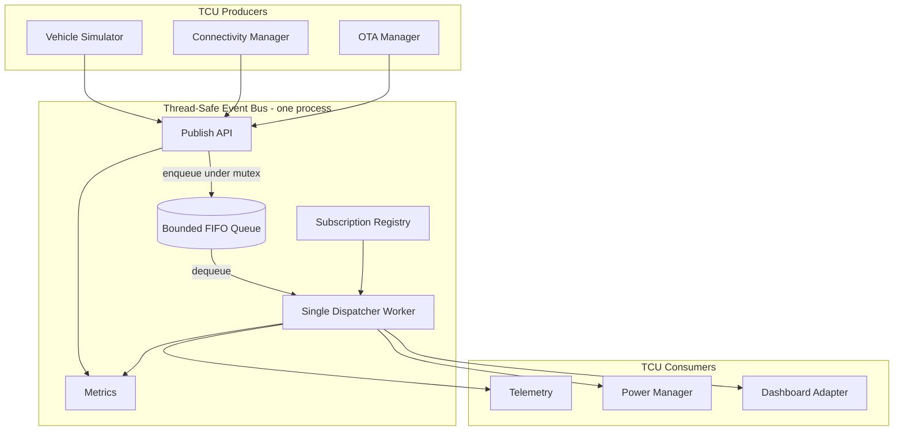
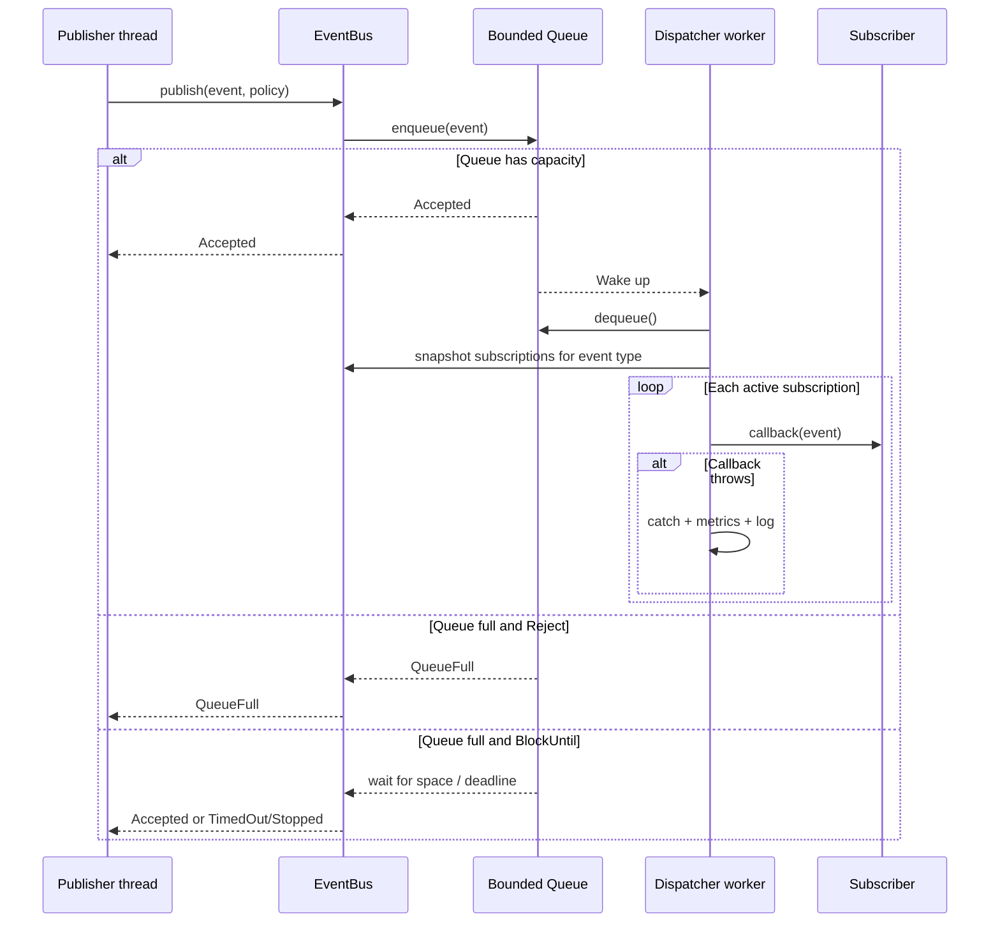
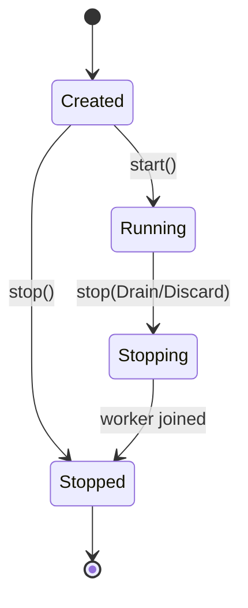
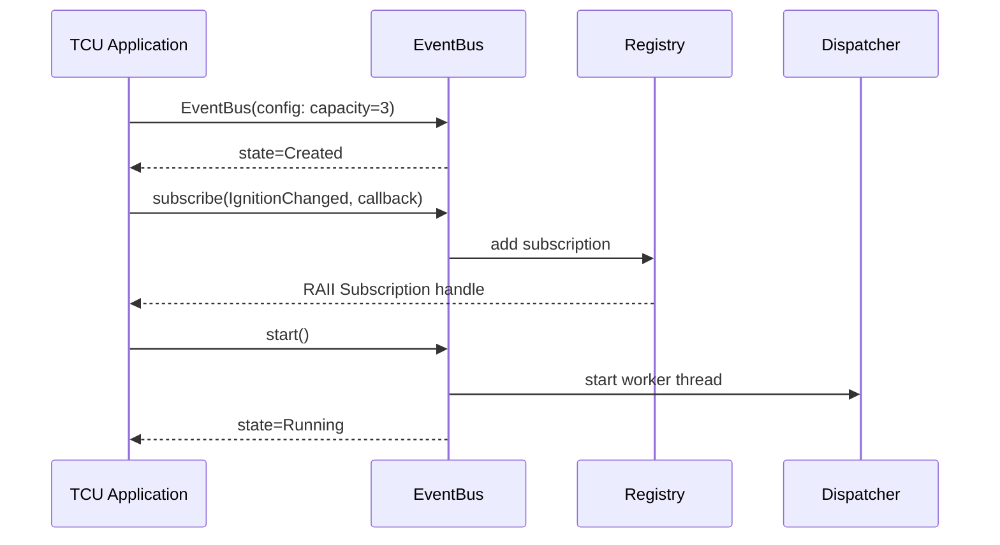
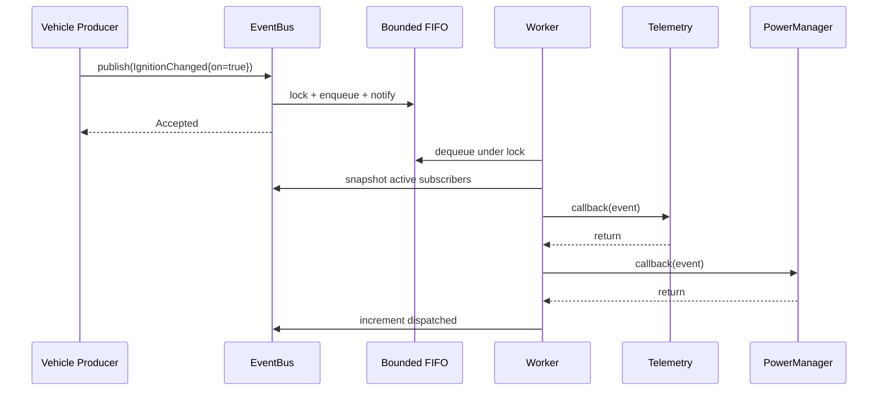
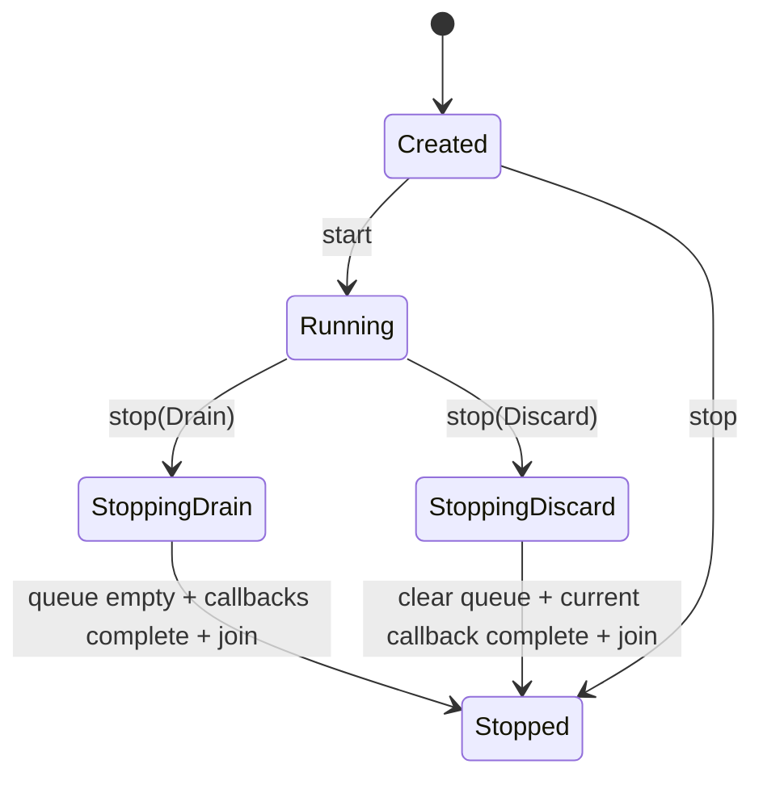

# Project 01 — Thread-Safe Event Bus

> **Virtual TCU Lab | System Design | C++17 | Version 1.1**  
> Mục tiêu: tạo nền tảng giao tiếp sự kiện **trong một process** cho các module TCU giả lập (Vehicle, Connectivity, Telemetry, Remote Control, OTA). Không dùng phần cứng thật.

## 1. Executive summary

Xây dựng một thư viện C++17 `tcu::eventbus` có khả năng đăng ký consumer theo loại sự kiện, publish sự kiện bất đồng bộ, phân phối qua hàng đợi giới hạn, và dừng hệ thống an toàn. Thiết kế ưu tiên tính chính xác, predictable resource usage và testability hơn throughput tối đa.

**Phạm vi v1:** event bus in-process; một worker dispatch mặc định; nhiều publisher đồng thời; callback được gọi tuần tự; FIFO theo thứ tự sự kiện **được enqueue thành công**, không cam kết thứ tự thời gian thực giữa các publisher; `publish` trả về kết quả; bounded queue; backpressure; RAII subscription; graceful stop; metrics; unit tests.

**Ngoài phạm vi v1:** IPC giữa process, distributed messaging, durable queue, exactly-once delivery, hard real-time guarantees, event priority, retry tự động, zero-copy và thread pool. Các phần này có thể phát triển sau.

## 2. Use cases trong Virtual TCU

| Producer | Event | Consumer | Mục đích |
|---|---|---|---|
| Vehicle Simulator | `IgnitionChanged` | Power Manager, Telemetry | Theo dõi trạng thái nguồn xe |
| CAN Receiver | `VehicleSpeedUpdated` | Telemetry | Gửi tốc độ xe lên cloud |
| Connectivity Manager | `NetworkStatusChanged` | Telemetry, Remote Control | Bật/tắt gửi dữ liệu khi mạng thay đổi |
| Cloud Command Handler | `DoorLockRequested` | Remote Control | Xử lý yêu cầu khóa cửa giả lập |
| OTA Manager | `OtaProgressChanged` | Dashboard | Hiển thị tiến trình cập nhật |

**Nguyên tắc:** Event Bus truyền **facts / commands** giữa module, không quyết định business policy. Remote Control vẫn phải tự xác thực và kiểm tra điều kiện an toàn. Không đưa raw passwords, private keys hoặc dữ liệu nhạy cảm vào event payload/log.

## 3. Yêu cầu

### 3.1 Functional requirements

- FR-01: Nhiều producer có thể `publish()` đồng thời an toàn.
- FR-02: Subscriber đăng ký theo event type; nhiều subscriber trên cùng type.
- FR-03: Dispatch bất đồng bộ; không gọi callback trực tiếp trên producer thread.
- FR-04: Queue có giới hạn (`capacity > 0`); không tăng bộ nhớ vô hạn.
- FR-05: Khi queue đầy, hỗ trợ `Reject` (mặc định), `BlockUntil(timeout)`; bản v1 **không drop silently**.
- FR-06: `publish` trả `Accepted`, `QueueFull`, `TimedOut`, `Stopped`, `InvalidArgument`.
- FR-07: Subscription handle cho phép unsubscribe an toàn.
- FR-08: Stop theo hai chế độ `Drain` (xử lý backlog) và `Discard` (bỏ backlog), với quy tắc shutdown rõ ràng.
- FR-09: Có metrics: accepted/rejected/dispatched/callback_failures/queue_depth.
- FR-10: Mọi lỗi callback phải được cô lập, không làm chết worker.

### 3.2 Non-functional requirements

- NFR-01: C++17, Linux/Ubuntu; không phụ thuộc thư viện bên thứ ba ở core (test dùng GoogleTest).
- NFR-02: Thread-safe, không data race trong đường đi được hỗ trợ.
- NFR-03: Không cấp phát bộ nhớ không giới hạn: queue bounded; số subscription do ứng dụng quản lý; event payload phải bị ràng buộc kích thước ở integration layer.
- NFR-04: API rõ ownership; không use-after-free khi unsubscribe, stop, destroy.
- NFR-05: Test được với fake subscriber, deterministic synchronization, sanitizer.
- NFR-06: Có benchmark throughput/latency **đo trên máy thực tế**; không tự đặt số liệu benchmark giả.

## 4. Kiến trúc hệ thống



### 4.1 Components

| Component | Trách nhiệm | Không chịu trách nhiệm |
|---|---|---|
| `Event` / payload types | Định nghĩa dữ liệu sự kiện bất biến sau publish | Business logic |
| `EventBus` | Lifecycle, publish, subscribe, dispatch | Network protocol |
| `BoundedQueue` | FIFO, capacity, wait/wake, closed state | Callback execution |
| `SubscriptionRegistry` | Type -> danh sách subscription | Giữ lifetime của object bên ngoài |
| `Dispatcher` | Đọc queue, tạo snapshot subscriber, invoke callback | Retry callback |
| `Metrics` | Thread-safe counters, queue depth | Metrics exporter/cloud |

### 4.2 Processing flow



## 5. API design (đề xuất, chưa phải implementation)

```cpp
namespace tcu::eventbus {

using EventType = std::uint32_t;

struct Event {
    EventType type;
    std::chrono::steady_clock::time_point created_at;
    std::shared_ptr<const void> payload; // v1 type-erasure; validate type mapping
};

enum class PublishStatus {
    Accepted, QueueFull, TimedOut, Stopped, InvalidArgument
};

enum class FullQueuePolicy { Reject, BlockUntil };
enum class StopMode { Drain, Discard };

struct BusConfig { std::size_t queue_capacity = 1024; };
struct PublishOptions {
    FullQueuePolicy on_full = FullQueuePolicy::Reject;
    std::chrono::milliseconds timeout{0};
};

using Handler = std::function<void(const Event&)>;

class Subscription {
public:
    Subscription(Subscription&&) noexcept;
    Subscription& operator=(Subscription&&) noexcept;
    Subscription(const Subscription&) = delete;
    Subscription& operator=(const Subscription&) = delete;
    ~Subscription(); // unsubscribe, see lifetime contract
    void unsubscribe();
private:
    // weak_ptr to bus shared state + subscription id
};

class EventBus {
public:
    explicit EventBus(BusConfig config);
    ~EventBus();
    EventBus(const EventBus&) = delete;
    EventBus& operator=(const EventBus&) = delete;

    void start();
    PublishStatus publish(Event event, PublishOptions opts = {});
    Subscription subscribe(EventType type, Handler callback);
    void stop(StopMode mode = StopMode::Drain);
    MetricsSnapshot metrics() const;
};
}
```

**Type safety:** Mẫu trên dễ triển khai nhưng `shared_ptr<const void>` cần mapping type và kiểm tra trước cast. Có thể thay bằng `std::variant<IgnitionChanged, VehicleSpeedUpdated, NetworkStatusChanged, ...>` để an toàn kiểu tại compile-time; khuyến nghị dùng `variant` cho sản phẩm lab nếu tập sự kiện đã xác định. Không `static_cast` payload không kiểm tra.

**Callback lifetime:** Subscriber không được capture raw `this` nếu object có thể bị hủy trước unsubscribe. Ưu tiên `weak_ptr` hoặc quản lý thứ tự shutdown. `unsubscribe()` ngăn callback **mới bắt đầu** sau khi unsubscribe được đồng bộ hóa, nhưng callback đang chạy có thể hoàn tất. Nếu cần `unsubscribeAndWait()` phải thêm contract chờ in-flight callback và xử lý trường hợp gọi từ chính callback.

## 6. Concurrency model và invariants

1. **Một mutex bảo vệ queue và lifecycle state**, và một `condition_variable` cho `not_empty`, một cho `not_full`. Một mutex khác bảo vệ registry hoặc cùng lock với state theo một thứ tự thống nhất. **Không gọi callback khi đang giữ lock**.
2. `publish()` kiểm tra trạng thái `Running` và capacity dưới lock; khi `Accepted`, event đã nằm trong queue.
3. Worker lấy event ra dưới lock, notify `not_full`, sau đó phát cho subscriber ngoài lock.
4. Snapshot subscriber được chụp có lock; unsubscribe cần kiểm tra `active` hoặc cơ chế generation để tránh callback bắt đầu sau unsubscribe. Subscriber đang chạy có thể hoàn thành.
5. State: `Created -> Running -> Stopping -> Stopped`; `start` chỉ được gọi một lần trong v1. `stop` idempotent từ non-worker thread.
6. Không gọi `stop()` kiểu blocking từ callback/dispatcher thread; thay bằng `requestStop()` nếu cần hỗ trợ đường này. Tránh self-join.
7. `Drain`: từ chối publish mới, tiêu thụ hết events đang queued, đợi callback đang chạy kết thúc; có thể treo nếu callback không bao giờ kết thúc. `Discard`: xóa queued events, để callback hiện tại hoàn thành rồi join. Cả hai mode đều wake blocked publishers, trả `Stopped`.
8. V1 callbacks chạy tuần tự; callback chậm làm tăng queue latency; cần metric và bounded operation. Một subscriber lỗi không ảnh hưởng subscriber khác.
9. Event object được immutable đối với consumer; nếu payload chứa pointer trỏ đến buffer mutable thì producer phải copy hoặc chuyển sang immutable owned data.
10. `Subscription` chỉ giữ weak reference đến shared state để không dùng dangling pointer khi bus bị hủy trước handle.

### 6.1 Backpressure decision

| Queue situation | `Reject` | `BlockUntil` |
|---|---|---|
| Có chỗ | Enqueue ngay | Enqueue ngay |
| Đầy | `QueueFull` | Đợi space đến deadline |
| Stop khi đang đợi | `Stopped` | `Stopped` |
| Hết deadline | Không áp dụng | `TimedOut` |

**TCU best practice:** callback/dispatch thread không nên gọi blocking `publish()` lên chính bus khi queue có thể đầy, vì sẽ gây deadlock/starvation. Trong v1, cấm `BlockUntil` từ dispatcher thread và trả `InvalidArgument` hoặc dùng non-blocking policy.

## 7. Sơ đồ trạng thái bus



## 8. Error handling và logging

- `publish` dùng result enum cho lỗi dự đoán được (queue full, shutdown, timeout); không dùng exception cho luồng thường gặp.
- Constructor có thể throw nếu config sai (capacity = 0) hoặc không cấp phát được tài nguyên.
- Callback exception bị catch tại dispatcher, tăng `callback_failures`, ghi log ngắn; tiếp tục dispatch.
- Logging không làm block dispatch kéo dài; tránh log payload nhạy cảm, tránh recursion qua chính Event Bus.
- `std::bad_alloc` trong dispatcher và lỗi không recoverable phải có chiến lược fail-safe; không hứa tiếp tục hoạt động sau lỗi bộ nhớ nghiêm trọng.

## 9. Testing strategy

### 9.1 Unit tests (GoogleTest)

| ID | Test | Expected |
|---|---|---|
| UT-01 | Publish 1 event, 1 subscriber | Callback nhận đúng event |
| UT-02 | Publish 1 event, nhiều subscriber | Mỗi subscriber được gọi một lần |
| UT-03 | Nhiều publishers đồng thời | Số `Accepted` khớp số delivered khi Drain |
| UT-04 | Capacity 1, consumer cố tình block | `Reject` trả `QueueFull` khi queue đầy |
| UT-05 | BlockUntil trên queue đầy | `TimedOut` theo deadline |
| UT-06 | Stop khi publisher đang chờ | Publisher wake và trả `Stopped` |
| UT-07 | Callback throw | Metrics tăng, worker còn hoạt động |
| UT-08 | Unsubscribe trước publish | Không nhận callback mới |
| UT-09 | Unsubscribe khi callback đang chạy | Không UAF/deadlock, callback hiện tại có thể kết thúc |
| UT-10 | Drain with backlog | Mọi accepted queued event được xử lý |
| UT-11 | Discard with backlog | Queued event bị bỏ, không đợi xử lý hết backlog |
| UT-12 | Stop hai lần | Không crash / double join |
| UT-13 | Event payload immutable ownership | Không dangling reference |
| UT-14 | Publish after Stop | Trả `Stopped` |
| UT-15 | Callback publish nonblocking | Không deadlock; queue-full được báo đúng |

Để tránh flaky tests: dùng `promise/future`, `latch` tự xây bằng condition variable (C++17), và timeout bảo vệ, **không dựa vào sleep ngẫu nhiên**.

### 9.2 Integration & stress

- `vehicle_simulator` publish 10.000 events; Telemetry/Power mock subscribe; xác minh accepted, rejected và dispatched counters.
- 4–8 publisher threads cạnh tranh queue; benchmark latency p50/p95/p99 và throughput, ghi rõ hardware/OS/compiler/config.
- Chạy với `-fsanitize=address,undefined` và build riêng `-fsanitize=thread` (không ghép ASan với TSan); kiểm tra leaks/races.
- Stop giữa burst, callback throw, slow handler, subscribe/unsubscribe cạnh tranh.
- Nên đo cả memory growth, peak queue depth và thời gian shutdown.

## 10. Acceptance criteria (Definition of Done)

- [ ] Build trên Ubuntu với C++17 và CMake.
- [ ] Public API documented: ownership, state transitions, callback/thread rules.
- [ ] Support multiple publishers, multiple subscribers và bounded queue.
- [ ] Implement `Reject` và `BlockUntil` với các status rõ ràng.
- [ ] `Drain` và `Discard` thực hiện đúng contract.
- [ ] Không callback khi giữ internal lock; không deadlock trong supported usage.
- [ ] RAII subscription không dangling khi bus bị destroy trước.
- [ ] Ít nhất 15 test cases ở mục 9.1 pass.
- [ ] CI chạy unit tests + sanitizer jobs trên môi trường phù hợp.
- [ ] README có quickstart, design tradeoffs và benchmark reproducible.

## 11. Jira-style implementation backlog

| Ticket | Title | Output | Phụ thuộc |
|---|---|---|---|
| TCU-EB-001 | Setup library, CMake & tests | `eventbus` lib + GTest target | — |
| TCU-EB-002 | Event types & typed payload | Contract + compile tests | 001 |
| TCU-EB-003 | Implement bounded blocking queue | Queue + timeouts + tests | 001 |
| TCU-EB-004 | Implement subscriber registry & RAII | Subscription handle + concurrency tests | 002 |
| TCU-EB-005 | Implement dispatcher & publish | Delivery + callback isolation | 003, 004 |
| TCU-EB-006 | Implement lifecycle and graceful shutdown | Drain/Discard + wakeup | 005 |
| TCU-EB-007 | Add metrics & logging | counters + snapshots | 005 |
| TCU-EB-008 | Integrate mock Vehicle & Connectivity | Runnable demo | 006 |
| TCU-EB-009 | Fault injection and sanitizer tests | test report | 008 |
| TCU-EB-010 | Benchmark and system design review | design review + results | 009 |

## 12. Repository layout

```text
virtual-tcu-lab/
├── CMakeLists.txt
├── README.md
├── docs/
│   └── 01_Thread_Safe_Event_Bus_System_Design.md
├── modules/core/event_bus/
│   ├── include/tcu/eventbus/event_bus.hpp
│   ├── include/tcu/eventbus/event.hpp
│   ├── src/event_bus.cpp
│   ├── src/bounded_queue.cpp
│   └── CMakeLists.txt
├── apps/event_bus_demo/main.cpp
└── tests/unit/event_bus/
    ├── event_bus_test.cpp
    ├── concurrency_test.cpp
    └── shutdown_test.cpp
```

## 13. Milestones và thứ tự triển khai

1. **M1 — Compile & basic delivery:** skeleton, event definition, subscribe, publish, single worker.
2. **M2 — Boundedness:** capacity, queue-full reject, blocking timeout.
3. **M3 — Lifecycle correctness:** unsubscribe contract, stop modes, no deadlock/self-join.
4. **M4 — Reliability:** metrics, callbacks throw, concurrency/sanitizer tests.
5. **M5 — TCU demo:** Vehicle Simulator -> Event Bus -> Telemetry mock + Power Manager.

Không gắn cứng thời lượng vì phụ thuộc mức độ hoàn thiện và môi trường developer.

## 14. Design decisions & trade-offs

| Quyết định | Lý do | Giới hạn |
|---|---|---|
| One dispatcher | Dễ chứng minh thứ tự và correctness | Subscriber chậm chặn subscriber khác |
| Bounded FIFO | Dễ backpressure, memory predictability | Producer có thể bị reject |
| RAII subscription + weak bus state | Hạn chế dangling reference | Cần quản lý callback in-flight |
| Result-based publish | Dễ xử lý full/stop/timeout | Caller phải kiểm tra status |
| In-process only | Nhẹ, dễ test, không hardware | Chưa thay thế IPC hoặc broker |
| Immutable owned payload | Loại lỗi dangling/mutation | Có overhead copy/allocation |

### 14.1 Open questions trước khi code production

- Team cần event types compile-time (`variant`) hay đăng ký dynamic (`type_index`)?
- Callback order giữa subscriber có phải contract không? (v1 đề xuất theo registration order).
- Có cần unsubscribe-and-wait không? Nếu có, thiết kế không được wait trong callback của chính subscription.
- Timeout của callback được xử lý ở tầng nào? Không thể ép ngắt C++ callback an toàn bằng thread cancellation.
- Có cần ưu tiên event critical (power, emergency) không? Nếu có, không dùng FIFO chung cho critical và best-effort.
- Metrics nên tích hợp Prometheus exporter hay chỉ log?

## 15. Roadmap tích hợp vào các project TCU tiếp theo

- **Project 05 CAN:** `CanAdapter` phát `VehicleSpeedUpdated` / `IgnitionChanged`.
- **Project 10 Connectivity:** `ModemManager` phát `NetworkStatusChanged`.
- **Project 13 MQTT:** `TelemetryService` subscribe vehicle + connectivity events.
- **Project 16 Remote Control:** `RemoteCommandHandler` phát command được kiểm tra, subscriber BCM giả lập phản hồi.
- **Project 18 OTA:** `OtaManager` phát progress và error events.
- **Project 30 Integration:** dùng metrics/event IDs để trace một đường đi end-to-end.

## 16. Nguồn tham khảo

- C++ reference — concurrency: https://en.cppreference.com/w/cpp/thread
- GoogleTest documentation: https://google.github.io/googletest/
- CMake documentation: https://cmake.org/cmake/help/latest/
- Linux CAN documentation (cho tích hợp tiếp theo): https://docs.kernel.org/networking/can.html

---

**Lưu ý:** Tài liệu là một system design đề xuất, không phải đặc tả TCU của OEM cụ thể. Các acceptance criteria cần được điều chỉnh theo yêu cầu hiệu năng, quy trình safety/security và platform thực tế.

## 17. Operational behavior specification (cách hệ thống vận hành)

### 17.1 Nguyên tắc tổng quát

Event Bus là **hạ tầng chuyển sự kiện nội bộ**, không phải message broker bền vững. Producer gọi `publish()` để **đề nghị đưa event vào queue**; worker riêng nhận event và lần lượt gọi các callback tương ứng. `Accepted` có nghĩa **đã enqueue thành công**, **không có nghĩa callback chạy thành công** hoặc thông điệp được lưu bền vững.

- Một instance `EventBus` hoạt động trong một process, có **một worker** ở v1.
- Có nhiều publisher threads và nhiều subscribers; callback được thực thi trên worker, **không phải thread của publisher**.
- Queue FIFO giữ thứ tự **enqueue thành công**. Khi nhiều publisher chạy đồng thời không cam kết thứ tự tương ứng với thời điểm chúng gọi API.
- Các subscriber cùng event type được gọi theo **thứ tự đăng ký** trong bản v1. Một callback lỗi không ngăn callbacks còn lại nhận cùng event.
- Tất cả hành vi bên dưới mô tả **contract dự kiến để implement/test**, không phải kết quả đã được kiểm chứng bằng code.

### 17.2 Sequence: hệ thống khởi chạy



**Expected behavior:** `queue_capacity == 0` bị reject khi tạo bus; có thể đăng ký subscription ở trạng thái `Created` hoặc `Running`, không được đăng ký mới khi `Stopping/Stopped`. `start()` hợp lệ duy nhất từ `Created`; gọi lại phải trả lỗi API rõ ràng (đề xuất `std::logic_error`) và không tạo worker thứ hai. `publish()` trước `start()` trả `Stopped` theo enum hiện tại (hoặc thay bằng `NotRunning` nếu API được điều chỉnh; phải thống nhất trước khi implement).

### 17.3 Sequence: publish và dispatch thành công

Giả sử queue rỗng, đã có 2 subscribers theo thứ tự **Telemetry** và **PowerManager** cho `IgnitionChanged`.



**Expected behavior:** event không bị thay đổi sau `publish`; callbacks quan sát cùng dữ liệu. `publish()` có thể trả `Accepted` **trước khi** bất kỳ callback nào chạy. `dispatched` nên đếm **số event đã hoàn thành vòng phân phối** (kể cả không có subscriber hoặc callback có exception), không đếm số lượt callback; nếu cần, thêm `callback_invocations` và `callback_failures` riêng.

### 17.4 Bounded queue và backpressure

Ví dụ `capacity = 2`: worker đang xử lý **E0** chậm, queue chứa **E1, E2**.

| Hành động | Expected result | Điều không được xảy ra |
|---|---|---|
| Publisher A gọi `publish(E3, Reject)` | `QueueFull` ngay, E3 không vào queue | Block vô hạn hoặc drop E1/E2 |
| Publisher B gọi `publish(E4, BlockUntil, 100ms)` | Chờ slot trống; `Accepted` nếu có slot trong hạn, `TimedOut` nếu không | Tiếp tục chờ sau deadline |
| Trong khi B đang chờ, gọi `stop(Discard)` | B wake và trả `Stopped` | B enqueue E4 sau khi shutdown bắt đầu |
| Worker dequeue E1 | Một slot trống, báo `not_full` | Queue depth âm hoặc vượt capacity |

**Timeout contract:** dùng `std::chrono::steady_clock`, deadline tuyệt đối và vòng lặp predicate để chống spurious wakeup. `timeout=0ms` với `BlockUntil` xử lý như kiểm tra không chờ: queue còn chỗ ⇒ `Accepted`, queue đầy ⇒ `TimedOut`. Nếu có nhiều producer đang chờ, **không cam kết fairness**/thứ tự đánh thức ở v1.

### 17.5 Subscription và lifetime

- `subscribe(type, cb)` trả một `Subscription` **move-only**; handle phải được giữ sống trong module consumer. Hủy/move-assign handle có hiệu lực unsubscribe với đăng ký cũ.
- `unsubscribe()` idempotent. Sau khi hàm trả về, worker **không được bắt đầu callback mới** cho subscription đó; callback đã bắt đầu có thể hoàn tất.
- Để đáp ứng đúng contract, ngay trước khi invoke callback worker phải đồng bộ với trạng thái `active` của subscription; chỉ snapshot danh sách mà không kiểm tra lại là **không đủ**.
- Chỉ invoke callback khi không giữ queue/registry lock. Cần cơ chế per-subscription để thực hiện atomic admission (`active` check và đánh dấu in-flight) mà không giữ global lock trong callback.
- Nếu callback tự `unsubscribe()` chính nó: không được deadlock; callback hiện tại hoàn tất rồi subscription không còn nhận event mới.
- Hủy `EventBus` khi vẫn có `Subscription` handle bên ngoài không gây use-after-free (handle chỉ giữ weak ownership đến shared state).
- Producer có thể publish event mà không có subscriber: event vẫn được dequeue rồi bỏ qua an toàn; không tự động retry.

**Chú ý:** khi object được callback capture bị hủy, chính consumer phải bảo đảm lifetime của object; một `Subscription` RAII đơn thuần không tự bảo vệ `this` bị capture trong callback đang chạy. Đề xuất consumer dùng `weak_ptr` để lock object, hoặc quy trình dừng đảm bảo callback đã kết thúc trước khi hủy object.

### 17.6 Callback lỗi, callback chậm và reentrant publish

| Trường hợp | Expected behavior |
|---|---|
| Subscriber thứ nhất throw `std::runtime_error` | Catch, tăng `callback_failures`, log an toàn; subscriber thứ hai vẫn được gọi |
| Subscriber mất 2 giây để xử lý | Worker bị trì hoãn 2 giây; queue có thể đầy; **không tự động kill callback** |
| Callback gọi `publish(E2, Reject)` | Cho phép, trả `Accepted` hoặc `QueueFull`; E2 xử lý sau event hiện tại |
| Callback gọi `publish(E2, BlockUntil)` | Không cho phép trong worker; trả `InvalidArgument` ngay để tránh self-deadlock |
| Callback gọi blocking `stop()` | Không hỗ trợ; dùng `requestStop(mode)` nonblocking nếu API mở rộng |
| Callback có lỗi nghiêm trọng không phải C++ exception (segfault, terminate) | Không có cam kết cách ly ở mức process; cần process supervisor/watchdog trong project nâng cao |

### 17.7 Shutdown: Drain vs Discard



**Điểm tuyến tính hóa shutdown:** tại thời điểm state chuyển từ `Running` sang `Stopping` dưới lock. Từ thời điểm này mọi `publish()` mới trả `Stopped`. Các `publish()` đang chờ chỗ trống phải được đánh thức và trả `Stopped`.

- **Drain:** đã `Accepted` trước stop ⇒ worker tiếp tục dispatch tất cả event còn trong queue theo FIFO; `stop()` chờ callback hiện tại và backlog hoàn thành; **không giới hạn thời gian** nếu callback bị treo.
- **Discard:** các event **đang chờ trong queue** bị loại bỏ; callback đã bắt đầu vẫn chạy đến khi return; `stop()` join worker. Ghi nhận metric `discarded_on_stop` để không nhầm với successful delivery.
- Stop lần hai không tạo thêm worker, không double-join. Khi nhiều thread gọi stop đồng thời, chỉ một thread thực hiện join, các thread còn lại chờ state `Stopped` hoặc trả về theo một contract duy nhất (khuyến nghị cùng chờ `Stopped`).
- Không được destroy `EventBus` khi thread khác còn gọi method trên chính object đang bị hủy; API C++ bình thường không bảo vệ use-after-free bên ngoài lifetime của object.

### 17.8 Event processing example trong TCU

| Bước | Module | Hành động/expected behavior |
|---|---|---|
| 1 | Vehicle Simulator | Phát `IgnitionChanged{on=true}` |
| 2 | EventBus | Trả `Accepted`, enqueue event nếu còn chỗ |
| 3 | Dispatcher | Lấy event, phân phối theo subscriber registration order |
| 4 | Power Manager | Đổi internal state từ `Idle` sang `Active` theo logic riêng |
| 5 | Telemetry | Cập nhật cache trạng thái ignition, không gọi mạng trong callback chậm |
| 6 | EventBus | Cập nhật metrics và xử lý event kế tiếp |

Nếu `Telemetry` cần gửi cloud, nên chuyển công việc sang queue/network service riêng thay vì block dispatcher trên MQTT publish đồng bộ. Nếu cloud đang offline, lưu offline là trách nhiệm của Telemetry Service (Project 14), **không phải Event Bus**.

## 18. Behavioral contracts và ví dụ dữ liệu

### 18.1 Event schema minh họa

```cpp
struct IgnitionChanged { bool on; };
struct VehicleSpeedUpdated { double kmh; };
struct NetworkStatusChanged { bool online; };

// Một lựa chọn type-safe cho lab:
using EventPayload = std::variant<
    IgnitionChanged,
    VehicleSpeedUpdated,
    NetworkStatusChanged>;
```

Payload phải thuộc sở hữu độc lập của event (copy/move immutable); không chứa reference/pointer trần tới stack frame của producer. `EventType` và payload cần kiểm tra mapping nhất quán nếu chọn type-erasure API ở mục 5.

### 18.2 Behavior Given/When/Then (BDD)

**B01 — Delivery bình thường**  
Given: bus `Running`, queue còn chỗ, Telemetry subscribe `VehicleSpeedUpdated`.  
When: producer publish speed = 42.5 km/h.  
Then: publish trả `Accepted`, Telemetry nhận đúng một callback có speed = 42.5; nếu gọi `stop(Drain)` sau đó, callback đã hoàn tất.

**B02 — Không có subscriber**  
Given: bus `Running`, không subscribe event type X.  
When: publish X thành công.  
Then: không có callback; event được consume an toàn; không leak.

**B03 — Queue đầy và Reject**  
Given: worker bị chặn có kiểm soát bởi test gate, hàng đợi đầy.  
When: publish thêm một event với `Reject`.  
Then: trả `QueueFull`, event không được gửi, queue depth không vượt capacity.

**B04 — Queue đầy và timeout**  
Given: worker đang bận, queue đầy.  
When: gọi `BlockUntil` với deadline 100ms và không có slot được giải phóng.  
Then: trả `TimedOut`; không enqueue event. Không dựa vào sleep không kiểm soát để viết test.

**B05 — Unsubscribe đồng thời dispatch**  
Given: callback A có thể đang chạy.  
When: `unsubscribe(A)` hoàn tất.  
Then: không có invocation mới của A bắt đầu; invocation đã bắt đầu được phép return bình thường; không crash/deadlock.

**B06 — Callback throw**  
Given: callback A throw, callback B cũng subscribe cùng event.  
When: publish event.  
Then: B vẫn nhận callback, `callback_failures` tăng đúng 1.

**B07 — Stop Drain**  
Given: các event E1,E2,E3 đã Accepted.  
When: ứng dụng gọi `stop(Drain)`.  
Then: tất cả event đã Accepted được dispatch xong trước khi stop return, ngoại trừ event không có callback vẫn được xử lý như no-op.

**B08 — Stop Discard**  
Given: E1 đang dispatch, E2/E3 còn queue.  
When: gọi `stop(Discard)`.  
Then: E1 được phép hoàn tất; E2/E3 không invoke callback; tăng `discarded_on_stop` 2.

**B09 — Concurrent publishers**  
Given: 8 producer threads mỗi thread publish 1.000 event với payload sequence id riêng.  
When: tất cả hoàn thành và `stop(Drain)`.  
Then: accepted count bằng dispatched count (không xét discarded); không data race; FIFO theo enqueue order, không khẳng định ordering toàn cục theo wall clock.

**B10 — Shutdown đang block**  
Given: một publisher chờ `BlockUntil` do queue đầy.  
When: thread khác `stop(Discard)`.  
Then: publisher được wake và trả `Stopped`, không treo.

## 19. Observability và acceptance quan sát được

| Metric | Ý nghĩa / khi tăng | Lưu ý |
|---|---|---|
| `accepted_total` | Mỗi `publish` enqueue thành công | Không đồng nghĩa callback thành công |
| `rejected_queue_full_total` | `Reject` gặp queue đầy | Không tính `TimedOut` |
| `publish_timeout_total` | `BlockUntil` hết deadline | Không tính stop |
| `dispatched_total` | Worker xử lý xong một event | Gồm event không có subscriber |
| `callback_invocations_total` | Mỗi callback được invoke | Có thể lớn hơn dispatched |
| `callback_failures_total` | Callback throw exception được catch | Không bao gồm crash process |
| `discarded_on_stop_total` | Event queued bị discard khi stop | Không bao gồm event đang chạy |
| `queue_depth` | Số events còn chờ trong queue | 0..capacity, không gồm event đang dispatch |
| `queue_high_watermark` | Độ sâu lớn nhất quan sát | <= capacity |

**Lưu ý đếm:** trong chế độ Drain, sau khi worker join và không có lỗi fatal: `accepted_total == dispatched_total`. Với Discard: `accepted_total == dispatched_total + discarded_on_stop_total` (sau khi stop kết thúc). Đối với callback exception, `dispatched_total` vẫn tăng khi đã hoàn tất xử lý event.

## 20. Hướng dẫn chạy demo mong muốn

1. Tạo bus với `capacity=3`, subscribe `IgnitionChanged` từ `PowerManager` và `Telemetry`.
2. Start worker, chạy `vehicle_simulator` gửi chuỗi `OFF -> ON -> OFF` (3 events) với sequence IDs.
3. Quan sát log mang `event_id`, `event_type`, `publisher`, `subscriber`, `queue_depth`, `publish_status` (không log dữ liệu nhạy cảm).
4. Kiểm tra subscriber nhận đúng thứ tự trong một stream producer và metrics khớp.
5. Tạo callback chậm bằng test gate, làm đầy queue, thử `Reject` và `BlockUntil`; xác nhận status.
6. Gọi `stop(Drain)`, in summary; chạy lại với `stop(Discard)` và quan sát backlog bị discard.

Ví dụ log kỳ vọng (minh họa, không phải kết quả chạy thật):

```text
INFO  bus_state=Running capacity=3
INFO  event_id=101 type=IgnitionChanged publish_status=Accepted queue_depth=1
INFO  event_id=101 subscriber=PowerManager callback_status=ok
INFO  event_id=101 subscriber=Telemetry callback_status=ok
INFO  event_id=102 type=IgnitionChanged publish_status=Accepted queue_depth=1
INFO  bus_state=Stopping mode=Drain
INFO  bus_state=Stopped accepted=2 dispatched=2 discarded=0 callback_failures=0
```

### 20.1 Những điều không nên kỳ vọng ở v1

- Không đảm bảo event được xử lý nếu process bị kill sau khi `Accepted`.
- Không có message persistence, delivery acknowledgement từ consumer hoặc exactly-once delivery.
- Không có realtime deadline guarantee.
- Không bảo đảm subscriber chậm không ảnh hưởng subscriber khác trong cùng bus.
- Không bảo đảm `EventBus` tự quản lý lifetime của object mà callback capture.

## 21. Quy tắc review behavior trước khi implement

- [ ] Thống nhất event type + payload type safety (`variant` hay checked type erasure).
- [ ] Thống nhất các trạng thái và lỗi API, nhất là `start()` sai trạng thái và `publish()` trước start.
- [ ] Thống nhất subscriber order, unsubscribe vs in-flight callback, và locking rules.
- [ ] Thống nhất metrics definitions và conservation equation cho Drain/Discard.
- [ ] Với mọi behavior B01–B10, có ít nhất một automated test quyết định pass/fail.
- [ ] Dùng stress + sanitizers để tìm race/UAF, không dùng benchmark làm bằng chứng correctness.

---

**Version 1.1 — Behavior specification bổ sung cho System Design v1.0.** Các contract trong mục 17–21 có tính đề xuất, cần được chốt trước khi bắt đầu code.
