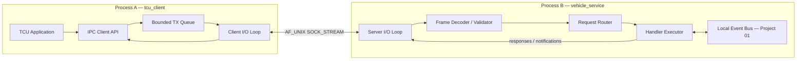
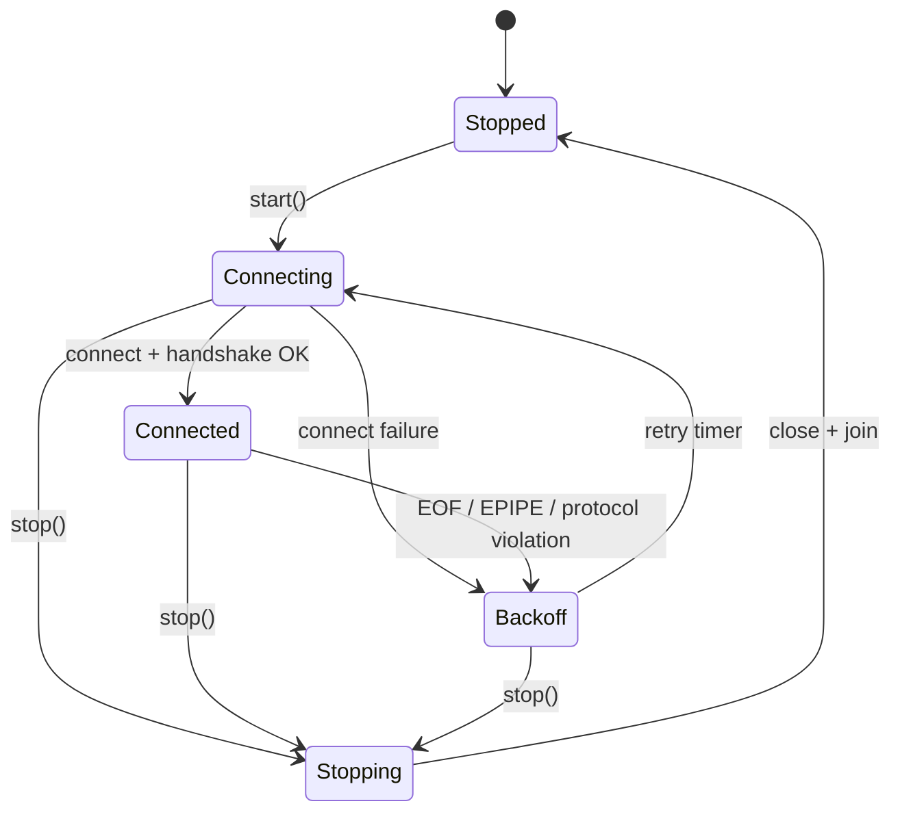
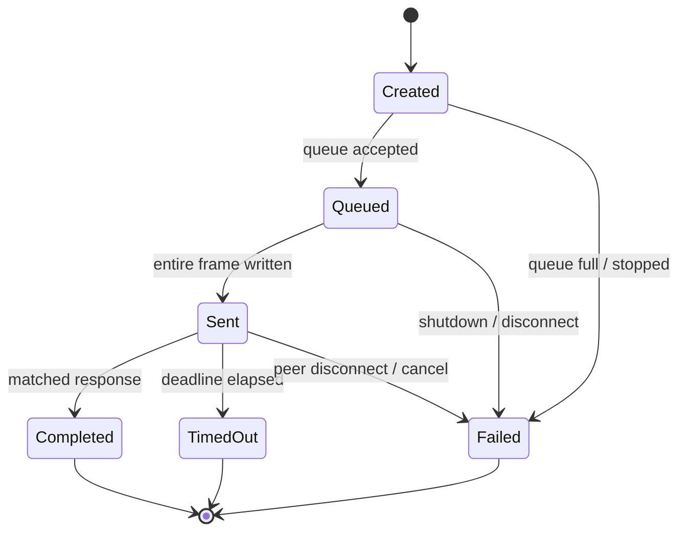
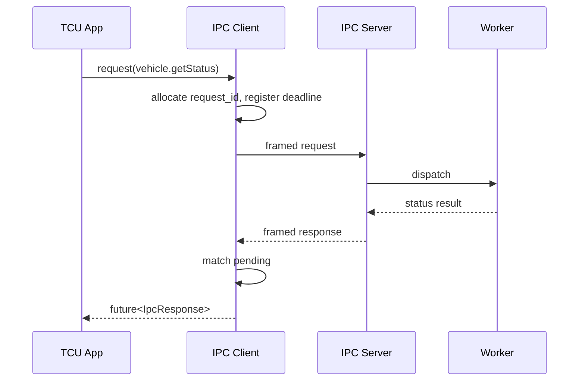
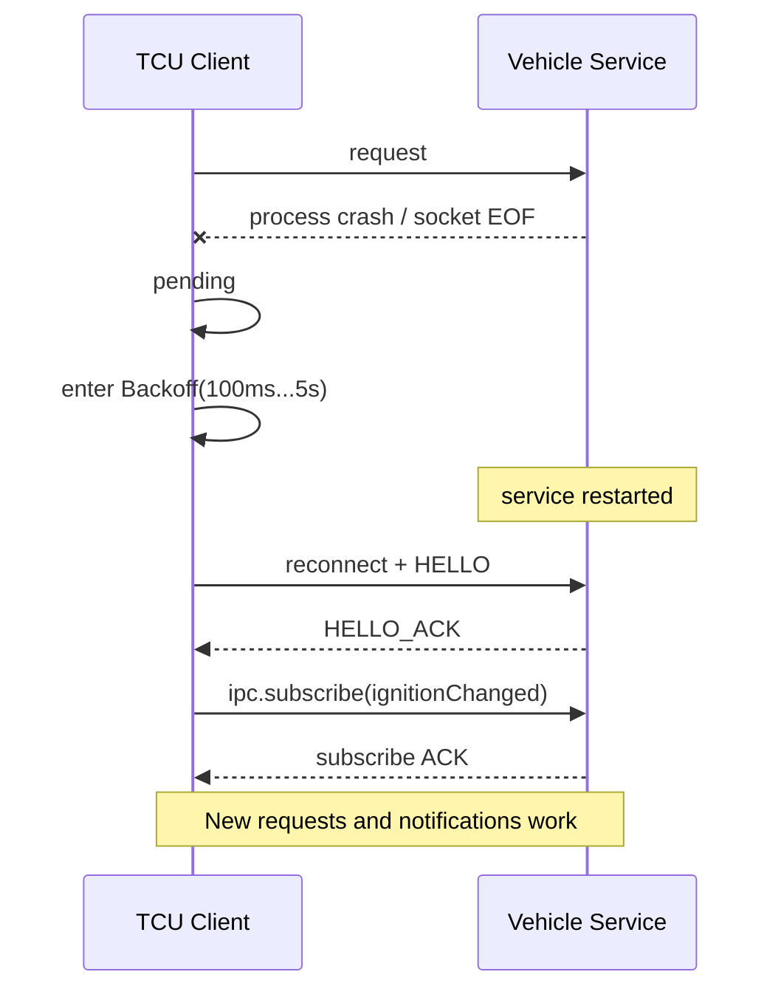
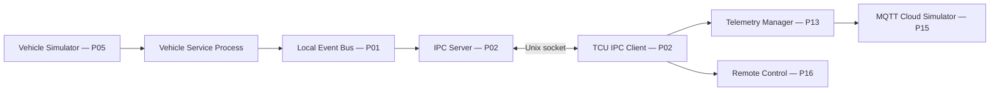

# Project 02 — IPC Service Framework

> **Virtual TCU Lab | System Design & Operational Behavior Specification**  
> **Version:** 1.0 · **Target:** Middle C++ Developer · **Platform:** Ubuntu Linux / C++17 · **Status:** Design proposal, chưa phải code production  
> **Phụ thuộc:** Project 01 — Thread-Safe Event Bus (tùy chọn, dùng trong từng process)

## 1. Executive summary

Dự án xây dựng thư viện **IPC (Inter-Process Communication)** để các service TCU chạy trong **những process riêng** trao đổi request/response và asynchronous notification. Bản MVP sử dụng **Unix Domain Socket (AF_UNIX, SOCK_STREAM)** trên một máy Linux, không cần phần cứng. Thiết kế có message framing, request correlation, timeout, reconnect, queue giới hạn, lifecycle, peer authorization, logging và fault injection.

**Mục tiêu demo:** `tcu_app` gọi `vehicle_service.getVehicleStatus()`, đăng ký nhận `IgnitionChanged`, sau đó `vehicle_service` bị kill/restart; `tcu_app` phát hiện disconnect, reconnect và tiếp tục nhận notifications mà không crash/deadlock.

**Ranh giới:** Project 01 là Event Bus **nội bộ một process**; Project 02 truyền message **giữa các process**. IPC không tự đảm bảo durability hay exactly-once. Không gửi command xe thật; mọi hành động chạy trên simulator.

## 2. Use cases trong Virtual TCU

| ID | Bên gọi | Bên phục vụ | Use case |
|---|---|---|---|
| UC-01 | TelemetryService | VehicleService | Lấy vehicle status hiện tại |
| UC-02 | VehicleService | TelemetryService | Phát notification IgnitionChanged |
| UC-03 | RemoteCommandService | BcmSimulator | Gửi LockDoor request, nhận kết quả |
| UC-04 | OtaManager | ConnectivityService | Hỏi trạng thái mạng trước download |
| UC-05 | DiagnosticsService | GatewaySimulator | Gửi diagnostic request giả lập |
| UC-06 | Main TCU app | Services | Quan sát health, restart/reconnect |

### 2.1 Outcomes cần đạt

1. Chạy tối thiểu ba executable riêng biệt: `vehicle_service`, `tcu_client`, `ipc_demo_controller`.
2. Trao đổi message có định dạng ổn định, không phụ thuộc ranh giới từng `read()`.
3. Một request được ghép với response bằng `request_id`; request timeout được giải phóng resource.
4. Disconnect, restart và malformed packet không làm process còn lại crash.
5. Test tự động chứng minh lifecycle, bounded memory, timeout và reconnect.

## 3. Requirements

### 3.1 Functional requirements

| ID | Requirement | Priority |
|---|---|---|
| FR-01 | IPC server bind/listen/accept trên Unix pathname socket | P0 |
| FR-02 | Client connect/disconnect và reconnect có backoff | P0 |
| FR-03 | Frame protocol length-prefix, đọc/ghi từng phần | P0 |
| FR-04 | Request/response có correlation ID và deadline | P0 |
| FR-05 | Notification một chiều (server → client) | P0 |
| FR-06 | Max frame size, validation và error code chuẩn hóa | P0 |
| FR-07 | Bounded outgoing queue và backpressure rõ ràng | P0 |
| FR-08 | Graceful shutdown, join worker threads, close FD | P0 |
| FR-09 | Bảo vệ socket filesystem, kiểm tra peer credentials | P1 |
| FR-10 | Multiple clients, per-connection isolation | P1 |
| FR-11 | Subscribe/re-subscribe sau reconnect | P1 |
| FR-12 | Instrumentation, metrics, structured logs | P1 |
| FR-13 | D-Bus adapter hoặc SO_REUSE? Không nằm trong MVP | P2 |

### 3.2 Non-functional requirements / design targets

Các con số sau là **mục tiêu kiểm thử đề xuất**, không phải requirement của OEM:

- Linux x86_64 Ubuntu; compiler GCC/Clang hỗ trợ C++17; CMake ≥ 3.16.
- 1 server, tối thiểu 8 concurrent clients trong test tích hợp.
- Default max payload: **64 KiB**; max outgoing queue per connection: **256 messages / 1 MiB** (chạm một trong hai giới hạn).
- Default request timeout: **2000 ms** (cấu hình được, dùng `steady_clock`).
- Reconnect backoff: 100 ms → 200 ms → 400 ms → 800 ms → cap 5 s, thêm jitter trong bản nâng cao.
- Không busy-spin; thời gian shutdown có giới hạn, ví dụ ≤ 3 s trong test bình thường.
- Không double-close FD, use-after-free, data race (kiểm tra bằng ASan/TSan tùy build).
- Không chặn I/O loop bằng business callback lâu; dispatch qua executor/Project 01 Event Bus.

### 3.3 Explicit non-goals trong v1

- Distributed IPC giữa nhiều host; shared memory zero-copy; POSIX message queues.
- Exactly-once delivery, transaction, durable replay sau crash.
- Encryption trên UDS; sử dụng filesystem permissions + peer credential check cho local trust boundary (đánh giá threat model riêng nếu dữ liệu nhạy cảm).
- High-performance broker hàng trăm nghìn clients; cross-platform Windows.
- Tự động retry các request có side-effect như `LockDoor` khi chưa có idempotency contract.

## 4. Kiến trúc hệ thống



### 4.1 Thành phần

| Component | Responsibility | Tuyệt đối không làm |
|---|---|---|
| `UnixSocket` | RAII cho FD, connect/bind/listen/close, nonblocking I/O | Chứa business logic |
| `FrameCodec` | Encode/decode header/payload, chống malformed/oversize | Deserialize khi thiếu bytes |
| `IpcClient` | Correlation map, deadlines, reconnect, subscription | Tự retry side-effect RPC |
| `IpcServer` | Accept clients, peer check, session lifecycle | Gọi blocking handler trên I/O loop |
| `ClientSession` | State, TX/RX buffers, per-peer queue | Giữ lock trong lúc callback |
| `RequestRouter` | Map method → handler, validation | Trust payload không kiểm tra |
| `Executor` | Chạy handlers ngoài I/O thread | Nuốt exception không log |
| `Metrics` | Counters, latency, health | Ghi PII/secret vào logs |

### 4.2 Vì sao chọn SOCK_STREAM?

Socket stream có tính phổ biến và thực hành được partial I/O; yêu cầu tự làm **length-prefix framing**. `SOCK_SEQPACKET` cũng hợp lệ với Unix sockets và giữ message boundaries nhưng có hành vi/giới hạn riêng; có thể thử nghiệm ở extension. `epoll` level-triggered với nonblocking FD phù hợp cho demo nhiều clients; edge-triggered để sau khi đã kiểm soát tốt vòng đọc đến `EAGAIN`.

## 5. Transport protocol v1

### 5.1 Wire format (network byte order / big-endian)

| Offset | Length | Field | Ý nghĩa |
|---:|---:|---|---|
| 0 | 4 | `body_length` (uint32) | Số bytes còn lại từ `version` đến hết payload |
| 4 | 1 | `version` (uint8) | `1` |
| 5 | 1 | `type` (uint8) | `1=Request, 2=Response, 3=Notification, 4=Error` |
| 6 | 2 | `flags` (uint16) | v1 phải = 0 |
| 8 | 8 | `request_id` (uint64) | Nonzero cho request và response; 0 cho notification |
| 16 | 2 | `name_length` (uint16) | Độ dài UTF-8 method/topic |
| 18 | N | `name` | Ví dụ `vehicle.getStatus` |
| 18+N | M | `payload` | JSON UTF-8 trong MVP |

`body_length = 1 + 1 + 2 + 8 + 2 + N + M = 14 + N + M`. `max_body_length = 65,536` bytes; nếu prefix > limit, server đóng session và log `FRAME_TOO_LARGE`. Không cấp phát theo length trước khi kiểm tra max. Không giả định `read()` trả đủ 4-byte prefix, header hoặc body. JSON chỉ là **encoding application**, framing không phụ thuộc JSON.

**Protocol invariants:** version đúng; type hợp lệ; flags = 0; name_length không vượt phần body còn lại; request_id mapping đúng loại frame; method/topic theo allowlist; parse JSON từ bytes đã đọc đủ, giới hạn JSON depth ở application layer.

### 5.2 Request/response sample (minh họa logical JSON, không phải raw wire)

```json
{"type":"request","request_id":41,"method":"vehicle.getStatus","payload":{}}
```

```json
{"type":"response","request_id":41,"method":"vehicle.getStatus","payload":{"ignition":true,"speed_kph":0,"battery_pct":79}}
```

```json
{"type":"notification","request_id":0,"topic":"vehicle.ignitionChanged","payload":{"ignition":false,"timestamp_ms":1793322000000}}
```

```json
{"type":"error","request_id":41,"method":"vehicle.getStatus","payload":{"code":"INVALID_ARGUMENT","message":"bad request"}}
```

**Lưu ý:** `timestamp_ms` ví dụ là dữ liệu giả định; dùng wall clock để quan sát, `steady_clock` cho timeouts.

## 6. Public C++ API (interface proposal)

```cpp
#pragma once
#include <chrono>
#include <cstdint>
#include <functional>
#include <future>
#include <string>

namespace tcu::ipc {

enum class IpcError {
    None, NotConnected, Timeout, Cancelled, QueueFull,
    PermissionDenied, ProtocolError, PeerClosed, RemoteError, ShuttingDown
};

struct IpcResponse {
    IpcError error{IpcError::None};
    std::string payload_json;
    std::string detail;
};

struct ClientOptions {
    std::string socket_path{"/tmp/virtual-tcu/vehicle.sock"};
    std::chrono::milliseconds request_timeout{2000};
    std::size_t max_pending_requests{128};
    std::size_t max_tx_messages{256};
    std::size_t max_tx_bytes{1024 * 1024};
    bool reconnect_enabled{true};
};

class IpcClient {
public:
    explicit IpcClient(ClientOptions options);
    ~IpcClient();
    IpcClient(const IpcClient&) = delete;
    IpcClient& operator=(const IpcClient&) = delete;

    bool start();
    std::future<IpcResponse> request(
        std::string method,
        std::string payload_json,
        std::chrono::milliseconds timeout);
    // callback chạy trong callback executor, KHÔNG phải I/O thread
    void subscribe(std::string topic,
                   std::function<void(std::string)> callback);
    void stop();  // idempotent
};

class IpcServer {
public:
    explicit IpcServer(std::string socket_path);
    using Handler = std::function<IpcResponse(std::string)>;
    void registerHandler(std::string method, Handler handler);
    bool start();
    void publishNotification(std::string topic, std::string payload_json);
    void stop();
};

} // namespace tcu::ipc
```

**API notes:** Đoạn code là contract minh họa, chưa compilable độc lập. Production nên trả typed `Result`, dùng `std::shared_future`/cancellation token nếu nhiều consumers, và làm rõ callback lifetime. V1 `subscribe()` lưu local subscription, server hỗ trợ control request `ipc.subscribe`/`ipc.unsubscribe`; tự re-subscribe sau reconnect và nhận ACK trước khi coi subscription active.

## 7. Concurrency model và ownership

- **Client:** một I/O thread (nonblocking `poll`/`epoll`), một timer management path (có thể dùng cùng event loop), callback executor 1–N threads.
- **Server:** một accept/event loop, worker executor N threads; per-client RX/TX state do I/O loop sở hữu.
- **Ownership:** mỗi FD do đúng một `UnixSocket` RAII object sở hữu; `ClientSession` dùng ID + generation để bỏ completion của session cũ.
- **Synchronization:** `pending_requests` bảo vệ bởi mutex hoặc sở hữu độc quyền bởi I/O loop; chọn **một** mô hình và tài liệu hóa, không pha lẫn tùy hứng.
- **Lock discipline:** không giữ mutex khi gọi user handler, `promise.set_value()`, callback hoặc blocking syscalls.
- **Queue:** bounded, ghi `QueueFull` nhanh; không block caller vô hạn.
- **Shutdown:** mọi future còn pending phải hoàn thành một lần với `Cancelled`/`PeerClosed`; không `std::future_error` do double resolve.

### 7.1 State machine của client



### 7.2 State machine của request



Timeout áp dụng từ lúc tạo request (bao gồm thời gian queue); pending request không được ở map vô hạn. Late response sau timeout phải log counter và **discard**, không hoàn thành request khác.

## 8. Operational behavior — hệ thống hoạt động như thế nào?

### 8.1 Startup / handshake

```mermaid
sequenceDiagram
  participant S as vehicle_service
  participant C as tcu_client
  participant I as IPC Transport
  S->>S: create socket path (safe dir / permissions)
  S->>I: bind / listen
  C->>I: connect
  I-->>S: accept + peer authorization
  C->>S: HELLO(version=1, client_id)
  S-->>C: HELLO_ACK(version=1, capabilities)
  C->>C: Connected; start subscriptions
```

**Behavior:** `start()` trả về sau khi khởi động worker, còn trạng thái `Connected` chỉ có khi handshake xác thực protocol thành công. Nếu mismatch version, server gửi `UNSUPPORTED_VERSION` (nếu có thể) rồi đóng connection; client báo lỗi rõ ràng, không reconnect tight loop với lỗi cấu hình cố định.

### 8.2 Request → response thành công



**Behavior:** asynchronous client API không block caller đến khi response về; nhiều inflight requests xử lý response lệch thứ tự nhờ `request_id`. Server không hứa xử lý theo thứ tự completion.

### 8.3 Partial reads/writes

- `read()` có thể trả 1, 2 hoặc nhiều frame trong một lần; decoder giữ buffer và tách frame tuần tự.
- `write()` có thể ghi một phần; chỉ bỏ bytes khỏi TX buffer đúng số bytes đã gửi.
- `EINTR`: retry syscall phù hợp; `EAGAIN/EWOULDBLOCK`: đợi readiness, **không** spin.
- `read() == 0`: peer orderly shutdown; chuyển disconnect state.
- `EPIPE/ECONNRESET`: đánh dấu session closed, không để `SIGPIPE` làm process crash (Linux dùng `MSG_NOSIGNAL` cho `send`).

### 8.4 Disconnect và reconnect



**Behavior:** tất cả requests đang pending trong session cũ nhận `PeerClosed` đúng một lần. **Không tự replay** RPC có side effect khi chưa có idempotency key + server-side dedup. Subscription được tái đăng ký; notifications trong khoảng mất kết nối **có thể bị mất**.

### 8.5 Timeout

Request hết deadline (kể cả vẫn nằm trong TX queue) trả `Timeout`. Nếu đã gửi, server vẫn có thể đang xử lý; timeout **không đồng nghĩa rollback**. Với remote command, caller phải dùng `command_id` và truy vấn lại trạng thái để tránh gửi lặp nguy hiểm.

### 8.6 Queue full / slow consumer

Client áp dụng `FailFast` cho request mới khi queue chạm `max_tx_messages` hoặc `max_tx_bytes`; return future resolved `QueueFull`. Server với client đọc chậm sẽ giới hạn per-client queue, ngừng push hoặc đóng slow connection theo chính sách được ghi log; không ảnh hưởng clients khác. **Không** giữ queue không giới hạn.

### 8.7 Notifications và ordering

Server publish `vehicle.ignitionChanged`; chỉ sessions đã subscribe thành công nhận event. Thứ tự của frames trên **một session** được giữ theo thứ tự enqueue, nhưng không bảo đảm global ordering giữa nhiều clients và threads. V1 delivery là **best-effort at-most-once trong một session**, không durable.

### 8.8 Security / authorization behavior

- Tạo thư mục socket có owner/permissions được kiểm soát (demo `/tmp/virtual-tcu` nhưng không dùng thư mục world-writable thiếu bảo vệ).
- Với pathname socket, kiểm tra quyền thư mục/socket, `SO_PEERCRED` và allowlist UID/GID khi chấp nhận client.
- Kiểm tra method authorization từng request; client không thể chỉ khai báo `client_id` để được tin cậy.
- `unlink` stale socket chỉ sau khi xác định an toàn; tránh xóa socket đang phục vụ process hợp lệ; quản lý bằng runtime dir có ownership rõ.
- Không log token/secret hoặc payload nhạy cảm.

### 8.9 Graceful shutdown

1. Chuyển state sang `Stopping`, ngừng accept/request mới.
2. Hoàn tất hoặc cancel inflight theo policy (`Cancel` mặc định); set futures một lần.
3. Wake event loop, đóng sockets và hủy timer.
4. Join worker threads **không self-join**; callback executor stop an toàn.
5. Dọn pathname socket do server sở hữu, đưa state về `Stopped`.

`stop()` gọi hai lần phải an toàn; `stop()` chạy song song với reconnect và timeout không được deadlock.

## 9. Behavioral contracts — Given/When/Then

| ID | Given | When | Then |
|---|---|---|---|
| B-01 | Server online | Client connect | Handshake OK và state Connected |
| B-02 | Client connected | Request valid | Response match đúng request_id |
| B-03 | Hai requests song song | Responses đảo thứ tự | Futures trả đúng kết quả tương ứng |
| B-04 | Frame bị chia nhiều reads | Receiver đọc dần | Decode đúng 1 message, không mất bytes |
| B-05 | Hai frames đi chung một read | Parser chạy | Decode chính xác 2 messages |
| B-06 | Prefix length vượt max | Server nhận | Reject/close, không cấp phát quá mức |
| B-07 | Không có response | Deadline hết | Future `Timeout`, pending map được dọn |
| B-08 | Server crash khi request inflight | Client thấy EOF | `PeerClosed` đúng một lần, reconnect |
| B-09 | Server restart | Client reconnect | Subscription restored sau ACK |
| B-10 | Outgoing queue full | New request | `QueueFull` nhanh, không block vô hạn |
| B-11 | Handler throw exception | Server dispatch | `INTERNAL_ERROR`; server vẫn sống |
| B-12 | Client nhận late response | Request đã timeout | Drop late response, tăng metric |
| B-13 | Hai clients | Một client đọc chậm | Client còn lại vẫn phục vụ |
| B-14 | Unauthorized UID | Client connect | Reject + audit log, không dispatch |
| B-15 | stop() gọi hai lần | Service stopping/stopped | Không crash, không double-close |
| B-16 | stop() cùng lúc reconnect | Multiple threads | Terminate bounded, TSan sạch |
| B-17 | Client request sau stop | Client Stopped | Error `ShuttingDown`/`NotConnected` |
| B-18 | Dữ liệu malformed JSON | Handler parse | Error rõ ràng, không kill I/O loop |
| B-19 | Protocol version khác | HELLO handshake | `UNSUPPORTED_VERSION`, disconnect |
| B-20 | App send LockDoor timeout | Retry temptation | Không tự resend nếu không có idempotency contract |

## 10. Fault injection matrix

| Failure | Cách giả lập | Expected |
|---|---|---|
| Process kill | `kill -9 <pid>` server simulator | Client detects EOF, futures fail, reconnect |
| Server delayed response | Handler `sleep_for(3s)` | Client timeout 2s; late response discarded |
| Partial frame | Python test gửi từng byte | Decoder giữ state, decode khi đủ frame |
| Oversized frame | Gửi prefix 10 MiB | Reject trước allocation |
| Corrupt version/type | Sửa bytes trong test fixture | Protocol error, session closed |
| Slow client | Không đọc response | Per-session TX queue capped |
| Mass concurrency | 8–32 clients, N inflight requests | No deadlock; bounded memory |
| Path permission denied | Chạy client dưới UID không có quyền | Explicit `PermissionDenied`/connect failure |
| Rapid restart | Kill/restart server liên tiếp | Backoff hoạt động; không leak FD |
| Client shutdown mid-write | Stop khi TX chưa hết | Stop bounded, buffers released |

## 11. Metrics, logs và observability

| Metric | Type | Meaning |
|---|---|---|
| `ipc_connections_active` | Gauge | Số sessions hiện tại |
| `ipc_connect_attempts_total` | Counter | Attempts kể cả lỗi |
| `ipc_reconnect_total` | Counter | Số lần reconnect thành công |
| `ipc_requests_sent_total` | Counter | Request frames gửi đủ |
| `ipc_requests_completed_total` | Counter | Response matched hợp lệ |
| `ipc_request_timeouts_total` | Counter | Hết deadline |
| `ipc_queue_rejects_total` | Counter | TX queue full |
| `ipc_protocol_errors_total` | Counter | Frames không hợp lệ |
| `ipc_late_responses_total` | Counter | Responses đến sau timeout |
| `ipc_tx_queue_bytes` | Gauge | Memory-bound TX bytes |
| `ipc_request_latency_ms` | Histogram | Từ request đến response |

Log fields đề xuất: `timestamp`, `level`, `service`, `connection_id`, `request_id`, `method`, `event`, `reason`, `duration_ms`. Dùng correlation ID để trace xuyên process; giới hạn độ dài và redact payload. Metrics phải nhất quán: mỗi request được resolved đúng **một** lần, nhưng tổng `completed + timeouts + failures` chỉ khớp `created` khi không còn outstanding requests.

## 12. Test strategy

### 12.1 Unit tests (Google Test / Google Mock)

- `FrameCodec_RejectOversizeBeforeAlloc`
- `FrameCodec_ReadHeaderByteByByte`
- `FrameCodec_TwoFramesOneBuffer`
- `FrameCodec_RejectInvalidNameLength`
- `FrameCodec_RejectUnsupportedVersion`
- `Client_RequestIdUniqueWhileInFlight`
- `Client_ResponseOutOfOrderMatchesFuture`
- `Client_TimeoutCompletesExactlyOnce`
- `Client_DisconnectFailsPendingRequests`
- `Client_QueueFullReturnsError`
- `Client_LateResponseIgnored`
- `Client_StopIdempotent`
- `Server_HandlerExceptionMappedToError`
- `Server_RejectUnauthorizedMethod`
- `Session_SlowConsumerDoesNotGrowMemory`

### 12.2 Integration tests

1. Launch server subprocess, connect client, request `vehicle.getStatus`.
2. Two clients subscribe to topic; publish notification; verify both receive while authorized.
3. Kill server mid-request; verify client error and reconnect after server restarts.
4. Restart server; verify auto re-subscribe followed by new notification.
5. Spawn multiple clients with pipelined requests; check correct correlation.
6. Close server while one client stops; verify no hang.

### 12.3 Stress and sanitizer

- 30-minute load test: 8 clients × 10 requests/s với payload nhỏ (mục tiêu demo, điều chỉnh theo máy).
- ASan/UBSan build: detect UAF, double-free, undefined behavior.
- TSan build riêng (nếu môi trường hỗ trợ): detect races.
- Valgrind/GDB và `/proc/<pid>/fd` để kiểm tra FD leaks.
- Không chạy ASan và TSan trong cùng executable.

## 13. Acceptance criteria / Definition of Done

- [ ] `cmake -S . -B build && cmake --build build` thành công trên Ubuntu.
- [ ] Có demo 2+ process giao tiếp request/response qua UDS.
- [ ] Có protocol framing versioned, size-bound, partial-read/write safe.
- [ ] 20 BDD scenarios đã được chuyển thành tests (unit/integration tùy case).
- [ ] Khi server kill/restart, client reconnect không crash; không auto-replay unsafe RPC.
- [ ] Timeouts và pending promises resolve đúng một lần.
- [ ] Queue bounded; slow client không làm memory tăng vô hạn.
- [ ] Safe shutdown; không FD leaks rõ ràng trong test.
- [ ] Logs có connection/request IDs; không log secrets.
- [ ] README mô tả run scripts, architecture, protocol version và limitations.

## 14. Jira-style implementation backlog

| Ticket | Title | Scope | Acceptance |
|---|---|---|---|
| IPC-001 | Bootstrap CMake & library skeleton | `libtcu_ipc`, tests, CI | Clean build, test runner |
| IPC-002 | Implement RAII UnixSocket | connect/bind/accept/close, nonblocking | No FD leak, safe errors |
| IPC-003 | Implement FrameCodec v1 | length prefix, parser, serializer | Partial I/O tests pass |
| IPC-004 | Implement IPC server event loop | accept, session registry, shutdown | Multi-client demo |
| IPC-005 | Implement IPC client request API | request ID, futures, response handling | Concurrent requests correlate |
| IPC-006 | Implement deadlines/timeouts | scheduler and pending cancellation | No hanging futures |
| IPC-007 | Implement bounded TX queue | capacity by count and bytes | QueueFull deterministic |
| IPC-008 | Implement reconnect state machine | backoff, handshake, generation | Kill/restart test passes |
| IPC-009 | Implement notifications & subscribe | subscription ACK and restore | Reconnect notifications demo |
| IPC-010 | Implement peer authorization | socket permissions, SO_PEERCRED | Unauthorized UID denied |
| IPC-011 | Implement metrics/logging | counters and structured logs | Observable trace in demo |
| IPC-012 | Build fault injection & stress suite | scripts, sanitizers | Regression suite passes |

**Ticket dependency:** `001 → 002 → 003 → 004/005 → 006/007 → 008/009 → 010/011 → 012`. Chia PR theo từng milestone để review.

## 15. Repository layout

```text
virtual-tcu-lab/
├── modules/ipc/
│   ├── include/tcu/ipc/
│   │   ├── ipc_client.hpp
│   │   ├── ipc_server.hpp
│   │   ├── ipc_types.hpp
│   │   └── frame_codec.hpp
│   ├── src/
│   │   ├── unix_socket.cpp
│   │   ├── frame_codec.cpp
│   │   ├── ipc_client.cpp
│   │   ├── ipc_server.cpp
│   │   ├── client_session.cpp
│   │   └── request_router.cpp
│   └── CMakeLists.txt
├── apps/
│   ├── vehicle_service/main.cpp
│   └── tcu_client/main.cpp
├── tests/
│   ├── unit/ipc/
│   ├── integration/ipc/
│   └── fault_injection/ipc/
├── configs/ipc_demo.json
├── scripts/run_ipc_demo.sh
└── docs/02_IPC_Service_Framework_System_Design.md
```

## 16. Hướng dẫn demo mong muốn

### 16.1 Chuẩn bị

```bash
sudo apt update
sudo apt install -y build-essential cmake ninja-build gdb libgtest-dev \
    libgmock-dev python3
```

Sau khi implement, target command:

```bash
cmake -S . -B build -G Ninja -DCMAKE_BUILD_TYPE=Debug
cmake --build build
ctest --test-dir build --output-on-failure
```

Các command chạy dưới đây là **giao diện CLI mục tiêu**, chưa có executable cho tới khi viết code:

```bash
# Terminal 1
./build/apps/vehicle_service --socket /tmp/virtual-tcu/vehicle.sock

# Terminal 2
./build/apps/tcu_client --socket /tmp/virtual-tcu/vehicle.sock \
  --scenario status-and-subscribe

# Terminal 3: khi đã thấy status success
pkill -9 -f '/build/apps/vehicle_service' # chỉ dùng trong môi trường demo kiểm soát
./build/apps/vehicle_service --socket /tmp/virtual-tcu/vehicle.sock
```

**Expected log (minh họa):**

```text
[server] listening socket=/tmp/virtual-tcu/vehicle.sock
[client] state=Connected protocol=v1
[client] request_id=1 method=vehicle.getStatus outcome=success
[client] subscription=vehicle.ignitionChanged outcome=active
[client] state=Backoff reason=PeerClosed pending_failed=1
[client] state=Connected reconnect_count=1
[client] subscription=vehicle.ignitionChanged outcome=restored
[client] notification topic=vehicle.ignitionChanged ignition=false
```

### 16.2 Demo checklist và expected behavior

- [ ] Status request chạy OK.
- [ ] Hai requests đồng thời nhận đúng correlation.
- [ ] Notification đến callback ngoài I/O thread.
- [ ] Server kill: client báo PeerClosed (không crash).
- [ ] Server restart: client backoff, reconnect, re-subscribe.
- [ ] Slow handler: timeout không block event loop.
- [ ] Malformed frame: reject có kiểm soát.
- [ ] Client stop: shutdown đúng, không hanging futures.

## 17. Design decisions và trade-offs

| Quyết định | Chọn trong MVP | Trade-off |
|---|---|---|
| Transport | Unix Domain Socket / SOCK_STREAM | Linux-local only; phải tự framing |
| Serialization | JSON | Dễ debug nhưng overhead cao, cần schema validation |
| Concurrency | I/O loop + worker executor | Phức tạp hơn thread per-client, kiểm soát tốt hơn |
| Delivery | In-session best effort | Dễ implement; không durable |
| Backpressure | Fail-fast + bounded queue | Caller cần xử lý QueueFull |
| Retry | Connection retry, không RPC replay | Tránh double side-effect |
| Auth | Filesystem + SO_PEERCRED | Chỉ áp dụng local Linux; cần threat model |
| Versioning | HELLO v1 + strict validation | Upgrade cần compatibility strategy |

### 17.1 Những câu hỏi cần thống nhất trước khi production

1. Mỗi TCU service có socket riêng hay một central message broker?
2. Thư viện IPC có cần tương thích QNX hay dùng Linux-only API?
3. Có cần schema Protobuf và backward compatibility?
4. Request handlers có idempotency key / retry contract hay không?
5. Runtime socket directory được init bằng systemd hay process quản lý?
6. Có cần hỗ trợ payload nhạy cảm và phân quyền theo method/topic?
7. Mục tiêu throughput/latency cụ thể của hardware target là bao nhiêu?

## 18. Tích hợp với Project 01 và các project sau



**Ranh giới rõ ràng:** Event Bus chuyển event nội bộ; IPC transport qua process boundary; MQTT kết nối tới backend. Cả ba có fault models và delivery guarantees khác nhau; không dùng chúng như đồng nghĩa.

## 19. Review checklist cho Middle C++ Developer

- [ ] `request_id` unique trên mỗi connection và không reuse khi còn pending.
- [ ] Không có dangling callback capture (`this`) sau object destruction.
- [ ] Stop không chờ lock đang bị giữ bởi callback.
- [ ] Frame parser không overflow/underflow với input không tin cậy.
- [ ] Error paths cũng hoàn thành futures.
- [ ] Không retry command có side-effect một cách mù quáng.
- [ ] Socket file và peer authorization được kiểm tra trong môi trường thực.
- [ ] `SIGPIPE` không terminate process.
- [ ] Reconnect tạo generation mới; response session cũ không được accept.
- [ ] Test chứng minh partial I/O, timeout race và kill/restart.

## 20. Tài liệu kỹ thuật tham khảo

- Linux `unix(7)` — Unix-domain sockets, credential passing, `SO_PEERCRED`: https://man7.org/linux/man-pages/man7/unix.7.html
- Linux `epoll(7)` — level-triggered / edge-triggered behavior: https://man7.org/linux/man-pages/man7/epoll.7.html
- Linux `socket(7)` — socket options: https://man7.org/linux/man-pages/man7/socket.7.html
- GoogleTest: https://google.github.io/googletest/
- CMake: https://cmake.org/cmake/help/latest/

---

**Expected deliverable:** C++17 library `libtcu_ipc`, `vehicle_service` simulator, `tcu_client`, protocol spec, automated test suite, startup/shutdown scripts và demo fault injection. Hệ thống có thể chạy trên Ubuntu mà không cần hardware automotive.
