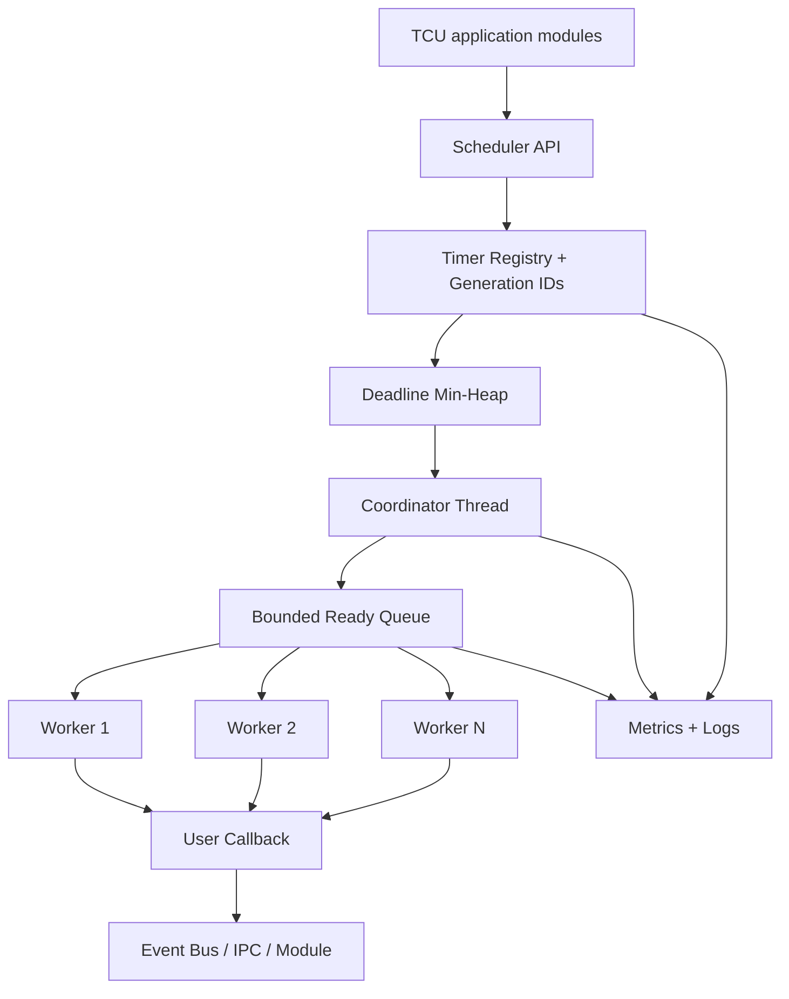
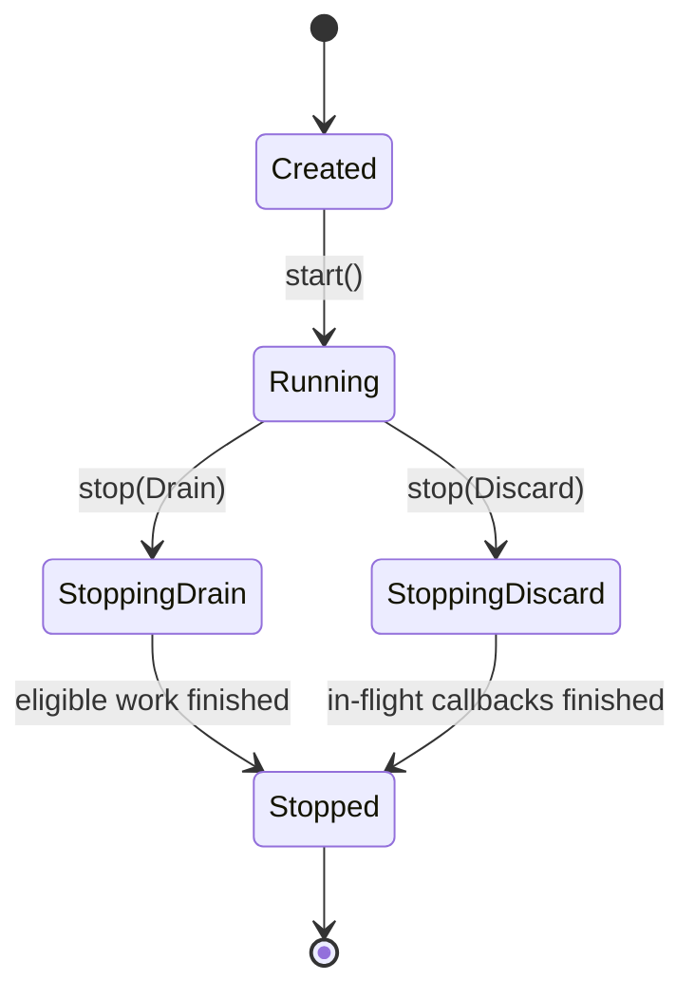
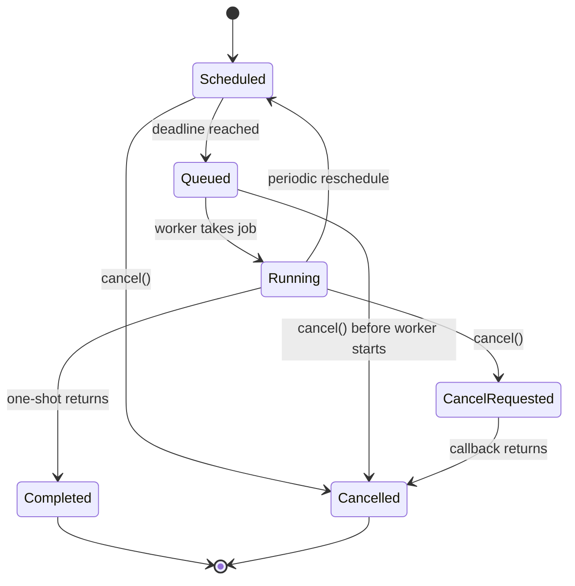
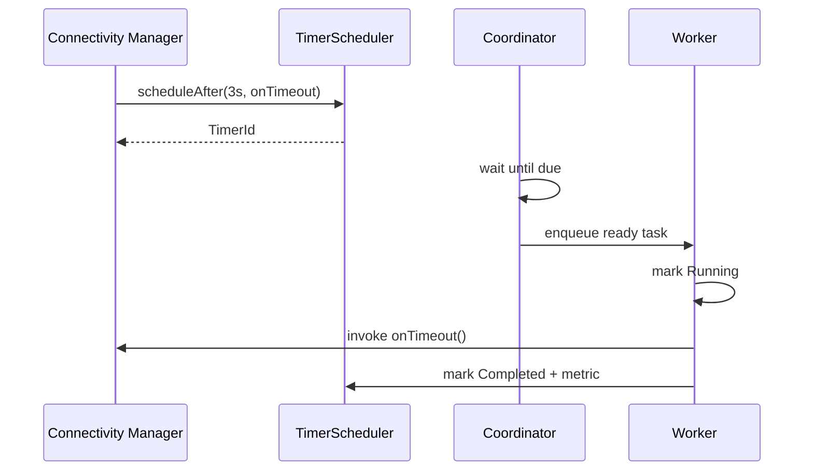
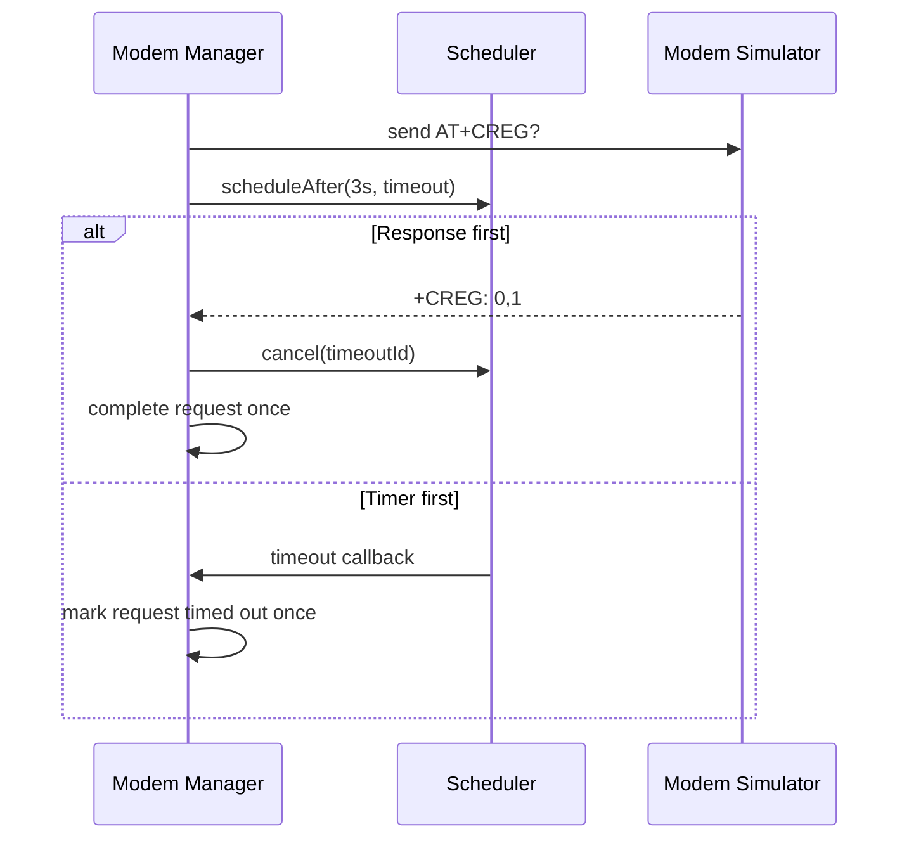

# Project 03 — Timer & Task Scheduler: System Design

> **Virtual TCU Lab** | Version 1.0 | Language: C++17 | Environment: Ubuntu Linux (simulation only)  
> **Audience:** Middle C++ Developer | **Status:** Proposed design, not yet implemented

## 1. Executive Summary

`libtcu_scheduler` is a reusable in-process timer and task scheduler for Virtual TCU Lab. It schedules delayed and periodic tasks using a **monotonic clock**, supports cancellation, constrained queues, worker isolation, observability, and deterministic testing. Typical TCU clients include Telemetry Manager (sample every N seconds), Connectivity Manager (retry after backoff), IPC Framework (request deadlines), Power Manager (inactivity timeout), and Modem Manager (AT response timeout).

**Primary architectural decision:** one scheduler coordinator thread manages deadlines using a min-heap and `std::condition_variable::wait_until`; a bounded worker queue and a configurable worker pool execute callbacks. No user callback executes under scheduler locks or on the coordinator thread. This prevents slow callbacks from delaying timer bookkeeping, although backlog still affects callback start time.

**Out of scope:** hard real-time scheduling, cross-process persistence, cron/calendar scheduling, and executing code while the host is suspended or powered off.

## 2. Goals and Non-Goals

### Goals

- Schedule **one-shot** tasks at a delay or a monotonic deadline.
- Schedule **periodic** tasks with explicitly configured fixed-delay or fixed-rate behavior.
- Cancel a task safely, including during races with dispatch and callback execution.
- Provide predictable start/stop semantics, bounded memory usage and backpressure.
- Avoid busy-waiting and wall-clock adjustments affecting deadlines.
- Support unit tests with injectable clock/executor or controlled fake clock.
- Expose metrics and structured logs for diagnosis.
- Integrate with Project 01 Event Bus and Project 02 IPC service without tight coupling.

### Non-Goals

- Guaranteed sub-millisecond deadlines or OS real-time priorities.
- Durable jobs after a process restart.
- Exactly-once execution across process crashes.
- Interrupt-safe scheduling; methods run in normal process context.
- A general-purpose distributed task queue.

## 3. Assumptions and Constraints

| ID | Constraint / assumption |
|---|---|
| AS-01 | C++17, POSIX/Linux target for reference implementation. |
| AS-02 | `std::chrono::steady_clock` is used for all deadline comparisons. |
| AS-03 | Timer count and execution backlog are bounded by configuration. |
| AS-04 | Task callbacks must be non-blocking where feasible; blocking callbacks require worker budget and timeout design by caller. |
| AS-05 | Callbacks may capture application objects; callers own their lifecycle through weak ownership or cancellation + stop ordering. |
| AS-06 | Scheduler provides at-most-once start for a one-shot task while the process remains alive, not crash-durable delivery. |
| AS-07 | For periodic jobs, overload policy must be explicit: no unbounded catch-up. |

## 4. TCU Use Cases

1. **Telemetry:** collect vehicle status every 1,000 ms while ignition is on.
2. **Modem:** fail AT command if reply not received within 3,000 ms.
3. **Connectivity:** retry after 1 s, 2 s, 4 s, up to configured maximum, with jitter applied by client.
4. **IPC:** time out pending request if server does not reply before deadline.
5. **Power:** transition ACTIVE → IDLE after 5 minutes without activity, if conditions permit.
6. **OTA:** poll download progress periodically, but cancel polling once install completes.
7. **Health:** publish heartbeat every 10 seconds to Event Bus.

## 5. Functional Requirements

| ID | Requirement | Acceptance criterion |
|---|---|---|
| FR-01 | Schedule one-shot delay | Eligible callback starts no earlier than its deadline, subject to clock precision. |
| FR-02 | Schedule absolute deadline | API accepts `steady_clock::time_point`; overdue tasks become immediately eligible. |
| FR-03 | Periodic fixed-delay | Next deadline computed after previous callback completion + interval. |
| FR-04 | Periodic fixed-rate | Deadlines align to original phase; missed periods are skipped (no burst catch-up). |
| FR-05 | Cancellation | A successful `cancel()` prevents callbacks that have not started; in-flight callback continues. |
| FR-06 | Idempotent cancellation | Repeated cancellation has a defined status and never crashes. |
| FR-07 | Bounded capacity | Reject schedules beyond max pending timers and enforce worker queue capacity. |
| FR-08 | Lifecycle | `start`, `stop(Drain/Discard)`, repeated stops and invalid transitions are defined. |
| FR-09 | Per-task error isolation | Throwing callback is caught and recorded; scheduler remains operational. |
| FR-10 | Metrics | Track scheduled, executed, cancelled, rejected, failed, skipped, queue depth and lateness. |
| FR-11 | No callback lock nesting | Callbacks are never invoked with scheduler internal mutex held. |
| FR-12 | Integration | Timer can publish Event Bus event or complete IPC deadline by callback. |

## 6. Non-Functional Requirements

- **Safety:** no data races, use-after-free, double execution of one-shot, deadlock or busy loop.
- **Latency:** latency is best-effort, not hard real time; baseline target p99 scheduling-to-start lateness < 50 ms on an otherwise idle reference Linux workstation (benchmark, not guarantee).
- **Memory:** bounded registered timers and bounded runnable work queue, with configurable limits.
- **Scale:** test 10,000 registered timers, e.g. 100–1,000 callbacks/s; measure actual sustainable throughput on test hardware.
- **Recovery:** callback exceptions do not terminate worker threads.
- **Shutdown:** stop eventually completes if callbacks return; no guarantee for permanently blocked callbacks.
- **Testability:** deterministic deadline tests using an injected clock plus a mechanism to wake coordinator after fake clock advances.

## 7. High-Level Architecture



The coordinator owns deadline selection; workers own callback execution. Registry entries record cancellation and lifecycle. Heap entries may be lazily invalidated using **generation counters**, and are pruned before deadline selection. Heap growth is bounded by compaction when invalid entries exceed a configured threshold.

### 7.1 Components

| Component | Responsibility |
|---|---|
| `TimerScheduler` | Public lifecycle and scheduling API. |
| `TimerRegistry` | Map timer ID to state, metadata and generation. |
| `DeadlineQueue` | Min-heap of `(deadline, id, generation)` and earliest-deadline search. |
| `Coordinator` | Sleep until earliest due deadline or notifications; submit runnable jobs. |
| `ReadyQueue` | Bounded queue for callbacks ready to run. |
| `WorkerPool` | Execute callbacks, trap exceptions, report completion. |
| `ClockAdapter` | Injectable monotonic clock/test clock. |
| `Metrics` | Counters, gauges, histograms. |

## 8. State Models

### 8.1 Scheduler state



**V1 policy:** scheduler is single-use. Calling `start()` after `Stopped` returns `InvalidState`; create a new instance instead. This avoids subtle thread-resurrection races.

### 8.2 Timer state



A queued callback may be physically present in `ReadyQueue` but must consult the shared timer state at worker start. Cancellation then prevents user callback invocation. Cancellation during `Running` is **cooperative** and cannot interrupt the callback.

## 9. Public API Design (Illustrative C++17)

```cpp
#pragma once
#include <chrono>
#include <cstdint>
#include <functional>
#include <memory>

namespace tcu::scheduler {
using Clock = std::chrono::steady_clock;
using TimerId = std::uint64_t;
using Callback = std::function<void()>;

enum class PeriodicMode { FixedDelay, FixedRateSkipMissed };
enum class StopMode { Drain, Discard };
enum class Error { None, InvalidArgument, InvalidState, CapacityExceeded };
enum class CancelResult { Cancelled, RunningCancelRequested, AlreadyFinished, NotFound };

struct Config {
    std::size_t workerThreads{2};
    std::size_t maxTimers{10000};
    std::size_t maxReadyTasks{1024};
};
struct ScheduleResult {
    TimerId id{0};
    Error error{Error::None};
    explicit operator bool() const { return error == Error::None; }
};

class TimerScheduler final {
public:
    explicit TimerScheduler(Config config);
    ~TimerScheduler();
    Error start();
    ScheduleResult scheduleAfter(Clock::duration delay, Callback cb);
    ScheduleResult scheduleAt(Clock::time_point deadline, Callback cb);
    ScheduleResult scheduleEvery(Clock::duration interval,
                                 PeriodicMode mode, Callback cb);
    CancelResult cancel(TimerId id);
    void stop(StopMode mode);
    TimerScheduler(const TimerScheduler&) = delete;
    TimerScheduler& operator=(const TimerScheduler&) = delete;
private:
    struct Impl;
    std::unique_ptr<Impl> impl_;
};
} // namespace tcu::scheduler
```

**API clarification:** `stop()` must only be called from outside scheduler worker/coordinator threads in V1; otherwise return an error in a future `requestStop` API or document an asynchronous stop method. Callback may call `cancel()` and `schedule*()` but not synchronous `stop()`. API above is illustrative, not production-compiled code.

### 9.1 Input validation

- Empty callback → `InvalidArgument`.
- Negative delay → `InvalidArgument`; zero delay → immediate eligibility.
- Periodic interval <= 0 → `InvalidArgument`.
- `workerThreads == 0`, `maxTimers == 0`, `maxReadyTasks == 0` → invalid configuration.
- Scheduling before start or after stop begins → `InvalidState`.
- Full registry → `CapacityExceeded`; no partially registered timer.

## 10. Threading, Ownership and Locking

- **Coordinator thread:** only reads heap head under lock, waits on `cv`, transitions due timers to `Queued` and pushes runnable references to ready queue.
- **Worker threads:** pop runnable references and atomically claim `Queued -> Running` under state lock; invoke callback **after** releasing locks.
- **Shared mutex:** protects registry, heap and timer states. Ready queue may use a separate mutex; choose a fixed lock order or avoid nested acquisition with a single scheduling mutex plus condition variables.
- **Ownership:** registry owns timer descriptors (`shared_ptr<TimerRecord>` internally); queue holds safe references; callbacks own captured state only as specified by caller.
- **Generation ID:** on rearm/reschedule, generation increments; stale heap references ignored.
- **No detach:** all created threads join during stop/destructor, provided callbacks terminate.
- **Destruction precondition:** no external thread is concurrently calling scheduler API while destructor runs; lifetime managed by application owner.

### 10.1 Backpressure policy

When the ready queue is at capacity:
- One-shot due timer remains pending for later submission; it is not dropped silently.
- Fixed-rate periodic tick is **skipped** and increments `periods_skipped`; no unbounded backlog.
- Fixed-delay periodic task cannot overlap itself and waits for its callback to finish before next deadline is defined.
- Coordinator must never block forever trying to enqueue work; it waits for ready-queue space via notification or bounded policy.
- If one-shot due backlog exhausts configured timer capacity, later `schedule*` calls reject. Bounded timer registry prevents unbounded memory.

**Fairness note:** under sustained overload, FIFO-ready scheduling is intended but not a formal fairness guarantee. Document priority support as a future extension.

## 11. Periodic Timing Semantics

### 11.1 Fixed-delay

`next_deadline = completion_time + interval`.

- Suitable for background status checks when exact cadence is not critical.
- Never overlaps itself; timing drifts with callback execution.

### 11.2 Fixed-rate, skip missed

`next_deadline` is the first cadence-aligned time **strictly after completion_time**. For a task with phase `t0`, it equals `t0 + k * interval` for the smallest qualifying integer k.

- Suitable for telemetry sampling aligned to nominal periods.
- Missed ticks increment `periods_skipped`; do not execute an immediate catch-up burst.
- Never overlaps itself. Under a slow callback, some ticks are skipped.

### 11.3 Clock behavior

- Use `steady_clock` and `wait_until` based on the same clock.
- Clock monotonicity protects against changes to system wall time, timezone and NTP adjustments.
- A system suspend/resume might lead to overdue tasks depending on platform clock behavior; no wakeup during suspend is guaranteed. Document this separately for production hardware.

## 12. Operational Behavior — Expected End-to-End Flows

### 12.1 Startup

**Given** a valid config and state `Created`  
**When** application calls `start()`  
**Then** coordinator and workers begin, state becomes `Running`, metrics initialize, and scheduling APIs accept tasks.

### 12.2 One-shot success



**Expected:** callback starts once, no earlier than deadline; `scheduleAfter` returns immediately except for brief synchronization, not callback execution.

### 12.3 Cancel before deadline

**Given** timer in `Scheduled`  
**When** `cancel(id)` returns `Cancelled`  
**Then** callback will never start and scheduled capacity is released.

### 12.4 Cancel while queued

**Given** timer has been dispatched to ready queue but worker has not claimed it  
**When** `cancel(id)` succeeds  
**Then** worker skips callback after checking timer state; metric reports cancellation.

### 12.5 Cancel while running

**Given** callback has started  
**When** `cancel(id)` is called  
**Then** returns `RunningCancelRequested`; callback continues until it returns; periodic timer is **not rearmed**.

### 12.6 Fixed-delay callback longer than period

**Given** interval 100 ms and callback duration 250 ms  
**When** callback runs  
**Then** next start becomes eligible no earlier than 100 ms after completion; callbacks do not overlap.

### 12.7 Fixed-rate callback longer than period

**Given** interval 100 ms and callback duration 250 ms  
**When** callback completes  
**Then** missed cadence slots are counted/skipped and next deadline is future-aligned; no burst of delayed callbacks.

### 12.8 Callback throws

**Given** callback throws `std::runtime_error`  
**When** worker executes it  
**Then** exception is trapped, error logged, `callbacks_failed` increments and worker survives. **V1 policy:** periodic callback that throws is disabled/cancelled, not automatically retried.

### 12.9 Full timer capacity

**Given** scheduler already holds `maxTimers` active timers  
**When** new timer is scheduled  
**Then** return `CapacityExceeded` without memory growth or executing callback.

### 12.10 Full worker queue

**Given** workers are busy and ready queue is full  
**When** another one-shot timer is due  
**Then** its callback waits in bounded scheduler timer storage; no silent loss, no busy loop, lateness metric increases.

### 12.11 Drain shutdown

**Given** running scheduler with pending timers  
**When** `stop(Drain)` begins  
**Then** no new schedules are accepted; only callbacks **already due or queued at stop time** finish; future timers are cancelled; stop waits for in-flight callbacks and returns in `Stopped` state. This is a **bounded drain policy** (not "wait for all future timers").

### 12.12 Discard shutdown

**Given** running scheduler  
**When** `stop(Discard)` begins  
**Then** pending/not-started callbacks are cancelled; in-flight callbacks are allowed to finish; threads join; repeated `stop` is a no-op.

### 12.13 Modem reply wins timeout race

**Given** timer protects pending AT command  
**When** modem reply arrives as timeout becomes ready  
**Then** only one application completion wins via a separate atomic/locked request state (`Pending -> Replied` or `Pending -> TimedOut`); cancelling timer alone is **not** sufficient to guarantee single completion.

### 12.14 Slow callback isolation

**Given** two workers and one callback blocks  
**When** other timers expire  
**Then** another worker can execute eligible callbacks; if all workers are blocked, lateness grows and overload metrics reflect it.

### 12.15 Schedule from callback

**Given** a worker callback is executing  
**When** callback calls `scheduleAfter()`  
**Then** new timer is accepted if scheduler is `Running` and capacity permits, without deadlock.

## 13. Behavioral Contract Matrix

| ID | Given / When | Expected behavior | Test ID |
|---|---|---|---|
| B-01 | Start once | Running, resources ready | UT-01 |
| B-02 | Start twice | InvalidState/no extra threads | UT-02 |
| B-03 | Zero-delay one-shot | Eligible immediately, once | UT-03 |
| B-04 | Negative delay | InvalidArgument | UT-04 |
| B-05 | Cancel Scheduled | Never called | UT-05 |
| B-06 | Cancel Queued | Skip callback | UT-06 |
| B-07 | Cancel Running | Request recorded; no interruption | UT-07 |
| B-08 | Periodic fixed-delay | Completion + interval | UT-08 |
| B-09 | Fixed-rate slow callback | Skip missed ticks | UT-09 |
| B-10 | Callback exception | Worker survives | UT-10 |
| B-11 | Timer capacity reached | Reject new timer | UT-11 |
| B-12 | Ready queue full | Bounded; one-shot not lost | IT-01 |
| B-13 | Stop Drain | Finish due/queued; cancel future | IT-02 |
| B-14 | Stop Discard | Drop pending; finish in-flight | IT-03 |
| B-15 | Schedule after stop | InvalidState | UT-12 |
| B-16 | Duplicate cancel | Defined AlreadyFinished/NotFound | UT-13 |
| B-17 | Concurrent schedule/cancel | No races or UAF | ST-01 |
| B-18 | Clock advanced in test | Deterministic due notification | UT-14 |
| B-19 | Modem reply/timeout race | Exactly one completion at consumer | IT-04 |
| B-20 | 10k timers | Bounded memory; measurable p99 | PT-01 |

## 14. Fault Injection Plan

| Fault | Injection method | Expected observable result |
|---|---|---|
| Worker callback sleeps indefinitely | Test-controlled blocking gate (released by test) | Queue grows only up to capacity; shutdown test releases callback before join. |
| Callback throws | Throw from test callback | Failure counter increases; other timers run. |
| Timer churn | Rapid create/cancel cycles | No stale callback, heap compaction bounds storage. |
| Burst 10k due at once | Fake clock jump | No OOM; overflow policy enforced; delayed start metrics. |
| Stop races with schedule | Barrier synchronize API calls | Either accepted before transition or rejected; no callback after final stop. |
| Repeat cancellation | Concurrent cancel same ID | One transition wins; others return stable status. |
| Application owner destroyed | Callback captures `weak_ptr` | No dereference of dead object. |
| Workload CPU pressure | Stress processes | Best-effort lateness observable; no deadline guarantee misrepresented. |

## 15. Metrics and Logging

### Metrics

- `scheduler_timers_active` (gauge)
- `scheduler_ready_queue_depth` (gauge)
- `scheduler_callbacks_started_total`
- `scheduler_callbacks_completed_total`
- `scheduler_callbacks_failed_total`
- `scheduler_timers_cancelled_total`
- `scheduler_schedule_rejected_total{reason}`
- `scheduler_periods_skipped_total`
- `scheduler_callback_start_lateness_ms` (histogram; `actual_start - deadline`)
- `scheduler_callback_duration_ms` (histogram)

### Structured log examples

```text
INFO scheduler.start workers=2 max_timers=10000 max_ready=1024
DEBUG scheduler.schedule id=42 mode=once delay_ms=3000
INFO scheduler.cancel id=42 result=cancelled
WARN scheduler.backpressure ready_depth=1024 active_timers=963
ERROR scheduler.callback id=99 error=exception action=periodic_disabled
INFO scheduler.stop mode=discard in_flight=0
```

Avoid logging full telemetry payload, credentials, or secrets.

## 16. Integration with Virtual TCU Lab

### Project 01 — Event Bus

Scheduler callback publishes `HeartbeatDue`, `TelemetrySampleDue`, or `PowerIdleExpired`. Events are **not** dispatched synchronously on the coordinator thread. Callback must check Event Bus publication result and handle backpressure.

### Project 02 — IPC Framework

IPC client associates `request_id` with a timer. On response, request state atomically changes `Pending -> Completed` and timer is cancelled. On deadline, timer callback atomically changes `Pending -> TimedOut` then emits timeout. Independent request state guarantees a single final outcome despite races.

### Future Project 10 — Connectivity State Machine

Connectivity Manager owns retry attempts and jitter policy; Scheduler only runs the requested deadline and does **not** implement network-specific reconnect policy.



## 17. Folder Structure

```text
03_timer_task_scheduler/
├── CMakeLists.txt
├── README.md
├── docs/
│   ├── system_design.md
│   └── state_transitions.md
├── include/tcu/scheduler/
│   ├── timer_scheduler.hpp
│   ├── scheduler_types.hpp
│   └── scheduler_metrics.hpp
├── src/
│   ├── timer_scheduler.cpp
│   ├── deadline_queue.cpp
│   ├── worker_pool.cpp
│   └── clock_adapter.cpp
├── examples/
│   ├── telemetry_timer_demo.cpp
│   └── modem_timeout_demo.cpp
├── tests/
│   ├── unit/
│   ├── integration/
│   └── stress/
└── scripts/
    ├── run_tests.sh
    └── run_sanitizers.sh
```

## 18. Suggested Jira Backlog

| Ticket | Summary | Deliverable | Acceptance criterion |
|---|---|---|---|
| TCU-SCH-01 | Create CMake C++17 library skeleton | `libtcu_scheduler`, headers, CI build | Clean GCC/Clang compile. |
| TCU-SCH-02 | Define lifecycle and scheduling API | Config, result types, docs | Invalid transitions covered. |
| TCU-SCH-03 | Implement registry + deadline heap | Heap, ID/generation | Earliest deadline, stale entry rejection. |
| TCU-SCH-04 | Implement coordinator | Thread, CV, wait-until | No polling/busy spin. |
| TCU-SCH-05 | Implement bounded worker queue | Queue, worker pool | Backpressure behavior proven. |
| TCU-SCH-06 | Implement one-shot timers | scheduleAfter/At | Exactly one callback start. |
| TCU-SCH-07 | Implement periodic semantics | Fixed-delay and fixed-rate | Skipped ticks and no overlaps tested. |
| TCU-SCH-08 | Implement cancellation races | State transition rules | Scheduled/Queued/Running tested. |
| TCU-SCH-09 | Implement shutdown | Drain/Discard | No deadlock; threads joined. |
| TCU-SCH-10 | Add logs and metrics | Metrics + structured logs | All primary transitions observable. |
| TCU-SCH-11 | Unit tests and sanitizers | GTest and TSan/ASan | No sanitizer findings in supported cases. |
| TCU-SCH-12 | Build Modem + Telemetry demos | Example binaries | Both end-to-end demos pass. |
| TCU-SCH-13 | Stress and benchmark | 10k-timer benchmark report | Memory bound and lateness measured. |
| TCU-SCH-14 | Code review and documentation | README and ADRs | All contracts resolved/approved. |

## 19. Testing Strategy

### 19.1 Unit tests

Use Google Test/Mock, fake clock and synchronization barriers (avoid flaky `sleep`-based assertions). Validate every row of the Behavioral Contract Matrix.

### 19.2 Integration tests

- Telemetry timer publishes to Project 01 Event Bus; subscriber receives periodic updates.
- IPC timeout integration against Project 02 stub server that delays replies.
- Mixed schedule/cancel/stop under real threads.
- Ensure callback exceptions cannot terminate `std::thread` via uncaught exception.

### 19.3 Stress tests

- 10k timers with randomized 1–60 s deadlines.
- 8 publishers/schedulers concurrently register and cancel timers.
- Test repeated start/stop on **fresh instances**, verify no lingering threads.
- Use ThreadSanitizer on concurrency tests and AddressSanitizer/UBSan in separate build configurations as supported.

### 19.4 Benchmark data to record

- Host CPU, cores, OS/kernel, compiler and optimization flags.
- Number of timers, callback rate, worker count and queue limits.
- p50/p95/p99 lateness, memory peak, CPU usage and drops/skips.
- Do not claim real-time guarantees based solely on a workstation benchmark.

## 20. Demo Workflow

1. Compile using CMake/Ninja (Linux, C++17).
2. Start `telemetry_timer_demo`: periodic 1 s simulated telemetry callback.
3. Enable a 3 s simulated AT command timeout and inject reply at 2 s: timer cancelled.
4. Repeat with reply at 4 s: timeout fires; late reply ignored by request state.
5. Introduce slow callback; observe queue depth and lateness metrics.
6. Execute `stop(Drain)`, check due work completion and cancellation of future tasks.
7. Execute `stop(Discard)` in a fresh scheduler; pending tasks should not start.
8. Run GTest, then sanitizer builds, then 10k-timer stress test.

**Illustrative expected log:**

```text
scheduler.started workers=2
telemetry.sample tick=1 vehicle_speed=0
modem.request id=17 timeout_ms=3000
modem.reply id=17 latency_ms=2000
scheduler.cancel id=42 result=cancelled
modem.request id=18 timeout_ms=3000
modem.timeout id=18
modem.late_reply id=18 ignored=true
scheduler.stopped mode=drain
```

## 21. Definition of Done

- [ ] Implements FR-01 through FR-12 or explicitly documents deviations.
- [ ] All 20 behavioral contracts are covered by tests (unit/integration/stress as mapped).
- [ ] No callbacks run under internal scheduler locks.
- [ ] Cancellation and shutdown concurrency contracts are documented and tested.
- [ ] Timer and ready queues are bounded; heap invalidation compaction is tested.
- [ ] No data race or memory error in supported sanitizer builds.
- [ ] Metrics reflect attempts, callback start/completion and missed periods correctly.
- [ ] API and examples compile under C++17 and work without physical TCU hardware.
- [ ] Limitations (best effort, callback blocking, process crash) clearly documented.

## 22. Open Design Questions / ADR Candidates

1. Should worker count be fixed or configurable at runtime? **V1: startup configuration only.**
2. Do we need callback priorities? **V1: no; future feature after profiling.**
3. Should schedule capacity count queued/in-flight tasks? **V1: active state until completion/cancellation; document exact implementation accounting.**
4. Should `stop` support a time limit? **V1: no force-kill; caller must ensure callbacks terminate.**
5. How are fake-clock wakeups triggered? **V1: clock adapter notifies scheduler CV on time advance.**
6. Will QNX/RTOS need a different executor? **Yes; separate platform adaptor if production OS differs.**
7. How to represent `cancel` after tombstones are collected? **V1: `NotFound` allowed after retention; callers must not rely on indefinite completed-ID history.**

## 23. Learning Outcomes

After implementation, a Middle C++ Developer should be able to explain:

- Why `steady_clock` is preferred to `system_clock` for timeouts.
- How a min-heap and CV beat polling and one-thread-per-timer designs.
- Where cancellation linearization occurs and why running callbacks cannot be forcibly stopped.
- How lock scope, callback lifetime and queue capacity prevent common production failures.
- Why periodic scheduling modes and overload policies change observable semantics.
- How timeouts interact with concurrent responses and require an application-level single-completion state.

---

**Next project:** Project 04 — Configuration & Logging Service.  
**Document type:** System Design + Behavioral Specification + Implementation Backlog.  
**Note:** All source snippets and logs are illustrative; this document is a design specification, not an executable deliverable.
