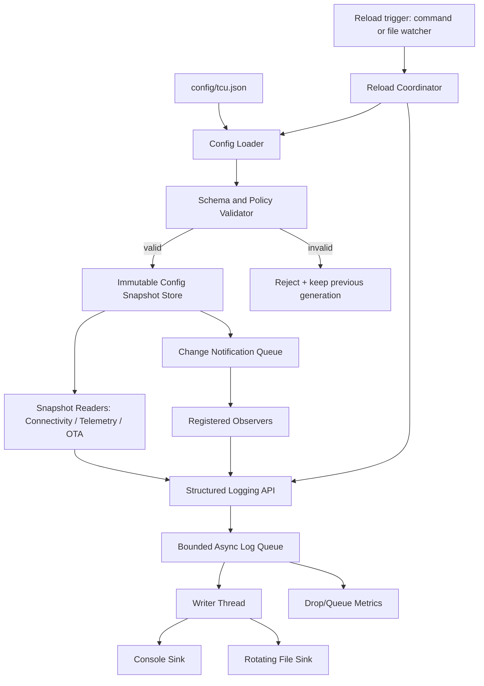
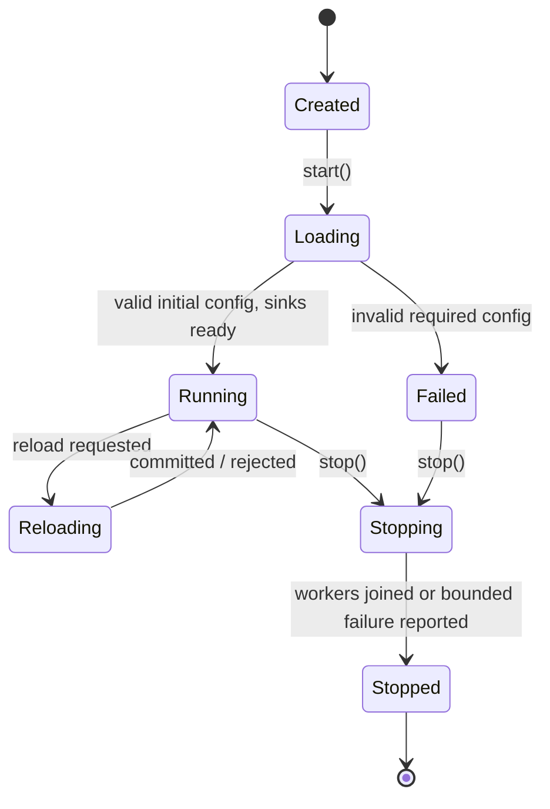

# Project 04 — Configuration & Logging Service: System Design & Behavioral Specification

> **Virtual TCU Lab** | Version 1.0 | **C++17** | Ubuntu Linux simulator | Audience: Middle C++ Developer  
> **Status:** Proposed design (not an implemented library) | **Priority:** P1 | **Dependencies:** optional Project 01 Event Bus and Project 03 Scheduler

## 1. Executive Summary

Build `libtcu_config` and `libtcu_logging`: two reusable in-process libraries plus a demonstration daemon. They supply safe, typed, validated configuration and structured, asynchronous, bounded logging for later TCU modules (Connectivity, Telemetry, OTA, Diagnostics, Power Management).

**Key decisions:** (1) schema-validated *immutable configuration snapshots*, atomically published after successful validation; (2) a bounded async log queue with one writer thread, deterministic severity-aware overload policy, and no exceptions escaping the logging API; (3) configuration updates are transactional at the *snapshot* level, not distributed transactions across all consumers; (4) no secrets in logs or remote status.

**Important boundary:** this is an application/middleware simulation, not a safety-certified automotive platform, an audit-grade logging system or a hard real-time system.

## 2. Context and Motivation

TCU modules need configurable network retry intervals, telemetry periods, cloud endpoint settings, queue limits, logging verbosity and output paths. Scattered constants and independent file reads lead to inconsistent values, undefined failure behavior and information leakage. A common service gives modules a coherent snapshot and centralized diagnostics.

Representative usage:
- Connectivity Manager reads `connectivity.retry.*`, changes retry interval on permitted reload.
- Telemetry Manager reads `telemetry.period_ms` and reconfigures periodic timers after a confirmed update.
- OTA Manager reads update server URL and timeout; sensitive credentials are obtained from a secret provider, **not a loggable JSON file**.
- Diagnostics exposes bounded, redacted logs for fault analysis.
- Power Manager disables high-volume logs in low-power modes, subject to explicit policy.

## 3. Goals, Non-Goals and Design Principles

### Goals

1. Load configuration from a local JSON file; validate types, ranges, cross-field constraints and required keys.
2. Expose typed reads from one coherent immutable snapshot (version + generation + origin).
3. Reload configuration manually or on a file-change signal, without publishing partial/invalid changes.
4. Distinguish dynamically changeable settings from restart-required settings.
5. Notify subscribers *after* snapshot commit; isolate slow/throwing callbacks.
6. Emit timestamped, structured, severity-filtered logs to console and rotating files.
7. Bound queue size, memory, disk consumption and shutdown behavior.
8. Redact secrets and personally identifying vehicle data by policy; provide counters and health indicators.
9. Run without real vehicle hardware; provide deterministic tests and fault injection.

### Non-goals

- Cloud configuration synchronization, remote command channel or OTA configuration rollout in V1.
- Multi-process atomic shared configuration, consensus or database transactions.
- Guaranteeing logs survive power loss or disk corruption.
- Hiding credentials stored in process memory from a fully compromised host.
- Real-time-safe logging from interrupt context or guaranteed callback execution deadlines.
- Changing the logging path or cryptographic policy at runtime without explicit restart support.

### Principles

**Validate before publish; never expose half-applied values.** **Minimize lock hold times.** **Failure of optional logging cannot crash business logic.** **A configuration subscriber must tolerate notification delays and use snapshot generations.** **Sensitive values must not reach logging APIs whenever possible.**

## 4. Assumptions and Platform

| ID | Assumption |
|---|---|
| AS-01 | Reference implementation: C++17, Ubuntu 22.04/24.04, CMake, Google Test/Mock. |
| AS-02 | JSON parsing via a selected dependency (e.g. nlohmann/json); version pinned in build. |
| AS-03 | C++17 `std::shared_ptr<const ConfigSnapshot>` and `std::atomic_load/store` free functions provide safe snapshot handover. |
| AS-04 | Logging uses a monotonic clock for durations and wall-clock UTC for human timestamps. |
| AS-05 | Single service process for V1; other processes have separate instances, not automatically consistent. |
| AS-06 | One config reload is serialized through a reload mutex; readers do not block on file I/O or parsing. |
| AS-07 | Only a defined allowlist of keys supports hot reload; others require service restart. |
| AS-08 | Filesystem watcher events are hints; content is re-read and validated. |

## 5. Scope and Deliverables

- `libtcu_config`: schema, typed snapshot, reader, loader, validator, reload coordinator, change notification.
- `libtcu_logging`: log event, severity and privacy classification, bounded queue, formatters, sinks, rotation, counters.
- `tcu_config_logging_demo`: two or more worker threads using both libraries; commands to alter valid/invalid config.
- `config/default.json`, `config/schema.md`, sample override files (without credentials), JSON schema-like specification.
- Unit tests, multi-thread stress tests, integration test scripts and documentation.

## 6. High-Level System Architecture



**Thread model:** application threads read snapshots and enqueue logs; one serialized reload worker performs file I/O/validation; an optional notifier worker runs change callbacks; one logger writer thread writes sinks. No callback runs while a config store mutex is held. For V1, the reload and notifier workers can be implemented as dedicated threads or integrated with Project 03; contract stays the same.

## 7. Configuration Data Model

### 7.1 Example configuration (`config/tcu.json`)

```json
{
  "schema_version": 1,
  "connectivity": {
    "retry_base_ms": 1000,
    "retry_max_ms": 30000,
    "max_attempts": 0
  },
  "telemetry": {
    "period_ms": 5000,
    "offline_queue_capacity": 2048
  },
  "logging": {
    "level": "INFO",
    "queue_capacity": 8192,
    "file_max_bytes": 10485760,
    "file_count": 5,
    "console_enabled": true
  },
  "network": {
    "cloud_endpoint": "https://mock-cloud.local",
    "tls_required": true
  }
}
```

All numeric sizes are in the unit named by their field. `max_attempts = 0` means an unlimited number of *policy-controlled* reconnect attempts, not a busy loop. Production cloud endpoints and certificates are OEM-specific; do not hardcode keys or tokens in the sample.

### 7.2 Example schema constraints

| Key | Type | Constraint | Reload policy |
|---|---|---|---|
| `schema_version` | int | Exactly `1` in V1 | Restart / migration |
| `connectivity.retry_base_ms` | int | 100–60,000 | Hot |
| `connectivity.retry_max_ms` | int | 100–300,000; >= base | Hot |
| `connectivity.max_attempts` | int | 0–100 | Hot |
| `telemetry.period_ms` | int | 200–3,600,000 | Hot |
| `telemetry.offline_queue_capacity` | int | 16–100,000 | Restart |
| `logging.level` | enum | TRACE/DEBUG/INFO/WARN/ERROR/FATAL | Hot |
| `logging.queue_capacity` | int | 128–65,536 | Restart |
| `logging.file_max_bytes` | int | 1 MiB–100 MiB | Restart |
| `logging.file_count` | int | 1–20 | Restart |
| `logging.console_enabled` | bool | true/false | Hot |
| `network.cloud_endpoint` | string | allowed scheme/host, max length | Restart (V1) |
| `network.tls_required` | bool | true for nonlocal endpoints | Restart |

**Unknown keys:** reject by default; optionally provide explicit `extensions` object for future vendor extensions. **Defaults:** loaded from a vetted baseline; malformed or missing mandatory fields never silently become arbitrary zero values. **Precedence:** defaults < local file < command-line permitted overrides; secrets come from a separate provider, not override CLI arguments.

### 7.3 Snapshot structure

```cpp
struct ConfigSnapshot {
    uint64_t generation = 0;
    std::string source;
    std::chrono::system_clock::time_point loadedAt;
    ConnectivityConfig connectivity;
    TelemetryConfig telemetry;
    LoggingConfig logging;
    NetworkConfig network;
};
```

Snapshot is immutable to clients after publication (`shared_ptr<const ConfigSnapshot>`). Readers receive a consistent set of fields and can keep old snapshots safely until done. `generation` increments on successful effective content changes; rejecting invalid reload does not increment it. Publication and callback delivery are distinct events.

## 8. Configuration API Design (Illustrative C++17)

```cpp
enum class LoadError {
    None, FileNotFound, ReadError, ParseError, SchemaError,
    InvalidValue, RestartRequired, ServiceStopped
};

struct ReloadResult {
    LoadError error;
    uint64_t generation;
    bool changed;
    std::string publicReason; // redacted; safe for logs
};

using ConfigPtr = std::shared_ptr<const ConfigSnapshot>;
using ConfigObserver = std::function<void(ConfigPtr current, ConfigPtr previous)>;

class IConfigurationService {
public:
    virtual ~IConfigurationService() = default;
    virtual ConfigPtr snapshot() const noexcept = 0;
    virtual ReloadResult reload() = 0;
    virtual SubscriptionId subscribe(ConfigObserver observer) = 0;
    virtual bool unsubscribe(SubscriptionId id) = 0;
};
```

`reload()` is serialized; async notifier executes callbacks after successful commit. `unsubscribe()` prevents future callbacks from *starting* after its linearization point; a callback already running may finish. Subscriber code must not assume `reload()` blocks until its notification runs. A subscriber needing immediate convergence compares the current snapshot generation on startup and after notification.

## 9. Reload Pipeline & Transaction Semantics

```mermaid
sequenceDiagram
    participant Op as Operator / Watcher
    participant R as Reload Coordinator
    participant F as File Reader
    participant V as Validator
    participant S as Snapshot Store
    participant N as Notifier
    participant M as TCU Module
    Op->>R: reload()
    R->>F: read file
    F-->>R: bytes or error
    R->>V: parse + schema + policy checks
    alt valid and hot-reloadable
        V-->>R: candidate snapshot
        R->>S: atomic publish(generation + 1)
        R-->>Op: Success(new generation)
        R->>N: enqueue ConfigChanged
        N->>M: callback(new, previous)
    else invalid / restart-required
        V-->>R: rejection reason
        R-->>Op: Failed; old generation kept
    end
```

### Reload-specific rules

1. Read the whole file into a bounded buffer; reject oversize input before parsing (config max 1 MiB by default).
2. Check metadata and decode UTF-8; reject duplicate keys if parser can detect them (or use a strict parser mode).
3. Validate field types, ranges, and cross-field invariants.
4. Compare with current snapshot; if *semantically unchanged*, return success with `changed=false` and do not notify.
5. If any changed key is restart-required, **reject the entire reload** with `RestartRequired`. Do not partially apply hot keys in the same file.
6. Publish a new snapshot at a single atomic handover point.
7. Notify subscribers asynchronously and in publication order within the process; coalescing is not enabled in V1. Bounded notification queue overflow marks degraded health and triggers a resync notification; consumers must always re-read the newest generation.
8. Failed subscriber callback is logged and counted; it never rolls back committed global configuration.
9. Restart-required change is applied only on normal process restart after successful initial configuration validation.

**Important:** Snapshot publication is atomic, but changes to external resources in subscriber callbacks are not. If a critical module cannot accept a change, it must keep its last working operational state, emit a failure metric and request a controlled rollback/restart according to the application owner. Do not describe this as a distributed atomic transaction.

## 10. Logging Architecture and Contract

### 10.1 Log event model

```cpp
enum class Severity { Trace, Debug, Info, Warn, Error, Fatal };
enum class DataClass { Public, VehicleSensitive, Secret };

struct LogRecord {
    std::chrono::system_clock::time_point timestampUtc;
    std::chrono::steady_clock::time_point timestampMono;
    Severity severity;
    std::string component;
    std::string eventName;
    std::string message;
    std::string correlationId;
    std::vector<Field> fields; // typed key/value and classification
};
```

**Recommended structured output:** newline-delimited JSON, one record per line with fields like `timestamp_utc`, `severity`, `component`, `event`, `correlation_id`, `message`, `fields`. Escape newline/control characters, use stable field names, and cap per-record size (e.g., 16 KiB).

### 10.2 API example

```cpp
class ILogger {
public:
    virtual ~ILogger() = default;
    virtual void log(Severity level,
                     std::string_view component,
                     std::string_view event,
                     std::string_view message) noexcept = 0;
    virtual void flush() = 0;    // may block; never call from sink thread
    virtual void stop() = 0;
};
```

Production implementation should provide typed, classification-aware fields and avoid building expensive payloads when a severity is disabled. No raw password/token/secret value API by default. Logging methods must never throw into business threads; internal formatting failures increment a counter and fail closed.

### 10.3 Queue and overload policy

- Bounded MPSC queue, single writer consumer, configurable `queue_capacity` at startup.
- TRACE/DEBUG/INFO: drop the *incoming* record immediately when full; count drops by severity.
- WARN/ERROR: bounded wait up to a configurable limit (e.g., 20 ms); on expiry drop and increment `high_priority_drops`; do **not** block indefinitely.
- FATAL: attempt synchronous emergency write to pre-opened stderr (best effort) then initiate bounded flush; no durability guarantee.
- Logging from the logger/sink thread must not enqueue back into its own queue; write emergency fallback or suppress recursion.
- Never hold application locks while waiting on a logger queue; API documentation warns against coupling.

### 10.4 File rotation and disk handling

- Rotate when current file would exceed configured maximum; maintain at most `file_count` rotated files plus active file. Document file naming scheme (`tcu.log`, `tcu.log.1`, ...).
- Limit file permissions to service account (e.g. `0600`), create parent directory with restrictive permissions, avoid following attacker-controlled symlinks in production-hardening phase.
- Disk full / permission denied: file sink becomes unhealthy, drop or redirect according to configured fallback policy; **application remains operational**.
- Flush on graceful stop with bounded wait, explicitly document remaining-loss risk after crash/power loss.
- V1 focuses on size-based rotation, not time-based retention or compression.

### 10.5 Privacy and security requirements

- **Never log:** credentials, bearer tokens, private keys, unredacted SIM identifiers, full VIN or precise GPS unless explicit policy/legal basis and masking is implemented.
- Prefer allowlisted structured fields; sensitive classes are replaced with `[REDACTED]` at ingestion and again validated in sink formatting.
- Configuration parse errors expose key path and error type, not secret values or full file content.
- Correlation IDs are arbitrary opaque IDs; do not embed VIN, phone numbers or access tokens.
- Rotation/archive files inherit restrictive permissions. Make log upload a separate future project with authorization and retention policy.

## 11. Service Lifecycle and State Machines



**Startup:** load and validate configuration before starting dependent TCU modules; initialize logger with safe fallback stderr logging first. If initial config is invalid, main service does not start with unsafe defaults. **Shutdown order:** stop config watch/reload requests → finish or reject in-progress reload → stop notification worker → stop dependent module producers → drain logging queue within deadline → close sinks. Avoid logger callbacks reentering shutdown and self-join.

## 12. Operational Behavior — End-to-End Scenarios

### Scenario A: Normal startup

1. `tcu_demo` initializes minimal stderr diagnostic output.
2. `ConfigurationService.start()` reads `config/tcu.json`, validates and publishes generation `1`.
3. `LoggingService.start()` configures queue, filters and sinks from generation `1`.
4. Connectivity and Telemetry read the same generation `1` snapshot and begin work.
5. Health status reports `config_valid=true`, `logger_healthy=true`, `generation=1`.

### Scenario B: Valid hot reload

1. Operator changes `telemetry.period_ms` from 5000 to 2000 by writing a temp file and atomic rename.
2. Watcher detects an event and requests `reload()`; debounce duplicate events.
3. Validation passes and generation `2` is published atomically.
4. Reload returns success; notifier invokes Telemetry observer outside locks.
5. Telemetry cancels its previous periodic task and schedules a new one; next sampling follows module-specific scheduling contract.
6. Subsequent logs include `config_generation=2` without dumping configuration contents.

### Scenario C: Invalid reload

1. New file specifies `retry_max_ms < retry_base_ms`.
2. Validator rejects `InvalidValue`.
3. Generation and active settings remain unchanged.
4. A redacted error identifies the invalid key relation; `config_reload_failures_total` increments.

### Scenario D: Restart-only change

1. Operator changes `logging.queue_capacity` while daemon is running.
2. Validator accepts type/range but detects `RestartRequired` policy.
3. Entire reload is rejected; old snapshot remains active, including other changed hot fields in that same candidate.
4. Operator schedules controlled restart; after restart new settings take effect if valid.

### Scenario E: Log pressure

1. Many producer threads submit DEBUG logs faster than the file can write.
2. Queue reaches capacity; DEBUG records are dropped and counted.
3. WARN and ERROR attempt bounded wait, not unlimited blocking.
4. Normal TCU business threads remain responsive; health shows logger degradation.

### Scenario F: Disk full / crash

1. Sink hits `ENOSPC` during write.
2. Sink marks itself unhealthy, increments `file_sink_errors_total`, uses configured emergency output if possible.
3. Service continues core behavior; no infinite retry or log recursion.
4. After space is restored, sink recovery follows explicit retry policy (e.g., probe every 30 s; no spin).
5. If process crashes, any records still in memory queue can be lost; report this honestly.

## 13. Behavioral Contracts (Given / When / Then)

| ID | Given | When | Then |
|---|---|---|---|
| BC-01 | Valid config on disk | Service starts | Generation 1 published and readable. |
| BC-02 | Missing required field | Service starts | Startup fails; no unsafe implicit defaults. |
| BC-03 | Invalid JSON | Reload requested | Return ParseError; old snapshot unchanged. |
| BC-04 | Out-of-range integer | Reload requested | Return InvalidValue; old snapshot unchanged. |
| BC-05 | Cross-field retry invariant violated | Reload requested | Reject candidate; error references field path. |
| BC-06 | Semantically identical config | Reload requested | `changed=false`; no generation bump or callback. |
| BC-07 | Valid hot fields changed | Reload requested | Atomic generation increment and notification. |
| BC-08 | Hot + restart-only fields changed | Reload requested | Entire candidate rejected; no partial apply. |
| BC-09 | Two concurrent reload calls | Both execute | Serialized, deterministic generations; no mixed snapshots. |
| BC-10 | Readers continuously access snapshot | Reload publishes | Each read sees a complete old or new snapshot. |
| BC-11 | Observer throws | Change dispatched | Exception isolated; other observers still execute. |
| BC-12 | Observer unsubscribes during callback | Notification in flight | Started callback may finish; no new callback starts after unsubscribe linearizes. |
| BC-13 | Watcher reports repeated events | File changed once | Debounced load; no duplicate effective change notification. |
| BC-14 | New file truncated during non-atomic write | Reload starts | Reject partial file; old snapshot remains active. |
| BC-15 | Config larger than limit | Reload starts | Reject before parsing; bounded memory use. |
| BC-16 | Logger below configured level | DEBUG record submitted | Filter before formatting/enqueue; no output. |
| BC-17 | Logger queue full | INFO record submitted | Nonblocking drop and counter increment. |
| BC-18 | Logger queue full | ERROR record submitted | Bounded wait; on expiry counted drop, no indefinite stall. |
| BC-19 | Log contains Secret field | Record emitted | Secret value absent from all sinks, formatted logs and error messages. |
| BC-20 | Output file reaches max size | Next write occurs | Rotate within retention policy, keep file count bounded. |
| BC-21 | Disk fills | File write attempted | Sink error reported; main app remains alive. |
| BC-22 | Many threads log concurrently | Load test executes | No data races, malformed JSONL or unbounded memory. |
| BC-23 | Active producers still logging | Graceful stop begins | New logs rejected per shutdown contract; queued logs flushed within bounded shutdown policy. |
| BC-24 | Process crashes unexpectedly | Logs remain queued | Possible queue loss explicitly documented; no false durability claim. |
| BC-25 | Observer notification backlog overflows | Generations published rapidly | Degraded counter increments; resync to latest generation is triggered. |
| BC-26 | Logger in write callback accidentally logs | Reentrant log happens | No deadlock/recursive queue amplification. |
| BC-27 | File path is not writable | Startup initializes file sink | Safe fallback diagnostics and explicit unhealthy state. |
| BC-28 | Process reads config with unknown schema version | Startup/reload | Reject with UnsupportedVersion, no blind parsing. |
| BC-29 | Logger receives oversized message | Enqueue attempted | Truncate or reject per documented policy with counter; memory bounded. |
| BC-30 | `stop()` invoked twice | Second call | Idempotent; no double join or use-after-free. |

**Test oracle note:** a successful `reload()` means snapshot committed, **not** that every observer has completed applying it. Client observability should expose both `config_generation_seen` and `config_generation_applied` where relevant.

## 14. Concurrency & Ownership Design

- Readers get snapshots using `std::atomic_load(&current_snapshot_)`; never mutate snapshot objects after publication.
- Reload mutex serializes parse/compare/publish, but callbacks and file sink I/O never run under this mutex.
- Subscription registry uses mutex and callback lifetime tracking; do not invoke callbacks while holding registry lock.
- Notifications carry `shared_ptr<const ...>` to preserve old/new snapshot lifetime.
- Logger producer copies/owns record data before queueing; no `string_view` references into short-lived buffers remain in async queue.
- Writer thread alone owns rotating file handles; producers must not write to them directly (except controlled emergency path).
- Prevent circular teardown: application stops producers before logger, and unsubscription finishes before callback-captured objects are destroyed.
- Scheduler integration: if using Project 03 for debouncing/retry, unsubscribe/cancel timers before scheduler shutdown; no hot-reload callback may block waiting for itself.

### Lock order guidance

Never hold config mutex while acquiring logger queue mutex, subscriber mutex or calling module hooks. Prefer data handoff outside locks. For any library-internal multi-lock path, document total order and stress-test shutdown/reload races.

## 15. Failure Handling and Recovery Matrix

| Failure | Detection | System behavior | Recovery |
|---|---|---|---|
| Missing file at startup | open error | Block main service startup | Restore file and restart |
| Bad JSON on reload | parser error | Keep last-known-good generation | Fix and reload |
| Unsupported schema | version check | Reject | Migrate config or binary |
| Temporary file read failure | I/O error | Keep old | Backoff/debounce retry |
| Reload notification failure | exception/overflow | Count, mark degraded | Consumer resyncs latest snapshot |
| Disk full | write errno | File sink unhealthy, no app crash | Periodic bounded recovery probe |
| Permission denied | open/write errno | Fallback stderr/metric | Correct permissions and restart/reprobe |
| Slow log disk | writer latency | Bounded producer queue, drops | Reduce volume/adjust sink |
| Invalid log field | privacy/format validation | Redact or reject record | Fix caller and alert metric |
| Shutdown with blocking callback | join deadline | Report failed graceful termination; never detach unsafe owned worker | Fix callback contract / supervisory restart |

## 16. Metrics, Logs and Health

| Metric | Meaning |
|---|---|
| `config_generation` | Currently committed generation |
| `config_reload_attempts_total` | All reload attempts |
| `config_reload_success_total` | Valid reloads including no-op (tag separately) |
| `config_reload_failures_total{reason}` | Rejected load attempts by bounded reason |
| `config_notify_failures_total` | Callback exceptions or notifier delivery failures |
| `config_notification_queue_depth` | Pending notifications |
| `logger_queue_depth` | Pending log records |
| `logger_records_written_total{sink}` | Successful writes by sink |
| `logger_records_dropped_total{severity}` | Dropped records by severity |
| `logger_sink_errors_total{sink}` | Open/write/rotation errors |
| `logger_write_latency_ms` | Write latency distribution |
| `logger_rotations_total` | Completed rotations |
| `config_generation_applied{component}` | Last successfully applied generation per component |

Metrics labels must have bounded cardinality: do not use arbitrary paths, VIN or correlation IDs as labels. Provide local health endpoint or console status; do not leak sensitive config values.

### Example expected logs (illustrative)

```jsonl
{"timestamp_utc":"2026-10-30T01:00:00.000Z","severity":"INFO","component":"config","event":"startup_loaded","generation":1}
{"timestamp_utc":"2026-10-30T01:00:05.000Z","severity":"INFO","component":"config","event":"reload_committed","generation":2}
{"timestamp_utc":"2026-10-30T01:00:10.000Z","severity":"WARN","component":"config","event":"reload_rejected","reason":"InvalidValue","field":"connectivity.retry_max_ms"}
{"timestamp_utc":"2026-10-30T01:00:11.000Z","severity":"WARN","component":"logger","event":"queue_drops_detected","count":125}
```

The above timestamps are examples, not measurements from a running program.

## 17. Testing Strategy

### Unit tests

1. Parse valid sample and verify typed fields.
2. Reject missing, wrong type, negative, overflow and out-of-range values.
3. Reject schema version mismatch and unknown keys.
4. Validate cross-field retry_max >= retry_base and TLS policy.
5. Verify canonical comparison ignores whitespace/key ordering.
6. Verify publication yields coherent immutable snapshots to readers.
7. Verify no-op reload does not increment generation.
8. Reject mixed hot/restart-only updates atomically.
9. Validate subscription ordering and exception isolation.
10. Validate unsubscribe semantics and observer object lifetime.
11. Verify severity filter and structured JSON escaping.
12. Verify redact-on-ingest and redact-on-format for Secret fields.
13. Verify size-based rotation/retention boundaries.
14. Verify queue overload policy by severity with injected slow sink.
15. Verify `flush` and `stop` idempotency and no self-join.

### Integration tests

- Modify config via atomic rename while Telemetry demo runs; assert new generation and updated timer period.
- Simulate invalid writes, permission errors and config file removal; assert last-known-good behavior.
- Spawn 8 producer threads logging simultaneously and reload 100 times; verify well-formed JSONL and no crash.
- Fill logging directory (use isolated test filesystem or mock sink), assert healthy core loop and error counters.
- Run `kill -9` on demo, restart and check recovery assumptions; do not demand crash durability.

### Fault injection and sanitizers

- AddressSanitizer / UndefinedBehaviorSanitizer (memory / UB).
- ThreadSanitizer for C++ data races, in a compatible build environment.
- Inject short writes, EINTR, ENOSPC, disk delay, corrupt JSON, notifier exceptions and queue overflow through interfaces.
- Long-running 1–24 h soak testing with bounded memory and file count; report host CPU/RAM, throughput and drop count.

## 18. Performance & Capacity Targets (Illustrative; benchmark and tune)

| Target | Initial lab budget | Validation |
|---|---|---|
| Snapshot read | p99 < 100 microseconds, uncontended desktop | Microbenchmark |
| Reload 100 KiB config | p99 < 100 ms excluding disk stalls | Integration benchmark |
| Logging throughput | >= 10,000 small records/s in local lab | Saturation test |
| Memory | Bounded by queue + max record + snapshots retained | RSS / leak tracking |
| Drop handling | No indefinite producer waits | Saturation assertions |
| Graceful stop | Aim <= 2 seconds with healthy sinks/callbacks | Shutdown test |

These are **engineering exercise budgets, not automotive OEM requirements**. A slow filesystem, OS scheduling or downstream callback can violate them; report environment and percentiles.

## 19. Repository Layout

```text
virtual-tcu-lab/
  modules/
    config/
      include/tcu/config/{types.hpp,service.hpp,validator.hpp}
      src/{loader.cpp,validator.cpp,service.cpp,watcher.cpp}
    logging/
      include/tcu/logging/{logger.hpp,record.hpp,sink.hpp}
      src/{async_logger.cpp,json_formatter.cpp,file_sink.cpp,console_sink.cpp}
  apps/
    config_logging_demo/main.cpp
  configs/
    tcu.json
    invalid_retry.json
    invalid_schema.json
  tests/
    unit/config/
    unit/logging/
    integration/config_logging/
  scripts/
    demo_reload.sh
    test_disk_failure.sh
  docs/
    architecture/04_Configuration_Logging_Service_System_Design.md
  CMakeLists.txt
```

## 20. Jira Backlog (Implementation-ready)

| Ticket | Title | Scope / Definition of Done |
|---|---|---|
| TCU-CFG-001 | Define typed config schema | Field types, validation ranges, reload policy documented; fixtures added. |
| TCU-CFG-002 | Implement JSON loader | Read capped file, parse strict JSON, return typed errors; tests pass. |
| TCU-CFG-003 | Implement cross-field validator | Required fields, ranges, TLS rules and unknown key policy tested. |
| TCU-CFG-004 | Immutable snapshot store | Atomic load/store publication and generation semantics; race tests. |
| TCU-CFG-005 | Hot reload & restart-only policy | Transactional candidate rejection, no-op behavior, tests. |
| TCU-CFG-006 | Subscriber registry | Register/unregister, ordered notification, isolation, lifecycle tests. |
| TCU-CFG-007 | Filesystem trigger & debounce | Handle duplicate notifications, atomic file replacement and read errors. |
| TCU-LOG-001 | Define structured log schema | Severity, classification, JSON escaping, max record size. |
| TCU-LOG-002 | Implement bounded async queue | MPSC, writer thread, level filtering, overload/drop counters, tests. |
| TCU-LOG-003 | Console & rotating file sinks | Rotation, retention, permissions, disk errors, recovery probe. |
| TCU-LOG-004 | Implement redaction policy | Allowlisted fields and Secret redaction verified end-to-end. |
| TCU-LOG-005 | Implement lifecycle & flush | Startup fallback, drain/stop and reentrancy regression tests. |
| TCU-CFG-008 | Observability and demo application | Health metrics, live reload demo, sample logs documented. |
| TCU-CFG-009 | Stress and fault injection | ASan/TSan, 8 log producers, reload storm, disk fault report. |
| TCU-CFG-010 | Integration with other TCU libs | Use config in Project 03 Scheduler and expose events to Project 01. |

Suggested build order: CFG-001→002→003→004→005→006; LOG-001→002→003→004→005; then watcher, integration and stress testing. Tests and code review are part of each ticket, not deferred entirely to the end.

## 21. Demo Workflow (No Vehicle Hardware)

```bash
# Build commands refer to the proposed future implementation.
cmake -S . -B build -G Ninja -DCMAKE_BUILD_TYPE=Debug
cmake --build build
ctest --test-dir build --output-on-failure

# Start the demonstration application when implemented:
./build/apps/config_logging_demo --config configs/tcu.json

# In another terminal, edit permitted fields via temp-file + atomic rename,
# then use the demo reload command or watcher to trigger revalidation.
```

Expected startup: `startup_loaded generation=1`. Expected valid reload: `reload_committed generation=2`, telemetry changes its sampling interval. Expected invalid reload: `reload_rejected`, still generation `2`. Expected log flood: drop metrics rise, app remains responsive. Expected disk error: file sink marked unhealthy while main loop continues.

**Caution:** This document is a design, not proof that the above `build/apps/...` executable exists yet.

## 22. Integration with Projects 01–03 and Future TCU Modules

| Project | Interface | Expected behavior |
|---|---|---|
| 01 Event Bus | Publish `ConfigChanged{generation}` / logger health events | Do not publish sensitive config payloads; consumers re-read snapshots. |
| 02 IPC Framework | Optional `GetConfigStatus` request | Provide generation, schema and health only; access-controlled read of nonsecret settings. |
| 03 Timer Scheduler | Debounce watcher and retry sink recovery; update telemetry interval | Cancel old schedules safely and apply new generation once. |
| 05 Virtual CAN | Signal decoder sampling settings | Reject invalid ranges before use. |
| 09 Modem Simulator | AT retry/timeouts | Applying new policy does not retroactively alter in-flight AT command deadlines unless specified. |
| 13 MQTT Telematics | Topics and retry settings | Endpoint/security changes are restart-required in V1. |
| 18 OTA | Download timeouts and verbose debug logs | Never record signed URLs or credentials. |
| 22 Power Manager | Low-power logging mode | Emergency ERROR reporting remains available via policy. |

## 23. Risks, Tradeoffs and Alternatives

- **JSON vs YAML:** JSON is easier to parse strictly and test; comments require separate documentation. YAML is friendlier but has more edge cases and type ambiguities.
- **Shared snapshot vs per-field atomics:** snapshot ensures cross-field consistency and prevents torn configuration; retains old snapshots temporarily if consumers hold them.
- **Async vs synchronous logging:** async reduces producer I/O latency but risks losing queued logs on crash; synchronous can stall time-critical threads.
- **Watcher vs explicit reload:** watcher improves usability but may be unreliable across rename/mount behavior; explicit admin reload remains the deterministic fallback.
- **Rolling log file vs system journal:** local rotation teaches sink design; on production Linux, `journald` may be preferable depending on platform retention and diagnostics pipeline.
- **V1 restart policy:** conservative restart-only settings reduce complex resource reinitialization races; can be expanded later with staged apply/rollback per component.

## 24. Acceptance Checklist / Definition of Done

- [ ] Typed schema covers every sample field and version migration policy.
- [ ] Invalid startup fails safely; invalid reload preserves last-known-good snapshot.
- [ ] Generation, no-op, hot/restart-only and observer behaviors match contracts.
- [ ] No partial config reads under simultaneous reloads.
- [ ] Logging JSONL is well-formed under concurrent producers.
- [ ] All secrets classified and redacted (including on error paths).
- [ ] Bounded queue, max record size and file retention enforced.
- [ ] Disk failures cannot crash normal telemetry processing.
- [ ] Shutdown does not deadlock or leave owned worker threads running.
- [ ] BC-01 through BC-30 mapped to automated tests or documented manual fault tests.
- [ ] ASan/UBSan/TSan checks run in supported CI configurations; limitations recorded.
- [ ] Integration demo shows valid reload, invalid reload, rotation and overload behavior.
- [ ] README includes architecture, compile commands, known limitations and metrics.

## 25. Open Design Questions / ADR Candidates

1. Should config notifications be synchronous or asynchronous? **V1: asynchronous, ordered, with resync on overflow.**
2. Should secrets use environment variables? **V1: use a separate credential provider; avoid CLI/env leakage when possible.**
3. Should partial hot reload be allowed when a restart-only key is also modified? **V1: no, reject all.**
4. How are files replaced? **Recommend write-temp + `fsync` + rename on same filesystem; watcher must re-read.**
5. Should logging use lock-free queue? **V1: bounded mutex/CV queue first; optimize only after profiling.**
6. Are logs sent to cloud? **Out of scope; future authorized upload/retention service.**
7. How are privacy policies tested? **Golden tests plus fuzzing of field names/strings and code review.**
8. What is the behavior if multiple processes require identical settings? **V1: independent service instances; Project 02 may distribute status, but cross-process consistency is not promised.**
9. What happens if subscriber permanently blocks? **Treat as component bug, report degradation; never detach a thread with references to destructed objects.**

## 26. Learning Outcomes

After completing this project, a Middle C++ Developer should be able to explain:

- How immutable snapshots and atomic shared-pointer publication avoid torn reads.
- Why startup validation and hot reload require different failure policies.
- Why a successful config commit does not imply that every module has applied it.
- How async logging improves throughput yet trades off crash durability.
- How queue backpressure and bounded wait prevent logging from blocking vehicle services.
- How to design log redaction, rotation, failure recovery and metrics from the outset.
- How to write deterministic tests for reload races, disk faults and shutdown ordering.

---

**Next project:** Project 05 — Virtual CAN Bus Laboratory.  
**Document type:** System Design + Operational Behaviors + Test Contracts + Jira Backlog.  
**Notice:** All architecture, API sketches, logs and performance numbers are proposed/illustrative until implemented and benchmarked.
