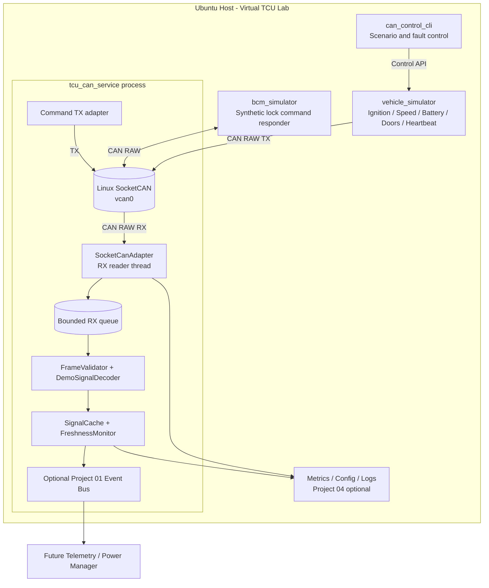
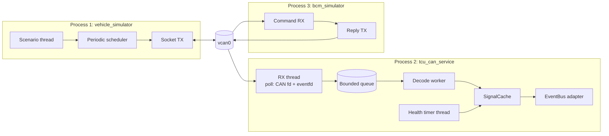
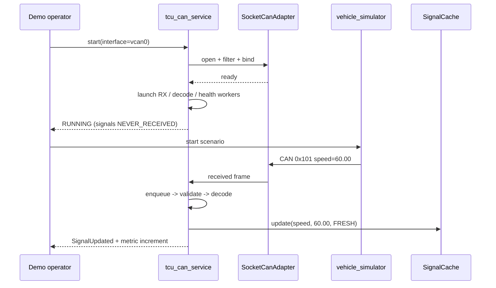
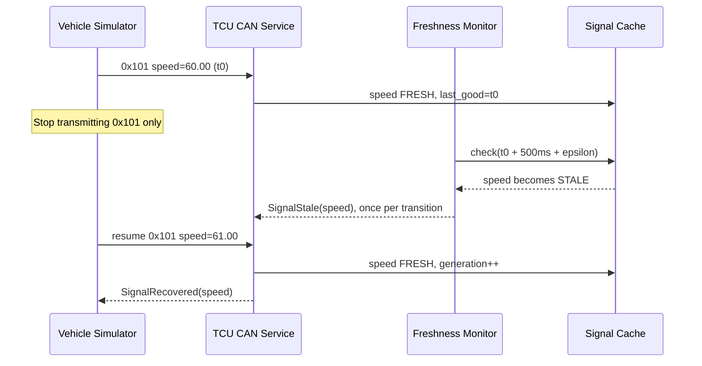
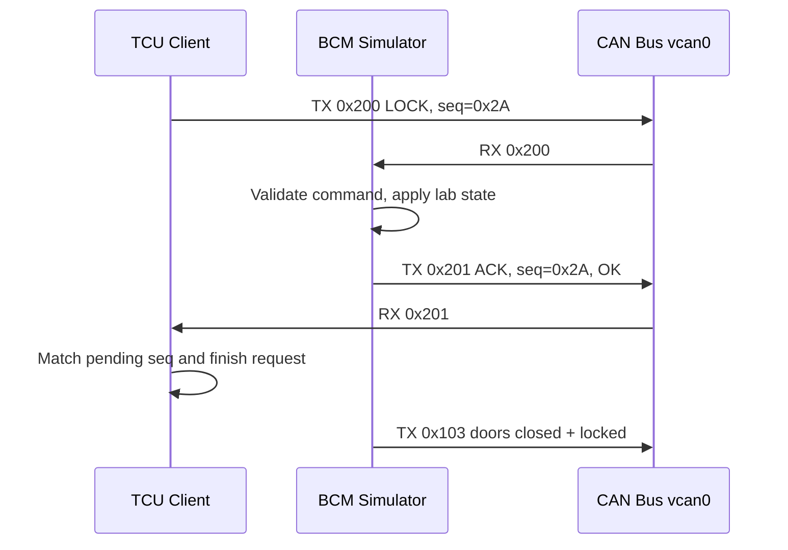
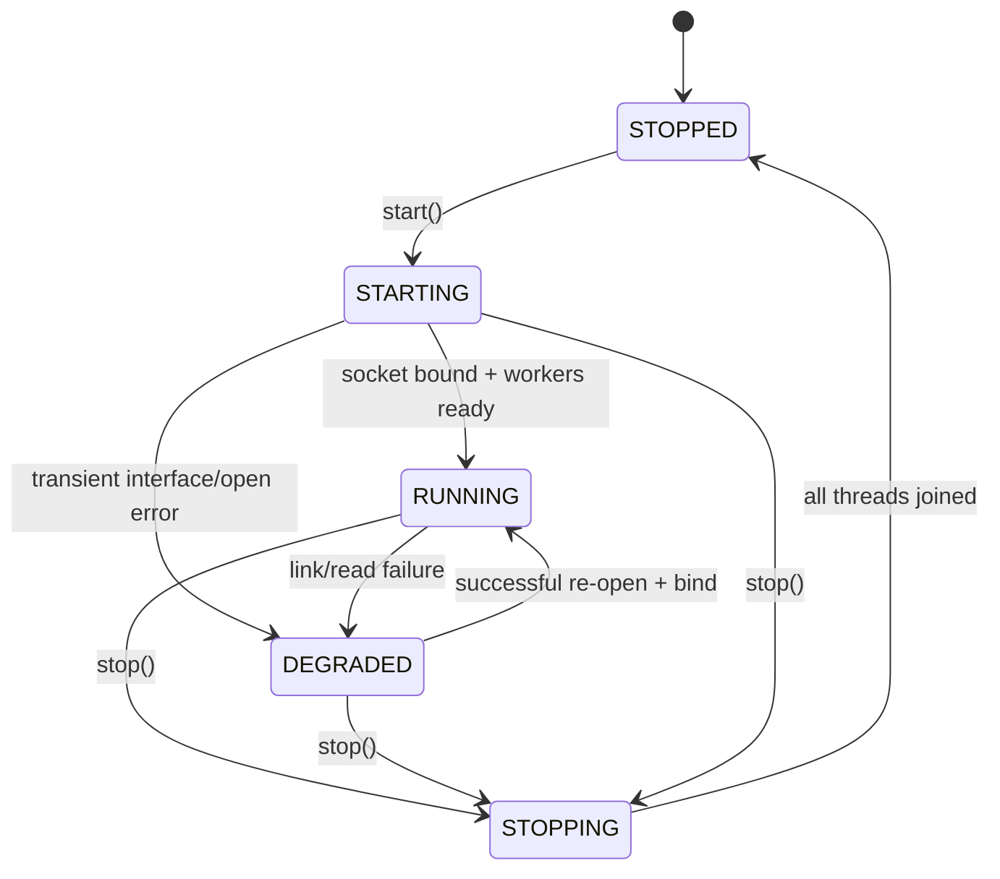
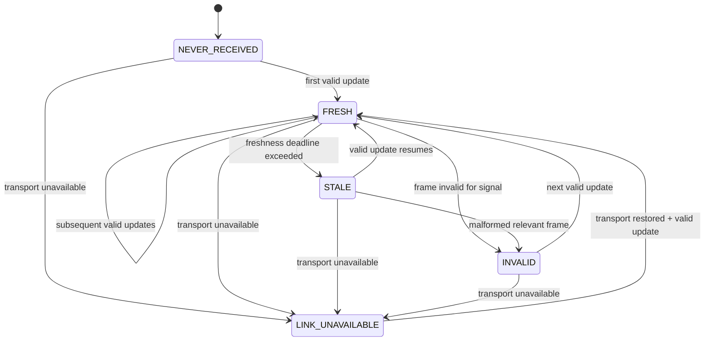

# Project 05 — Virtual CAN Bus Laboratory

> **Virtual TCU Lab | System Design & Behavioral Specification | Version 1.0**  
> **Language:** C++17 | **Platform:** Ubuntu Linux / SocketCAN (`vcan`) | **Priority:** P0  
> **Audience:** Middle C++ Developer (TCU application / middleware)  
> **Status:** Design proposal, **not** a claim that the library has been implemented or tested.  
> **Hardware:** Not required. All CAN nodes are simulated processes on a development host.

---

## 1. Executive Summary

Build a **Virtual CAN Bus Laboratory** that simulates communication between a TCU application and multiple ECUs over a Linux virtual CAN network (`vcan0`). Deliver a reusable C++17 transport library, a vehicle signal simulator, a TCU CAN receiver/service, a small BCM simulator, and an automated test suite.

The lab answers practical engineering questions:

1. How does a TCU receive frames asynchronously from CAN without busy-polling?
2. How are raw frame metadata and payload validated before entering business code?
3. How does a service distinguish **a received frame**, **a valid signal**, and **a fresh signal**?
4. What happens when an ECU stops transmitting, the interface disappears, frames arrive unexpectedly, or a queue fills up?
5. How do multiple simulated ECUs and the TCU coexist on one bus?
6. How can we demonstrate functionality and failures without physical CAN hardware?

**Key design choices:** Linux SocketCAN RAW sockets for transport; classical 11-bit CAN frames in V1; explicit synthetic signal mappings; a single RX reader and bounded decode queue; monotonic timestamps for stale detection; deterministic fake transports and fake clock for tests; optional Event Bus integration.

**Safety boundary:** All frame identifiers and signals in this design are **invented for a lab**. They must not be sent to a physical car, gateway, production ECU, or safety-critical system. This design is not an OEM-specific vehicle network specification.

---

## 2. Position in the 30-Project Roadmap

| Previous / next project | Relationship |
|---|---|
| 01 — Thread-Safe Event Bus | Optional transport for emitting `VehicleSignalUpdated`, `SignalStale`, and `CanLinkStatusChanged` events within the TCU process. |
| 02 — IPC Service Framework | Optional later extension: send decoded updates from the CAN service to a different process. |
| 03 — Timer & Task Scheduler | Optional scheduling mechanism for periodic vehicle frames and signal-health checks. |
| 04 — Configuration & Logging Service | Optional shared config snapshot, structured logging, and runtime metrics. |
| **05 — Virtual CAN Bus Laboratory** | **Current scope:** CAN RAW I/O, synthetic ECU simulator, simple decoding and behavior verification. |
| 06 — DBC Signal Decoder | Next scope: replace hand-written mapping with generalized DBC-based decoding (Intel/Motorola bit order, scale, offset, signedness). |
| 07 — Vehicle Gateway Simulator | Future: gateway routing and multi-bus paths. |
| 16 — Remote Vehicle Control | Future: secure cloud command handling; the Project 05 BCM command is only a local synthetic demo. |

**V1 boundary:** The decoder used here is intentionally simple and specific to this fake signal table. A general DBC parser, ISO-TP, UDS, SOME/IP, and full network fault modeling are outside scope.

---

## 3. Goals, Non-Goals, Assumptions

### 3.1 Goals

- **G-01** Create and use `vcan0` with no CAN interface hardware.
- **G-02** Send and receive classical CAN data frames using C++17 SocketCAN RAW sockets.
- **G-03** Simulate ignition, speed, battery, door/lock state, and ECU heartbeat.
- **G-04** Validate frame ID type, data length, known IDs, and field ranges.
- **G-05** Apply receive filters and preserve metadata in diagnostics.
- **G-06** Make telemetry timestamps and freshness status observable.
- **G-07** Detect missing periodic signals, recover on resumed traffic, and define startup defaults.
- **G-08** Handle expected I/O failures, overload, restart, and shutdown without deadlocks or memory growth.
- **G-09** Support CLI-driven fault injection and replayable test scenarios.
- **G-10** Provide buildable, tested, documented libraries and demo executables.

### 3.2 Non-goals

- Accurate representation of electrical CAN signaling, bit timing, arbitration delays, termination, ACK, noise, or a physical transceiver.
- Verification of real CAN controller error counters, physical bus-off, or genuine bus recovery timing using `vcan` alone.
- Production-quality OEM DBC parsing or interpretation of proprietary real vehicle signals.
- Safety-certified control, vehicle homologation, ASIL certification, or production automotive security.
- Exactly-once transmission, durable CAN delivery, or persistence of all frames.
- Implementation of ISO-TP, UDS, J1939, CANopen, CAN XL, or CAN FD in mandatory V1.
- Network tunneling of CAN frames to a real vehicle.

### 3.3 Reference Environment

| Item | Decision |
|---|---|
| OS | Ubuntu Linux with SocketCAN and `vcan` kernel support; native Linux recommended. |
| C++ | C++17, CMake 3.16+ (or pinned supported version), GCC/Clang. |
| CAN access | `PF_CAN`, `SOCK_RAW`, `CAN_RAW`; Linux UAPI `<linux/can.h>` and `<linux/can/raw.h>`. |
| Simulator | C++17 process with command-line configuration and optional fault scripts. |
| Tests | Google Test/Mock, CTest, integration shell/Python. |
| Baseline tools | `iproute2`, `can-utils` (`candump`, `cansend`, `cangen`, `canplayer`), `gdb`, sanitizers. |
| Clock | `std::chrono::steady_clock` for intervals; UTC/wall clock only for human logs. |
| Privileges | Admin privileges only for creating/managing `vcan0`; ordinary users can typically use it after setup. |

`vcan` availability depends on host kernel modules and environment permissions. Some container/WSL installations require kernel configuration or are unsuitable for creating virtual network interfaces; native Linux VM is a reliable fallback.

---

## 4. Use Cases and Actors

| Actor | Responsibility | Representative scenario |
|---|---|---|
| `vehicle_simulator` | Sends periodic and event-driven synthetic vehicle frames. | Speed increases from 0 to 60 km/h, ignition turns ON. |
| `bcm_simulator` | Listens for synthetic lock commands and emits responses/door-state frames. | TCU sends `LOCK`, BCM replies success. |
| `tcu_can_service` | Receives CAN frames, validates, decodes, checks freshness, publishes events. | Speed frame arrives, Telemetry module receives decoded speed. |
| `can_control_cli` | Modifies simulator state and faults. | Stop speed publication, inject invalid battery state. |
| `candump` | External observer and debugging reference. | Compare on-bus frames to service logs. |
| `metrics_cli` / demo output | Shows counters, queue state, freshness, and latest values. | Verify stale detection and drop counters. |

### 4.1 Core demo stories

1. **Vehicle startup:** ignition ON -> synthetic ECU heartbeat -> speed updates -> service shows fresh signals.
2. **Vehicle speed changes:** periodic raw frame -> validation -> decoding -> cache update -> optional Event Bus notification.
3. **Signal loss:** speed frames stop, but other traffic continues -> speed becomes stale after its timeout.
4. **CAN interface issue:** `vcan0` is removed/down -> service observes link/read issues, marks affected data not fresh, retries according to configuration.
5. **Command/ack demo:** TCU sends a synthetic lock command -> BCM simulator validates -> response arrives -> outcome logged.
6. **Noisy traffic:** unrelated IDs, malformed lengths (through fake transport), and excessive load -> service remains bounded and observable.

---

## 5. Architecture



### 5.1 Component responsibilities

| Component | Must do | Must not do |
|---|---|---|
| `SocketCanAdapter` | Open/bind CAN socket, set filters, read/write frames, manage FD ownership. | Make domain decisions such as door-lock safety policy. |
| `CanRxWorker` | Poll socket and shutdown wakeup FD; validate wire-level sizes; enqueue quickly. | Execute arbitrary user callbacks on RX thread. |
| `BoundedFrameQueue` | Bound memory, preserve FIFO of frames successfully enqueued, account for drops. | Claim kernel/physical traffic was lossless. |
| `FrameValidator` | Reject unsupported type, unexpected length, invalid metadata. | Parse generic DBC (Project 06). |
| `DemoSignalDecoder` | Decode documented synthetic IDs and fields; validate raw-to-physical mapping. | Guess signal definition from arbitrary frames. |
| `SignalCache` | Store last accepted value + arrival time + validity/freshness and generation. | Persist signals across reboot automatically. |
| `FreshnessMonitor` | Compare last RX monotonic timestamp with configurable timeout. | Infer stale signal is zero or false. |
| `VehicleSimulator` | Generate reproducible periodic and event-driven frames. | Model physical CAN arbitration with timing guarantees. |
| `BcmSimulator` | Ack/reject synthetic command under deterministic lab rules. | Control real door locks. |
| `CanMetrics` | Count receive, decode, reject/drop, stale, recoveries and TX. | Assert exact kernel packets delivered without extra instrumentation. |

### 5.2 Process and thread model



- **Single CAN RX reader:** one owner of `read`/`recvmsg` for the RX socket; no competing receive threads.
- **Single decode worker V1:** decoding and state update occur sequentially; simplifies ordering and testability.
- **Health timer:** checks freshness at a configured cadence; no wall-clock dependency.
- **Shutdown:** use `eventfd` (or equivalent deterministic wakeup) to interrupt `poll`; join threads before destroying sockets/queues.
- **Scaling:** more workers only after measuring contention and defining per-signal ordering semantics.

---

## 6. Synthetic CAN Network Contract

> The following frame IDs and payloads are *lab-only inventions*. They are intentionally **not** an OEM DBC. Classical CAN, standard 11-bit IDs only (`0x000`–`0x7FF`), **8 data bytes** per frame in the V1 demo.

### 6.1 CAN message catalog

| CAN ID | Direction | Cycle / trigger | Payload definition (little-endian where applicable) |
|---|---|---|---|
| `0x100` | Vehicle -> TCU | Change + every 1 s | Byte 0 bit 0: ignition (0 OFF, 1 ON); remaining bytes reserved zero. |
| `0x101` | Vehicle -> TCU | 100 ms | Bytes 0–1: speed `uint16_le`, scale `0.01 km/h`; other bytes zero. |
| `0x102` | Vehicle -> TCU | 1 s | Bytes 0–1: battery voltage `uint16_le`, scale `0.01 V`; byte 2: SOC 0–100%. |
| `0x103` | BCM -> TCU | Change + every 1 s | Byte 0 bits 0–3: four door-open flags; bit 4: doors locked; remaining reserved. |
| `0x110` | Vehicle -> TCU | 1 s | Byte 0: heartbeat counter modulo 256; byte 1: ECU status code (0 OK, 1 DEGRADED). |
| `0x200` | TCU -> BCM | On demo command | Byte 0: command (`0x01` LOCK, `0x02` UNLOCK); byte 1: correlation sequence (0–255). |
| `0x201` | BCM -> TCU | On `0x200` | Byte 0: correlation sequence; byte 1: result (`0x00` OK, `0x01` REJECTED, `0x02` INVALID). |

**Policy for reserved bytes:** V1 sender MUST set all reserved bytes to zero; V1 receiver ignores them but increments `reserved_nonzero_total` on nonzero reserved data, unless future schema version formalizes strict rejection. Do not accidentally interpret padding as new signals.

### 6.2 Examples: raw bytes and expected physical values

| Frame | Interpretation |
|---|---|
| `100#0100000000000000` | Ignition ON. |
| `100#0000000000000000` | Ignition OFF. |
| `101#7017000000000000` | Speed raw `0x1770` = 6000 -> **60.00 km/h**. |
| `101#0000000000000000` | Speed **0.00 km/h**. |
| `102#B004550000000000` | Voltage raw `0x04B0` = 1200 -> **12.00 V**, SOC `0x55` = **85%**. |
| `103#1000000000000000` | All doors closed; lock bit is 1. |
| `110#0100000000000000` | Heartbeat counter 1, healthy status. |
| `200#012A000000000000` | Synthetic LOCK request, sequence `0x2A`. |
| `201#2A00000000000000` | Synthetic ACK for sequence `0x2A`, result OK. |

**Important encoding notes:** CAN ID is **not** part of the data payload. SocketCAN `can_id` also contains flag bits; mask them before using a numeric identifier. CAN `len` is payload byte length (not the wire-level DLC encoding for CAN FD). For V1, reject frames with unsupported flags (EFF/RTR/ERR), rather than quietly interpreting them as data.

### 6.3 Signal constraints

| Signal | Decode and valid range | Freshness timeout (demo default) |
|---|---|---|
| Ignition | bit0 boolean | 3,000 ms |
| Vehicle speed | uint16_le × 0.01; 0–250.00 km/h | 500 ms |
| Battery voltage | uint16_le × 0.01; 6.00–18.00 V (demo only) | 3,000 ms |
| Battery SOC | byte 2; 0–100% | 3,000 ms |
| Doors + lock | bit masks | 3,000 ms |
| ECU heartbeat | counter modulo 256; status 0 or 1 | 3,000 ms |

Timeouts and ranges are **example configuration for the lab**, not production requirements. V1 treats a value outside its range as `INVALID` and does not overwrite the last good value; a separate `last_error` is updated.

### 6.4 Freshness and validity are separate dimensions

- `NEVER_RECEIVED`: no valid frame ever accepted for the signal since service start.
- `FRESH`: last accepted signal arrived within freshness timeout.
- `STALE`: accepted signal exists but deadline exceeded.
- `INVALID`: the latest relevant frame decoded incorrectly or contained out-of-range data; last good value remains available with explicit status.
- `LINK_UNAVAILABLE`: transport currently cannot receive; do not assume cache is fresh.

**Required API representation:** `value` is optional; `last_good_value` does not imply freshness. Avoid passing stale speed as `0`, or missing ignition as `false`.

---

## 7. Functional Requirements

| ID | Requirement | Expected evidence |
|---|---|---|
| FR-01 | Open `vcan0` by configured interface name. | Startup log, bind test. |
| FR-02 | Receive classical standard CAN frames using RAW socket. | `candump` and service agree on test input. |
| FR-03 | Send validated frames to `vcan0`. | `candump` sees outgoing lab frame. |
| FR-04 | Configure per-ID receive filters. | Irrelevant IDs do not reach decode pipeline in normal operation. |
| FR-05 | Decode all catalog messages using fixed synthetic schema. | Golden-vector unit tests. |
| FR-06 | Reject unsupported EFF, RTR, error frames and lengths != 8 for known V1 IDs. | Rejection counters and unit tests. |
| FR-07 | Publish decoded values with source CAN ID, timestamp and quality status. | Event subscriber integration. |
| FR-08 | Detect stale periodic signals and return freshness explicitly. | Fake-clock tests and live pause demo. |
| FR-09 | Recover freshness when a valid signal resumes. | STOP/RESUME injection. |
| FR-10 | Provide bounded RX queue and overload policy. | Stress test + drop metrics. |
| FR-11 | Support graceful start/stop, including pending `poll`. | Repeated startup/shutdown test. |
| FR-12 | Support simulator controlled state and reproducible seed. | Scenario replay produces equivalent value sequences. |
| FR-13 | Handle interface errors with reported DEGRADED state and controlled retry. | Interface down/recreate test. |
| FR-14 | Support synthetic BCM lock command/ack with sequence matching. | Integration command/response test. |
| FR-15 | Export counters, current signal quality and recent errors. | `metrics_cli` / console sample. |
| FR-16 | Run without real hardware and without cloud connectivity. | Local setup and CI smoke run. |

---

## 8. Non-Functional Requirements

- **NFR-01 — Safety:** no physical bus bridging, no real OEM CAN database, lab mode default.
- **NFR-02 — Memory bound:** RX ingress queue has capacity > 0, configurable with safe maximum; no unbounded buffering.
- **NFR-03 — Thread safety:** no shared mutable state without synchronization; run TSAN-compatible unit tests on fake transport where possible.
- **NFR-04 — Ownership:** RAII for socket FDs, threads, queue, and subscription handles.
- **NFR-05 — Latency:** no hard real-time claim. Measure RX-to-decoded latency under documented local load; report p50/p95/p99, not invented targets.
- **NFR-06 — Isolation:** malformed/unexpected frames do not terminate the TCU service.
- **NFR-07 — Data quality:** stale and invalid never silently become nominal values.
- **NFR-08 — Observability:** any drop or reject path must increment a distinguishable metric.
- **NFR-09 — Reproducibility:** a deterministic scenario and fixed seed are provided for all non-timing values.
- **NFR-10 — Portability boundary:** public domain model is not tied to Linux; `SocketCanAdapter` is Linux-specific.
- **NFR-11 — Shutdown:** no infinite join, callback after destruction, or close/use races on supported paths.
- **NFR-12 — Security:** reject malformed input; no assumption that classical CAN frames are authenticated.

---

## 9. C++17 API Design (Proposed)

The APIs below define **contracts to implement**. They are not a claim of existing compiled source code.

### 9.1 Domain types

```cpp
#pragma once
#include <array>
#include <chrono>
#include <cstdint>
#include <optional>
#include <string>

namespace tcu::can {

using SteadyTime = std::chrono::steady_clock::time_point;

enum class FrameFormat { Standard11, Extended29 };

enum class SignalQuality {
    NeverReceived,
    Fresh,
    Stale,
    Invalid,
    LinkUnavailable
};

struct CanMessage {
    std::uint32_t id{0};             // Numeric ID, stripped of Linux flag bits
    FrameFormat format{FrameFormat::Standard11};
    std::array<std::uint8_t, 8> data{};
    std::uint8_t length{0};          // 0..8 for classical CAN
    SteadyTime received_at{};        // Set on receive, not sender wall-clock
};

struct SignalSample {
    std::string signal_name;
    std::optional<double> value;
    SignalQuality quality{SignalQuality::NeverReceived};
    SteadyTime last_good_at{};
    std::uint32_t source_id{0};
    std::uint64_t generation{0};
};

} // namespace tcu::can
```

**Refinement:** For boolean/door/heartbeat semantics, a production-grade implementation should prefer typed variants or distinct signal structures rather than storing every value as `double`; `double` here simplifies the introductory dashboard contract.

### 9.2 Transport abstraction

```cpp
namespace tcu::can {

enum class ReadStatus { Received, Timeout, Interrupted, LinkError, FatalError };
enum class WriteStatus { Sent, InvalidFrame, LinkUnavailable, SystemError };

struct ReadResult {
    ReadStatus status;
    std::optional<CanMessage> message;
    int os_error{0};  // diagnostic errno snapshot, if any
};

class ICanTransport {
public:
    virtual ~ICanTransport() = default;
    virtual ReadResult receive(std::chrono::milliseconds timeout) = 0;
    virtual WriteStatus send(const CanMessage& msg) = 0;
    virtual void requestStop() noexcept = 0;
};

class SocketCanTransport final : public ICanTransport {
public:
    // Factory/open is preferable to a throwing constructor.
    // Provides CAN_RAW_FILTER and poll/eventfd-based wakeup.
    // Methods use explicit lifecycle and one receiver owner.
};

} // namespace tcu::can
```

**Receive contract:** `Received` carries one fully read supported frame; `Timeout` is normal; `Interrupted` is expected on shutdown; `LinkError` can be retried; `FatalError` requires service-level policy. OS error is captured immediately; no exceptions escape RX worker.

### 9.3 Decoder / signal cache interfaces

```cpp
namespace tcu::can {

struct DecodeResult {
    bool accepted{false};
    std::string reason;
    std::vector<SignalSample> updates;
};

class IDemoSignalDecoder {
public:
    virtual ~IDemoSignalDecoder() = default;
    virtual DecodeResult decode(const CanMessage& frame) = 0;
};

class ISignalCache {
public:
    virtual ~ISignalCache() = default;
    virtual void apply(const SignalSample& update) = 0;
    virtual std::optional<SignalSample> get(const std::string& name) const = 0;
    virtual void markStale(SteadyTime now) = 0;
    virtual void markLinkUnavailable() = 0;
};

} // namespace tcu::can
```

The snippet is illustrative and needs `<vector>` in the actual header. To avoid implicit timestamp ambiguities, a finalized API should carry explicit `SignalDefinition`, freshness deadline and last-error metadata in `SignalCache`.

### 9.4 High-level service facade

```cpp
namespace tcu::can {

enum class ServiceState { Stopped, Starting, Running, Degraded, Stopping };

struct CanServiceConfig {
    std::string interface_name{"vcan0"};
    std::size_t rx_queue_capacity{1024};
    std::chrono::milliseconds reconnect_initial{250};
    std::chrono::milliseconds reconnect_max{5000};
    std::chrono::milliseconds health_check_period{50};
};

class CanService {
public:
    // start(): false on invalid config/unrecoverable startup failure.
    // stop(): idempotent; joins all owned threads.
    bool start(const CanServiceConfig& config);
    void stop() noexcept;
    ServiceState state() const noexcept;
    std::optional<SignalSample> readSignal(const std::string& name) const;
    WriteStatus sendDemoCommand(std::uint8_t command,
                                std::uint8_t sequence);
};

} // namespace tcu::can
```

**Lifecycle rule:** `CanService` is non-copyable. A `stop()` call from inside an owned callback/worker is prohibited in V1; use `requestStop()` and let the owner thread perform `stop()` to avoid self-join.

### 9.5 Example of correct SocketCAN flags handling

```cpp
#include <linux/can.h>

bool isSupportedClassicStandardData(const can_frame& frame) {
    if (frame.can_id & (CAN_EFF_FLAG | CAN_RTR_FLAG | CAN_ERR_FLAG)) {
        return false;
    }
    const auto numeric_id = frame.can_id & CAN_SFF_MASK;
    return numeric_id <= CAN_SFF_MASK && frame.len <= CAN_MAX_DLEN;
}
```

For known synthetic messages, `FrameValidator` additionally requires `len == 8`. Since the numeric mask always fits by construction, a real implementation should focus on the flag and length checks, then on known-ID selection.

---

## 10. SocketCAN Adapter: Linux-Level Specification

### 10.1 Open/bind sequence

1. Validate interface-name length, supported format and config limits.
2. Create `socket(PF_CAN, SOCK_RAW | SOCK_CLOEXEC, CAN_RAW)` (or apply `FD_CLOEXEC` separately for portability).
3. Query interface index by `if_nametoindex()`; fail explicitly if name missing.
4. Configure `CAN_RAW_FILTER` for IDs `0x100`, `0x101`, `0x102`, `0x103`, `0x110`, `0x201` on the TCU RX socket; BCM uses `0x200`.
5. Create a separate `eventfd` as the shutdown wakeup signal; use `poll()` to watch CAN socket and `eventfd`.
6. Bind `sockaddr_can {AF_CAN, ifindex}` to the interface.
7. Read exactly `CAN_MTU` bytes into `struct can_frame` (classical CAN) and validate payload length.
8. On shutdown: signal eventfd, wake `poll()`, stop reader, join threads, close FDs via RAII.

**Filter detail:** matching semantics are `(received_id & mask) == (filter_id & mask)`. Use a mask that includes relevant format/flag checks where appropriate, not a careless filter that lets different frame types alias. A strict standard-data filter commonly uses `CAN_SFF_MASK | CAN_EFF_FLAG | CAN_RTR_FLAG` with matching flags clear.

### 10.2 Send contract

- V1 allows only standard 11-bit, non-RTR, non-error, classical frames with known demo IDs and expected length.
- `send()` serializes all writes that share a TX socket if accessed from multiple threads.
- Successful `write()` only means accepted by the local socket/kernel path; it does **not** prove a remote ECU processed the frame.
- For the BCM demo, delivery is acknowledged **at application level** by a matching `0x201` frame.
- `EINTR` may be retried; `EAGAIN` (if nonblocking) follows a bounded retry/timeout policy; partial/unexpected write is failure.

### 10.3 Receive policy

- CAN socket is configured nonblocking or polled before bounded reads.
- Avoid calling subscriber callbacks from the socket RX thread.
- On filter match, copy the frame to a bounded ingress queue.
- Default overload policy is **DropNewest**, with `rx_queue_drop_total` incremented and rate-limited logging. It is a lab/telemetry choice, **not appropriate as a blanket policy for safety-critical commands**.
- `candump`/a second socket can see traffic that a particular filtered TCU socket does not; this is normal.

### 10.4 Loopback and same-host visibility

SocketCAN RAW normally enables local loopback of transmitted frames to other matching sockets, while a socket does not normally receive its **own** sent frames unless `CAN_RAW_RECV_OWN_MSGS` is enabled. The lab should explicitly test behavior with separate RX/TX sockets and never assume loopback implies a real ECU acknowledged traffic.

### 10.5 Optional CAN FD extension (V2)

To support CAN FD, opt in using `CAN_RAW_FD_FRAMES`, handle both `CAN_MTU` and `CANFD_MTU`, and use `struct canfd_frame` with `len <= 64`. **Do not** read FD frames blindly into `struct can_frame`. This extension is not required for V1 and depends on interface/kernel support.

---

## 11. Sequence Diagrams — Normal Behavior

### 11.1 Startup / first valid signal



### 11.2 Stale signal and recovery



### 11.3 Synthetic lock command and acknowledgment



The sequence byte is only a *demo correlation mechanism*. With an 8-bit sequence it wraps; do not assume global uniqueness or security. A future Remote Control service must implement authentication, expiry, replay protection, and safety policy separately.

---

## 12. Lifecycle and State Machines

### 12.1 Service states



**Policy:** invalid configuration causes `start()` to return failure with state `STOPPED`. Transient interface errors may enter `DEGRADED` and retry. Any attempt to stop while starting is serialized through a lifecycle mutex; `start()` while already running is rejected or idempotent according to a single documented choice (V1 chooses **rejected / returns false**).

### 12.2 Read/health behavior



**State model clarification:** The diagram displays one *effective status* for UI simplicity. Implementation should track `last_good`, `last_error`, `transport_health`, and `freshness` as **separate fields** so information is not lost. When transport recovers, signal quality remains non-fresh until a new valid frame is received.

---

## 13. Operational Behavior — Step by Step

### 13.1 Boot sequence

1. Config service loads `interface=vcan0`, allowed IDs, queue capacity and signal deadlines.
2. CAN service validates config without opening threads.
3. Transport opens RAW socket and binds to the interface.
4. RX socket filters are installed and shutdown wakeup FD is ready.
5. Queue and threads start; signals are `NEVER_RECEIVED` and contain no nominal value.
6. Vehicle simulator starts and emits frames according to scenario.
7. Each accepted frame eventually updates signal cache, emits event and increments counters.

**Startup must not report ignition OFF or speed zero before receiving a valid frame.** Unknown and zero are distinct states.

### 13.2 Normal receive path

1. `poll()` reports CAN socket readable.
2. RX worker reads a complete `can_frame`, captures monotonic receipt time.
3. It checks transport-level wire size and copies frame into bounded queue.
4. Decode worker pops frame in FIFO order, validates flags/known ID/payload length.
5. Decoder produces typed signal updates; range checks happen before cache commit.
6. Cache updates `last_good_at`, increments generation and stores quality `FRESH`.
7. Event Bus adapter optionally publishes `VehicleSignalUpdated`.
8. Metrics report received/accepted/decoded/dispatched separately.

### 13.3 Unknown frame

- Unknown CAN ID is normally dropped at socket filter level (without entering application counters).
- In a test mode with broad filter, unknown ID reaches the application, increments `unknown_id_total`, and is ignored.
- It never changes cached signals or triggers a spurious business command.

### 13.4 Invalid relevant frame

- Known ID with wrong length, invalid flag or value outside defined range is rejected.
- Preserve last good physical value, record error reason and a distinct invalid status/event.
- Do not reset `last_good_at`; a malformed frame cannot refresh a stale signal.
- Repeated invalid frames may result in one quality transition plus a growing reject counter, not infinite duplicate events.

### 13.5 Timeout / missing signal

- The health worker checks each expected signal against `steady_clock`.
- Timeout uses `now > last_good_at + timeout`. At exact boundary, value is still fresh; tests pin this semantic.
- Signal becomes `STALE` once per state transition; other healthy signals remain fresh.
- On resumed valid frame, signal becomes `FRESH` and a recovery event is emitted once.
- Signal missing since process startup remains `NEVER_RECEIVED`, with optional startup-missing warning after a separate grace interval.

### 13.6 CAN interface down / missing

- When `vcan0` is not available, log a classified transport problem and enter `DEGRADED`.
- Set transport health unavailable; retain last good cache values but do not present them as fresh.
- Retry reopen/bind using bounded exponential backoff with optional jitter and a configurable maximum; never busy-loop.
- When the interface is recreated and transport binds, enter `RUNNING`; wait for new valid frames to restore `FRESH` status.
- Do not claim that `ip link down` always yields the exact same errno on every kernel; integration test checks externally observable degraded/recovered behavior.

### 13.7 Queue overload

- RX reader must not block indefinitely on a full queue.
- V1 policy: `DropNewest`; increment `rx_queue_drop_total` and rate-limit warning logs.
- Never silently mark dropped frames as decoded; quality can become stale if valid updates were dropped.
- If frame loss is unacceptable, change architecture/policy explicitly (sizing, kernel buffers, prioritization, consumer scaling), not by assuming a safety guarantee from this lab.

### 13.8 Graceful shutdown

1. Enter `STOPPING` and reject new outbound app requests.
2. Signal stop and wake the RX `poll()` via eventfd.
3. Join RX worker; no more queue enqueues.
4. **V1 `Drain` mode:** decode remaining queued frames up to a configured deadline, then discard leftovers and count them.
5. Join decode and health workers; do not invoke callbacks after dependent objects are destroyed.
6. Release Event Bus adapter, queue, sockets, and eventfd in ownership order.
7. Enter `STOPPED`. Repeat `stop()` does nothing and never double-closes FDs.

For fast shutdown, an explicit `Discard` mode is permissible; the caller chooses one policy and it must be tested. A callback must never block `stop()` forever.

### 13.9 Process crash / restart

- CAN frames are not persisted. Frames sent while the TCU process is absent are not replayed automatically.
- On restart, all signals begin `NEVER_RECEIVED`, unless a later project implements a carefully marked persisted snapshot.
- Simulators continue to emit; a restarted TCU can receive the next periodic frame and recover freshness.
- Application commands that were in flight require a separate end-to-end timeout/reconciliation policy.

---

## 14. Behavior Contracts (Given / When / Then)

The following BDD contracts are intended to become executable tests.

| ID | Given | When | Then |
|---|---|---|---|
| B-01 | `vcan0` exists and config valid | `start()` called | Service enters `RUNNING`; no signal is fabricated. |
| B-02 | No valid speed frame | Read speed immediately | Value absent, quality `NEVER_RECEIVED`. |
| B-03 | Service running | Receive `101#7017000000000000` | Speed=60.00, quality `FRESH`, source ID `0x101`. |
| B-04 | Speed=60.00 fresh | Receive speed=0 | Speed is valid 0.00, not missing. |
| B-05 | Speed=60.00 fresh | Receive new speed=70.00 | Latest value 70.00; generation increments. |
| B-06 | Last speed valid at t0 | At t0+500ms (exact) check freshness | Still `FRESH` by chosen strict-greater timeout rule. |
| B-07 | Last speed valid at t0 | At t0+501ms check freshness | `STALE` transition; last good remains 60.00. |
| B-08 | Speed already stale | Health timer checks repeatedly | Exactly one stale-transition event, no repeated spam. |
| B-09 | Speed stale | Valid speed frame resumes | Quality `FRESH`, one recovery event. |
| B-10 | Speed fresh | Receive malformed length on ID `0x101` | Reject and mark error; last good time/value unchanged. |
| B-11 | Speed fresh | Receive out-of-range 300.00 km/h | Reject; does not overwrite good value or refresh deadline. |
| B-12 | Service running | Unknown CAN ID arrives in broad-filter test | `unknown_id_total` increases; no domain update. |
| B-13 | Service running | Standard RTR frame received | Reject as unsupported; no signal mutation. |
| B-14 | Service running | Extended-ID frame with same low 11 bits | Reject; must not alias standard ID. |
| B-15 | Service running | CAN error frame received by injected fake transport | Reject as domain data; classify separately. |
| B-16 | Ingress queue full | Another frame arrives | `DropNewest` occurs, counter increments, no unbounded memory. |
| B-17 | Multiple simulator ECUs online | Publish interleaved IDs | TCU decodes each known ID correctly; no cross-signal corruption. |
| B-18 | All expected signals fresh | Speed sender stops but heartbeat continues | Only speed becomes stale after its deadline. |
| B-19 | Link down / interface removed | Receive I/O fails | Service `DEGRADED`; retries bounded without busy spin. |
| B-20 | Link recreated | Retry succeeds and frames resume | Service `RUNNING`, signal fresh only after valid new frame. |
| B-21 | Service stopped | `sendDemoCommand()` called | Returns `LinkUnavailable` (or documented stopped status). |
| B-22 | BCM simulator running | Send LOCK seq=0x2A | BCM returns matching success ACK and state update. |
| B-23 | LOCK seq=0x2A pending | Receive ACK with different seq | Ignore unrelated ACK; pending request remains pending. |
| B-24 | BCM rejects invalid command | Send unknown command byte | Explicit REJECTED/INVALID response; no state change. |
| B-25 | Service running | Call `stop()` | RX worker wakes, threads join, service `STOPPED`. |
| B-26 | Service stopped | Call `stop()` again | No-op, no double close. |
| B-27 | Service running | Call `start()` again | Rejected; no duplicate threads or sockets. |
| B-28 | Process crashes | Restart without persisted state | `NEVER_RECEIVED` until new valid frames arrive. |
| B-29 | Reproducible scenario, fixed seed | Execute scenario twice | Same logical signal values/order; wall-clock timing may vary. |
| B-30 | Host under stress | Inject random frames and frequent stop/start | No memory error, deadlock, or unbounded queue under supported test conditions. |

**Test note:** Some malformed CAN frames cannot be placed on a real `vcan` interface because kernel validation rejects them. Inject such cases via `FakeCanTransport` or call `FrameValidator` directly. Do not claim an impossible on-wire test passed.

---

## 15. Fault Injection Matrix

| Fault | Injection mechanism | Expected detection | Expected recovery |
|---|---|---|---|
| Speed traffic disappears | `vehicle_simulator --pause-id 0x101` | Speed freshness deadline passes | Resume ID 0x101 -> fresh again. |
| Battery frame invalid | Fake transport provides 0x102 with SOC=120 | Decoder rejects, invalid metric | Next valid frame updates signal. |
| Unknown identifier | `cansend vcan0 555#...` with broad-filter test mode | Unknown ID counter | Ignore safely. |
| Unexpected length | Fake transport supplies 3-byte 0x101 | Validation failure | Keep last good. |
| Interface missing | Start without `vcan0` | Open/bind failure | Retry after interface created. |
| Interface down | `sudo ip link set vcan0 down` | Degraded transport health | Interface up/rebind (platform-specific). |
| Interface deleted | `sudo ip link del vcan0` | Socket/link error | Recreate and reopen/rebind. |
| Burst traffic | `cangen vcan0 ...` with safe options | Queue-depth rise, drops if overloaded | Return to normal after burst. |
| Decoder slow | Test hook sleeps on decode worker | Ingress queue fills | Observable backpressure; no crash. |
| Process killed | `kill -9` (integration test only) | Missing process | Restart service; no automatic packet replay. |
| Fake transport EIO | Inject read error | Transport error metric | Controlled retry state. |
| `stop()` while `poll()` waits | Signal eventfd | Immediate wakeup path | Join and clean release. |
| Duplicate command ACK | BCM fake sends duplicate response | Pending request already closed | Ignore duplicate; count anomaly. |
| Frame flood | Randomized property test | Validate parsing, bounds | No unchecked allocations. |

**Physical limitations of `vcan`:** it is suitable for testing user-space CAN software but cannot establish physical bus arbitration timing, transceiver behavior, electrical faults, or authentic bus-off recovery. These require other test infrastructure or real hardware/HIL.

---

## 16. Observability and Metrics

| Metric | Meaning | Invariant / note |
|---|---|---|
| `can_rx_read_total` | Complete frames read from RAW socket | Does not prove no frames were lost in kernel. |
| `can_rx_enqueued_total` | Frames admitted to bounded ingress queue | `<= can_rx_read_total`. |
| `can_rx_queue_drop_total` | Frames discarded by V1 overload policy | Count every intentional app-level queue drop. |
| `can_rx_invalid_total` | Frames rejected by validator/decoder | Split by reason tags in detail. |
| `can_unknown_id_total` | Unknown IDs seen when broad filter enabled | Normally zero due to socket filter. |
| `can_decoded_total` | Frames successfully decoded into signals | Does not equal number of signal updates. |
| `signal_update_total` | Accepted physical-value updates | May exceed decoded frames (multi-signal frames). |
| `signal_stale_transitions_total` | Fresh -> Stale transitions | No repeats each health tick. |
| `signal_recovered_total` | Stale/unavailable -> Fresh transitions | Only after valid frame. |
| `can_tx_attempt_total` | Outbound send attempts | Split result by status. |
| `can_tx_success_total` | Successful local socket writes | Does not assert application-level ACK. |
| `can_link_reconnect_total` | Successful re-open/rebind after link failure | No false successes during retries. |
| `can_queue_depth` | Current bounded queue usage | `0 <= depth <= capacity`. |
| `can_decode_latency_ms` | Measured receipt-to-decode duration | Histogram p50/p95/p99 in benchmark output. |

### 16.1 Example structured logs (illustrative)

```text
2026-10-30T02:00:00Z INFO  can_service event=started interface=vcan0 state=RUNNING
2026-10-30T02:00:01Z INFO  signal event=updated name=speed_kmh value=60.00 quality=FRESH can_id=0x101
2026-10-30T02:00:02Z WARN  signal event=stale name=speed_kmh age_ms=501 timeout_ms=500
2026-10-30T02:00:03Z INFO  signal event=recovered name=speed_kmh value=61.00
2026-10-30T02:00:04Z WARN  can_service event=link_unavailable interface=vcan0 state=DEGRADED
2026-10-30T02:00:06Z INFO  can_service event=link_restored interface=vcan0 state=RUNNING
```

The timestamps and values above are sample expectations, not measured output. Avoid logging full raw CAN payloads indefinitely in production or with real vehicle data; use access controls, retention policy, and privacy review.

### 16.2 Health surface

```json
{
  "service_state": "RUNNING",
  "interface": "vcan0",
  "rx_queue_depth": 0,
  "rx_queue_capacity": 1024,
  "signals": {
    "speed_kmh": {
      "value": 60.0,
      "quality": "FRESH",
      "source_can_id": "0x101",
      "age_ms": 72
    },
    "ignition": {
      "value": null,
      "quality": "NEVER_RECEIVED"
    }
  }
}
```

This JSON is an **example presentation**, not a schema guaranteed by an existing implementation.

---

## 17. Data Integrity, Concurrency and Ownership

### 17.1 Locking rules

1. Transport/socket FD belongs to the adapter; RX worker is the only receiver.
2. TX socket writes serialized where multiple senders exist.
3. Queue mutex protects queue state; callback invocation happens **after releasing** queue lock.
4. Cache mutex protects signal state; events are published only **after releasing** cache lock.
5. Lifecycle mutex prevents concurrent start/stop races; join outside locks that workers may need.
6. Shutdown eventfd remains alive until RX thread has exited.
7. Never emit a user callback under socket, queue, cache, or lifecycle mutex.

### 17.2 Invariants

- A committed cache update contains a validated value and nonzero signal-generation number.
- `last_good_at` can only advance on valid accepted input.
- Every queue drop/reject is observable by a counter.
- No signal is `FRESH` without a valid frame or with unavailable transport.
- Only one worker dispatches decoded updates in V1; accepted queue FIFO is preserved.
- CAN socket writes do not imply an ACK; BCM application-level correlation is separate.
- `stop()` releases owned resources exactly once.

### 17.3 Time semantics

Use monotonic time in the receive and health paths. Simulator cycle scheduling can use Project 03 Timer Scheduler or `sleep_until()` on a steady clock. System clock adjustments cannot change stale logic. Logs may carry UTC timestamps independently.

### 17.4 Backpressure alternatives

| Option | Benefit | Risk / V1 decision |
|---|---|---|
| DropNewest | Minimal RX blocking; bounded memory | **Chosen V1**; telemetry loss possible, must count drops. |
| DropOldest | Often preserves latest sensor estimate | Can drop pending state transitions/commands; not default. |
| Block producer | Stronger queue admission | Could stall RX reader, amplify kernel drops. |
| Per-ID coalescing | Efficient latest-value telemetry | Changes event semantics and may hide transitions. |
| Priority queue | Separate command/status sensitivity | Future design; needs fairness specification. |

---

## 18. Testing Strategy

### 18.1 Unit tests (no kernel interface required)

| Test ID | Test case | Expected assertion |
|---|---|---|
| UT-01 | Decode speed raw 0x1770 | 60.00 km/h. |
| UT-02 | Decode battery raw 0x04B0 and SOC 0x55 | 12.00 V and 85%. |
| UT-03 | Ignition 0 and 1 | Explicit false/true with valid quality. |
| UT-04 | Door bitmask | Open/closed/locked bits correctly mapped. |
| UT-05 | Unknown ID | No accepted signal. |
| UT-06 | Unsupported extended frame | Reject without aliasing. |
| UT-07 | RTR / error frame | Reject and classify. |
| UT-08 | Length 7 for known ID | Reject, no cache commit. |
| UT-09 | Out-of-range speed | Reject, preserve last good. |
| UT-10 | Invalid battery SOC 120 | Reject affected signal per selected atomic-frame policy. |
| UT-11 | Fake clock t=timeout boundary | Still fresh (strict `>`). |
| UT-12 | Fake clock after timeout | Exactly one `SignalStale` event. |
| UT-13 | Stale -> new valid data | Exactly one recovery transition. |
| UT-14 | Queue full | DropNewest, depth <= capacity. |
| UT-15 | Multiple producers | No data race, bounded queue. |
| UT-16 | I/O failure injected | Service enters degraded/retry path. |
| UT-17 | Repeated stop/start | No double close or orphan threads. |
| UT-18 | ACK correlation mismatch | Do not complete unrelated command. |
| UT-19 | Heartbeat wraps 255 -> 0 | Accept as normal modulo behavior. |
| UT-20 | Reserved bytes nonzero | Count anomaly, follow V1 ignored-reserved policy. |
| UT-21 | Processor callback throws (if callback adapter used) | Isolate failure, keep service alive. |
| UT-22 | No valid startup data | NeverReceived, no zero-value defaults. |

### 18.2 Integration tests on `vcan0`

1. Provision `vcan0`, start `candump`, then start receiver + simulator.
2. Inject known frames using `cansend`; compare decoded output and cache.
3. Verify socket filter with known ID vs unrelated ID.
4. Suspend one simulated signal; assert only that signal becomes stale.
5. Restart simulator; assert fresh recovery without restarting TCU process.
6. Start BCM simulator, send demo lock sequence; verify correlated reply.
7. Delete/recreate `vcan0`; assert controlled recovery if supported by host/kernel behavior.
8. Stop receiver while idle; assert clean bounded shutdown.

### 18.3 Stress, fault and fuzz tests

- Repeated high-rate input with `cangen`, bounded queue assertions and CPU/memory profiling.
- Generator replay from saved seeds.
- Decoder fuzz testing with random IDs, flags, lengths, and payloads through fake transport (not relying on malformed kernel frames).
- AddressSanitizer and UndefinedBehaviorSanitizer for memory/UB checks.
- ThreadSanitizer for user-space concurrency tests on supported toolchains/environments.
- Separate negative tests for invalid interface name, missing permissions, interface down/up, read errors, and forced process kill.

### 18.4 Performance characterization (not an automotive guarantee)

Record host CPU model, Linux kernel, compiler/build flags, queue capacity, frame rates, number of consumers, and run duration. Report p50/p95/p99 latency, max resident memory, total drops, and CPU usage. A 100 frames/s smoke scenario is illustrative; do not make universal performance claims from one laptop.

---

## 19. Jira Backlog — Implementation Ready

| Ticket | Summary | Acceptance criteria | Depends on |
|---|---|---|---|
| CAN-001 | Bootstrap CMake + Google Test | `cmake --build`, `ctest` run on Ubuntu. | None |
| CAN-002 | Define synthetic CAN signal catalog | IDs, payloads, ranges, timeouts documented and golden vectors created. | CAN-001 |
| CAN-003 | Implement RAII SocketCAN RAW transport | Open/bind/filter/send/receive; error outcomes tested with fake adapter. | CAN-001 |
| CAN-004 | Build `vehicle_simulator` | Deterministic 0x100/101/102/110 periodic frames, CLI scenario options. | CAN-002/003 |
| CAN-005 | Build `bcm_simulator` | 0x200 commands receive ack 0x201 and publish 0x103. | CAN-002/003 |
| CAN-006 | Implement frame validator | Reject unsupported flags and lengths; tests pass. | CAN-002 |
| CAN-007 | Implement demo signal decoder | All catalog golden vectors decode; values/ranges enforced. | CAN-006 |
| CAN-008 | Implement bounded ingress queue | DropNewest and FIFO admission tests; no unbounded growth. | CAN-001 |
| CAN-009 | Implement CAN RX worker | poll/eventfd, queue handoff, clean shutdown. | CAN-003/008 |
| CAN-010 | Implement signal cache and fake clock | Quality, generation, timestamp tests pass. | CAN-007 |
| CAN-011 | Implement freshness monitor | One stale transition, one recovered transition; independent IDs. | CAN-010 |
| CAN-012 | Implement link loss / retry state machine | DEGRADED -> RUNNING with bounded backoff in fake and vcan integration. | CAN-003/009 |
| CAN-013 | Add Event Bus / logging adapters | Events delivered and errors do not escape into RX thread. | CAN-009/010 |
| CAN-014 | Implement synthetic command/ack correlation | Matching sequences complete, wrong/duplicate ignored. | CAN-005/009 |
| CAN-015 | Implement metrics and diagnostics CLI | Counters and signal quality queryable; metrics invariants tested. | CAN-009/010 |
| CAN-016 | Implement fault injection commands | Pause/resume, corrupt fake data, link failure scenarios reproducible. | CAN-004/012 |
| CAN-017 | Integration test harness with `vcan0` | Provision/cleanup scripts, smoke/timeout/BCM tests in CI host with rights. | CAN-004..016 |
| CAN-018 | Stress, sanitizer and benchmark suite | Recorded environment, summary report, no unaddressed sanitizer failures. | CAN-017 |
| CAN-019 | Documentation + design review | README, system design, known vcan limitations, ADRs and demo commands. | All |

### 19.1 Suggested implementation sprints

- **Sprint 1 (foundation):** CAN-001 to CAN-007 — setup, wire protocol, sender/receiver, decoding.
- **Sprint 2 (robustness):** CAN-008 to CAN-012 — queues, lifecycle, signal quality, link recovery.
- **Sprint 3 (integration):** CAN-013 to CAN-019 — events, BCM demo, metrics, fault testing, documentation.

Sprint duration depends on team capacity; estimates are intentionally omitted rather than invented.

---

## 20. Proposed Repository Layout

```text
virtual-tcu-lab/
├── CMakeLists.txt
├── cmake/
├── docs/
│   └── 05_Virtual_CAN_Bus_Laboratory_System_Design.md
├── config/
│   ├── can_lab.json
│   └── scenarios/
│       ├── normal_drive.json
│       ├── speed_signal_loss.json
│       └── invalid_battery.json
├── include/tcu/can/
│   ├── can_message.hpp
│   ├── can_transport.hpp
│   ├── socketcan_transport.hpp
│   ├── frame_validator.hpp
│   ├── demo_signal_decoder.hpp
│   ├── signal_cache.hpp
│   ├── can_service.hpp
│   └── can_metrics.hpp
├── src/
│   ├── socketcan_transport.cpp
│   ├── frame_validator.cpp
│   ├── demo_signal_decoder.cpp
│   ├── signal_cache.cpp
│   └── can_service.cpp
├── apps/
│   ├── vehicle_simulator/main.cpp
│   ├── bcm_simulator/main.cpp
│   ├── tcu_can_service/main.cpp
│   └── can_control_cli/main.cpp
├── scripts/
│   ├── setup_vcan.sh
│   ├── teardown_vcan.sh
│   ├── demo_normal.sh
│   ├── demo_signal_loss.sh
│   └── integration_test.sh
└── tests/
    ├── unit/
    │   ├── test_frame_validator.cpp
    │   ├── test_demo_signal_decoder.cpp
    │   ├── test_signal_cache.cpp
    │   └── test_service_lifecycle.cpp
    ├── integration/
    │   ├── test_can_roundtrip.cpp
    │   ├── test_signal_loss.cpp
    │   └── test_bcm_command.cpp
    └── fake/
        ├── fake_can_transport.hpp
        └── fake_clock.hpp
```

---

## 21. Demo Workflow — Ubuntu, No Hardware

### 21.1 Install tools

```bash
sudo apt update
sudo apt install -y build-essential cmake ninja-build \
  iproute2 can-utils libgtest-dev libgmock-dev
```

### 21.2 Create virtual CAN interface

```bash
sudo modprobe vcan
sudo ip link add dev vcan0 type vcan
sudo ip link set dev vcan0 up
ip -details link show vcan0
```

If `vcan0` already exists, skip creation or use a script that checks first. Do not change real interfaces named `can0`/`can1` for this lab.

### 21.3 Verify Linux SocketCAN before writing C++

**Terminal A — observer**

```bash
candump vcan0
```

**Terminal B — inject test frames**

```bash
cansend vcan0 100#0100000000000000
cansend vcan0 101#7017000000000000
cansend vcan0 102#B004550000000000
cansend vcan0 103#1000000000000000
cansend vcan0 110#0100000000000000
```

Expected decoded interpretation: ignition ON; speed 60.00 km/h; battery 12.00 V and SOC 85%; all doors closed and locked; heartbeat healthy.

### 21.4 Build and run proposed programs **after implementation**

```bash
cmake -S . -B build -G Ninja -DCMAKE_BUILD_TYPE=Debug
cmake --build build
ctest --test-dir build --output-on-failure

# These executable names are part of the design, not existing artifacts:
./build/bin/tcu_can_service --interface vcan0 --config config/can_lab.json
./build/bin/vehicle_simulator --interface vcan0 --scenario config/scenarios/normal_drive.json
./build/bin/bcm_simulator --interface vcan0
```

### 21.5 Interactive behavior demonstration

1. Observe fresh ignition, speed, battery and heartbeat in TCU logs/dashboard.
2. Pause only speed publication from `can_control_cli` (to be implemented).
3. Confirm speed becomes stale after 500ms plus health-check scheduling delay; heartbeat remains fresh.
4. Resume speed frames and confirm one recovered transition.
5. Send LOCK command with seq `0x2A`; verify a matching ACK and door state.
6. Stop the receiver and confirm all owned threads exit without a forced kill.

### 21.6 Interface fault demonstration

```bash
sudo ip link set dev vcan0 down
# Observe service degraded / signal quality change.
sudo ip link set dev vcan0 up
# Observe controlled reopen / receive resumption.
```

Actual error order and recovery mechanism can vary across Linux versions. The integration test should assert the final externally observable state rather than a specific errno sequence.

### 21.7 Cleanup

```bash
sudo ip link set dev vcan0 down
sudo ip link delete dev vcan0 type vcan
```

**Note:** `vcan` has no external wire, so CAN `bitrate` configuration is not a meaningful physical timing verification. Avoid inventing a bitrate-based bus-load conclusion from this lab.

---

## 22. Sample Configuration (Design Contract)

```json
{
  "schema_version": 1,
  "mode": "lab_only",
  "can": {
    "interface": "vcan0",
    "format": "classic_standard_11bit",
    "rx_queue_capacity": 1024,
    "health_check_ms": 50,
    "reconnect": {
      "initial_ms": 250,
      "max_ms": 5000,
      "jitter_percent": 10
    },
    "allowed_rx_ids": [256, 257, 258, 259, 272, 513]
  },
  "signals": {
    "ignition": {"can_id": 256, "timeout_ms": 3000},
    "speed_kmh": {"can_id": 257, "timeout_ms": 500},
    "battery_voltage_v": {"can_id": 258, "timeout_ms": 3000},
    "battery_soc_pct": {"can_id": 258, "timeout_ms": 3000},
    "door_state": {"can_id": 259, "timeout_ms": 3000},
    "heartbeat": {"can_id": 272, "timeout_ms": 3000}
  },
  "simulator": {
    "speed_period_ms": 100,
    "heartbeat_period_ms": 1000,
    "fixed_seed": 42
  }
}
```

The decimal CAN IDs above map to `0x100=256`, `0x101=257`, `0x102=258`, `0x103=259`, `0x110=272`, `0x201=513`. **Application validation** must reject configuration that violates known ID set, nonpositive deadlines, nonpositive queue capacity, and inappropriate physical-interface names in strict lab mode.

---

## 23. Design Decisions (ADR Candidates)

### ADR-01 — SocketCAN RAW rather than CAN device-specific libraries

**Decision:** use Linux kernel SocketCAN RAW sockets.  
**Reason:** standard Linux APIs, `vcan` simulation, compatibility with `can-utils`.  
**Trade-off:** Linux-specific adapter; platform abstraction needed for QNX/other OS.

### ADR-02 — Synthetic fixed schema instead of DBC parser

**Decision:** hand-coded decoder for seven fake IDs in V1.  
**Reason:** focus on transport, lifecycle and behaviors; Project 06 handles DBC complexity.  
**Trade-off:** schema changes require code edits until generalized.

### ADR-03 — Single decode worker

**Decision:** one RX thread and one decoder worker.  
**Reason:** stable ordering, simple cache/quality consistency.  
**Trade-off:** slower decoder can become bottleneck; observe metrics before scaling.

### ADR-04 — DropNewest on bounded RX queue

**Decision:** never block CAN reader indefinitely; count every app-level drop.  
**Reason:** limit memory and protect socket reader under load.  
**Trade-off:** frame loss, unsuitable by itself for safety-critical/control functions.

### ADR-05 — Monotonic signal freshness

**Decision:** stale detection based on `steady_clock`, not wall-clock time.  
**Reason:** withstand system time changes and support deterministic fake-clock tests.  
**Trade-off:** timestamps need separate UTC conversion for human display.

### ADR-06 — Link recovery rather than process termination

**Decision:** transient missing/down interface -> `DEGRADED` -> bounded retry.  
**Reason:** realistic long-running device behavior.  
**Trade-off:** must design retry cancellation and avoid stale state misrepresentation.

### ADR-07 — Strict lab-only command scope

**Decision:** synthetic `0x200` and `0x201` only; no real BCM/CAN IDs.  
**Reason:** learning remote request/ack correlation without touching a vehicle.  
**Trade-off:** not a substitute for secure remote vehicle control implementation.

---

## 24. Risks, Limitations and Mitigations

| Risk | Impact | Mitigation |
|---|---|---|
| Misusing lab IDs on real vehicle | Unsafe/inappropriate actuation | Strict `lab_only` mode, only `vcan*` interfaces accepted by default, documentation warnings. |
| Treating vcan as physical CAN fidelity | Invalid engineering conclusions | Document limitation; use HIL/physical tests for arbitration, bus-off and noise. |
| Unbounded queue or callback blocking | Memory leak / delayed processing | Bounded queue, one lightweight RX thread, measured drop policy. |
| Bad decoder accepting frame flags | Wrong signal values | Proper flag masks, filter and validator tests. |
| Invalid signal interpreted as zero | Wrong system-level decisions | Explicit quality/optional value model. |
| Timestamp races / wall clock changes | False stale/recovered transitions | Inject steady clock, serialize cache updates. |
| Close/read concurrency on FDs | Crash / stuck shutdown | eventfd wakeup, owner-thread join, RAII. |
| Simulator and TCU using same code assumptions | False-positive tests | Independent golden vectors plus `cansend` / `candump` reference checks. |
| 8-bit command sequence wraps | Correlation ambiguity | Bounded number of in-flight commands in lab; future robust correlation protocol. |
| False sense of security | Real CAN does not authenticate payload | Treat incoming frames as untrusted; separate auth and policy in later projects. |

---

## 25. Integration Plan with the Virtual TCU Lab

| Integration | Input / output | Behavior contract |
|---|---|---|
| Project 01 — Event Bus | `SignalUpdated`, `SignalStale`, `CanLinkStatusChanged` | Event publishing never holds CAN/cache mutexes; failures tracked. |
| Project 02 — IPC | Decoded signal snapshots from CAN service to another process | Versioned messages, timeout/reconnect behavior owned by IPC. |
| Project 03 — Scheduler | Signal freshness checks and simulator periodic TX | Task scheduling must not overlap same signal update unexpectedly. |
| Project 04 — Config/Logging | Immutable timeouts/filters; structured logs | Invalid config reload does not partially change CAN behavior. |
| Project 06 — DBC | Replace demo decoder with ID/bit extraction tables | Preserve transport API and quality semantics. |
| Project 07 — Gateway | Multiple virtual interfaces (`vcan0`, `vcan1`) | Forwarding and loop prevention clearly specified. |
| Project 13 — MQTT | Fresh telemetry updates | Reject/mark stale data according to cloud publishing policy. |
| Project 16 — Remote Control | Secure command -> synthetic CAN command | Auth and vehicle safety policy evaluated before any send. |
| Project 17 — Health | Link health and stale signal counts | Distinguish interface health from individual ECU/signal health. |

**Suggested event payload:** `{ signal_name, typed_value, quality, source_can_id, sequence/generation, monotonic_age_ms, utc_observed_at_optional }`. Do not transport a raw `steady_clock::time_point` across machines/processes as a portable serialization format; use explicit time basis and conversion policy.

---

## 26. Definition of Done / Acceptance Checklist

- [ ] Lab uses only fake identifiers and `vcan` by default; no physical car required.
- [ ] Config and startup validation prevent accidental real CAN interface access in strict lab mode.
- [ ] CMake project builds with at least one supported Ubuntu toolchain.
- [ ] `setup_vcan.sh` and teardown script are repeatable/idempotent.
- [ ] `candump` confirms frames sent by simulator and `cansend` confirms TCU receive.
- [ ] Known input frames decode to expected physical values with independent golden vectors.
- [ ] Signal quality is explicit: never received, fresh, stale, invalid, unavailable.
- [ ] Only valid frame updates refresh freshness timestamp.
- [ ] Stale and recovered transitions are emitted once each, not on every timer tick.
- [ ] Unknown/extended/RTR/error/invalid-length cases do not mutate signals.
- [ ] RX queue remains within capacity; every application-level drop is counted.
- [ ] Interface failure/recovery is observable and no busy-loop occurs.
- [ ] Synthetic BCM command/ACK correlation is tested (including mismatch/duplicate).
- [ ] `stop()` is idempotent and wakes RX poll; no deadlock in repeated tests.
- [ ] Unit tests pass; vcan integration tests pass on a supported Linux host.
- [ ] AddressSanitizer/UBSan findings are addressed; TSAN results documented where supported.
- [ ] Benchmark conditions and measured results are recorded without unverified claims.
- [ ] Design limitations and safety restrictions are included in README.
- [ ] Demo, behavior contracts and Jira tickets match implemented semantics.

---

## 27. Open Questions Before Implementation

1. Does TCU CAN app run in one process or as a separate daemon with IPC?
2. Should CAN service use event callbacks, local Event Bus, or a shared latest-value cache as its primary interface?
3. Are some lab commands permitted while ignition is ON? This must remain an explicit simulator policy, not an assumption.
4. Do we want strict reserved-byte validation now or only observability?
5. How should partial multi-signal validity be handled for battery voltage + SOC in one frame (atomic frame reject vs per-signal reject)? **Default V1 proposal:** reject entire known frame when any required field is invalid; document chosen rule.
6. What are the supported Linux kernel, toolchain and CI permissions for creating `vcan0`?
7. Do we want socket RX overflow notification (`SO_RXQ_OVFL`/`recvmsg`) in V2 to supplement application queue-drop metrics?
8. Should simulator scenarios run on deterministic virtual time or real monotonic time? **Default V1 proposal:** real monotonic for integration, fake clock for unit tests.
9. Will Project 06 use `cantools` for reference golden vectors or a native C++ DBC library?
10. When the same ID is redefined in future protocol versions, how is schema/version compatibility negotiated?

---

## 28. Recommended Learning Outcomes

After completing Project 05, a Middle C++ Developer should be able to:

- Explain the distinction between CAN frame metadata, domain signal decoding, and signal freshness.
- Use SocketCAN RAW sockets, filters, `vcan`, `cansend`, `candump`, and error-aware `poll` loops.
- Design ownership/lifetime of FD-backed services safely in multithreaded C++17.
- Build a deterministic ECU simulator and a reproducible fault-injection test harness.
- State precisely what a `send()` success does—and does not—guarantee.
- Investigate missing frames, stale signals, queue overload, interface failure and graceful recovery.
- Separate user-space simulator validation from hardware-in-the-loop / physical CAN requirements.
- Integrate decoded signals into Telemetry, Power Manager, IPC and Event Bus without leaking transport details.

---

## 29. References

Official technical references used to ground this design:

1. **Linux Kernel: SocketCAN – Controller Area Network** — https://docs.kernel.org/networking/can.html  
   Relevant sections: CAN RAW sockets, CAN frame formats, CAN filters, local loopback, CAN FD socket option, and virtual CAN (`vcan`).
2. **Linux-CAN can-utils** — https://github.com/linux-can/can-utils  
   Tools: `candump`, `cansend`, `cangen`, `canplayer`, `cansequence` and other test utilities.
3. **Linux iproute2 documentation** — https://man7.org/linux/man-pages/man8/ip-link.8.html  
   Virtual link setup and interface operations.
4. **Linux poll(2)** — https://man7.org/linux/man-pages/man2/poll.2.html  
   Waiting for socket/wakeup FD readiness.
5. **Linux eventfd(2)** — https://man7.org/linux/man-pages/man2/eventfd.2.html  
   Event-FD based thread wakeup and shutdown.

**Verification note:** Commands require host/kernel support. Design behavior and examples do not claim measured latency, physical CAN equivalence, or successful execution on every host.

---

## 30. Suggested Next Deliverables

Implement in this order:

1. `SocketCanTransport` + simple `tcu_can_receiver` to print `can_id`, bytes, and timestamps.
2. `vehicle_simulator` with fixed deterministic signals and terminal CLI.
3. `FrameValidator`, `DemoSignalDecoder`, `SignalCache` with fake-clock tests.
4. `CanService` with bounded queue, health monitor and clean lifecycle.
5. `bcm_simulator`, fault injection, Event Bus integration and automated vcan tests.

**Next project in the 30-project series: Project 06 — DBC Signal Decoder**, where a general decoder replaces Project 05's synthetic hard-coded signal map.
