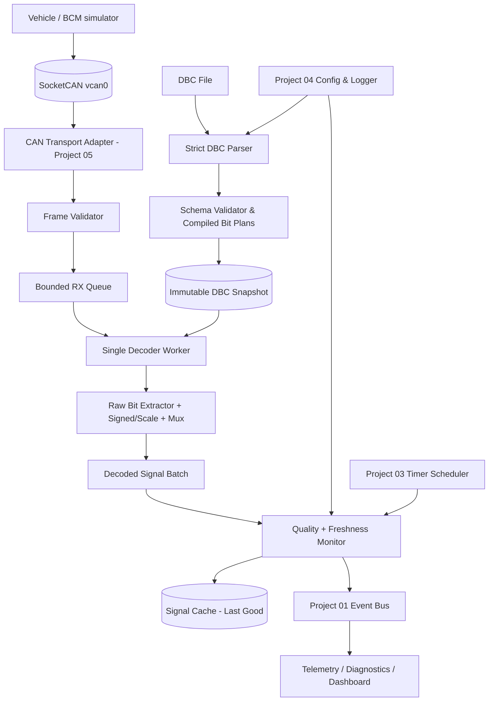
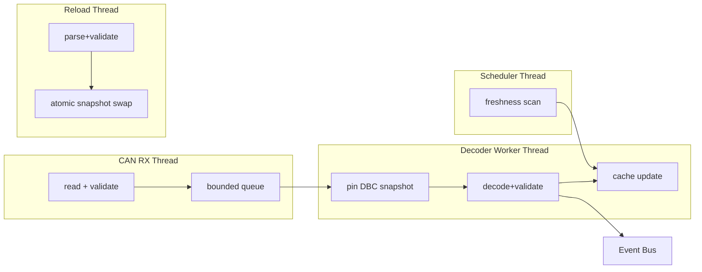
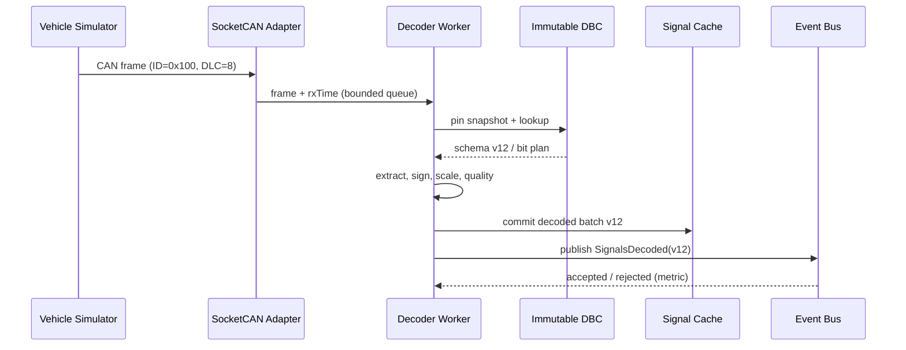
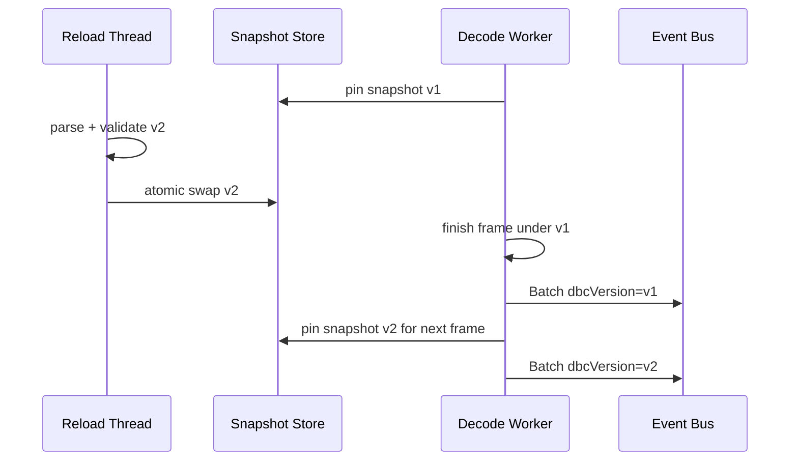
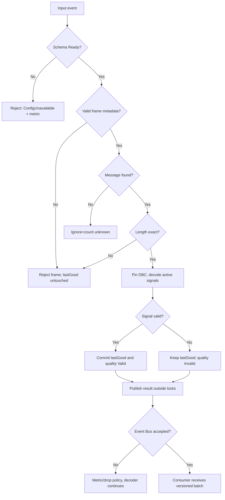

# Project 06 — DBC Signal Decoder

> **Virtual TCU Lab | System Design + Operational Behavior + What-if/Fault Testing | v1.0**  
> **Ngôn ngữ:** Tiếng Việt | **C++:** C++17 | **Môi trường:** Ubuntu Linux, ưu tiên `vcan0` (không cần hardware)  
> **Đối tượng:** Middle C++ Developer / TCU Application & Middleware  
> **Trạng thái:** **Thiết kế đề xuất**, chưa phải source code đã triển khai hoặc chứng nhận an toàn automotive.  
> **Ngày biên soạn:** 2026-10-30 | **Ưu tiên:** P0  
> **Liên quan:** Project 01 Event Bus, 02 IPC, 03 Timer, 04 Config & Logging, 05 Virtual CAN.

---

## 1. Executive Summary

Xây một **bộ giải mã CAN signals theo file DBC** thay cho những phép dịch bit hard-coded ở Project 05. Dữ liệu vào là CAN frame (ID chuẩn hoặc mở rộng, payload, timestamp, bus ID). Đầu ra là một *batch* tín hiệu được giải mã kèm **raw value, physical value, unit, quality, timestamp và phiên bản DBC**. Hệ thống phải thất bại an toàn khi gặp DBC sai, frame lỗi, multiplexing không khớp, thiếu dữ liệu hoặc quá tải.

Điểm nhấn ở cấp Middle C++ là **hợp đồng dữ liệu, tính đúng của bit ordering, concurrency, failure isolation, hot reload atomic, bounded resource và khả năng chứng minh behavior bằng test**. Hầu như mọi tình huống lỗi trong tài liệu đều có phương án kích hoạt giả lập, expected behavior và mục tiêu kiểm thử.

**Định nghĩa “chịu nổi”:** Không crash, không undefined behavior, không chấp nhận giá trị sai thành tín hiệu hợp lệ, không dùng dữ liệu stale như fresh, không rò rỉ memory/threads và **có phản hồi xác định** (status/metric) khi bị lỗi. Điều này không có nghĩa hệ thống có thể đáp ứng mọi tải hoặc đảm bảo an toàn chức năng của xe thật.

### 1.1 Kết quả cần bàn giao

1. `libtcu_dbc`: parser/validator cho **subset DBC có tài liệu**, immutable database và pure bit decoder.
2. `libtcu_signal`: signal quality tracking, cache và freshness management.
3. `dbc_validate`: CLI kiểm tra file DBC và in diagnostics có số dòng.
4. `dbc_decode`: CLI decode frame từ hex string / candump replay (hoặc adapter Project 05).
5. `virtual_dbc_demo`: simulator gửi frame qua `vcan0` và consumer hiển thị giá trị.
6. Test corpus: golden vectors, differential tests với `cantools`, fuzz, concurrency, fault injection, regression.
7. CMake/CTest, CI sanitizer, README, ADR và bản báo cáo quality/performance.

### 1.2 Nguyên tắc an toàn

- Chỉ dùng CAN IDs, ECU names và DBC **tự tạo cho phòng lab**; không suy đoán mapping OEM.
- Library chỉ **giải mã và cung cấp thông tin**, không trực tiếp điều khiển phanh, lái, động cơ, khóa cửa của xe thật.
- `vcan` không mô phỏng độ trễ arbitration, physical bus faults hoặc transceiver. Không coi test này là HIL/ASIL validation.
- Không có bảo đảm dữ liệu đến từ ECU đáng tin cậy chỉ vì DBC decode thành công. Data integrity (CRC/counter), xác thực và safety policy cần lớp riêng.

---

## 2. Vị trí trong lộ trình 30 project

| Project | Tương tác |
|---|---|
| 01 — Thread-Safe Event Bus | Emit `SignalsDecoded`, `SignalQualityChanged`, `DbcReloaded`. Không gọi callback tùy ý khi giữ lock. |
| 02 — IPC Service Framework | Tùy chọn gửi signal batch sang process telemetry qua versioned IPC contract. |
| 03 — Timer & Task Scheduler | Quét freshness bằng monotonic clock, scheduling periodic deadline. |
| 04 — Config & Logging | Cấu hình strictness, path DBC, limits, logging, metrics; cập nhật snapshot. |
| 05 — Virtual CAN Bus | Nguồn frame qua SocketCAN/vcan; giữ transport độc lập khỏi decoder. |
| **06 — DBC Signal Decoder** | **Current scope**: DBC parser, validation, bits, multiplex, quality, hot reload, tests. |
| 07 — Vehicle Gateway | Reuse signal decoding để quan sát message trên nhiều bus; không tự động rewrite frames. |
| 13/14 — MQTT & Offline Storage | Chỉ xuất signal hợp lệ + quality để tránh biến invalid/stale thành telemetry hợp lệ. |
| 20/21 — UDS / DTC | DBC không thay thế UDS; chia sẻ CAN transport nhưng đường dữ liệu khác. |

---

## 3. Scope, giả định và quyết định phiên bản

### 3.1 Trong phạm vi V1 (bắt buộc)

- **Classical CAN**: payload `0..8` bytes, 11-bit và 29-bit identifiers, phân biệt rõ frame format; full payload length validation.
- DBC subset: `BO_` message, `SG_` signal, `@1` Intel/little-endian, `@0` Motorola/big-endian, `+/-`, factor/offset, min/max, unit.
- `VAL_` value descriptions (enum) được hỗ trợ nếu cú pháp hợp lệ; raw numeric phải luôn truy cập được.
- **Basic multiplexing**: một mux `M` và các nhánh `mN` trong cùng message. Unconditional signals luôn giải mã; signal không-active không được gắn INVALID.
- Bit width từ **1..64** cho integer signals; float 32/64-bit (ví dụ `SIG_VALTYPE_`) **chưa hỗ trợ** trong V1, nếu xuất hiện phải báo `UNSUPPORTED_FEATURE`.
- DBC load **strict**, validate id/length/bit coverage/overlap/duplicate name & ID, giới hạn kích thước/độ phức tạp; không load nửa chừng.
- Decode batch theo một snapshot DBC nhất quán; preserve raw uint64, sign-extension an toàn, scale double và đo overflow.
- Frame chất lượng kém không được cập nhật last-good value; mô hình quality phân biệt lỗi hiện tại và freshness.
- DBC hot reload bất đồng bộ, validate off hot path, publish snapshot nguyên tử, không mix version trong một frame.
- Comprehensive test coverage, fuzzing and fault injection no hardware.

### 3.2 V2 (optional, không được âm thầm nhận ở V1)

- CAN FD đến 64 bytes; ISO-defined DLC restrictions được validate ở transport tùy framework; DBC mapping up to 64.
- Extended/nested multiplexing `SG_MUL_VAL_`; float signals `SIG_VALTYPE_`; advanced attributes/gen signals.
- Per-message E2E profile: rolling counter, CRC, source authenticity policy (phải cấu hình rõ cách tính).
- DBC hot reload với migration state nâng cao, multi-bus routing, multi-worker partitions.
- DBC full syntax compatibility, J1939 PGN abstraction, cyclic message encoding, UDS (các bài sau).

### 3.3 Ngoài phạm vi

- Viết hoặc đảm bảo tương thích toàn bộ **Vector DBC grammar** trong V1.
- Điều khiển ECU thật, giải mã bản DBC bí mật hoặc xác thực danh tính CAN sender bằng ID.
- ISO-TP/UDS, CAN bus arbitration, PHY bit timing, CRC/controller error state qua `vcan`.
- Cấp chứng chỉ safety/security, bảo đảm đúng tuyệt đối cho dữ liệu thực địa.

### 3.4 Assumptions và defaults (được thay bằng config)

| Biến | Default lab | Lý do |
|---|---|---|
| `dbc_max_bytes` | 2 MiB | Chặn file config quá lớn |
| `max_messages` | 2.000 | Bounded parser memory |
| `max_signals_per_message` | 128 | Chặn cấu hình bệnh lý |
| `max_total_signals` | 10.000 | Memory cap |
| `max_message_length` | 8 bytes | Classical CAN V1 |
| `rx_queue_capacity` | 4.096 frames | Load bounded |
| `max_hot_reload_attempts_per_min` | 6 | Tránh thrash |
| `invalid_policy` | `RejectSignalKeepLastGood` | Không phát false-valid |
| `payload_length_policy` | `Exact` | Bảo thủ và dễ test |
| `on_unknown_id` | `IgnoreAndCount` | Chặn poisoning/log spam |
| `freshness_period` | 50 ms | Phát hiện stale gần deadline |
| `signal_timeout_default` | 500 ms | Chỉ là lab sample; mỗi signal cấu hình riêng |
| `worker_model` | one decoder thread | Deterministic ordering |

**Lưu ý:** Các số trên là baseline để đo, không phải yêu cầu performance của OEM. Không đưa deployment production nếu chưa có số liệu thật.

---

## 4. Functional & Non-Functional Requirements

### 4.1 Functional Requirements (FR)

| ID | Requirement | Mức |
|---|---|---|
| FR-01 | Load DBC từ file và tạo immutable database có version/hash | MUST |
| FR-02 | Parse & validate subset `BO_`, `SG_`, `VAL_`, basic mux | MUST |
| FR-03 | Reject cú pháp không hỗ trợ liên quan decode (fail-closed) | MUST |
| FR-04 | Decode đúng Intel start bit LSB và Motorola start bit MSB | MUST |
| FR-05 | Correct signed extension cho 1..64 bits | MUST |
| FR-06 | Physical = raw_signed_or_unsigned × factor + offset; reject non-finite result | MUST |
| FR-07 | Không nhầm STD/EFF frame có cùng numeric CAN ID | MUST |
| FR-08 | Validate length, frame flags và metadata trước khi decode | MUST |
| FR-09 | Decode mux branch tương ứng, không emit signal không active | MUST |
| FR-10 | Raw invalid/forbidden values được áp dụng từ config bổ sung, không tự suy diễn | MUST |
| FR-11 | Signal cache lưu last-good và report quality tách biệt | MUST |
| FR-12 | Freshness dựa `steady_clock`, invalid frame không refresh last-good | MUST |
| FR-13 | Unknown IDs bị bỏ qua có metric, không exception/crash | MUST |
| FR-14 | Hot reload nguyên tử, giữ config cũ nếu load thất bại | MUST |
| FR-15 | Expose stats và structured diagnostics; log rate limiting | MUST |
| FR-16 | Graceful stop, bounded queues, no callback-after-destruction | MUST |
| FR-17 | CLI replay từ file, deterministic tests với fake clock | MUST |
| FR-18 | Optional publish events qua Event Bus 01 | SHOULD |
| FR-19 | CAN FD support gated by explicit feature flag | OPTIONAL V2 |

### 4.2 Non-functional Requirements / SLO tham khảo lab

| ID | SLO / invariant | Phương pháp đánh giá |
|---|---|---|
| NFR-01 | Zero sanitizer findings (ASan/UBSan; TSAN nếu môi trường hỗ trợ) | CI test & soak |
| NFR-02 | Không unbounded memory growth khi gửi `100.000` frames | Soak + RSS trend + queue depth |
| NFR-03 | Decoder thuần: p99 dưới **200 µs** / classical frame trên máy tham chiếu | Benchmark pinned config, có report CPU |
| NFR-04 | `dbc_load` trên file mẫu < **500 ms** sau warm filesystem | Benchmark, không chặn RX thread |
| NFR-05 | Không crash khi parser fuzz 1 triệu inputs ngẫu nhiên | libFuzzer/AFL++, budget quy định |
| NFR-06 | Không mixed schema trong một `decode(frame)` | Version tracing |
| NFR-07 | Lỗi DBC reload không làm mất phiên bản đang chạy | Hot-reload integration tests |
| NFR-08 | Callback exception không kill decoder worker | Fault test |
| NFR-09 | Deterministic behavior trên frame order đã biết | Replay check |
| NFR-10 | Mọi input invalid trả mã lỗi có thể phân loại | Contract tests |

Các ngưỡng latency và tài nguyên là **mục tiêu cho lab**, cần đo baseline và điều chỉnh tùy CPU/OS; không hứa hard real-time.

---

## 5. Architecture & component responsibilities



| Component | Ownership | Invariant |
|---|---|---|
| `CanTransportAdapter` | đọc frame từ Project 05, giữ flags/timestamps | Không đưa RTR/ERR vào data decoder |
| `FrameValidator` | kiểm tra ID type/DLC/payload length; drops | Không dereference vượt số byte có thật |
| `DbcParser` | tokenize, build AST, source locations | Không partial-accept unsupported decode directives |
| `SchemaValidator` | duplicate/overlap/bit positions/mux validity | Chỉ publish database hợp lệ |
| `CompiledDbc` | precompute bit indexes & lookup maps | Immutable sau `commit` |
| `Decoder` | pure decode một frame với snapshot | Không mutate global state, không lock callbacks |
| `SignalQualityMonitor` | state per signal, timeout, counters | Last-good không đổi do invalid frame |
| `SignalCache` | dữ liệu dùng bởi consumer | Version + value + quality nhất quán |
| `ReloadCoordinator` | load validate and atomic swap | Một decode frame không mix DBC versions |
| `EventPublisher` | publish change batch async | Failed publish phải có counter + policy |

### 5.1 Process/thread model



- **V1 một decoder worker** để giữ thứ tự dequeue, giảm complexity. Timestamp arrival được lấy ở ingress (RX thread), không lấy ở decode worker; clock thống nhất cho deadline.
- `CompiledDbc` được giữ bởi `std::shared_ptr<const CompiledDbc>`. Trong C++17 dùng free functions `std::atomic_load(&ptr)`/`std::atomic_store(&ptr, next)` cho `shared_ptr` (hoặc dùng mutex); **không dùng `std::atomic<std::shared_ptr<...>>` nếu yêu cầu C++17**.
- Reload xây database mới trên worker riêng; chỉ swap khi **toàn bộ** parse+validate+compile thành công. Decode giữ reference snapshot đến hết frame.
- Signal cache có mutex riêng, cập nhật cả batch trong một critical section ngắn; Event Bus publish **sau khi nhả lock**.
- Timestamp per-signal để đảm bảo monitor timeout không biến signal invalid thành fresh; monitor dùng `steady_clock`.

---

## 6. DBC grammar & validation contract

### 6.1 Đặc tả mapping subset

DBC message mẫu:

```dbc
VERSION "virtual-tcu-lab-v1"
NS_ :
BS_:
BU_: ECU TCU

BO_ 256 VEHICLE_STATUS: 8 ECU
 SG_ VehicleSpeed : 0|16@1+ (0.01,0) [0|250] "km/h" TCU
 SG_ Ignition : 16|1@1+ (1,0) [0|1] "" TCU
 SG_ CabinTemp : 24|8@1- (1,-40) [-40|125] "degC" TCU

BO_ 257 TORQUE_STATUS: 8 ECU
 SG_ Torque : 7|12@0- (0.5,0) [-1024|1023.5] "Nm" TCU

BO_ 258 MUX_STATUS: 8 ECU
 SG_ Page M : 0|8@1+ (1,0) [0|255] "" TCU
 SG_ CommonStatus : 8|8@1+ (1,0) [0|255] "" TCU
 SG_ BatteryVoltage m1 : 16|16@1+ (0.01,0) [0|50] "V" TCU
 SG_ MotorTemp m2 : 16|16@1- (0.1,0) [-100|100] "degC" TCU
```

- CAN ID trong `BO_` viết dưới dạng **decimal**. DBC `@1`: Intel / little-endian; `@0`: Motorola / big-endian.
- **Intel start bit = vị trí LSB**; **Motorola DBC start bit = vị trí MSB** theo byte-bit numbering *sawtooth*. Không áp dụng đổi endian bằng `ntohs`/`reinterpret_cast` vì signal có thể lệch ranh giới byte.
- `BU_`, `NS_`, `BS_`, `VERSION` được chấp nhận như metadata hoặc directive hợp lệ trong subset. Unknown optional metadata chỉ được ignore nếu nằm trong allowlist và được ghi nhận warning. Unknown directive có thể ảnh hưởng decode: **reject file**.
- `VAL_` value-description mapping cho một signal được hỗ trợ; không coi một enum number không có label là invalid trừ khi policy quy định.
- Attributes như `GenMsgCycleTime`, special invalid/NA values, profile CRC/counter **không được tự suy ra từ DBC** nếu chưa có contract chính thức; dùng JSON sidecar (có schema) cho lab.
- `BO_` có raw ID mang extended flag theo DBC convention (bit 31) với 29-bit ID bên dưới: phân giải thành `(is_extended, arbitration_id)` riêng và đối chiếu với transport format; reject DBC ID có reserved bits, out of range hoặc inconsistent flags.

### 6.2 Input schema checks

| Loại | Check | Fail code |
|---|---|---|
| File | vượt size, encoding không hỗ trợ, NUL byte, thiếu required directives | `DBC_SYNTAX`/`DBC_LIMIT` |
| Message | ID out-of-range, repeated `(is_extended, id)`, name conflict, len > 8 V1 | `DBC_MESSAGE` |
| Signal | name duplicate trong cùng message, width 0/ >64, start invalid, factor non-finite | `DBC_SIGNAL` |
| Bit layout | bất kỳ bit không nằm trong declared payload size | `DBC_OUT_OF_BOUNDS` |
| Overlap | signals *cùng active mux branch* dùng chung bit | `DBC_OVERLAP` |
| Multiplexing | nhiều mux chủ trong một message, duplicate ambiguous branch, unsupported nested mux | `DBC_MUX` |
| Attributes | `SIG_VALTYPE_` floats, `SG_MUL_VAL_` unsupported (V1) | `UNSUPPORTED_FEATURE` |
| Enumerations | conflicting `VAL_` number/name within a signal; unknown references | `DBC_ENUM` |
| Min/max | min > max, unit invalid encoding, non-finite scale values | `DBC_RANGE` |
| Resource | parse depth, token length, message/signal limits exceeded | `DBC_LIMIT` |

**Overlap nuance:** mux branch `m1` và `m2` có thể chia sẻ vùng bits, vì tại một thời điểm chỉ một nhánh active. Nhưng signal unconditional không được trùng với bất kỳ signal active nào. Trùng trong cùng nhánh `m1` là lỗi.

**Strictness nuance:** `[0|0]` trong DBC không nhất thiết là domain physical chỉ có 0; nhiều công cụ dùng để thể hiện range chưa được khai báo. V1 chỉ thực thi range như constraint nếu `range_enforcement=true` được khai báo trong sidecar hoặc đặc tả yêu cầu rõ; nếu không giữ metadata và phát cảnh báo/metric cho out-of-range.

### 6.3 Boundaries, unsupported features và versioning

- V1 parse entire text và liệt kê `ParseDiagnostic{file,line,column,code,message}`; khi có lỗi **reject cả database**.
- File cũ vẫn active nếu reload thất bại; tại cold-start nếu load lỗi, service chuyển `NOT_READY` và **không xuất bất kỳ valid signal nào**.
- DBC changed signals phải có `config_version` và `dbc_hash` (SHA-256) đính kèm update; downstream so version để tránh silent semantics drift.
- Không hỗ trợ grammar nào thì fail rõ ràng; không được dùng regex “nuốt” những dòng không hiểu mà giả vờ parse thành công.

---

## 7. Bit extraction — thuật toán tham chiếu, signedness & physical scaling

### 7.1 Quy tắc đọc bits

- Intel (`@1`): bắt đầu tại bit LSB `start`; với raw bit index `i`, đọc CAN payload position `start + i` và đặt vào bit `i` của raw.
- Motorola (`@0`): start tại **MSB** của signal; đọc tuần tự từ MSB đến LSB. Sau một bit có `p % 8 == 0`, bit tiếp là `p + 15` (MSB byte kế), còn lại `p - 1`.
- `position = byteIndex * 8 + bitIndexWithinByte`, bit index của mỗi byte theo giá trị logic 0=LSB ... 7=MSB; validate `position < payload_bytes*8` **trước** khi truy cập.
- `width` 1..64, sử dụng `uint64_t`; tránh `1ULL << 64` (undefined behavior) và mọi phép shift signed âm.

```cpp
// Pseudocode C++17: illustration, errors are returned to caller in production.
std::optional<uint64_t> extractRaw(
    const uint8_t* data, size_t bytes,
    size_t start, unsigned width, bool littleEndian) {
    if (!data || width == 0 || width > 64) return std::nullopt;
    uint64_t raw = 0;
    size_t bitPos = start;
    for (unsigned i = 0; i < width; ++i) {
        if (bitPos >= bytes * 8) return std::nullopt;
        const uint64_t bit = (data[bitPos / 8] >> (bitPos % 8)) & 1U;
        if (littleEndian) raw |= (bit << i);
        else raw = (raw << 1) | bit;
        if (i + 1 == width) break;
        if (littleEndian) ++bitPos;
        else bitPos = ((bitPos % 8) == 0) ? bitPos + 15 : bitPos - 1;
    }
    return raw;
}
```

### 7.2 Signed conversion (không shift UB)

```cpp
// C++17 two's-complement mathematical interpretation for widths 1..64.
std::optional<int64_t> signExtend(uint64_t raw, unsigned bits) {
    if (bits == 0 || bits > 64) return std::nullopt;
    const uint64_t mask = (bits == 64) ? UINT64_MAX : ((uint64_t{1} << bits) - 1);
    raw &= mask;
    const uint64_t signBit = uint64_t{1} << (bits - 1);
    if ((raw & signBit) == 0) return static_cast<int64_t>(raw);
    const uint64_t magnitude = ((~raw) & mask) + uint64_t{1};
    if (magnitude == (uint64_t{1} << 63)) return INT64_MIN;
    return -static_cast<int64_t>(magnitude);
}
```

- Signed negative 1-bit signal: raw `1` → `-1`. Signed 12-bit raw `0xABC` → `-1348`.
- For unsigned 64-bit `raw > 2^53`, `double` không biểu diễn mọi số nguyên chính xác: **giữ `raw_u64` nguyên vẹn**, physical double có thể làm tròn. Không chuyển raw sang int64 nếu unsigned value vượt range.
- `physical = rawNumeric * factor + offset`; validate `isfinite(factor/offset/physical)`. Khi optional min/max enforcement bật, out-of-range trở thành quality invalid chứ không âm thầm clamp.

### 7.3 Goldens tính tay (không phụ thuộc oracle)

| Message / raw payload (hex) | Signal | Phép tính | Expected |
|---|---|---|---|
| `0x100` / `10 27 01 00 50 00 00 00` | VehicleSpeed `0|16@1+` | raw `0x2710` = 10000; ×0.01 | **100.00 km/h** |
| `0x100` / `10 27 01 00 50 00 00 00` | Ignition `16|1@1+` | bit 16 = 1 | **1** |
| `0x100` / `10 27 01 00 50 00 00 00` | CabinTemp `24|8@1-` | raw `0x00`; physical -40 | **-40 °C** |
| `0x101` / `AB C0 00 00 00 00 00 00` | Torque `7|12@0-` | raw `0xABC` = signed -1348; ×0.5 | **-674 Nm** |
| `0x102` / `01 7F D2 04 00 00 00 00` | Page=1 | mux branch `m1`, BatteryVoltage raw `0x04D2` | **12.34 V** |
| `0x102` / `02 7F 9C FF 00 00 00 00` | Page=2 | mux branch `m2`, MotorTemp raw `0xFF9C` = -100; ×0.1 | **-10 °C** |

**Ghi chú:** Trong payload `0x100`, byte `0x50` ở index 4 không nằm trong CabinTemp (index 3). Bài test dùng sự phân biệt này để tìm lỗi off-by-one. Các bytes là dữ liệu lab, không đại diện xe thật.

---

## 8. Domain types & C++17 API proposal

```cpp
namespace tcu::dbc {

enum class FrameFormat { Standard11, Extended29 };
enum class SignalQuality {
    NotReceived, Valid, InvalidRaw, OutOfRange,
    Stale, DecodeError, NotActive, ConfigUnavailable
};
enum class DecodeError {
    None, UnknownMessage, WrongFormat, WrongLength,
    ErrorFrame, RemoteFrame, UnsupportedFeature,
    InvalidBitLayout, NonFinitePhysical, InternalError
};

struct CanFrameView {
    uint32_t arbitrationId{};  // bits only; CAN_EFF_FLAG removed by adapter
    FrameFormat format{FrameFormat::Standard11};
    const uint8_t* data{};
    uint8_t size{};            // Classical <= 8, FD V2 <=64
    bool isRemote{};
    bool isError{};
    std::chrono::steady_clock::time_point rxTime;
    uint32_t busId{};
};

struct SignalValue {
    std::string signalName;
    uint64_t raw{};
    bool isSigned{};
    std::optional<int64_t> signedRaw;
    double physical{};
    std::string unit;
    std::optional<std::string> enumLabel;
    SignalQuality quality{};
};
struct DecodedBatch {
    uint32_t arbitrationId{};
    uint32_t busId{};
    std::string messageName;
    std::string dbcHash;
    uint64_t dbcVersion{};
    std::chrono::steady_clock::time_point rxTime;
    std::vector<SignalValue> signals; // active signals only
};
struct DecodeResult {
    DecodeError error{DecodeError::None};
    std::optional<DecodedBatch> batch;
};

class IDbcRepository {
public:
    virtual ~IDbcRepository() = default;
    virtual bool loadInitial(const std::string& path) = 0;
    virtual bool reload(const std::string& path) = 0; // async in implementation
};
class ISignalDecoder {
public:
    virtual ~ISignalDecoder() = default;
    virtual DecodeResult decode(const CanFrameView& frame) const = 0;
};
class ISignalObserver {
public:
    virtual ~ISignalObserver() = default;
    virtual void onBatch(const DecodedBatch& batch) = 0;
    virtual void onQualityChanged(const std::string& key, SignalQuality q) = 0;
};
} // namespace tcu::dbc
```

**API contract:**

- `decode()` là function không block vào disk/network, không throw exception ra hot path cho input expected-invalid; trả typed error.
- `loadInitial()` chỉ trả true khi toàn bộ database dùng được. `reload()` là wrapper khởi động operation có job ID/status riêng trong implementation, không đồng nghĩa commit ngay.
- `signalName` một mình không unique toàn hệ thống: key dùng `(busId, isExtended, arbitrationId, signalName)` hoặc stable numeric ID do database compile.
- `DecodedBatch` là **snapshot logical** của *một frame*; subscriber chỉ nhìn signal active; inactive mux signals không xuất hiện. `NotActive` có thể xuất hiện trong snapshot cache query, không xuất như decode failure.
- `std::string` allocations trên hot path có thể được giảm bằng interned IDs/immutable views sau khi đo benchmark; tránh giữ `string_view` tới snapshot bị giải phóng.

---

## 9. Runtime state & data quality contracts

### 9.1 Signal state (sample)

```text
NEVER_SEEN --valid frame--> VALID --time elapsed--> STALE
    |                        |                      |
    +--invalid frame------> INVALID_*              +--valid frame--> VALID
                             |                      |
                             +--valid frame--------+ 

Reload removed signal -> CONFIG_UNAVAILABLE/RETIRED
Mux inactive -> NOT_ACTIVE for this frame; no last-good overwrite
```

**Hai góc nhìn tách biệt bắt buộc:**

1. `LastObservation`: kết quả decoding gần nhất (có thể invalid), receive timestamp, reason.
2. `LastGoodValue`: giá trị hợp lệ gần nhất và timestamp riêng.

`freshness` đánh giá từ **timestamp của last-good**, không phải từ lần có frame cuối cùng. Invalid frames, wrong DLC, duplicate/unknown CAN frames **không refresh** freshness của signal đó.

### 9.2 Matrix state transition

| Previous | Input | Last-good | Reported quality | Event |
|---|---|---|---|---|
| NotReceived | valid active signal | update | Valid | `SignalUpdated` |
| Valid | valid active signal | update | Valid | `SignalUpdated` nếu policy cho phép |
| Valid | invalid raw | giữ nguyên | InvalidRaw | `SignalQualityChanged` |
| Valid | range violation (enforced) | giữ nguyên | OutOfRange | `SignalQualityChanged` |
| Valid | no valid input vượt timeout | giữ nguyên | Stale | `SignalQualityChanged` |
| Stale | valid new signal | update | Valid | `SignalRecovered` |
| Any | mux branch không active | giữ nguyên | không phát update | optional cache status NotActive |
| Any | DBC reload signal removed | retire/namespace version | ConfigUnavailable | `SchemaChanged` |
| Any | decoder temporarily unavailable | giữ last-good, invalid quality | ConfigUnavailable | `DecoderUnavailable` |

**Important:** Nếu quality vừa `InvalidRaw` vừa timeout, client cần cả `last_observation_quality` và `last_good_is_stale` riêng. Một enum đơn lẻ không diễn đạt đủ; thiết kế cache phải giữ hai chiều trạng thái.

### 9.3 No silent semantics changes

- Thay đổi DBC (factor, signedness, unit, bit layout, mux branch) = schema version mới.
- Cache old signals có thể được giữ dưới namespace version cũ nhưng **không coi là signal mới valid**. Trong V1, khuyến nghị reset quality về NotReceived sau swap nếu semantic hash của signal thay đổi; giữ last-good chỉ để diagnostics.
- Việc DBC reload không được gọi từ decode worker; hash/version xuất hiện trong mọi batch và log.

---

## 10. Operational behavior — hệ thống làm việc ra sao

### 10.1 Cold startup

1. Config Service đọc `decoder.yaml`/JSON; kiểm tra hạn mức, đường dẫn DBC, strict policies.
2. `DbcParser` parse toàn bộ file; ghi diagnostic có line/column khi lỗi.
3. Validator xây compiled bit plans, lookup table `(busId, frameFormat, CAN ID)`.
4. Commit immutable snapshot version `v1`, tạo signal cache initial `NotReceived`.
5. Bắt đầu RX/decoder threads; publish `DecoderReady(version, hash)`; **không sẵn sàng nếu không có DBC hợp lệ**.

### 10.2 Normal receive/decode

1. Project 05 đọc frame, chụp `rxTime` mono và flags, validate RAW frame.
2. Đẩy vào bounded RX queue; return drop/backpressure metric nếu quá tải.
3. Worker pop và atomic-load DBC snapshot **một lần cho frame**.
4. Lookup message theo bus/format/id, kiểm tra expected payload length.
5. Nếu có mux: decode selector, chọn active signals; kiểm tra branch hợp lệ.
6. Bit extractor lấy raw; sign-extend; calculate physical; apply invalid/range rules.
7. Tạo `DecodedBatch` có hash/version; commit quality cache; publish theo policy (không giữ cache mutex khi gọi Event Bus).

### 10.3 Invalid/unrecognized frame

- Unknown ID: `UnknownMessage`, count + optional sampled log; không mutate signal cache.
- Wrong format, length, RTR, ERR: `DecodeError`, không phát valid batch.
- Trường hợp *một signal* invalid nhưng frame khác vẫn hợp lệ: V1 **partial batch per signal** với invalid status cho signal lỗi, các signal independent được cập nhật (trừ khi lỗi ở frame-level hoặc multiplex selector). Policy phải giữ không thể nhầm invalid thành valid.
- Unexpected mux value: update unconditional signals; skip branch signals; emit `UnknownMuxValue` metric. Nếu mux selector **không thể giải mã**, reject frame-level mux branch; không tự chọn mặc định.

### 10.4 Hot reload

1. File watcher/debounce hoặc CLI reload tạo request, queue bounded; reject nếu nhiều pending.
2. Load + validate + compile trên reload thread, tính hash.
3. Nếu lỗi: log diagnostic, tăng metric, giữ snapshot active; announce `DbcReloadFailed`.
4. Nếu thành công: atomic swap; increment version; reset/migrate signal cache theo semantic hash; announce `DbcReloaded`.
5. Frame nào pin old snapshot vẫn được decode theo old version và nhận label old version. Consumer có thể chọn bỏ kết quả cũ dựa epoch để tránh reordering khi reload.

### 10.5 Timeout / stale

- Freshness monitor quét `now - lastGoodRxTime` bằng steady clock. Với mux branch không active lâu, policy cần timeout theo *last active valid instance*, không coi inactive là packet loss. Có thể dùng `NotActive` ở consumer.
- Đúng thời điểm `now == deadline` phải có contract: `now >= deadline` là stale. Timer jitter chỉ ảnh hưởng thời điểm phát event; query `isFresh(now)` phải chính xác.
- RX queue delay lâu có thể làm signal **đến muộn**: dùng `rxTime` nguyên gốc; nếu frame xử lý sau deadline, không tự đánh dấu fresh đến `now` khi timestamp đã cũ.

### 10.6 Shutdown

- Stop nhận frame; ngừng enqueue; drain/discard theo config, dùng deadline shutdown.
- Cancel freshness timers/reload jobs; join thread; unregister subscribers; flush bounded logs/metrics.
- Đảm bảo không callback sau destruction. Nếu deadline hết, báo `ForcedStop` và không block vô hạn; không thể force-terminate C++ thread an toàn nên mọi worker phải cooperative-cancel.

---

## 11. Sequence diagrams — normal, invalid & reload

### 11.1 Receive → Decode → Cache



### 11.2 Bad frame does NOT refresh good data

```mermaid
sequenceDiagram
    participant ECU as Fault Injector
    participant W as Decoder
    participant Q as Quality Monitor
    participant C as Consumer
    ECU->>W: Frame with wrong DLC
    W-->>Q: DecodeError(WrongLength)
    Q-->>C: LastGood unchanged; freshness aging
    Note over Q,C: no fake Valid event
    ECU->>W: Valid frame after timeout
    W->>Q: Valid signal
    Q->>C: SignalRecovered + new value
```

### 11.3 Atomic reload under traffic



---

## 12. Concurrency, ownership, consistency & ordering

1. **Single owner** cho RX queue, decoder worker và quality monitor state; tránh hai thread cùng decode rồi ghi cache không theo timestamp.
2. `std::shared_ptr<const CompiledDbc>` được pin ở đầu mỗi frame, release sau khi result hoàn thành; reloader không chỉnh sửa object cũ.
3. Không lock `DbcRepository` trong toàn bộ decode loop; chỉ atomic load O(1) hoặc mutex cực ngắn.
4. Decoder worker đi theo queue order. Không đảm bảo arrival order giữa các bus đa nguồn; nếu cần nhiều bus, define per-bus ordering và source sequence.
5. Cache snapshot update một batch là atomic về mặt read; callback chạy sau commit.
6. Timer callback và decode callback tương tác quality cache bằng mutex; timestamp chống stale event đến sau valid update: trước khi emit stale phải re-check epoch+lastGood timestamp.
7. Shutdown cần order: stop producers → stop new requests → join RX → drain decoder → stop monitor → stop Event Bus subscriptions.
8. Metrics có thể atomic relaxed; không dùng metrics để làm synchronization correctness.
9. File watcher không được expose path injection hoặc accept symlink/untrusted file theo mặc định; external DBC phải được phân quyền file integrity.
10. Callback fault isolation: một consumer throw hoặc block không cản decoder; Event Bus worker có bounded queues/rejection policy.

**Invariants phải property-test:**

- `DecodedBatch` luôn có một và chỉ một schema version/hash.
- Decoder không đọc ngoài `size` bytes và không shift >=64.
- Từ mọi invalid/unknown frame: **không xuất valid value không căn cứ**.
- Bounded RX queue không vượt capacity; drop counters monotonic.
- `lastGoodRxTime` chỉ đi tới cho valid active signal (monotonic) và không đi lùi.
- Unconditional signals có thể ra trong mux message; inactive branch tuyệt đối không được active.
- Snapshot publish trước cache/event coherent với version.

---

## 13. Behavior contracts cơ bản (Given / When / Then)

| ID | Given | When | Then |
|---|---|---|---|
| B-01 | DBC hợp lệ, state NotReady | start | chuyển Ready, version/hash được công bố |
| B-02 | `VEHICLE_STATUS` schema | nhận `10 27 01 00 50 00 00 00` | Speed=100, Ignition=1, CabinTemp=-40 |
| B-03 | Torque Motorola signed | nhận `AB C0 00 00 00 00 00 00` | raw=0xABC, signed=-1348, physical=-674 |
| B-04 | Mux Page=1 | decode BatteryVoltage | MotorTemp không active, không update |
| B-05 | Mux Page=2 | decode MotorTemp | BatteryVoltage không active, không update |
| B-06 | 8-byte schema | nhận 7-byte payload | `WrongLength`, không update cache |
| B-07 | Standard ID 0x100 defined | EFF ID 0x100 arrives | UnknownMessage, không alias standard |
| B-08 | Signal đã Valid | frame malformed arrives | giữ lastGood, quality/error được báo |
| B-09 | Last-good 500ms old | `now >= deadline` | stale mà không reset lastGood |
| B-10 | Stale cache | valid frame arrives | recovered, lastGood/new timestamp updated |
| B-11 | DBC reload parse lỗi | reload | giữ version/hash cũ, service Ready |
| B-12 | DBC reload valid | swap | frame in-flight dùng old pinned snapshot; frame mới dùng new |
| B-13 | Queue full | new frame arrives | finite drop/reject theo policy, không deadlock |
| B-14 | Consumer callback throws | event dispatched | decoder vẫn chạy, metric error tăng |
| B-15 | Stop requested | shutdown | không accept frame mới, join workers trong deadline |
| B-16 | Width 64 unsigned raw max | decode | raw giữ exact `UINT64_MAX`; physical có precision note |
| B-17 | Factor NaN in DBC | load | reject, không publish schema |
| B-18 | Signal overlap within same mux branch | validate | reject file với line number |
| B-19 | Two mutually exclusive mux branches overlap | validate | accepted (if otherwise valid) |
| B-20 | Unknown mux selector value | decode | unconditional signals vẫn ra; không invent branch |

---

## 14. Comprehensive “WHAT IF?” & resilience strategy

Mục đích bảng dưới là **phân tích hệ thống lỗi có hệ thống**, không phải lời khẳng định đã bao phủ mọi trạng thái vật lý, mọi kết hợp concurrency hoặc mọi rủi ro security chưa biết. Mỗi trường hợp ghi rõ cách **inject** và behavior **bắt buộc** để trở thành kiểm thử tự động.

**Legend:** `P0` = block release; `P1` = nên có trước khi tích hợp; `P2` = nâng cao. Mọi case P0 cần test tự động. `DIAG` = report mã lỗi/log+metric (rate-limited). `NO-VALID` = không phát tín hiệu hợp lệ mới nếu dữ liệu không đủ cơ sở.

### 14.1 DBC input, parser & syntax

| ID | What if...? | Cách inject/test | Behavior bắt buộc | Prio |
|---|---|---|---|---|
| W-001 | DBC file không tồn tại | Trỏ config đến missing.dbc | Cold start NotReady; reload giữ schema cũ; DIAG file-not-found | P0 |
| W-002 | Không đọc được file | chmod 000; chạy unprivileged | Không crash; reject; hiển thị permission diagnostic | P0 |
| W-003 | File rỗng | truncate 0 | Reject với missing message/schema; NO-VALID | P0 |
| W-004 | File rất lớn | Sinh file >2 MiB | Reject trước parse; RSS bounded; không load partial | P0 |
| W-005 | Token rất dài | Sinh tên SG_ 1 triệu ký tự | Token limit; reject; không cấp phát bất thường | P0 |
| W-006 | NUL hoặc binary embedded | Chèn 0x00 trong BO_ | Reject encoding/syntax; không silent truncate | P0 |
| W-007 | UTF-8 hỏng ở tên/unit | Inject invalid byte sequences | Reject hoặc policy encoding hợp lệ rõ; không UB | P1 |
| W-008 | DBC thiếu BO_ | Chỉ SG_ ở đầu file | Reject orphan signal, line number | P0 |
| W-009 | Missing colon/parenthesis | Mutate SG_ grammar | Reject syntax có location; không regex partial accept | P0 |
| W-010 | Line endings LF/CRLF/mixed | Tạo ba file tương đương | Same parse nếu grammar cho phép; line number đúng | P1 |
| W-011 | Comment/header metadata không hỗ trợ | Chèn directive lạ | Unknown decode-relevant => reject; allowlist metadata => warning | P0 |
| W-012 | Decimal overflow trong BO_ | ID = 999999999999999999999 | Reject arithmetic overflow trước cast | P0 |
| W-013 | Phép số cực lớn trong factor | factor 1e999 | Reject nonfinite parse; no schema commit | P0 |
| W-014 | DBC thay đổi khi đang đọc | Writer truncate/replace during reload | Parse stable bytes; checksum revalidate nếu thay đổi; reject/atomic rename policy | P1 |
| W-015 | Parser bị crash do fuzz payload | libFuzzer random bytes | No crash/hang/leak; return typed error | P0 |

### 14.2 Schema/bit layout validation

| ID | What if...? | Cách inject/test | Behavior bắt buộc | Prio |
|---|---|---|---|---|
| W-016 | ID STD ngoài 11-bit | BO_ numeric ID 0x800 without EFF convention | Reject invalid standard range | P0 |
| W-017 | ID EFF ngoài 29-bit | Raw DBC ID với reserved bits | Reject invalid extended ID | P0 |
| W-018 | Trùng message ID cùng format | Two BO_ same (format,id) | Reject duplicates, không chọn message cuối | P0 |
| W-019 | Cùng numeric ID nhưng STD/EFF khác | BO_ chuẩn và extended cùng ID | Phân biệt chính xác; không collision | P0 |
| W-020 | Độ dài BO_ 9 bytes ở Classical | Define len 9 | Reject V1; ghi unsupported FD hint | P0 |
| W-021 | Signal width 0 | 0\|0@1+ | Reject trước extraction | P0 |
| W-022 | Signal width 65 | 0\|65@1+ | Reject trước shift | P0 |
| W-023 | Signal vượt payload Intel | 63\|2@1+ trong BO_ 8 | Reject out-of-bounds với bit details | P0 |
| W-024 | Signal vượt payload Motorola | start 0 length 9 trong BO_ 1 | Reject sawtooth bit plan out-of-bounds | P0 |
| W-025 | 2 unconditional signals overlap | Construct shared bit | Reject, list conflicting signals | P0 |
| W-026 | Overlap mux branches khác nhau | m1 và m2 cùng bit range | Accept nếu mutual exclusion proved | P0 |
| W-027 | Signal name duplicate | Hai SG_ Speed trong message | Reject ambiguity | P0 |
| W-028 | Signed range min lớn hơn max | [10\|0] | Reject contradictory metadata | P1 |
| W-029 | Zero factor | factor=0 | Theo policy V1 reject tránh silent constant mapping | P1 |
| W-030 | Unknown VAL_ signal ref | VAL_ tham chiếu missing signal | Reject unknown enum ref | P1 |
| W-031 | Signal/Message limit vượt ngưỡng | Sinh >10k signals | Reject bounded resources | P0 |

### 14.3 Bit extraction, signedness & mathematics

| ID | What if...? | Cách inject/test | Behavior bắt buộc | Prio |
|---|---|---|---|---|
| W-032 | Intel signal bắt đầu bit 0 | Golden 1-bit | Raw chính xác bit0 | P0 |
| W-033 | Intel signal ở bit 63 | Golden 1-bit | Raw chính xác bit63, no OOB | P0 |
| W-034 | Motorola MSB bit7 | Golden 8-bit | Raw bằng payload byte0 | P0 |
| W-035 | Motorola cross-byte | Golden 7\|12@0- | Raw 0xABC, signed -1348 | P0 |
| W-036 | Motorola start bit 0 chuyển byte | Golden 0\|2@0+ | Next position=15, đúng expected | P0 |
| W-037 | Length 1 signed negative | raw=1, width=1 | signedRaw=-1 | P0 |
| W-038 | Length 64 signed MIN | raw=0x8000000000000000 | INT64_MIN, no overflow | P0 |
| W-039 | Length 64 unsigned MAX | raw=UINT64_MAX | raw giữ 64-bit exact | P0 |
| W-040 | Width 63 negative | raw signbit set | sign extend đúng, test no UB | P0 |
| W-041 | Raw gần 2^53 | uint64 raw=9007199254740993 | raw exact, physical precision limitation documented | P0 |
| W-042 | Factor âm | factor=-0.5 | Physical correct và range policy đúng | P1 |
| W-043 | Offset âm | factor=0.1, offset=-40 | Physical đúng cả giá trị âm | P0 |
| W-044 | Physical overflow | factor 1e308, raw lớn | Reject non-finite physical, không publish VALID | P0 |
| W-045 | Scale rounding boundary | expected 1.005, FP rounding | Use epsilon/tolerance documented; không exact compare double | P1 |
| W-046 | Raw invalid code 0xFFFF | sidecar invalid=65535 | Quality InvalidRaw; lastGood giữ | P0 |
| W-047 | Physical ngoài range | speed 300 > configured 250 | OutOfRange khi enforce, không clamp silent | P0 |
| W-048 | NaN trong compiled metadata | Inject malformed in-memory test object | Reject before decode or InternalError, no UB | P1 |
| W-049 | Bit patterns random | property fuzz raw + roundtrip oracle | Matches verified reference, no OOB/shift UB | P0 |

### 14.4 Multiplexing and enums

| ID | What if...? | Cách inject/test | Behavior bắt buộc | Prio |
|---|---|---|---|---|
| W-050 | Mux selector = supported value | Page=1 | Decode only m1 + unconditional | P0 |
| W-051 | Mux selector switches rapidly | Alternate Page=1/2 at high rate | No branch bleed; ordering maintained | P0 |
| W-052 | Mux selector unknown | Page=99 | Unconditional only; UnknownMux metric | P0 |
| W-053 | Mux selector invalid raw | mark selector invalid via sidecar | No branch decode; report MuxInvalid | P0 |
| W-054 | Two multiplexors declared | Two SG_ M | Reject V1 unsupported design | P0 |
| W-055 | Nested multiplexing directive | SG_MUL_VAL_ | Explicit UNSUPPORTED_FEATURE (V1) | P0 |
| W-056 | Mux branch thiếu | Only m1 defined, selector=2 | Unknown branch, not crash | P0 |
| W-057 | Overlapping within same branch | m1 sig A/B overlap | Schema reject | P0 |
| W-058 | Unconditional overlaps branch | Common signal touches m1 bit | Schema reject | P0 |
| W-059 | Enum known numeric | VAL_ label=ON | emit raw+physical+label | P1 |
| W-060 | Enum unknown numeric | VAL_ values omit 3, raw=3 | Return numeric; label absent, no invented enum | P0 |
| W-061 | Enum name contains quote/escape | quoted label with escape | Parser respects supported escaping or fails explicitly | P1 |

### 14.5 Runtime frame metadata & transport

| ID | What if...? | Cách inject/test | Behavior bắt buộc | Prio |
|---|---|---|---|---|
| W-062 | CAN ID không có trong DBC | Send 0x777 | UnknownMessage+metric, NO-VALID | P0 |
| W-063 | Standard/EFF alias | Send extended 0x100 | Do not match standard 0x100 | P0 |
| W-064 | RTR frame masquerading as data | Synthetic RTR frame | Reject RemoteFrame, no decode | P0 |
| W-065 | SocketCAN ERR frame | Synthetic error metadata | Reject ErrorFrame, count transport issue | P0 |
| W-066 | Frame payload ngắn | DLC 7 vs schema 8 | Reject frame-level, no partial V1 | P0 |
| W-067 | Frame payload dài | DLC 8 vs schema 7 | Reject frame-level exact policy | P0 |
| W-068 | No data pointer size>0 | API unit test with nullptr | Typed error, no segfault | P0 |
| W-069 | Unexpected busId | Bus 2 with schema bus 1 | UnknownMessage; no cross-bus contamination | P0 |
| W-070 | CAN FD frame tới V1 | Send len 16 / FD metadata | UnsupportedFeature, no truncation to 8 | P0 |
| W-071 | Frame replay duplicate | Send identical frame twice | Policy: update each arrival; no dedup without sequence policy | P1 |
| W-072 | Hardware-style CRC wrong payload | Mutate payload without E2E profile | Decoder may yield valid-looking signal; record limitation, require E2E for integrity | P0 |
| W-073 | Frame receive timestamp future | Mock clock t+1hour | Reject/quarantine skew; no perpetual freshness | P0 |

### 14.6 Quality, timing, stale, lifecycle

| ID | What if...? | Cách inject/test | Behavior bắt buộc | Prio |
|---|---|---|---|---|
| W-074 | No frame since boot | Run simulator off | NotReceived; no lastGood | P0 |
| W-075 | Frame stale >deadline | Fake clock +501ms | Stale with lastGood preserved | P0 |
| W-076 | Exactly deadline boundary | now==deadline | Stale per now>=deadline | P0 |
| W-077 | Invalid frame arrives before timeout | Wrong DLC at t+400ms | Must not refresh lastGood or stale deadline | P0 |
| W-078 | Only mux inactive for long | Page=2 while m1 absent | No false invalid; signal inactive/lastGood age separately | P0 |
| W-079 | Freshness monitor delayed | Pause scheduler 3s | Query freshness based on clock still correct; event emitted eventually | P1 |
| W-080 | Valid frame after stale | Resume traffic | Recovered + new lastGood timestamp | P0 |
| W-081 | Time jumps backwards (wall clock) | Change system clock | No freshness impact: steady_clock only | P0 |
| W-082 | RX queue delays 2s | Block decoder worker | Don't mark stale rxTime as fresh at decode time | P0 |
| W-083 | Out-of-order rxTime | Inject older frame after newer | Discard/quarantine older signal update; maintain monotonic lastGood | P0 |
| W-084 | Signal becomes invalid immediately | Inject invalid raw code | Observation invalid, lastGood retained | P0 |
| W-085 | No timeout configured | Unset signal timeout | Explicit unlimited/disabled state; no arbitrary 500ms if disabled | P1 |

### 14.7 Reload, config changes & schema drift

| ID | What if...? | Cách inject/test | Behavior bắt buộc | Prio |
|---|---|---|---|---|
| W-086 | Valid reload while traffic continuous | Load v2 during 1000fps | Atomic swap, no per-frame mixed versions | P0 |
| W-087 | Invalid reload | Broken syntax in v2 | Keep old schema, reject reload | P0 |
| W-088 | Reload same file | Same SHA-256 content | No new semantic version or policy-defined no-op | P1 |
| W-089 | Two reload requests concurrent | Threads A/B reload | Serialize/debounce; deterministic last approved commit | P0 |
| W-090 | Reload queue flood | 1000 config change events | Bounded queue/rate limit; no memory growth | P0 |
| W-091 | Signal meaning changes | Factor v1=1→v2=10 | Reset new version quality; never silently reinterpret old lastGood | P0 |
| W-092 | Signal removed | Remove `VehicleSpeed` | Retire cache entry; consumer notified | P0 |
| W-093 | Signal renamed | Rename Speed to Velocity | Treat as remove+add; no old-key alias | P1 |
| W-094 | DBC file replaced mid-read | Rename/truncate while loading | Consistent bytes/hash or reject, no partial schema | P0 |
| W-095 | Memory pressure during reload | Inject allocation failure | Catch at reload boundary; keep old schema; no process crash | P1 |
| W-096 | Old pinned frames finish after swap | Pause decode before swap | Old batch tagged v1; downstream can reject stale epoch | P0 |
| W-097 | System restart after reload | Kill/relaunch app | Load configured persisted version; caches start unknown | P1 |

### 14.8 Threading, races, shutdown

| ID | What if...? | Cách inject/test | Behavior bắt buộc | Prio |
|---|---|---|---|---|
| W-098 | Reload coincides with decode | Barrier interleaving at atomic load | No UAF / torn config | P0 |
| W-099 | Freshness scan races valid frame | Barrier at deadline | No stale event delivered after newer valid generation | P0 |
| W-100 | Queue pop races stop | Stop during blocking wait | Wake worker, exit per drain policy | P0 |
| W-101 | Subscriber unsubscribe during callback | Invoke unsubscribe concurrently | Subscription lifetime safe; policy documents in-flight callback | P0 |
| W-102 | Consumer throws exception | Throw in callback | Catch at dispatch boundary; decoder survives | P0 |
| W-103 | Consumer blocks for 10s | Sleep in downstream handler | Decoder remains responsive via async Event Bus; queue bound | P0 |
| W-104 | Concurrent cache reads while update | 32 reader threads + worker | No torn SignalValue/version, no TSAN race | P0 |
| W-105 | Double stop | Two threads call stop() | Idempotent, no double-join | P0 |
| W-106 | Stop before start | Call stop on constructed service | Safe no-op / documented state result | P1 |
| W-107 | Reload during shutdown | Cancel reload mid-parse | No late swap after stopping; resources released | P0 |
| W-108 | Thread creation failure | Inject std::system_error | Startup failed gracefully, no zombie threads | P1 |
| W-109 | Callback destroys service | Reentrant shutdown request | Deferred stop; no self-join deadlock | P1 |

### 14.9 Overload, pressure & performance

| ID | What if...? | Cách inject/test | Behavior bắt buộc | Prio |
|---|---|---|---|---|
| W-110 | RX bursts >capacity | Send 100k frames quickly | Drop according to policy; bounded RSS; metric counts | P0 |
| W-111 | Decode worker slower than producer | Artificial sleep per frame | Queue depth bounded; lag visible | P0 |
| W-112 | Unknown-ID flood | Flood 0x700-0x7FF | Rate-limit logs; no CPU amplification | P0 |
| W-113 | Invalid frame flood | Repeated DLC mismatch | Bounded error metrics, sampled logs | P0 |
| W-114 | Huge value-table metadata | Generate huge VAL_ list | Parser limit enforcement; bounded memory | P1 |
| W-115 | 100% CPU while parsing DBC | Worst-case crafted file | Parse work budget/timeout or killable isolate; reject pathological inputs | P1 |
| W-116 | Slow disk / log backend | Block log sink | Decode continues, logging drops according to configured severity | P0 |
| W-117 | High-rate schema reload | Replace DBC every 100ms | Debounce/rate limit; no old-snapshot retention leak | P0 |
| W-118 | Large amount of cached signals | 10k signals | Bounded memory; latest query within benchmark budget | P1 |
| W-119 | Clock precision stress | 1ms timers, saturated CPU | Detect lateness; do not claim hard realtime | P2 |

### 14.10 Cross-process, Event Bus & consumer

| ID | What if...? | Cách inject/test | Behavior bắt buộc | Prio |
|---|---|---|---|---|
| W-120 | Event Bus not started | Publish without start | Typed publish failure; cache remains valid; retry policy documented | P0 |
| W-121 | Event Bus queue full | Block subscriber | Drop/reject metric; avoid blocking decoder | P0 |
| W-122 | IPC consumer disconnected | Kill telemetry process | Decoder independent; cache available; IPC reports error | P1 |
| W-123 | Subscriber expects old schema | Reload DBC but consumer old | Include schema version/hash; reject incompatible message | P0 |
| W-124 | Two consumers request same signal | Dashboard and MQTT read simultaneously | Consistent snapshot+quality, no data race | P0 |
| W-125 | Null/dangling string_view | Destroy pinned snapshot then read label | Use owning value / pinned lifetime, ASan clean | P0 |
| W-126 | Consumer ignores quality | Mock client using value only | API requires explicit status or safe typed wrapper; documentation warns | P1 |
| W-127 | Consumer accepts stale data | Pause simulator | Telemetry sends status=stale or omits value per policy | P0 |
| W-128 | Event ordering across reload | Pin v1, swap v2, concurrent events | Version tagging; consumer version ordering rules applied | P0 |
| W-129 | Service restarts and reconnects | Kill -9 decoder, supervisor restart | Startup NotReceived until fresh frames; no phantom lastGood | P1 |

### 14.11 Security, malformed inputs & data trust

| ID | What if...? | Cách inject/test | Behavior bắt buộc | Prio |
|---|---|---|---|---|
| W-130 | Untrusted external DBC file | Upload arbitrary DBC file | Apply file limits, allowlisted path, ownership/signature policy | P0 |
| W-131 | Path traversal via config | Path ../../etc/passwd | Block outside configured directory; no data exfiltration | P0 |
| W-132 | Symlink swap race | Replace DBC path symlink during load | Use trusted path/fd policy; no TOCTOU acceptance | P1 |
| W-133 | Malicious string injected to logs | DBC name contains CRLF/control chars | Sanitize output; no log injection | P0 |
| W-134 | DoS by repeated parse failures | Reload bad file at 100Hz | Rate limit, no CPU starvation | P0 |
| W-135 | Spoofed CAN ID | Attacker-like simulator sends same ID | Decode only; no attribution, flag trust limitation | P0 |
| W-136 | Bad CRC/rolling counter | Corrupt frame payload | Not detected without E2E profile; mark trust gap, add V2 checker | P1 |
| W-137 | Unexpected DBC encoding directive | SIG_VALTYPE_/SG_MUL_VAL_ | Fail-closed, explicit unsupported diagnostic | P0 |
| W-138 | Sensitive data in dumps | Insert VIN/customer data in tests | Use synthetic IDs/test values; sanitize logs | P1 |
| W-139 | Malicious repeated enum labels | Duplicate/conflicting VAL_ | Reject schema, avoid ambiguous values | P1 |

### 14.12 Host/OS/failure recovery & observability

| ID | What if...? | Cách inject/test | Behavior bắt buộc | Prio |
|---|---|---|---|---|
| W-140 | vcan0 chưa được tạo | Start before ip link add | Transport degraded; decoder schema may Ready; no signals valid | P0 |
| W-141 | vcan0 bị down | ip link set vcan0 down | LinkDown event; lastGood ages; optional reconnect | P0 |
| W-142 | vcan0 xuất hiện lại | ip link set vcan0 up | Rebind, resume decoded signals | P0 |
| W-143 | Process killed mid-frame | kill -9 worker | Restart cold cache; no corrupted persistent DBC | P1 |
| W-144 | Machine time skew (NTP) | date adjust wall time | No monotonic freshness change | P0 |
| W-145 | Disk full | fill log partition in isolated test | Logs fail without decoder crash; schema already in RAM remains | P1 |
| W-146 | Out-of-memory pressure | cgroup memory.max tiny | Controlled failure where possible; kernel OOM acknowledged; recovery by supervisor | P1 |
| W-147 | Log flood of same failure | 10k unknown IDs | Rate-limited logs + aggregate metric | P0 |
| W-148 | Metrics counter overflow | Seed counter near UINT64_MAX | Saturate/reset policy deterministic, no wrap confusion | P2 |
| W-149 | Health endpoint temporarily broken | Throw/fail metric export | Decode unaffected | P1 |

### 14.13 Toolchain, regression & cross-platform

| ID | What if...? | Cách inject/test | Behavior bắt buộc | Prio |
|---|---|---|---|---|
| W-150 | GCC vs Clang khác tối ưu | Run same golden vectors both compilers | Identical raw/quality; physical within tolerance | P0 |
| W-151 | x86_64 vs ARM64 | Run CI/QEMU cross-arch | No host endianness dependency | P1 |
| W-152 | Sanitizer-enabled build | ASan/UBSan/TSAN | No findings in supported environment | P0 |
| W-153 | C++ compiler strict warnings | -Wall -Wextra -Wconversion -Werror | Build pass or documented exemptions | P1 |
| W-154 | cantools disagree on vector | Differential random tests | Investigate mismatch; hand goldens decide truth | P0 |
| W-155 | Parser test nondeterminism | Use seed and fake clock | Same input seed => same results | P0 |
| W-156 | Wrong locale decimal separator | LC_ALL=de_DE.UTF-8 | Parse decimal point in DBC consistently | P1 |
| W-157 | Missing external tools | can-utils not installed | Pure unit tests still run; integration skipped explicitly | P1 |
| W-158 | CI container lacks NET_ADMIN | docker without cap | Pure decoder tests pass; vcan setup fails clearly | P1 |
| W-159 | Golden file accidentally modified | Change expected vector | Code review + hash diff + independent oracle test | P1 |

### 14.14 Coverage summary and critical combinations

- **Tổng số WHAT-IF:** **159** scenarios, chia 13 nhóm; mỗi scenario phải ánh xạ ít nhất một test id và evidence CI. Không gọi đây là exhaustive proof của tất cả interleavings.
- P0 phải tự động hóa trước demo integration; P1 trước hoàn thiện project, P2 khi có budget.
- Các case riêng lẻ **chưa đủ**: kiểm thử **pairwise** và một số **triple-fault** như *reload + burst + queue full*, *timeout + old frame + new valid frame*, *shutdown + callback blocked + reload*, *schema drift + consumer offline + IPC reconnect*, *error-frame flood + disk-full + logging failure*, *mux switch + invalid raw + staleness*.
- Tạo deterministic fault scheduler với barriers và fake clock để tái hiện race; **random fuzz** chỉ là lớp bổ sung.
- Danh sách phải được cập nhật theo failure data thực tế sau khi triển khai; những rủi ro không mô phỏng được bằng vcan phải có HIL test plan riêng nếu dự án tiến ra hardware.

#### 14.15 Failure policy decision tree



---

### 14.16 Multi-fault campaigns — kiểm thử hệ thống chịu lỗi kết hợp

Một lỗi đơn lẻ có thể được xử lý đúng nhưng hai lỗi cùng lúc lại làm sai state machine. Những campaign sau dùng **fake clock, barriers và injectable transport** để tạo repeatable test; không dựa vào may rủi scheduling.

| Campaign | Faults đồng thời | Bước inject quan trọng | Expected / pass gate |
|---|---|---|---|
| C-01 | Schema reload + RX burst + queue full | Pause decode, gửi 10k frames, swap v2 | Mỗi batch có đúng version; queue không vượt 4.096; có drop counter; không crash |
| C-02 | Stale timer + new valid frame + out-of-order old frame | Giữ timer tại barrier, nhận `t=501ms`, sau đó frame `t=200ms` | Quality kết thúc Valid; lastGood không bị đưa lùi về 200ms |
| C-03 | DBC invalid + active traffic + repeated reload | Keep v1 valid, mutate invalid v2 100 lần | v1 hoạt động; reload rate-limited; không tăng bộ nhớ vô hạn |
| C-04 | Consumer blocked + Event Bus full + shutdown | Block callback 10s, stop deadline 2s | Decode không chờ callback; shutdown ghi incomplete nếu không cooperative-cancel; không deadlock |
| C-05 | CAN adapter down + stale scan + valid recovery | Link down, advance clock 1s, link up | Signals stale; sau link up chỉ fresh lại khi có frame valid mới |
| C-06 | Bad length flood + logging disk full | Send 50k malformed frames, fail file sink | Không xuất valid mới; decoder sống; logs rate-limited; counters tăng |
| C-07 | Hot reload factor change + disconnected telemetry + reconnect | Swap v2 lúc IPC offline, reconnect subscriber | Consumer nhận version/hash, không dùng v1 values theo v2 |
| C-08 | Multiplex switch + invalid value + branch overlap | Alternate page1/page2; inject raw invalid m1 | Chỉ active branch được xử lý; m1 InvalidRaw không ảnh hưởng valid m2 |
| C-09 | Parser fuzz + low memory + concurrent reload | Limit 64 MiB in isolated process, fuzz invalid files | Không publish partial schema; OOM được báo khi có thể, supervisor restart nếu OS kill |
| C-10 | Process SIGKILL + retry/restart + old cache | SIGKILL giữa stream, restart with schema v1 | Cache NotReceived ban đầu; chỉ fresh sau frame mới; no phantom Valid |
| C-11 | Clock wall jump + timer jitter + delayed queue | Jump wall clock, fake 2s decode lag | Freshness dùng ingress `steady_clock`; timestamp wall-clock không làm sai state |
| C-12 | Shared ID STD/EFF + unknown-ID flood + bus routing | STD/EFF cùng numeric ID, flood other IDs | Không alias, không cross-bus pollution; unknown ID logs bounded |

**Pass gate chung:** không sanitizer finding; không assertion/crash; không sai giá trị `Valid`; có typed error/status; resources bounded theo config; recovery phải được xác nhận bằng input hợp lệ mới. Nếu fail thì ghi `seed`, DBC hash, test artifact, CPU/OS/compiler và interleaving schedule để tái hiện.

---

## 15. Fault-injection methodology & test harness

### 15.1 Test pyramid

| Tier | Tools | Mục tiêu |
|---|---|---|
| Unit pure | Google Test/Mock, in-memory frames, fake clock | bit semantics/validations deterministic |
| Property | RapidCheck (optional), generated bit layouts | raw decode property/invariants |
| Differential | Python `cantools` as **reference oracle**, generated `.dbc` | compare known supported subset, detect disagreements |
| Parser fuzz | libFuzzer/AFL++ + ASan/UBSan | malformed/crafted DBC bytes |
| Frame fuzz | fuzz `(id, format, len, payload, time)` | no crash and invariant safety |
| Concurrency | TSAN (where usable), barriers, artificial yields | reload/cache/freshness/shutdown races |
| Integration | SocketCAN `vcan`, `cansend`, `candump`, Python simulator | real Linux transport interface |
| Fault lab | `tc netem` **chỉ cho IP paths**, drop simulation for CAN adapter, kill/restart | network/consumer cross-service faults |
| Stress/soak | burst producer + cgroup limits + perf, RSS | bounded memory, latency degradation |
| Optional HIL | physical CAN interfaces, controller metrics | electrical timing, bus-off (không trong V1) |

**Cảnh báo:** `tc netem` áp dụng phù hợp cho network IP, không tự động mô phỏng chính xác hành vi CAN PHY trên `vcan`. Muốn drop CAN frames có kiểm soát, đặt một `FaultInjectingCanAdapter` tại biên transport hoặc dùng simulator có chính sách skip/duplicate/reorder.

### 15.2 Test doubles

```cpp
struct IFakeClock {
    virtual ~IFakeClock() = default;
    virtual std::chrono::steady_clock::time_point now() const = 0;
};
struct ICanSource {
    virtual ~ICanSource() = default;
    virtual bool read(/*out frame*/) = 0;
};
struct IDbcLoader {
    virtual ~IDbcLoader() = default;
    virtual std::shared_ptr<const tcu::dbc::ISignalDecoder> load() = 0;
};
```

Inject fake clock manually; không sleep thực trong unit tests. Các điểm fault injection: `before_validate`, `before_bit_read`, `after_pin_snapshot`, `before_cache_commit`, `after_cache_commit`, `before_event_publish`, `after_reload_parse`, `before_reload_commit`, `on_stop_requested`. Không đưa test hooks vào public production API trừ khi cần.

### 15.3 Deterministic race recipes

**Race A: `reload` vs `decode`:**

1. Thread D pin `v1` rồi chờ barrier.
2. Thread R validate + swap `v2`, báo `DbcReloaded`.
3. Resume D: result bắt buộc `dbcVersion=v1`.
4. Decode frame kế tiếp: `dbcVersion=v2`. Chạy lặp 10.000 lần dưới sanitizer.

**Race B: stale timer vs valid frame:**

1. `lastGoodRxTime=T0`, deadline `T0+500ms`.
2. Timer tính stale, tạm dừng trước commit.
3. Worker commit valid frame `rxTime=T0+501ms`.
4. Timer resume: **recheck epoch**; không được overwrite Valid bằng stale cũ.

**Race C: stop vs blocked observer:**

1. Subscriber cố tình block; publish queue đạt capacity.
2. Gọi stop với `shutdown_deadline=2s`.
3. Decoder không block trên callback; khi stop deadline vượt, ghi result `StopIncomplete`/drain policy; chủ sở hữu worker phải hợp tác hủy chứ không dùng forced thread kill.

### 15.4 Property-based invariants (gợi ý)

```text
P-01: For every valid bit-plan, extraction reads only indexes in [0, len*8).
P-02: For widths 1..64, signExtend corresponds to two's-complement math.
P-03: Decode never emits a signal from an inactive mux branch.
P-04: A frame with wrong length leaves every signal's LastGood unchanged.
P-05: Physical values marked Valid are finite and obey enforced range/invalid sets.
P-06: A retry/reload failure never replaces active immutable DBC.
P-07: All signal batches have exactly one schema version/hash.
P-08: For any frame sequence, lastGoodRxTime never decreases.
P-09: Unknown IDs and malformed frames cannot create new Valid signals.
P-10: No user callback executes while SignalCache mutex is held.
P-11: Memory allocated for queue <= declared capacity (+ documented overhead).
P-12: Under identical sequence and fake clock, outputs/events are deterministic.
```

### 15.5 Test fixture generation and oracle discipline

- Mỗi DBC fixture có `expected/*.json` với raw, signed raw, physical, quality, DBC hash/version.
- `cantools` được dùng **độc lập** để compare supported subset; không gọi library bên trong C++ decoder production.
- Trường hợp cantools parser chấp nhận syntax nhưng thiết kế strict V1 reject phải ghi rõ *intentional divergence*.
- Với 64-bit precision, compare raw bằng **integer**, compare scaled physical bằng abs/rel tolerance, tránh `==` double.
- Có ít nhất **50 handcrafted golden vectors** và **10.000 random property vectors** cho Intel/Motorola/signed/width/mux. Seed và binary fixture được lưu để reproduce.
- Không sử dụng DBC thực tế có NDA; tạo fixtures nội bộ.

---

## 16. Observability — metrics, errors, log format

### 16.1 Metrics đề nghị

| Metric | Type | Ý nghĩa / invariant |
|---|---|---|
| `dbc_load_attempts_total{result}` | counter | lần parse/reload thành công/thất bại |
| `dbc_active_version` | gauge | schema version hiện tại |
| `dbc_parse_duration_ms` | histogram | chi phí parse/compile |
| `can_frames_received_total{bus}` | counter | ingress frames |
| `decoder_frames_total{result}` | counter | successful/unknown/bad-length/error |
| `decoder_signals_total{quality}` | counter | valid/invalid/out_of_range |
| `decoder_queue_depth` | gauge | phải <= capacity |
| `decoder_queue_drops_total` | counter | dropped frames |
| `decoder_decode_latency_us` | histogram | decode pure latency |
| `decoder_ingress_to_publish_ms` | histogram | queue + processing latency |
| `signal_stale_total{signal_id}` | counter | transitions into stale |
| `signal_recovered_total{signal_id}` | counter | transitions into valid |
| `decoder_event_publish_failures_total` | counter | Event Bus backpressure/error |
| `decoder_unknown_mux_total` | counter | mux value unsupported |
| `decoder_schema_transition_total` | counter | successful semantic migrations |

**Cardinality:** production metrics không dùng `signalName` động từ untrusted DBC làm label vô hạn; map signal IDs hoặc aggregate. Log sampling cho unknown IDs, parse errors lặp lại.

### 16.2 Structured logs minh họa

```json
{"ts":"2026-10-30T08:00:00Z","severity":"INFO","module":"dbc_decoder","event":"decoder_ready","dbc_version":1,"dbc_hash":"<sha256>"}
{"ts":"2026-10-30T08:00:02Z","severity":"WARN","module":"dbc_decoder","event":"frame_rejected","reason":"WRONG_LENGTH","can_id":"0x100","format":"STD","expected_len":8,"actual_len":7}
{"ts":"2026-10-30T08:00:03Z","severity":"WARN","module":"dbc_decoder","event":"reload_rejected","reason":"DBC_OVERLAP","path":"virtual.dbc","line":42}
```

Structured log timestamps có thể dùng wall-clock để con người đọc, nhưng freshness logic tuyệt đối không dùng wall-clock.

---

## 17. Reference configuration / sample files

### 17.1 `decoder.json` (illustrative)

```json
{
  "schema_version": 1,
  "dbc_path": "./configs/virtual_tcu.dbc",
  "strict": true,
  "max_dbc_bytes": 2097152,
  "frame_mode": "classical_can",
  "payload_length_policy": "exact",
  "rx_queue_capacity": 4096,
  "decoder_workers": 1,
  "reload": {"enabled": true, "debounce_ms": 300, "max_attempts_per_min": 6},
  "signal_freshness": {"default_timeout_ms": 500, "scan_period_ms": 50},
  "invalid_raw_codes": {"VEHICLE_STATUS.VehicleSpeed": [65535]},
  "range_enforcement": {"VEHICLE_STATUS.VehicleSpeed": true},
  "event_publish": {"mode": "async", "on_full": "drop_and_count"},
  "logging": {"rate_limit_per_reason_per_min": 60}
}
```

- `decoder.json` là sidecar **do project tự định nghĩa**, không phải DBC standard. Document JSON schema và reject unknown config keys ở chế độ strict.
- `invalid_raw_codes` dùng fully qualified signal name; khi trùng message name across buses phải bổ sung bus/ID key trong production.
- Nếu `frame_mode=classical_can`, DBC frame length >8 reject ngay. FD V2 chỉ bật khi decoder, transport, simulator và acceptance criteria cùng hỗ trợ.

---

## 18. Repository layout

```text
virtual-tcu-lab/
  modules/
    dbc_decoder/
      CMakeLists.txt
      include/tcu/dbc/
        frame_view.hpp
        dbc_database.hpp
        dbc_parser.hpp
        bit_extractor.hpp
        signal_decoder.hpp
        signal_quality.hpp
        signal_cache.hpp
        dbc_repository.hpp
      src/
        dbc_lexer.cpp
        dbc_parser.cpp
        schema_validator.cpp
        compiled_bitplan.cpp
        bit_extractor.cpp
        signal_decoder.cpp
        signal_cache.cpp
        freshness_monitor.cpp
        reload_coordinator.cpp
      tests/
        unit/
          bit_extractor_test.cpp
          sign_extend_test.cpp
          schema_validation_test.cpp
          mux_decoder_test.cpp
          cache_quality_test.cpp
          reload_atomicity_test.cpp
        integration/
          vcan_integration_test.cpp
          eventbus_integration_test.cpp
        fixtures/
          virtual_tcu.dbc
          invalid/*.dbc
          golden/*.json
      fuzz/
        fuzz_dbc_parser.cpp
        fuzz_frame_decoder.cpp
      bench/
        decoder_benchmark.cpp
  apps/
    dbc_validate/
    dbc_decode/
    virtual_dbc_demo/
  configs/
    decoder.json
    virtual_tcu.dbc
  scripts/
    setup_vcan.sh
    generate_frames.py
    run_fault_matrix.py
  docs/
    06_DBC_Signal_Decoder_System_Design.md
    adr/
    test-evidence/
```

---

## 19. Jira backlog — implementation-ready

| Ticket | Story / deliverable | Acceptance criteria | Suggested estimate |
|---|---|---|---|
| DBC-001 | CMake, CI, sanitizer, skeleton | Build+CTest+lint pass | S |
| DBC-002 | Frame domain model & typed errors | Unit validation for STD/EFF/RTR/ERR/len | S |
| DBC-003 | Lexer/parser `BO_`,`SG_` subset | Valid fixtures pass, malformed reject with locations | L |
| DBC-004 | Schema validator & strict limits | Overlap/bounds/duplicate/limit tests | L |
| DBC-005 | Intel extraction 1..64 | Golden, boundaries, property tests | M |
| DBC-006 | Motorola sawtooth extraction | Golden cross-byte vectors; oracle compare | M |
| DBC-007 | Signed/raw/scaling/enum | sign tests, nonfinite, precision policy | M |
| DBC-008 | Basic multiplexing | M/mN, overlap branches, unsupported syntax | L |
| DBC-009 | Compiled immutable DBC snapshot | Version/hash, frame lookup, no mutability | M |
| DBC-010 | Signal quality + last-good cache | Invalid vs stale behavior tests | L |
| DBC-011 | Fake clock + freshness | exact deadline, out-of-order timestamp tests | M |
| DBC-012 | Hot reload atomic snapshot | v1/v2 barrier race test, rollback | L |
| DBC-013 | Project 05 CAN adapter integration | vcan demo with deterministic frame outputs | M |
| DBC-014 | Event Bus Project 01 integration | no callback under lock; publish fail metric | M |
| DBC-015 | CLI dbc_validate / dbc_decode | reproducible command outputs and error codes | M |
| DBC-016 | Config sidecar & invalid raw policy | strict validation + reload behavior | M |
| DBC-017 | Test generation and cantools oracle | golden matrix + differential 10k vectors | L |
| DBC-018 | Parser/frame fuzzing | 1M iterations no sanitizer crash | L |
| DBC-019 | Concurrency, reload/stop stress | 10k race interleavings, TSAN clean where available | L |
| DBC-020 | 1h soak + benchmark report | bounded resources, p99 reported against target | M |
| DBC-021 | What-if traceability 100% P0 | every P0 mapped to test ID + CI evidence | L |
| DBC-022 | Documentation, ADR, readme, demo | usage, sequence diagrams, limitations documented | S |

### 19.1 Suggested sprint breakdown

- **Sprint 1:** DBC-001–007 (core parser, bits, strict validation).
- **Sprint 2:** DBC-008–012 (multiplex, quality, reload, concurrency).
- **Sprint 3:** DBC-013–017 (CAN integration, CLI, golden/differential).
- **Sprint 4:** DBC-018–022 (fuzz, resilience, benchmark, final demo).

Estimates S/M/L tương đối, không phải cam kết lịch. Middle developer phải trình bày được tradeoffs: exact length vs partial, single vs multi worker, schema migration policy, invalid value handling.

---

## 20. Build, simulation & demo workflow (sau khi đã implement)

### 20.1 Prerequisites

```bash
sudo apt update
sudo apt install -y build-essential cmake ninja-build can-utils iproute2 \
  libgtest-dev libgmock-dev python3 python3-venv
python3 -m venv .venv
. .venv/bin/activate
pip install cantools
```

**Lưu ý:** Một số CI containers/WSL2 kernels có thể không có module `vcan` hoặc quyền `CAP_NET_ADMIN`; run pure unit tests không phụ thuộc `vcan`.

### 20.2 Start simulated bus

```bash
sudo modprobe vcan
sudo ip link add dev vcan0 type vcan
sudo ip link set vcan0 up
candump vcan0
```

Terminal khác:

```bash
# VEHICLE_STATUS: speed=100 km/h, ignition=1, cabinTemp=-40
cansend vcan0 100#1027010050000000
# TORQUE_STATUS: Motorola signed raw=0xABC -> -674 Nm
cansend vcan0 101#ABC0000000000000
# MUX page=1 -> battery voltage =12.34 V
cansend vcan0 102#017FD20400000000
```

### 20.3 Proposed CLI commands (chưa có binary)

```bash
cmake -S . -B build -G Ninja -DCMAKE_BUILD_TYPE=Debug
cmake --build build
ctest --test-dir build --output-on-failure

# Những CLI sau là deliverables cần implement:
./build/apps/dbc_validate/dbc_validate configs/virtual_tcu.dbc
./build/apps/dbc_decode/dbc_decode --dbc configs/virtual_tcu.dbc \
    --id 0x100 --format std --data 1027010050000000
./build/apps/virtual_dbc_demo/virtual_dbc_demo --interface vcan0
```

Expected CLI response minh họa:

```json
{"frame_id":"0x100","dbc_version":1,"signals":[
  {"name":"VehicleSpeed","raw":10000,"physical":100.0,"unit":"km/h","quality":"Valid"},
  {"name":"Ignition","raw":1,"physical":1.0,"quality":"Valid"},
  {"name":"CabinTemp","raw":0,"physical":-40.0,"unit":"degC","quality":"Valid"}
]}
```

### 20.4 Demo what-if sequence

1. **Normal:** Send valid speed frame; check raw, scaled, version and cache.
2. **Wrong length:** Send `100#102701` (3 bytes), verify `WrongLength`; last-good stays unchanged.
3. **Missing frames:** Stop simulator, advance fake clock in test; state transitions to stale.
4. **Mux switching:** Send `102#017FD20400000000` then `102#027F9CFF00000000`; check no branch bleed.
5. **Reload bad DBC:** Introduce invalid overlapping signal; CLI reload returns failure and v1 still serves.
6. **Reload good DBC:** Change version with intentional factor change; confirm no mixed-version events and last-good reset for changed signal.
7. **Overload:** Burst frames at > decoder throughput; queue bound & drop metrics.
8. **Shutdown:** Run stop during active ingress+reload; finite completion and clean sanitizer report.

---

## 21. Design decisions (ADRs)

### ADR-01 — Small strict DBC subset rather than pretend full compatibility

**Decision:** Build `BO_/SG_/VAL_/basic mux`; unsupported decoder-relevant constructs cause hard reject. **Reason:** Hidden silent omissions are more dangerous than explicit lack of support. **Tradeoff:** May reject real-world DBCs requiring more features.

### ADR-02 — Compiled bit plans vs ad hoc bit twiddling

**Decision:** Validate and compile bit positions once, then use pure extraction in runtime. **Reason:** Predictable cost, easy fuzz/property testing. **Tradeoff:** More startup work/memory.

### ADR-03 — Exact DLC rather than partial decode

**Decision:** Strict reject mismatch for V1. **Reason:** No accidental valid-looking values when payload incomplete. **Tradeoff:** Less permissive than some tools; explicit migration later.

### ADR-04 — Preserve last-good but never mislabel invalid as fresh

**Decision:** Keep separate last observation quality, last valid value and monotonic timestamp. **Reason:** Diagnostic usefulness without false-valid telemetry. **Tradeoff:** More state complexity.

### ADR-05 — Single decoder worker

**Decision:** One worker preserves queue order and simplifies deterministic tests. **Reason:** TCU middle-level learning and sufficient lab performance. **Tradeoff:** Throughput cap; scale after profiling.

### ADR-06 — Atomic immutable DBC hot reload

**Decision:** Parse completely and swap once; in-flight frames pin old snapshot. **Reason:** consistency and rollback guarantee. **Tradeoff:** Temporary memory double during reload.

### ADR-07 — Explicit unsupported CAN FD and E2E features in V1

**Decision:** Reject unknown FD/CRC constructs rather than misinterpret. **Reason:** Avoid pretending decoding covers safety-relevant integrity. **Tradeoff:** Not a production-ready decoder for all vehicle networks.

---

## 22. Threats, risks, mitigation & residual risk

| Risk | Severity | Mitigation | Residual risk |
|---|---|---|---|
| Wrong Motorola bit mapping | Critical | Hand-calculated goldens + cantools oracle + fuzz | External DBC dialect differences |
| Wrong signed64 interpretation | High | Integer-safe algorithm + UBSan + boundary tests | Physical double precision loss |
| DBC parser silent ignore | Critical | strict grammar and unsupported-feature rejection | Parser subset intentionally incomplete |
| Out-of-range treated valid | High | Enforced policy + typed quality | DBC min/max may be ambiguous |
| Old cache reused after schema change | High | Semantic hash/version, reset quality | Consumer can ignore version contract |
| Queue overload and stale lag | High | bounded queue, ingress timestamp, metrics | Data drops at sustained overload |
| Race during reload/shutdown | High | shared snapshot, barrier tests, sanitizer | Unseen scheduler interleavings |
| Spoofed CAN frames | High | No sender trust claim; E2E/security later | Raw CAN has no source authentication |
| `vcan` falsely implies hardware validation | High | documented lab-only boundary | Need physical HIL tests |
| Resource exhaustion by bad DBC | High | file/token/message limits, path controls | Worst-case parser CPU pattern until bounded |

---

## 23. Definition of Done / acceptance checklist

- [ ] C++17 source builds with CMake and all tests pass; `-Wall -Wextra -Wconversion` enabled.
- [ ] DBC parser strict subset documented; unknown decode-impacting directives rejected.
- [ ] STD/EFF arbitration ID mapping and DLC rules validated.
- [ ] Intel and Motorola bit plans verified against handwritten vectors and independent oracle.
- [ ] Signed widths 1..64, physical scaling, NaN/Inf and overflow handled without UB.
- [ ] Multiplex one-level branches and VAL_ mapping work; unsupported nested constructs rejected.
- [ ] No invalid/unknown/wrong-DLC frame can refresh lastGood incorrectly.
- [ ] Freshness uses monotonic clock; reload changes cannot silently reinterpret existing signal values.
- [ ] Atomic DBC reload tested concurrently with decode, timer and shutdown.
- [ ] Bounded queue/load shedding metrics present; no unbounded growth in burst/soak.
- [ ] All P0 what-if cases mapped to executable test and CI evidence.
- [ ] Parser and frame fuzz run with no sanitizer finding for agreed budget.
- [ ] Standard demo on `vcan0` documented and repeatable.
- [ ] Limitations: vcan vs hardware, unsupported DBC features, lack of E2E security are explicit.
- [ ] ADR, documentation, test report, benchmark (CPU/OS/toolchain) retained.

### 23.1 Traceability template

| Requirement/What-if | Test ID | Test layer | Result | Evidence URI | Owner |
|---|---|---|---|---|---|
| FR-04, W-035 (Motorola cross-byte) | UT-BIT-001 | Unit | pending | artifacts/ut-bit-001.xml | Decoder |
| FR-14 | IT-RELOAD-001 | Integration | pending | artifacts/reload-run.log | Platform |
| NFR-01 | CI-ASAN-001 | CI | pending | artifacts/asan-report.txt | QA/Dev |

`Test ID` trong bảng là **ví dụ**; khi hiện thực sẽ tạo mapping tự động từ toàn bộ W-IDs. Không coi bảng pending là kết quả đã chạy.

---

## 24. Open questions cần xác nhận với Tech Lead

1. Project TCU thực tế chỉ decode Classical CAN hay có CAN FD? DBC subset nào có mặt?
2. DBC có chứa `SIG_VALTYPE_`, extended multiplexing hoặc OEM-specific attributes không?
3. Signal timeout được cấp bởi DBC attributes, OEM spec hay sidecar config?
4. Min/max DBC là hard validity criteria hay chỉ metadata hiển thị?
5. Các raw invalid/NA values được định nghĩa ở đâu? Có alive counter/CRC profiles không?
6. Có cần timestamp hardware/kerneltimestamp? Mức sai số đo được cho freshness là bao nhiêu?
7. SLA decode throughput và CPU/memory budget trên SoC target?
8. Reload DBC có được bật trong xe hay compile-time only? Có signature/secure provisioning?
9. Consumer cần historical last-good hay chỉ latest-valid? Schema changes được version hóa thế nào?
10. CAN signal có ảnh hưởng safety decisions nào? Nếu có, yêu cầu safety process và validation cao hơn phạm vi lab.

---

## 25. Learning outcomes & progression to Project 07

Sau project này, Middle C++ Developer nên giải thích và chứng minh được:

- Cách DBC lưu bit layout và vì sao Motorola DBC MSB dễ bị code sai.
- Lý do phải giữ **raw**, **scaled physical**, **quality** và **freshness** riêng biệt.
- Sự khác nhau giữa frame validation, signal validation và dữ liệu đáng tin cậy.
- Vấn đề C++17 khi reload immutable snapshot giữa nhiều threads.
- Cách thiết kế parser fail-closed, fuzzing, golden fixtures và test race condition.
- Cách xác định giới hạn kiểm thử `vcan` và chọn HIL tests cho phần cứng.

**Điểm nối sang Project 07 — Vehicle Gateway Simulator:** Chuyển frame từ nhiều bus, lọc/routing theo network policy; signal decoder Project 06 cung cấp quan sát semantic nhưng không tự động forward raw CAN khi policy không cho phép.

---

## 26. References & technical verification

1. **Linux Kernel — SocketCAN (CAN RAW / CAN FD / filters / frame structs)**: https://docs.kernel.org/networking/can.html
2. **Kvaser CANlib — DBC signal bit numbering; Intel LSB and Motorola DBC MSB distinction**: https://kvaser.com/canlib-webhelp/group__kvadb__signals.htm
3. **cantools documentation — DBC signals, strict overlap/fit checks, decoding and multiplexing**: https://cantools.readthedocs.io/en/stable/
4. **CSS Electronics — DBC message and signal fields, Intel/Motorola definition**: https://www.csselectronics.com/pages/can-dbc-file-database-intro
5. **cantools GitHub — independent reference tests and fixtures**: https://github.com/cantools/cantools
6. **Linux can-utils — candump/cansend tooling**: https://github.com/linux-can/can-utils
7. **GoogleTest**: https://google.github.io/googletest/

**Phân định nguồn:** Các tài liệu trên xác nhận các khái niệm và behavior của chuẩn/công cụ; **mọi SLO, API, state machine, policy và test scenario trong file này là quyết định thiết kế đề xuất cho lab**, không được xem là OEM specification hoặc chuẩn ISO bắt buộc.

---

## 27. Suggested next deliverables

1. `configs/virtual_tcu.dbc` và set of invalid/mux/bit golden fixtures.
2. C++17 executable skeleton cho `dbc_validate`/`dbc_decode` và CMake.
3. Bản Jira chi tiết theo từng ticket DBC-001…022 (PR sequence, test plan, DoD).
4. Automated test map W-001…W-159 → test file/fixture/assertions.
5. Golden vector differential runner (`cantools` so sánh với decoder tự viết).
6. Hướng dẫn review thiết kế với Tech Lead trước coding.

**Status:** Design only. Tài liệu **không tuyên bố** code đã chạy hoặc stress test đã đạt.

