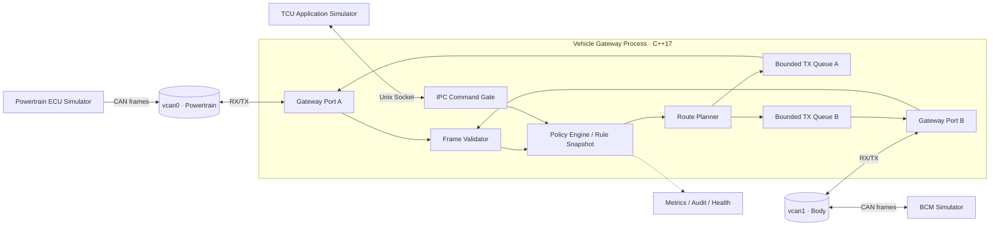
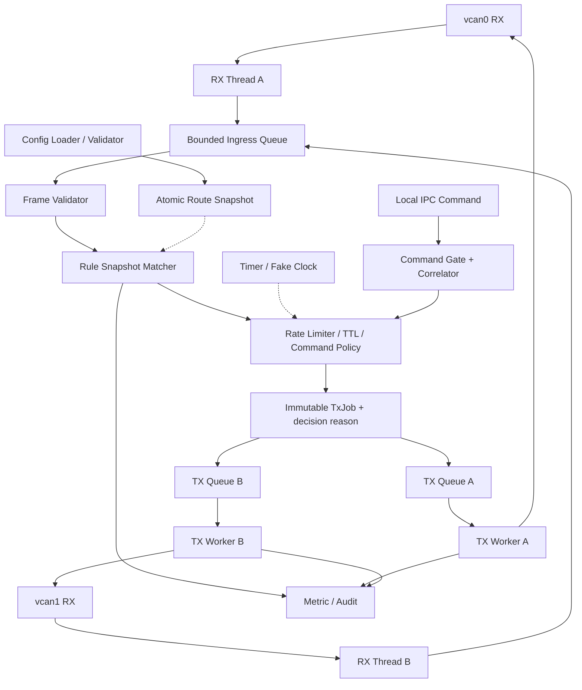
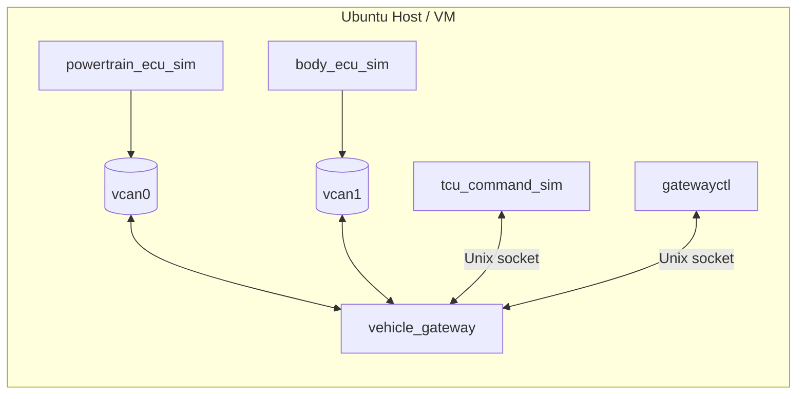
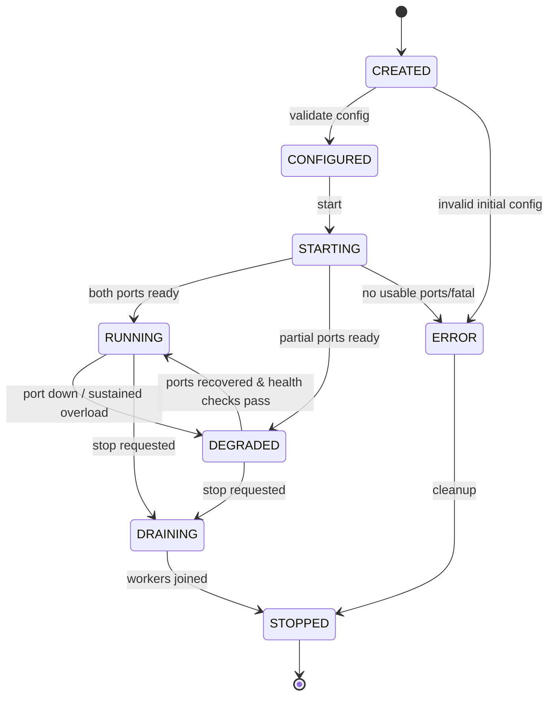
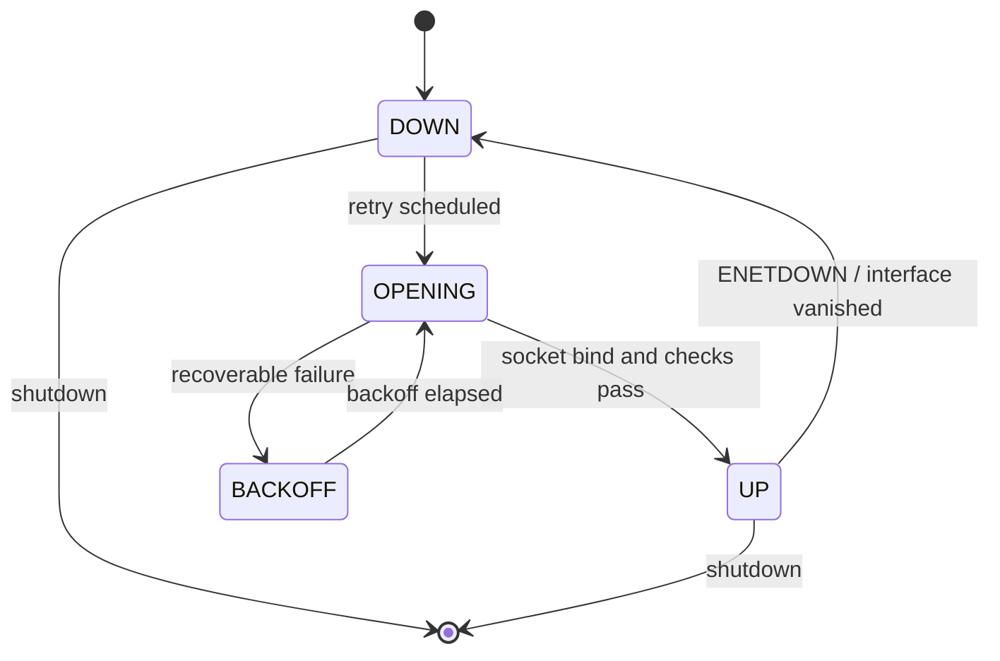
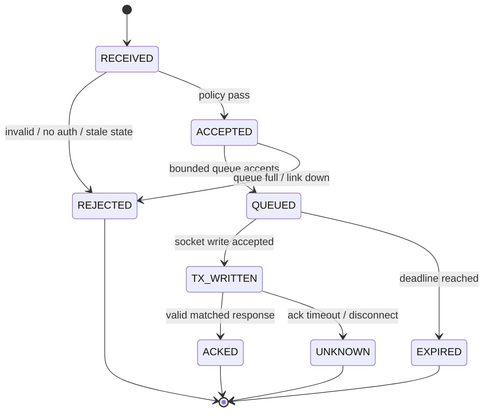
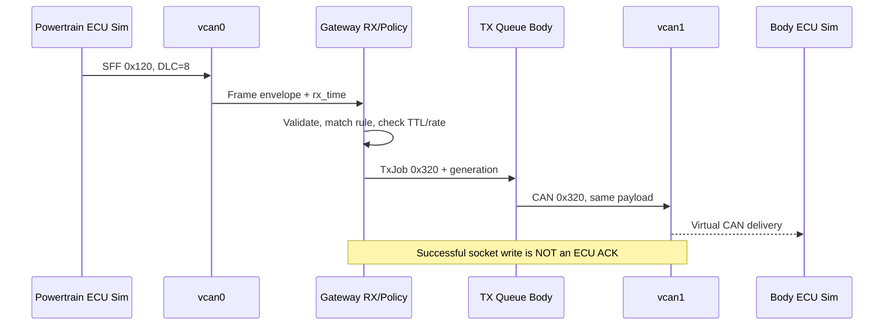
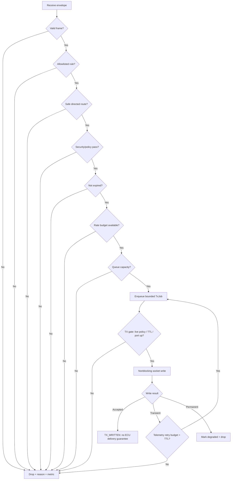

# Project 07 — Vehicle Gateway Simulator

> **Virtual TCU Lab | System Design + Operational Behavior + Comprehensive What-if/Resilience Test Plan | v1.0**  
> **Ngôn ngữ:** Tiếng Việt · **C++17** · **OS giả định:** Ubuntu Linux (SocketCAN/vcan) · **Ngày:** 2026-10-30  
> **Đối tượng:** Middle C++ Developer / TCU Application & Middleware · **Ưu tiên:** P1  
> **Trạng thái:** **Bản thiết kế để triển khai**, không phải sản phẩm đã phát triển, chạy thử, có chứng nhận hoặc đáp ứng safety requirements của OEM.  
> **Kế thừa:** Project 01 Event Bus, 02 IPC, 03 Timer, 04 Config/Logging, 05 Virtual CAN, 06 DBC Decoder.  
> **Giới hạn sử dụng:** **CHỈ xe/ECU giả lập và bus ảo**, không kết nối xe thật, không dùng CAN ID/lệnh thuộc OEM.

---

## 1. Executive Summary

Xây **gateway C++17 mô phỏng** định tuyến frame giữa **hai CAN bus ảo độc lập**: `vcan0` (Powertrain Simulator) và `vcan1` (Body Simulator). Gateway đọc frame từ từng bus, áp dụng **routing allowlist**, validate metadata + payload, map CAN ID nếu được cho phép, giới hạn lưu lượng, gửi lên bus đích, và đo lường mọi quyết định. Một **control endpoint giả lập** được phân tách khỏi luồng CAN để chạy kịch bản command từ TCU Application tới BCM simulator bằng hợp đồng xác thực giả lập dành riêng cho lab.

**Câu hỏi hệ thống phải trả lời:**

1. Một frame từ bus A có được đi sang bus B không, theo rule nào, và vì sao?
2. Frame sai/mất định kỳ/vô danh/không được phép có thể vượt qua gateway không?
3. Khi gặp overload, mất interface, tx failure, shutdown hoặc hot reload, hệ thống có phản hồi **xác định, hữu hạn** không?
4. Có thể bảo đảm không bị **routing loop**, không truyền lệnh nguy hiểm và không truyền frame stale không?
5. Khi đồng thời gặp nhiều lỗi, service có **fail-closed cho command** và không silently corrupt dữ liệu không?
6. Có thể tái hiện mọi behavior bằng **fake clock, fake transport, deterministic replay và `vcan`** mà không cần ECU vật lý không?

### 1.1 Definition of “chịu nổi” (không phải bất tử)

- Không crash/undefined behavior/data race/memory leak do input không đáng tin; độ bền được **kiểm chứng bằng test**, không tự nhận đã đạt.
- Không forward frame **không match allowlist**; command không qua được validation/security/safety gates.
- Bảo đảm **bounded queues**, deadline và memory theo limits đặt trước; overload tạo drop/reject có metric rõ ràng.
- Không tự tạo delivery guarantee: `send()` thành công chỉ nghĩa là **kernel chấp nhận enqueue/ghi frame**, không có nghĩa ECU đích đã nhận hoặc thực thi.
- Không replay command đã hết hạn và **không tự động retry command** nếu không có protocol idempotency ở tầng ứng dụng.
- Recover khi interface lên lại theo policy; không làm xuất hiện frame cũ hoặc route cũ bị thu hồi.
- Không kỳ vọng simulator chứng minh physical layer timing, bus-off thật, arbitration thực tế hay đáp ứng ISO 26262.

### 1.2 Deliverables

1. `libtcu_gateway`: strict route config, validator, route matcher, rule snapshot, policy engine, rate limiter và audit metadata.
2. `libtcu_gateway_transport`: adapter `SocketCanEndpoint` cùng `FakeCanEndpoint` cho test.
3. `vehicle_gateway`: executable có `start/stop/status/reload`, graceful shutdown, observability.
4. `powertrain_ecu_sim`, `body_ecu_sim`, `tcu_command_sim`: process simulator riêng (đều sử dụng ID giả).
5. `gatewayctl`: CLI xem active rules, generation, queue depth, drop reasons; yêu cầu mô phỏng command chỉ trên lab.
6. Config mẫu, golden fixtures, unit/integration/soak/fault injection/property tests, scripts setup `vcan0/vcan1`.
7. Architecture diagrams, ADRs, Jira backlog, threat model, test evidence + báo cáo baseline.

---

## 2. Vị trí trong lộ trình 30 project

| Dự án | Tương tác / cách kế thừa |
|---|---|
| 01 — Thread-Safe Event Bus | Emit `RouteDecision`, `GatewayHealthChanged`, `SignalObserved`; không giả định subscriber là transport. |
| 02 — IPC Service Framework | `gatewayctl` / TCU App giao tiếp với gateway bằng Unix Domain Socket có phân quyền; request/response có correlation ID. |
| 03 — Timer & Task Scheduler | Token bucket replenishment, freshness deadlines, bus reconnect backoff, periodic health checks dùng `steady_clock`. |
| 04 — Config & Logging | Validate cấu hình rồi atomic publish immutable snapshot; structured log, redaction, rate limit log. |
| 05 — Virtual CAN Bus | `SocketCanTransport`, vcan, mock ECU, các kiểu CAN frame/metadata. |
| 06 — DBC Signal Decoder | Optional decode cho kiểm tra signal/health; **không biến CAN frame thành authenticated input**. |
| **07 — Vehicle Gateway Simulator** | Route, policy, loop prevention, tx scheduling, resilience, multi-bus. |
| 08 — SOME/IP | Future: bổ sung service-oriented bridge; không có trong MVP. |
| 16 — Remote Vehicle Control | Tầng trên chịu trách nhiệm command authorization, vehicle condition, E2E response; gateway là policy boundary bổ sung. |
| 20 — UDS Diagnostics | ISO-TP/UDS routing là project riêng, không transparent forward arbitrary multi-frame ở V1. |

### 2.1 Phân biệt các kiểu gateway

- **Frame/PDU-like gateway trong lab (V1):** nhận một CAN data frame và, theo allowlist, forward hoặc map frame/ID tới bus khác. *Đây không phải implementation AUTOSAR PduR.*
- **Signal-level gateway (V2):** giải mã signal bằng Project 06, validate quality/freshness, biến đổi cấu trúc, encode lại message theo DBC đích; cần test bit layouts & semantic changes.
- **Transport-protocol gateway (V2+):** ISO-TP nhiều frame và stateful flows; **cố ý không làm** ở V1. Không route tùy tiện diagnostic frame với giả định rằng 1 raw frame = 1 request.

Tham khảo phân biệt PDU/signal gateway ở tài liệu AUTOSAR chính thức (xem §28). Thiết kế này **lấy cảm hứng từ khái niệm**, không tuyên bố AUTOSAR conformance.

---

## 3. Scope, assumptions và giới hạn

### 3.1 V1 — MUST

- Hai interface Linux CAN ảo `vcan0`/`vcan1`, hỗ trợ CAN **classical** 11-bit (SFF) và 29-bit (EFF) với format tách biệt; data frame `0..8` bytes.
- Process độc lập cho gateway và 2–3 ECU simulators; bind/poll các socket theo đúng interface.
- **Explicit, directional, deny-by-default route table**: `(ingress_port, format, CAN ID)` -> `(egress_port, output CAN ID, allowed DLC, TTL, priority, rate limit, payload policy)`.
- **ID mapping** bảo toàn payload theo rule; không tự đổi bytes hoặc encode signal nếu không có transformer versioned riêng.
- Validate flags, format, DLC, interface, rule ambiguity/collision, self-route và conservative routing cycles.
- Queue TX **bounded theo egress**; scheduler ưu tiên có fairness, rate limiting; absolute `steady_clock` freshness deadline.
- `No echo forwarding`: không match lại output CAN ID trên egress trong một route ngược, dù adapter tự nhìn thấy local loopback.
- Hot reload config theo transaction: parse → validate toàn bộ → build snapshot → atomic swap / reject nguyên phiên bản.
- Separate **synthetic command** path qua IPC, định nghĩa clear **accepted/enqueued/tx-written/ECU-acknowledged**.
- Metrics/counters, tracing, failure policies và fault injection **deterministic**.

### 3.2 V2 — tùy chọn, không ngầm hứa ở V1

- Signal-level mapping/re-packing dựa DBC + explicit destination schema.
- CAN FD (<= 64 bytes) sau khi enable capability/MTU/kernel checks; ghi rõ FD không đồng nghĩa classical CAN.
- ISO-TP diagnostic gateway với state machine đầy đủ; multi-frame transfer, flow control, addressing, session timeouts.
- Multiple bus ports, redundant gateway instances với fencing, advanced priority shaping, secure command policy integration.
- Dynamic route discovery, authenticated origin (chỉ nếu có protocol/cryptographic E2E được thiết kế riêng).

### 3.3 Non-goals / cảnh báo

- Không bridge giữa mạng của xe thật, không phát lệnh điều khiển phương tiện thật; **không có OEM IDs**.
- Không chứng minh CAN bus arbitration, bit timing, transceiver fault, EMC, bus-off recovery của controller bằng `vcan`.
- Không có source authentication tự nhiên trên CAN; **CAN ID không định danh người gửi**.
- Không hứa reliable/exactly-once delivery qua raw CAN; không hứa hard real-time.
- Không tunnel arbitrary incoming CAN từ cloud trực tiếp vào bus phương tiện.
- Không dùng `vcan` test làm cơ sở tuyên bố compliance cybersecurity/safety.

### 3.4 Môi trường giả lập

| Hạng mục | Quyết định lab |
|---|---|
| OS | Ubuntu Linux native/VM có kernel `vcan`, SocketCAN; WSL2/container có thể giới hạn module/NET_ADMIN. |
| C++ | C++17, GCC/Clang, CMake 3.16+, `-Wall -Wextra -Wpedantic`; sanitizers. |
| CAN | `<linux/can.h>`, `<linux/can/raw.h>`, `PF_CAN`, `SOCK_RAW`, `CAN_RAW`; `can-utils`. |
| Test | Google Test/Mock, deterministic fake transport, CTest, Python fault scripts, optional libFuzzer. |
| Time | `steady_clock` cho TTL/deadline; wall clock chỉ cho người đọc log. |
| Interface | Separate `vcan0`, `vcan1`, mỗi port 1 RX socket; TX socket theo port hoặc adapter tương đương. |
| Logging | Structured JSON, route_id, config_generation, ingress/egress, reason, no sensitive payload by default. |
| Command source | Local IPC simulator có access control của OS; không exposed public TCP server. |

---

## 4. Actors, topology và synthetic messages

### 4.1 Topology



**Diễn giải:** Diagram biểu diễn direction logic; tất cả sockets trên cùng host chia sẻ CAN stack của Linux. `vcan0` và `vcan1` là hai virtual network interfaces **riêng**; traffic không tự đi giữa chúng nếu không có gateway.

### 4.2 Message table giả lập (không phải mapping thực tế)

| Ingress | CAN ID | Format | DLC | Ý nghĩa | Hành động V1 |
|---|---:|---|---:|---|---|
| `vcan0` | `0x120` | SFF | 8 | `POWERTRAIN_STATUS` (speed/ignition bytes synthetic) | map sang `vcan1:0x320`, giữ payload |
| `vcan0` | `0x121` | SFF | 4 | `BATTERY_STATUS` | map sang `vcan1:0x321`, giữ payload |
| `vcan1` | `0x220` | SFF | 2 | `DOOR_STATUS` | map sang `vcan0:0x420`, giữ payload |
| `vcan1` | `0x221` | SFF | 3 | `BCM_COMMAND_RESULT` | chỉ đưa tới IPC response correlator; **không broadcast trên CAN khác** |
| IPC simulator | `COMMAND_LOCK` | n/a | n/a | Lệnh khóa cửa của lab (không phải OEM command) | chỉ sau policy gate, encode sang `vcan1:0x230` |
| `vcan0`/`vcan1` | bất kỳ ID khác | any | any | Unknown/untrusted | **DROP** + counter |

Lưu ý: cùng numeric ID có thể mang format EFF/SFF khác; key matching gồm `is_extended`, không so sánh ID đơn thuần. `vcan1:0x320/0x321` và `vcan0:0x420` **không** là source trong rule ngược, để tránh vòng lặp.

### 4.3 Explicit trust boundaries

1. **RX CAN boundary:** frame từ bus **untrusted**; validate và allowlist, không tự suy diễn authenticity.
2. **IPC command boundary:** peer credentials qua local socket **chỉ là trust boundary của host giả lập**; thêm policy version/nonce/expiry cho demo, không thay thế cloud authorization.
3. **Config boundary:** mọi file config phải validated whole-file; quyền ghi config giới hạn; không hot reload từ arbitrary CAN input.
4. **TX boundary:** recheck frame expiry, bus health, active security deny rules ngay trước I/O.
5. **Observability boundary:** chỉ metadata được log mặc định; payload/IDs trong demo không nhạy cảm nhưng production vẫn cần data governance.

---

## 5. Requirements với ID và mức ưu tiên

### 5.1 Functional Requirements

| ID | Requirement | Level |
|---|---|---|
| FR-01 | Khởi tạo/bind hai CAN virtual ports độc lập | MUST |
| FR-02 | Nhận frame đúng format, DLC, flags và ingress identifier | MUST |
| FR-03 | Allowlist định tuyến theo `(ingress, id-format, id)` | MUST |
| FR-04 | Mapping output id chỉ khi rule hợp lệ và chỉ ra egress rõ ràng | MUST |
| FR-05 | Drop unknown frame/RTR/error frames ở V1 với reason phân loại | MUST |
| FR-06 | Reject cấu hình self-route, duplicate ambiguous routes, conservative cycles | MUST |
| FR-07 | Bounded egress queues và overload policy xác định | MUST |
| FR-08 | Chặn frame đã hết TTL trước khi TX; dùng monotonic clock | MUST |
| FR-09 | Rate limit per-rule bằng token bucket, không throttling vô hạn | MUST |
| FR-10 | Strict config hot reload; không partial apply; ghi generation ID | MUST |
| FR-11 | Không tự retry synthetic command khi kết quả không xác định | MUST |
| FR-12 | Phân biệt `Accepted`, `Queued`, `Written`, `Acked`, `TimedOut`, `Unknown` | MUST |
| FR-13 | Reconnect port khi down theo bounded backoff, expose degraded state | MUST |
| FR-14 | Graceful shutdown: không gọi callback sau giải phóng, unblock I/O threads | MUST |
| FR-15 | Metrics per bus/rule/decision, structured audit với rate-limit | MUST |
| FR-16 | Tests không cần hardware, deterministic fake clock & transport | MUST |
| FR-17 | IPC status/reload/query command API với input validation | SHOULD |
| FR-18 | DBC signal quality observer cho monitoring, không thay raw CAN auth | SHOULD |
| FR-19 | Optional safe synthetic command path (local-only) | SHOULD |
| FR-20 | Optional V2 signal gateway với encode/decode theo DBC mới | V2 |

### 5.2 Non-functional Requirements (mục tiêu thử nghiệm, KHÔNG phải OEM SLA)

| ID | Mục tiêu lab | Cách đo / giới hạn |
|---|---|---|
| NFR-01 | Không có findings ASan/UBSan/TSan trên suite đã chạy | CI sanitizer + report; TSan phụ thuộc môi trường |
| NFR-02 | Memory/queue hữu hạn với input liên tục | `rss` plateau, queue depth bounded, drop counters tăng |
| NFR-03 | >= 5.000 test frames/s input trong 2 phút trên host tham chiếu | Load report ghi CPU, kernel, cấu hình, drop |
| NFR-04 | p99 route-plan latency < 2 ms tại baseline single-thread | Fake-clock/benchmark riêng, không tính physical bus |
| NFR-05 | p99 RX → socket-write < 20 ms dưới load mục tiêu | Integration measurements, mark degradation nếu vượt |
| NFR-06 | Route reload không làm một frame thuộc hai rule generations | Trace generation ở decision |
| NFR-07 | Queue full có behavior deterministic | Fault test + metric `drop_queue_full_total` |
| NFR-08 | Không callback sau `stop()` hoàn tất | Lifetime + shutdown race tests |
| NFR-09 | Không forward unknown command / expired command | Negative security tests |
| NFR-10 | Không mirror frame giữa bus một cách tự phát | Replay anti-loop test |

**Mục tiêu 5k/s và latency là giới hạn để benchmark**, không khẳng định CAN vật lý có thể đạt hoặc routing đó đáp ứng deadline chức năng an toàn. Cần chọn host/test profile, ghi actuals và điều chỉnh.

---

## 6. Architecture chi tiết



### 6.1 Module responsibilities

| Module | Trách nhiệm | Không chịu trách nhiệm |
|---|---|---|
| `CanPort` | SocketCAN I/O, lifecycle, read/write, link status | Không parse business signal |
| `FrameValidator` | SFF/EFF flags, RTR/ERR, DLC, format | Không cấp quyền command |
| `RouteConfigLoader` | Parse strict JSON, reject schema unknown/unsupported | Không xử lý frame trên hot path |
| `RouteGraphValidator` | Check duplicates/self/cyclic reachable `(bus, format, id)` | Không bảo đảm external nodes không replay |
| `RouteEngine` | Lookup immutable snapshot, create `TxJob`, emit reasons | Không thực thi side-effect khi đang giữ snapshot lock |
| `TokenBucket` | Bounded per-rule bandwidth quota | Không thể thay thế physical CAN arbitration |
| `TxScheduler` | Deadline/priority/egress queue fairness | Không hứa global FIFO across ports |
| `CommandGate` | IPC origin/policy/expiry, correlation, status | Không xác thực ECU trên CAN chỉ bằng ID |
| `HealthMonitor` | Reconnect, link degraded/healthy, stale timers | Không sửa physical bus faults |
| `GatewayStats` | Atomic counters, histograms, rate-limited logs | Không log secrets/payload tùy ý |

### 6.2 Deployment & processes



### 6.3 Threading model (V1)

- 2 RX threads, một cho mỗi CAN port; nonblocking socket + `poll()`/`epoll()` + stop notification (eventfd/self-pipe).
- 1 route worker đọc **bounded ingress MPSC queue** để bảo toàn thứ tự quan sát của từng RX thread.
- 2 TX workers, mỗi bus 1 bounded queue; priority levels có quota nhằm tránh starvation (critical frames phải explicit allowlist; V1 không coi tất cả traffic là critical).
- 1 health/timer loop (có thể reuse Scheduler Project 03) giám sát interface, timeouts, queued expired jobs.
- Config reload trên management worker; xây immutable snapshot rồi publish atomic. Không thay đổi rules in place.
- IPC admin/command chạy trên bounded executor; không được block RX/TX threads.

**Bảo đảm ordering:** FIFO trong **cùng một route ở cùng một egress queue** khi không có policy drop/reordering. Không bảo đảm thứ tự toàn cục giữa hai bus, các priority levels, hay thời điểm ECU thật nhận frame.

### 6.4 Ownership & memory

- `GatewayRuntime` sở hữu ports, pools, queues, timers, metrics; dùng RAII and `unique_ptr`.
- `RouteSnapshot` immutable, giữ bởi `shared_ptr<const RouteSnapshot>`; mỗi `RouteDecision` ghi `generation`.
- Frame payload copy-by-value tối đa 8 byte, metadata value type; không đưa pointer trỏ vào socket buffer sang thread khác.
- `TxJob` chứa `expiry_steady`, `route_id`, `policy_generation`, payload copy, và optional correlation ID (chỉ metadata nội bộ).
- Không callback ngoài module trong khi đang giữ queue/config mutex; tránh shutdown deadlocks.

---

## 7. Data contracts và API C++17 đề xuất

### 7.1 CAN Frame Envelope

```cpp
#include <array>
#include <chrono>
#include <cstdint>
#include <optional>
#include <string>
#include <vector>

using SteadyTime = std::chrono::steady_clock::time_point;

enum class CanFormat : std::uint8_t { Standard11, Extended29 };
enum class Port : std::uint8_t { Powertrain, Body };

struct FrameEnvelope {
    Port ingress;
    CanFormat format;
    std::uint32_t identifier;  // decoded numeric ID, without Linux flag bits
    std::uint8_t dlc;         // V1: 0..8
    std::array<std::uint8_t, 8> data{};
    SteadyTime rx_time;
    std::uint64_t ingress_sequence = 0; // process-local only
    bool is_rtr = false;
    bool is_error = false;
};

enum class RouteDecisionCode {
    ForwardedToQueue, RejectedUnknown, RejectedInvalid,
    RejectedPolicy, RejectedExpired, RejectedRateLimit,
    RejectedQueueFull, RejectedLinkDown, RejectedCommand,
    RejectedShuttingDown
};

struct RouteDecision {
    RouteDecisionCode code;
    std::string route_id;       // empty if unmatched
    std::uint64_t generation;  // applied immutable snapshot
};
```

### 7.2 Route, snapshot, engine

```cpp
struct RouteKey {
    Port ingress;
    CanFormat format;
    std::uint32_t identifier;
};

struct RouteRule {
    std::string id;
    RouteKey match;
    Port egress;
    CanFormat output_format;
    std::uint32_t output_id;
    std::uint8_t required_dlc;
    std::chrono::milliseconds max_age;
    std::uint32_t rate_per_second;
    std::uint32_t burst;
    std::uint8_t priority; // bounded enum range at config validation
};

struct RouteSnapshot {
    std::uint64_t generation;
    std::vector<RouteRule> rules;
    // immutable index, route graph metadata, schema hash
};

class IClock {
public:
    virtual ~IClock() = default;
    virtual SteadyTime now() const noexcept = 0;
};

class ICanPort {
public:
    virtual ~ICanPort() = default;
    virtual bool isUp() const noexcept = 0;
    virtual bool sendNonBlocking(const FrameEnvelope& out) = 0;
};

class GatewayEngine {
public:
    RouteDecision route(const FrameEnvelope& input);
    bool reloadFromFile(const std::string& path); // validate -> atomic swap
    void requestStop() noexcept;
    void join();
};
```

**API mẫu** là skeleton, chưa compile độc lập và chưa phải source implementation. Error handling production nên dùng typed `Result<Status, Value>` thay vì trả `bool` mơ hồ; `sendNonBlocking` cần phân biệt `WouldBlock`, `LinkDown`, `Fatal`, `Written`. `Port` chỉ là logical enum; adapter map tới interface names do config cung cấp.

### 7.3 TX Result contract

| Status | Chính xác có nghĩa gì | Hành vi |
|---|---|---|
| `ROUTE_ACCEPTED` | Rule match và job được tạo | Chưa chắc queue nhận |
| `QUEUED` | Job trong egress queue | Chưa ghi socket |
| `TX_WRITTEN` | `send()`/`write()` trả số bytes đúng | **Không suy ra ECU đã nhận** |
| `TX_RETRYABLE` | EAGAIN/EINTR/quá tải transient theo policy | Retry có hạn cho telemetry only, không vượt deadline |
| `TX_FAILED` | Link down/permanent I/O error | Drop/reject có metric và health transition |
| `COMMAND_ACKED` | BCM simulator trả response có correlation đúng và còn hạn | Chỉ là ACK của *ECU giả* |
| `COMMAND_UNKNOWN` | Timeout/mất link/restart; kết quả vật lý không xác định | Không tự retry command; yêu cầu reconcile/query |

### 7.4 IPC contract for synthetic command

```json
{
  "request_id": "lab-req-001",
  "command": "LOCK_SIMULATED_DOOR",
  "created_at_unix_ms": 0,
  "ttl_ms": 1500,
  "target": "body_simulator",
  "client_session": "local-demo",
  "policy_version": 1
}
```

`created_at_unix_ms` chỉ cho human/audit; TTL enforcement dựa trên **monotonic arrival + duration** sau khi kiểm tra wall timestamp khi ingress (ngăn request hết hạn ngay từ nguồn). Tham số ví dụ không có ý nghĩa lệnh automotive thật. `request_id` cần store trong bounded dedup cache theo TTL, và correlation với ACK phải nằm ở protocol giả lập rõ ràng, không tin CAN ID đơn lẻ.

---

## 8. Routing rules và cấu hình tham khảo

### 8.1 Ví dụ `gateway.json` (đề xuất, chưa có parser)

```json
{
  "schema_version": 1,
  "interfaces": {
    "powertrain": "vcan0",
    "body": "vcan1"
  },
  "limits": {
    "ingress_queue_capacity": 2048,
    "tx_queue_capacity_per_port": 1024,
    "max_routes": 256,
    "max_config_file_bytes": 262144,
    "max_log_rate_per_reason_per_sec": 5
  },
  "default_action": "deny",
  "command_policy": {
    "enabled": false,
    "require_local_ipc_peer_allowlist": true,
    "no_automatic_retry": true
  },
  "routes": [
    {
      "id": "powertrain_status_to_body",
      "source": "powertrain",
      "source_format": "sff",
      "source_id": "0x120",
      "required_dlc": 8,
      "target": "body",
      "target_format": "sff",
      "target_id": "0x320",
      "ttl_ms": 100,
      "rate_per_second": 100,
      "burst": 20,
      "priority": 2
    },
    {
      "id": "battery_status_to_body",
      "source": "powertrain",
      "source_format": "sff",
      "source_id": "0x121",
      "required_dlc": 4,
      "target": "body",
      "target_format": "sff",
      "target_id": "0x321",
      "ttl_ms": 1000,
      "rate_per_second": 20,
      "burst": 5,
      "priority": 1
    },
    {
      "id": "door_status_to_powertrain",
      "source": "body",
      "source_format": "sff",
      "source_id": "0x220",
      "required_dlc": 2,
      "target": "powertrain",
      "target_format": "sff",
      "target_id": "0x420",
      "ttl_ms": 250,
      "rate_per_second": 50,
      "burst": 10,
      "priority": 2
    }
  ]
}
```

### 8.2 Strict validation matrix

| Field | Validate | On invalid |
|---|---|---|
| `schema_version` | Known supported integer | Reject entire config |
| Bus alias/name | Unique, allowed interface names, no unexpected extra port | Reject config |
| Source/target | Must exist; source != target | Reject config |
| CAN ID + format | SFF `<=0x7FF`, EFF `<=0x1FFFFFFF` | Reject config |
| DLC | Classical 0..8 (lab demo exact length) | Reject config |
| `ttl_ms` | `>0`, bounded max 10s | Reject config |
| `rate_per_second`,`burst` | Positive, capped; no integer overflow | Reject config |
| Match key | No duplicate/ambiguous match without explicit deterministic policy | Reject config |
| Routing graph | No back-edge/cycle reachable across `(bus,format,id)` | Reject config |
| Targets collisions | Conflicting output route semantics not allowed unless explicitly disambiguated | Reject config |
| Security policy | Unknown keys and unsafe command enable require explicit local admin | Reject config |
| Config file | Path safe, regular file, limited size, no symlink if strict mode | Reject + retain active generation |

### 8.3 Route graph và loop prevention

- Graph nodes: `(logical_port, frame_format, numeric_id)`; edges: allowed `route(source_node → target_node)`.
- Reject exact cycles (A→B→A) and self-route, plus conservative ambiguous rules that could produce feedback under local socket loopback.
- **Không có hop count/origin chuẩn trong raw CAN**; metadata nội bộ chỉ tồn tại trong process. Khi external ECU tùy ý retransmit một output ID thành input ID, gateway **không thể đảm bảo tuyệt đối loop-free** nếu có rule tạo chu trình ngữ nghĩa qua nhiều actor.
- **Không dùng cache de-dup/hash TTL** để cam kết loại hết loop: payload giống nhau có thể là dữ liệu hợp lệ theo chu kỳ; ngược lại attacker thay đổi payload có thể vượt cache.
- SFF/EFF key và CAN_ERR/RTR flags tách biệt; không dựa vào `CAN_RAW_RECV_OWN_MSGS` mặc định như lớp phòng vệ duy nhất.
- Nếu cần bidirectional request/response, định nghĩa **ID space riêng cho mỗi chiều**, route explicit; không route output IDs quay ngược vào một source rule.

### 8.4 Safe command rules (synthetic only)

Command path không đi qua generic frame-forward route: `IPC request → input validation → local policy → current vehicle-simulated state → encoder → destination bus → response correlator`. Nếu speed status không fresh, policy nghiêm ngặt **reject/unknown** thay vì giả định speed=0. Khi command timed out, không tự động retry nếu execution outcome không xác định.

---

## 9. State machines

### 9.1 Gateway lifecycle



**Semantics:** `RUNNING` không đảm bảo mọi CAN TX được giao thành công; chỉ cho biết service healthy theo checks đã khai báo. `DEGRADED` phải nêu rõ bus nào, reason nào. `stop()` idempotent, không giữ mutex khi join threads. Restart tạo instance mới hoặc explicit `reset()` sau `STOPPED` nếu API cho phép.

### 9.2 CAN port health



A port `DOWN` không có đường fallback sang bus khác tự động; tránh phát frame trên bus sai. TX jobs cũ expire hoặc bị purge; recovery **không flush expired commands**.

### 9.3 Command lifecycle



**Command `UNKNOWN`** có thể đã được thực thi bởi simulator; không phát lại theo automatic retry. Hãy query observed state qua một luồng riêng nếu protocol cho phép.

---

## 10. Operational behavior — happy path & exceptional path

### 10.1 Startup

1. Validate startup flags và JSON (syntax, schema, route IDs, graphs, queue sizes, time budgets, security policy).
2. Build immutable `RouteSnapshot(generation=1)`; record schema checksum.
3. Create bounded queues, metrics, fake/real timers; initialize IPC local listener with permissions.
4. Open/bind `vcan0`,`vcan1`; set explicit socket filter / mode; create stop notification.
5. Start RX threads, route worker, TX workers, health monitor; publish `RUNNING` if both ports available, otherwise `DEGRADED` per configured availability policy.
6. Print audit summary of allowed routes and explicit default-deny; no frame forwarding before snapshot exists.

### 10.2 Routing: Powertrain → Body



### 10.3 Frame rejected

1. RX nhận unknown id, RTR, CAN error frame, invalid DLC hay source-port sai.
2. Validator/rule engine trả **typed rejection reason**; **không enqueue TX**.
3. Increment exact `drop_reason_total`, sample rate-limited log; không exception hoặc busy loop.

### 10.4 Queue pressure

1. RX tiếp nhận frame hợp lệ; enqueue ingress queue full → drop theo chính sách `DropNewestLowPriority` (mặc định lab), metric.
2. Route worker match, egress queue full → reject with reason (hoặc nếu cấu hình coalesce cho *telemetry signal only* thì replace latest).
3. **Không block RX thread vô hạn**. High-priority quota prevents perpetual starvation of regular traffic; no automatic command coalescing.

### 10.5 Link down, recovery

- `vcan1` down: gateway marks Body `DOWN`, stops delivery to Body, drops/expires queued jobs; emits `DEGRADED`, backs off opening.
- `vcan0` vẫn có thể nhận nhưng không buffer vô hạn cho bus đang down.
- Link up: rebind, health check, mark `UP`; only new and still-valid **allowed telemetry** could be sent; default lab **purges TX queue on down** for simpler contract. Commands never replay.

### 10.6 Hot reload: normal vs policy tightening

- Build candidate off hot path; validate strict; atomically swap `shared_ptr<const RouteSnapshot>`; bump `generation`.
- A decision already computed using old generation may still exist in a queue; **TX must re-check active deny/revocation/security gate before send**. When a route is removed, purge pending jobs for revoked route, even if they carry an older generation.
- For purely cosmetic/telemetry rate changes, explicitly define whether old queued traffic drains under old limits or is revalidated under new snapshot. **V1 decision: revalidate TX against current active policy and expire/drop mismatches**, simplifying audit.
- Failed reload never changes generation or partially applies a ruleset.

### 10.7 Graceful shutdown

1. Mark DRAINING and reject new IPC commands/forwarding.
2. Stop RX, unblock waits using stop notifications, close listeners safely.
3. **Discard command queue**. For telemetry, bounded drain optional up to shutdown deadline; V1 default discards remaining queued jobs with metrics.
4. Join TX/route/health workers, flush logs with bounded timeout, close sockets, release snapshots.
5. `stop()` idempotent; no callbacks/cross-process response after lifetime ends.

---

## 11. Behavioral contracts (Given / When / Then)

| ID | Given | When | Then |
|---|---|---|---|
| BC-01 | Gateway running, allowlisted `vcan0:0x120` | Frame DLC=8 arrives | One `vcan1:0x320` job created with unchanged 8-byte payload |
| BC-02 | No route for `0x555` | Unknown frame arrives | Drop, `RejectedUnknown`, **zero TX** |
| BC-03 | Rule only SFF `0x120` | EFF numeric `0x120` arrives | Drop, no mistaken ID match |
| BC-04 | Rule DLC=8 | DLC=7 arrives | Reject invalid; do not pad silently |
| BC-05 | Route to Body | Body down | Do not enqueue indefinitely; `DEGRADED` and explicit drop |
| BC-06 | Queue at capacity | One more frame arrives | Policy-defined drop, process remains bounded |
| BC-07 | Frame waits > route max_age | TX worker wakes | Drop stale frame; no late delivery |
| BC-08 | Reload file invalid | Admin requests reload | Old generation retained, reason recorded |
| BC-09 | New rules revoke a route | Old queued job pending | Purge/revalidate; do not transmit revoked job |
| BC-10 | Two-way mapping without feedback edge | Repeated frames sent | No growing echo loop; rate remains bounded |
| BC-11 | Synthetic command identity invalid | IPC command arrives | `REJECTED`, no CAN command TX |
| BC-12 | Synthetic speed status stale | Door command requires stopped vehicle | Reject/unknown; never assume speed zero |
| BC-13 | Command written but no ACK | Timeout reached | `UNKNOWN`, no auto retry |
| BC-14 | RX and reload concurrent | Frame arrives during swap | Frame decision uses one complete snapshot generation |
| BC-15 | Shutdown races with enqueue | Stop initiated | No use-after-free, no callback after joined |
| BC-16 | Callback/event subscriber throws | Route completes | Internal state preserved, error counted, no worker death |
| BC-17 | Duplicate request ID | Same command repeated within dedup TTL | One execution attempt max within defined window; repeated reply from cache |
| BC-18 | TX `EAGAIN` | Telemetry send attempted | Requeue only while deadline/budget permits; no busy-spin |
| BC-19 | TX `EINTR` | Interrupted syscall | Retry syscall safely according to budget, no unbounded loop |
| BC-20 | Recovered port | Newly generated valid frame arrives | Resume routing with current snapshot only |

### 11.1 Safety and security invariants

- **INV-01:** `unmatched_frame ⇒ tx_count_for_frame == 0`.
- **INV-02:** `invalid_metadata || invalid_dlc ⇒ no_tx`.
- **INV-03:** `tx_job.policy_generation` must be recorded; **revoked route never TX after revoke commit** (TX gate serialized against revocation commit; race boundary is defined by successful commit/audit epoch, not wall-clock guess).
- **INV-04:** `now() >= expiry ⇒ no_tx`.
- **INV-05:** `queue_depth <= configured_capacity` at all reachable states.
- **INV-06:** `command_status == UNKNOWN ⇒ automatic_command_retry_count == 0`.
- **INV-07:** `stop completed ⇒ active_worker_count == 0`.
- **INV-08:** No route graph cycle under validated ruleset; residual external replay risk documented.
- **INV-09:** `TX_WRITTEN` never converts to `COMMAND_ACKED` without fresh matching simulator response.
- **INV-10:** Config reload failure leaves **exact** active config generation unchanged.
- **INV-11:** No integer overflow in IDs, token counters, rate limit math, duration conversion.
- **INV-12:** Backpressure only discards or rejects according to explicit policy; never silently stores unbounded work.

---

## 12. Failure policy decision tree



**Critical note:** policy revocation requires a synchronization boundary with TX gate. Implementation should use generation-aware shared/exclusive barrier or a serialized policy epoch where the administrative **reload commit** is the moment all future writes observe deny. A `send()` already in progress **before** commit may complete after it; audit must distinguish it. Claim “no TX after reload” without defining that race would be misleading.

---

## 13. Reliability/concurrency design chi tiết

### 13.1 Queue and scheduling policy

| Queue | Lab default | Full policy | Phân biệt |
|---|---:|---|---|
| Ingress MPSC | 2048 envelopes | DropNewest + metric, never block RX indefinitely | Exact loss count |
| Egress Body | 1024 TxJobs | Drop low-priority newest, reserve small control quota | No unbounded reserve |
| Egress Powertrain | 1024 TxJobs | Same | Do not mix ports |
| IPC command pending | 64 entries | Immediate `BUSY`, no silently accepted work | Distinct from generic forwarding |
| Dedup request table | 1024 IDs, 30s TTL | Reject new commands or evict only expired | Explicit `UNKNOWN` on capacity pressure |
| Audit log queue | 4096 records | Severity-aware discard + counter | Can't block safety gate |

- Token bucket takes **time** from `IClock`, uses saturating/bounded arithmetic. No busy loop while empty.
- Strict priority can starve low priority. Use weighted scheduling e.g. high:normal:low `4:2:1` per egress, with deadline check before TX. This guarantees only scheduler fairness under processing capacity, not physical medium QoS.
- Never use command retries to hide uncertain execution. Telemetry retries may reorder unless same-route FIFO maintained; explicitly trace decision.
- De-dup for telemetry? Do **not** treat identical payload as duplicates: periodic sensors legitimately repeat values.

### 13.2 Races to reason about

| Race | Required strategy |
|---|---|
| RX vs shutdown | Stop flag + wakeup fd; close socket only after RX loop exit or safe cancellation protocol |
| TX vs shutdown | Drain/discard atomic policy; worker join before releasing transport |
| Config reload vs routing | `shared_ptr<const Snapshot>` per evaluation; no partially mutated rules |
| Config revoke vs queued TX | Recheck active policy + synchronize commit/TX gate |
| Port rebind vs TX | Per-port lifecycle token / generation; stale fd not reused accidentally |
| Timer callback vs object destruction | Cancellation barrier or weak/shared lifetime token; no raw dangling `this` |
| Metrics reset vs increment | Per-counter atomics with explicit snapshot semantics; avoid unsafe reset |
| IPC response vs timeout | Terminal transition exactly once; correlate by `request_id` and session generation |
| Two command requests vs same BCM state | Serialize per target or provide explicit idempotency / conflict resolution |
| Event Bus callback vs gateway lock | Post-event after unlock; callback exception isolated |

### 13.3 Memory/time correctness

- `steady_clock` never mixed directly with Unix timestamp for expiry calculation.
- Durations validated before addition; avoid integer overflow and clock horizon bugs.
- No dynamic allocation on the hottest RX path if avoidable; but correctness beats micro-optimization.
- No arbitrary pointer reinterpretation from `can_frame` to user data; use field-wise conversion.
- SocketCAN reads must verify `nbytes == CAN_MTU` for classical frames; FD mode only explicitly supported when enabled and MTU checked.
- Apply `CAN_EFF_FLAG`, `CAN_RTR_FLAG`, `CAN_ERR_FLAG` handling explicitly and strict filters. Error frames are monitoring, not normal data.

---

## 14. Comprehensive WHAT-IF Test Catalog

> **Cách đọc:** mỗi case có ID, trigger/What-if, **cách fault injection**, **expected behavior/observable oracle** và priority.  
> **Mục tiêu bao phủ:** normal + boundaries + invalid + concurrency + reliability + security + multi-fault; **không thể liệt kê toán học mọi interleaving**, nên bổ sung fuzz/property testing và model-based/state-machine exploration để tìm tổ hợp chưa dự đoán.  
> **P0:** phải chạy trước demo/MVP; **P1:** trước release lab; **P2:** nâng cao/extension.  
> `FakeCanPort`, `FakeClock` và `TestScheduler` cho test chính xác lỗi syscall/race; `vcan` cho end-to-end Linux. Không dùng `vcan` để tuyên bố tái hiện physical bus-off/arbitration.

### 14.1 Input CAN & metadata — 14 scenarios

| ID | What if / tình huống | Cách giả lập / kích hoạt | Expected behavior / oracle | Priority |
|---|---|---|---|---|
| WI-IN-001 | Nhận SFF 0x120 đúng DLC 8 trên vcan0 | cansend + candump đối chiếu | 1 route 0x320; payload y nguyên; counter forwarded +1 | P0 |
| WI-IN-002 | Nhận EFF có numeric ID 0x120 | FakeCanPort với EFF flag | Không match SFF rule; drop reason FORMAT_MISMATCH | P0 |
| WI-IN-003 | Nhận CAN ID lớn hơn giới hạn SFF | Fake transport inject invalid envelope | Không TX, validator INVALID_ID | P0 |
| WI-IN-004 | Nhận CAN ID lớn hơn EFF mask | Fuzz identifier 0x20000000 | Reject và không overflow mask | P0 |
| WI-IN-005 | Nhận RTR frame với ID được allowlist | Set CAN_RTR_FLAG in fake input | Không route data; RTR_REJECTED | P0 |
| WI-IN-006 | Nhận CAN error frame | FakeCanPort inject CAN_ERR_FLAG | Chỉ health metric; không route như user frame | P0 |
| WI-IN-007 | CAN RX read trả số bytes lẻ/thiếu | Fake read returns CAN_MTU-1 | Read error + frame drop; không đọc vùng chưa init | P0 |
| WI-IN-008 | DLC > 8 trong classical mode | Fake metadata dlc=9 | Reject INVALID_DLC; no out-of-bounds read | P0 |
| WI-IN-009 | DLC=0 với rule required=8 | cansend 120# | Reject DLC_MISMATCH; no padding | P0 |
| WI-IN-010 | DLC=7 vs required=8 | cansend 120#00112233445566 | Reject; không convert partial payload | P0 |
| WI-IN-011 | Frame id cùng số nhưng khác ingress bus | Inject 0x120 trên vcan1 | Không match route from vcan0 | P0 |
| WI-IN-012 | Received unknown CAN ID liên tục | cangen random IDs trong range không allowlist | 0 forward; drop_count; logs rate-limited | P0 |
| WI-IN-013 | Data payload toàn 0x00 | cansend known frame zero-filled | Route đúng nếu rule cho phép; không coi zero là invalid mặc định | P1 |
| WI-IN-014 | Payload toàn 0xFF | cansend all-FF sample | Pass RAW mapping; signal-level checks tách Project 06 | P1 |

### 14.2 Routing rules, allowlist & permissions — 14 scenarios

| ID | What if / tình huống | Cách giả lập / kích hoạt | Expected behavior / oracle | Priority |
|---|---|---|---|---|
| WI-RT-001 | Không có rule cho CAN ID bất kỳ | Empty routes config | Deny-all, no implicit forwarding | P0 |
| WI-RT-002 | Rule map 0x120 -> 0x320 | Golden CAN frames | Chỉ thay CAN ID, giữ 8 bytes/format như config | P0 |
| WI-RT-003 | Rule trùng source key hai đích khác nhau | Load conflicting JSON | Reject entire reload, old snapshot retained | P0 |
| WI-RT-004 | Rule trùng route ID nhưng source khác | Duplicate route IDs | Config error, unique IDs enforced | P0 |
| WI-RT-005 | Nguồn và đích cùng interface | Set source=target | Reject self-route config | P0 |
| WI-RT-006 | Rule có target port không khai báo | Config target=ghost | Reject config; no runtime default port | P0 |
| WI-RT-007 | Rule có src ID string âm | JSON "-1" | Reject strict numeric format | P0 |
| WI-RT-008 | Rule có src ID sai prefix/case/leading characters | Fuzz parser strings | Reject ambiguous parse; no partial integer | P1 |
| WI-RT-009 | Forward disabled bởi policy flag | Toggle route disabled | No TX; count POLICY_DISABLED | P0 |
| WI-RT-010 | Frame đã match nhưng bus target bị down | Bring target link down | LINK_DOWN, no redirect or unlimited buffering | P0 |
| WI-RT-011 | Rule threshold vô hạn hoặc rate=0 | Load 0 or extreme values | Reject invalid limits, no overflow | P0 |
| WI-RT-012 | Hai rule có source match giống nhưng priority khác | Conflicting rules with precedence | Reject ambiguity in V1; do not select arbitrary rule | P1 |
| WI-RT-013 | Route đổi output format SFF->EFF hợp lệ | V2-style test with config declared conversion | V1 reject unsupported conversion unless explicitly supported and tested | P1 |
| WI-RT-014 | Cấu hình có unknown JSON keys | Inject typo targett | Fail closed; reject file with path to bad field | P1 |

### 14.3 Loops, echo & topology — 14 scenarios

| ID | What if / tình huống | Cách giả lập / kích hoạt | Expected behavior / oracle | Priority |
|---|---|---|---|---|
| WI-LP-001 | A:0x120 -> B:0x320, B:0x320 -> A:0x120 | Cycle config graph | Reject reload before accepting any frame | P0 |
| WI-LP-002 | Rule A:0x120 -> A:0x120 | Self-edge config | Reject self route | P0 |
| WI-LP-003 | Ba bước A:x -> B:y -> A:z -> B:x | Build synthetic multi-node cycle | Detect cycle on node graph, reject | P0 |
| WI-LP-004 | SocketCAN default local loopback quan sát TX qua socket khác | Use separate RX/TX sockets same port | No repeated routing because output ID not source key | P0 |
| WI-LP-005 | Enable CAN_RAW_RECV_OWN_MSGS | Toggle socket option for test | Route rules remain safe; echo does not amplify | P0 |
| WI-LP-006 | BCM simulator tự echo 0x320 nhiều lần | ECU script replay output frame | No matching backward route; no amplification | P0 |
| WI-LP-007 | Repeat exact payload 10.000 lần legitimate | cangen fixed frame | No global payload-hash dedup; route obeys rate/queues | P1 |
| WI-LP-008 | Malicious external actor changes payload each echo | Synthetic second process rewrite payload | Rule graph still no feedback; no dependence on content hashing | P1 |
| WI-LP-009 | Unknown third process injects output ID as input | cansend vcan1 320#... | Denied by source allowlist | P0 |
| WI-LP-010 | Two gateways chạy song song cùng rule on same host | Launch duplicate instances | Deployment guard/lock warns or prohibits; if bypassed test shows duplicates possible | P1 |
| WI-LP-011 | Cổng vcan0 và vcan1 bị alias cùng ifindex | Config maps both aliases to same interface | Reject logical ports same physical interface in strict V1 | P0 |
| WI-LP-012 | External ECU behaves as arbitrary bridge outside process | Simulated ECU bridges ID spaces | Document residual uncontrolled loop risk; enforce rate cap/monitor storm | P1 |
| WI-LP-013 | Route graph very large near max_routes | Generate 256 nodes/edges | Validation terminates within bounded time | P1 |
| WI-LP-014 | Route graph inputs crafted for quadratic explosion | Fuzz 256 dense rules | Bound CPU/memory and fail rejected graph | P2 |

### 14.4 Payload, mapping & signal quality — 12 scenarios

| ID | What if / tình huống | Cách giả lập / kích hoạt | Expected behavior / oracle | Priority |
|---|---|---|---|---|
| WI-PL-001 | Mapped frame payload differs from source | Golden byte-by-byte assertion | Mismatch fails test; raw mapping must preserve bytes | P0 |
| WI-PL-002 | Raw route mistakenly recomputes CRC byte | Inject rule with unauthorized transform | Reject unsupported transform; no silent payload mutation | P0 |
| WI-PL-003 | DLC of output incompatible with target rule | Bad config requested DLC conversion | Reject at config time | P0 |
| WI-PL-004 | DBC decoder reports stale speed while routing raw status | Project 06 quality mock | Raw route policy explicit; command gate refuses stale speed | P0 |
| WI-PL-005 | DBC parser output invalid value | Mock `INVALID` decoded signal | No output to trusted signal path; metrics quality invalid | P0 |
| WI-PL-006 | Overflow in numeric scaling planned for V2 | Fake extreme DBC factor | V1 blocks signal map; V2 needs safe conversion test | P1 |
| WI-PL-007 | Destination mapping has conflicting DBC schema | Compare source vs dest definitions in V2 fixture | V2 deny until explicit compatible encode plan | P1 |
| WI-PL-008 | Source and destination same CAN ID numeric but on different bus | Route 0x220->0x220 with acyclic topology | Allowed only if graph no loop + explicit config; metadata preserves bus IDs | P1 |
| WI-PL-009 | One-bit flipped payload | Fuzz one-bit mutation | Raw route keeps input; trust layer cannot claim E2E integrity | P0 |
| WI-PL-010 | Unknown rolling counter/CRC field in raw message | Synthetic counter semantic not configured | Never claim counter verified; document absence | P1 |
| WI-PL-011 | Received event with zero timestamp or future timestamp | Fake envelope with invalid clock metadata | Validate clock domain; reject or normalize at ingress according contract | P0 |
| WI-PL-012 | CAN FD frame arrives in classical-only mode | CANFD_MTU fake read | Reject unsupported frame with counter; never truncate to 8 silently | P0 |

### 14.5 Rate limits, priorities & fairness — 12 scenarios

| ID | What if / tình huống | Cách giả lập / kích hoạt | Expected behavior / oracle | Priority |
|---|---|---|---|---|
| WI-RL-001 | Rule rate budget 100/s receive 1000/s | Clock-controlled burst test | Forward <= budget + burst over measured window; count throttled | P0 |
| WI-RL-002 | Burst exactly consumes token cap | FakeClock step and known sends | No extra token generated | P0 |
| WI-RL-003 | Clock jumps backward in wall time | Change system wall clock in test double | Monotonic budgets unaffected | P0 |
| WI-RL-004 | Steady clock boundary equal next refill | FakeClock exact boundary | Deterministic allowance; no off-by-one | P0 |
| WI-RL-005 | Token math integer overflow with huge elapsed | FakeClock far-future jump | Saturate capacity; no wrap | P0 |
| WI-RL-006 | Long idle followed by burst | Wait fake 1h then 1k frames | Credit capped at burst; no accumulated infinity | P0 |
| WI-RL-007 | High priority flood starves low priority | Weighted-scheduler generated queues | Low priority gets quota when capacity exists; lateness measured | P1 |
| WI-RL-008 | Low priority flood while command pending | Inject 10k telemetry + one synthetic command | Command admission bounded and separate; no hidden infinite wait | P0 |
| WI-RL-009 | Priority value outside allowed enum | Config priority=999 | Reject config | P0 |
| WI-RL-010 | Two routes share token state accidentally | Alternate IDs/route keys | Counters isolated per route as defined | P0 |
| WI-RL-011 | Reload changes route rate budget | Swap config under traffic | Old queued jobs revalidated; new token policy deterministic | P1 |
| WI-RL-012 | Rate limited frame has no remaining TTL | Throttle then advance time | Drop stale; no deferred spontaneous send | P0 |

### 14.6 Queues, backpressure & memory — 14 scenarios

| ID | What if / tình huống | Cách giả lập / kích hoạt | Expected behavior / oracle | Priority |
|---|---|---|---|---|
| WI-QU-001 | Ingress queue exactly at capacity | Fake worker paused + 2048 frames | 2048 bounded, next drop with exact counter | P0 |
| WI-QU-002 | Egress queue exactly at capacity | Block TX fake + 1024 jobs | No allocation beyond limit; explicit QUEUE_FULL | P0 |
| WI-QU-003 | Slow TX worker and fast RX workers | Hold TX 5 s while flood | Bounded RSS; drop rate rises, no deadlock | P0 |
| WI-QU-004 | Multiple producers enqueue concurrently | 8 fake RX producers | No lost internal accounting or corrupted queue | P0 |
| WI-QU-005 | Enqueue during transition to DRAINING | Latch race at state transition | Reject new job or accept before barrier; deterministic outcome | P0 |
| WI-QU-006 | Payload object destroyed before TX | ASan lifetime test | TX holds own copied bytes; no UAF | P0 |
| WI-QU-007 | Out-of-memory during config build | Fault allocator | Reload fails atomically; active route stays | P1 |
| WI-QU-008 | Out-of-memory during hot-path enqueue | Inject allocation failure where possible | Catch/handle fail; never silently accept | P1 |
| WI-QU-009 | Logging queue full during CAN flood | Slow logging sink | No RX stall; log_dropped counter | P0 |
| WI-QU-010 | Dedup cache fills before TTL expiry | Generate 1025 unique commands | Reject new commands or explicit safe policy; never unbounded map | P0 |
| WI-QU-011 | Queue counter overflow 32-bit | Seed counters near max | Saturating/64-bit counters, no negative depth | P1 |
| WI-QU-012 | Stale telemetry is queued behind many entries | FakeClock advance while TX stopped | Drop on dequeue, never send expired | P0 |
| WI-QU-013 | Priority reordering breaks same-route FIFO | Mixed-priority fixture within same route | Enforce stated per-route ordering or document if changed | P1 |
| WI-QU-014 | Repeated startup/shutdown leaks queue buffers | 10k cycle fixture / ASan | Stable resources, no leaked threads/file descriptors | P1 |

### 14.7 CAN port / Linux socket failures — 16 scenarios

| ID | What if / tình huống | Cách giả lập / kích hoạt | Expected behavior / oracle | Priority |
|---|---|---|---|---|
| WI-SO-001 | vcan0 interface does not exist at startup | Delete vcan0 then launch | DEGRADED/ERROR per availability policy, no crash | P0 |
| WI-SO-002 | vcan1 set DOWN while routing | ip link set vcan1 down | Port DOWN; no further TX_WRITTEN to target | P0 |
| WI-SO-003 | vcan1 goes UP again | ip link set vcan1 up | Reconnect with backoff; new valid traffic resumes | P0 |
| WI-SO-004 | `socket()` returns EMFILE | Fake syscall injection | Health error, no FD leak/retry spin | P0 |
| WI-SO-005 | `bind()` returns ENODEV | Fake syscall injection | Port marked DOWN; backoff retry | P0 |
| WI-SO-006 | `poll()` returns EINTR | Fake syscall injection | Resume safely, avoid busy loop | P0 |
| WI-SO-007 | `read()` returns EAGAIN | Fake nonblocking socket | Not an error; return to poll | P0 |
| WI-SO-008 | `write()` returns EAGAIN | Fake TX socket full | Bounded telemetry retry; command not automatically resent | P0 |
| WI-SO-009 | `write()` returns ENETDOWN | Fake error or link toggle | Stop port writes; mark DEGRADED | P0 |
| WI-SO-010 | `write()` returns partial length | Fake anomalous return | Treat as failure; never report TX_WRITTEN | P0 |
| WI-SO-011 | Socket FD reused by OS after close | Lifecycle generation + close/reopen race | Old jobs cannot write to unrelated new fd | P0 |
| WI-SO-012 | Receive buffer loss at kernel level | Stress and SO_RXQ_OVFL where supported | Expose available overflow signal; no fictitious zero-loss claim | P1 |
| WI-SO-013 | Read classical frame with FD-size buffer | Fake CAN_MTU return | Correctly classify classical frame, no uninitialized FD flags | P0 |
| WI-SO-014 | Error frame arrives when error subscription enabled | Set CAN_RAW_ERR_FILTER on fake/real | Keep separate health stream, never ordinary data route | P0 |
| WI-SO-015 | `setsockopt(CAN_RAW_FILTER)` fails | Fake syscall EPERM/EINVAL | Reject port setup or mark unsafe; never silently receive-all | P0 |
| WI-SO-016 | Port ifindex changed during restart | Delete/recreate interface name | Requery ifindex, rebind cleanly | P1 |

### 14.8 Configuration hot reload & lifecycle — 16 scenarios

| ID | What if / tình huống | Cách giả lập / kích hoạt | Expected behavior / oracle | Priority |
|---|---|---|---|---|
| WI-CF-001 | Valid route file reload under traffic | Generate repeated 0x120 + reload | Each frame uses one generation; no partial routing | P0 |
| WI-CF-002 | Malformed JSON input | Truncate JSON mid-field | Reload fail; previous generation unchanged | P0 |
| WI-CF-003 | Route source references nonexistent bus | Change to vcan99 alias | Reload fail with field path | P0 |
| WI-CF-004 | Rename output ID while jobs queued | Pause TX then reload | Queued jobs revalidate and drop if no longer permitted | P0 |
| WI-CF-005 | Remove an allowed route immediately | Hold TX gate, perform commit | No disallowed TX after policy commit boundary | P0 |
| WI-CF-006 | Reload toggles command policy off | Command enqueued, disable command | Pending command canceled before write when possible | P0 |
| WI-CF-007 | Config hot reload requested 1000 times/sec | Burst admin requests | Bound reload attempts; no CPU thrash/starvation | P1 |
| WI-CF-008 | Config file much larger than max bytes | Generate 100MB test config | Reject before unbounded parse memory | P0 |
| WI-CF-009 | Config contains duplicate JSON keys | Parser duplicate key fixture | Reject, no last-key-wins silent behavior | P0 |
| WI-CF-010 | Config schema_version unsupported | Set schema_version=99 | Reject with schema error | P0 |
| WI-CF-011 | Config path is symlink to other resource | Symlink mock/system temp file | Strict path policy rejects unsafe symlink | P1 |
| WI-CF-012 | Config file modified while reading | Atomic rename vs in-place writer | Read coherent stable content or reject; no partial commit | P0 |
| WI-CF-013 | Reload races with stop() | Barrier concurrency test | Either reject reload or complete before stop; no deadlock | P0 |
| WI-CF-014 | Loss of filesystem permissions on reload | chmod fixture | Fail reload cleanly; active snapshot remains | P1 |
| WI-CF-015 | Failed generation increments counter | Send 5 malformed configs | generation unchanged across failures | P0 |
| WI-CF-016 | Reload of same config hash repeatedly | Same file repeated | No unnecessary reset of limiter/queues; explicit no-op result | P1 |

### 14.9 Concurrency, race & ownership — 16 scenarios

| ID | What if / tình huống | Cách giả lập / kích hoạt | Expected behavior / oracle | Priority |
|---|---|---|---|---|
| WI-TH-001 | Two threads update gateway status | Stress port health and shutdown | Valid state transitions only; TSan clean | P0 |
| WI-TH-002 | RX worker calls stop while main stops | Barrier + stop twice | Idempotent, join exactly once | P0 |
| WI-TH-003 | TX writes while route revoked | Pause right before send then reload | TX gate honors commit ordering, audit epoch | P0 |
| WI-TH-004 | Stale callback touches destructed gateway | Timer fires after destruction | Cancel/join or lifetime token prevents UAF | P0 |
| WI-TH-005 | Config snapshot swapped while route reads rules | Continuous route + reload | No iterator invalidation/partial pointers | P0 |
| WI-TH-006 | Health watcher rebinds while TX worker writes | Barrier at fd swap | Port generation prevents stale descriptor use | P0 |
| WI-TH-007 | IPC response arrives same time timeout | Controlled deterministic interleaving | One terminal status, never both ACKED and UNKNOWN | P0 |
| WI-TH-008 | Queue enqueue races with full/dequeue | Many threads and capacity=1 | Linearizable count, bounded occupancy | P0 |
| WI-TH-009 | Metric snapshot concurrently reads counters | Hammer increments + snapshot | No data race; documented approximate consistency | P1 |
| WI-TH-010 | Event Bus callback throws in routing flow | Inject throwing subscriber | No gateway worker death; error isolated | P0 |
| WI-TH-011 | Event Bus subscriber blocks 10s | Slow callback simulator | CAN transport never blocked indefinitely by observer | P0 |
| WI-TH-012 | Daemon receives SIGTERM mid-reload | Send SIGTERM with barrier | Graceful bounded shutdown; no half-applied config | P0 |
| WI-TH-013 | All port workers wait on blocking poll | Trigger stop notification | All wake and join within budget | P0 |
| WI-TH-014 | Spurious condition_variable wakeups | Inject wake repeatedly | Predicate loops correct; no phantom TX | P1 |
| WI-TH-015 | Deadlock via inverse lock order | Schedule route+status+reload stress | Lock graph stable; watchdog detects no stalls | P0 |
| WI-TH-016 | `std::bad_alloc` from admin thread | Fault allocator in test | Admin rejects request without corrupting runtime | P1 |

### 14.10 Synthetic command safety & authorization — 16 scenarios

| ID | What if / tình huống | Cách giả lập / kích hoạt | Expected behavior / oracle | Priority |
|---|---|---|---|---|
| WI-SC-001 | Anonymous IPC client sends lock request | Connect without allowed peer credentials | Reject, no CAN TX | P0 |
| WI-SC-002 | Authorized local client sends valid command | Configured localhost test peer | One command attempt; state/ACK tracked | P0 |
| WI-SC-003 | Client claims remote authority in JSON without proof | Spoof field in request | Never trust body-provided role; use peer ACL | P0 |
| WI-SC-004 | Client sends unknown command string | Malformed command enum | Reject and audit | P0 |
| WI-SC-005 | Client requests unsupported target | target=engine | Reject; no generic raw frame injection | P0 |
| WI-SC-006 | Request expired before ingress | created_at old, TTL short | Reject EXPIRED without CAN write | P0 |
| WI-SC-007 | Request_id repeats during active TTL | Replay same ID 10 times | Dedup response; one execution attempt | P0 |
| WI-SC-008 | Request_id reused with different payload | Same id, changed command | Reject conflict; do not execute variant | P0 |
| WI-SC-009 | Vehicle speed missing/stale | Pause powertrain speed signal | Fail-closed, not assume stopped | P0 |
| WI-SC-010 | Speed value indicates moving | Mock speed>policy threshold | Reject lock/unlock according lab safety policy | P0 |
| WI-SC-011 | Ignition/power status invalid | Inject Project 06 invalid signal | Reject or UNKNOWN; no unsafe defaults | P0 |
| WI-SC-012 | Command policy disabled in config | Enable=false then request | No commands emitted | P0 |
| WI-SC-013 | IPC payload oversize | Send 1MB command with max 8KB | Reject before allocation spike | P0 |
| WI-SC-014 | IPC socket permissions too permissive | Simulate chmod 0777 | Startup warning/fail strict mode | P1 |
| WI-SC-015 | Command flood from same peer | Send 10k requests | Per-peer/global quotas, bounded pending and BUSY errors | P0 |
| WI-SC-016 | Remote network endpoint inadvertently exposed | Runtime config tries tcp://0.0.0.0 | Reject unsupported remote listener in V1 | P0 |

### 14.11 ACK, correlation, retry & state reconciliation — 12 scenarios

| ID | What if / tình huống | Cách giả lập / kích hoạt | Expected behavior / oracle | Priority |
|---|---|---|---|---|
| WI-AK-001 | BCM sends matching ACK before timeout | Synthetic `0x221` response with correlation | COMMAND_ACKED exactly once | P0 |
| WI-AK-002 | BCM sends ACK with wrong request_id | Fake BCM mismatch | Do not complete wrong request | P0 |
| WI-AK-003 | ACK arrives after deadline | Delay in simulator | Do not reverse UNKNOWN to ACKED without explicit late-result policy | P0 |
| WI-AK-004 | No ACK despite successful TX write | Drop BCM response | Result UNKNOWN, no automatic resend | P0 |
| WI-AK-005 | BCM replies twice | Duplicate ack injection | One terminal transition, duplicate counter | P0 |
| WI-AK-006 | ACK from wrong logical bus | Inject 0x221 on vcan0 | Reject correlation; no false ACK | P0 |
| WI-AK-007 | BCM restarts and reuses sequence id | Restart simulator with epoch change | Require session/epoch correlation, avoid previous request match | P1 |
| WI-AK-008 | ACK payload malformed | Bad length/status enum | Reject malformed response; timeout pending command | P0 |
| WI-AK-009 | Response arrives before TX job marked WRITTEN | Schedule RX and TX status racing | State machine handles valid ordering without losing ACK | P0 |
| WI-AK-010 | Timeout callback races with ACK callback | Deterministic scheduler barriers | One terminal result only | P0 |
| WI-AK-011 | Command was executed but response lost | Drop ACK but update simulator state | UNKNOWN; query state, no blind retry | P0 |
| WI-AK-012 | Gateway process crashes after CAN write | Kill service at send boundary | On restart old command never auto-replayed | P0 |

### 14.12 Freshness, deadlines & time anomalies — 12 scenarios

| ID | What if / tình huống | Cách giả lập / kích hoạt | Expected behavior / oracle | Priority |
|---|---|---|---|---|
| WI-TM-001 | Frame stale in ingress queue | Pause route worker > TTL | No route; EXPIRED metric | P0 |
| WI-TM-002 | Frame stale in egress queue | Pause TX worker > TTL | No write; expiry checks before socket | P0 |
| WI-TM-003 | Deadline equality now==expiry | FakeClock exact boundary | Expired by definition `now >= expiry` | P0 |
| WI-TM-004 | Time budget configured zero/negative | Invalid JSON rate/TTL | Config rejected | P0 |
| WI-TM-005 | 32-bit millisecond duration overflow | Fake huge ttl_ms | Reject numeric overflow | P0 |
| WI-TM-006 | Clock wall time set backward 1 day | Fake wall clock change | steady_clock TTL unaffected | P0 |
| WI-TM-007 | Suspend/resume long delay | FakeClock jumps ahead | Backlog expires, no burst flush | P0 |
| WI-TM-008 | Clock tick coarse relative to TTL | Fake time coarse resolution | Conservative expiry behavior, documented resolution | P1 |
| WI-TM-009 | Reopen port after 10s while TTL 100ms | Keep link down | No old telemetry replay | P0 |
| WI-TM-010 | Network NTP leap second | Wall-clock event in test | Monotonic deadlines unaffected | P1 |
| WI-TM-011 | Scheduled retry timer canceled on stop | Stop before timer fires | No reconnect after stopped | P0 |
| WI-TM-012 | Backoff jitter random causes flaky tests | Seeded PRNG or fake deterministic backoff | Reproducible timings with bounded max attempts | P1 |

### 14.13 System resources, process restart & recovery — 14 scenarios

| ID | What if / tình huống | Cách giả lập / kích hoạt | Expected behavior / oracle | Priority |
|---|---|---|---|---|
| WI-OS-001 | Gateway killed with SIGKILL | Kill -9 while sending telemetry | Supervisor optional restart; no stale persisted command | P0 |
| WI-OS-002 | Gateway receives SIGTERM normally | Send TERM under traffic | Bounded stop, no FD leak | P0 |
| WI-OS-003 | 10k repeated process starts | Launch/stop in subprocess loop scaled to CI budget | No leftover listeners/sockets/threads | P1 |
| WI-OS-004 | Working directory not writable | Run read-only cwd | Use configured state dir; explicit failures | P1 |
| WI-OS-005 | Disk full while logging | Fake ENOSPC log sink | Gateway traffic continues under bounded log loss | P0 |
| WI-OS-006 | No free file descriptors | ulimit -n low | Fail healthfully; no busy loop | P0 |
| WI-OS-007 | Memory cgroup limit near queue footprint | Run constrained container/VM | Known failure/reject; OOM mode documented | P1 |
| WI-OS-008 | CPU throttled to one core | taskset/cgroup CPU quota | Queue bounds and deadlines remain respected | P0 |
| WI-OS-009 | OOM during startup config parse | Fault injector | No partially initialized running state | P0 |
| WI-OS-010 | IPC admin socket path occupied | Precreate active/conflicting socket | Refuse unsafe takeover; explicit startup error | P1 |
| WI-OS-011 | Gateway restarts with old config file removed | Delete file before restart | Fail to start rather than use unknown policy | P0 |
| WI-OS-012 | Gateway restarts with pending timer metadata | Service restart after scheduled action | No implicit replay; timer scoped to process | P1 |
| WI-OS-013 | Container network namespace lacks vcan | Run under unprivileged namespace | Report missing capability; offer fake transport path | P1 |
| WI-OS-014 | Service supervisor rapidly restarts crashing binary | Simulated crash loop | Backoff/limits at supervisor; do not claim internal daemon heals SIGKILL | P1 |

### 14.14 Telemetry, metrics, logs & audit — 12 scenarios

| ID | What if / tình huống | Cách giả lập / kích hoạt | Expected behavior / oracle | Priority |
|---|---|---|---|---|
| WI-OB-001 | Every frame dropped unknown ID | Send 100 unknown IDs | Counter increments 100; bounded logs | P0 |
| WI-OB-002 | Same route has TX write failures | Inject ENETDOWN 10 times | Counter per route + port; last error visible | P0 |
| WI-OB-003 | Clock changes mid-log output | Alter wall clock | Trace via monotonic duration and wall label; no expiry corruption | P1 |
| WI-OB-004 | Log contains synthetic command token | Inject secret-like string in IPC input | Redact sensitive fields, no token leaked | P0 |
| WI-OB-005 | Logging sink blocks indefinitely | Blocking sink fake | Gateway keeps bounded queue, drop logs or degrade | P0 |
| WI-OB-006 | Metrics are queried during reload | Concurrent status+reload | Snapshot includes active generation and consistent route list | P0 |
| WI-OB-007 | Counter resets after restart | Restart binary | Instance ID distinguishes counter epochs | P1 |
| WI-OB-008 | Metric names have user-controlled route IDs | Fuzz giant/hostile route name | Validate/sanitize labels and cap cardinality | P0 |
| WI-OB-009 | Audit file unavailable | chmod/no disk | Diagnostic error exposed; no unsafe auto-permit | P1 |
| WI-OB-010 | Request reaches `TX_WRITTEN` but no ACK | Drop ACK | Dashboard clearly displays UNKNOWN not success | P0 |
| WI-OB-011 | Multiple routes drop for distinct reasons | Mixed invalid load | Exact reason counts tally with decision events | P0 |
| WI-OB-012 | Trace ID collision across restarted process | Restart with reused sequence | Include instance/session epoch, no false correlation | P1 |

### 14.15 Integration Project 01..06 — 12 scenarios

| ID | What if / tình huống | Cách giả lập / kích hoạt | Expected behavior / oracle | Priority |
|---|---|---|---|---|
| WI-IG-001 | Event Bus Project 01 is down | Use failing EventBus mock | Gateway routing continues; bounded event drops | P0 |
| WI-IG-002 | Event Bus subscriber throws | Throw from callback | Catch/record, no callback under gateway mutex | P0 |
| WI-IG-003 | IPC Project 02 peer disconnects mid-command | Kill IPC client before result | No stale pointer; command outcome tracked or safely canceled | P0 |
| WI-IG-004 | IPC response arrives after client reconnect | Change connection generation | No response attached to wrong session | P0 |
| WI-IG-005 | Timer Project 03 fires during shutdown | Fake scheduler barrier | Callback canceled or ignored safely | P0 |
| WI-IG-006 | Config Project 04 hot reload concurrently | Shared config interface mock | Gateway route snapshot coherent | P0 |
| WI-IG-007 | CAN Project 05 RX service restarts | Restart source simulator | Fresh inputs resume, no fake last-good routing | P0 |
| WI-IG-008 | CAN Project 05 interface recreated | Delete/add vcan0 | Rebind with correct ifindex | P0 |
| WI-IG-009 | DBC Project 06 reports invalid speed | Inject invalid signal quality | Synthetic command denied; raw routing not misreported as validated | P0 |
| WI-IG-010 | DBC Project 06 reload changes signal IDs | Atomic DBC reconfiguration | No mixed schema in one command decision | P0 |
| WI-IG-011 | Logger blocked while routing | Slow Config/Logging sink | RX/route workers remain bounded/nonblocking | P0 |
| WI-IG-012 | Two separate gateways consume one event bus | Run multi-process lab fixture | No assumed global exactly-once semantics across processes | P1 |

### 14.16 Performance, soak & degradation — 12 scenarios

| ID | What if / tình huống | Cách giả lập / kích hoạt | Expected behavior / oracle | Priority |
|---|---|---|---|---|
| WI-PF-001 | Sustained 5k frames/s for 120s | cangen/fake frame generator | Report throughput, p99, RSS, drop; no crash | P0 |
| WI-PF-002 | 10x configured rate for 1h simulated | Accelerated FakeClock/load | Drop/limit metrics, bounded queue/RSS | P0 |
| WI-PF-003 | Burst 100k frames instantaneously | In-memory fake ingress generator | Bounded RAM, deterministic drop policy | P0 |
| WI-PF-004 | Very slow TX egress 10 frames/s | Fake port throttling | No unbounded backlog, deadline enforced | P0 |
| WI-PF-005 | Mixed 100 routes plus 2 hot routes | Synthetic traffic distribution | No route starvation outside stated limits | P1 |
| WI-PF-006 | Long-running idle 24h simulated | Fast-forward fake clock + wake tests | No timer thrash or overflow | P1 |
| WI-PF-007 | Memory footprint over 24h real soak | Run nightly on host | No sustained upward RSS after warmup | P1 |
| WI-PF-008 | 10k reloads in long-running process | Generate alternating valid configs | No retained snapshots leaking without bound | P1 |
| WI-PF-009 | Repeated severe overload and recovery | Alternate 1min flood/idle | Queue depth eventually returns baseline | P0 |
| WI-PF-010 | CPU load >90% host-wide | Competing processes/cgroup CPU throttling | Fails with bounded backpressure, no incorrect forwarding | P1 |
| WI-PF-011 | Massive unknown CAN ID spam | Fuzz random frames | No log/metric cardinality explosion | P0 |
| WI-PF-012 | p99 route latency target violated | Benchmark inject scheduler pause | Observe NFR violation; do not mark passing | P0 |

### 14.17 Adversarial inputs, fuzzing & security boundary — 14 scenarios

| ID | What if / tình huống | Cách giả lập / kích hoạt | Expected behavior / oracle | Priority |
|---|---|---|---|---|
| WI-SE-001 | Fuzz raw frame flags and DLC combinations | libFuzzer frame validator | No UB/OOB, reject invalid | P0 |
| WI-SE-002 | Fuzz JSON config random bytes | AFL++/libFuzzer parser harness | No crash/OOM; reject malformed | P0 |
| WI-SE-003 | Malformed UTF-8 in rule id/name | Fuzz encoding | Reject or sanitize deterministically | P1 |
| WI-SE-004 | Integer wrap in rate math | Property test near uint64_max | Saturate/validate, no extra sends | P0 |
| WI-SE-005 | Gigantic output ID encoded as numeric JSON | Set value > uint32 | Reject before narrowing conversion | P0 |
| WI-SE-006 | Sparse/malicious route graph | Fuzzer generate random graph | No accepted cycles; check graph invariant | P0 |
| WI-SE-007 | Fake client bypasses ACL by setting role field | Unauthorized local IPC | Reject based on peer identity not body text | P0 |
| WI-SE-008 | Replay stale command with valid request ID | Repeat after TTL with old timestamp | Reject expired; no new execution | P0 |
| WI-SE-009 | Replace config file between validation and open | Symlink/TOCTOU simulation | Open fd once + fstat/secure file handling | P1 |
| WI-SE-010 | Insert terminal escape in route ID | Fuzz console strings | Structured logs escape controls; no command injection | P1 |
| WI-SE-011 | Try to enable raw CAN injection command | Set command="SEND_ANY_CAN" | Unknown command rejected by strict enum | P0 |
| WI-SE-012 | Spoof BCM ACK on wrong bus | Inject ack from vcan0 | Reject wrong bus/correlation (not cryptographic origin proof) | P0 |
| WI-SE-013 | Spoof BCM ACK on correct bus | Inject valid-looking ack from another process | Record limitation: CAN origin unauthenticated; cannot prove spoof resistance | P0 |
| WI-SE-014 | Try to bypass rate limiter with ID formatting | Compare 0x120 and decimal 288 representations | Canonical ID yields same rule/tokens | P0 |

### 14.18 Build, deployment & test environment — 12 scenarios

| ID | What if / tình huống | Cách giả lập / kích hoạt | Expected behavior / oracle | Priority |
|---|---|---|---|---|
| WI-BT-001 | Project built with GCC and Clang | CI matrix compilers | Same tests pass; no compiler-specific UB | P1 |
| WI-BT-002 | Build without Linux CAN headers | Cross-platform compile attempt | Clear platform gate/error or fake backend | P1 |
| WI-BT-003 | Kernel has no vcan module | modprobe fails | Setup script reports unsupported; no false success | P0 |
| WI-BT-004 | Permissions deny ip link add | Run setup non-root | Actionable NET_ADMIN error, not silent failure | P0 |
| WI-BT-005 | One vcan already exists | Run setup twice | Idempotent script, no destructive reset of unrelated interface | P0 |
| WI-BT-006 | Two vcan ports configured same name | Duplicate interface names | Config validation fails | P0 |
| WI-BT-007 | ASan and TSan configured together | CI config check | Run separate sanitizer builds; no incompatible config assumption | P1 |
| WI-BT-008 | Test fails due to sleep timing flakiness | Run repeated deterministic fake-clock test | Stable pass/fail; no fixed real sleeps in unit tests | P0 |
| WI-BT-009 | CTest interrupted mid-integration | Kill test runner | Cleanup trap restores/removes lab interfaces safely | P1 |
| WI-BT-010 | README claims vehicle safety certification | Doc lint/review checklist | Correct statement: simulation only | P0 |
| WI-BT-011 | Build with warnings treated as errors | Enable -Werror on CI baseline | No warnings within supported toolchain | P1 |
| WI-BT-012 | Different Linux kernel SocketCAN behavior | Run VM matrix as available | Feature detect, explicit unsupported responses | P1 |

### 14.19 Coverage summary

| Group | Prefix | Scenarios |
|---|---|---:|
| Input CAN & metadata | `WI-IN` | 14 |
| Routing rules, allowlist & permissions | `WI-RT` | 14 |
| Loops, echo & topology | `WI-LP` | 14 |
| Payload, mapping & signal quality | `WI-PL` | 12 |
| Rate limits, priorities & fairness | `WI-RL` | 12 |
| Queues, backpressure & memory | `WI-QU` | 14 |
| CAN port / Linux socket failures | `WI-SO` | 16 |
| Configuration hot reload & lifecycle | `WI-CF` | 16 |
| Concurrency, race & ownership | `WI-TH` | 16 |
| Synthetic command safety & authorization | `WI-SC` | 16 |
| ACK, correlation, retry & state reconciliation | `WI-AK` | 12 |
| Freshness, deadlines & time anomalies | `WI-TM` | 12 |
| System resources, process restart & recovery | `WI-OS` | 14 |
| Telemetry, metrics, logs & audit | `WI-OB` | 12 |
| Integration Project 01..06 | `WI-IG` | 12 |
| Performance, soak & degradation | `WI-PF` | 12 |
| Adversarial inputs, fuzzing & security boundary | `WI-SE` | 14 |
| Build, deployment & test environment | `WI-BT` | 12 |
| **TOTAL** | **18 groups** | **244** |

**Cảnh báo về độ bao phủ:** 100% pass cho bảng trên không chứng minh loại trừ mọi lỗi; scheduler interleavings vô hạn, external CAN traffic và hardware constraints chưa được chứng minh. Dùng property-based generators, state-space exploration, mutation testing, fuzzing, sanitizer, và các chiến dịch multi-fault ở phần sau để giảm rủi ro bỏ sót.


## 15. Multi-fault campaigns — các lỗi đồng thời

> Các lỗi thực tế thường **không độc lập**. Tối thiểu chạy các campaign sau bằng deterministic scheduler để cố định interleaving, sau đó lặp với randomized seed; mỗi campaign phải lưu event trace, seed và environment để tái hiện. Các con số thời gian dưới đây là **mốc test lab**.

| ID | Faults cùng lúc & cách tạo | Điều cần chứng minh | Priority |
|---|---|---|---|
| MF-01 | Hot reload **revoke 0x120** ngay khi TX worker sắp `send()` (barrier) | TX gate và commit có linearization point, không ghi frame bị revoke sau commit | P0 |
| MF-02 | `vcan1` down khi 1000 TxJobs đang queue, sau đó up 2s sau | Không flush backlog stale; only new valid frames | P0 |
| MF-03 | Ingress flood 100k frames + audit sink block + status API query | Bounded resource, control plane còn phản hồi hoặc trả BUSY trong deadline | P0 |
| MF-04 | Stop + retry timer + interface re-create cùng lúc | Không reopen sau STOPPED; không UAF/FD reuse | P0 |
| MF-05 | ACK đến đúng tick timeout + IPC client disconnect | Một terminal result, không giao cho session mới | P0 |
| MF-06 | Command được TX_WRITTEN + gateway SIGKILL trước khi nhận ACK | Restart không replay, external state reconciliation báo UNKNOWN | P0 |
| MF-07 | Valid command + stale speed status + active route reload | Reject theo latest safe policy, không default speed=0 | P0 |
| MF-08 | Queue full + priority flood + command admission | Fail command rõ ràng nếu không có capacity, không giả success | P0 |
| MF-09 | `ENETDOWN` khi TX + `EAGAIN` khi retry + TTL expiration | Hữu hạn retries và no expired TX | P0 |
| MF-10 | Config malformed + memory fault trong parser + traffic cao | Old snapshot active; parser không giết RX/TX path | P0 |
| MF-11 | Two sockets local echo + external ECU echo + bidirectional signals | Không hình thành forwarding explosion trong validated ID graph | P0 |
| MF-12 | Clock wall jump + port outage + route age threshold | Monotonic freshness, no backlog replay | P0 |
| MF-13 | Process restart + reused request ID + delayed ACK từ process cũ | Session epoch correlation, no false command success | P0 |
| MF-14 | DBC hot reload + CAN signal-invalid + command pending | No stale data used for safety decision; schema/version coherent | P0 |
| MF-15 | Event Bus callback throws + Logger disk full + Gateway overload | Fault isolation; forwarding still follows explicit policy | P1 |
| MF-16 | Config limit lowered + existing queues larger than new limit + TX blocked | Controlled purge or reject, memory converges to new bound | P1 |
| MF-17 | CPU throttle + high rate-limit traffic + admin reload | Bounded queues, no starvation of deny/revoke control plane | P1 |
| MF-18 | `vcan0` removed + `vcan1` removed + stop requested | Bounded shutdown; no infinite reconnect loop | P0 |
| MF-19 | Config file replaced by symlink + reload + ACL permission change | Reject insecure config, maintain trusted snapshot | P1 |
| MF-20 | Route collision + cycle + invalid DLC cùng trong một new config | Reject entire config and list deterministic validation errors | P1 |
| MF-21 | Concurrent 50 IPC commands + duplicate request IDs + BCM restart | Per-target serialization, dedup state, no repeated unapproved execution | P0 |
| MF-22 | TX scheduler paused + 100k frames + fake clock jumps forward 1h | All expired jobs discarded; memory bounded; no burst flush | P0 |
| MF-23 | Status read + metrics reset command + 1000 drops/s | Counters safe under concurrent access, documented snapshot semantics | P1 |
| MF-24 | Gateway daemon restarted while another gateway instance already running | Explicit single-instance guard or detected duplicated traffic, not silent split-brain | P1 |
| MF-25 | Fake OOM + command request + config reload + stop | No unauthenticated TX and safe resource release | P1 |
| MF-26 | Unknown CAN spam + valid 0x120 every 10 ms + log sink throttled | Valid traffic remains serviceable under documented fairness/budget | P1 |

### 15.1 Chiến dịch chaos theo trình tự

**Campaign C-01 — Gateway survivability** (script chạy tự động, 2 phút mô phỏng hoặc hơn):

1. 0–10s: Powertrain 10 Hz; Body 5 Hz; verify baseline route maps.
2. 10–20s: flood 10x + inject unknown IDs; verify bounded queue and drop metrics.
3. 20–30s: bring `vcan1` down, hold then bring up; verify DEGRADED → RUNNING and zero expired backlog flush.
4. 30–40s: reload bad config, then valid route revoke; verify generations and policy commit.
5. 40–50s: inject malformed frame, fake TX `EAGAIN`, fake delayed ACK; verify typed failure, no retransmitted command.
6. 50–60s: stop mid-load, restart and query metrics; verify fresh runtime epoch and no stale pending command.
7. Continue repeats with changing seeds and capture trace + trace IDs; compare observed invariants to oracles.

**Campaign C-02 — Safety boundary**:

- Simulated stopped vehicle → submit command → hold before TX → inject moving/stale signal or disable policy. Expect **reject/purge** before write if safe condition no longer holds at TX boundary.
- Simulated command TX accepted → drop ACK → send duplicate request. Expect original result `UNKNOWN`, **no second execution** without explicit new authorized request and reconciliation.
- Forged ACK from another process on same `vcan1` may appear structurally valid: assert **limitation**; CAN native frame alone is not proof of sender authenticity. Distinguish what lab can enforce from what needs E2E authenticated protocol.

### 15.2 Fault model matrix

| Failure layer | What can be simulated with `vcan` | What requires mocks / future HIL |
|---|---|---|
| CAN traffic rate / unknown IDs | `cangen`, `cansend`, replay | Physical arbitration priorities/timing |
| Interface down/up | `ip link set vcanX down/up` | Real transceiver/controller bus-off |
| Read/write syscall failures | Partly by interface toggles | `EMFILE`, short read/write, exact `EINTR/EAGAIN` sequences via fake transport |
| Producer crash/restart | Kill/restart ECU simulator | Actual ECU brownout/boot timings |
| TTL/rate timing | FakeClock + controlled scheduler | Hardware timestamp accuracy and worst-case real-time |
| Config/reload races | Barriers + test executor | OEM deployment auth/secure boot |
| CAN sender spoofing | Two injector processes on same vcan | Cryptographic provenance in actual vehicle protocol |
| EMC, signal integrity, ACK faults | **Not supported** by vcan | CAN PHY lab / HIL hardware |

---

## 16. Testing methodology & harness design

### 16.1 Test pyramid

| Layer | Tools | Focus | Frequency |
|---|---|---|---|
| Pure unit tests | Google Test, fake clock | FrameValidator, route match, ID mapping, TTL, token bucket, graph validation | Every commit |
| Deterministic concurrency | Fake transport + barriers | Reload-vs-TX, stop races, ACK timeout races, link rebind | Every PR/CI |
| Property / model-based | RapidCheck/custom generators or Python Hypothesis on config oracle | Invariants, graph acyclicity, generation consistency, queue bound | Nightly/CI subset |
| Fuzzing | libFuzzer/AFL++ | JSON parser, frame metadata, route graph, IPC frame decoder | Nightly + regression corpus |
| Integration (no hardware) | `vcan0`,`vcan1`, `candump`,`cansend`, CTest | End-to-end routing and simulator response | On Linux CI |
| Fault injection | Faulty ICanPort, fake filesystem/allocator, process kill | Retries, timeouts, crash recovery | Nightly and release |
| Soak/performance | Frame generator, perf, RSS, ASan/UBSan, TSan separate build | Memory/CPU/thread stability, p99 and throughput | Nightly/release |

### 16.2 Test doubles

```cpp
struct SentRecord {
    Port egress;
    FrameEnvelope frame;
    SteadyTime at;
};

class FakeClock final : public IClock {
public:
    SteadyTime now() const noexcept override;
    void advance(std::chrono::milliseconds delta);
};

class FakeCanPort final : public ICanPort {
public:
    // Test-only knobs; actual implementation uses typed Result.
    void injectRead(const FrameEnvelope& frame);
    void setLinkUp(bool enabled);
    void failNextWrite(int posix_errno);
    void blockBeforeWrite();
    void releaseWrite();
    std::vector<SentRecord> sent() const;
};
```

Các interfaces trong skeleton phải được hoàn thiện trước khi compile. Mỗi fake expose **test hooks đồng bộ** (barrier/latch), tuyệt đối không dựa vào `sleep_for(5ms)` để hy vọng trigger race.

### 16.3 Golden tests đề nghị

| Test ID | Input | Oracle |
|---|---|---|
| GT-01 | `vcan0:0x120`, SFF, payload `0102030405060708` | `vcan1:0x320` exactly 8 bytes |
| GT-02 | `vcan0:0x121`, SFF, payload `00112233` | `vcan1:0x321`, 4 bytes |
| GT-03 | `vcan1:0x220`, SFF, payload `0100` | `vcan0:0x420`, 2 bytes |
| GT-04 | `vcan0:0x120`, SFF, 7 bytes | No TX and DLC_MISMATCH |
| GT-05 | `vcan0:0x120`, EFF, 8 bytes | No TX and FORMAT_MISMATCH |
| GT-06 | `vcan1:0x320`, SFF, 8 bytes | No TX (anti-echo) |
| GT-07 | `vcan0:0x555`, SFF, 8 bytes | No TX and UNKNOWN_ROUTE |
| GT-08 | Two simultaneous frames on each bus | No cross-port payload corruption, per-route ordering documented |
| GT-09 | Valid config g1, invalid config g2 | Retain g1; no generation bump |
| GT-10 | g1 route revoked g2 while job queued | No revoked TX after g2 commit point |
| GT-11 | TTL=100ms, queue delay=101ms | DropExpired, no write |
| GT-12 | Reconnect after down/up | Current-rule traffic resumes, old expired jobs absent |

### 16.4 Property-based invariants

1. For every generated input whose key is **not** in allowed rules, there must be no output; proof in finite generated domain only.
2. For every successful raw map, `payload_out == payload_in` and `dlc_out == dlc_in` in V1.
3. All accepted rules form a directed acyclic graph for `(port,format,id)` nodes.
4. `0 <= queue_depth <= capacity` during every state transition.
5. All `TxJob` sent satisfy `send_time < expiry_time` and active safety gate at the defined commit boundary.
6. Across any config reload, frame decision logs show exactly one configuration generation.
7. Every command request reaches at most one terminal status; no retry on `UNKNOWN`.
8. Repeated `stop()` calls never lead to resources freed twice.
9. Every requested rule removal eventually removes queued work for that rule before new TX allowed.
10. Under arbitrary malformed config parser input, no accepted snapshot violates strict config invariants.

### 16.5 Model-based state exploration

State variables (small model): `lifecycle in {RUNNING,DEGRADED,DRAINING,STOPPED}`, `port_up[2]`, `config_generation`, `queue_depth in {0,1,full}`, `command in {none,queued,written,acked,unknown}`, `policy_enabled`. Transition alphabet: `receive`, `enqueue`, `tx`, `timeout`, `link_down`, `link_up`, `reload_allow`, `reload_revoke`, `stop`, `ack`.

Enumerate short interleavings depth 5–10 with reduced queue capacities 1–2, compare reference model and implementation traces. Explicitly check each invariant after **every step**, not only at end; shrink failing seeds to minimal repro.

### 16.6 Test run acceptance framework

Every test case should record: `case_id`, `git_sha`, `config_hash`, `random_seed`, `kernel_version`, `compiler`, `compiler_flags`, `mode=fake/vcan`, `elapsed_ms`, `expected_status`, `actual_status`, `input_trace_path`, `output_trace_path`.

Do not report a test as PASS merely because the process did not crash. The oracle must check **forbidden output**, not only expected output; `candump` target trace should contain **exactly** the expected mapped IDs/bytes in simple cases.

---

## 17. Observability, logs và SLO reporting

### 17.1 Metrics contract

| Metric | Type/labels | Ý nghĩa |
|---|---|---|
| `gateway_rx_frames_total` | counter by ingress/format | Frames observed at app receive |
| `gateway_tx_written_total` | counter by egress/route | Socket writes accepted |
| `gateway_drop_total` | counter by ingress/route/reason | Rejected/dropped; avoid huge label cardinality |
| `gateway_queue_depth` | gauge by queue | Current bounded occupation |
| `gateway_queue_high_watermark` | gauge by queue | High water mark since start |
| `gateway_tx_latency_ms` | histogram by egress | RX timestamp → accepted socket write |
| `gateway_route_match_latency_us` | histogram | Validator + matcher overhead |
| `gateway_port_up` | gauge by port | 1 up, 0 down |
| `gateway_reconnect_attempt_total` | counter by port | Backoff attempts |
| `gateway_config_generation` | gauge | Current active route snapshot version |
| `gateway_config_reload_total` | counter by outcome | success/fail/no-op |
| `gateway_command_total` | counter by result | accepted/rejected/acked/unknown |
| `gateway_rate_limited_total` | counter by route | Tokens insufficient |
| `gateway_worker_live` | gauge by worker | Thread lifecycle |
| `gateway_log_dropped_total` | counter by severity | Logging backpressure |

### 17.2 Structured log examples (synthetic)

```json
{"level":"info","event":"route_decision","instance":"gw-001","route":"powertrain_status_to_body","generation":1,"ingress":"powertrain","egress":"body","source_id":"0x120","target_id":"0x320","decision":"QUEUED","seq":42}
{"level":"warn","event":"frame_rejected","instance":"gw-001","source_id":"0x555","ingress":"powertrain","reason":"UNKNOWN_ROUTE","count_sample":1}
{"level":"warn","event":"port_state","port":"body","from":"UP","to":"DOWN","reason":"ENETDOWN","retry_after_ms":500}
{"level":"info","event":"config_committed","generation":2,"removed_routes":["powertrain_status_to_body"],"revoked_queued_jobs":6}
{"level":"warn","event":"synthetic_command","request_id":"lab-req-001","result":"UNKNOWN","reason":"ACK_TIMEOUT","retry_performed":false}
```

Do **not** log untrusted full frames or secrets by default. For forensic mode, capture payloads only with explicit test lab flag, size caps, and time-bounded retention.

### 17.3 Performance reporting template

```text
Build SHA: ..............
Host CPU/kernel: ........
Config hash: ............
Traffic: ........ fps, ....... sec, ....... routes
RX frames: ..............
TX_WRITTEN: ............. (socket accepted only)
Drop by reason: .........
Ingress/egress Q HWM: ..
RSS start/peak/end: .....
CPU avg/peak: ...........
p50/p95/p99 route latency: ...
p50/p95/p99 RX->TX: .....
ASan/UBSan/TSan findings: ...
Invariant violations: ...
Overall verdict: PASS/FAIL/INCONCLUSIVE (reason)
```

**Rule:** Any `INCONCLUSIVE` due to missing test support (e.g. no vcan in container) is not a PASS.

---

## 18. Repository layout đề xuất

```text
virtual-tcu-lab/
├── CMakeLists.txt
├── cmake/
│   ├── EnableSanitizers.cmake
│   └── Warnings.cmake
├── apps/
│   ├── vehicle_gateway/main.cpp
│   ├── gatewayctl/main.cpp
│   ├── powertrain_ecu_sim/main.cpp
│   ├── body_ecu_sim/main.cpp
│   └── tcu_command_sim/main.cpp
├── modules/
│   ├── core/                   # Project 01 Event Bus, Project 03 Scheduler
│   ├── ipc/                    # Project 02
│   ├── config_logging/         # Project 04
│   ├── can_transport/          # Project 05
│   ├── dbc_decoder/            # Project 06
│   └── gateway/
│       ├── include/tcu/gateway/
│       │   ├── gateway_engine.hpp
│       │   ├── frame_envelope.hpp
│       │   ├── route_config.hpp
│       │   ├── route_graph_validator.hpp
│       │   ├── route_snapshot.hpp
│       │   ├── route_engine.hpp
│       │   ├── rate_limiter.hpp
│       │   ├── tx_scheduler.hpp
│       │   ├── command_gate.hpp
│       │   └── metrics.hpp
│       └── src/
│           ├── gateway_engine.cpp
│           ├── route_config.cpp
│           ├── route_graph_validator.cpp
│           ├── route_engine.cpp
│           ├── rate_limiter.cpp
│           ├── tx_scheduler.cpp
│           ├── command_gate.cpp
│           └── metrics.cpp
├── configs/gateway.json
├── docs/
│   ├── project07_system_design.md
│   ├── ADRs/
│   └── traces/
├── scripts/
│   ├── setup_vcan.sh
│   ├── teardown_vcan.sh
│   ├── run_demo.sh
│   ├── inject_link_fault.sh
│   └── chaos_campaign.py
└── tests/
    ├── unit/
    ├── property/
    ├── fuzz/
    ├── integration/
    ├── concurrency/
    ├── fault_injection/
    └── soak/
```

### 18.1 CMake targets

- `tcu_gateway_core` static/shared library; independent from Linux sockets, testable with fake transport.
- `tcu_gateway_socketcan` Linux-only adapter target.
- `vehicle_gateway`, `gatewayctl`, `powertrain_ecu_sim`, `body_ecu_sim`, `tcu_command_sim` binaries.
- `gateway_unit_tests`, `gateway_integration_tests`, `gateway_concurrency_tests`, `gateway_fuzz_frame`, `gateway_fuzz_config` test targets.
- `ctest -L unit`, `ctest -L integration`, `ctest -L fault`, `ctest -L soak` labeled suites.

---

## 19. Jira backlog — 28 implementation-ready tickets

| Ticket | Task | Acceptance / DoD | Depends | Priority |
|---|---|---|---|---|
| GW-001 | Bootstrap repo + CMake + CI | Build GCC/Clang, CTest + warnings/sanitizer presets | — | P0 |
| GW-002 | Define CAN FrameEnvelope & typed Result APIs | Unit test invalid ID/flags/DLC | 001 | P0 |
| GW-003 | Build strict JSON route parser | Reject duplicates, unknown keys, over-size, malformed | 002 | P0 |
| GW-004 | Implement route graph validator | Reject self/cycles/conflict; property tests | 003 | P0 |
| GW-005 | Build immutable RouteSnapshot/index | No partial state / deterministic matching | 003–004 | P0 |
| GW-006 | Implement SocketCAN port adapter | Open/bind/RX/TX + error return + RAII | 002 | P0 |
| GW-007 | Implement FakeCanPort/FakeClock | Deterministic `EAGAIN/ENETDOWN` and time | 002 | P0 |
| GW-008 | Implement single-worker RouteEngine | Raw ID mapping exactly by rule | 005–007 | P0 |
| GW-009 | Implement bounded ingress queue | Producer stress; counter correctness | 008 | P0 |
| GW-010 | Implement bounded egress TX queues | Full policy / deadline drop | 008 | P0 |
| GW-011 | Implement per-rule token bucket | Rate/burst boundaries, fake time | 008 | P0 |
| GW-012 | Implement port health & reconnect | Down/up, backoff, no stale flush | 006–010 | P0 |
| GW-013 | Implement route reload atomic | Failed reload retains old snapshot | 005 | P0 |
| GW-014 | Implement policy revoke TX gate | Queued TX cannot bypass removed rule | 010,013 | P0 |
| GW-015 | Implement anti-loop config guard | Graph cycle tests + echo integration | 004,008 | P0 |
| GW-016 | Implement structured metrics/audit | Per reason, bounded log cardinality | 008 | P0 |
| GW-017 | Implement gateway lifecycle & stop | No deadlocks/UAF/restart issues | 006–016 | P0 |
| GW-018 | Implement two ECU simulator apps | Synthetic IDs, optional fault scripts | 006 | P0 |
| GW-019 | Implement `gatewayctl` status/reload | Local IPC, validation, permissions | 013,016 | P1 |
| GW-020 | Implement synthetic command gate | Local auth/policy/TTL/dedup; default disabled | 019 | P1 |
| GW-021 | Implement command result correlator | Correct matching, UNKNOWN not auto retry | 020 | P1 |
| GW-022 | Integrate Project 06 signal quality | Invalid/stale status blocks simulated command | 020 | P1 |
| GW-023 | Build 12 golden routing tests | Exact expected TX and forbidden frames | 008–018 | P0 |
| GW-024 | Implement What-if matrix CI harness | 244 mapped cases with statuses, P0 coverage report | 017–023 | P1 |
| GW-025 | Implement deterministic race campaigns | MF-01..MF-26, no flaky sleeps | 014,017,021 | P1 |
| GW-026 | Add property-based/fuzzing tests | Parser/frame/graph fuzz + seed corpus | 004,008 | P1 |
| GW-027 | Long-running soak + benchmark | RSS/p99/CPU, no unbounded growth; report | 017–026 | P1 |
| GW-028 | Docs, ADR, safety limitation, handover | README, demo video/script, test evidence & architecture | all | P1 |

### 19.1 Suggested sprint delivery

| Sprint | Tasks | Milestone |
|---|---|---|
| Sprint 1 | 001–008 | Strict route parser + pure engine + fake transport, **no threading yet** |
| Sprint 2 | 009–018, 023 | End-to-end raw CAN routing across `vcan0/vcan1`, bounded resources |
| Sprint 3 | 019–022, 024 | Admin IPC, synthetic command safety, regression what-if suite |
| Sprint 4 | 025–028 | Race/chaos/soak, hardening, evidence & handover |

Chia Sprint theo khả năng thực tế. Nếu chỉ có một developer, có thể kéo dài hơn; không xem đây là cam kết tiến độ.

---

## 20. Build, run và demo giả lập trên Ubuntu

### 20.1 Prerequisites

```bash
sudo apt update
sudo apt install -y build-essential cmake ninja-build \
  can-utils iproute2 libgtest-dev libgmock-dev \
  gdb valgrind jq
```

Tạo hai interface ảo (**chỉ trên host Linux lab**):

```bash
sudo modprobe vcan
sudo ip link add dev vcan0 type vcan
sudo ip link add dev vcan1 type vcan
sudo ip link set vcan0 up
sudo ip link set vcan1 up
ip -details link show vcan0
ip -details link show vcan1
```

Nếu interface đã tồn tại, bỏ bước `ip link add` hoặc dùng script idempotent. `NET_ADMIN` có thể cần để cấu hình interface; đừng mặc định lệnh chạy được trong mọi WSL/container.

### 20.2 Verify base isolation **trước khi có gateway**

Terminal 1:

```bash
candump vcan0
```

Terminal 2:

```bash
candump vcan1
```

Terminal 3:

```bash
cansend vcan0 120#0102030405060708
```

**Expected:** frame 0x120 xuất hiện ở terminal `candump vcan0`, **không tự xuất hiện** trên `candump vcan1`.

### 20.3 Verify forwarding **sau khi đã implement gateway**

Các binary/lệnh sau là **đề xuất cần triển khai**, không phải lệnh hiện đã tồn tại:

```bash
# Terminal gateway — proposed executable after implementation
./build/apps/vehicle_gateway/vehicle_gateway --config configs/gateway.json

# Terminal source
cansend vcan0 120#0102030405060708

# Terminal observer (vcan1)
candump vcan1

# Expected mapped frame on vcan1: 320#0102030405060708
```

Test bus B → A:

```bash
cansend vcan1 220#0100
# Observe vcan0: 420#0100
```

Test negative cases:

```bash
# Unknown ID must NOT forward
cansend vcan0 555#0102030405060708

# Bad length must NOT forward
cansend vcan0 120#010203

# Output ID injected into vcan1 must NOT loop back
cansend vcan1 320#0102030405060708
```

**Quan trọng:** `candump vcan1` cũng sẽ thấy frame source `320` mà bạn tự inject trong negative case; chỉ nhìn candump một bus sẽ không phân biệt được frame gốc với gateway output nếu cùng ID. Khi test anti-loop, cần monitor `vcan0` và metrics `gateway_tx_written_total` để chứng minh gateway **không** tạo frame phát sinh.

### 20.4 Fault injection thực tế vs mock

```bash
# Down target bus (requires privileges)
sudo ip link set vcan1 down

# Trigger source frame
cansend vcan0 120#0102030405060708

# Up target bus
sudo ip link set vcan1 up

# Unknown-traffic stress (rate/options depend on can-utils version)
cangen vcan0 -g 1
```

Để test chính xác `EAGAIN`, `EINTR`, `ENOMEM` hoặc interleaving tại TX gate, **không cố gắng tạo ngẫu nhiên trên vcan**; dùng `FakeCanPort` và scheduler/barrier injection.

### 20.5 Demo acceptance sequence

1. **Normal:** two-way allowed routes exactly mapped, no extra frames.
2. **Deny:** unknown and wrong DLC never forwarded.
3. **Pressure:** flood & block output; bounded queue/deadline metrics.
4. **Failure:** down/up target; DEGRADED/recovery, no old replay.
5. **Reload:** invalid config rejected; then revoke route while queued and verify no prohibited TX.
6. **Command:** local-only synthetic command, valid/invalid/stale-state path, UNKNOWN on lost ACK, no blind resend.
7. **Shutdown:** stop/restart under load and demonstrate no hanging workers or dirty state.
8. **Evidence:** save traces/config hash, sanitizers, benchmark chart and test report.

---

## 21. Design Decisions (ADRs)

### ADR-01 — App-level strict routing, not a generic CAN transparent bridge

Deny-by-default allowlist and synthetic IDs; generic pass-through could forward unexpected control traffic, especially as project grows.

### ADR-02 — Two truly separate `vcan` interfaces

Needed to demonstrate multi-bus isolation/routing; one interface cannot represent cross-bus permission boundaries cleanly.

### ADR-03 — Immutable route snapshots & TX reauthorization

Consistent per-frame evaluation; queued jobs cannot override later revocation/security policy.

### ADR-04 — Directed route graph, not content-hash dedup

Raw CAN lacks a standard hop count. Acyclic mappings + default-deny reduce accidental forwarding loops, but don't claim impossible external feedback is solved.

### ADR-05 — Bound every work queue and retry

Gateway must degrade observably instead of accumulating infinite memory; TTL makes old telemetry discard preferable to late delivery.

### ADR-06 — `TX_WRITTEN` != target delivery

No automatic command retry on ambiguous outcome; simulated ACK is a distinct higher-layer event.

### ADR-07 — Monotonic deadlines, wall clock audit only

`steady_clock` prevents NTP jumps from changing TTL semantics within a running process. Across process restarts, no implicit carryover.

### ADR-08 — Separate control plane and data plane

Admin config/reload and simulated command requests must not block RX/TX pipeline or bypass frame routing allowlists.

### ADR-09 — Fail-closed safety policy when vehicle state missing

Missing/stale/invalid speed or ignition signals are **not** treated as safe default values.

### ADR-10 — Classical CAN only in MVP

FD, signal encoding, transport protocols and physical behavior require new explicit requirements and tests.

---

## 22. Risks, threat model & residual risk

| Risk | Mitigation | Residual risk |
|---|---|---|
| Untrusted CAN input can be spoofed | Strict input allowlist, validate DLC/format, traffic bounds | CAN ID alone **cannot authenticate sender** |
| Gateway forwarding feedback loop | No cycles in configured graph; separate ID spaces | External arbitrary forwarding can still create unmodeled feedback |
| Command mistaken as safely executed | Distinguish TX_WRITTEN/ACKED/UNKNOWN, no blind retry | Lost ACK still leaves uncertain external outcome |
| Policy revoked during pending TX | Commit barrier with TX gate, purge queued jobs | Write already begun before commit may complete later |
| Config replacement attack | Strict file permissions/secure open, version/hash, admin IPC ACL | Host compromise can bypass application boundary |
| Backpressure loses telemetry | Bounded queues, freshness limits, metrics | No zero-loss guarantee under overload |
| Simulator too optimistic | Separate mocks + vcan, explicit HIL gaps | Cannot prove PHY timing, arbitration, EMI, controller bus-off |
| Non-real-time Linux scheduling | Measure p99, enforce TTL; no hard timing promises | Scheduling pauses can violate target latency |
| CPU/memory exhaustion | Limits, log rate limits, bounded retries | Severe OOM/OS failure may terminate process |
| Undocumented OEM semantics | Synthetic IDs and explicit contracts | Project cannot transfer control rules directly to real car |

### 22.1 What this design explicitly does **not** prove

- Safety of remote lock/unlock on a real vehicle, correctness of OEM access-control or homologation.
- Authenticity of CAN sender or BCM ACK without an authenticated higher-layer protocol.
- Physical CAN reliability, electric behavior, arbitration, bus-off, data link ACK or hardware latency.
- Complete AUTOSAR PduR/COM/BSW implementation or compliance.
- No bug under all possible OS thread interleavings merely because finite tests passed.

---

## 23. Definition of Done / acceptance checklist

### Functional

- [ ] Lab network consists of **two separate virtual CAN ports**; `candump` verifies isolation without gateway.
- [ ] 3 sample routes forward **exact** synthetic payload/ID; source bus and target bus explicitly verified.
- [ ] Unknown IDs, wrong format, RTR/error frames and incorrect DLC never forward.
- [ ] No config cycle, self-route, duplicate ambiguous matcher or unsafe port alias accepted.
- [ ] Strict config reload commits atomically and retains previous generation on failure.
- [ ] Removing a rule blocks subsequent transmissions under defined TX commit barrier semantics.
- [ ] Rate limiter, TTL, ingress and TX queues remain bounded.
- [ ] Down/up interface produces DEGRADED/recover events and does not replay expired jobs.
- [ ] Synthetic command disabled by default; explicit allowlist/ACL, safe-state checks, dedup, ACK UNKNOWN no retry.
- [ ] Stop/restart under load releases all workers and has a clean runtime session epoch.

### Testing / evidence

- [ ] All P0 `WI-*` cases covered by executable tests or documented blockers; **not merely prose**.
- [ ] All P0 `MF-*` cases implemented with determinism and failure oracles.
- [ ] ASan/UBSan clean on supported CI; TSan separate build clean where supported; document unsuppressed findings.
- [ ] Fuzz parser/graph/validator corpus seeded, crashes triaged and minimized.
- [ ] Soak metrics show no unbounded memory/queue behavior within defined test load.
- [ ] Report includes test IDs, code SHA, environment, seed, expected/actual and PASS/FAIL/INCONCLUSIVE.
- [ ] Documentation states vcan/HIL limits and no real vehicle actuation.

### 23.1 Traceability sample

| Requirement | Behavior | What-if cases | Jira | Evidence |
|---|---|---|---|---|
| FR-03/04 | BC-01..04 | WI-IN, WI-RT, WI-PL | GW-003..008, GW-023 | Golden traces |
| FR-06 | BC-10 | WI-LP, MF-11 | GW-004, GW-015 | Graph property tests |
| FR-07/09 | BC-06, BC-18 | WI-RL, WI-QU, MF-03 | GW-009..011 | Stress + fake clock |
| FR-08 | BC-07 | WI-TM, MF-22 | GW-010, GW-023 | Deadline proofs by fake clock |
| FR-10 | BC-08/09/14 | WI-CF, MF-01 | GW-013/014 | Reload-vs-TX barrier test |
| FR-11/12 | BC-11..13/17 | WI-SC, WI-AK, MF-05/06 | GW-020/021 | Command state trace |
| FR-13/14 | BC-05/15/20 | WI-SO, WI-TH, MF-04/18 | GW-012/017 | Port/lifecycle tests |
| FR-15 | BC-16 | WI-OB, MF-15 | GW-016 | Metrics/log evidence |

### 23.2 Acceptance scoring (không được dùng để che lỗi critical)

A passing release **bắt buộc 100% P0** test cases đã chạy và 100% safety invariants, **không** được bù trừ bằng tỉ lệ pass của P1/P2. P1/P2 có thể được deferred nếu có owner, lý do và mitigation rõ; tài liệu không giả định tất cả test đã thực thi.

---

## 24. Open questions cần thống nhất với Tech Lead trước khi code

1. Team gateway thật nằm ở Linux Application/Middleware hay AUTOSAR Classic/Adaptive? Nếu Classic, design interfaces khác hẳn.
2. Hệ thống thật có bao nhiêu CAN/LIN/Ethernet domains? Bridge ở frame, PDU, signal hay service level?
3. Routing được cấu hình compile-time, runtime reload hay deployment-time signed configuration?
4. Team có yêu cầu strict end-to-end freshness/counter/CRC/authenticated messages không?
5. Route nào được xem là safety-related? Cần independent safety controller và certification process nào?
6. Data plane yêu cầu throughput/latency/CPU budget trên SoC thực tế bao nhiêu?
7. Có cần persist state giữa restart không, và policy command retry là gì?
8. Cần CAN FD, ISO-TP/UDS, SOME/IP hay chỉ classical raw CAN gateway?
9. Hệ thống cần active-active gateway redundancy hay chỉ single instance?
10. Policy khi interface down: drop, cache telemetry ngắn hạn hay fallback? Không default sang bus khác.
11. Ai sở hữu vehicle state validity (DBC/Safety Policy/TCU app)? Quá hạn signal xử lý ra sao?
12. Logging data retention/PII requirements do OEM đặt ra thế nào?
13. Danh tính IPC client được xác thực bằng peer credentials, capability hay signed command tokens?
14. Khả năng cập nhật routing trong lúc xe đang hoạt động có được cho phép không?
15. Có HIL rig, physical ECU và test bench nào để xác minh phần `vcan` không bao phủ?

---

## 25. Roadmap học tập cụ thể cho Middle C++ Developer

| Bước | Kỹ năng cần làm chủ | Kết quả thực hành |
|---|---|---|
| 1 | Linux SocketCAN, frames, filters, `poll`, interface lifecycle | Two virtual ports read/write hoàn chỉnh |
| 2 | C++17 RAII/ownership, dependency inversion | Fake vs real port adapters |
| 3 | Pure routing/strict validation/graph theory | Route engine deterministic và cycle reject |
| 4 | Concurrency & backpressure | Bounded queues, worker lifetime, no deadlock |
| 5 | Time/state machines | TTL, token bucket, reconnect, command correlation |
| 6 | Transactional config & safety barrier | Atomic reload, revoke pending work |
| 7 | Observability and testability | Given/When/Then, metrics, fault injection and race barriers |
| 8 | Whole-system integration | Virtual ECU demo and chaos campaigns |

Một bài phỏng vấn cấp Middle nên có thể giải thích rõ: vì sao `send()` không phải ECU ACK, tại sao bidirectional route dễ loop, vì sao config reload cần TX reauthorization, tại sao queue phải bounded, và cách test race condition mà không dựa vào sleep.

---

## 26. Quick glossary

| Thuật ngữ | Ý nghĩa |
|---|---|
| Gateway | Component định tuyến/thay đổi message giữa các mạng |
| Frame route | Forward một CAN data frame theo allowlist |
| Signal route | Decode/validate/re-encode dữ liệu tín hiệu theo semantic/schema |
| `vcan` | Virtual CAN interface Linux, không có physical transceiver |
| SFF/EFF | Standard 11-bit / Extended 29-bit CAN frame identifier formats |
| `DLC` | Payload length field / wire length semantics theo frame format |
| TTL / Freshness | Giới hạn tuổi dữ liệu trong ứng dụng; không phải CAN PHY timestamp guarantee |
| TX_WRITTEN | Kernel nhận lệnh ghi CAN frame; chưa xác nhận ECU đích đã nhận |
| `UNKNOWN` command outcome | Không biết command có được thực thi không; cần reconcile, không blind retry |
| Route generation | Version của immutable route snapshot |
| Fail-closed | Không cấp quyền/truyền command khi không đủ bằng chứng hợp lệ |
| Fault injection | Cố ý tạo trạng thái lỗi có kiểm soát để xác minh behavior |
| HIL | Hardware-in-the-Loop: kiểm thử với phần cứng/ECU thật |

---

## 27. Hướng mở rộng sang Project 08 và các dự án sau

- **Project 08 — SOME/IP Service Simulator:** chuyển từ frame CAN routing sang publish/subscribe/service calls; tách rõ IPC, SOME/IP endpoint, discovery và network failure semantics.
- **Project 13/14 — MQTT/Offline Storage:** forward decoded, validated telemetry lên cloud; không relay raw CAN control frames tùy ý.
- **Project 16 — Remote Vehicle Control:** lấy command policy, explicit ACK/UNKNOWN, idempotency và safety gating từ lab này; security gateway không thay OEM authorization.
- **Project 20 — UDS Diagnostic Server:** đưa ISO-TP/UDS thành bounded sessions có flow control, transport timeouts và diagnostic access policy riêng.

---

## 28. References — verified public technical sources

1. **Linux Kernel: SocketCAN — Controller Area Network** (socket API, raw filters, CAN FD capability, loopback, error frames): https://docs.kernel.org/networking/can.html
2. **Linux Kernel: ISO-TP (ISO 15765-2)** (stateful multi-frame transport for diagnostics, intentionally excluded from V1): https://docs.kernel.org/networking/iso15765-2.html
3. **AUTOSAR Classic Platform R24-11: Requirements on Gateway** (PDU-level vs signal-level gateway conceptual distinctions; this project is NOT AUTOSAR-compliant): https://www.autosar.org/fileadmin/standards/R24-11/CP/AUTOSAR_CP_RS_Gateway.pdf
4. **can-utils** (Linux CAN command-line tools): https://github.com/linux-can/can-utils
5. **Linux SocketCAN public UAPI** (`linux/can.h`, `linux/can/raw.h`) as installed from your target Linux headers; use host/kernel version appropriate to build.

**Version/verification note:** Project scope is a learning simulation. The exact names of enums/config/API, thresholds, policies, synthetically generated IDs and acceptance requirements are **our design decisions** rather than claims from AUTOSAR or the Linux kernel.

---

## 29. Suggested next artifacts

- `gateway_protocol_spec.md`: versioned transport schema, error codes, all terminal command states, CLI status output.
- `gateway_jira_backlog.csv`: importable tickets mapping FR/BC/WI/MF and time estimates.
- `gateway_test_matrix.csv`: all What-if and multi-fault cases with `automated/manual/blocker`, owner, results, evidence path.
- `gateway_reference_implementation/`: buildable C++17 source, CMake/CTest, pure routing engine, fake transport and vcan integration demo.
- `gateway_architecture_review.md`: structured review of assumptions, safety boundaries, config reload semantics and residual risk.

**Tài liệu này mô tả implementation mong muốn và kiểm thử cần thực hiện; không tự khẳng định đã chứng minh robustness.**
