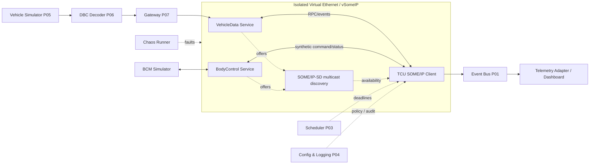
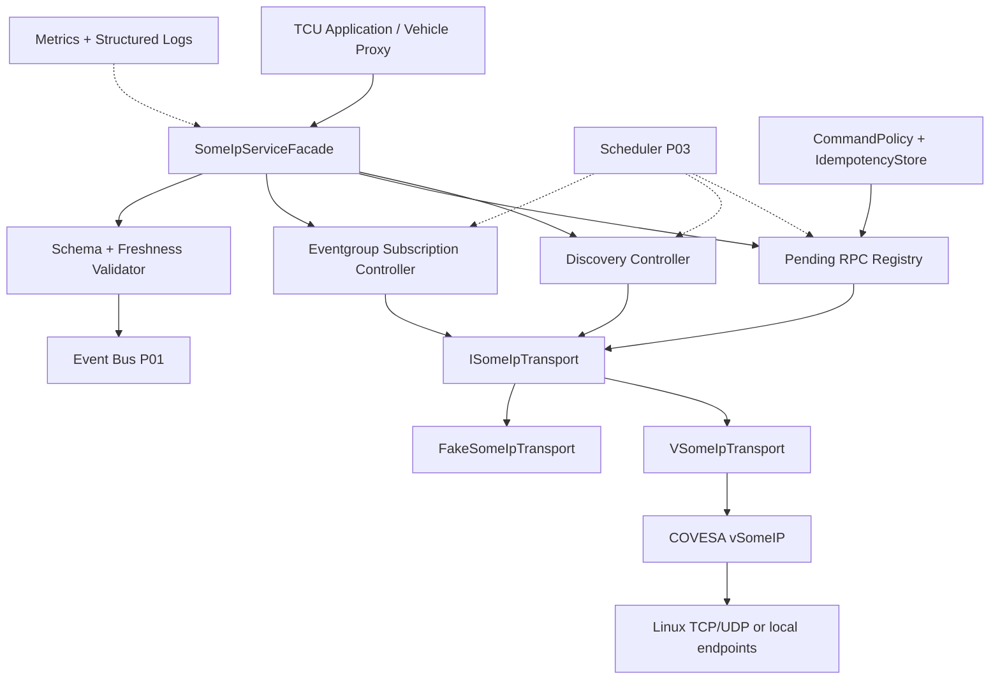
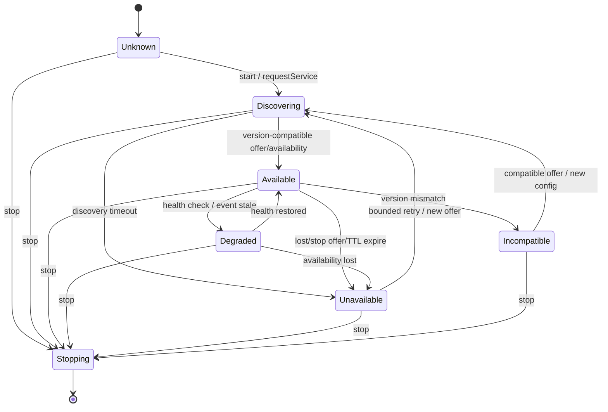
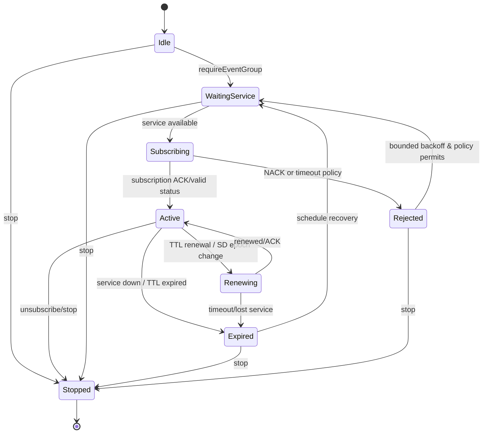
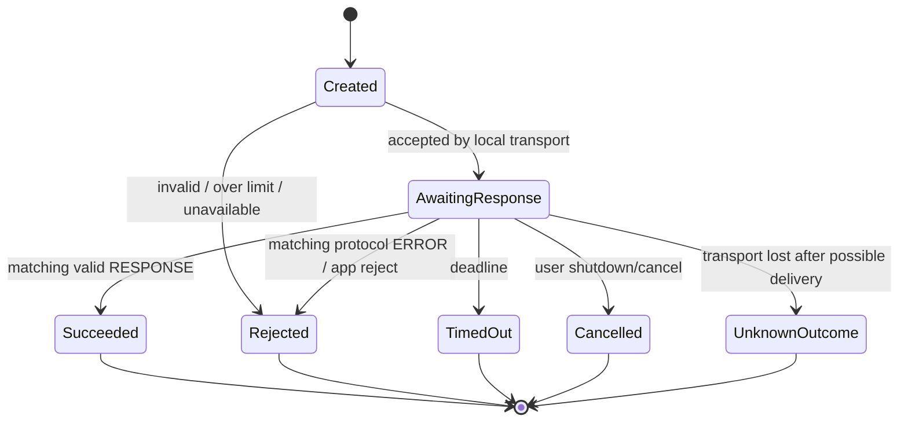
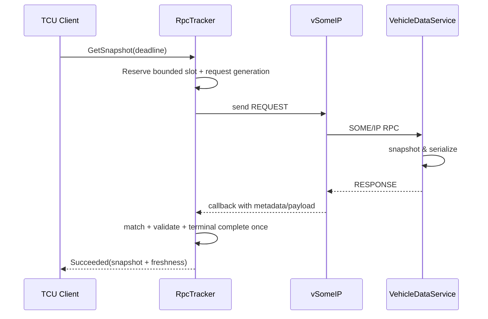
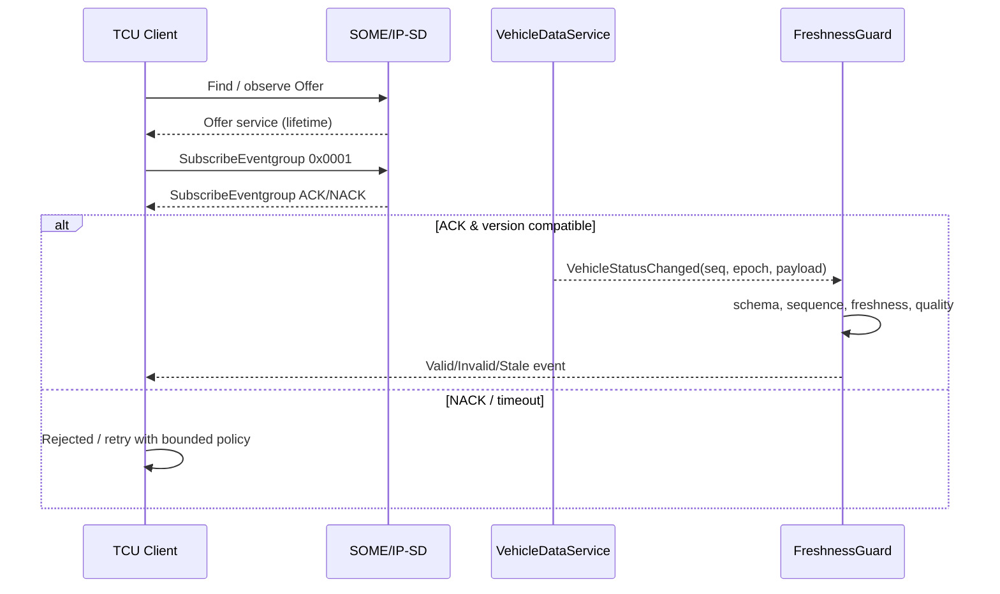
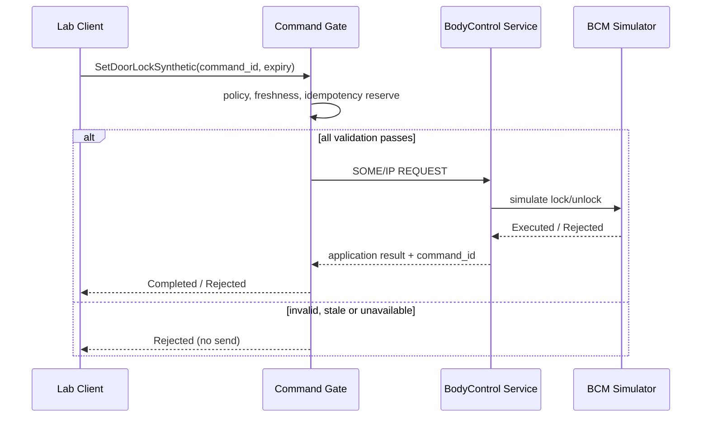
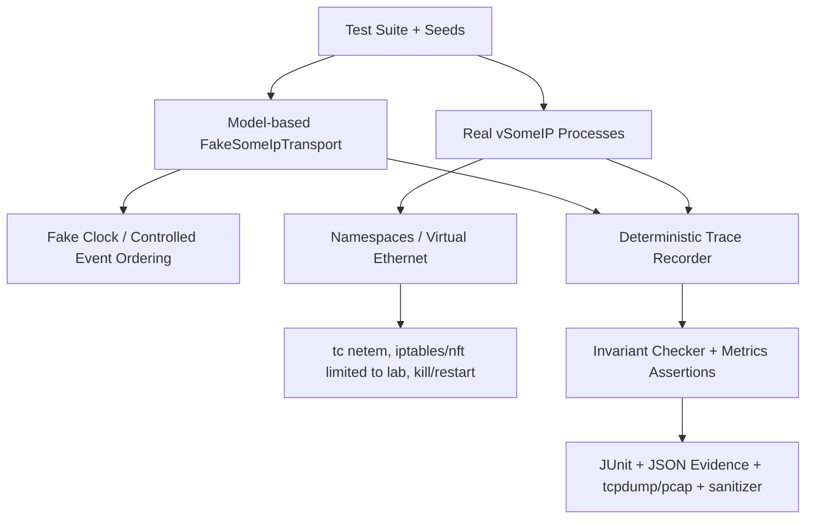

# Project 08 — SOME/IP Service Simulator

> **Virtual TCU Lab — System Design, Operational Behavior & Resilience Test Catalog | v1.0**  
> **Ngôn ngữ:** Tiếng Việt · **C++17** · **OS lab:** Ubuntu Linux · **Ngày:** 2026-10-30  
> **Đối tượng:** Middle C++ Developer, TCU middleware/application · **Ưu tiên trong roadmap:** P2  
> **Nền tảng:** COVESA vSomeIP (SOME/IP + SOME/IP-SD), Google Test, CMake, Linux network namespaces tùy chọn.  
> **Trạng thái:** **Thiết kế và kế hoạch kiểm thử; chưa triển khai/chưa có test report.**  
> **Phụ thuộc:** Projects 01–04 cho core, IPC, timer, config/logging; Projects 05–07 cho dữ liệu xe giả lập/gateway.  
> **An toàn:** Chỉ sử dụng service IDs/dữ liệu tổng hợp trong isolated lab; không gắn mạng xe thật, không vận hành lệnh OEM hoặc chức năng safety-critical.

---

## 1. Executive summary và mục tiêu

Xây hệ thống **SOME/IP Service Simulator** gồm server `vehicle_data_service`, server `body_control_service` (chỉ thực thi trên BCM simulator), client `tcu_someip_client`, cộng với **chaos controller** và **observability agent**. Client khám phá service bằng SOME/IP Service Discovery (SD), gửi RPC, subscribe **eventgroup**, tiêu thụ notifications và phản ứng đúng khi server/connection/SD mất ổn định. Luồng telemetry đi từ CAN/Digital Twin giả (P05–P07) đến service và tới TCU app. Tầng nghiệp vụ nằm trên **vSomeIP adapter**, cho phép unit test không cần network.

### 1.1 Câu hỏi thiết kế cần trả lời

1. Client phân biệt `service discovered`, `subscription accepted`, `RPC sent`, `response received`, `business action completed` như thế nào?
2. Mất Offer, TTL hết hạn, StopOffer, SD reboot, service restart, route manager restart: trạng thái có tự phục hồi mà không dùng state cũ?
3. Request muộn/trùng/sai session/sai phiên bản có thể tạo **false success** hoặc thực thi command hai lần không?
4. Event gaps, late events, event out of order, subscription churn, queue overload có thể làm telemetry sai mà vẫn gắn cờ `Valid` không?
5. Khi network, service, thread và cấu hình lỗi đồng thời, hệ thống có chặn command không an toàn, giữ bounded resources, không crash/deadlock không?
6. Có thể chứng minh behavior bằng fake clock, fake transport, replay, integration vSomeIP và packet/network fault injection hay không?

### 1.2 Định nghĩa hệ thống “chịu nổi”

- **Safety of state:** không chấp nhận RPC response lạ như kết quả của yêu cầu đang chờ; không gọi remote action từ notification không xác thực ứng dụng.
- **Fail-closed với command:** reject khi policy, peer/endpoint, version, health hoặc freshness không đạt; việc validation tại lab **không thay thế** security layer production.
- **Bounded:** giới hạn pending RPC, subscriptions, payload, callback queue, retry, CPU/RAM; overload phải đo được và có response hữu hạn.
- **No false delivery promises:** `send` thành công không chứng minh server thực thi; retry command chỉ khi protocol/nghiệp vụ hỗ trợ idempotency.
- **Self-recovery:** mất dịch vụ -> `Unavailable`, hủy/invalidate pending theo policy, rediscover/resubscribe khi hợp lệ; không replay command mù quáng.
- **Auditable:** event/request correlation, state transitions, reason codes, metrics, chaos run IDs được ghi rõ.
- **Test evidence:** mọi tuyên bố quality chỉ được công nhận khi suite tương ứng chạy và lưu báo cáo.

### 1.3 Deliverables

1. `libtcu_someip` — `ISomeIpTransport`, `VSomeIpTransport`, `FakeSomeIpTransport`, typed service contracts, metadata validation.
2. `libtcu_service_runtime` — discovery state, subscription controller, request tracker, event freshness guard, metrics.
3. `vehicle_data_service`, `body_control_service`, `tcu_someip_client`, `someip_labctl`, `chaos_runner`.
4. Configs vSomeIP cho **local host mode** và **2-node/netns mode**; ID không đụng nhau, ports, routes/multicast được chú giải.
5. Test harness deterministic, network fault injection, sanitizer, fuzz hooks, trace capture, baseline report.
6. 1 dashboard/CLI trạng thái service, eventgroup, pending RPC và metric/error reasons.

---

## 2. Liên hệ với các project trước

| Project | Mối liên hệ |
|---|---|
| 01 — Event Bus | Consumer nhận `VehicleStatusUpdated`, `ServiceHealthChanged`, `RpcCompleted`; event bus nội bộ **không** phải bus SOME/IP. |
| 02 — IPC Framework | CLI/admin tương tác local IPC, không mở interface quản trị ra automotive Ethernet. |
| 03 — Timer Scheduler | Deadline RPC, freshness timers, bounded retry/jitter, debounce, resubscription orchestration. |
| 04 — Config & Logging | Validate toàn bộ configs; structured logs, active config generation, secret redaction. |
| 05 — Virtual CAN | Sinh tín hiệu CAN từ virtual ECU; có thể đọc qua adapter riêng. |
| 06 — DBC Decoder | Cung cấp signal status `Valid/Stale/Invalid`; **không** chứng minh authenticity. |
| 07 — Gateway | Cung cấp vehicle state mô phỏng; SOME/IP service **không** tự biến dữ liệu CAN thành command được phép. |
| **08 — SOME/IP Service Simulator** | Middleware over IP, service discovery, RPC, eventgroups, failure recovery. |
| 09–10 — Modem/Connectivity | Sau này có thể báo `ConnectivityHealth`; SOME/IP trong lab là mạng nội bộ, **không đồng nghĩa kết nối cellular/cloud**. |
| 16 — Remote Control | Nghiệp vụ remote-control/authorization đầy đủ là project riêng; ở đây chỉ có **command synthetic** gửi đến BCM simulator. |

---

## 3. Phạm vi, giả định và ranh giới

### 3.1 V1 — MUST

- C++17 và COVESA vSomeIP 3.x (pin tag/commit khi build); giữ compatibility adapter khỏi code business.
- Hai service **giả lập**: `VehicleDataService` (1 method + 2 events) và `BodyControlService` (synthetic command + state event).
- Một hoặc nhiều clients: discover/request/response/subscribe/notify/unsubscribe; dùng **eventgroup**, không gọi trực tiếp subscribe event riêng trên wire.
- Xử lý rõ `AvailabilityState`, `SubscriptionState`, `RpcState`, `ServiceHealth`, `DataQuality`.
- Correlation bằng Request ID/metadata do vSomeIP cung cấp cùng **application-level command ID** cho nghiệp vụ.
- Validate payload type, schema/version, size, ranges, freshness; thư viện vSomeIP xử lý protocol, ứng dụng tự thực hiện serialization schema.
- Bounded outstanding requests, worker queue và cache; timers bằng monotonic time.
- Fault injection cho service crash, missing SD, network partition/delay/loss, stale event, long callback, overload, bad payload.
- Shutdown với lifetime-safe callbacks, không block vSomeIP I/O/dispatch threads bằng business code dài.
- Test cả fake transport và integration với **vSomeIP thực**.

### 3.2 V2 — SHOULD / OPTIONAL

- 2 Linux network namespaces/2 VMs với multicast SD thực, TCP vs UDP comparison, multiple instances, multi-client isolation.
- SOME/IP-TP, payloads lớn và reassembly behavior — chỉ bật khi phiên bản vSomeIP và config hỗ trợ; không tự tuyên bố hỗ trợ.
- Service/interface version migration, multiple providers/routing policy được xác định bởi config của lab.
- Threat-model extension: OS/network segmentation, policy, optional external authenticated transport; không coi SOME/IP-SD có authentication.
- Soak test 24h và performance tuning; chaos experiments nhiều lỗi.

### 3.3 Non-goals

- Không tự implement toàn bộ SOME/IP wire protocol hay SOME/IP-SD stack; dùng vSomeIP ở integration layer.
- Không bảo đảm transport-level exactly-once delivery, message authenticity, confidentiality, hard real-time, Functional Safety compliance.
- Không coi `vsomeip::application` auto serialize C++ structs; phải định nghĩa wire payload/schemas riêng.
- Không tái tạo mọi rule của AUTOSAR, không tuyên bố AUTOSAR conformance/interoperability với ECU thương mại.
- Không kiểm thử thực tế switch automotive, ECU hardware, multicast VLAN production, DoIP hoặc safety logic thực tế.

### 3.4 Phân biệt test modes

| Mode | Network thật? | SD trên wire? | Mục đích / hạn chế |
|---|---|---|---|
| M0: Deterministic model | Không | Fake events | Unit state machine, fake clock, exhaustive transitions; **không** chứng minh tương thích wire. |
| M1: vSomeIP same-host | Local IPC (vSomeIP có thể route qua UDS) | Có thể config SD hoặc static local routing | API integration, callbacks, lifecycle; không dùng làm bằng chứng multicast end-to-end. |
| M2: 2 network namespaces/VMs | Ethernet/IP ảo | Có, nếu kernel routes/multicast đúng | SD offers, events, TCP/UDP, network fault; cần kiểm tra thực sự có packet trên interface. |
| M3: malicious payload harness | Socket parser/test input bị giới hạn | Có thể inject synthetic packets vào lab | Kiểm tra robustness; chỉ isolated namespace, không quét mạng bên ngoài. |

---

## 4. Kiến trúc tổng thể và trust boundaries



> **Đường nét mang tính logic**, không phải tất cả luồng đi qua đúng transport. SD phát/nhận qua UDP multicast, còn method/event data có thể dùng UDP/TCP tùy cấu hình; giao tiếp giữa các app cùng host có thể đi qua local endpoints vSomeIP.

### 4.1 Trust boundaries

1. **Network ingress:** source IP/port, Offer/SD hay SOME/IP header **không phải chứng chỉ định danh**; validate bằng chính sách application/OS lab.
2. **Message parser boundary:** vSomeIP lo framing/transport; adapter không assume payload hợp lệ; yêu cầu explicit length và schema validation.
3. **Service availability:** Offer / callback availability là tín hiệu khám phá, **không** xác nhận service khỏe, trusted hay RPC sẽ thành công.
4. **Command boundary:** lệnh có tác dụng phụ cần authorization/condition/expiry/idempotency theo app protocol; lab command chỉ điều khiển BCM giả lập.
5. **Config boundary:** deny-by-default cho service/method/event IDs; pin config generation; validate schema trước activation.
6. **Observability:** log không ghi raw payload chứa dữ liệu nhạy cảm; hạn chế rate để log storm không gây overload.

### 4.2 Service identifiers giả lập (KHÔNG phải OEM IDs)

| Service | Service ID | Instance | Interface major | Method/Event | Eventgroup | Semantics |
|---|---|---|---:|---|---|---|
| VehicleData | `0x7301` | `0x0001` | 1 | `0x0101` GetSnapshot | — | RPC read-only trả dữ liệu snapshot (freshness/quality). |
| VehicleData | `0x7301` | `0x0001` | 1 | `0x8001` VehicleStatusChanged | `0x0001` | Notification theo thay đổi/chu kỳ, có app-level seq/timestamp. |
| VehicleData | `0x7301` | `0x0001` | 1 | `0x8002` VehicleHealthChanged | `0x0001` | Event health/freshness; gửi cùng eventgroup. |
| BodyControl | `0x7302` | `0x0001` | 1 | `0x0101` SetDoorLockSynthetic | — | Request/response, chỉ BCM ảo, chính sách fail-closed. |
| BodyControl | `0x7302` | `0x0001` | 1 | `0x8001` DoorStateChanged | `0x0002` | Notification kết quả quan sát; không thay thế action ACK. |

**Quy ước payload demo:** tự định nghĩa envelope gồm `schema_version`, `source_epoch`, `sequence`, `measured_at`, `quality`, `payload_len`, `payload`. Serialization của ứng dụng có thể là binary little/big endian *được version hóa rõ*, hoặc Protocol Buffers cho thử nghiệm; **không ngụ ý** format này là SOME/IP standard. Length field header SOME/IP vẫn do vSomeIP lo.

---

## 5. Requirements với ID và độ ưu tiên

### 5.1 Functional requirements

| ID | Requirement | Priority |
|---|---|---|
| FR-01 | Khởi tạo/đóng app vSomeIP theo lifecycle và xử lý init failure | MUST |
| FR-02 | Server offer/stop-offer đúng service + instance + version | MUST |
| FR-03 | Client discover, observe availability transitions và TTL expiry | MUST |
| FR-04 | Request/response correlation, deadline, single terminal completion | MUST |
| FR-05 | Eventgroup subscribe, ACK/NACK, renew/re-subscribe, unsubscribe | MUST |
| FR-06 | Validate schema, sizes, ranges, seq, quality trước khi publish data | MUST |
| FR-07 | Phân biệt service discovered, service healthy, subscription active | MUST |
| FR-08 | Hỗ trợ nhiều concurrent RPC với bounded pending table | MUST |
| FR-09 | Không tự retry side-effect request nếu result là unknown | MUST |
| FR-10 | Drop/flag stale, out-of-epoch events, không hồi sinh data cũ | MUST |
| FR-11 | Retry discovery/subscription có bounded backoff + jitter | MUST |
| FR-12 | Graceful shutdown, cancel futures, unsubscribe, destroy callbacks an toàn | MUST |
| FR-13 | Fake transport + fake clock cho deterministic unit testing | MUST |
| FR-14 | Observability: state, counters, latency histograms, error codes | MUST |
| FR-15 | Source-side policy cho body-control synthetic command | MUST |
| FR-16 | Validate full config, reject IDs/ports/versions trùng/conflict | MUST |
| FR-17 | Dùng TCP cho RPC synthetic V1 và chọn UDP/TCP cho event theo config | SHOULD |
| FR-18 | Run same-host và cross-netns có capture SOME/IP-SD trên wire | SHOULD |
| FR-19 | Remote service version incompatibility -> explicit incompatible state | MUST |
| FR-20 | Multi-client subscriptions + isolation | SHOULD |
| FR-21 | Optional SOME/IP-TP & large payloads (validated capability) | V2 |
| FR-22 | Optional hot reload theo staged restart vì vSomeIP runtime config có giới hạn | V2 |

### 5.2 NFR — mục tiêu đo trong lab, KHÔNG phải SLA OEM

| ID | Lab target | Verification |
|---|---|---|
| NFR-01 | Zero ASan/UBSan/TSan findings trên CI suites chạy được | Sanitizer logs, compiler/OS profiles ghi rõ. |
| NFR-02 | Pending RPC <= 1.000, callback queue <= 4.096 (configurable) | High-rate burst, peak RSS, reject metrics. |
| NFR-03 | p99 RPC round-trip < 100 ms ở M1 reference host, no induced faults | Perf baseline, ghi hardware + load + sample count. |
| NFR-04 | Recovery client service availability <= 5 s sau server comeback ở M2 baseline | Time-correlated tcpdump/state transitions; phụ thuộc SD timing config. |
| NFR-05 | Không phát command sau deadline hoặc khi quality/policy fail | Negative tests, server command audit. |
| NFR-06 | `stop()` hữu hạn <= 3 s khi mọi callback hợp tác | Shutdown tests; nếu external library hang, report riêng. |
| NFR-07 | Queue/memory plateau với 60 min stress; không tỷ lệ thuận vô hạn theo request rate | RSS, heap, drops, settled pending count. |
| NFR-08 | 100% one-terminal-result invariant trong deterministic request test | Property test 100k state transitions. |
| NFR-09 | 0 event được chấp nhận `Valid` từ epoch đã invalidated | Event trace checker. |
| NFR-10 | Thu thập CPU/RSS, callback latency, packet captures, test seed | Artifact export CI. |

**Chú ý:** benchmark tùy host và config, không thể khẳng định đã đạt trước khi chạy. `stop()` có thể khó kiểm soát do routing manager hoặc thư viện; đo và đánh dấu giới hạn thay vì hứa hard guarantee.

---

## 6. SOME/IP và SOME/IP-SD — các ngữ nghĩa cần hiểu đúng

### 6.1 SOME/IP header (16 bytes)

| Field | Bits | Mục đích |
|---|---:|---|
| Message ID | 32 | Service ID (16) + Method/Event ID (16). |
| Length | 32 | Số byte từ Request ID đến hết payload (= 8 + payload length với message thông thường không TP/E2E). |
| Request ID | 32 | Client ID (16) + Session ID (16), để correlate request/response. |
| Protocol Version | 8 | Phiên bản header; không đồng nghĩa application schema version. |
| Interface Version | 8 | Major version của service interface. |
| Message Type | 8 | REQUEST, REQUEST_NO_RETURN, NOTIFICATION, RESPONSE, ERROR, ... theo protocol. |
| Return Code | 8 | Success/error protocol-level; không thay cho nghiệp vụ ACK. |

- SOME/IP messages dùng network byte order ở header. Parser phải tôn trọng length field và giới hạn thông điệp; không suy diễn `payload = UDP datagram - 16` trong mọi trường hợp.
- **Service ID + instance** xác định dịch vụ ở mức middleware configuration, trong khi instance không nằm trực tiếp như một field header SOME/IP thông thường.
- `REQUEST_NO_RETURN` khác REQUEST: không mong response. Hạn chế dùng cho command có side effect ở lab.
- `NOTIFICATION` không tự chứng minh nguồn dữ liệu trusted; schema/version/freshness được kiểm tra tầng application.

### 6.2 Service Discovery

- Server offer service instance qua SD; client có thể tìm bằng FindService. Một Offer có lifetime/TTL; StopOffer có TTL=0 theo SD semantics. Client làm invalidation theo availability và TTL.
- SubscribeEventgroup qua SD; ACK/NACK chỉ cho biết trạng thái subscribe theo protocol, không bảo đảm đã nhận mọi event; hỗ trợ resubscribe/renew theo SD và version library.
- SD có reboot/session handling; nhận biết reboot/epoch thay đổi phải invalidate state liên quan đúng policy. Fake transport test state machine; integration test thẩm tra behavior thư viện trên wire.
- `DiscoveryAvailable` khác `TransportConnected` khác `ApplicationHealthy`. Không đồng nhất các bit trạng thái này.
- **Không dùng local same-host routing để khẳng định đã kiểm chứng multicast Service Discovery trên wire.**

### 6.3 TCP vs UDP, eventgroups, fields

| Tiêu chí | TCP (reliable transport) | UDP (unreliable transport) |
|---|---|---|
| Transport | Byte stream; fragmentation/framing handled by stack | Datagram, có thể loss/reorder/duplicate ở mô phỏng |
| Ordering | Stream order trên connection | Không bảo đảm delivery/order |
| Failure mode | Disconnect, half-open, head-of-line blocking | Packet loss, reorder, truncation, MTU |
| Ý nghĩa app | Không suy ra business exactly-once | Không suy ra at-least-once |

Event **phải đăng ký vào eventgroup** để được subscribe; field có thể có getter/setter + notifier tùy service definition. vSomeIP không tự serialize arbitrary C++ struct. Quy ước schema lab là ứng dụng sở hữu.

### 6.4 Documentation notes / version pin

- AUTOSAR FO **SOME/IP Protocol R25-11**: wire header, method/event, return code, transport semantics.
- AUTOSAR FO **SOME/IP-SD R24-11**: SD phases, Offers, TTL, SubscribeEventgroup ACK/NACK, reboot handling; lấy làm tham khảo behavior, **không tuyên bố conformance**.
- COVESA vSomeIP docs/API: `request_service`, `offer_service`, `register_availability_handler`, `register_message_handler`, `request_event`, `subscribe`, `notify`, `send`, `stop`; xác nhận với **version đã pin** trong source.

---

## 7. Component design và decomposition



### 7.1 Module responsibilities

| Module | Responsibilities | Không làm |
|---|---|---|
| `VSomeIpTransport` | Adapt callbacks/API, offer/request/subscribe, message bytes, lifecycle | Không quyết định business success. |
| `DiscoveryController` | Desired vs observed services, transitions, generation/reboot handling | Không quyết định authorization. |
| `RpcTracker` | Bounded outstanding operations, deadline, response correlation, single completion | Không tự retry non-idempotent command. |
| `SubscriptionController` | Desired eventgroups, ack/nack, renew/re-subscribe, unsubscribe, state | Không bảo đảm event exactly once. |
| `PayloadCodec` | Encode/decode app-level schema; range/size/version checks | Không tự xử lý SOME/IP standard header. |
| `FreshnessGuard` | Source epoch, seq, measured timestamp, stale/invalid flags | Không xác thực publisher cryptographically. |
| `CommandGate` | Synthetic command policy/expiry, dedupe, bounded rate | Không gửi lệnh lên xe thật. |
| `Executor` | Callback queue, application handlers, reject/overload behavior | Không block vSomeIP dispatch threads. |
| `ChaosRunner` | Inject deterministic faults/signal control/network chaos M2 | Không được truy cập host/public network ngoài lab. |

### 7.2 Process/thread model

- `vehicle_data_service`: vSomeIP app event loop + bounded business worker(s) + publisher scheduler.
- `body_control_service`: vSomeIP app event loop + serialized synthetic command worker để bảo toàn state của BCM giả.
- `tcu_someip_client`: event loop + short callback handlers enqueue vào application executor; controller timers từ P03.
- `labctl/chaos_runner`: separate process; điều khiển process và Linux netns lab; không gọi trực tiếp application internals khi integration test.
- Mỗi process có **clear ownership**, cancellation token, stop sequence và logging context; tránh unbounded detached threads.

---

## 8. Đề xuất C++17 API (thiết kế, không phải implementation vSomeIP hoàn chỉnh)

```cpp
using ServiceId = uint16_t;
using InstanceId = uint16_t;
using MethodId = uint16_t;
using EventGroupId = uint16_t;
using RequestKey = uint64_t; // internal generation + logical request ID

struct ServiceKey {
    ServiceId service;
    InstanceId instance;
    uint8_t major;
};

enum class Availability { Unknown, Unavailable, Discovering, Available, Degraded, Incompatible, Stopping };
enum class SubState { Idle, WaitingService, Subscribing, Active, Renewing, Rejected, Expired, Stopped };
enum class RpcState { Created, AwaitingResponse, Succeeded, Rejected, TimedOut, Cancelled, UnknownOutcome };
enum class DataQuality { Valid, Stale, Invalid, Unknown };

struct RpcRequest {
    ServiceKey target;
    MethodId method;
    std::vector<uint8_t> payload;
    std::chrono::steady_clock::time_point deadline;
    std::string app_command_id;  // empty for read-only RPC
    bool idempotent;             // from service contract, never guessed
};

struct RpcResult {
    RpcState state;
    std::vector<uint8_t> payload;
    std::string reason;
};

class ISomeIpTransport {
public:
    virtual ~ISomeIpTransport() = default;
    virtual bool start() = 0;
    virtual void stop() noexcept = 0;
    virtual void requestService(ServiceKey service) = 0;
    virtual bool sendRequest(const RpcRequest& request, RequestKey local_key) = 0;
    virtual void requestEvent(ServiceKey service, uint16_t event) = 0;
    virtual void subscribe(ServiceKey service, EventGroupId group) = 0;
    virtual void unsubscribe(ServiceKey service, EventGroupId group) = 0;
    // Callbacks for availability, message, subscribe result are registered
    // via a lifetime-safe observer API in the real implementation.
};

class SomeIpServiceFacade {
public:
    explicit SomeIpServiceFacade(std::shared_ptr<ISomeIpTransport> transport);
    void start();
    std::future<RpcResult> callAsync(RpcRequest request);
    void requireService(ServiceKey key);
    void requireEventGroup(ServiceKey key, EventGroupId eventgroup);
    void stop();
};
```

**Implementation caveat:** `RequestKey` nội bộ phải map sang real `(client_id, session_id, service, instance, method, request-generation)` từ vSomeIP; transport **không thể mặc nhiên gắn arbitrary user `RequestKey` vào SOME/IP header**. Map và callback contract được xác nhận với API thực tế của pinned vSomeIP. `std::future` chỉ minh họa; thực tế dùng promise quản lý bởi tracker, tránh double set_value và use-after-free.

### 8.1 Callback adapter skeleton

```cpp
// Pseudocode: tên/kiểu enum và method phụ thuộc vSomeIP pinned release.
void VSomeIpTransport::onMessage(const vsomeip::message_ptr& msg) {
    // Runs on a vSomeIP callback thread: do not block here.
    if (!msg) { metrics_.invalid_callback_total++; return; }
    auto metadata = extractValidatedMetadata(msg); // bounds, type, ids
    if (!metadata) { metrics_.invalid_message_total++; return; }
    auto envelope = copyPayloadWithMaxSize(msg, limits_.max_payload);
    if (!envelope) { metrics_.oversize_total++; return; }
    if (!app_queue_.tryPush({*metadata, std::move(*envelope)})) {
        metrics_.callback_queue_full_total++;
        // Do not silently treat a dropped RESPONSE as success.
    }
}
```

### 8.2 Ownership & thread safety

- App vSomeIP phải sống lâu hơn handlers; `stop()` đăng ký/huỷ callbacks theo API pinned, dùng weak references/generation token; worker drain/cancel trước khi release state.
- Không giữ mutex của `RpcTracker` trong lúc gọi vào vSomeIP hoặc user callback, tránh reentrant deadlock.
- Chỉ event loop/controller sở hữu mutable service state; worker report qua serialized queue hoặc lock với invariant rõ.
- `std::chrono::steady_clock` cho deadlines; wall-clock timestamps chỉ để log/telemetry, không dùng làm timeout.
- Subscription callback có thể đến sau `unsubscribe()`/`stop()`; generation fence giúp reject late callbacks.

---

## 9. State machines

### 9.1 Client service availability



**Rule:** `Available` nghĩa là service lookup/transport biết service có thể reachable; trước khi command side-effect vẫn kiểm tra health, policy, deadline, version, freshness.

### 9.2 Eventgroup subscription



**Rule:** Event arrived trước confirmed subscription => không tự biến state thành `Active`; xử lý theo event policy với counters, không dùng nó để chứng minh ACK. Tùy callback semantics phiên bản vSomeIP, mapping ACK -> app state được document rõ.

### 9.3 RPC lifecycle



**Rule:** `TimedOut/UnknownOutcome` không chứng minh server chưa thực thi. Khi deadline vs response race, **một** terminal outcome theo rule tuyến tính hóa được test; side-effect command không retry mù.

---

## 10. Operational behavior — luồng bình thường

### 10.1 Startup (provider và client)

1. Validate config toàn bộ: unique application ID, service/instance, major, ports, event/eventgroup mappings, queue limits, network policy.
2. Initialize `vSomeIpTransport` và register callbacks trước `start()`; khi init thất bại, fail startup thay vì service giả READY.
3. Provider register handlers, offer service + event(s); client `request_service` và `request_event`/`subscribe` theo API ordering verified.
4. Client nhận availability, cập nhật generation và request eventgroup; khi subscription accepted, đánh dấu `Active`.
5. Health probe/snapshot đọc dữ liệu và chỉ báo `Ready` khi application-level checks đạt.
6. Phát `ServiceHealthChanged`; UI hiển thị lớp state riêng `Discovered`, `Subscribed`, `Healthy`, `DataFresh`.

### 10.2 RPC read-only



### 10.3 Eventgroup subscription / notifications



### 10.4 Synthetic body command



### 10.5 Availability lost / recovery

1. Service down / SD TTL expire / endpoint lost -> bump `service_generation`, mark service `Unavailable`, mark associated subscriptions `Expired`, invalidate event freshness.
2. RPC outstanding: complete as `UnknownOutcome` nếu command có thể đã được gửi, hoặc `Rejected/Cancelled` nếu chứng minh chưa rời client; tuyệt đối không biến thành success.
3. Retry discovery theo config với backoff+jitter và maximum in-flight; không spin loop; cache không được tự nâng chất lượng lên Valid.
4. Compatible offer mới -> re-establish required eventgroups, initiate health probe; không replay side-effect command pending.
5. Return to Healthy chỉ khi service + subscription + application data policy đạt, ghi metrics recovery latency.

### 10.6 Shutdown & restart

- Set `Stopping` fence trước; reject publish/call mới; cancel timers; unsubscribe/stop-offer theo role; stop worker; teardown vsomeip theo API pinned.
- Callback đến muộn phải bị bỏ vì generation/lifetime token, không truy cập freed state.
- `SIGTERM`/CTRL+C không trực tiếp gọi logic blocking trong signal handler; dùng atomic flag/eventfd/loop cơ chế an toàn.
- Startup lại trên host lab có thể gặp stale shared memory/UDS do crash; áp dụng docs vSomeIP và chỉ cleanup **đúng tài nguyên của lab**, tránh xóa bừa `/dev/shm` hoặc socket của ứng dụng khác.

---

## 11. Event payload & contract

### 11.1 Suggested schema (application-defined)

```text
VehicleStatusEnvelope {
  uint8 schema_version = 1;
  uint64 source_epoch;         // simulator reboot/identity epoch
  uint64 monotonic_sequence;   // per source+event stream
  int64 measured_unix_ms;      // audit / data-age check with clock policy
  uint8 quality;               // 0=Valid,1=Stale,2=Invalid,3=Unknown
  int16 speed_kph_x10;         // synthetic numeric data
  uint8 ignition_on;
  uint8 door_locked;
}
```

- Binary codec must specify byte order, exact widths, padding absent, valid ranges, maximum payload length and schema compatibility.
- `measured_unix_ms` là clock nguồn có thể lệch; dùng age logic với negotiated clock trust / local receive time trong M0/M1; không lấy wall-clock từ peer không trusted làm deadline duy nhất.
- `source_epoch` do simulator tạo và thay khi restart; `sequence` reset chỉ hợp lệ khi epoch thay đổi, không accept seq rollback trong cùng epoch.
- `EventGroup` membership được quản lý bởi service configuration; tên mô phỏng không bảo đảm semantics field/event giống OEM.

### 11.2 Contract thành công/thất bại

| API | Accepted | Completed | Không được suy luận |
|---|---|---|---|
| `requestService` | Client đăng ký mong muốn tìm service | Availability callback version-compatible | Server khỏe, trusted |
| `subscribe` | Middleware nhận yêu cầu | ACK/status hợp lệ và đã active | Event không loss |
| `sendRequest` | Transport nhận request để gửi | Matching response/app ACK | Server chưa/đã thực thi nếu timeout |
| `notify` | Publisher enqueue/gửi event | Client nhận, validate, accept | Every subscriber receives exactly once |
| `stop()` | Bắt đầu shutdown | Terminated trong policy | Network peers đã quan sát StopOffer chắc chắn |

---

## 12. Retry, overload và idempotency policy

| Path | Timeout | Retry | Hành vi overflow |
|---|---|---|---|
| Find/availability | Configurable SD timings | Backoff bounded with jitter; match library behavior | Coalesce duplicate requests; bounded timers. |
| Subscribe eventgroup | ACK/refresh deadline | Retry sau NACK/timeout tùy cause và policy | 1 pending per (service instance, group, generation). |
| Read-only GetSnapshot | e.g. 200 ms demo deadline | Có thể retry với new session nếu idempotent và service still ready | Reject `Busy`; metrics. |
| Synthetic lock command | e.g. 500 ms expiry | **Không tự retry unknown outcome**, trừ khi idempotency protocol verified | Reject `Overloaded`; không queue vô thời hạn. |
| Notifications | N/A, event freshness 1s/5s tùy event | Không tự replay whole backlog khi service comeback | Drop/coalesce telemetry theo documented policy, mark gaps/stale. |
| Logs | N/A | Rate-limit/rotate | Never block critical I/O callback. |

**Generalized backoff:** `delay = min(cap, base * 2^attempt) + bounded_jitter`, clamp để tránh overflow; stop/cancel phải wake ngay. Tách high-level application retries khỏi SD internal retries của vSomeIP để tránh nhân đôi traffic.

### 12.1 Idempotency implementation cho synthetic command

- Command có `command_id` (UUID string trong lab) và expiry; server dedupe theo `(authorized synthetic client, command_id, epoch)`.
- Server chỉ ghi `Applied` **sau** BCM simulator trả kết quả; nếu crash đúng giữa effect và journal persistence, kết quả là **Unknown** trừ khi BCM cung cấp idempotency/fencing; không hứa exactly-once.
- Replay command cùng id có thể trả cached terminal result *chỉ khi protocol đảm bảo*; duplicate với payload khác cùng id -> reject Conflict.
- Không sinh command replay sau client reconnect nếu state chưa được reconcile bằng query/ack hợp lệ.

---

## 13. Configuration, versioning và validation

Ví dụ file **application policy** (không phải vSomeIP native config):

```yaml
lab:
  environment: isolated
  allow_real_vehicle: false
  mode: M1
services:
  vehicle_data: {service: '0x7301', instance: '0x0001', major: 1}
  body_control: {service: '0x7302', instance: '0x0001', major: 1}
limits:
  max_payload_bytes: 4096
  max_pending_rpc: 1000
  callback_queue_capacity: 4096
  rpc_deadline_ms: 200
  max_subscribe_attempts_per_minute: 20
  max_event_age_ms: 1000
policy:
  command_requires_fresh_vehicle_state: true
  reject_command_when_disconnected: true
  never_replay_unknown_command: true
```

- vSomeIP JSON configuration là file riêng: `applications`, `routing`, `services`, `events`, `eventgroups`, `service-discovery`, `unicast`, ports. Lấy **mẫu đã pin từ upstream** và đổi IP/interface theo M1 hoặc M2; không dùng YAML trên làm input trực tiếp cho vSomeIP.
- Validate uniqueness/mapping/ports, maximum payload, version, network namespace, multicast route, service discovery TTL vs cyclic offers. `0x7301`/`0x7302` chỉ IDs synthetic local lab.
- Hot reload nguyên vSomeIP runtime config **không mặc định**; V1 hỗ trợ reload application policy qua validated atomic snapshot; thay đổi port/service topology -> controlled restart.

---

## 14. Observability và telemetry

| Metric | Loại | Ý nghĩa |
|---|---|---|
| `someip_service_availability{service}` | Gauge | 0/1, tách `service_healthy`. |
| `someip_subscription_state{service,eventgroup}` | Gauge | trạng thái desired/observed của group. |
| `someip_sd_offer_seen_total` | Counter | Offers quan sát (M2 network capture hoặc adapter). |
| `someip_rpc_outstanding` | Gauge | pending bounded, tại stop về 0. |
| `someip_rpc_terminal_total{state,reason}` | Counter | Exactly one terminal per local call. |
| `someip_rpc_latency_seconds` | Histogram | request-to-response; timeout separate. |
| `someip_event_rejected_total{reason}` | Counter | stale, wrong_epoch, schema, seq, overload. |
| `someip_recovery_seconds` | Histogram | outage -> healthy phục hồi, có context mode/timing. |
| `someip_callback_queue_depth` | Gauge | executor backpressure. |
| `someip_subscription_attempts_total` | Counter | detect storm/double retry loops. |
| `someip_unknown_command_total` | Counter | command outcome uncertain, demand reconciliation. |
| `someip_process_rss_bytes` | Gauge | long-run memory. |

**Structured log fields:** `ts_wall`, `ts_mono_delta`, `service`, `instance`, `major`, `eventgroup`, `message_type`, `client_id`, `session_id` (nếu hợp lệ), `request_generation`, `source_epoch`, `command_id` (hashed/opaque), `reason`, `chaos_run_id`, `config_generation`. Không dump payload mặc định.

---

## 15. Testing architecture, oracle và traceability



### 15.1 What-if test case format

Mỗi case ghi rõ: **Trigger** (điều kiện kích lỗi), **Expected behavior** (observable contract) và **Oracle** (metric/log/assert). IDs `WI-xx-yy` là trace keys trong CI. Những case yêu cầu raw protocol packets cần isolated network; case model test có thể dùng direct fake callback; **không giả định vSomeIP sẽ chuyển malformed wire packets đến user callback**.

### 15.2 Oracle invariants

1. `rpc_created = rpc_terminal + rpc_pending` sau từng test quiescent (trừ test cố ý in-flight); local terminal tối đa 1.
2. Không thực thi synthetic command khi `policy_approved != true` hoặc deadline đã hết theo đồng hồ xét quyền.
3. `service_generation` tăng khi availability epoch invalidated, late callbacks from previous generation không được mutate current state.
4. Subscription `Active` chỉ sau validity/ACK policy; một group/generation chỉ có một pending resubscribe.
5. Accepted `Valid` event: schema đúng, payload range hợp lệ, source epoch hiện hành, seq không lùi trong stream, freshness đạt.
6. CPU/RAM/queue/threads bounded theo config khi overload kéo dài; mọi drop/reject đều có reason counter.
7. Không có app-level success khi transport fail, timeout, message mismatch hoặc command outcome unknown.
8. Sau stop: no callback into freed objects, pending registry quiescent, worker threads joined.
9. Không tự tăng subscription attempts vô hạn trong một recovery window.
10. Không có side-effect command replay tự động khi state unknown.

### 15.3 Fault injection methods

| Tool | Faults | Evidence |
|---|---|---|
| Fake clock/transport | reordered callbacks, response-vs-deadline, split-brain epochs, immediate stop | deterministic operation trace |
| Process signals / supervisor | service crash/restart, client restart, routing manager loss | process exit, recovery traces |
| `tc netem` trong namespace lab | delay, loss, duplicate, reorder, corruption | qdisc config, packet capture |
| `ip link set ... down` | network partition / interface down | link state, SD/availability log |
| TCP proxy / socket fakes | half-open, close/reset, truncated synthetic streams | transport state logs |
| Raw packet fuzzer isolated | malformed header/SD entries/length | library crash/hang reports; app may not see callbacks |
| CPU/memory pressure simulator | callback latency, overloaded queue | p99, peak RSS, saturation counters |
| Unit/mutation/property testing | wrong transitions, monotonic IDs, stale states | minimized reproducer, seed |

---

## 16. Comprehensive What-if Catalog (264 cases in 22 categories) — hệ thống chịu đựng lỗi đến đâu?

**Đây là một danh mục hữu hạn có hệ thống, không thể bao phủ literally mọi chuỗi lỗi trong thế giới thực.** Phân chia theo discovery, lifecycle, RPC, event, network, parsing, resources, security, concurrency, recovery và evidence. Tất cả `Expected` dưới đây là **hợp đồng dự kiến của ứng dụng/lab**; packet-level behavior có thể do vSomeIP xử lý và phải kiểm chứng theo version pinned. `Oracle` là kết quả đo được cần xuất ra từ runner.

**Quy tắc chạy:** M0 cho deterministic fake clock/model races; M1 cho local vSomeIP API; M2 cho SD/multicast/TCP/UDP trên network thật (ảo); M3 cho isolated fuzzing. Gán mỗi case `P0` nếu đụng command safety/false success/corrupt data/crash/resource unbounded, `P1` nếu impact availability/recovery, `P2` nếu diagnostic/advanced; tester cập nhật priority trong test plan khi có target OEM cụ thể.

### 16.1 — Initialization & configuration (12 cases)

| Case ID | What if? / Trigger | Expected behavior | Test oracle |
|---|---|---|---|
| WI-01-01 | Config file missing | Abort startup; return nonzero; no phantom Ready | exit code + startup_error_total |
| WI-01-02 | Invalid JSON in native vSomeIP config | Fail to initialize; do not start providers | init error + no Offer |
| WI-01-03 | Duplicate application ID across simulated apps | Reject/alert conflict; no silent identity mixing | config validator + app logs |
| WI-01-04 | Duplicate service/instance provider declared locally | Reject ambiguous topology or require explicit policy | config validation result |
| WI-01-05 | Same TCP port assigned to two simulated services | Detect conflict before Ready; don't bind partial topology | bind error + health state |
| WI-01-06 | Bad multicast IP or route | Mark discovery unavailable; emit actionable diagnostic | pcap missing Offer + discovery error |
| WI-01-07 | Unknown service ID in policy | Reject unconfigured service, deny by default | unknown_service_total |
| WI-01-08 | Missing eventgroup declaration for event | Fail validation; never claim subscription active | config error + state |
| WI-01-09 | Invalid interface major mapping | State Incompatible, never decode as compatible | version_reject_total |
| WI-01-10 | Invalid queue size zero/too-large | Reject config, do not allocate blindly | init status + resource bound |
| WI-01-11 | Clock provider not available | Fail explicit test setup; do not use wall clock fallback for deadlines | clock_init_failed |
| WI-01-12 | Invalid credentials/policy file permissions | Reject startup or enter read-only safe mode per config | file permission audit + health |

### 16.2 — Service Discovery: Find/Offer/TTL (12 cases)

| Case ID | What if? / Trigger | Expected behavior | Test oracle |
|---|---|---|---|
| WI-02-01 | No server Offer at startup | Client stays Discovering/Unavailable with bounded Find policy | availability timeline + retry count |
| WI-02-02 | Offer arrives after client timeout | Apply only if compatible/current; do not restore old requests | generation + pending count |
| WI-02-03 | Offer TTL expires without renewal | Mark Unavailable, invalidate cache and subscriptions | TTL transition + stale count |
| WI-02-04 | StopOffer received for active service | Invalidate availability immediately per SD behavior | availability state trace |
| WI-02-05 | Duplicate Offer arrives repeatedly | Coalesce, don't create duplicate subscriptions | subscription_attempts_total |
| WI-02-06 | Offer refers to wrong service ID | Ignore; no accidental binding | unknown_offer counter |
| WI-02-07 | Offer wrong instance ID | Do not treat required instance as available | instance mismatch counter |
| WI-02-08 | Offer incompatible major version | Mark Incompatible; do not send RPC | version_reject counter |
| WI-02-09 | Offer minor version outside compatibility policy | Apply explicit configured compatibility check | compatibility decision trace |
| WI-02-10 | Offer endpoint changes during active RPC | Fence old generation and reconcile pending outcome | generation trace + rpc terminal |
| WI-02-11 | Offer with unsupported transport options | Reject candidate/mark degraded; avoid bad send | endpoint_policy_error |
| WI-02-12 | SD multicast missing but static same-host routing works | Report mode limitation, do not mark SD-wire test passed | pcap evidence + mode label |

### 16.3 — SD reboot, session & lifecycle (12 cases)

| Case ID | What if? / Trigger | Expected behavior | Test oracle |
|---|---|---|---|
| WI-03-01 | Provider restarts with fresh source epoch | Expire old subscriptions and stale data; rediscover | epoch counter + state |
| WI-03-02 | Client restarts while server remains up | Rebuild desired subscriptions; no stale pending futures | subscribe trace + pending=0 |
| WI-03-03 | Routing manager restarts before client | Re-register or fail safe according to vSomeIP version | routing_state + recovery trace |
| WI-03-04 | Routing manager dies mid-subscription | Mark Unknown/Unavailable then reconcile; no false Active | subscription state trace |
| WI-03-05 | Reboot flag/session signals observed | Validate through vSomeIP/SD test, invalidate required bindings | pcap + availability generation |
| WI-03-06 | Session ID wraps in long-running integration | No collision with concurrently active RPC mapping | correlator invariants |
| WI-03-07 | Old Offer delivered after new epoch | Reject stale generation; no regression to prior endpoint | stale_offer_reject |
| WI-03-08 | Duplicate SD reboot notification | Idempotent transition; one recovery workflow | recovery_task_count |
| WI-03-09 | Provider crash without StopOffer | Recover from TTL/availability timeout; don't wait forever | timeout + service_unavailable |
| WI-03-10 | Provider graceful StopOffer then restart | Clean transition and fresh subscription lifecycle | offer state transitions |
| WI-03-11 | Client process killed mid-request | Server may execute; no local success assertion after restart | server journal + client recovery |
| WI-03-12 | SD counter reset without valid reboot evidence | Avoid blindly declaring trusted reboot; follow library decision | pcap + decision log |

### 16.4 — Subscription ACK/NACK/renewal (12 cases)

| Case ID | What if? / Trigger | Expected behavior | Test oracle |
|---|---|---|---|
| WI-04-01 | SubscribeEventgroup ACK arrives | Transition Subscribing -> Active only when current | subscription_state |
| WI-04-02 | SubscribeEventgroup NACK arrives | Transition Rejected; bounded retry according to reason | nack reason + retry count |
| WI-04-03 | ACK arrives after unsubscribe | Ignore stale ACK via generation fence | late_ack_rejected |
| WI-04-04 | ACK races subscription timeout | Only one state transition wins; no duplicate timers | state transition sequence |
| WI-04-05 | Subscribe request duplicated by retry loop | Coalesce at controller, max one outstanding per group | pending_subscribe gauge |
| WI-04-06 | Server offers no requested eventgroup | Reject subscription; never mark Active | unknown_group_total |
| WI-04-07 | Server stops group after ACK | Invalidate Active and stop trusting new data | subscription_expiry trace |
| WI-04-08 | Renewal trigger while previous renew pending | Deduplicate, avoid Subscribe storm | renew_attempt count |
| WI-04-09 | Subscription expires while event arrives | Apply documented fence and quality policy; no false Valid | timestamped trace |
| WI-04-10 | Unsubscribe on shutdown during ACK | Stop wins, late callbacks safely ignored | callback_after_stop counter |
| WI-04-11 | Two subscribers on one group | Track per-client membership and independent lifecycle | subscriber state audit |
| WI-04-12 | Unsubscribe one of two clients | Other client remains active, no global unsubscribe | client A/B event receipt |

### 16.5 — Request/response correctness (12 cases)

| Case ID | What if? / Trigger | Expected behavior | Test oracle |
|---|---|---|---|
| WI-05-01 | Matching response before deadline | Resolve once with validated response | rpc_succeeded_total |
| WI-05-02 | Response arrives with wrong client ID | Ignore or reject; never complete another call | wrong_correlation_total |
| WI-05-03 | Response arrives with wrong session ID | Ignore; pending call remains or times out | session_mismatch_total |
| WI-05-04 | Response matches IDs but wrong service/method | Reject unexpected correlation | rpc_mismatch_total |
| WI-05-05 | Response with ERROR return code | Complete as Rejected/Error not Succeeded | terminal reason |
| WI-05-06 | Protocol response payload malformed | Reject payload/flag invalid; no business success | schema_error + status |
| WI-05-07 | Response arrives exactly at deadline | Deterministic linearization with one terminal result | one-terminal checker |
| WI-05-08 | Response arrives after TimedOut | Drop, count late response, do not resurrect | late_response_total |
| WI-05-09 | Duplicate response to same request | Complete once, count duplicate | rpc_terminal_count |
| WI-05-10 | Service replies to read-only method out of order | Match by correlation, not FIFO | request mapping check |
| WI-05-11 | Client cancels pending RPC while response arrives | One terminal result, lifetime-safe | race test + TSan |
| WI-05-12 | Max outstanding RPC reached | Reject Busy promptly, don't grow registry | pending cap + reject |

### 16.6 — RPC delivery uncertainty and retries (12 cases)

| Case ID | What if? / Trigger | Expected behavior | Test oracle |
|---|---|---|---|
| WI-06-01 | Send fails before transport accepts | Return transport-rejected; no false business execution | send status + server audit |
| WI-06-02 | Connection drops after send accepted | UnknownOutcome for side-effect command, never auto replay | unknown_total + server journal |
| WI-06-03 | Client retry read-only GET after timeout | New request ID, bounded policy and deadline | trace attempts |
| WI-06-04 | Client retry non-idempotent synthetic command | Blocked unless explicit idempotency contract | replay_blocked_total |
| WI-06-05 | Duplicate command ID with same payload after server ACK | Return stored result only if dedupe durable as designed | server idempotency journal |
| WI-06-06 | Duplicate command ID with different payload | Reject conflict before any action | conflict metric |
| WI-06-07 | Command TTL expires inside pending queue | Reject before remote send; do not execute | deadline_reject + audit |
| WI-06-08 | Command succeeds at BCM but response lost | Status Unknown; reconcile via state read, no false success | BCM state + unknown outcome |
| WI-06-09 | Application error returned in successful transport RESPONSE | Map business failure explicitly, not success | app_error code |
| WI-06-10 | Server busy with transient error | Apply retry only for safe/idempotent read path | retry policy evidence |
| WI-06-11 | Client reconnects with unsent queued command | Discard expired/outdated side-effect commands | queue purge + audit |
| WI-06-12 | Server crash between effect and dedupe persistence | Unknown unless idempotent underlying actuator simulator | BCM journal vs result journal |

### 16.7 — Notification events and payload quality (12 cases)

| Case ID | What if? / Trigger | Expected behavior | Test oracle |
|---|---|---|---|
| WI-07-01 | Valid notification with current epoch and increasing seq | Update cache and publish event | event_valid_total |
| WI-07-02 | Notification received before ACK | Never infer subscription ACK from data alone | subscription_state |
| WI-07-03 | Unknown event ID within known service | Drop, increment unknown_event | unknown_event_total |
| WI-07-04 | Event contains invalid speed outside lab range | Flag Invalid; do not forward Valid | range_reject |
| WI-07-05 | Event schema version unsupported | Reject or compatibility decode according to explicit rule | schema_version_reject |
| WI-07-06 | Event from old service epoch after restart | Reject old epoch, keep new snapshot | epoch_reject |
| WI-07-07 | Event seq repeated | Deduplicate or mark duplicate per stream policy | duplicate_event_total |
| WI-07-08 | Event seq decreases within same epoch | Drop/mark OutOfOrder, do not regress state | sequence_reject |
| WI-07-09 | Event seq gap detected | Mark gap/quality degraded until resync | gap_total + quality |
| WI-07-10 | Event timestamp far in future | Reject/untrust source time; no negative age accepted | clock_skew_total |
| WI-07-11 | Event arrives after unsubscribe completes | Ignore generation-invalid event | late_event_total |
| WI-07-12 | Event with quality Stale arrives after Valid | Do not overwrite fresh Valid with stale snapshot | cache monotonicity check |

### 16.8 — Event delivery, backpressure & consumers (12 cases)

| Case ID | What if? / Trigger | Expected behavior | Test oracle |
|---|---|---|---|
| WI-08-01 | 10k events/s for 60s beyond worker capacity | Bound queue, coalesce/drop telemetry; emit quality gaps | queue cap + drops |
| WI-08-02 | Slow dashboard subscriber blocks callback | Offload to worker; vSomeIP dispatch stays responsive | callback p99 + drops |
| WI-08-03 | Event Bus (P01) queue full | Mark `NotPublished`/drop metric; no false consumer-processed status | eventbus reject counter |
| WI-08-04 | Consumer unsubscribes while callback queued | Lifetime-safe cancellation/generation guard | ASan + callback ordering |
| WI-08-05 | Telemetry consumer crashes | Producer survives; health warning; bounded local queue | process status + backlog bound |
| WI-08-06 | Event bursts alternate old and new epochs | Only active epoch may update cache | generation checker |
| WI-08-07 | Two clients use different consumption speeds | No cross-client starvation beyond configured fairness | per-client throughput |
| WI-08-08 | Duplicate multicast data caused by network fault | Deduplicate where seq/epoch allows; do not claim exactly once | duplicate counter |
| WI-08-09 | Event arrives before initial snapshot | Apply explicit bootstrap policy; mark Unknown until baseline | snapshot_ready state |
| WI-08-10 | Subscriber never drains queue | Backpressure rejects/drops; no memory growth | RSS plateau |
| WI-08-11 | Runtime callback throws exception | Catch at app boundary, count, keep service alive | exception counter + PID |
| WI-08-12 | Worker restart drops outstanding events | Mark data gap and require resync; no silent Valid | restart + gap metric |

### 16.9 — TCP/UDP transport and network changes (12 cases)

| Case ID | What if? / Trigger | Expected behavior | Test oracle |
|---|---|---|---|
| WI-09-01 | UDP packet loss 30% on M2 | Detect missing sequences, degrade data quality; no hard delivery guarantee | pcap + gap metric |
| WI-09-02 | UDP reorder 50 packets | Apply sequence/reordering policy, don't regress cache | last_seq invariant |
| WI-09-03 | UDP duplication 20% | Bound duplicate processing | duplicate event counter |
| WI-09-04 | TCP connection reset mid-request | UnknownOutcome or transport failure per send certainty | rpc state trace |
| WI-09-05 | TCP half-open / no FIN | RPC deadline expires; no indefinite wait | timeout trace |
| WI-09-06 | High RTT > RPC deadline | Timeout correctly; late response dropped | latency + timer |
| WI-09-07 | Temporary packet corruption | Malformed packets dropped by stack/library or app codec | pcap + invalid count |
| WI-09-08 | MTU lower than payload path | Error/reassembly behavior explicitly reported; no OOM | transport failure + memory |
| WI-09-09 | TCP stream split/coalesced messages | vSomeIP handles framing; app receives only full valid messages | request count & pcap |
| WI-09-10 | Network interface down then up | Availability invalidated and eventually rediscovered | recovery interval |
| WI-09-11 | Wrong route causes SD multicast only failure | Report SD unavailable even if unicast TCP works | pcap + route check |
| WI-09-12 | DNS/address mapping stale after restart | Reject mismatched endpoint/config generation; refresh as designed | endpoint trace |

### 16.10 — Cross-netns & multicast correctness (12 cases)

| Case ID | What if? / Trigger | Expected behavior | Test oracle |
|---|---|---|---|
| WI-10-01 | Multicast route missing in provider namespace | M2 SD validation fails clearly, no silent pass | tcpdump no multicast |
| WI-10-02 | Multicast membership missing at client | Client Unavailable, documentation detects setup error | IGMP/pcap + config |
| WI-10-03 | Two namespaces accidentally share same unicast IP | Startup/topology validation fails; no false discovery | IP check + bind logs |
| WI-10-04 | Firewall blocks UDP SD port but RPC TCP open | SD fails; no reliance on TCP reachability as discovery | pcap 30490 + state |
| WI-10-05 | Client and server in same process unintentionally | Reject M2 evidence; assert distinct namespaces/PIDs | namespace inode checks |
| WI-10-06 | Cross-namespace veth dropped | Recover after restoration; no stale service state | link stats + recovery |
| WI-10-07 | Broadcast-looking traffic mistaken for SD multicast | Reject test pass without correct SOME/IP-SD packets | pcap decoder proof |
| WI-10-08 | Misconfigured multicast TTL/hop limit | Detection and explicit network setup error | packet flags + logs |
| WI-10-09 | Two providers advertise same service instance unexpectedly | Reject ambiguous topology or apply configured deterministic policy | provider map conflict |
| WI-10-10 | Changing provider IP during active subscription | Require rediscovery/rebind; invalidate old endpoint | endpoint epoch |
| WI-10-11 | Service offered with TCP only while client expects UDP | Mark protocol incompatible/no route, avoid silent fallback | endpoint mismatch |
| WI-10-12 | ARP/neighbour resolution fails transiently | Remain degraded until network returns, bounded retries | neighbour stats + latency |

### 16.11 — Payload codec, versions & limits (12 cases)

| Case ID | What if? / Trigger | Expected behavior | Test oracle |
|---|---|---|---|
| WI-11-01 | Payload empty when schema requires fields | Reject `MalformedPayload` | codec error |
| WI-11-02 | Payload truncated at field boundary | Reject without out-of-bounds read | ASan + reject |
| WI-11-03 | Payload extra trailing bytes | Reject unless schema explicitly supports extensions | codec decision |
| WI-11-04 | Variable length field says 4GB but buffer tiny | Reject before allocation; no integer overflow | fuzz + RSS |
| WI-11-05 | Length arithmetic overflows 32-bit | Check with safe arithmetic and cap | UBSan + validator |
| WI-11-06 | NaN/Inf in optional floating point field | Reject invalid numeric values | range checker |
| WI-11-07 | Different endianness from schema | Detect via version/checks; don't publish plausible wrong data | golden vectors |
| WI-11-08 | Unknown enum value in payload | Use Unknown/reject policy, no fallthrough side-effect | enum validation |
| WI-11-09 | Major interface version mismatch | Do not execute RPC using wrong codec | version rejection |
| WI-11-10 | Minor version adds compatible optional field | Decode with explicit compatibility tests | golden fixture |
| WI-11-11 | Payload exactly at configured max size | Accept if valid, no off-by-one | boundary test |
| WI-11-12 | Payload one byte over max | Reject before copy/alloc | oversize metric |

### 16.12 — Wire headers & malformed SD inputs (isolated only) (12 cases)

| Case ID | What if? / Trigger | Expected behavior | Test oracle |
|---|---|---|---|
| WI-12-01 | Header shorter than 16 bytes | vSomeIP/stack safely discards; process survives | pcap + no crash |
| WI-12-02 | SOME/IP Length smaller than mandatory 8 bytes | Discard invalid packet; no callback effect | packet parser harness |
| WI-12-03 | Length larger than received buffer | Discard safely; bounded resource usage | fuzzer + RSS |
| WI-12-04 | Response header has wrong Message Type | No matching success | message type reject |
| WI-12-05 | Unsupported protocol version | Library rejects/errors per pinned semantics; app never false success | protocol metric/pcap |
| WI-12-06 | Unknown Service ID in valid header | No unintended service handler invocation | handler call count |
| WI-12-07 | Request targets unknown Method ID | Appropriate error/drop by library policy; no side effect | server audit |
| WI-12-08 | SD entries have invalid option length | SD stack rejects safely; no invented offer | SD packet test |
| WI-12-09 | SD references option index out of range | Drop/reject safely; no invalid endpoint | parser robustness |
| WI-12-10 | SD Offer contains malformed endpoint option | No service activation; no crash | availability state |
| WI-12-11 | Packet has invalid return-code/message-type combination | No success; spec-aligned library behavior assessed | pcap + state |
| WI-12-12 | UDP contains concatenated SOME/IP messages | Library behavior verified to spec/version; no packet-as-one assumption | message count + capture |

### 16.13 — Service/interface version migration (12 cases)

| Case ID | What if? / Trigger | Expected behavior | Test oracle |
|---|---|---|---|
| WI-13-01 | Provider upgrades major version while running | Old client becomes Incompatible until proper rollout | availability+version |
| WI-13-02 | Provider adds optional field with same major | Compatibility decided by schema contract/golden tests | decode result |
| WI-13-03 | Consumer cache from schema v1 after v2 restart | Invalidate/migrate explicitly; no silent reinterpretation | cache schema tag |
| WI-13-04 | Two instances have same service ID different instance | Bind strictly requested instance | routing correlation |
| WI-13-05 | Two providers use same service+instance on isolated partitions | Fail/resolve explicit conflict after partition heals | provider identity map |
| WI-13-06 | Client requests wildcard version accidentally | Config validator enforces intended strictness | config linter |
| WI-13-07 | Server replies with unexpected interface version | Reject instead of decoding | version reject |
| WI-13-08 | Source epoch collides numerically after restart | Use stronger session/generation fence than epoch alone | old response test |
| WI-13-09 | Unsupported event ID appears after minor upgrade | Drop until config declares event | unknown event metric |
| WI-13-10 | Hot-reload app payload schema while events in flight | Generation-based codec acceptance, never mixed decode | generation trace |
| WI-13-11 | One consumer v1 another v2 | Each obeys own compatibility rules; no cross-broadcast corruption | per-client results |
| WI-13-12 | Rollback provider to earlier version | Client returns compatible/incompatible deterministically | rollout trace |

### 16.14 — Concurrency & lifetime races (12 cases)

| Case ID | What if? / Trigger | Expected behavior | Test oracle |
|---|---|---|---|
| WI-14-01 | `stop()` races request creation | Reject or accept under single linearization; no post-stop RPC | race trace |
| WI-14-02 | `stop()` races response callback | Exactly one completion, no use-after-free | TSan/ASan |
| WI-14-03 | Unsubscribe races event callback | Late callback ignored or safely handled by contract | generation + ASan |
| WI-14-04 | TTL expiry races fresh Offer | Monotonic state resolution, no flapping after stable Offer | state trace |
| WI-14-05 | Response races timeout | One terminal outcome, no broken promise | property checker |
| WI-14-06 | Two threads issue same command ID simultaneously | One reservation; no double execution | dedupe journal |
| WI-14-07 | Many callbacks enqueue while queue closes | No push-after-free, reject counted | sanitizers |
| WI-14-08 | Worker callback tries to call facade reentrantly | No self-deadlock; locks never cover callbacks | deadlock watchdog |
| WI-14-09 | vSomeIP callback begins after facade destruction attempt | Weak/lifetime guard prevents dereference | ASan |
| WI-14-10 | Config snapshot swaps while RPC validated | Request uses one complete generation | config_generation trace |
| WI-14-11 | Unsubscribe A while subscribe B on same group | Per-client state isolated, no global missing group | subscriber map |
| WI-14-12 | Thread pool shrinks while callbacks scheduled | Tasks complete/cancel per policy; no dangling references | task count checker |

### 16.15 — Timeouts, timers & clock behavior (12 cases)

| Case ID | What if? / Trigger | Expected behavior | Test oracle |
|---|---|---|---|
| WI-15-01 | System wall clock jumps forward 1 hour | steady_clock deadlines unaffected | fake clock assertions |
| WI-15-02 | System wall clock jumps backward 1 hour | No extending RPC deadlines | timeout timeline |
| WI-15-03 | Timer fires twice due scheduler fault injection | Idempotent state completion | terminal count |
| WI-15-04 | Timer callback delayed under CPU pressure | Reject expired request when executed; never send stale command | deadline at actual send |
| WI-15-05 | Deadline zero or negative config | Reject at validation; do not wait forever | config error |
| WI-15-06 | Very large deadline overflows duration arithmetic | Clamp or reject; no wraparound | sanitizer test |
| WI-15-07 | Subscribe renewal timer fires after stop | No sends after stop | send count |
| WI-15-08 | SD timeout races recovery timer | At most one discovery workflow generation | retry task count |
| WI-15-09 | Client fast restart while old timers queued | Generation fence ignores old timer callbacks | stale timer metric |
| WI-15-10 | Repeated short service flaps | Backoff prevents tight reconnection loop | retry rate metric |
| WI-15-11 | Time source advances by huge synthetic duration | Finite timer processing; no 1e9 callback storm | timer count + CPU |
| WI-15-12 | Callback never returns | Isolate from dispatch; bounded shutdown/report limitation | watchdog + health |

### 16.16 — Resource exhaustion & load (12 cases)

| Case ID | What if? / Trigger | Expected behavior | Test oracle |
|---|---|---|---|
| WI-16-01 | 100k concurrent RPC attempts | Pending max enforced; Busy returned | outstanding peak |
| WI-16-02 | Payload storm above max_payload cap | Reject before allocation | RSS + oversize_total |
| WI-16-03 | Client memory pressure near process limit | Fail requests gracefully where possible; no uncontrolled OOM | RSS + exit status |
| WI-16-04 | Server command queue saturated | Reject synthetic command; no unsafe buffering | rejection counters |
| WI-16-05 | Log storm at 50k lines/s | Rate-limit/rotate; app callbacks continue | log drop + CPU |
| WI-16-06 | Subscribe storm across 5k synthetic clients | Apply quotas and reject excessive load | subscriber cap |
| WI-16-07 | SD Find storm from many clients | Provider remains responsive to allowed load | CPU/SD stats |
| WI-16-08 | Slow read-only handler blocks worker | Other callbacks remain serviced with fairness policy | p99 across methods |
| WI-16-09 | Burst of giant malformed headers | Parser survives under fuzz limits; no memory inflation | ASan + RSS |
| WI-16-10 | Open file descriptors near ulimit | Predictable init/reconnect failure; no fd leaks | fd peak & recovery |
| WI-16-11 | OOM killer terminates provider | Client enters Unavailable, no false Ready | process status + TTL |
| WI-16-12 | Flood after network reconnect | Bound request replay/coalesce telemetry, no thundering herd | rate histogram |

### 16.17 — Provider/client crashes & recovery (12 cases)

| Case ID | What if? / Trigger | Expected behavior | Test oracle |
|---|---|---|---|
| WI-17-01 | Provider SIGKILL while idle | Client learns unavailable via callback/TTL | availability delay |
| WI-17-02 | Provider SIGKILL during RPC | Unknown/timeout correctly, no success | rpc terminal reason |
| WI-17-03 | Provider restarts with same service IDs | Fresh health and subscriptions needed | epoch transitions |
| WI-17-04 | Client SIGKILL during subscription | Server cleanup/TTL; no forever leaked local state | subscriber count after TTL |
| WI-17-05 | Routing process SIGKILL | Apps degrade/re-register or restart per pinned behavior | logs + app health |
| WI-17-06 | Client reboot with persistent last snapshot | Cache starts Unknown/Stale until source reconfirmed | data quality at boot |
| WI-17-07 | Server reboot with wrong schema file | Service may offer but health rejects; no invalid Valid | codec health status |
| WI-17-08 | Provider crash loop every second | Backoff/rate limiting prevents CPU storm | restart metric |
| WI-17-09 | Service shuts down without StopOffer | TTL still eventually removes availability | SD TTL trace |
| WI-17-10 | Partial config write during restart | Fail config validation, no half-offered service | file integrity + startup status |
| WI-17-11 | Crash while dedupe journal updates | Unknown outcome or recover transactionally | journal invariants |
| WI-17-12 | Client shutdown while DNS/IP config changes | No hang, old resources released | fd/thread counts |

### 16.18 — Security & trust assumptions (12 cases)

| Case ID | What if? / Trigger | Expected behavior | Test oracle |
|---|---|---|---|
| WI-18-01 | Untrusted synthetic peer sends valid-looking Offer | Do not equate Offer with authentication; lab policy warns/filters | security event + no command |
| WI-18-02 | Peer forges valid-looking RESPONSE headers | Without authenticated transport cannot prove source; record limitation, app only checks metadata | threat-test report |
| WI-18-03 | Unknown client calls synthetic lock method | Reject by lab access policy; no BCM effect | authorization_reject |
| WI-18-04 | Command schema payload tampered | Reject via validation; no BCM effect | codec reject + BCM audit |
| WI-18-05 | Command expired before processing | Reject at gate even if transport delivered | expiry_reject |
| WI-18-06 | Repeated command ID replayed | Dedupe/reject; no repeated BCM effect | BCM action count |
| WI-18-07 | Application config includes wildcard allow-all | Fail secure-by-default lint policy | config policy error |
| WI-18-08 | Sensitive token accidentally placed in payload | Redact log fields and avoid logging bytes | log scanner |
| WI-18-09 | Event contains nonsensical source identity | Mark untrusted/invalid rather than attribute to allowed ECU | source validation |
| WI-18-10 | Attacker floods malformed SD packets in isolated lab | Keep parser bounded; do not claim protocol-level security | fuzz report |
| WI-18-11 | Server certificate/TLS not configured in lab | Document absence explicitly, do not claim confidentiality | security metadata |
| WI-18-12 | State mismatch permits command during vehicle-motion simulation | Policy rejects synthetic command based on fresh state | command gate decision |

### 16.19 — Power, lifecycle & integration with TCU (12 cases)

| Case ID | What if? / Trigger | Expected behavior | Test oracle |
|---|---|---|---|
| WI-19-01 | Ignition OFF while subscription active | Apply lab power policy, reduce rate or stop as configured | power state + event rate |
| WI-19-02 | Power Manager requests suspend during RPC | Cancel/read-only or Unknown side-effect; never block shutdown | power transition |
| WI-19-03 | Wakeup triggers many services at once | Stagger discovery/retry to bound peak CPU | recovery stagger metric |
| WI-19-04 | Low battery state prevents long-running task | Degrade nonessential pub/sub, keep safety gating | policy metrics |
| WI-19-05 | Vehicle CAN signals stale but SOME/IP remains Available | Data quality Stale; reject condition-dependent command | freshness + gate |
| WI-19-06 | Gateway P07 restarts while service stays Offered | Application health Degraded until new valid data | source epoch/health |
| WI-19-07 | Event Bus P01 crashes but vSomeIP alive | Backpressure/degraded behavior, no phantom consumers | bus delivery result |
| WI-19-08 | IPC P02 admin unavailable | Core SOME/IP services continue; admin health degraded | PID + status |
| WI-19-09 | Scheduler P03 stops while client active | Fail safe on deadlines, never send new unbounded RPC | timer health |
| WI-19-10 | Config P04 reload invalid command policy | Retain prior validated policy or fail closed per chosen ADR | policy generation |
| WI-19-11 | Linux process suspended 30s then resumed | Detect stale data/deadlines before processing backlog | clock + quality |
| WI-19-12 | System startup order server-after-client | Client waits/retries boundedly and eventually subscribes | boot trace |

### 16.20 — Multi-client, fairness & topology (12 cases)

| Case ID | What if? / Trigger | Expected behavior | Test oracle |
|---|---|---|---|
| WI-20-01 | Two client IDs use same session number | Correlation separated by client ID/instance/method | rpc map assertions |
| WI-20-02 | Two clients subscribe same eventgroup | Both receive events as configured | per-client count |
| WI-20-03 | One client floods RPC while another idle | Fairness/quota prevents unbounded starvation | p99 per client |
| WI-20-04 | One client sends unsupported interface version | Only that client rejected; others unaffected | per-client error |
| WI-20-05 | Client A unsubscribes, client B remains | B receives events after A removal | A/B receipt |
| WI-20-06 | Provider offers two instances of one service | Instances not conflated; routing correct | instance trace |
| WI-20-07 | Provider migration to new IP mid-session | Invalidate/rebind according to endpoint generation | route trace |
| WI-20-08 | Late response from old provider goes to new provider session | Reject due correlation/generation | stale response metric |
| WI-20-09 | Two providers falsely same instance in M2 | Explicit ambiguity policy, no silent random select | routing conflict |
| WI-20-10 | Client has duplicate desired service declarations | Coalesce into one subscriptions set | registry size |
| WI-20-11 | Eventgroup has shared events across two groups | Per-group subscription accounting correct | notification count |
| WI-20-12 | Load balancing changes selected endpoint | Only allowed when consistency requirements met | policy decision + state |

### 16.21 — Observability, test evidence & QA (12 cases)

| Case ID | What if? / Trigger | Expected behavior | Test oracle |
|---|---|---|---|
| WI-21-01 | Counter overflows synthetic 32-bit value | Use wide counters/saturate/document reset | metrics test |
| WI-21-02 | Metrics export endpoint down | Core service continues; metrics error recorded | health state |
| WI-21-03 | Trace loses command_id under load | Mark observability violation, don't claim test pass | trace completeness checker |
| WI-21-04 | Log fields contain invalid UTF-8 payload bytes | Encode or omit; structured logging survives | log parser |
| WI-21-05 | Clock skew across netns test processes | Use monotonic local durations and sync marks for timeline | trace alignment |
| WI-21-06 | Test passes without network packet capture in M2 | Mark evidence incomplete / fail M2 verification | pcap artifact gate |
| WI-21-07 | Fuzzer crash cannot be reproduced | Save seed/config/build ID and minimize testcase | reproducer pack |
| WI-21-08 | Sanitizer test skipped due environment | Report NotRun, never mark Passed | CI summary |
| WI-21-09 | Timeout test sometimes flaky by wall time | Replace with fake clock test for deterministic suite | flaky count |
| WI-21-10 | Error metric cardinality explodes due random IDs | Bound label set; put IDs in traces, not metric labels | metric series count |
| WI-21-11 | Benchmark run on noisy host | Mark result noncomparable, record CPU/kernel profile | benchmark metadata |
| WI-21-12 | Regression fixes behavior without updating contract | CI traceability gate fails until spec/tests updated | req-test coverage table |

### 16.22 — Protocol compatibility & transport edge (12 cases)

| Case ID | What if? / Trigger | Expected behavior | Test oracle |
|---|---|---|---|
| WI-22-01 | Server returns ERROR with E_OK unexpectedly | Treat as malformed/error path; no success | wire result + state |
| WI-22-02 | Application receives REQUEST_NO_RETURN for RPC requiring result | Reject unsupported mode for side-effect command | message-type policy |
| WI-22-03 | A RESPONSE arrives with unrecognized request ID | Discard, count unsolicited response | unknown_response_total |
| WI-22-04 | Event NOTIFICATION sent to non-subscriber | Application visibility handled per middleware; do not treat as subscribed | subscription state |
| WI-22-05 | Endpoint advertises TCP but actually listens UDP | Connection attempt fails boundedly; report mismatch | endpoint error |
| WI-22-06 | Endpoint advertises UDP but network blocks fragmented datagrams | Quality degradation/timeout, no silent success | pcap + gap metric |
| WI-22-07 | Version mismatch at raw header layer | vSomeIP rejects per pinned behavior; no unsafe decode | wire tests |
| WI-22-08 | SOME/IP TP flag set but feature not enabled | Reject/transport error, no ad hoc reassembly | TP unsupported metric |
| WI-22-09 | TP reassembly incomplete/timeout in optional V2 | Drop incomplete packet and free buffer boundedly | memory + timeout metric |
| WI-22-10 | E2E protection expected but absent | Reject according to app contract; no Valid | E2E gate metric |
| WI-22-11 | E2E checksum/counter invalid in optional mode | Reject/quality invalid, no command execution | E2E test vector |
| WI-22-12 | A message includes multiple SOME/IP records in one packet | Verify pinned stack parses all correctly, no data overread | count + pcap |

---

## 17. Multi-fault campaigns (34 campaigns) — tổ hợp lỗi xảy ra cùng lúc

**Vì sao cần phần này:** test riêng lẻ thường qua nhưng thứ tự lỗi chéo làm phát lộ race, stale state, over-retry hoặc false success. Mỗi campaign phải có `seed`, time-relative fault schedule, expected state machine, process/core dump, pcap nếu M2, và oracle invariants. Chạy cả đảo thứ tự lỗi: `A→B`, `B→A`, `A∥B`, và jitter ±1/±10/±100 ms quanh race boundary.

| Campaign | Đồng thời inject | Expected / chứng cứ bắt buộc |
|---|---|---|
| MF-01 — Service crash + RPC deadline | Server crash đúng khi client timeout GetSnapshot | RpcTracker chỉ terminal một lần; late result không hồi sinh future; trace deadline và process exit. |
| MF-02 — StopOffer + in-flight command | Server gửi StopOffer sau khi nhận command, trước BCM ACK | Outcome Unknown nếu hiệu lực chưa xác định; không retry; audit BCM. |
| MF-03 — TTL expire + late Offer | TTL hết hạn sát lúc Offer mới đến | Thống nhất generation rule; không nhận stale event từ generation trước. |
| MF-04 — SD reboot + old subscription ACK | Provider restart; ACK cũ đến muộn | ACK cũ bị fence, active chỉ sau handshake của epoch mới. |
| MF-05 — Client shutdown + message callback | Callback RESPONSE chạy khi `stop()` bắt đầu | Không use-after-free, one terminal, thread join hợp lệ. |
| MF-06 — Two subscribers + one unsubscribe | A unsubscribe khi B đang subscribe và event đang gửi | B tiếp tục active; A không nhận event sau fence. |
| MF-07 — Network loss + retry storm | M2 drop SD 100%, đồng thời 500 clients restart | Bound requests/rate, no busy loops, measured CPU plateau. |
| MF-08 — Network restore + event storm | Reconnect rồi 50k/s event burst và queue gần đầy | Backpressure bounded; event freshness đúng, no false Valid. |
| MF-09 — CPU pause + expired command | Suspend client 10s trong khi command in queue và deadline < 1s | Resume và reject expired command trước send. |
| MF-10 — Provider restart + same seq | Server mới reset sequence=0 và source epoch mới | Accept only after valid epoch transition/rebootstrap; old data stale. |
| MF-11 — Old event + new schema | Hot payload schema update cùng lúc late NOTIFICATION tới | Reject old generation, never misdecode as new schema. |
| MF-12 — Response duplication + timeout | UDP duplicate synthetic response + deadline race | Single terminal and duplicate/late metrics. |
| MF-13 — Wrong version + valid-looking payload | Offer incompatible major và response payload parse được | Reject version before business decode; no success. |
| MF-14 — Config reload + active subscription | Change desired group while existing subscribe pending | No mixed config generations; old callback fenced. |
| MF-15 — Routing manager crash + provider restart | Kill routing host khi server restart | No phantom Available; re-register or clean fail safe. |
| MF-16 — Command replay + BCM restart | Idempotency replay khi fake BCM crash giữa effect và ACK | Unknown/reconcile; never silently double apply. |
| MF-17 — Subscription NACK + rapid Offer | NACK while offers repeat rapidly | One bounded retry controller, no NACK storm. |
| MF-18 — Logger disk-full + malformed payload | Fill isolated log disk while fuzzing codec | Service survives or explicit fail, no sensitive raw payload dump. |
| MF-19 — Memory pressure + massive RPCs | RSS restricted, 100k concurrent calls, server lag | Pending max enforced, no uncontrolled memory growth. |
| MF-20 — Malformed SD + valid Offers | Inject invalid SD entries between valid Offer packets | Valid service stability; no state poisoning/no crash. |
| MF-21 — Endpoint IP migration + stale response | Provider changes IP while old response arrives | Old generation invalid; never attribute old response to new provider. |
| MF-22 — Clock jump + timeout + reconnect | Shift wall clock while service recovers and timer fires | Monotonic deadlines unchanged, one rediscovery workflow. |
| MF-23 — Signal quality stale + command | Gateway P07 stale speed plus synthetic unlock command | CommandGate rejects per lab policy; zero BCM actions. |
| MF-24 — Event Bus full + subscription recovery | P01 queue full while eventgroup resubscribes | No false successful delivery; quality degraded and drops counted. |
| MF-25 — Multicast blocked + TCP works | Block SD only, allow direct TCP RPC port | Discovery scenario fails explicitly, not mislabeled pass from TCP. |
| MF-26 — 3 clients + one slow + server overload | One slow client consumes resources as two others send RPC | Configured fairness/quotas, bounded response latency where possible. |
| MF-27 — Client crash + persistent snapshot | Kill/restart client while saved telemetry appears fresh | Cached data starts Unknown/Stale until new validation. |
| MF-28 — Packet reordering + same event seq | Reorder and duplicate notifications around source restart | Old epoch rejected; in-epoch seq monotonic quality. |
| MF-29 — TP optional + memory cap | Enable large payload path, drop segments while memory constrained | Reassembly buffers bounded and expired, no OOM. |
| MF-30 — Two providers same instance after partition heals | Run duplicate offers with conflicting endpoint in M2 | Conflict detected/explicit policy; never random command destination. |
| MF-31 — Shutdown + resubscribe timer + Offer | Stop while retry timer and new service offer fire | Stop fence wins, no new send, all callbacks lifetime-safe. |
| MF-32 — Server timeout + journal write failure | BCM effect succeeds; dedupe result cannot persist; response late | Return/record Unknown; never claim exactly-once. |
| MF-33 — Fuzzer + sanitizer + continuous traffic | Feed isolated malformed packets during 1h valid RPC/event run | No crash/hang/UB; valid traffic latency tracked; failures preserved. |
| MF-34 — Multiple simultaneous infrastructure faults | Kill provider, block multicast and saturate disk then restore in stages | Fail closed; no deadlock; recovery measured, no stale Valid or unsafe replay. |

### 17.1 Chạy campaign deterministic

```text
seed=807
schedule:
  t=0000ms: service available, eventgroup active
  t=0150ms: send synthetic command-id=CMD-42
  t=0199ms: sever provider process
  t=0200ms: RPC deadline expires
  t=0201ms: deliver queued synthetic RESPONSE (fake mode only)
assert:
  local_terminal_count(CMD-42) == 1
  no_auto_retry(CMD-42)
  no_use_after_free
  outcome in {UnknownOutcome, TimedOut} per linearization rule
  business_effect_may_be_unknown == true
```

**Quan trọng:** `TimedOut` và `UnknownOutcome` có thể là hai nhãn khác nhau tùy API contract; cả hai **không** chứng minh hành động không xảy ra. Khi có side effect, export `needs_reconciliation=true`.

### 17.2 Multi-fault coverage matrix

| Dimension A | Dimension B | Vòng lặp bắt buộc |
|---|---|---|
| Availability | Subscription | Offer lost + ACK late; TTL expires + renew; stop-offer + late notify. |
| RPC | Timer | response/timeout/cancel/stop races, slow callback. |
| Command | Storage | effect vs ACK loss, journal failure, duplicate ID, server crash. |
| Network | Load | loss+retry storm, high RTT+full queue, reorder+event burst. |
| Config | Lifecycle | policy swap + late callback, version bump + service restart. |
| Resources | Observability | disk full+log storm, memory pressure+fuzzing, CPU stall+expiry. |
| TCU integration | Network | stale CAN+valid SOME/IP, EventBus full+subscriber active, modem state vs in-vehicle Ethernet distinct. |

### 17.3 Coverage strategy để tránh tổ hợp vô hạn

- **Pairwise** cho configuration & failure dimensions; **3-way** với safety-critical triad (availability, in-flight command, deadline).
- **State transition/property-based** cho all pairwise temporal ordering của event callbacks (Offer, StopOffer, ACK, NACK, Reply, Timeout, Stop).
- **Boundary-value** cho input sizes, TTL=0, buffer size limits, session wrap, queue=0/1/max, deadlines ngay trước/sau.
- **Fuzz/mutation** packet/parser và codec; lập bảng mức độ hỗ trợ vSomeIP theo phiên bản; lưu crash reproducer.
- **Soak/chaos** kéo dài để tìm leak/rare races; bắt buộc phân biệt `Pass`, `Fail`, `Blocked`, `NotRun`.
- **Risk-based residual analysis:** có thể còn lỗi ngoài danh mục; không dùng con số case để tuyên bố exhaustive hoặc certified.

---

## 18. Testing matrix theo tầng

| Level | Tool | Bài test | Pass conditions |
|---|---|---|---|
| Unit | Google Test/Mock | codec, validators, retry, state transitions, generation | All assertions pass, zero UB on sanitized runs. |
| Property/model | Fake transport + fake clock | random ordering, deadline races, bounded registry | Invariants hold across reported seeds. |
| Component | vSomeIP same host (M1) | lifecycle, request-response, notify, subscription | Matching callbacks, correct state/outcomes. |
| System | 2 namespaces/VMs (M2) | SD multicast, TCP/UDP, shutdown/reconnect, failover | pcaps evidence + recover within measured target. |
| Negative | Packet producer M3 | malformed SOME/IP/SD and codec boundary inputs | No crash/uncaught exception; library rejects as designed. |
| Performance | benchmark tool, perf, RSS | 1k pending, 10k notifications/sec baseline, fair clients | Bounded and measured p50/p99, no unbounded resource use. |
| Reliability | chaos runner | 34 multi-fault campaigns and permutations | Invariants + expected transitions verified; log anomalies. |
| Soak | scripted 1h (optional 24h) | reconnect loops, frequent eventgroups, high churn | RSS/fd stable; no stuck requests, data quality truthful. |

### 18.1 Test fixtures & golden vectors

- `fixtures/wire/` contains captured valid SOME/IP messages from pinned vSomeIP and isolated malformed samples; no production packets.
- `fixtures/app_codec/` contains deterministic payload v1/v2, signed values, byte ordering, invalid field lengths and out-of-range values.
- `fixtures/sd/` contains Offer/StopOffer/Subscribe ACK/NACK traces with SD timing metadata.
- `fixtures/concurrency/` enumerates event order `response-before-timeout`, `timeout-before-response`, `stop-before-callback`, `callback-before-stop`.
- `tests/golden/` asserts message/state behavior **without** requiring kernel multicast in M0.

### 18.2 Performance harness: record exact environment

```bash
uname -a
cmake --version
clang++ --version || g++ --version
ip -br addr
ip route
ss -tunap | head -50
# Optional in isolated M2 namespace: tcpdump, tc/netem, process resource stats.
```

For perf: run warmup and repeated runs, report median/p95/p99 with sample count, RSS peak, FD peak, CPU utilization, event drop and RPC terminal reason distribution; do not compare same-host IPC speed to cross-host Ethernet directly.

---

## 19. Linux lab setup và reproducible demos

### 19.1 Dependencies

- Ubuntu Linux native/VM; GNU C++17 compiler, CMake, Boost, COVESA vSomeIP **pinned tag**, Google Test, `iproute2`, optional `tcpdump`, `tc netem`.
- Start with official upstream `examples/hello_world` before adapting service IDs; it uses `VSOMEIP_CONFIGURATION` and `VSOMEIP_APPLICATION_NAME` and demonstrates app init/routing/client setup.
- Native vSomeIP build instructions depend on selected release/distribution. Keep `third_party/vsomeip.lock` with Git tag/commit, recorded build options and sample config copied from pinned source.
- `vcan0` is **not** needed for SOME/IP transport itself. CAN integration is a separate upstream data producer from P05–P07.

### 19.2 Run modes

**M0 — state-machine unit tests**

```bash
cmake -S . -B build -G Ninja -DCMAKE_BUILD_TYPE=Debug
cmake --build build
ctest --test-dir build --output-on-failure -L unit
```

**M1 — vSomeIP same-host** (configuration path differs by local checkout, example only):

```bash
VSOMEIP_CONFIGURATION=./configs/vsomeip-local.json \
VSOMEIP_APPLICATION_NAME=vehicle_data_service ./build/apps/vehicle_data_service

VSOMEIP_CONFIGURATION=./configs/vsomeip-local.json \
VSOMEIP_APPLICATION_NAME=tcu_someip_client ./build/apps/tcu_someip_client
```

**M2 — isolated virtual network**

- Create `ip netns add tcu` and `ip netns add ecu`, connect with veth pair, assign lab-only RFC1918 addresses, configure multicast route and firewall in each namespace.
- Launch provider in `ecu`, client in `tcu`, routing manager per logical host based on pinned vSomeIP configuration.
- Verify actual SD multicast UDP packets with `tcpdump -ni <veth> udp port 30490` (port configurable); **M2 must not pass without packet evidence**.
- Use `tc netem` in appropriate namespace to inject delay/loss/reorder, revert qdisc during teardown; exercise only lab veth.
- Container mode might not support multicast/NET_ADMIN without privileges; record `Blocked` instead of pretending network tests ran.

### 19.3 Demo workflows & expected logs

| Demo | Script/action | Expected evidence |
|---|---|---|
| DEMO-01 Service discovery | start client before server, then start server | Discovering→Available, offer/availability trace. |
| DEMO-02 Request/response | `labctl get-snapshot` | RESPONSE matches request, returns app envelope quality. |
| DEMO-03 Subscription | `labctl subscribe vehicle-state` | ACK→Active, notifications/seq increase. |
| DEMO-04 Provider crash | SIGKILL provider | Unavailable after detection, no fresh Valid event from old epoch. |
| DEMO-05 Recovery | restart provider | new epoch/Offer, resubscribe, new snapshot after health. |
| DEMO-06 Timeout race | fake reply at deadline boundary | exactly one completion. |
| DEMO-07 Side-effect unknown | fake BCM applies but response lost | Unknown, no auto replay, reconciliation needed. |
| DEMO-08 Loss/reorder | apply netem in M2 | gap/degradation without false freshness. |
| DEMO-09 Overload | 20k burst into bounded executor | drops/rejects bounded, RSS plateaus. |
| DEMO-10 Graceful stop | stop during RPC/subscription | no callbacks after destruction, pending=0. |

### 19.4 Suggested repository

```text
08_someip_service_simulator/
├── README.md
├── CMakeLists.txt
├── cmake/
├── configs/
│   ├── application_policy.yaml
│   ├── vsomeip-local.json
│   ├── vsomeip-netns-provider.json
│   └── vsomeip-netns-client.json
├── interfaces/
│   ├── ISomeIpTransport.hpp
│   ├── IServiceRegistry.hpp
│   ├── IClock.hpp
│   └── TypedServiceContracts.hpp
├── src/
│   ├── transport/{VSomeIpTransport,FakeSomeIpTransport}/
│   ├── discovery/
│   ├── rpc/
│   ├── subscription/
│   ├── codec/
│   ├── policy/
│   └── metrics/
├── apps/{vehicle_data_service,body_control_service,tcu_someip_client,someip_labctl}/
├── simulator/{vehicle_feed,body_control_fake,chaos_runner}/
├── tests/
│   ├── unit/
│   ├── component/
│   ├── integration/
│   ├── model_based/
│   ├── fuzz/
│   ├── soak/
│   └── fixtures/
├── scripts/{setup_netns,teardown_netns,run_m1,run_m2,run_chaos}/
└── docs/{adr,traceability,test_reports}/
```

---

## 20. Jira backlog và thứ tự implement

Bảng tickets mô phỏng. Estimate là **độ phức tạp tương đối (story points)**, không phải deadline cam kết.

| Jira | Epic | Ticket | SP | Acceptance criteria tóm tắt |
|---|---|---|---:|---|
| TCU-SOMEIP-001 | Foundation | Pin vSomeIP/Boost and CI toolchain | 3 | Build reproducible, lockfile recorded, smoke app starts. |
| TCU-SOMEIP-002 | Foundation | Create CMake libraries/app skeleton | 3 | All targets build -Wall -Wextra; ctest callable. |
| TCU-SOMEIP-003 | Foundation | Define synthetic service ID/interface contracts | 3 | Unique IDs/events/groups, codec schema version documented. |
| TCU-SOMEIP-004 | Foundation | Implement application config validator | 5 | Reject duplicate IDs/ports/invalid limits; tests. |
| TCU-SOMEIP-005 | Foundation | Create IClock, fake clock and deterministic runner | 5 | Advance time, order callbacks, replay fixed seeds. |
| TCU-SOMEIP-006 | Transport | Design ISomeIpTransport interface | 5 | Mockable lifetime-safe callback API and outcome semantics. |
| TCU-SOMEIP-007 | Transport | Implement VSomeIpTransport adapter | 8 | Real app startup/callbacks/stop in M1 with no blocking callbacks. |
| TCU-SOMEIP-008 | Transport | Implement FakeSomeIpTransport | 5 | Inject callback order, failures, send rejection, epochs. |
| TCU-SOMEIP-009 | Transport | Implement payload codec with golden vectors | 5 | Schema/size/range/version tests pass. |
| TCU-SOMEIP-010 | Service Discovery | Implement DiscoveryController state machine | 8 | Desired/observed availability, generations, tests. |
| TCU-SOMEIP-011 | Service Discovery | Implement version/instance compatibility checks | 5 | Wrong major/method never accepted. |
| TCU-SOMEIP-012 | Service Discovery | Implement TTL/StopOffer/reboot observable tests | 5 | M0 behaviors and M2 packet proof where possible. |
| TCU-SOMEIP-013 | Subscriptions | Implement SubscriptionController | 8 | ACK/NACK/retry/generation exactly tracked. |
| TCU-SOMEIP-014 | Subscriptions | Add renewal/unsubscribe + stale callback fence | 8 | No duplicated active group; no callback-after-stop. |
| TCU-SOMEIP-015 | RPC | Implement bounded RpcTracker | 8 | One terminal outcome, correlation, timeout, max in-flight. |
| TCU-SOMEIP-016 | RPC | Implement response validation + error mapping | 5 | Unknown/malformed/late response never success. |
| TCU-SOMEIP-017 | RPC | Implement safe read-only retry policy | 5 | Retry only idempotent read with bounded attempts. |
| TCU-SOMEIP-018 | Business | Implement VehicleDataService provider | 5 | Snapshot RPC plus status/health events. |
| TCU-SOMEIP-019 | Business | Implement TCU Client with health/freshness cache | 8 | Data Valid/Stale/Invalid correctly routed to P01. |
| TCU-SOMEIP-020 | Business | Implement BodyControl synthetic service | 8 | Only fake BCM affected; no real ECU access. |
| TCU-SOMEIP-021 | Business | Implement CommandGate with expiry and idempotency | 8 | No stale/unauthorized command; unknown never auto retry. |
| TCU-SOMEIP-022 | Runtime | Implement bounded callback executor | 5 | No long callback blocks vsomeip; overload measured. |
| TCU-SOMEIP-023 | Runtime | Implement observability and reason-code taxonomy | 5 | All decisions have metrics/structured log. |
| TCU-SOMEIP-024 | Runtime | Implement graceful shutdown/restart sequence | 8 | No pending/threads leak; callbacks lifetime-safe. |
| TCU-SOMEIP-025 | Integration | Create M1 same-host integration suite | 5 | RPC/notify/subscription evidence from real library. |
| TCU-SOMEIP-026 | Integration | Create M2 network namespaces/veth SD lab | 8 | SD multicast pcap proof, clear setup/teardown. |
| TCU-SOMEIP-027 | Integration | Build network fault injection scripts | 5 | netem loss/reorder/delay and deterministic restoration. |
| TCU-SOMEIP-028 | Testing | Implement WI suite model and golden fixtures | 8 | Every case has mode, oracle, pass/fail/notrun trace. |
| TCU-SOMEIP-029 | Testing | Implement multi-fault chaos runner | 8 | All campaigns executed/reproducible with seeds. |
| TCU-SOMEIP-030 | Testing | Implement fuzzing + ASan/UBSan/TSan pipelines | 8 | Seeds and crash reproducer; zero findings on run suites. |
| TCU-SOMEIP-031 | Performance | Run benchmark, 1-hour soak and saturation | 5 | Bounded CPU/RSS, report p99 + exact environment. |
| TCU-SOMEIP-032 | Documentation | ADRs, security limitations and final demo guide | 5 | Docs trace tests ↔ requirements, limitations explicit. |

### 20.1 Suggested sprint slicing (adapt to real availability)

| Phase | Output | Jira scope |
|---|---|---|
| Sprint A — Core | Build system, contracts, codecs, fake transport, service state | 001–012 |
| Sprint B — Functional | Subscriptions, RPC, providers/client, synthetic command policy | 013–021 |
| Sprint C — Integration | Executor, telemetry, shutdown, M1/M2, fault tools | 022–027 |
| Sprint D — Resilience | What-if suite, chaos, sanitizers, soak, docs | 028–032 |

**Priority if time short:** P0 first = `ISomeIpTransport`, M0 state machine, RpcTracker, subscription lifecycle, synthetic side-effect gate, correct lifetime/shutdown. Then run M1 and finally M2. Do not start directly from raw SOME/IP parser.

---

## 21. Definition of Done / acceptance checklist

### 21.1 Functional

- [ ] C++17 project builds in pinned Ubuntu+vSomeIP environment; exact versions recorded.
- [ ] `VehicleDataService` provides GetSnapshot and events through valid eventgroup config.
- [ ] Client correctly observes availability, subscribes and receives real vSomeIP notifications.
- [ ] Subscription NACK/expiry/resubscribe cases have observable state transitions.
- [ ] RPC accepts only matching response, reports protocol-vs-business outcome separately.
- [ ] Synthetic BCM command policy enforces expiry, health, authorization and idempotency assumptions.
- [ ] Latest event has explicit quality + epoch + sequence and cannot regress to stale.
- [ ] `stop()` prevents new operations and safely completes/cancels pending ones.

### 21.2 Robustness

- [ ] All `WI-xx-yy` cases mapped to a test ID/mode and oracle with `Pass/Fail/Blocked/NotRun`.
- [ ] All multi-fault campaigns executed in feasible modes or marked explicitly NotRun/Blocked with cause.
- [ ] Zero **observed** ASan/UBSan/TSan findings on executed suites; skip reason documented if unsupported.
- [ ] Overload/queue/resource limits enforced and documented with real measurements.
- [ ] No false RPC business success, no auto replay of unknown side-effect command, no stale Valid from old generation.
- [ ] Invalid SD/packet input cannot crash tested stack under chosen fuzz campaigns; unsupported tests flagged.
- [ ] M2 packet captures prove genuine SOME/IP-SD over isolated virtual Ethernet.
- [ ] All temp network namespaces/qdiscs cleaned after tests, no host network side effects.

### 21.3 Evidence artifacts

```text
artifacts/<run-id>/
  build-info.json              # pinned git SHA, compiler, OS/kernel
  test-summary.json            # case id, mode, status, duration
  junit.xml
  scenario-seeds.json
  service-state-trace.jsonl
  rpc-terminal-ledger.jsonl
  metrics.prom
  sanitized-logs/
  network/pcap/               # M2 only, lab packets
  perf/report.md
  issue-reproducers/
```

---

## 22. Design decisions (ADRs) và tradeoffs

| ADR | Decision | Alternative / reason |
|---|---|---|
| ADR-01 | Reuse pinned vSomeIP, don't build wire stack for V1 | Homemade stack costly and easy to misinterpret SD/interoperability. |
| ADR-02 | Fake transport for deterministic logic + real vSomeIP M1/M2 | Pure mock misses protocol/OS integration; real only is nondeterministic. |
| ADR-03 | Separate `Available`, `Subscribed`, `Healthy`, `DataFresh` | Single connected bool causes false readiness. |
| ADR-04 | Application-level `source_epoch/sequence/quality` | SOME/IP/SOME-IP-SD cannot alone express domain freshness. |
| ADR-05 | No auto retry for side-effect command on unknown | At-most-once intent, not exactly-once guarantee. |
| ADR-06 | Bounded pending/queues and explicit Busy/Dropped | Predictable memory/failure under overload. |
| ADR-07 | CommandPolicy deny-by-default; isolated lab only | Protocol metadata not cryptographic identity. |
| ADR-08 | Default C++17 monolithic runtime + optional multi-process | Lower initial complexity, staged realism. |
| ADR-09 | App hot reload only; change native vSomeIP config via restart | Runtime reconfiguration and API semantics vary by release. |
| ADR-10 | `steady_clock` deadlines and version/epoch fences | Wall-clock change and late callbacks common edge cases. |

---

## 23. Threat model, residual risk & production gap

| Threat / assumption | Lab mitigation | Remaining gap |
|---|---|---|
| Forged Offer/Endpoint | Local namespace and allowlist; validation | Does not authenticate peer over real network. |
| Forged response / replay | Request correlation + command ID/expiry | Without cryptographic integrity, attackers may spoof valid metadata. |
| Queue/DoS | Resource caps and rate limits | Host kernel/multicast infrastructure may still exhaust. |
| Crash/partial side effect | UnknownOutcome, safe reconciliation | Exactly-once actuator semantics require authoritative persistent protocol. |
| Malformed SOME/IP/SD | Pinned library + fuzz/sanitizers | Library unknown bugs remain; update/patch policy needed. |
| Timing/freshness | Epoch, sequence, time quality | Cross-machine clock sync and physical sensor trust not proven. |
| Functional safety | Synthetic only, fail-closed demo | OEM hazard analysis, ISO 26262, HIL/SIL and integration validation required. |

### 23.1 Risk register

| Risk | Likelihood | Impact | Mitigation |
|---|---|---|---|
| vSomeIP version-specific callback semantics | Medium | High | Pin version, integration tests, check actual API. |
| Multicast networking fails in containers | High | Medium | Prefer native VM/netns; explicitly label M2 blocked. |
| Race in subscribe/stop/reconnect | Medium | High | Serialized state machine, fake clock, TSan tests. |
| False success for unknown command | Medium | Critical | Status model and idempotency gate, negative tests. |
| Fuzzing causes host network impact | Low if isolated | High | Restrict namespace + privilege + cleanup scripts. |
| Too broad scope for one developer | High | Medium | MVP first, M0+M1 before advanced M2/V2. |

---

## 24. Learning checklist cho Middle C++ Developer

**C++:** RAII, smart pointer ownership, weak_ptr, futures/promises, atomic, mutex, condition_variable, thread pools, chrono steady_clock, testing seams, CMake/CTest, GDB, ASan/TSan/UBSan, move semantics.

**Networking:** TCP vs UDP, multicast, routes, port binding, Linux namespaces/veth, socket buffer pressure, tc netem, tcpdump/Wireshark. Understand that vSomeIP may use local UDS for inter-process communication on the same machine.

**SOME/IP:** 16-byte header, Request/Response, Message ID vs instance, Service Discovery Offer/Find/StopOffer/TTL, Eventgroups Subscribe/ACK/NACK/renew, major/minor compatibility, transport reliability, session/request correlation, optional SOME/IP-TP.

**System design:** service lifecycle, backoff/jitter, observability, bounded resources, data-quality model, idempotency/unknown outcome, multi-fault test model, safe shutdown.

---

## 25. References / nguồn tham khảo

1. [AUTOSAR — SOME/IP Protocol Specification, Foundation R25-11](https://www.autosar.org/fileadmin/standards/R25-11/FO/AUTOSAR_FO_PRS_SOMEIPProtocol.pdf) — message format, RPC/event semantics, protocol errors; đặc biệt §5.1 header và §5.2 protocol behavior.
2. [AUTOSAR — SOME/IP Service Discovery Protocol, Foundation R24-11](https://www.autosar.org/fileadmin/standards/R24-11/FO/AUTOSAR_FO_PRS_SOMEIPServiceDiscoveryProtocol.pdf) — Offers, subscriptions, TTL, reboot/session behavior.
3. [COVESA vSomeIP — vsomeip in 10 minutes](https://github.com/COVESA/vsomeip/wiki/vsomeip-in-10-minutes) — practical design and examples; notes that vSomeIP itself does not serialize arbitrary data structures.
4. [COVESA vSomeIP — application API](https://github.com/COVESA/vsomeip/blob/master/interface/vsomeip/application.hpp) — callback, service, eventgroup, method APIs; pin version to avoid API drift.
5. [COVESA vSomeIP — configuration reference](https://github.com/COVESA/vsomeip/blob/master/documentation/vsomeipConfiguration.md) — apps, routing, ports, service discovery, events/eventgroups.
6. [COVESA vSomeIP — hello_world example](https://github.com/COVESA/vsomeip/blob/master/examples/hello_world/readme.md) — reproducible local app startup concepts.
7. [Linux tc-netem manual](https://man7.org/linux/man-pages/man8/tc-netem.8.html) — delay, loss, corruption, reorder; use within isolated lab only.
8. [Google Test](https://google.github.io/googletest/) — unit/integration test framework.

**Accuracy note:** Đây là **application/middleware design & test plan** dựa trên public specs, không sao chép AUTOSAR requirements nguyên văn, không phải tài liệu conformance. Detail timing, ACK mapping, config và API phải được đối chiếu theo đúng release vSomeIP lúc triển khai. Thực thi tests là bước riêng; không ghi `Passed` khi mới thiết kế.

---

## 26. Executive acceptance summary

Hệ thống Project 08 được xem là *đủ điều kiện chuyển sang tích hợp các dự án TCU tiếp theo* khi và chỉ khi đã có bằng chứng: **không false success, không stale Valid, không auto replay unknown command, bounded resources, state machine lifecycle đúng, integrated vSomeIP thật, service discovery có capture trong M2 và stress/chaos results được lưu đầy đủ.**

V1 không chứng minh communication secure, ISO 26262, production OEM readiness, hoặc hết mọi bug. Phần What-if là **test design**, không phải báo cáo nghiệm thu.

