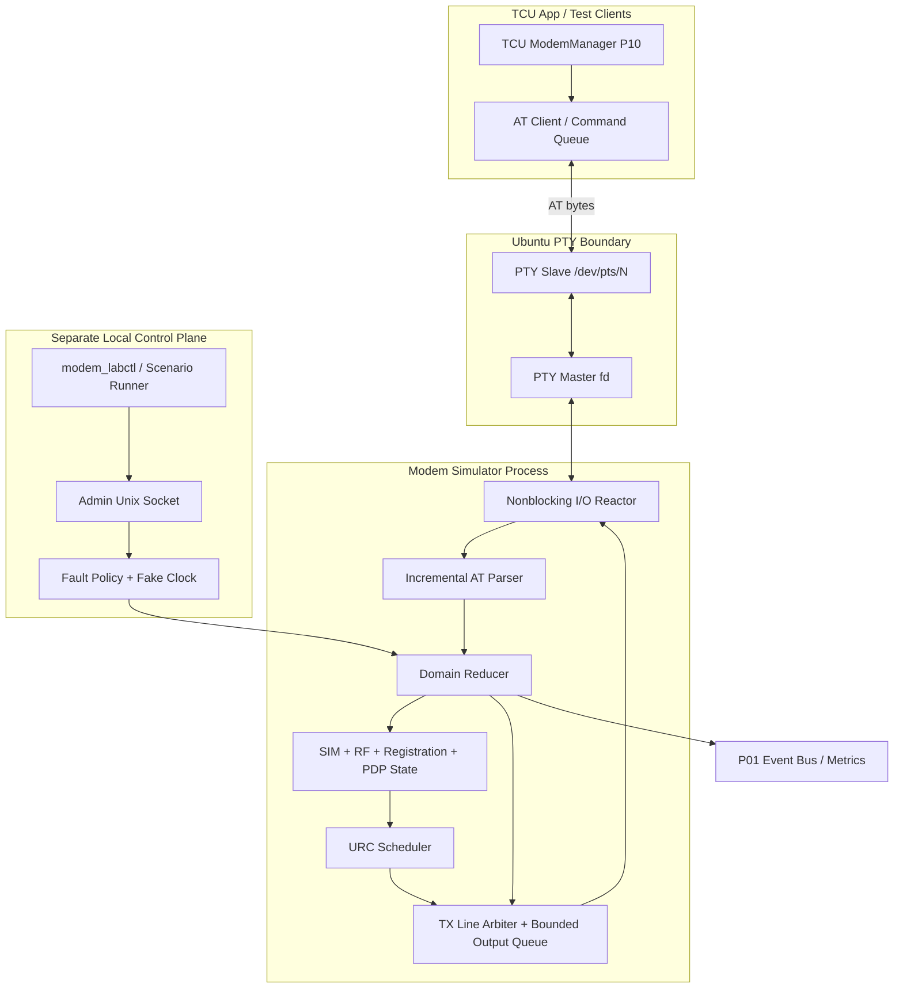
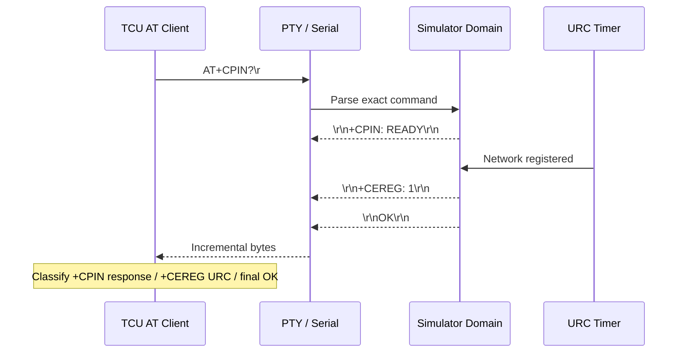
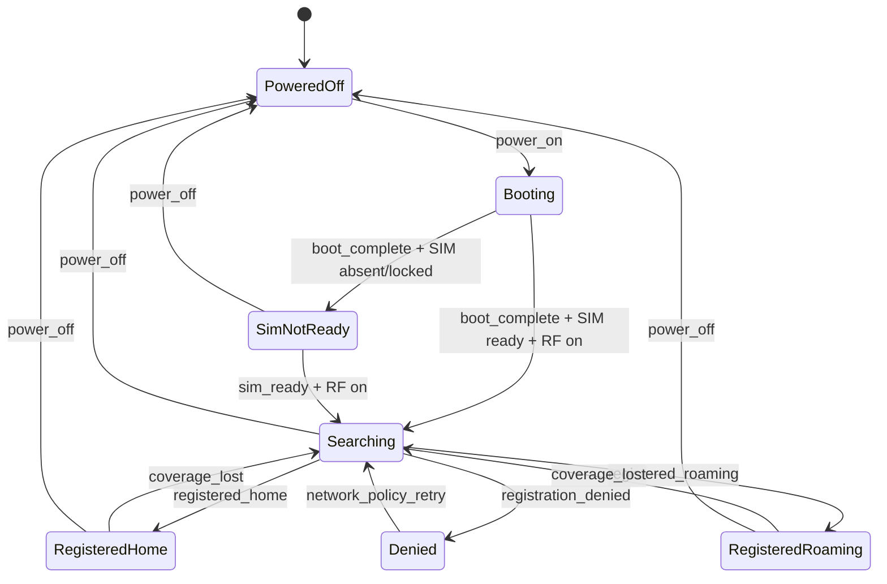
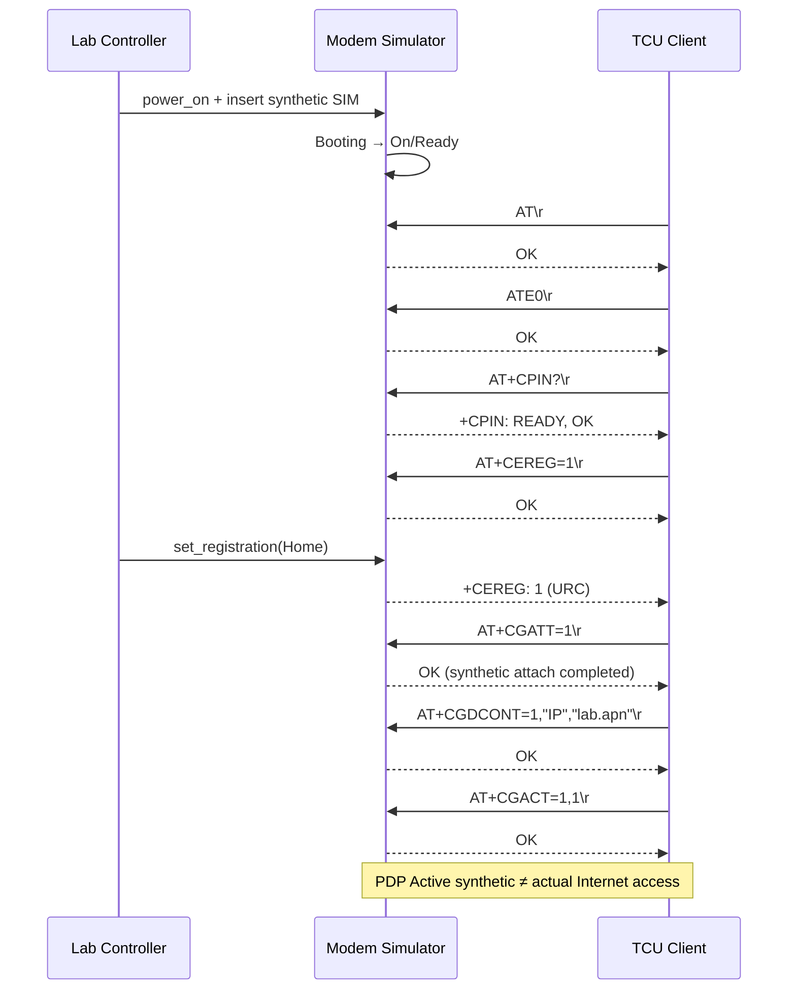
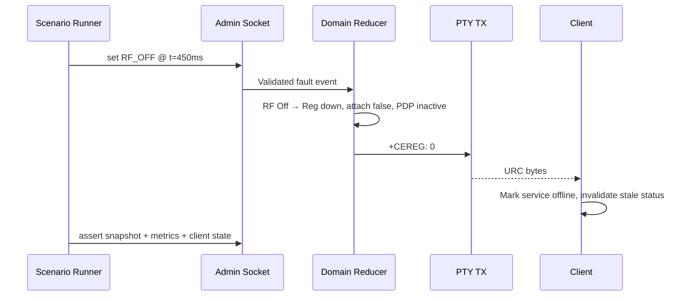
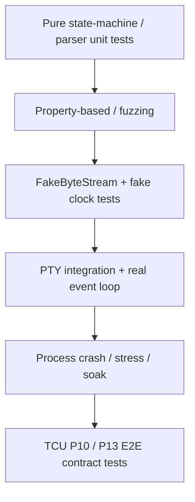

# Project 09 — AT Command Modem Simulator

> **Virtual TCU Lab | System Design · Operational Behavior · Fault Injection · Resilience Test Catalog | v1.0**  
> **Ngôn ngữ:** Tiếng Việt | **Ngôn ngữ triển khai:** C++17 | **Môi trường:** Ubuntu Linux | **Ngày:** 2026-10-30  
> **Đối tượng:** Middle C++ Developer, TCU application/middleware | **Ưu tiên:** P0  
> **Phụ thuộc:** P01 Event Bus, P02 IPC, P03 Timer Scheduler, P04 Configuration & Logging; P05–P08 là integration tùy chọn.  
> **Trạng thái:** **Tài liệu thiết kế / kế hoạch kiểm thử. Chưa có source code hay bằng chứng chạy test.**  
> **Phạm vi an toàn:** Chỉ mô phỏng modem/đường truyền trong lab, không đăng ký mạng di động thật, không yêu cầu SIM, thiết bị radio hay gửi AT command đến modem sản xuất.

---

## 1. Executive summary

Xây dựng một **modem LTE giả lập qua pseudo-terminal (PTY)** để ứng dụng **TCU Modem Manager C++** có thể giao tiếp bằng chuỗi lệnh AT, nhận phản hồi có thứ tự, xử lý **URC (Unsolicited Result Code)**, quản lý SIM/network registration, packet-service state, mất/khôi phục kết nối và reset. Hệ thống phải tái tạo được lỗi *khó bắt* gồm phản hồi chia nhỏ theo byte, URC chen vào giữa response, timeout, modem reboot, đóng file descriptor, stale response và nhiều lỗi đồng thời.

**Phạm vi quan trọng:** Project 09 là **modem-side simulator và client test harness**, *không phải* LTE stack, PPP/IP connectivity manager, network data bearer thật, hoặc một implementation chứng nhận đầy đủ của TS 27.007. Project 10 sẽ dùng simulator này để xây Connectivity Manager production-style.

### 1.1 Thành phẩm cần bàn giao

1. `libtcu_at_core`: incremental AT command tokenizer/decoder, formatter, results, bounded buffers.
2. `libtcu_modem_sim`: modem domain model, command handlers, URC scheduler, fault injection, deterministic fake clock.
3. `libtcu_serial`: RAII PTY/serial abstractions, non-blocking I/O, poll/epoll wrapper, serialized output.
4. `at_modem_simulator`: process sở hữu **PTY master**, xuất đường dẫn **PTY slave** cho consumer.
5. `tcu_at_client`: client mẫu C++17 kết nối PTY slave, thực hiện request/reply và route URCs; có command deadlines và recovery.
6. `modem_labctl`: CLI/Unix-socket admin riêng để điều chỉnh SIM, RF, registration, delays, faults, reset.
7. `scenario_runner`: YAML/JSON scenario files, fake-clock unit test, real PTY integration tests, fault campaigns.
8. `docs/`: sequence/state diagrams, AT subset contract, behavioral contracts, trace samples, ADR, test matrix, limitations.

### 1.2 “Hệ thống chịu nổi” nghĩa là gì?

- **Correctness:** Không tự báo `Registered/Attached` khi state chưa cho phép, không coi URC là câu trả lời hợp lệ của command khác, không tạo `OK` giả.
- **Boundedness:** Bộ nhớ, số command đang chờ, độ dài dòng, số URC, TX buffer, tốc độ fault và log có giới hạn.
- **Lifecycle safety:** Reset, stop/restart, reconnect, timeouts không gây use-after-free, dangling callback, deadlock hay double terminal result.
- **Recoverability:** Hệ thống xác định khi nào mất đồng bộ, khởi tạo session mới hợp lệ và phát trạng thái `Unknown/Degraded` thay vì reuse giá trị cũ.
- **Observability:** Mỗi fault có injection ID, clock, trạng thái trước/sau, counter và test artifact; không ghi payload nhạy cảm.
- **Honesty:** “Write vào PTY thành công” **không** nghĩa modem đã thi hành command; `OK` của command **không** luôn chứng minh đã có mạng IP.

### 1.3 Những giả định không được lẫn với thực tế

- Mô phỏng ***một*** kênh AT text, ***một*** outstanding command tại thời điểm trong client V1. Không có transaction ID trong giao thức AT text cơ bản.
- 3GPP TS 27.007 định nghĩa nhiều lệnh AT chuẩn; các mẫu giá trị/sự kiện dưới đây là **profile phòng lab**, không khẳng định mọi modem trả về y hệt hoặc hỗ trợ hết.
- Có thể bổ sung `AT+Q...`, `AT^...` hoặc nhóm vendor riêng trong plugin nếu **có datasheet + version**, không tự chế tên lệnh rồi gắn nhãn chuẩn 3GPP.
- `PTY` giả lập stream terminal và hangup/short read/write; **không** giả lập RF PHY, UART điện áp, baud timing chuẩn xác, modem firmware hoặc attach thực sự với nhà mạng.

---

## 2. Vị trí trong hệ thống Virtual TCU Lab

| Dự án | Liên kết / trách nhiệm |
|---|---|
| P01 — Event Bus | Xuất sự kiện `SimStateChanged`, `RegistrationChanged`, `ModemReset`, `SignalQualityChanged`. |
| P02 — IPC Framework | `modem_labctl` sử dụng admin socket riêng để điều khiển simulator; không dùng AT data PTY làm control plane. |
| P03 — Timer Scheduler | Sắp xếp delay, unsolicited events, timeout, registration transitions, watchdog, jitter bằng **monotonic clock**. |
| P04 — Config/Logging | Validate profile, strict config snapshots, structured logs và redact SIM ID, IMEI, APN credentials. |
| P05–07 — CAN/DBC/Gateway | Có thể map ignition và battery đến RF policy; **không** tự quyết định cellular đăng ký theo tín hiệu CAN chưa validated. |
| P08 — SOME/IP | Client transport riêng qua IP ảo; SOME/IP discovery **không** là AT command hoặc cellular registration. |
| **P09 — AT Modem Simulator** | Emulate command/response + URCs; test isolation và faults. |
| P10 — Connectivity Manager | Dùng client/AT abstraction để phát triển retry, bearer orchestration, health và recovery. |
| P11 — Network Fault Injection | Mô phỏng *IP transport* bị mất/gói trễ; khác với đường AT control plane PTY. |
| P13/14 — MQTT/Offline Queue | Chỉ dựa vào health đã được xác nhận, không suy luận Internet chỉ từ `+CEREG`. |
| P22 — Power Manager | Policy DTR/sleep/reset được mô hình hóa; không thay thế power hardware thật. |

---

## 3. Scope, versions, non-goals và ADRs

### 3.1 V1 — MUST

- PTY master được mở bởi simulator với `posix_openpt()`, `grantpt()`, `unlockpt()`, `ptsname_r()`; consumer mở slave và cấu hình `cfmakeraw()`/`tcsetattr()` đúng quyền.
- Non-blocking read/write trên FDs, xử lý `EINTR`, `EAGAIN`, partial I/O, HUP, EOF, master/slave recreation.
- AT line parser incremental: delimiters `\r` theo profile, optional `\r\n` tolerant input (config); quoted values, max length, byte/control-char validation; **không** nhầm `\n` bên trong response với command boundary.
- Echo (`ATE0`/`ATE1`) và verbose final result (`OK`, `ERROR`, `+CME ERROR: ...`), case-insensitive command **name**, parameter validation có ranh giới rõ.
- Phân loại **solicited response vs URC**, bảo đảm output line atomic, URC có thể xuất hiện **giữa các dòng** solicited response (không chèn byte giữa một dòng nếu không bật fault profile).
- Modem states: Power, SIM, RF, EPS registration, packet attach, PDP context config/activation, data IP availability *synthetic*.
- Implement AT subset có tài liệu trong §6; reject command không hỗ trợ bằng `ERROR` / `+CME ERROR` theo profile, không lặng im mặc định.
- Fault injection có deterministic seed, fake clock, scripted actions và safety guard (admin chỉ local socket).
- Bounded queues, bounded output buffers, CPU throttling, graceful shutdown, no busy loop.
- CI: unit/property/integration + memory/concurrency diagnostics + realistic PTY end-to-end.

### 3.2 V2 — SHOULD / OPTIONAL

- Multiple logical modem instances, mỗi instance là PTY và state riêng; dual-SIM behavior demo nếu yêu cầu.
- Số hóa packet-service state và *mock data plane* độc lập, không nói `CGACT=1` tạo Internet thật.
- Command-line chaining, AT S-register, numeric results (`ATV0`), complex escaping: chỉ mở khi có test vectors và documentation.
- SMS AT subset theo TS 27.005, SMS indications, prompt `>` và PDU mode, **không** bắt buộc V1.
- Vendor-profile registry (Quectel/SIMCom/u-blox) có version pins, conformance test với datasheet, **không** mặc định trộn dialects.
- QEMU/Yocto packaged simulation; integration with ModemManager (open-source) qua adapter tùy yêu cầu, không giả định ModemManager nhận mọi AT-only PTY là modem hoàn chỉnh.

### 3.3 Non-goals

- Không implement cellular RF, SIM authentication, network signalling thật, attach NAS/PDN, SMS thật, GNSS phần cứng.
- Không đảm bảo TS 27.007 full conformance, 3GPP certification hay interoperability với một OEM/modem cụ thể.
- Không kiểm thử hardware UART signal integrity/flow control `RTS/CTS`, electrical DTR/DCD, kernel driver/USB enumeration thực.
- Không khẳng định `close/reopen` một serial device thật luôn chặn stale response (xem §10.7).
- Không dùng modem simulator để điều khiển thiết bị thực hoặc bypass cơ chế nhà mạng.

### 3.4 Architecture Decision Records

| ADR | Quyết định | Lý do / trade-off |
|---|---|---|
| ADR-09-01 | PTY làm transport test, fake transport cho unit test | Không cần hardware; PTY không mô phỏng PHY/UART điện. |
| ADR-09-02 | Single-threaded domain reducer + I/O reactor + bounded TX writer | Dễ suy luận transition, tránh khóa nhiều nơi; không được block reactor. |
| ADR-09-03 | Single outstanding command ở client | AT text không có request ID; trộn nhiều command gây ambiguity. |
| ADR-09-04 | Monotonic clock, injectable `IClock` | Fake-clock tests reproducible, tránh đổi wall clock. |
| ADR-09-05 | Simulator profile versioned + strict validation | Không silent semantics change giữa test runs. |
| ADR-09-06 | URC dispatcher độc lập nhưng serial hóa bytes qua một TX owner | URC có thể chen vào response theo dòng, không corrupt byte stream chuẩn. |
| ADR-09-07 | Reset tăng `session_epoch`, invalidate timers | Chặn callback thuộc phiên cũ trong simulator. |
| ADR-09-08 | Fault injector tách riêng control plane, local authorization | Không để payload AT tùy ý điều khiển infrastructure. |
| ADR-09-09 | Fail-closed khi packet attach, SIM/registration chưa hợp lệ | Không phát báo cáo connectivity sai chỉ vì flag cũ. |
| ADR-09-10 | Evidence-first: mỗi failure campaign có trace + metrics | Thiết kế và chạy test là hai việc khác nhau. |

---

## 4. System architecture và trust boundaries



### 4.1 Data plane vs control plane

- **AT data plane:** `PTY slave ↔ PTY master`; chỉ có AT command bytes, solicited lines, final result codes, URCs.
- **Simulator admin control plane:** Unix Domain Socket giới hạn owner/mode `0600` hoặc test namespace; sử dụng JSON message **có schema** để inject faults và đặt scenario state. Không cho client AT bất kỳ gọi `inject`.
- **Observability plane:** structured logs và metrics nội bộ, không tự broadcast IMEI/SIM secrets.

### 4.2 Process boundaries, ownership và security

1. Simulator sở hữu **master fd**; client sở hữu **slave fd**. Mỗi owner dùng RAII, không để raw fd sống vượt quá lifetime object.
2. `PTY slave path` là ephemerally allocated (đổi sau restart). CLI phải đọc `endpoint.json`/stdout handshake; không hard-code `/dev/pts/3`.
3. Nếu client mất quyền truy cập PTY hoặc lỡ mở path khác, phải báo `PortUnavailable`; không fallback sang `/dev/ttyUSB*` thật.
4. Cấm wildcard device enumeration ngoài lab; allowlist slave path dưới `/dev/pts`, hoặc fake adapter theo explicit test config.
5. Admin socket không exposed qua TCP; giới hạn kích thước/complexity config; bảo vệ khỏi scenario injection và path traversal.
6. Logging phải tách `actual_data_redacted` và `synthetic_demo_values`; tắt raw byte dumps mặc định.

### 4.3 Sơ đồ trao đổi AT cơ bản



### 4.4 Registration / modem state machine (minh họa)



**Lưu ý:** Đây là *simplified logical model*; power, SIM, RF, EPS registration và PDP là nhiều **state axes** độc lập có constraints; state diagram trên chỉ là projection đọc nhanh.

---

## 5. Domain model và invariants

### 5.1 State axes

| Axis | Domain V1 | Semantic |
|---|---|---|
| `PowerState` | `Off`, `Booting`, `On`, `Resetting` | `Off/Resetting` không nhận business AT; `Booting` chỉ whitelist. |
| `SimState` | `Absent`, `PinRequired`, `PukRequired`, `Ready`, `Fault` | SIM readiness không đồng nghĩa registered. |
| `RfState` | `Off`, `On` | RF off bắt buộc registration/attach down. |
| `EpsRegState` | `NotRegistered`, `Searching`, `Home`, `Roaming`, `Denied`, `Unknown` | EPS registration là trạng thái *mô phỏng*, không phải Internet. |
| `PacketAttachState` | `Detached`, `Attaching`, `Attached`, `Unknown` | Attached chỉ có thể khi SIM ready, RF on và registered. |
| `PdpContextState` | `Unconfigured`, `Configured`, `Activating`, `Active`, `Failed` | `Active` synthetic và có profile APN hợp lệ; không tạo Linux interface/IP thật trong V1. |
| `AtChannelState` | `Closed`, `Open`, `Desynchronized`, `Closing` | `Desynchronized` từ client ngăn command không an toàn. |
| `UrcSubscriptionState` | `Disabled`, `Enabled` (per family) | URC enable/disable không chặn read command. |

### 5.2 Invariants bất biến phải kiểm tra sau *mọi* transition

- **INV-01:** `Power=Off` ⇒ `Attached=false`, `PDP != Active`, `EPSReg != Home/Roaming`.
- **INV-02:** `Sim != Ready` ⇒ `Attached=false`, `PDP != Active`; registration phải về trạng thái được profile cho phép, không reuse Home/Roaming.
- **INV-03:** `RF=Off` ⇒ `Attached=false`, `PDP != Active`, `EPSReg=NotRegistered` sau transition nguyên tử.
- **INV-04:** `EPSReg` không Home/Roaming ⇒ `Attached=false`, `PDP != Active`.
- **INV-05:** `PDP=Active` ⇒ `Attached=true`, `RF=On`, `Sim=Ready`, `EPSReg∈{Home,Roaming}`.
- **INV-06:** Mỗi command request V1 có **tối đa một final result** trong cùng simulator session trừ profile fault cố tình vi phạm; client phải bắt vi phạm.
- **INV-07:** Không có TX line trộn bytes giữa URC và response dưới nominal profile.
- **INV-08:** Task có `epoch` khác session hiện tại không được mutation domain hoặc phát success signal.
- **INV-09:** `stop()` trả về ⇒ không còn callback ứng dụng/worker tham chiếu state đã giải phóng.
- **INV-10:** Độ dài input line, pending output bytes, fault schedule, in-flight timers và metrics cardinality không vượt giới hạn cấu hình.
- **INV-11:** Một terminal state (`Success`,`Error`,`Timeout`,`Cancelled`,`PortLost`) cho mỗi client command; callback tối đa một lần.
- **INV-12:** `AT command completed` không tự động biến `DataBearer=Online` khi chưa có evidence độc lập.

### 5.3 Defaults cấu hình lab (không phải performance chuẩn automotive)

| Key | V1 default | Rationale |
|---|---:|---|
| `max_input_line_bytes` | 1024 | Tránh unbounded parser. |
| `max_response_line_bytes` | 2048 | Giới hạn wire response line. |
| `max_pending_commands` | 1 | Single outstanding transaction ở AT client. |
| `max_tx_queue_bytes` | 65536 | Bound output memory. |
| `max_pending_urc` | 256 | Bursts được drop/coalesce có metric. |
| `max_scheduled_faults` | 4096 | Chặn scenario vô hạn. |
| `max_admin_message_bytes` | 16384 | Chặn unbounded JSON. |
| `command_deadline_ms` | 2000 | Có thể override theo loại command. |
| `reboot_delay_ms` | 1500 | Fake-time test; không đại diện modem thật. |
| `registration_delay_ms` | 1000 | Fake-time test; có thể change. |
| `retry_base_ms / max_ms` | `500 / 30000` | Client manager, có bounded jitter/attempts. |
| `max_event_history` | 10000 | Circular ring, không giữ vô hạn. |
| `metrics_label_max_cardinality` | 100 | Không gắn request ID vào metric label. |

### 5.4 State transitions: atomicity và precedence

- Domain reducer xử lý events tuần tự; mỗi event đưa state đến một snapshot hợp lệ rồi mới publish derived URC và metrics.
- **Precedence:** `PowerOff`/`Reset` > `SIMRemoved`/`RFOff` > `RegistrationLost` > `Attach/Activate` success > `QualityChange` (chi tiết đặt trong ADR/test).
- `PowerOff` đồng thời `AttachComplete` ⇒ `PowerOff` thắng; attachment không resurrect vì stale timer.
- `SIMRemoved` đồng thời `RegisteredHome` ⇒ không được register lại đến khi SIM ready và new generation.
- Khi không có thứ tự tuyệt đối giữa external events, scenario runner phải ghi **accepted reducer order** và expected state theo serialization; *không* ngầm giả sử OS thread scheduling cố định.

---

## 6. AT command profile và wire contract

### 6.1 Nguyên tắc chuẩn / profile

- Chuẩn tham chiếu chính: **3GPP TS 27.007** (AT command set for User Equipment). Project chọn **một subset** và đóng băng hành vi trong `configs/at_profile_v1.yaml`.
- **Final result code** như `OK`/`ERROR`/`+CME ERROR` thuộc transaction; **URC** do modem chủ động phát, có thể không liên quan lệnh đang chờ.
- Dùng `\r` làm command terminator trong test profile. Response mẫu dùng `\r\n...\r\n`. Echo do modem simulator điều khiển; client không assume luôn tắt echo.
- 3GPP exact format, mức tham số, vendor extension phụ thuộc version/profile. Những fields đơn giản hóa được chú thích `LAB_PROFILE`, không tự xưng compliance.

### 6.2 AT command subset V1

| Command | Ý nghĩa mô phỏng | Hợp đồng chính / lỗi |
|---|---|---|
| `AT` | Ping | Trả `OK` nếu channel ready; reboot/off không xử lý. |
| `ATE0`, `ATE1` | Echo off/on | Có hiệu lực từ *sau* xử lý lệnh; responses không bị echo kép. |
| `AT+CMEE=0/1/2` | Error verbosity | Profile quyết định code vs text; invalid mode phải lỗi. |
| `AT+CPIN?` | SIM status | `READY`, `SIM PIN`, `SIM PUK` hoặc `+CME ERROR` khi không có SIM tùy profile. |
| `AT+CPIN="<pin>"` | Nhập PIN *synthetic* | Rate-limited, counter/lockout; tuyệt đối không lưu PIN thật trong trace. |
| `AT+CSQ` | Signal strength | Dữ liệu range theo spec; `99` khi không xác định; client không coi `99` là tín hiệu cực tốt. |
| `AT+CFUN?`, `AT+CFUN=0/1` | RF mode demo | Đổi RF và invalidate registration/attach theo invariants; các mức khác ở V1 bị reject. |
| `AT+CEREG?`, `AT+CEREG=0/1` | EPS registration/status URC | Read: profile `+CEREG: <n>,<stat>`; URC mode 1: `+CEREG: <stat>`; reject unsupported modes. |
| `AT+CGATT?`, `AT+CGATT=0/1` | Packet attach demo | Set=1 chỉ thành công khi prerequisites; có thể async completion theo profile, không nói IP online. |
| `AT+CGDCONT?`, `AT+CGDCONT=1,"IP","<apn>"` | PDP context configuration | Validate context ID, PDP type, APN length/characters; không tạo IP interface thật. |
| `AT+CGACT?`, `AT+CGACT=0/1,1` | Activate/deactivate PDP | Reject nếu chưa attached; activation may fail/timeout. |
| `AT+CGPADDR=1` | Virtual PDP address | Chỉ trả synthetic IP ở `PDP Active`; otherwise unavailable/error by profile. |
| `AT+CGSN` | Synthetic equipment ID | Sử dụng ID giả, redact trong log theo chính sách. |
| `AT+CCLK?` | Modem wall clock | Test invalid/stale clock; tuyệt đối không dùng làm timer deadline. |
| `AT+FOO` | Unknown command | Final `ERROR`/`+CME ERROR` theo policy; không im lặng. |

**Không nằm trong V1:** `ATD`, `ATA`, SMS `AT+CMGS`, GNSS vendor commands, escape `+++`, `AT+CMUX`, modem firmware update, vendor-specific data dial modes, PDP real networking. Đặc tả mở rộng phải ghi rõ firmware/version và thêm test corpus.

### 6.3 Response wire examples (echo disabled)

```text
HOST --> MODEM:  AT+CPIN?\r
MODEM --> HOST:  \r\n+CPIN: READY\r\n\r\nOK\r\n

HOST --> MODEM:  AT+CEREG?\r
MODEM --> HOST:  \r\n+CEREG: 1,1\r\n\r\nOK\r\n

MODEM --> HOST (URC spontaneous): \r\n+CEREG: 0\r\n
HOST --> MODEM:  AT+CGATT?\r
MODEM --> HOST:  \r\n+CGATT: 0\r\n\r\nOK\r\n
```

### 6.4 Parser rules và commands grammar

1. Parser đọc **bytes tăng dần** không assume `read()` trả một dòng hay một AT message hoàn chỉnh.
2. `CR` kết thúc một command line; giới hạn toàn bộ command length trước khi allocate; reject NUL/invalid controls theo policy.
3. AT command case-insensitive **trong phần tên**, không tự lower-case credentials/APN/PIN/quoted parameters.
4. Một command `AT` V1 trên một dòng. Chained commands không hỗ trợ và phải **reject** nếu không xác định được ranh giới; không silently execute prefix rồi bỏ suffix.
5. Dấu nháy, dấu phẩy, escape được parse bằng state machine; malformed quote => lỗi không mutate state.
6. `AT+...=?` (test form) chỉ phản hồi nếu explicit supported; không giả `OK` cho mọi command.
7. Unknown URC có thể được forward vào channel `UnknownUrc` bounded; không được consume như solicited body.
8. Response may contain blank lines; client parser bỏ blank lines theo rules nhưng **không** lấy blank line làm terminal.
9. `OK/ERROR` chỉ là final nếu là **một dòng hoàn chỉnh**; `foobarOK` không phải success.
10. Full line framing được xử lý trước khi dispatch; injection mode `byte_corruption` là transport fault, phải raise `ProtocolError`/desync.

### 6.5 URC catalog và subscription

| URC synthetic | Kích hoạt | Expected behavior |
|---|---|---|
| `+CEREG: <stat>` | Registration change khi mode=1 | Update registration + invalidate attached/PDP nếu mất mạng. |
| `+CPIN: READY` | SIM became ready (lab extension if enabled) | Client re-query `AT+CPIN?` trước khi trust; không assume URC được hỗ trợ bởi mọi modem. |
| `+CGATT: <0|1>` | Attach change (lab-defined optional indication) | Demo proprietary-like URC **không gắn nhãn TS 27.007 standard URC**; client map bằng profile. |
| `RDY` | Reboot complete (vendor-like lab profile) | Không dùng như điều kiện thành công duy nhất; resynchronize command channel. |
| `+LABFAULT: <reason>` | Diagnostics riêng lab (optional) | **Không gửi trên protocol profile chuẩn mặc định**; chỉ test-specific mode. |

### 6.6 URC/response ambiguity

Trong AT text **không có request ID**. Một số prefix (ví dụ `+CEREG:`) xuất hiện ở cả solicited read và unsolicited notification. Client cần:

- Giữ active command specification (`expected_solicited_prefixes`, number/form of fields, terminal result).
- Route line theo active transaction context và grammar của response; nếu line ambiguous, chọn conservative (`Ambiguous` → mark state uncertain / explicit resync) thay vì báo success sai.
- Cho phép **URC giữa các line** của response, nhưng không reorder bytes trong một line nominal.
- Không phát command mới sau `Timeout` khi kênh còn `Desynchronized` mà chưa có policy resync.
- Ghi trace raw byte offsets redacted và normalized parsed lines để debug root cause.

---

## 7. API C++17 và class design

### 7.1 Transport interfaces

```cpp
using Byte = std::uint8_t;
using Bytes = std::vector<Byte>;
using MonoTime = std::chrono::steady_clock::time_point;

struct IoResult {
    enum class Code { Ok, WouldBlock, Closed, Interrupted, OsError } code;
    std::size_t count = 0;
    int os_error = 0;
};

class IByteStream {
public:
    virtual ~IByteStream() = default;
    virtual IoResult readSome(Byte* dst, std::size_t cap) = 0;
    virtual IoResult writeSome(const Byte* src, std::size_t len) = 0;
    virtual void close() noexcept = 0;
};

class IClock {
public:
    virtual ~IClock() = default;
    virtual MonoTime now() const noexcept = 0;
};
```

`IByteStream` chỉ đóng gói non-blocking operations, không block trong function `readSome()`; `Reactor` chịu trách nhiệm readiness notifications, partial write loops, close, queue và threading. Linux adapter kiểm tra `EINTR`/`EAGAIN` không coi như fatal. `FakeByteStream` phải cho phép phân mảnh byte stream theo arbitrary chunks.

### 7.2 Simulator state & commands

```cpp
enum class PowerState { Off, Booting, On, Resetting };
enum class SimState { Absent, PinRequired, PukRequired, Ready, Fault };
enum class EpsRegState {
    NotRegistered, Searching, Home, Roaming, Denied, Unknown
};

struct ModemSnapshot {
    std::uint64_t epoch = 0;
    PowerState power = PowerState::Off;
    SimState sim = SimState::Absent;
    bool rf_enabled = false;
    EpsRegState eps = EpsRegState::NotRegistered;
    bool attached = false;
    bool pdp_active = false;
    int rssi_code = 99;
};

struct AtRequest {
    std::string normalized_name;
    std::string original_parameters;  // case/payload preserved
    std::uint64_t channel_epoch = 0;
};

struct ResponsePlan {
    std::vector<std::string> body_lines;
    std::string final_result;    // one terminal line
    std::chrono::milliseconds delay{0};
};

class IModemDomain {
public:
    virtual ~IModemDomain() = default;
    virtual ResponsePlan execute(const AtRequest&) = 0;
    virtual void apply(const struct DomainEvent&) = 0;
    virtual ModemSnapshot snapshot() const = 0;
};
```

`execute()` và `apply()` phải chạy trong **domain reducer serialized context**; bản interface là khung thiết kế chứ không phải code build sẵn. Toàn bộ async callbacks mang `epoch`, `scenario_run_id` và `timer_id` để discard stale work.

### 7.3 Client API / transaction semantics

```cpp
enum class AtStatus {
    Ok, ModemError, Timeout, PortLost,
    ParseError, Desynchronized, Cancelled, QueueFull
};

struct AtReply {
    AtStatus status;
    std::vector<std::string> solicited_lines;
    std::string final_result;
    std::uint64_t session_epoch = 0;
};

struct AtCommandSpec {
    std::string command;
    std::vector<std::string> expected_prefixes;
    std::chrono::milliseconds timeout{2000};
    bool idempotent_read_only = false;
};

class IAtClient {
public:
    virtual ~IAtClient() = default;
    virtual std::future<AtReply> submit(AtCommandSpec) = 0;
    virtual void setUrcHandler(
        std::function<void(std::string, std::uint64_t)> cb) = 0;
    virtual void stop() noexcept = 0;
};
```

- `submit()` phải **reject/queue with bounded policy** khi đã có command in-flight; không phát hai commands cạnh nhau vào PTY V1.
- Completion exactly-once ở **API callback**, *không khẳng định remote execution exactly-once*.
- Callback không được chạy dưới mutex nội bộ; handle unsubscribe-during-callback/lifetime.
- URCs giao qua queue riêng có bounds và coalescing đối với signals idempotent (ví dụ last registration state); không drop silent critical reset signal.

### 7.4 Class responsibility matrix

| Class | Trách nhiệm | Không được làm |
|---|---|---|
| `PtyEndpoint` | Open/close PTY, mode, path ownership, HUP | Parse AT business. |
| `AtLineCodec` | Incremental framing, escaping, length | Interpret RF state. |
| `AtCommandRouter` | Map parse tree → command handler | Blocking I/O, locking socket. |
| `ModemReducer` | Apply deterministic state transitions | Ghi trực tiếp PTY, sleep thật. |
| `RegistrationEngine` | Simulate registration/attach prerequisites | Tạo network registration thật. |
| `UrcEmitter` | Compose URCs, rate/coalesce | Interleave bytes vào giữa line. |
| `TxLineArbiter` | Atomic frames/lines, queue/drop/priority | Drop final response im lặng. |
| `ScenarioEngine` | Inject faults scheduled + deterministic clock | Giữ unbounded fault queues. |
| `AtClientTracker` | Single request, timeout, resync, classification | Assume success from `write()`. |
| `HealthMetrics` | State, latency, drops, fault reason | Ghi secrets/cardinality vô hạn. |

---

## 8. Sequence diagrams: behavior end-to-end

### 8.1 Startup → SIM ready → registration → PDP activation



### 8.2 URC chen vào multi-line response

```mermaid
sequenceDiagram
  participant C as Client
  participant M as Modem Simulator
  C->>M: AT+CGDCONT?\r
  M-->>C: +CGDCONT: 1,"IP","lab.apn"
  M-->>C: +CEREG: 0 (URC; registration lost)
  M-->>C: OK
  Note over C: Parse body and URC separately
  Note over C: RegistrationLost invalidates attached/PDP; OK is only status of CGDCONT read
```

### 8.3 Timeout → Desynchronized → resynchronization

```mermaid
sequenceDiagram
  participant C as Client
  participant M as Simulator
  C->>M: AT+CGATT=1\r
  Note over M: Fault: response delayed > timeout
  C->>C: Deadline reached
  C->>C: Complete request Timeout exactly once
  C->>C: Mark channel Desynchronized
  Note over C,M: No next command until explicit resync policy
  C->>M: Close session / controlled reset in lab
  M->>M: Advance epoch + cancel stale actions
  C->>M: Reopen new PTY; AT\r
  M-->>C: OK
  C->>M: Re-query SIM/registration/attach states
  M-->>C: Current snapshot with final codes
```

**Important:** Close/reopen/reset làm “cách ly epoch” **trong simulator** do simulator chủ động tạo PTY/session mới. Với serial modem thật, đóng/mở thiết bị **không chứng minh** firmware đã hủy lệnh cũ; production policy cần vendor-specific reset/quarantine và các postconditions đo được.

### 8.4 Fault injection (admin/control plane)



---

## 9. Operational behavior và expected contracts

### 9.1 Lifecycle: Start/Stop

1. Load/validate immutable profile (commands, response grammar, timings, limits, SIM credentials synthetic, fault permissions).
2. Create PTY **master**; validate slave path under `/dev/pts`, ensure perms and explicit lab-run identity; print path/machine-readable endpoint.
3. Initialize domain state, `session_epoch`, timers and output queue. Start I/O reactor **before** announcing `READY`.
4. Client opens **slave**, sets raw/noncanonical settings; flush startup garbage only according to explicit epoch/resync policy.
5. On shutdown: reject new admin faults and input commands, deactivate timers, stop writer, complete pending with `PortLost/Cancelled`, join workers and release fds.
6. Endpoint path thay đổi sau restart ⇒ orchestration cập nhật endpoint manifest và client mới open đúng PTY; cấm fallback vào modem thật.

### 9.2 Command transaction

`Idle → Sending → AwaitingFinal → {Ok, ModemError, Timeout, PortLost, Cancelled}`. No direct `AwaitingFinal → SendingAnother` nếu chưa terminal. Nếu lỗi protocol nghiêm trọng, `Desynchronized` và cần resync trước khi tiếp tục.

**Expected:** `submit()` khi Busy phải trả bounded backpressure; timeout bao gồm thời gian xếp hàng nếu contract cấu hình như vậy; không start deadline tùy ý sau khi đã lỡ SLA.

### 9.3 URC behavior

- URC có thể phát khi Idle hoặc giữa body/final của một solicited reply, nhưng **nominal** không chen byte trong một dòng.
- Producer URC có bounded queue, registration state update là nguồn sự thật; nếu URC queue bị drop cần phát `StateUnknown/NeedsRefresh` đến client theo protocol control/health nếu có; periodic readback để resync.
- `+CEREG` URC mode=0 không được phát. URC vì fault duplicate/out-of-order phải được client xử lý bằng reconciliation, không lấy sequence chỉ từ text line không có sequence.

### 9.4 SIM / PIN behavior

- SIM absent ⇒ registration/attach/PDP invalid, `AT+CPIN?` trả error/absent theo profile.
- Nhập PIN đúng ⇒ `Ready`, reset counter; sai ⇒ đếm attempts (synthetic), có thể `PINRequired → PUKRequired` và lockout; không log raw PIN.
- SIM bị rút trong attach ⇒ attach/activation bị hủy theo epoch; lệnh chậm hoàn tất phải bị reject/marked failed.

### 9.5 RF / Registration / Packet states

- `CFUN=0` ⇒ RF off, registration `NotRegistered`, attached false, PDP inactive; `CFUN=1` ⇒ chỉ **Searching**, không instant Home nếu chưa có scheduled registration success.
- `RegisteredHome/Roaming` không tự cấp attach; `CGATT=1` cần valid prerequisites.
- Đổi APN khi PDP active ⇒ `Reject` hoặc explicit teardown per frozen profile; không silently retain PDP Active với APN cũ.
- `CGACT=1` chỉ active sau attach synthetic; `CGPADDR` là synthetic địa chỉ mô phỏng, không có OS interface/IP route.

### 9.6 Errors, retry và recovery

- Modem syntax/unsupported command: trả explicit final error.
- Link HUP/IO error: client complete pending once, enter `PortLost`, clear stale session data.
- Command timeout: **không lập tức retry side-effecting commands** (ví dụ SIM PIN, set RF, activate PDP) nếu chưa xác định kết quả trước. Các read-only query có thể retry sau resynchronization.
- Retry có exponential backoff + capped jitter + cancellation; không block reactor thread, không busy loop.
- Một client không được cho rằng `OK` của `AT+CGATT=1` chứng minh cloud reachable.

### 9.7 “Stale reply” là lỗi nguy hiểm nhất của AT text

Giả sử lệnh `A` timeout, client ngay lập tức gửi `B`, sau đó final `OK` muộn của `A` đến trước response `B`. Vì wire text không có correlation ID, client có thể đánh dấu sai B thành công. **V1 invariant:** Sau timeout đáng ngờ, client chuyển `Desynchronized` và chặn command tiếp theo đến khi có explicit resync. Trong lab, simulator hỗ trợ new-epoch PTY recreation để đảm bảo response cũ không rơi vào session mới. Production với modem thật cần policy mạnh hơn và test phần cứng.

### 9.8 Multiple concurrent error precedence

`PowerOff / Reset / SessionHup` > `SIMAbsent / RFOff` > `RegistrationLoss` > `AttachSuccess` > `PdpSuccess` > `SignalQuality`. Reducer xử lý serial, ghi epoch và reason. Pending side effects có precondition checks tại **commit time**, không chỉ tại request accept time.

### 9.9 Behavioral contracts — Given / When / Then (mẫu nền)

| ID | Given | When | Then / oracle |
|---|---|---|---|
| BC-001 | Simulator On, Echo Off | Client gửi `AT\r` | Hoàn thành một lần `OK`; không phát URC giả. |
| BC-002 | Client nhận từng byte | Response bị chia 1 byte/chunk | Parse đúng và không tiêu thụ vượt buffer. |
| BC-003 | SIM Absent | `AT+CPIN?` | Trả lỗi/absent theo profile; client không mark SIM Ready. |
| BC-004 | SIM Ready, RF On | `AT+CFUN=0` | Registration/attach/PDP về unavailable **atomic**. |
| BC-005 | Registration Home | `AT+CGATT=1` | Attach succeeds synthetic; không báo IP Online. |
| BC-006 | Response chậm và timeout | Late `OK` xuất hiện | Không gán late `OK` cho command tiếp theo; Desynchronized. |
| BC-007 | URC mode=1 | `+CEREG: 0` tới trong `CGDCONT?` | Query vẫn kết thúc đúng; registration invalidated. |
| BC-008 | TX queue full | Cần gửi final response | Error policy observable; không silent success; limiter/resync nếu không thể send. |
| BC-009 | Client closes PTY | `read()` on master HUP/EIO | Server cleanup, no spin; future session isolated. |
| BC-010 | Concurrent reset+attach complete | Reducer serializes | `Reset` thắng, không attached resurrection. |
| BC-011 | Client app crashes mid-command | Simulator retains master only | Không ghi tiếp vào stale fd unbounded; session handles hangup. |
| BC-012 | `stop()` returns | Fault timer attempts callback | Callback discarded via epoch, không use-after-free. |
| BC-013 | Unknown command | Client gửi `AT+FOO` | Final error, không thay đổi domain state. |
| BC-014 | SIM PIN protected | Wrong PIN nhiều lần | Synthetic lockout đúng policy, không log PIN. |
| BC-015 | Stress 24h trong budget | faults/URC bursts | Bounded resources; có trace metrics; không nói đã PASS nếu chưa chạy. |

---

## 10. Concurrency, resource management và time

### 10.1 Ownership/threads

| Thread/component | Owner dữ liệu | Không được làm |
|---|---|---|
| I/O Reactor | PTY fd readiness, RX/TX offsets | Parse domain bằng lock dài, `sleep`, emit user callbacks. |
| Domain Reducer | State snapshot và pending domain tasks | Block trên serial/network I/O. |
| Scenario Runner | Scripts, fault schedule, deterministic order | Mutate domain state trực tiếp từ nhiều threads. |
| Client Command Thread | Pending transaction và monotonic timeout | Gửi command mới trước khi transaction trước terminal + synchronized. |
| URC Dispatcher | Bounded URC queue, sinks | Interleave bytes phá atomic TX line. |
| Logger | Bounded structured log events | Block control path indefinitely khi disk full. |

### 10.2 Bounded queues và policy

- **Input parser:** Khi overflow, drop/reset command buffer, phát error *nếu có thể*; không dùng unchecked `std::string +=` mãi.
- **TX final replies:** Priority hơn telemetry URCs nhưng phải giữ thứ tự lines đã vào arbiter; nếu không thể enqueue trong budget, đánh dấu channel unhealthy/HUP để client resync, không `drop OK` lặng lẽ.
- **URC queue:** Coalesce contiguous state snapshots; nếu không thể bảo toàn fidelity, bump `urc_drop_count`, `state_refresh_required`.
- **Fault schedule:** Reject `ScheduleFull`; quotas theo scenario run; không spawn thread cho mỗi timer/event.
- **Log queue:** Rate limiting và redaction, bounded trace ring, log loss counters.

### 10.3 Time semantics

- Clock deadlines/retry/timers dùng `std::chrono::steady_clock`, fake clock injection cho unit tests.
- `AT+CCLK?` trả wall-clock synthetic, có thể lệch lùi/tới để test; **không** làm timeout lệch.
- Fake clock leap phải trigger overdue scheduled work theo order ổn định `(deadline, sequence)`; bounded scheduler dispatch tránh infinite loop.
- Các timeouts defaults chỉ là lab values; real modem attach có thể rất lâu, config theo command/profile và yêu cầu sản phẩm.

### 10.4 Locking, cancellation và shutdown

- Một callback user không được gọi khi giữ mutex của TX queue/domain/client request tracker.
- `stop()` idempotent; mọi timer cancellation có session generation; `join()` có policy không tự join current worker.
- `cancel()` vs response arrival hoàn tất một terminal outcome; không double-set `std::promise`.
- `kill -9` không graceful shutdown; process restart phải có state reset/reconcile, các pending ở client là `PortLost/Unknown`, không thành `Success`.

### 10.5 Observability và metrics

| Metric | Ý nghĩa / oracle |
|---|---|
| `at_commands_total{cmd,status}` | Command accepted, completed, errored; cardinality bounded theo whitelist. |
| `at_command_duration_ms` | End-to-end latency histogram, không dùng wall clock. |
| `at_parse_errors_total` | Invalid bytes/line/malformed command. |
| `at_client_desync_total` | Số lần phải resync vì timeout/ambiguity. |
| `modem_state_transitions_total{axis,reason}` | Kiểm toán changes, invariant violations = 0. |
| `urc_enqueued_total`, `urc_dropped_total` | Đo chất lượng unsolicited notifications. |
| `pty_hup_total`, `pty_io_errors_total` | Transport failure signals. |
| `tx_queue_depth_bytes`, `rx_buffer_bytes` | Boundedness dưới stress. |
| `stale_timer_discarded_total` | Epoch invalidated asynchronous work. |
| `sim_pin_failures_total` | Không label bằng PIN/IMEI. |
| `fault_injected_total{type}` | Traceability; labels giới hạn. |
| `reactor_spin_count`, `reactor_wakeups_total` | Phát hiện busy loop sau HUP/EAGAIN. |

**Log mẫu:**

```json
{"run_id":"lab-09-r001","epoch":7,"mono_ms":9152,"component":"at_client","event":"command_terminal","command":"AT+CPIN?","status":"OK","latency_ms":12}
{"run_id":"lab-09-r001","epoch":7,"mono_ms":9352,"component":"modem","event":"reg_state","from":"HOME","to":"NOT_REGISTERED","reason":"RF_OFF"}
{"run_id":"lab-09-r001","epoch":7,"mono_ms":9375,"component":"at_client","event":"channel_desync","reason":"late_result_after_timeout"}
```

---

## 11. Fault injection interface & deterministic scenario DSL

### 11.1 Fault taxonomy

| Layer | Injection knobs | Oracle |
|---|---|---|
| Parser/Wire | split bytes, duplicate bytes, truncate line, malformed CR, NUL, non-ASCII, echo on/off | ParseError/explicit reject, no false OK. |
| Timing | delay, reorder URCs across scheduling, freeze fake clock, timeout, late final, jitter | Single terminal outcome, recoverable desync. |
| Serial/PTY | HUP, close fd, revoke perms, EAGAIN/EINTR simulation, partial write | Handle finite, retry only safe I/O, no spin. |
| SIM/RF | SIM insertion/removal, PIN lock, RF off/on, signal unknown | Invariants, no stale registered state. |
| Network domain | Searching forever, denied, roaming, intermittent coverage, attach fail | Correct state progression, no synthetic false Internet. |
| PDP | Wrong APN, activate timeout, reset mid-activation, IP unavailable | No PDP Active unless all prerequisites. |
| Backpressure | URC storm, TX full, command flood, logging blocked | Bounded RAM, counts and state refresh. |
| Lifecycle | Boot hang, reboot loop, client crash, server crash, stop mid-command | Generational fencing, graceful recovery. |
| Config/admin | Invalid config, stale generation, unauthorized admin, malformed payload | Atomic reject, no partial mutation. |
| Concurrency | Concurrent reset/read, cancellation/timeout, close/write | No race, one terminal result. |

### 11.2 Scenario DSL (illustrative YAML)

```yaml
scenario_id: M09-LATE-OK-001
seed: 190907
profile: lab_at_v1
clock: fake
initial:
  power: on
  sim: ready
  rf: on
  registration: home
steps:
  - at_ms: 0
    client_send: "AT+CGATT=1"
  - at_ms: 1
    inject: {type: delay_final_result, command: "AT+CGATT=1", ms: 3000}
  - at_ms: 2000
    assert: {client_transaction: timeout, client_channel: desynchronized}
  - at_ms: 2500
    client_send: "AT+CSQ"
    expect_reject: desynchronized
  - at_ms: 3001
    assert: {client_false_success: false, outstanding_commands: 0}
expected:
  no_deadlock: true
  no_double_completion: true
  invariant_violations: 0
```

### 11.3 Test runner assertions

- `assert_state(axis, value, epoch)`, `assert_no_state(...)`, `assert_metric(name, upper/lower bound)`, `assert_no_leaks()` (integration measurement).
- `expect_line_exact(...)`, `expect_line_regex(...)`, `expect_urc_order(...)`, `expect_final_once(...)`.
- `expect_no_false_success`, `expect_no_stale_state_after_reset`, `expect_no_unsafe_retry`.
- `replay(run_id, seed, scheduler_order)` và artifact JSON/JUnit summary.

### 11.4 Test mode matrix

| Mode | Clock | Transport | Value / giới hạn |
|---|---|---|---|
| M0 Pure model | Fake | `FakeByteStream` | Exhaustive state transitions, deterministic; không chứng minh PTY. |
| M1 Real PTY | Real | `/dev/pts/N` | End-to-end fd/parser/termios/HUP; OS scheduler có nondeterminism. |
| M2 Process chaos | Real | PTY + Unix admin socket | SIGKILL/restart, permissions/FD faults; không chứng minh modem hardware. |
| M3 Fuzz/property | Fake / real | Corpus / libFuzzer | Parser robustness, failure classes, shrinking/repro seeds. |
| M4 Stress/soak | Real | PTY on CI runner | Resource stability, recovery, sustained loads; target phụ thuộc máy test. |

---

## 12. Quality attributes, SLOs và performance budget (targets để test)

| Dimension | Lab target / condition | Evidence cần có |
|---|---|---|
| Parser correctness | 100% golden vectors, state invariant violations = 0 | GTest + model assertions. |
| Transaction correctness | 0 double terminal callbacks, 0 false success under scripted late reply | Concurrency/fault suite. |
| Memory bounds | `max_tx_queue_bytes`, `max_pending_urc`, `max_input_line_bytes` không bị vượt | Counters + heap profiling. |
| Nominal latency | P99 `AT` ping ≤ 100 ms trên dedicated test host không tải quá mức | Histogram/CI bench; **không phải hard RT guarantee**. |
| Stress | ≥ 100 commands/s trong 10 phút với single serial client, no leaks or stalls | Test report, machine config, actual achieved rate. |
| URC burst | 5.000 URCs / 10s synthetic, bounded memory và recorded drops | Metrics and state reconciliation. |
| Soak | 24 giờ synthetic cycles với crash/reconnect script, memory trend measured | Log+heap+FD trends. |
| Restart | Client phát hiện HUP và không gửi command sai PTY; new epoch thực sự | Recovery integration traces. |
| Fault coverage | Tất cả P0 cases được tự động hóa, mọi skipped case có justification | Traceability report. |
| Security boundary | Không lộ PIN/IMEI/raw secret, admin không public, reject unauthorized | Static checks + log scanning. |

**Cảnh báo:** Các con số trên là **mục tiêu đề xuất**, không là benchmark đã đo hoặc SLA sản phẩm thật. Lưu ý stress 100 commands/s có thể cần profile delay = 0 để đạt trên PTY với single outstanding; không áp cho network registration commands có thời gian chờ dài.

---

## 13. Risk & threat model

| Risk | Impact | Mitigation | Evidence |
|---|---|---|---|
| Late OK gán cho command khác | False success, action sai | Desync + no next send + epoch-based simulator recovery | Late response tests. |
| URC được hiểu là response | Wrong registration / false state | Response grammar + event dispatcher + ambiguity policy | Interleaving fuzz. |
| SIM removed nhưng PDP còn active | False online state | Reducer invariants + commit-time validation | Races reset/removal. |
| UART busy loop khi HUP | CPU 100%, battery drain | HUP terminal handling + bounded recovery backoff | HUP soak + CPU cap. |
| URC storm/log storm | OOM, drops vô hình | Bounded queues, rate limit, coalescing, metrics | Stress tests. |
| Parser overflow | Crash/UB | Bounded byte parser + fuzz sanitizers | Fuzz corpus/ASan. |
| Admin fault exposed | Unauthorized mutation | UDS permissions, schema validation, no TCP admin | Permission tests. |
| SIM PIN leaked | Data exposure | Synthetic credentials, redaction, no raw logs | Log scanning. |
| Stale timers after reset | Resurrection của attach/registration | Session epoch + cancellation | Generation tests. |
| Config hot reload partial | State mismatch | Immutable validated snapshot, atomic publish | Concurrent reload tests. |
| PTY semantics mistaken for hardware | Overclaim readiness | Explicit test boundaries and future HIL plan | Test matrix. |

---

## 14. “What if” coverage methodology

**Không thể liệt kê theo nghĩa toán học “mọi” tổ hợp lỗi.** Tài liệu này bao phủ có hệ thống: class lỗi → trigger → expected invariant → observable oracle, kết hợp **single-fault cases**, **multi-fault campaigns**, fuzz và state-space/property testing. Những tổ hợp chưa thực hiện phải được trace đến assumptions/risks.

### 14.1 Severity/priority

- **P0 (Safety/Correctness):** false success, corrupted state, unauthenticated control, deadlock/crash, unbounded memory, retry unsafe side effect.
- **P1 (Reliability):** bounded overload, ambiguous notifications, restart, timeout, logging/data inconsistency.
- **P2 (Compatibility):** profile dialect quirks, optional behaviors, long-run performance tuning.

### 14.2 Format của mỗi case

| Field | Ý nghĩa |
|---|---|
| `ID` | `M09-WIF-###`, stable test ID |
| `What if / fault trigger` | Điều kiện và cách inject (scenario DSL, fake stream, PTY, process fault). |
| `Expected behavior / oracle` | Trạng thái cần chứng minh, cách xử lý, điều **không** được xảy ra. |
| `Mode` | `M0` pure model, `M1` real PTY, `M2` process, `M3` fuzz, `M4` soak; case có thể cần nhiều mode. |
| `Priority` | P0/P1/P2. |

### 14.3 Minimum evidence per test

- Trạng thái trước/sau + `epoch`, test seed và monotonic timeline; output lines/correlated command state.
- Trace `max RX/TX queue`, file descriptors, thread count và CPU nếu thuộc load/system fault.
- Không có invariant violation, no false success, no double terminal, không truy cập dữ liệu cũ không hợp lệ.
- Failure outcome rõ ràng như `ProtocolError`, `PortLost`, `Desynchronized`, `Rejected`, `Cancelled`; không dùng `OK` làm catch-all.

---

## 15. Comprehensive What-if catalog

> Các test IDs dưới đây là test specifications để triển khai, **chưa được chạy**. Expected behavior là yêu cầu thiết kế, không phải nhận xét về hệ thống có sẵn.


### 15.01 01. AT byte-stream parser & framing — 12 cases

| ID | What if / injection trigger | Expected behavior / oracle | Mode | Priority |
|---|---|---|---|---|
| **M09-WIF-001** | `AT` arrives one byte per read with CR last | Exactly one command parsed, one OK, no transient buffer overflow | M0/M1 | **P0** |
| **M09-WIF-002** | Two `AT\r` commands arrive within one read | Two serialized requests, never merge lines or issue extra OK | M0/M1 | **P0** |
| **M09-WIF-003** | CR arrives without any prior bytes | Empty command ignored/rejected per frozen profile; no state mutation | M0 | **P1** |
| **M09-WIF-004** | Input stops after `AT+CP` with no CR | Wait in bounded buffer; do not execute prefix or fabricate timeout reply | M0/M1 | **P0** |
| **M09-WIF-005** | Input exceeds max line by one byte | Reject/reset frame explicitly; RAM bounded; next valid command can be parsed | M0/M3 | **P0** |
| **M09-WIF-006** | Input contains NUL in AT command name | Reject malformed input, no truncation-based partial execution | M0/M3 | **P0** |
| **M09-WIF-007** | Input contains ESC/DEL/control bytes | Reject by profile, log sanitized error, no terminal injection | M0/M3 | **P0** |
| **M09-WIF-008** | Input uses `\n` only when profile requires CR | Reject/await CR within bounded memory; no command execution | M0 | **P1** |
| **M09-WIF-009** | Input uses `\r\n` with tolerant option on | Parse once; LF is not an empty next command | M0/M1 | **P1** |
| **M09-WIF-010** | Input splits UTF-8 multibyte sequence across read chunks | Non-ASCII forbidden by AT subset is rejected deterministically, not truncated/misread | M0/M3 | **P1** |
| **M09-WIF-011** | Input has 1000 consecutive CR separators | Bounded CPU and output queue; throttled/rejected empty commands | M0/M4 | **P1** |
| **M09-WIF-012** | Random binary stream with occasional `AT` substring | Never execute AT unless valid line framing and grammar; parser stays bounded | M3 | **P0** |

### 15.02 02. AT grammar, parameters & lexical validation — 12 cases

| ID | What if / injection trigger | Expected behavior / oracle | Mode | Priority |
|---|---|---|---|---|
| **M09-WIF-013** | `at+csq` lowercase command name | Same semantics as `AT+CSQ`, exact profile-appropriate result | M0 | **P1** |
| **M09-WIF-014** | `AT+CGDCONT=1,"IP","MiXeD.APN"` | APN case preserved; command keyword only normalized | M0 | **P0** |
| **M09-WIF-015** | `AT+CGDCONT=1,"IP","bad` missing closing quote | Syntax error, no config write, follow-up command works | M0/M3 | **P0** |
| **M09-WIF-016** | `AT+CGACT=1,` missing CID | Explicit syntax error and no PDP activation | M0 | **P0** |
| **M09-WIF-017** | `AT+CGATT=999999999999` integer overflow | Reject without UB/overflow or state mutation | M0/M3 | **P0** |
| **M09-WIF-018** | `AT+CPIN="1234";AT+CFUN=1` command chaining V1 | Reject whole line, do not execute PIN prefix nor CFUN suffix | M0 | **P0** |
| **M09-WIF-019** | `AT+CGDCONT=1,"IP","a,b"` comma in quoted APN | Tokenizer preserves quoted comma; validation policy applied to entire APN | M0 | **P1** |
| **M09-WIF-020** | `AT+CSQ=?` test form if unsupported | Explicit ERROR; not silently translate to execute command | M0 | **P1** |
| **M09-WIF-021** | `AT+CFUN = 1` whitespace variant | Apply frozen grammar strictly, no unintended partial accept | M0 | **P1** |
| **M09-WIF-022** | `AT+CPIN="<max length+1>"` PIN too long | Reject prior to credential comparison, no secret in log | M0/M3 | **P0** |
| **M09-WIF-023** | Unknown vendor command resembling prefix of supported command | Reject unknown full token, no prefix-command execution | M0/M3 | **P0** |
| **M09-WIF-024** | Malformed trailing bytes after otherwise valid command | Reject entire command and preserve state | M0/M3 | **P0** |

### 15.03 03. Response formatting & codec — 11 cases

| ID | What if / injection trigger | Expected behavior / oracle | Mode | Priority |
|---|---|---|---|---|
| **M09-WIF-025** | Response has two data lines before OK | Client retains both lines in order and completes only at final OK | M0/M1 | **P0** |
| **M09-WIF-026** | Response comes in split chunks every 1–7 bytes | Client incremental parser emits complete lines only | M0/M1 | **P0** |
| **M09-WIF-027** | `OK` appears inside APN string or quoted payload | Not treated as terminal unless stand-alone final result line | M0/M3 | **P0** |
| **M09-WIF-028** | Final `ERROR` arrives after valid intermediate data | Transaction fails; intermediate data does not update committed state | M0 | **P0** |
| **M09-WIF-029** | `+CME ERROR: 10` arrives as final | Client maps modem error, not serial IO error or timeout | M0/M1 | **P0** |
| **M09-WIF-030** | Unknown final result `NO CARRIER` in profile where unsupported | ProtocolError/explicit error mapping, not OK | M0 | **P1** |
| **M09-WIF-031** | Response body line exceeds max length | ParseError/Desynchronized with bounds; do not silently truncate into valid line | M0/M3 | **P0** |
| **M09-WIF-032** | Modem emits no final result ever | Command deadline expires once; channel enters Desynchronized | M0/M1 | **P0** |
| **M09-WIF-033** | Modem emits `OK` twice for one request | Detect unsolicited/duplicate final, no double completion | M0/M3 | **P0** |
| **M09-WIF-034** | Response contains many blank CRLF lines | Ignore only allowed blanks; no premature completion or memory growth | M0/M3 | **P1** |
| **M09-WIF-035** | TX writer interrupted halfway through final line | Partial offset resumed correctly or channel fails visibly; never publish false success | M0/M1 | **P0** |

### 15.04 04. Echo, final codes & protocol modes — 10 cases

| ID | What if / injection trigger | Expected behavior / oracle | Mode | Priority |
|---|---|---|---|---|
| **M09-WIF-036** | Echo enabled by default and client sends AT | Client recognizes echo as echo, not solicited data or final result | M0/M1 | **P0** |
| **M09-WIF-037** | Client executes ATE0 while echo currently on | The ATE0 line echoed according to pre-command mode; subsequent commands not echoed | M0/M1 | **P1** |
| **M09-WIF-038** | Client executes ATE1 while echo currently off | Future command lines echoed exactly once | M0/M1 | **P1** |
| **M09-WIF-039** | Echo bytes fragmented around a URC | Echo reassembled correctly, URC routed separately, no response corruption | M0/M1 | **P0** |
| **M09-WIF-040** | CMEE switches numeric to verbose error mode | Exact configured code/text emitted, client maps both forms | M0 | **P1** |
| **M09-WIF-041** | Invalid CMEE mode sent | Explicit error, error mode remains previous value | M0 | **P1** |
| **M09-WIF-042** | Modem resets and echo returns to profile default | Client re-negotiate ATE0; no assumption cached across epoch | M0/M1 | **P0** |
| **M09-WIF-043** | Final line uses mixed lowercase `ok` in injected fault | Reject or accept only per profile; do not silently alter compliance requirement | M0/M3 | **P1** |
| **M09-WIF-044** | Modem sends unexpected prompt `>` outside SMS mode | Protocol anomaly; no unintended user input transmitted | M0 | **P0** |
| **M09-WIF-045** | Modem sends numeric result with ATV0 disabled | Protocol error/resync by profile; no false OK | M0 | **P1** |

### 15.05 05. URC interleaving, classification & freshness — 12 cases

| ID | What if / injection trigger | Expected behavior / oracle | Mode | Priority |
|---|---|---|---|---|
| **M09-WIF-046** | +CEREG URC arrives while no command pending | Deliver to registration handler and update health once | M0/M1 | **P0** |
| **M09-WIF-047** | +CEREG URC arrives between query body and OK | Query completes normally, independent reg change applied | M0/M1 | **P0** |
| **M09-WIF-048** | +CEREG read response and URC have similar prefix | Distinguish by grammar/context, or explicitly mark Ambiguous; never false registered | M0/M3 | **P0** |
| **M09-WIF-049** | URC arrives before first solicited line | URC dispatch independent from request body and terminal result | M0/M1 | **P0** |
| **M09-WIF-050** | URC arrives immediately after final OK in same read | Request completes once; URC not silently dropped | M0/M1 | **P0** |
| **M09-WIF-051** | Two contradictory URCs emitted with same synthetic timestamp | Apply reducer order or reconcile readback; final state explicitly documented | M0 | **P0** |
| **M09-WIF-052** | URC emitted even though CEREG mode=0 under fault | Client applies conservative policy and marks protocol deviation, avoids false success | M0 | **P1** |
| **M09-WIF-053** | URC unknown prefix `+VENDORX:` | Bounded unknown channel, no crash or accidental solicited result | M0/M3 | **P1** |
| **M09-WIF-054** | 5000 repeated registration URCs | Coalesce/drop with counters and refresh, bounded queue and CPU | M0/M4 | **P0** |
| **M09-WIF-055** | Registration URC lost but state changed | Client periodic/triggered readback resolves state, does not remain falsely Online indefinitely | M0/M1 | **P0** |
| **M09-WIF-056** | URC bytes cut inside token (`+CER...`) | Parser waits boundedly or marks malformed; no phantom state update | M0/M3 | **P0** |
| **M09-WIF-057** | Unsolicited RDY arrives while a command is pending | Treat as reset hint, invalidate active request/state; no success from stale OK | M0/M1 | **P0** |

### 15.06 06. SIM lifecycle, PIN, security & identity — 12 cases

| ID | What if / injection trigger | Expected behavior / oracle | Mode | Priority |
|---|---|---|---|---|
| **M09-WIF-058** | SIM absent at startup | CPIN check reports absent/error, no attach or network registration | M0 | **P0** |
| **M09-WIF-059** | SIM inserted during boot | State advances only after valid boot+SIM readiness events | M0 | **P0** |
| **M09-WIF-060** | SIM removed after registered home | Registration, attach, PDP invalidated atomically; URC emitted as allowed | M0/M1 | **P0** |
| **M09-WIF-061** | SIM removed during pending PIN verification | PIN reply cannot commit Ready after SIM removed/epoch change | M0 | **P0** |
| **M09-WIF-062** | Wrong synthetic PIN once | Error response, decrement attempt counter once, raw PIN never in logs | M0 | **P0** |
| **M09-WIF-063** | Wrong PIN reaches configured lock threshold | Enter PUKRequired; ordinary PIN cannot bypass lockout | M0 | **P0** |
| **M09-WIF-064** | Correct PIN after reset but SIM still locked | Respect persisted synthetic lockout policy; no magically Ready | M0 | **P0** |
| **M09-WIF-065** | Correct synthetic PIN on PINRequired | Ready exactly once, attempt count reset according to profile | M0 | **P0** |
| **M09-WIF-066** | Rapid SIM insert/remove 100 cycles | No stale registration/attach resurrection, no leaks/timer explosion | M0/M4 | **P0** |
| **M09-WIF-067** | PIN payload includes quote/escape injection | Entire malformed command rejected, no parsing as second AT command | M0/M3 | **P0** |
| **M09-WIF-068** | Two PIN attempts issued concurrently by two client threads | Serialization/busy policy, no double decrement from one accepted request | M0/M1 | **P0** |
| **M09-WIF-069** | CGSN returns synthetic identity and logs are enabled | Redaction prevents full simulated equipment ID in routine logs | M0/M2 | **P1** |

### 15.07 07. Power, RF & reset semantics — 12 cases

| ID | What if / injection trigger | Expected behavior / oracle | Mode | Priority |
|---|---|---|---|---|
| **M09-WIF-070** | Power Off then AT command arrives | Command cannot update domain state; explicit port-unavailable or silent modem-off per profile | M0/M1 | **P0** |
| **M09-WIF-071** | Power On with boot delay | No business command accepted until ready; timer order deterministic | M0 | **P1** |
| **M09-WIF-072** | CFUN=0 while Home/Attached/PDP Active | All dependent states invalidated in one transition | M0 | **P0** |
| **M09-WIF-073** | CFUN=1 after RF Off | Transition to Searching, not instant Home unless explicit network event occurs | M0 | **P0** |
| **M09-WIF-074** | Reset while response body partially transmitted | Old epoch response invalid; client PortLost/Desync rather than OK | M0/M1 | **P0** |
| **M09-WIF-075** | Double reset events arrive back-to-back | No duplicate unsafe init, session epoch strictly advances | M0/M1 | **P0** |
| **M09-WIF-076** | Reset scheduled at same fake time as attach success | Reset wins by reducer precedence, attached false | M0 | **P0** |
| **M09-WIF-077** | Power Off during delayed registration success | Timer canceled/fenced, no later RegisteredHome resurrection | M0 | **P0** |
| **M09-WIF-078** | Power toggled 100 times/sec | Bounded timer/backpressure and no unbounded detached threads | M0/M4 | **P0** |
| **M09-WIF-079** | Boot hangs forever | Watchdog policy emits health Degraded, no false Ready | M0/M1 | **P1** |
| **M09-WIF-080** | Reset completes but SIM is absent | Remain SIM not ready and registration unavailable | M0 | **P0** |
| **M09-WIF-081** | Client receives RDY but cannot send AT ping | Remain recovering/not ready, avoid false modem healthy | M0/M1 | **P0** |

### 15.08 08. EPS registration state & network fluctuations — 12 cases

| ID | What if / injection trigger | Expected behavior / oracle | Mode | Priority |
|---|---|---|---|---|
| **M09-WIF-082** | No RF coverage indefinitely | Searching/NotRegistered, bounded retry, no Home manufactured by timeout | M0/M4 | **P0** |
| **M09-WIF-083** | Registration denied by network policy | Denied state reported, no blind fast retry loop or auto attach | M0 | **P0** |
| **M09-WIF-084** | Registration Home → Roaming | Track Roaming distinct from Home and apply policy checks | M0 | **P1** |
| **M09-WIF-085** | Registration Roaming forbidden by config | Client classifies restricted and does not activate PDP | M0 | **P0** |
| **M09-WIF-086** | Registered Home then immediately network lost | Reg down invalidates attach/PDP; no stale Online | M0 | **P0** |
| **M09-WIF-087** | Registered URC duplicated 100 times | State idempotent, no repeated attach side effects without policy | M0/M4 | **P0** |
| **M09-WIF-088** | Registration switches 1→0→1 within 5ms | Debounce/reconcile without ignoring real loss, no double completion | M0/M1 | **P0** |
| **M09-WIF-089** | Registration event from previous epoch arrives late | Discard/mismatch session, never apply old Home | M0 | **P0** |
| **M09-WIF-090** | +CEREG? returns malformed stat 9 | Reject out-of-range, state Unknown instead of Registered | M0/M3 | **P0** |
| **M09-WIF-091** | +CEREG? response has extra fields per valid later spec profile | Parse only documented subset or explicit unsupported error, no unsafe assumptions | M0 | **P1** |
| **M09-WIF-092** | CEREG URC disabled and registration changes | Read command reflects new state, no forced URC | M0 | **P1** |
| **M09-WIF-093** | Concurrent radio denied + regained signal | Valid reducer order, never attach until re-registration confirmed | M0 | **P0** |

### 15.09 09. Packet attach and PDP context — 12 cases

| ID | What if / injection trigger | Expected behavior / oracle | Mode | Priority |
|---|---|---|---|---|
| **M09-WIF-094** | CGATT=1 with SIM absent | Error; attach false and PDP inactive | M0 | **P0** |
| **M09-WIF-095** | CGATT=1 while RF off | Error, no state mutation beyond reported error | M0 | **P0** |
| **M09-WIF-096** | CGATT=1 while registration Searching | Error/deferred per profile, never falsely Attached | M0 | **P0** |
| **M09-WIF-097** | CGATT=1 while registration Home | Synthetic attachment follows configured completion semantics; no IP false claim | M0 | **P0** |
| **M09-WIF-098** | CGATT=0 when already detached | Idempotent success/reject by profile, no negative counters | M0 | **P1** |
| **M09-WIF-099** | CGDCONT invalid CID outside allowed range | Syntax/parameter error, no context created | M0 | **P0** |
| **M09-WIF-100** | CGDCONT with invalid APN character/oversize | Reject cleanly, preserve existing config | M0/M3 | **P0** |
| **M09-WIF-101** | CGACT=1 with no context configured | Reject, PDP stays inactive | M0 | **P0** |
| **M09-WIF-102** | CGACT=1 while attach loses registration | Commit-time prerequisites fail, no late Active | M0 | **P0** |
| **M09-WIF-103** | CGPADDR queried when PDP inactive | Return unavailable/error per profile, no stale synthetic IP | M0 | **P0** |
| **M09-WIF-104** | APN updated while PDP Active | Reject or documented teardown; never silently keep old connection flagged Active | M0 | **P0** |
| **M09-WIF-105** | PDP activation response delayed and reset occurs | Old activation canceled/fenced, no new-epoch `OK` from old session | M0/M1 | **P0** |

### 15.10 10. CSQ, signal quality and synthetic clock — 10 cases

| ID | What if / injection trigger | Expected behavior / oracle | Mode | Priority |
|---|---|---|---|---|
| **M09-WIF-106** | CSQ returns RSSI 99 unknown | Client reports Unknown, not maximum strength or connected | M0 | **P0** |
| **M09-WIF-107** | CSQ returns RSSI outside spec/configured range | ParseError/Invalid, no wrap-around or false good coverage | M0/M3 | **P0** |
| **M09-WIF-108** | CSQ result arrives after RF off | Observed state quality becomes stale/unknown by snapshot rules | M0 | **P0** |
| **M09-WIF-109** | RSSI changes rapidly across threshold | No unbounded events; optional hysteresis policy tested | M0/M4 | **P1** |
| **M09-WIF-110** | CSQ response missing second BER field | Strict profile validation, no uninitialized data | M0/M3 | **P1** |
| **M09-WIF-111** | CCLK returns wrong date format | ClockMarkedInvalid; never shift monotonic request deadlines | M0 | **P1** |
| **M09-WIF-112** | Wall clock jumps backward 3 days | Timer deadlines/retry unchanged; logs preserve monotonic trace order | M0 | **P0** |
| **M09-WIF-113** | Wall clock jumps forward 24 hours | Does not expire command timers early | M0 | **P0** |
| **M09-WIF-114** | Signal strength high but registration Denied | Connection remains denied, not inferred from RSSI | M0 | **P0** |
| **M09-WIF-115** | Signal strength unknown while PDP Active synthetic | Report quality Unknown without inventing RF loss unless policy explicitly says so | M0 | **P1** |

### 15.11 11. PTY creation, permissions and endpoint discovery — 11 cases

| ID | What if / injection trigger | Expected behavior / oracle | Mode | Priority |
|---|---|---|---|---|
| **M09-WIF-116** | `posix_openpt()` fails with EMFILE | Startup fails explicitly, no leaked resources or fake READY | M1/M2 | **P0** |
| **M09-WIF-117** | `grantpt()` fails with permission error | Fail startup and close master fd, no unsafe chmod fallback | M1/M2 | **P0** |
| **M09-WIF-118** | `unlockpt()` fails | Fail startup and clean up, no orphan partial endpoint manifest | M1/M2 | **P0** |
| **M09-WIF-119** | `ptsname_r()` reports inadequate buffer | Retry within bounded cap or fail; no truncated path open | M1/M2 | **P0** |
| **M09-WIF-120** | Client tries stale `/dev/pts/N` after restart | Reject mismatched endpoint generation; never accidentally open another device | M1/M2 | **P0** |
| **M09-WIF-121** | Client opens slave without raw mode | Setup validates/sets termios or reports config error; no silent echo-loop assumption | M1 | **P0** |
| **M09-WIF-122** | PTY has no slave opener yet | Simulator does not busy loop on HUP/EIO; waits/backoffs until attach | M1/M2 | **P0** |
| **M09-WIF-123** | Unexpected user opens same slave concurrently | Enforce lab single-owner policy or mark contention; no transaction cross-talk trusted | M1/M2 | **P0** |
| **M09-WIF-124** | File descriptor number reused after close | Generation guard prevents writes to wrong endpoint | M0/M2 | **P0** |
| **M09-WIF-125** | Endpoint.json write interrupted mid-file | Atomic replace/read validation; no client reads truncated path | M1/M2 | **P1** |
| **M09-WIF-126** | Device path points to `/dev/ttyUSB0` via crafted config | Reject by allowlist unless explicitly enabled for separate hardware mode | M0/M2 | **P0** |

### 15.12 12. Nonblocking I/O, partial writes and failures — 12 cases

| ID | What if / injection trigger | Expected behavior / oracle | Mode | Priority |
|---|---|---|---|---|
| **M09-WIF-127** | read returns EINTR repeatedly | Retry boundedly with cancellation check, no fatal state corruption | M0/M1 | **P1** |
| **M09-WIF-128** | read returns EAGAIN after readiness notification | Re-arm poll, no tight spin | M0/M1 | **P0** |
| **M09-WIF-129** | write returns short byte count multiple times | Preserve offset and byte order; exact output bytes once | M0/M1 | **P0** |
| **M09-WIF-130** | write returns EAGAIN with full TX queue | Respect backpressure; never allocate unbounded response copies | M0/M1 | **P0** |
| **M09-WIF-131** | write returns EINTR before any bytes | Retry safely, no duplicate first bytes | M0/M1 | **P1** |
| **M09-WIF-132** | write returns EPIPE/EIO | Mark port lost, fail pending once, stop writes to old fd | M0/M1 | **P0** |
| **M09-WIF-133** | read returns zero on client disconnect | Detect EOF/HUP and stop reactor busy polling | M0/M1 | **P0** |
| **M09-WIF-134** | poll reports POLLERR+POLLHUP together | Single terminal port-loss transition and cleanup | M1 | **P0** |
| **M09-WIF-135** | read/write readiness toggles rapidly | Reactor fairness and stop responsiveness; CPU within budget | M0/M4 | **P1** |
| **M09-WIF-136** | High volume interleaved TX/RX with small OS buffers | Byte order per direction preserved, no deadlock | M1/M4 | **P0** |
| **M09-WIF-137** | TTY flow-control flags are unexpectedly enabled | Test setup detects/corrects raw mode or reports error; no silent XON/XOFF loss | M1 | **P1** |
| **M09-WIF-138** | OS write succeeds but client crashes before read | Simulator cannot infer delivery; resource bounded, no false client completion | M1/M2 | **P0** |

### 15.13 13. Timeouts, late responses and desynchronization — 12 cases

| ID | What if / injection trigger | Expected behavior / oracle | Mode | Priority |
|---|---|---|---|---|
| **M09-WIF-139** | Response arrives 1ms before deadline | Complete Success once; timer cancellation cannot overwrite it | M0 | **P0** |
| **M09-WIF-140** | Response arrives exactly on deadline tick | Deterministic tie-break policy, only one terminal outcome | M0 | **P0** |
| **M09-WIF-141** | Response arrives 1ms after timeout | Timeout terminal, late OK never assigned to next command | M0/M1 | **P0** |
| **M09-WIF-142** | Intermediate body line arrives but final never arrives | Timeout/Desynchronized; no partial-response success | M0/M1 | **P0** |
| **M09-WIF-143** | Final ERROR arrives late after timeout | Ignore/quarantine old final, never complete next request as Error | M0/M1 | **P0** |
| **M09-WIF-144** | Client attempts new AT while Desynchronized | Reject with Desynchronized, no bytes written | M0 | **P0** |
| **M09-WIF-145** | Read-only command retry requested before resync | Queue/reject until resync; no unsafe line contamination | M0 | **P0** |
| **M09-WIF-146** | Resync ping gets a late OK from previous command | Do not accept ping solely from ambiguous OK; simulator epoch isolation test | M0/M1 | **P0** |
| **M09-WIF-147** | Modem never resets during recovery | Health remains Degraded with capped backoff; no busy retry loop | M0/M4 | **P0** |
| **M09-WIF-148** | Command times out during client shutdown | Terminal outcome deterministic one of Cancelled/Timeout per arbitration | M0/M1 | **P0** |
| **M09-WIF-149** | Timeout configured as zero/negative duration | Validate/reject config before scheduling; no underflow | M0 | **P0** |
| **M09-WIF-150** | Deadline starts after long queue wait despite end-to-end contract | Reject/expire according to defined SLA, no hidden unbounded latency | M0 | **P1** |

### 15.14 14. Cancellation, promises and response races — 11 cases

| ID | What if / injection trigger | Expected behavior / oracle | Mode | Priority |
|---|---|---|---|---|
| **M09-WIF-151** | Cancel before command is sent | Do not write command; future resolves Cancelled once | M0 | **P0** |
| **M09-WIF-152** | Cancel after bytes sent but before final | Resolve Cancelled locally; remote side effect outcome Unknown; quarantine/resync | M0/M1 | **P0** |
| **M09-WIF-153** | Cancel at same tick as OK arrives | One terminal result, no `promise_already_satisfied` exception | M0 | **P0** |
| **M09-WIF-154** | Cancel at same tick as ERROR arrives | Exactly one terminal outcome, callback at most once | M0 | **P0** |
| **M09-WIF-155** | Cancel and deadline expire concurrently | Deterministic terminal arbitration, no double cleanup | M0 | **P0** |
| **M09-WIF-156** | Client destructs while URC callback queued | Lifetime-safe unsubscribe or weak owner check; no UAF | M0/M3 | **P0** |
| **M09-WIF-157** | Client callback reenters `submit()` | No deadlock; request accepted/rejected by documented event-loop rules | M0 | **P0** |
| **M09-WIF-158** | Client callback calls `stop()` | Stop works without self-join deadlock | M0/M1 | **P0** |
| **M09-WIF-159** | Two threads call `stop()` concurrently | Idempotent teardown and one fd close per session | M0/M1 | **P0** |
| **M09-WIF-160** | Future result is abandoned by caller | Client cleans bounded pending resources and still handles protocol safely | M0/M4 | **P1** |
| **M09-WIF-161** | Client callback throws exception | Isolated and logged, parser/reactor continue or fail cleanly | M0 | **P0** |

### 15.15 15. Session epoch, stale timers and reset fencing — 12 cases

| ID | What if / injection trigger | Expected behavior / oracle | Mode | Priority |
|---|---|---|---|---|
| **M09-WIF-162** | Registration timer from epoch 4 fires in epoch 5 | Discard stale timer, reg remains current epoch state | M0 | **P0** |
| **M09-WIF-163** | Delayed `OK` from old session queued before reset | Drop old-epoch TX task, not delivered on new PTY | M0/M1 | **P0** |
| **M09-WIF-164** | PTY path changes but caller caches old path | Client detects endpoint epoch mismatch; does not open stale/wrong slave | M1/M2 | **P0** |
| **M09-WIF-165** | Modem reset schedules boot complete twice | Deduplicate/ignore stale generation, exactly one Ready transition | M0 | **P0** |
| **M09-WIF-166** | Attach timer completes after SIM remove and insert new SIM | Old attach canceled; new SIM requires new attach handshake | M0 | **P0** |
| **M09-WIF-167** | PDP activation completes after RF off/on cycle | Old activation fenced, no phantom PDP Active | M0 | **P0** |
| **M09-WIF-168** | Epoch counter approaches uint64_t max in injected state | Defined overflow rejection/reset policy, not wrap to stale epoch | M0 | **P1** |
| **M09-WIF-169** | Client reconnect and old URC worker still holds callback | Old callback dropped after new epoch; no corrupted state | M0/M3 | **P0** |
| **M09-WIF-170** | Fault event scheduled before reset runs afterward | Unless revalidated and new epoch, discard/no mutation | M0 | **P0** |
| **M09-WIF-171** | Multiple reset/admin actions in one fake tick | Stable precedence and serialized trace; no undefined ordering | M0 | **P0** |
| **M09-WIF-172** | Timer cancellation returns while callback already running | Callback checks epoch before commit; stop still safe | M0/M1 | **P0** |
| **M09-WIF-173** | Interface errors and reset happen together | One coherent port health transition; counters may reflect both but no double completion | M0/M1 | **P0** |

### 15.16 16. Queue bounds, overload and backpressure — 12 cases

| ID | What if / injection trigger | Expected behavior / oracle | Mode | Priority |
|---|---|---|---|---|
| **M09-WIF-174** | URC producer generates 1 million URCs quickly | Bounded memory; coalesce/drop counters; client state refresh required | M0/M4 | **P0** |
| **M09-WIF-175** | Client submits 1000 commands concurrently | Max pending policy enforced, no unbounded request futures/threads | M0/M4 | **P0** |
| **M09-WIF-176** | TX queue reaches configured bytes cap exactly | Boundary handled correctly, next over-cap enqueue returns explicit overload | M0 | **P0** |
| **M09-WIF-177** | Final reply generated while URC queue full | Prioritize transaction completion or force explicit channel failure; never silently lose terminal reply | M0/M1 | **P0** |
| **M09-WIF-178** | Input floods 10MB without CR | Input buffer never > max line; parser rejects/reset safely | M0/M3 | **P0** |
| **M09-WIF-179** | Logging sink blocks for 60s | Command channel still responsive within defined budget or degrades visibly; bounded log queue | M0/M2 | **P0** |
| **M09-WIF-180** | Metrics emitter throws/stalls | No domain state corruption; noncritical metric failure contained | M0 | **P1** |
| **M09-WIF-181** | URC coalescing hides intermediate loss signal | Reconciliation marks status Unknown until fresh query, no false continuous connectivity | M0 | **P0** |
| **M09-WIF-182** | Admin schedules 1 million future faults | Reject quota; no unbounded heap/timer growth | M0/M3 | **P0** |
| **M09-WIF-183** | High priority reply starves URCs forever | Fairness/rate policy eventually reports latest state or explicit health Degraded | M0/M4 | **P1** |
| **M09-WIF-184** | Burst of error lines plus HUP | No deadlock in writer, last known transaction goes PortLost/Unknown | M0/M1 | **P0** |
| **M09-WIF-185** | Client RX line buffer at exact cap boundary | Accept cap-length valid line; reject cap+1, no off-by-one | M0/M3 | **P0** |

### 15.17 17. Scheduler concurrency & ordering — 10 cases

| ID | What if / injection trigger | Expected behavior / oracle | Mode | Priority |
|---|---|---|---|---|
| **M09-WIF-186** | Two independent events same fake deadline | Stable sequence order recorded and replayable | M0 | **P0** |
| **M09-WIF-187** | Fake clock jumps ahead 1 hour | Drain due tasks boundedly; no infinite self-rescheduling loop | M0 | **P0** |
| **M09-WIF-188** | Periodic URC timer callback takes longer than interval | No overlapping same timer callback; skipped-tick policy explicit | M0/M4 | **P0** |
| **M09-WIF-189** | Cancel scheduled URC while it starts | Last-event policy defined, no UAF or extra stale state | M0 | **P0** |
| **M09-WIF-190** | Domain reducer receives 10000 network transitions from threads | Serialized transitions satisfy invariants at every committed point | M0/M4 | **P0** |
| **M09-WIF-191** | AT command handler blocks for 10 seconds (fault) | Reactor not blocked; watchdog/timeout and health signal respond | M0/M1 | **P0** |
| **M09-WIF-192** | Callback schedules a new zero-delay callback repeatedly | Scheduler applies cycle/batch cap and rejects runaway loop | M0/M4 | **P0** |
| **M09-WIF-193** | Thread priority inversion causes delayed command processing | No false deadline success and latency metric identifies delay | M0/M4 | **P1** |
| **M09-WIF-194** | Internal admin and AT command update RF simultaneously | Defined order + commit checks, no PDP Active with RF Off | M0 | **P0** |
| **M09-WIF-195** | Exception escapes domain reducer handler | Catch/isolate into error state or fail cleanly; no partially committed snapshot | M0/M3 | **P0** |

### 15.18 18. Client retry, watchdog and network policy — 11 cases

| ID | What if / injection trigger | Expected behavior / oracle | Mode | Priority |
|---|---|---|---|---|
| **M09-WIF-196** | Repeated registration denied errors | Capped retry according to policy, no unbounded aggressive polling | M0/M4 | **P0** |
| **M09-WIF-197** | APN activation result unknown after timeout | Do not blind repeat side-effecting activation; re-query after resync | M0 | **P0** |
| **M09-WIF-198** | Read-only CSQ fails transiently | Retry with bounded backoff after sync; no stale result marked fresh | M0 | **P1** |
| **M09-WIF-199** | SIM PIN attempt times out | Never blindly resend PIN; re-query SIM state and attempts count | M0 | **P0** |
| **M09-WIF-200** | Modem returns OK to CFUN but RF not ready yet | Wait/readback+transition evidence before Ready | M0 | **P0** |
| **M09-WIF-201** | Exponential backoff reaches max duration | Saturates safely, no integer overflow in duration multiply | M0 | **P0** |
| **M09-WIF-202** | Jitter random seed fixed | Reproducible retry schedule for debugging | M0 | **P1** |
| **M09-WIF-203** | Network comes back while backoff timer pending | Cancel/reschedule safely; no duplicate registration actions | M0 | **P0** |
| **M09-WIF-204** | Modem crash loop 30 times/min | Circuit breaker/degraded health, bounded restart attempts | M0/M2 | **P0** |
| **M09-WIF-205** | Watchdog reports idle client even though huge command pending | Use explicit progress/deadline rule, no false healthy state | M0 | **P1** |
| **M09-WIF-206** | Downstream cloud offline but modem Registered | Do not report E2E Internet healthy based solely on AT control-plane state | M0 | **P0** |

### 15.19 19. Profile config, hot reload and compatibility — 10 cases

| ID | What if / injection trigger | Expected behavior / oracle | Mode | Priority |
|---|---|---|---|---|
| **M09-WIF-207** | Profile JSON/YAML syntax invalid at startup | Fail-fast with line/path diagnostics, not partial defaults | M0/M2 | **P0** |
| **M09-WIF-208** | Command handler duplicated in config table | Reject ambiguous mapping, no non-deterministic dispatch | M0 | **P0** |
| **M09-WIF-209** | SIM attempt limit configured negative | Reject invalid schema before apply | M0 | **P0** |
| **M09-WIF-210** | Profile hot reload while command in-flight | Pin old immutable profile for transaction or reject reload per policy; never mixed grammar | M0/M1 | **P0** |
| **M09-WIF-211** | Profile reload changes error code format mid-response | Transaction observes one coherent profile generation | M0 | **P0** |
| **M09-WIF-212** | New profile enables unsupported vendor command silently | Reject unless plugin explicitly registered and versioned | M0 | **P1** |
| **M09-WIF-213** | Config file replaced with partially written data | Keep last-known-good immutable snapshot, emit validation error | M0/M2 | **P0** |
| **M09-WIF-214** | Command timeout set to extreme 2^63 value | Reject/saturate before arithmetic overflow | M0/M3 | **P0** |
| **M09-WIF-215** | Profile changes URC enable state during heavy URCs | Generation-coherent behavior; no queued stale URCs violate new policy silently | M0/M4 | **P0** |
| **M09-WIF-216** | Admin `reset_defaults` while profile loading | Serialized atomic commit; no half-initialized domain | M0 | **P0** |

### 15.20 20. Admin control, fault-injection access and isolation — 10 cases

| ID | What if / injection trigger | Expected behavior / oracle | Mode | Priority |
|---|---|---|---|---|
| **M09-WIF-217** | Unprivileged user connects to admin Unix socket | Permission denied; no state mutation | M2 | **P0** |
| **M09-WIF-218** | Admin sends malformed JSON with valid-looking prefix | Entire request rejected; no partial fault scheduling | M0/M2 | **P0** |
| **M09-WIF-219** | Admin payload exceeds max bytes | Reject without unbounded allocation | M0/M3 | **P0** |
| **M09-WIF-220** | Admin attempts path traversal in trace output name | Reject/canonicalize safe trace destination, no arbitrary file write | M0/M2 | **P0** |
| **M09-WIF-221** | Admin tries to select `/dev/ttyUSB0` by spoofing endpoint | Reject hardware path outside allowlist, no accidental real modem control | M0/M2 | **P0** |
| **M09-WIF-222** | Two admins send conflicting `RF ON/OFF` concurrently | Reducer sequential order, trace exact outcome | M0/M2 | **P0** |
| **M09-WIF-223** | Admin restarts simulator during command | Client sees PortLost/Unknown; admin sees accepted reset action | M1/M2 | **P0** |
| **M09-WIF-224** | Admin sends unknown fault type | Schema reject with explicit error, no-op domain | M0 | **P1** |
| **M09-WIF-225** | Admin requests 10GB trace capture | Enforce file quota and rotate, prevent disk exhaustion | M0/M2 | **P0** |
| **M09-WIF-226** | Admin control socket disconnects during fault scheduling | No half-committed scenario; acknowledged operations remain traceable | M0/M2 | **P1** |

### 15.21 21. Logging, metrics and diagnostics failures — 10 cases

| ID | What if / injection trigger | Expected behavior / oracle | Mode | Priority |
|---|---|---|---|---|
| **M09-WIF-227** | Disk fills while logging every AT line | Core command processing remains bounded; drop logs with counters | M0/M2 | **P0** |
| **M09-WIF-228** | Structured log JSON serializer sees invalid bytes | Escape/redact safely, never corrupt logger or leak secrets | M0/M3 | **P0** |
| **M09-WIF-229** | Metrics label generated from untrusted command text | Collapse to fixed enum/unknown, prevent cardinality explosion | M0 | **P0** |
| **M09-WIF-230** | Wall clock moves backward in logs | Monotonic duration/order remains nondecreasing; trace still replayable | M0 | **P1** |
| **M09-WIF-231** | Logger blocks inside a callback from reducer | Bounded queue prevents reducer stall/deadlock | M0/M4 | **P0** |
| **M09-WIF-232** | User enables raw trace accidentally with synthetic PIN | PIN masked even in debug mode by default | M0/M2 | **P0** |
| **M09-WIF-233** | Metrics pipeline unavailable for 1 hour | No memory accumulation; local bounded counters and failure signal | M0/M4 | **P1** |
| **M09-WIF-234** | Trace ring wraps after 10000 events | Oldest dropped with count, latest events coherent | M0/M4 | **P1** |
| **M09-WIF-235** | Error logs surge 100000/s | Rate limiting, CPU/RAM bounded, health metric indicates log suppression | M0/M4 | **P0** |
| **M09-WIF-236** | No `run_id` included in fault event | Schema validation fails or deterministic ID injected; correlation not silently ambiguous | M0 | **P1** |

### 15.22 22. Long-run performance and resource leak — 12 cases

| ID | What if / injection trigger | Expected behavior / oracle | Mode | Priority |
|---|---|---|---|---|
| **M09-WIF-237** | Simulator runs 24h without client | CPU near idle per baseline, no busy HUP loop, memory stable trend | M4 | **P0** |
| **M09-WIF-238** | 100 commands/s for 10min in zero-delay profile | Correct final replies; target achieved rate measured or failed transparently | M4 | **P1** |
| **M09-WIF-239** | Thousands of client open/close cycles | No accumulating FDs, threads, watchers or stale endpoints | M1/M4 | **P0** |
| **M09-WIF-240** | 10k modem resets with fake clock | No timer leak or stale mutation; bounded counters | M0/M4 | **P0** |
| **M09-WIF-241** | 10k SIM insert/remove cycles | No excessive callbacks, no retained old snapshots indefinitely | M0/M4 | **P0** |
| **M09-WIF-242** | 100k URC parse operations with varied fragmentation | No incorrect line parsing and stable heap usage | M0/M4 | **P0** |
| **M09-WIF-243** | Slow client reads 1 byte/sec for 1h | TX bounded, overload observable, no unbounded CPU/RAM | M1/M4 | **P0** |
| **M09-WIF-244** | Stress run exceeds CI CPU quota | Test records throttle/evidence instead of misleading pass SLA | M4 | **P1** |
| **M09-WIF-245** | ASan reports heap-use-after-free during shutdown storm | Fail release gate; fix lifetime before signoff | M3/M4 | **P0** |
| **M09-WIF-246** | TSan reports data race on snapshot read | Fail release gate; add synchronization or immutable handoff | M3/M4 | **P0** |
| **M09-WIF-247** | Long run time counter overflows signed milliseconds representation | Use safe chrono arithmetic/saturation, no negative sleeps | M0/M3 | **P0** |
| **M09-WIF-248** | Process OOM killed externally | Restart does not claim previous unknown command Success | M2/M4 | **P0** |

### 15.23 23. Process lifecycle, crash recovery and shutdown — 11 cases

| ID | What if / injection trigger | Expected behavior / oracle | Mode | Priority |
|---|---|---|---|---|
| **M09-WIF-249** | Simulator SIGKILL mid-AT body | Client detects HUP/PortLost, no success assigned | M2 | **P0** |
| **M09-WIF-250** | Client SIGKILL mid-transaction | Simulator handles slave hangup, no writer spin or fd leak | M2 | **P0** |
| **M09-WIF-251** | Simulator SIGHUP when hot reload disabled | Defined action/no-op, no accidental restart | M2 | **P1** |
| **M09-WIF-252** | Graceful SIGTERM while URC queue full | Bounded stop, no deadlock, outstanding clients see terminal failure | M2 | **P0** |
| **M09-WIF-253** | `stop()` invoked before `start()` | Idempotent safe no-op, no null fd closes | M0 | **P1** |
| **M09-WIF-254** | `start()` called twice without stop | Reject AlreadyRunning, no two reactors on same master fd | M0 | **P0** |
| **M09-WIF-255** | Restart right after SIGKILL reuses endpoint manifest | Atomic epoch/path update; stale consumers excluded | M1/M2 | **P0** |
| **M09-WIF-256** | Shutdown while pending timer invokes callback | Cancel/fence and join safely; no after-free side effects | M0/M2 | **P0** |
| **M09-WIF-257** | Parent process exits and leaves orphan admin socket | Socket cleanup on restart, permissions reverified | M2 | **P1** |
| **M09-WIF-258** | Supervisor restarts simulator in a crash loop | Backoff and circuit breaker; no infinite restart thrash | M2 | **P0** |
| **M09-WIF-259** | Stop called from inside callback owned by worker | Avoid self-join; termination outcome deterministic | M0/M2 | **P0** |

### 15.24 24. Fuzzing, adversarial inputs and parser properties — 10 cases

| ID | What if / injection trigger | Expected behavior / oracle | Mode | Priority |
|---|---|---|---|---|
| **M09-WIF-260** | libFuzzer generates arbitrary byte strings | No crashes/UB/unbounded allocations, every execution terminates within budget | M3 | **P0** |
| **M09-WIF-261** | AFL-style corpus mutates CRLF separators | Parser either valid command or explicit malformed, never partial side effects | M3 | **P0** |
| **M09-WIF-262** | Corpus mutates quoted APN with escape sequences | No parser injection or second-command execution | M3 | **P0** |
| **M09-WIF-263** | Corpus sends 100 nested quotes/commas | Complexity linear-ish within bound, no runaway recursion | M3 | **P0** |
| **M09-WIF-264** | Corpus sends UTF-8 replacement/invalid encodings | Explicit rejection/sanitization, no undefined index arithmetic | M3 | **P1** |
| **M09-WIF-265** | Result-code parser sees random prefixes `OK`, `ERROR` | Cannot trigger terminal success unless complete valid final line/context | M3 | **P0** |
| **M09-WIF-266** | State event generator sends random power/SIM/RF/reg transitions | INV-01..INV-12 always hold after commit | M0/M3 | **P0** |
| **M09-WIF-267** | Randomly cancel/send/reset at every simulated tick | Single completion, bounded resources, no deadlocks | M0/M3 | **P0** |
| **M09-WIF-268** | Malformed URC resembles valid CEREG body with oversized params | Reject ambiguous/out-of-range without Registered transition | M0/M3 | **P0** |
| **M09-WIF-269** | Differential command grammar tested against pinned independent parser for documented subset | Unexpected differences captured/reviewed, never blindly suppress | M3 | **P1** |

### 15.25 25. Clock, scheduling and deterministic replay — 10 cases

| ID | What if / injection trigger | Expected behavior / oracle | Mode | Priority |
|---|---|---|---|---|
| **M09-WIF-270** | Fake clock advances by 0 with pending zero-delay periodic task | Scheduler cycle limit prevents infinite loop | M0 | **P0** |
| **M09-WIF-271** | Fake clock advances 1000h instantly | Expire due work using bounded rules; no integer overflow/memory blowup | M0 | **P0** |
| **M09-WIF-272** | System wall clock changes during command | Deadline unaffected because steady_clock used | M0/M1 | **P0** |
| **M09-WIF-273** | NTP adjusts wall clock gradually | Measured monotonic latency remains consistent | M1 | **P1** |
| **M09-WIF-274** | Duplicate timer ID generated via faulty allocator | Reject collision or use generation-safe unique ID, no wrong cancellation | M0/M3 | **P0** |
| **M09-WIF-275** | Multiple faults scheduled at equal ms timestamps | Deterministic sequence tie-break and trace reproduces same final state | M0 | **P0** |
| **M09-WIF-276** | Timer canceled after callback scheduled but before execution | Callback cancellation semantics preserved; no stale state write | M0 | **P0** |
| **M09-WIF-277** | Scheduler switches to real clock mid-run by config error | Reject clock source change while running or create explicit new epoch | M0 | **P0** |
| **M09-WIF-278** | Negative delay injected in admin request | Schema rejection, no immediate unintended execution | M0 | **P1** |
| **M09-WIF-279** | Large jitter with base/max reversed | Validate config and fail before start | M0 | **P0** |

### 15.26 26. Cross-project integration with TCU platform — 12 cases

| ID | What if / injection trigger | Expected behavior / oracle | Mode | Priority |
|---|---|---|---|---|
| **M09-WIF-280** | P03 Timer Scheduler shuts down before pending AT deadline | Client fails/cancels pending deterministically; no stuck future | M0/M2 | **P0** |
| **M09-WIF-281** | P01 Event Bus queue full on RegistrationLost | Keep modem domain truth; mark event delivery degraded and enable readback | M0/M2 | **P0** |
| **M09-WIF-282** | P02 IPC admin process crashes during fault injection | Modem AT channel unaffected; accepted operations traceable | M2 | **P0** |
| **M09-WIF-283** | P04 Config reload invalid while modem registered | Preserve prior profile and state, no partial command dispatch table | M0/M2 | **P0** |
| **M09-WIF-284** | P10 Connectivity Manager interprets CGATT OK as Internet Online | Contract test rejects false connectivity; require separate IP health test | M0/M2 | **P0** |
| **M09-WIF-285** | P13 MQTT fails even when PDP synthetic Active | Report cloud connectivity Down independently of modem status | M0/M2 | **P0** |
| **M09-WIF-286** | P22 Power Manager requests sleep during AT PIN operation | Defer/reject per policy; never silently lose unknown security side effect | M0/M2 | **P0** |
| **M09-WIF-287** | P05 ignition toggles rapidly while RF state changes | Application policy serialized; no uncontrolled modem reset storms | M0/M2 | **P0** |
| **M09-WIF-288** | IPC and direct AT clients accidentally open same PTY | Single-owner/lease contract rejects second path, no cross-talk | M1/M2 | **P0** |
| **M09-WIF-289** | Vehicle Gateway P07 sends invalid signal to connectivity policy | Quality validation rejects stale/invalid source, no RF state flip | M0/M2 | **P0** |
| **M09-WIF-290** | SOME/IP P08 reports health but modem PTY lost | Independent health domains; modem remains PortLost | M0/M2 | **P0** |
| **M09-WIF-291** | Cloud simulator sends command while modem recovering | Command not routed as successful based on synthetic attach; policy gate | M0/M2 | **P0** |

### 15.27 27. Security/abuse and safe simulation boundary — 12 cases

| ID | What if / injection trigger | Expected behavior / oracle | Mode | Priority |
|---|---|---|---|---|
| **M09-WIF-292** | Untrusted config sets PTY path to real modem | Startup rejects hardware device without explicit separate opt-in (not V1) | M0/M2 | **P0** |
| **M09-WIF-293** | Malicious client sends modem PIN guess flood | Per-session rate/attempt limiter, synthetic lockout; no resource explosion | M0/M4 | **P0** |
| **M09-WIF-294** | Admin payload requests shell command execution | Unsupported field rejected; no dynamic shell execution | M0/M3 | **P0** |
| **M09-WIF-295** | Log includes unredacted synthetic PIN | Security test fails; encrypt/store appropriately or omit | M0/M2 | **P0** |
| **M09-WIF-296** | Malformed terminal escape code sent as AT parameter | Log sanitizer escapes control chars; no terminal command injection | M0/M3 | **P0** |
| **M09-WIF-297** | Metrics name includes attacker-controlled Unicode/path | Normalize to known enum, no arbitrary labels/files | M0 | **P0** |
| **M09-WIF-298** | Admin socket permissions world-writable after restart | Startup rejects unsafe mode/repairs minimally by safe policy | M2 | **P0** |
| **M09-WIF-299** | Endpoint path under attacker-controlled symlink | Resolve/canonicalize and enforce PTY device type + owned manifest | M1/M2 | **P0** |
| **M09-WIF-300** | Fault injector requests unbounded CPU spin | Reject unavailable fault capability or enforce per-run budget | M0/M2 | **P0** |
| **M09-WIF-301** | Scenarios try cross-run shared state mutation | Separate `run_id`, epoch and isolated endpoint/state, no leak across sessions | M0/M2 | **P0** |
| **M09-WIF-302** | Sensitive CCLK/CGSN data exported on public TCP port | No admin listener on TCP; lab logs redacted and local only | M0/M2 | **P1** |
| **M09-WIF-303** | Command contains huge quoted credential | Reject before logging/copying, no credential spill to core logs | M0/M3 | **P0** |

### 15.28 28. Portable profiles and optional features — 10 cases

| ID | What if / injection trigger | Expected behavior / oracle | Mode | Priority |
|---|---|---|---|---|
| **M09-WIF-304** | Vendor sends CRLF as input terminator with strict profile | Explicit reject/tolerant mode configuration; no silent dual parsing | M0 | **P1** |
| **M09-WIF-305** | Vendor uses `RDY` versus `READY` during boot | Only configured boot marker accepted; still require ping/readback | M0 | **P1** |
| **M09-WIF-306** | Vendor returns `+CEREG: 1,1,"tac",...` extended fields | Profile version parser validates allowed fields, no blind substring match | M0 | **P0** |
| **M09-WIF-307** | Vendor changes CME numeric code text | Error mapping versioned, unknown stays generic error not success | M0 | **P1** |
| **M09-WIF-308** | SMS `AT+CMGS` attempted in V1 | Explicit unsupported rather than entering hidden text prompt/data mode | M0 | **P0** |
| **M09-WIF-309** | AT+CMUX requested in V1 | Reject safely; no accidental channel framing switch | M0 | **P0** |
| **M09-WIF-310** | Numeric result code `0` while numeric mode unsupported | ProtocolError or explicit alternate profile; not always treat `0` as success | M0 | **P1** |
| **M09-WIF-311** | Client uses WSL environment without needed PTY permissions | Report platform capability/setup error, don't assume hardware behavior | M1 | **P1** |
| **M09-WIF-312** | Client/library receives systemd restart signal while terminal is in canonical mode | Reinitialize raw mode per session, no ghost echo | M1/M2 | **P1** |
| **M09-WIF-313** | Test environment has different locale decimal format | Parser uses locale-independent integer grammar, no ambiguous parse | M0/M1 | **P1** |

**Catalog tổng:** 313 single-fault/behavioral What-if cases qua 28 nhóm; 245 P0, 68 P1. Các test IDs ổn định để map vào CTest/scenario scripts.

---

## 16. Multi-fault / compound failure campaigns

> **Nguyên tắc:** Các lỗi đơn lẻ có thể pass nhưng khi kết hợp lại gây non-deterministic outcomes, race condition, unbounded retry hoặc false success. Mỗi campaign phải chạy với nhiều seeds/scheduler order; các giá trị `KPI` dưới đây là **assertions cần chứng minh**, không phải kết quả đã có.

| Campaign | Faults đồng thời và cách kích hoạt | Expected behavior / oracle | Evidence |
|---|---|---|---|
| **M09-MF-001** | AT+CGATT timeout + late `OK` + client gửi AT+CSQ | Client ở Desynchronized, CSQ bị reject, late OK không thể hoàn tất CSQ | Bytes timeline + exactly-once completion. |
| **M09-MF-002** | SIM remove + attach success timer + registration URC Home | SIM Absent ⇒ attach false, PDP inactive, old registration not trusted | Reducer epochs + INV-02/04. |
| **M09-MF-003** | CFUN=0 + PDP activate response + RX bytes fragmented | RF Off thắng; không có PDP Active hoặc false OK được dùng như connectivity | Domain snapshots + parser trace. |
| **M09-MF-004** | Modem reset + PTY HUP + old URC timer | Pending PortLost/Unknown once; old epoch callbacks discarded | Epoch counters + fd trace. |
| **M09-MF-005** | TX queue full + URC storm + essential final ERROR | Domain không crash; channel failure explicit nếu không bảo đảm final; counts và bounded RAM | Queue peak + terminal outcome. |
| **M09-MF-006** | Client SIGKILL + output pending + simulator restart | Không spin/leak; endpoint mới không gửi bytes cũ | PID/FD trends + endpoint epoch. |
| **M09-MF-007** | Admin RFOff + CEREG Home event + CGATT=1 | Serial order với precondition commit: không Attached khi RF Off | State transition log. |
| **M09-MF-008** | Wrong PIN + timeout + client retry same PIN | Không tự resend; counter không bị trừ hai lần bởi client recovery | PIN attempt counters (redacted). |
| **M09-MF-009** | CMEE change + response in-flight + config hot reload | Một transaction dùng grammar/error profile nhất quán | Profile generation trace. |
| **M09-MF-010** | Response split 1 byte + URC chen giữa 2 lines + short write | Parse đúng line boundaries; URC và final phân loại đúng | Golden RX/TX bytes. |
| **M09-MF-011** | Clock wall jump + delayed final + new retry timer | Deadlines monotonic, không success sau deadline sai | Fake clock assertions. |
| **M09-MF-012** | 10000 SIM toggles + 5000 URCs + log disk full | Bounded CPU/RAM/log, invariants giữ, log-drop được báo | Heap/CPU/queue/metrics. |
| **M09-MF-013** | Read EAGAIN + POLLHUP + concurrent stop | No busy loop or deadlock; one close/terminal failure | Reactor counters/TSan. |
| **M09-MF-014** | Double reset + delayed registration timer + new SIM insert | No stale timer resurrection, latest SIM readiness controls reg | Session/generation timeline. |
| **M09-MF-015** | PDP active + APN update + registration loss | No stale IP and no PDP Active after network loss | Domain assertions + command result. |
| **M09-MF-016** | 1000 client submits + command deadline + logger unavailable | Bound pending futures, expiry honored, no lock inversion | Queue peaks + blocked thread traces. |
| **M09-MF-017** | Endpoint manifest half-written + restart + stale client path | Client không mở sai thiết bị/real modem; fail safe until valid manifest | File atomicity + path allowlist. |
| **M09-MF-018** | URC drop + Home state loss + downstream reads cached reg | Client status Unknown until readback; no false Online | Quality flags + readback sequence. |
| **M09-MF-019** | Registration denied + retry watchdog + RF toggle | Bounded retry with no forbidden attach; circuit breaker honors state changes | Retry count + invariants. |
| **M09-MF-020** | Client cancels + response OK + shutdown simultaneously | Only one terminal result; no deadlock, promise twice or UAF | Stress gtest + ASan/TSan. |
| **M09-MF-021** | Parser fuzz oversized line + PTY short read + input flood | Bounded buffers and deterministic error, next clean session recovers | Fuzz seed + heap peak. |
| **M09-MF-022** | Admin unauthorized access + malformed fault payload + config reload | Neither unauthorized nor malformed request may mutate domain | Auth audit + immutable generation. |
| **M09-MF-023** | Fast roaming/home/loss + signal strength high + MQTT down | Independent health axes; do not infer Internet from registration/CSQ | P10/P13 contract assertions. |
| **M09-MF-024** | Termios canonical mode + echo enabled + 100 short AT commands | Setup detects/sets raw; no echoed loops, duplicate command or false success | Captured byte stream. |
| **M09-MF-025** | 24h soak + thousands of HUPs + SIGTERM at end | No FD/thread/memory growth; shutdown terminal and bounded | Time series + valgrind/ASan report. |
| **M09-MF-026** | Reset while 100 zero-delay timers due + fake-clock leap | Per-run scheduling budget enforced; no stale callbacks or infinite loop | Timer dispatch counts. |
| **M09-MF-027** | Registration Home URC + duplicated URC + delayed negative reply | Duplicate idempotent, request terminal error, no false success | State transitions + response parser. |
| **M09-MF-028** | Connection Lost + resync ping + late response from old command | No accepting ambiguous old OK as new-ping success; epoch isolation | RX bytes + epoch. |
| **M09-MF-029** | Slow client + TX priority inversion + urgent reset URC | Bounded queue; if urgent state cannot be delivered, enter Degraded/NeedsRefresh | Priority/drop metrics. |
| **M09-MF-030** | P01 event queue full + SIMRemoved + CFUN=1 | Internal SIM state remains absent; external health flagged stale until readback | Events lost + snapshots. |
| **M09-MF-031** | P03 scheduler shutdown + command timeout + modem HUP | Pending command completes once; no hung future | Async lifecycle probes. |
| **M09-MF-032** | Crash after accepting admin `Reset` but before ACK to admin | Admin sees Unknown outcome; on recovery query epoch/status, not blindly replay | Admin journal/trace. |
| **M09-MF-033** | RF On + SIM Ready + unsupported vendor URC + malformed CEREG | Reject untrusted lines; registration stays Unknown/Searching until valid event | Parser error + state flags. |
| **M09-MF-034** | CPU throttling + repeated timeouts + bounded backoff | Graceful degradation; no retry storms, health reflects pressure | Scheduler latency + retry histograms. |
| **M09-MF-035** | USB-like “disconnect” synthetic + master fd reuse + delayed callback | fd generation prevents writing to new unrelated PTY | OS fd reuse harness. |
| **M09-MF-036** | Long RF disabled + PDP readback + stale IP cache | No non-null fresh IP when PDP inactive; quality marks Stale/Unavailable | Cache and invariants. |
| **M09-MF-037** | Unknown URC storm + log sanitization + disk full | No log escape injection/OOM; protocol channel still bounded | Sanitized logs + queue peak. |
| **M09-MF-038** | Multi-client contention + mixed ATE settings + short writes | Single-owner policy rejects conflicting client; no cross-session mixed echo | Endpoint lease + wire trace. |
| **M09-MF-039** | Crash loop + unauthorized admin tries to disable quotas | Quotas/auth remain enforced across restarts; no unsafe recovery overrides | Permission check + restarts. |
| **M09-MF-040** | Burst of simultaneous RF/registration/SIM/admin events (property-based) | Every committed snapshot satisfies all invariants and bounded response behavior | Random seeds + minimized counterexamples. |

### 16.1 Ma trận mức độ fault-combination tối thiểu

| Fault A | Fault B | Fault C (optional) | Core property |
|---|---|---|---|
| Reset | Timeout | Late OK | Exactly-once, epoch. |
| SIM Removed | Registration Home | Attach Complete | Safety invariants. |
| Queue Full | URC Storm | Disk Full | Resource bounds. |
| HUP | Partial TX | Concurrent Stop | Lifecycle, no deadlock. |
| Config Reload | Command In-flight | Admin Reset | Snapshot atomicity. |
| Clock Leap | Overdue Timers | Retry Backoff | Determinism, no starvation. |
| Permission Failure | Stale Endpoint | Process Restart | Isolated lab boundary. |
| Client Crash | Old Callback | FD Reuse | Lifetime/ownership. |
| URC Drop | Cached Status | MQTT Failure | End-to-end no false online. |
| Fuzzed Input | Parser Overflow | Logging Failure | No UB/OOM. |

### 16.2 Chaos campaign execution policy

1. Chạy mỗi P0 campaign trong model với ít nhất 20 seeds và 3 sự hoán vị thứ tự event ở cùng thời điểm; quy tắc này là **coverage target**, không đảm bảo mọi scheduling được khám phá.
2. Chạy tối thiểu 10 lần với PTY thật cho các campaign liên quan kernel I/O và process crash.
3. Lưu input scenario, build commit, môi trường kernel, seed, reducer event order, outcome, sanitizer logs, metrics peaks.
4. Fail CI khi invariant violation, false success, UAF, data race, unbounded growth; không “retry cho pass” rồi bỏ qua lần failure trước.
5. Tránh fault inject lên host ngoài lab; dùng namespace/container quota và file descriptor budgets.

---

## 17. Testing strategy & traceability

### 17.1 Pyramid



| Suite | Main cases | Harness | Pass criteria |
|---|---|---|---|
| `at_codec_unit` | Grammar, CRLF, partial reads, result-code line boundary | GTest, FakeByteStream | Deterministic golden vectors, no accidental valid prefix. |
| `modem_domain_unit` | SIM/RF/registration/attach/PDP | FakeClock, reducer model | All INV-01..INV-05 hold after every transition. |
| `urc_parser_unit` | Interleaving, ambiguous prefix, echo, unsolicited | Generated streams | No URC-as-success/no loss without metric. |
| `at_client_unit` | Timeouts/cancel/retry/late OK | FakeClock, fake I/O | Exactly one terminal, no unsafe retry. |
| `pty_integration` | POSIX PTY, raw termios, split I/O, HUP | Real Linux PTY | Bytes correct, no spinning, proper close/reopen. |
| `sim_labctl_integration` | Scenario runner, admin socket auth & config | Unix socket process | Reject invalid/unauthenticated mutation. |
| `fuzz_codec` | Binary input, oversize, quotes, control bytes | libFuzzer/ASan/UBSan | No crash, OOB, UAF or resource explosion. |
| `state_property` | Random event transitions & time | Model/property generator | Invariant violations = 0. |
| `chaos_suite` | M09-MF-001..040 | Fault orchestrator | Expected outcomes + full evidence. |
| `soak_24h` | Repeated resets, disconnects, URCs | Real PTY test host | Report RSS/FD/thread trends and failures. |
| `integration_p10` | Connectivity Manager recovery | Mock client + real PTY | No false Internet Online or replay of unknown side effect. |

### 17.2 State transition property specification

```text
for event in generated_events(seed):
    prev = snapshot()
    reducer.apply(event)
    cur = snapshot()
    ASSERT invariants(cur)
    ASSERT cur.epoch >= prev.epoch
    ASSERT tx_queue_bytes <= config.max_tx_queue_bytes
    ASSERT pending_urc <= config.max_pending_urc
    ASSERT number_of_final_results_per_transaction <= 1
```

Đây là pseudocode kiểm thử; thực thi cần models và quét toàn bộ commit states. State reducer không nên expose mutable references trong test.

### 17.3 Boundary-value matrix

| Target | Inputs cần kiểm tra | Mục tiêu |
|---|---|---|
| AT line bytes | `0`, `1`, `max-1`, `max`, `max+1`, `10x max` | Off-by-one / bounded parser. |
| TX queue bytes | `cap-1`, `cap`, `cap+1` | Correct overflow semantics. |
| Timeout | `0`, `1ms`, `deadline-1ms`, `deadline`, `deadline+1ms`, max duration | Exactly-once and clock-safe. |
| PIN attempts | `0`, `1`, `limit-1`, `limit`, `limit+1` | No bypass/double decrement. |
| RSSI | `0`, `31`, `32`, `99`, negative, huge | Valid range/unknown mapping. |
| Registration | all nominal + unknown + malformed states | No false Home. |
| Modem epochs | `0`, `1`, latest, old, theoretical overflow | Stale work fencing. |
| URC counts | `0`, `1`, `max_urc-1`, `max_urc`, `max_urc+1`, `10x` | Drops observable. |
| Concurrent submitters | `1`, `2`, `4`, `32`, `1000` | Bounded pending. |
| PTY open/close cycles | `1`, `100`, `10000` | FD leaks, ownership. |

### 17.4 Coverage & release gates

- **Functional:** all core AT subset commands have at least success, syntax error, precondition failure, timeout, reset-during-command cases.
- **Concurrency:** command timeout/cancel/reset/stop/hup permutations tested; ThreadSanitizer for user-level races (recognize environment limitations).
- **Robustness:** fuzz parser with ASan/UBSan; every crashing seed captured as regression.
- **Safety:** no synthetic RF/attach/PDP state may violate invariants, and remote command execution unknown outcome never becomes reported success.
- **Isolation:** all PTYs under `/dev/pts`, no accidental real serial hardware path.
- **Reporting:** `test_results.json`, `junit.xml`, `metrics.json`, `fault_trace.jsonl`, sanitizer logs and reproduction scripts.

---

## 18. Jira backlog — implementation-ready tickets

> Cấu trúc: mỗi ticket là deliverable độc lập có definition of done và phụ thuộc rõ. Story points có thể ước lượng sau refinement; không khẳng định đây là ticket thật của công ty.

| Ticket | Summary | Dependency | Acceptance criteria |
|---|---|---|---|
| **TCU-M09-001** | Repo skeleton, CMake17, CI, coding standard | — | Targets compile with `-Wall -Wextra -Wpedantic`; CTest running. |
| **TCU-M09-002** | `IByteStream` + `FakeByteStream` | 001 | Inject partial read/write/EINTR/EAGAIN/HUP deterministically. |
| **TCU-M09-003** | PTY master/slave adapter, raw termios | 001–002 | Open/close cycles, device allowlist, endpoint manifest, no FD leaks. |
| **TCU-M09-004** | Nonblocking reactor, bounded RX/TX | 002–003 | Partial I/O handled; no POLLHUP spin, controlled shutdown. |
| **TCU-M09-005** | Incremental AT line parser/formatter | 002 | 1-byte chunks, limits, CR/CRLF profile, malformed grammar tested. |
| **TCU-M09-006** | AT command AST and grammar validator | 005 | No chained command injection; quote preservation, integer bounds. |
| **TCU-M09-007** | Domain snapshot + reducer + invariants | 001 | INV-01..INV-12 property tests and seeded replay. |
| **TCU-M09-008** | Basic commands AT, ATE, CMEE | 005–007 | Echo/final codes profile tested; no false terminator. |
| **TCU-M09-009** | SIM / PIN synthetic state engine | 007–008 | Absent, Ready, PIN/PUK, attempt counters and redaction. |
| **TCU-M09-010** | RF + CFUN + boot/reset engine | 007–009 | RF off invalidation, startup delay, epoch fencing. |
| **TCU-M09-011** | EPS registration + CEREG engine | 010 | Home/Roaming/Denied/Search, query and URC mode tests. |
| **TCU-M09-012** | Signal quality + CSQ/CCLK/CGSN | 007–011 | Valid/unknown parsing, synthetic identity, clock independence. |
| **TCU-M09-013** | Packet attach + CGATT | 011 | Prerequisite check and loss/reset cancellation tests. |
| **TCU-M09-014** | PDP context + CGDCONT/CGACT/CGPADDR | 013 | APN validation, no phantom PDP/IP on loss. |
| **TCU-M09-015** | TX line arbiter + prioritized bounded queues | 004, 008 | URC vs solicited lines atomic; final reply policy observable. |
| **TCU-M09-016** | URC scheduler, coalescing, subscriptions | 011, 015 | Interleaving tests; drops/refresh counters. |
| **TCU-M09-017** | AT client request tracker | 004–006 | One outstanding, completion once, timeout and error mapping. |
| **TCU-M09-018** | Client URC classifier/response grammar | 016–017 | `+CEREG` ambiguous forms not misclassified as success. |
| **TCU-M09-019** | Desynchronization / recovery protocol | 017–018 | Late `OK` cannot complete new command; new-epoch lab recovery. |
| **TCU-M09-020** | Admin Unix socket + schema + authorization | 007 | Local-only permission policy; invalid request atomically rejected. |
| **TCU-M09-021** | Fake clock + deterministic scenario engine | 007, 020 | Seeded replay, ordered deadlines, bounded fault queue. |
| **TCU-M09-022** | Fault injector transport / state / process | 004, 021 | HUP, partial bytes, delay, SIM/RF/reset, admin replay. |
| **TCU-M09-023** | Structured logs / metrics / redaction | 001, 007 | Fixed labels, no PIN, bounded traces, queue/drop counters. |
| **TCU-M09-024** | CLI `at_modem_simulator` + manifest | 003, 008–016 | One-command demo, startup/shutdown, exact PTY path printed. |
| **TCU-M09-025** | CLI `tcu_at_client` + scripted commands | 017–019, 024 | Demonstrate echo, CSQ, SIM, CEREG, CGATT, URC. |
| **TCU-M09-026** | Scenario runner + JSON/JUnit reports | 021–025 | Supports Given/When/Then, seed, run IDs, artifact capture. |
| **TCU-M09-027** | Automated What-if P0 cases | 022, 026 | Each P0 ID mapped to executable or justified `NotCovered`. |
| **TCU-M09-028** | Multi-fault suite & state-space testing | 026–027 | M09-MF-001..040 + minimized failure reproductions. |
| **TCU-M09-029** | Fuzz parser & ASan/UBSan/TSan CI | 005–006, 017 | No known sanitizer violations, seeds retained, test gating. |
| **TCU-M09-030** | PTY integration / SIGKILL / HUP tests | 003–004, 024–025 | Correct port-loss and endpoint-generation outcomes. |
| **TCU-M09-031** | Soak/benchmark/FD leak evidence | 023, 029–030 | 24h report with actual CPU/RSS/FD/throughput, no silent pass. |
| **TCU-M09-032** | Integration with P01/P02/P03/P04 and P10 contract | 024–031 | Domain health truthful; no false connectivity or unsafe retry. |
| **TCU-M09-033** | Security audit: admin, paths, logs and limits | 020, 023, 029 | Reject unsafe device, unauthorized admin, secret logs, oversized config. |
| **TCU-M09-034** | ADR docs, runbook, replay guide and readiness review | 026–033 | Repro steps, known limitations, test matrix, release gate signed. |

### 18.1 Gợi ý kế hoạch sprint (không cứng nhắc)

- **Sprint 1 — Foundation:** 001–008, 017; chạy client AT basic qua FakeByteStream và PTY.
- **Sprint 2 — Domain & URCs:** 009–016, 018, 023; SIM/RF/registration/PDP + event semantics.
- **Sprint 3 — Fault infrastructure:** 019–022, 024–026, 030; admin/test harness/late reply.
- **Sprint 4 — Resilience signoff:** 027–029, 031–034; fuzz/chaos/soak/security/E2E.

### 18.2 Definition of Done (per ticket)

1. Ticket có design notes và contract state/inputs/outputs/error codes.
2. Feature implement bằng C++17, có unit tests positive/negative/boundaries.
3. Không phát sinh unbounded buffer, data race, raw credential logs, undocumented retry.
4. Các faults liên quan có test có thể tái hiện với seed/time.
5. CMake/CTest CI không regression; ASan/UBSan và TSan theo job phù hợp.
6. Review code + cập nhật docs, metrics, operations procedure nếu thay đổi lifecycle.

---

## 19. Repository layout đề xuất

```text
virtual-tcu-lab/
└── projects/09_at_modem_simulator/
    ├── CMakeLists.txt
    ├── README.md
    ├── configs/
    │   ├── at_profile_v1.yaml
    │   ├── limits.yaml
    │   └── scenarios/
    │       ├── happy_path.yaml
    │       ├── late_ok_resync.yaml
    │       ├── sim_removed_during_attach.yaml
    │       └── multi_fault_reset_hup.yaml
    ├── include/tcu/modem/
    │   ├── ibyte_stream.hpp
    │   ├── iclock.hpp
    │   ├── at_client.hpp
    │   ├── at_parser.hpp
    │   ├── modem_domain.hpp
    │   ├── modem_snapshot.hpp
    │   └── fault_scenario.hpp
    ├── src/
    │   ├── core/at_codec.cpp
    │   ├── serial/pty_endpoint.cpp
    │   ├── serial/io_reactor.cpp
    │   ├── domain/modem_reducer.cpp
    │   ├── domain/registration_engine.cpp
    │   ├── domain/pdp_engine.cpp
    │   ├── urc/urc_emitter.cpp
    │   ├── sim/scenario_engine.cpp
    │   ├── sim/admin_server.cpp
    │   └── client/at_client.cpp
    ├── apps/
    │   ├── at_modem_simulator_main.cpp
    │   ├── tcu_at_client_main.cpp
    │   └── modem_labctl_main.cpp
    ├── tests/
    │   ├── unit/
    │   ├── property/
    │   ├── fuzz/
    │   ├── pty_integration/
    │   ├── scenarios/
    │   └── chaos/
    ├── scripts/
    │   ├── run_lab.sh
    │   ├── run_chaos.sh
    │   └── collect_evidence.sh
    └── docs/
        ├── architecture.md
        ├── at_profile_contract.md
        ├── behavior_and_errors.md
        ├── what_if_coverage.md
        ├── adr/
        └── readiness_report_template.md
```

### 19.1 CMake target design

```cmake
cmake_minimum_required(VERSION 3.20)
project(tcu_at_modem_simulator LANGUAGES CXX)
set(CMAKE_CXX_STANDARD 17)
set(CMAKE_CXX_STANDARD_REQUIRED ON)

# Interface/implementation targets planned for later development:
# tcu_at_core, tcu_serial, tcu_modem_sim, tcu_at_client
# Executables: at_modem_simulator, tcu_at_client, modem_labctl
# Tests: at_codec_unit, modem_domain_unit, at_client_unit, pty_integration
# Do not treat this illustrative snippet as a complete build script.
```

---

## 20. Ubuntu lab setup và manual demo workflow

### 20.1 Prerequisites

```bash
sudo apt update
sudo apt install -y \
  build-essential cmake ninja-build gdb \
  clang clang-tidy valgrind \
  libgtest-dev libgmock-dev \
  python3 python3-yaml python3-pytest \
  lsof strace
```

Không cần `modprobe` hay `vcan` cho Project 09. Linux có PTY support ở hệ điều hành; môi trường container cần mount/permission phù hợp cho `/dev/pts`.

### 20.2 Example executable contract (sau khi implement)

```bash
# Terminal 1: simulator xuất path, ví dụ /dev/pts/7
./build/at_modem_simulator \
  --profile configs/at_profile_v1.yaml \
  --endpoint-manifest /tmp/tcu-m09/endpoint.json

# Terminal 2: client đọc manifest, không hard-code số PTY
./build/tcu_at_client \
  --endpoint-manifest /tmp/tcu-m09/endpoint.json \
  --script configs/scenarios/happy_path.yaml

# Terminal 3: thay đổi trạng thái RF, SIM, registration qua admin socket riêng
./build/modem_labctl --socket /tmp/tcu-m09/admin.sock \
  set --field registration --value home

# Reproduce fault test
./build/scenario_runner \
  --scenario configs/scenarios/late_ok_resync.yaml \
  --seed 190907 --report-dir artifacts/late_ok_190907
```

> Các binary/arguments trên là **CLI contract đề xuất**. Chưa có source code nên **không chạy được ngay** từ tài liệu này.

### 20.3 PTY exploratory snippet (Python, chỉ để hiểu môi trường)

Đoạn script sau **có thể chạy độc lập** trên Linux/Ubuntu, tạo PTY pair và demo AT ping (không phải modem state machine đầy đủ):

```python
import os, pty, select, termios, tty
master_fd, slave_fd = pty.openpty()
slave_name = os.ttyname(slave_fd)
print("PTY slave:", slave_name)
tty.setraw(slave_fd)

os.write(slave_fd, b"AT\r")
ready, _, _ = select.select([master_fd], [], [], 1.0)
assert ready
incoming = os.read(master_fd, 1024)
print("simulator received:", repr(incoming))
assert incoming == b"AT\r"

os.write(master_fd, b"\r\nOK\r\n")
ready, _, _ = select.select([slave_fd], [], [], 1.0)
assert ready
print("client received:", repr(os.read(slave_fd, 1024)))

os.close(slave_fd)
os.close(master_fd)
```

Lưu thành `/tmp/pty_at_smoke.py`, chạy `python3 /tmp/pty_at_smoke.py`; đây chỉ minh họa PTY raw I/O, không cung cấp AT parser/URC/timeout.

### 20.4 Expected demo output (minh họa, không phải log thực thi)

```text
[SIM] epoch=1 power=ON sim=READY rf=ON reg=SEARCHING
[AT ] TX: AT+CPIN? / RX: +CPIN: READY / OK
[SIM] registration SEARCHING -> HOME
[URC] +CEREG: 1
[AT ] TX: AT+CGATT=1 / RX: OK
[INJ] delayed final result for AT+CSQ to 3s
[CLT] AT+CSQ deadline 2s -> TIMEOUT; channel=DESYNCHRONIZED
[CLT] next AT rejected=DESYNCHRONIZED
[SIM] new session epoch=2; stale epoch=1 result discarded
[CLT] AT ping and CPIN/CEREG/CGATT readbacks -> recovery
```

---

## 21. Behavior-driven acceptance walkthrough

### 21.1 Happy path

**Given** SIM `Ready`, RF `On`, registration `Searching`, PDP `Unconfigured`  
**When** client sends `AT`, `ATE0`, `AT+CPIN?`, enables CEREG URC, admin switches reg to Home, client configures APN and attaches/activates PDP  
**Then** each AT transaction has one terminal result; reg URC not confused with command reply; synthetic PDP becomes active only after prerequisites; modem status is not reported as actual Internet access.

### 21.2 Failure path: stale success from late result

**Given** command A waiting, 2s deadline, simulator delays its OK to 3s  
**When** client timeout fires, client tries B, then A's late OK arrives  
**Then** A has only `Timeout`, B is not sent until explicit resync, and no state is reported as successful due to late OK.

### 21.3 Failure path: SIM removal during attach

**Given** attached action is in progress and registration Home  
**When** admin removes SIM one millisecond before attach complete event  
**Then** SIM absent, registration/attached/PDP invalidated; delayed action fails/ignored; `INV-02` holds; no stale state published as valid.

### 21.4 Failure path: HUP/slow consumer/URC flood

**Given** client reads slowly and simulator emits URCs  
**When** queue approaches its cap and client disconnects  
**Then** memory and CPU remain within budgets, `POLLHUP` is handled once, pending requests become PortLost/Unknown, no endless retry/spin.

### 21.5 Security and operational handoff

**Given** an unprivileged admin caller and malformed config  
**When** it requests `RF ON`, overwrites profile or changes PTY path to real USB device  
**Then** all attempts fail securely without domain mutation, logged without secrets, and endpoint remains an isolated PTY.

---

## 22. System Design review checklist

- [ ] Document `AT` line termination, echo, `CMEE`, command subset and vendor-profile boundary.
- [ ] Freeze response grammar per command; document overlapping URC prefixes and ambiguity policy.
- [ ] Single outstanding command rule **enforced at wire write**, not only API.
- [ ] No future command after timeout until synchronized; explicit old-epoch isolation caveat.
- [ ] State invariants validated **after every reducer commit**.
- [ ] SIM/RF/reg/attach/PDP prerequisites checked at commit time, not only request time.
- [ ] All input and output queues have capacity and overload result; no silent final reply drop.
- [ ] PTY/FD ownership, HUP, EINTR/EAGAIN/short I/O and raw termios tests.
- [ ] Stale async callbacks fenced by epoch, including stop/restart/resets.
- [ ] Admin control plane isolated, authenticated by local OS permissions; no real modem path.
- [ ] Clock monotonic for deadlines, fake clock repeatable; no wall-clock dependencies.
- [ ] All P0 WIF scenarios mapped to test IDs; skipped tests have explicit risk acceptance.
- [ ] All MF campaigns reproducible with seed/trace; failure reports retained.
- [ ] Sanitizers/fuzz/soak evidence acquired; no benchmark pass claims without artifacts.
- [ ] P10 integration differentiates Radio Registered, Packet Attached, PDP Active and IP/Cloud reachability.

---

## 23. Open design questions cần chốt trước khi implement

1. Có cần chỉ một PTY AT channel hay mô phỏng đồng thời AT-control, data, GNSS channels?
2. Client và simulator cùng một process test harness hay hai process độc lập trong deploy?
3. Policy `AT` timeout và per-command `CFUN`/`CGATT` deadlines chọn thế nào cho bài tập?
4. URC có thể xuất hiện ở giữa solicited body line không? V1 nói **không**; chỉ faults mới corrupt bytes.
5. Khi response timeout, resync policy trên hardware thật là gì? V1 lab chỉ chứng minh **new-epoch simulator isolation**.
6. SIM PIN/PUK synthetic lockout có persist qua reset không? Chốt và test cụ thể.
7. Có cần simulate vendor firmware-specific URC (`RDY`, `+Q...`) không? Version pin/spec là gì?
8. Khi queue full, final response priority và close/Degraded semantics chốt bằng ADR nào?
9. Client có được dùng ModemManager/Linux service adapter, hay tự triển khai AT manager?
10. KPI throughput/latency target đo trên Ubuntu host nào, quota ra sao?
11. Có cần integration với real `NetworkManager`/PPP? Đó là scope P10/P11, không V1.
12. Dữ liệu synthetic IMEI/APN trong logs/demos cần redact ở mức nào?

---

## 24. Kế hoạch triển khai theo milestone

| Milestone | Scope | Bằng chứng completion |
|---|---|---|
| M1 — Runnable skeleton | PTY + AT ping + raw mode + CMake | AT ping trên hai process; PTY smoke script; no FD leaks. |
| M2 — AT core & SIM | Parser + AT/ATE/CMEE/CPIN/CSQ | Golden tests, fuzzer smoke, SIM transitions. |
| M3 — Registration & packet state | CFUN/CEREG/CGATT/CGDCONT/CGACT/CGPADDR | State invariants + URC tests. |
| M4 — Client robustness | Timeout, retries, desync, reconnect, URC classifier | Late OK and reset races tests. |
| M5 — Chaos infrastructure | Scenario DSL, admin, fault engine and reporters | Single-fault P0 suite + 40 multi-fault campaigns. |
| M6 — Quality & integration | P10 contract, sanitizers, soak, security | Evidence package and known gaps reviewed. |

### 24.1 Release artifacts checklist

```text
artifacts/
  build_info.json                 # compiler, toolchain, kernel, git revision
  unit_test_results.xml
  pty_integration_results.xml
  fuzz_crashes/                   # must be empty or filed as release blockers
  chaos/
    M09-MF-001/
      seed.json
      scenario.yaml
      trace.jsonl
      metrics.json
      outcome.json
  sanitizer_results/
  soak_24h_report.md
  test_coverage_matrix.csv
  security_review.md
  known_limitations.md
```

---

## 25. Reference documents & source of truth

1. **3GPP TS 27.007 — AT command set for User Equipment (UE)**, official specification registry: https://portal.3gpp.org/desktopmodules/Specifications/SpecificationDetails.aspx?specificationId=1515  
   ETSI version archive: https://www.etsi.org/deliver/etsi_ts/127000_127099/127007/  
   **Use:** command names, command/response forms, registration/packet service semantics. Always pin target release + vendor profile before implementing actual modem compatibility.
2. **Linux `pty(7)`**, master/slave model and UNIX98 PTY: https://man7.org/linux/man-pages/man7/pty.7.html
3. **POSIX/Linux `posix_openpt(3)`**, open PTY master: https://man7.org/linux/man-pages/man3/posix_openpt.3.html
4. **Linux `termios(3)`**, raw/noncanonical mode: https://man7.org/linux/man-pages/man3/termios.3.html
5. **Linux `poll(2)`**, fd readiness and events: https://man7.org/linux/man-pages/man2/poll.2.html
6. **3GPP TS 27.005** (optional SMS future extension): https://portal.3gpp.org/desktopmodules/Specifications/SpecificationDetails.aspx?specificationId=1514
7. **Google Test:** https://google.github.io/googletest/
8. **CMake:** https://cmake.org/cmake/help/latest/

### 25.1 Giới hạn tài liệu và điều kiện chuyển sang hardware

- Test PTY mô phỏng tính chất stream/device lifecycle trên Linux, **không** chứng minh modem-specific UART hardware, USB, RF behavior, cellular registration với nhà mạng hoặc modem firmware quirks.
- AT subset trong đây là **lab contract**; nơi khác có thể có response/URC variants, temporal semantics khác nhau. Không dùng như protocol-conformance test cho modem vật lý nếu không có vendor references.
- Các con số test mục tiêu và các What-if cases **chưa được chạy**. Mọi claim hệ thống thực sự “chịu nổi” cần reports theo release gates.
- “Tất cả tình huống” theo nghĩa exhaustive ngoài phạm vi mô phỏng hữu hạn. Cách chặt chẽ là formalize invariants, run state-space/property-based/fuzz, và theo dõi các tổ hợp chưa cover.

---

## 26. Tổng kết

Đây là **bản thiết kế cho phòng lab** của Project 09 — AT Command Modem Simulator, không phải một modem firmware hoàn chỉnh. Trọng tâm ở cấp Middle C++ Developer: **incremental parsing, POSIX/PTTY, timeouts, URC ambiguity, deterministic state machine, epoch fencing, resource limits, failure injection, exactly-once local completion và truthful recovery**. Khi hoàn thiện, simulator sẽ là nền cho **Project 10 — Connectivity State Machine** và cho phép thử mất/khôi phục “modem” trên desktop mà không cần thiết bị di động.

**Khuyến nghị làm đầu tiên:** Implement `AtLineCodec` + `FakeByteStream` + `PtyEndpoint`, sau đó `ModemReducer` và `AtClientTracker` (đặc biệt bài test *late OK after timeout*), rồi mới mở rộng registration, PDP, chaos campaigns.
