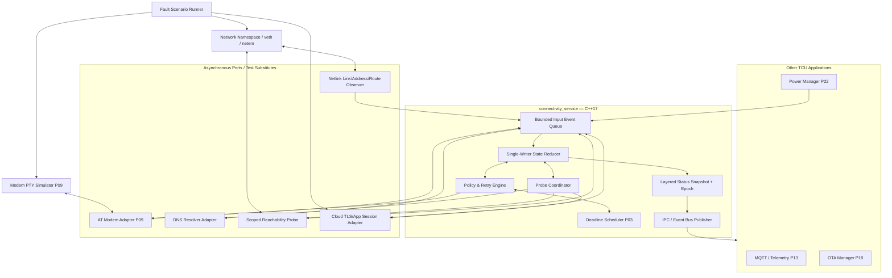
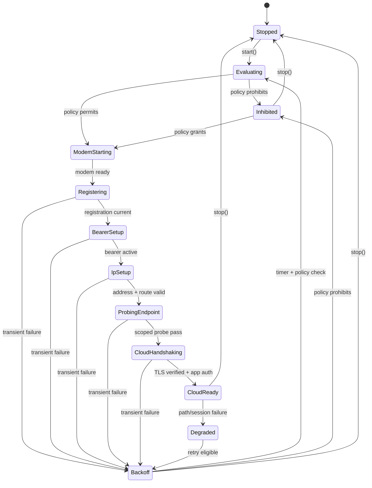
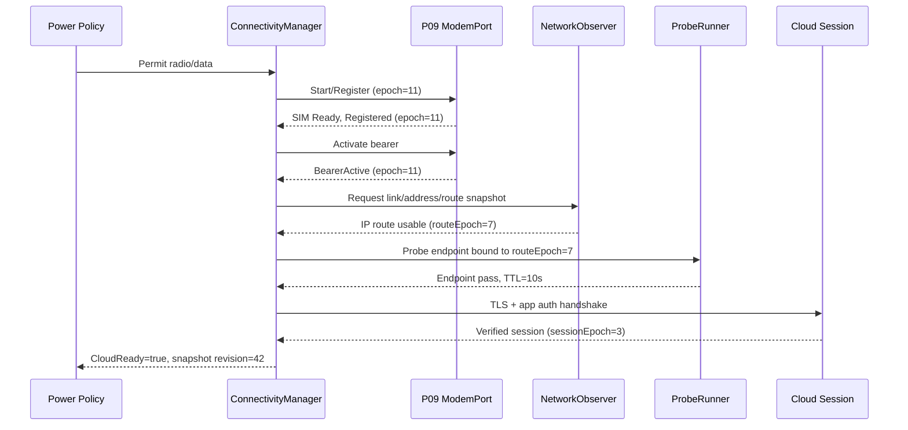
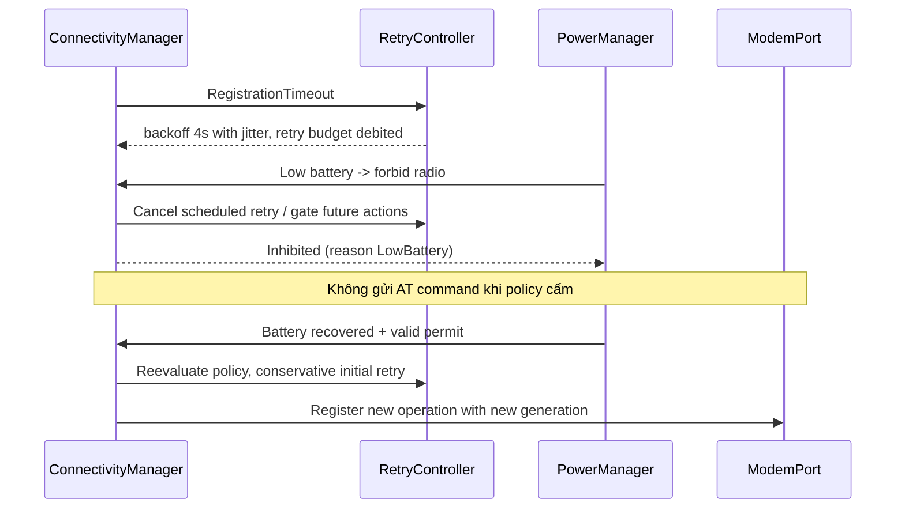
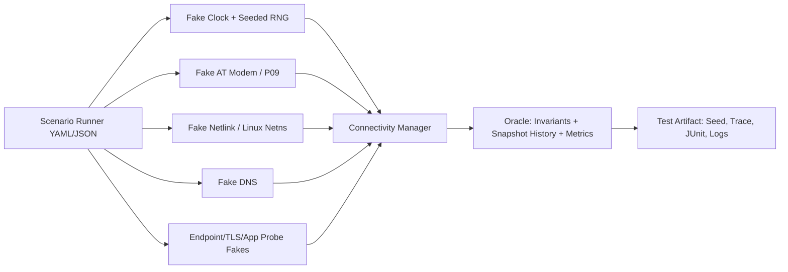

# Project 10 — Connectivity State Machine

> **Virtual TCU Lab | System Design · Operational Behaviors · What-if/Fault Injection · Resilience · v1.0**  
> **Ngày:** 2026-10-30 · **Ngôn ngữ:** Tiếng Việt · **Implementation target:** C++17, Ubuntu Linux  
> **Vai trò:** Middle C++ Developer, TCU application/middleware · **Ưu tiên:** P0  
> **Phụ thuộc:** P01 Event Bus, P02 IPC, P03 Timer, P04 Config/Logging, **P09 AT Command Modem Simulator**.  
> **Liên kết sau:** P11 Network Fault Injection, P13 MQTT, P14 Offline Queue, P22 Power Manager, P30 Full Integration.  
> **Trạng thái:** **Tài liệu thiết kế và kế hoạch kiểm thử; chưa triển khai source code, chưa có kết quả chứng minh vượt test.**  
> **Safety boundary:** Lab/simulator only. Mọi thay đổi network namespace, route, traffic control đều thực hiện trong môi trường test cô lập; không thao tác modem/ECU/xe thật.

---

## 1. Executive summary

Thiết kế `libtcu_connectivity` và ứng dụng `connectivity_service` quản lý toàn bộ vòng đời kết nối của một TCU: điều kiện bật modem, sẵn sàng SIM/RF, đăng ký mạng, packet bearer, địa chỉ IP, route, DNS, reachability của endpoint tin cậy, phiên TLS của cloud và quá trình recovery. Mỗi lớp có **state và mức confidence riêng**; một câu trả lời `OK` của modem hoặc `+CEREG: 1` **không được** suy ra Internet hay cloud online.

V1 giả lập một cellular bearer qua P09, một đường IP local trong Linux network namespace, một cloud endpoint giả và dùng interface/adapter để thay các thành phần OS. V2 thêm failover Ethernet/Wi-Fi, dual-stack IPv4/IPv6, policy theo battery/cost. Phần đầu chỉ cần **fake adapters + virtual clock** để kiểm thử deterministic; kernel networking được dùng cho integration test (không đòi SIM hoặc radio thật).

### 1.1 Deliverables

1. `libtcu_connectivity_core`: reducer, domain model, policy engine, transition validator, status snapshot, generation fencing.
2. `libtcu_connectivity_ports`: modem adapter (P09), netlink/network observer, DNS, health probe, cloud session probe, OS route observer (read-only trong V1).
3. `libtcu_retry`: exponential backoff + full jitter + retry budget + cool-down; fake RNG và clock.
4. `connectivity_service`: Linux service process với event loop serial; IPC/event publication, graceful shutdown, health metrics.
5. `connectivity_labctl`: control plane giả lập: SIM/RF/register, link up/down, DNS failures, delay, loss, cloud failure, battery constraints.
6. `scenario_runner`: unit/property/model-based test, real namespace integration, compound-fault/soak/chaos campaigns.
7. Docs: design, ADR, Mermaid, behavioral contracts, risk matrix, runbook và CI quality gates.

### 1.2 Acceptance được hiểu đúng

| Phân loại | Hệ thống phải chứng minh | Không được kết luận sai |
|---|---|---|
| Correctness | Trạng thái có bằng chứng được làm mới, dependency được thỏa mãn | Có registration = có Internet |
| Safety | Không cấp `CloudReady` khi TLS/cert chưa xác thực; không auto-replay command không idempotent | HTTP 200 bất kỳ = backend được tin cậy |
| Boundedness | Queue, timer, pending probes, retry, RAM, threads có giới hạn | Mất mạng là được retry vô hạn |
| Recovery | Trở lại hoạt động sau reset/link down/expiry với epoch mới | Reuse kết quả probe của link cũ |
| Predictability | Mỗi request hoàn thành tối đa một lần; callbacks cũ bị bỏ | Timeout rồi success có thể hoàn thành hai lần |
| Observability | Event cause, trace, epoch, confidence, counters và SLO đo được | `Online` không kèm định nghĩa rõ ràng |

### 1.3 Non-goals

- Không tự implement LTE NAS/PPP/MBIM/QMI, DHCP stack, DNS resolver đầy đủ, TLS handshake library hoặc nhà mạng di động.
- Không chứng nhận connectivity của OEM, AUTOSAR hay HIL. `veth`/`netem` không mô phỏng RF, modem USB enumeration, eSIM activation hoặc roaming billing thật.
- Không suy ra trạng thái Internet toàn cầu từ một server probe; chỉ chứng minh **configured endpoint(s)** đạt một điều kiện cụ thể ở thời điểm kiểm tra.
- Không tự động ghi route/system DNS thật trên máy host trong V1; mọi mutation giới hạn netns test.
- Không làm captive-portal login hay bypass các chính sách mạng.

---

## 2. Vị trí trong Virtual TCU Lab và contract phụ thuộc

| Dự án | Đầu vào/đầu ra và ranh giới sở hữu |
|---|---|
| P01 Event Bus | Publish `ConnectivitySnapshotChanged`, `BearerUnavailable`, `CloudSessionLost` sau reducer commit. Event bus delivery **không** là persistent delivery guarantee. |
| P02 IPC | Public API/CLI từ các process khác, request correlation và bounded serialization; lệnh `start/stop` có authorization. |
| P03 Timer | Fake/steady monotonic clock, deadline, cancellation token; không chạy callback nặng trên coordinator. |
| P04 Config & Logging | Reload validated policies atomically; secrets redact; logs không chứa token/cert private key. |
| P09 Modem Sim | Control-plane: AT command state và URC; không giả định PTY tự cung cấp IP dataplane thật. |
| P11 Fault Injection | Network namespaces, `tc netem`, DNS mock, route/MTU/packet loss, TLS/mock cloud faults. |
| P13 MQTT | Consumer của `CloudReady` **không** thay thế chính sách reconnect của MQTT transport. |
| P14 Offline Queue | Khi `CloudReady=false`, telemetry được lưu theo giới hạn; không drop chỉ vì `Registered=true`. |
| P22 Power | `PowerPolicy` có quyền cấm retry/radio, tối ưu năng lượng; tín hiệu ignition phải validated. |
| P30 Integration | E2E scenario từ vehicle ignition → modem → IP → cloud → telemetry. |

### 2.1 Trách nhiệm các layer

| Layer | Evidence cần | Ví dụ kết quả không chứng minh layer tiếp theo |
|---|---|---|
| L0 — Policy | ignition/battery/power/privacy/data-plan permit | Radio được phép không có nghĩa SIM sẵn sàng |
| L1 — Modem | port responsive + modem boot + SIM ready + RF state | `AT`/SIM ready không chứng minh cellular attach |
| L2 — Registration | domain response/URC cho current modem epoch | Registered không chứng minh data bearer IP |
| L3 — Bearer | packet-service active + OS link interface mapping valid | `CGACT` success không chứng minh có default route |
| L4 — Local IP | assigned address usable, interface/route/source scoped | Default route tồn tại không chứng minh DNS/Internet |
| L5 — Reachability | verified DNS & endpoint checks, family-bound and time-bounded | DNS lookup success không chứng minh backend reachable |
| L6 — Cloud | TLS identity verified + application auth/handshake + heartbeat fresh | TCP connect success không chứng minh cloud authenticated |

**Không có một boolean `connected` dùng cho mọi consumer.** API phải công bố `LocalIpReady`, `EndpointReachable`, `CloudReady`, `Degraded` và reason code riêng.

---

## 3. Architecture Decisions (ADRs)

| ADR | Quyết định | Lý do / trade-off |
|---|---|---|
| ADR-10-01 | One writer: single-threaded reducer/actor; I/O callbacks push bounded events | Transition determinism, tránh lock trên domain; queue overload phải xử lý |
| ADR-10-02 | Layered immutable status snapshot thay vì một enum global | Không nhầm registration/IP/cloud, hỗ trợ partial availability |
| ADR-10-03 | Epoch/generation gắn với modem session, bearer, interface, probe và config | Ngăn stale callback overwrite trạng thái mới |
| ADR-10-04 | Link/route events: observe kernel via rtnetlink trong Linux adapter, resync bằng snapshot | Netlink notification có thể mất/đến dồn; initial dump có race |
| ADR-10-05 | Retry phân loại lỗi + exponential backoff/full jitter + budget | Tránh tight loop/thundering herd, pin/battery overload |
| ADR-10-06 | CloudReady cần TLS identity + app-session proof; generic HTTP probe chỉ là `EndpointReachable` | Không có “success giả” khi captive portal/proxy/MITM |
| ADR-10-07 | Probe scope `{interface, address family, endpoint, epoch}` | Tránh success từ Wi-Fi làm cellular được đánh dấu healthy |
| ADR-10-08 | `steady_clock` + injected `IClock`/`IRng` | Timers không đổi khi NTP/wall-clock jump; deterministic testing |
| ADR-10-09 | Power policy là gate ưu tiên; khi radio prohibited thì không schedule reconnect | Ngăn hao pin/vi phạm ignition policy |
| ADR-10-10 | Reload cấu hình tạo immutable snapshot, re-evaluate toàn bộ phụ thuộc | Không dùng nửa cấu hình cũ/nửa mới |
| ADR-10-11 | Bounded memory, pending probes, events và retry | Không OOM khi outage lâu |
| ADR-10-12 | Offline queue là ownership P14; connectivity service không tự replay commands | Tránh double execution của lệnh điều khiển xe |
| ADR-10-13 | Test giả lập network trong `ip netns`, không chạm route host | Reproducible, không làm mất mạng người dùng |
| ADR-10-14 | Hysteresis rõ + failure threshold + stable window trước reset backoff | Tránh flap và retry storm |
| ADR-10-15 | `Unknown`/`Indeterminate` là trạng thái hợp lệ | Không ép false/true khi thiếu evidence |

---

## 4. System architecture và trust boundaries



### 4.1 Data plane, control plane và test plane

- **Modem control plane:** AT/PTTY chỉ cấp evidence boot, SIM, registration, attach và data context *synthetic*; modem bridge không tạo IP thật trên PTY.
- **IP data plane:** Linux namespace/veth, routes, DNS và fake cloud; có thể mô phỏng hoàn toàn offline. I/O ports có deadlines, không block reducer.
- **Admin test plane:** CLI/script tiêm lỗi vào fake ports/netns; không expose tới cloud hoặc xe thật. Config/threat boundary ngăn test action chảy sang production.
- **Status output:** Event Bus + IPC snapshots, ngôn ngữ `Online` được cấm trừ khi luôn kèm layer/scope.

### 4.2 Reliability domain boundaries

1. Thành công của `send(AT)` ≠ modem đã áp dụng lệnh.
2. Thành công của `AT+CGACT` ≠ kernel có usable IP; thành công của `ip addr show` ≠ endpoint reachable.
3. DNS resolved ≠ TLS secured; TLS secured ≠ app authenticated; app authenticated ≠ MQTT ready.
4. Health từ **đường A** không đủ để khẳng định **đường B** healthy (interface routing và source binding phải xác nhận).
5. Success của probe với epoch cũ phải bị discard, kể cả callback đến sau `stop()`.

---

## 5. Domain model, state algebra và invariants

### 5.1 State dùng dữ liệu có confidence, expiry và provenance

```text
ConnectivitySnapshot {
  revision, boot_epoch, modem_epoch, bearer_epoch, route_epoch, policy_epoch;
  modem: {power, sim, rf, registration, packet_attach, observed_at};
  ip: {interface_id, link, address_v4/v6, route_v4/v6, dns, observed_at};
  reachability: {endpoint, transport, address_family, verdict, checked_at, expires_at};
  cloud: {tls_verified, app_authenticated, session_liveness, checked_at, expires_at};
  policy: {allow_radio, allow_data, allow_cloud, cost_cap, battery_condition};
  summary: {local_ip_ready, endpoint_reachable, cloud_ready, degraded, reason};
}
```

`verdict` gồm `Unknown`, `Checking`, `Pass`, `Fail`, `Inconclusive` (ví dụ infrastructure bị chặn, không đủ dữ liệu). `Pass` được kèm TTL; hết TTL chuyển `Unknown/Stale`, không giữ online vĩnh viễn.

### 5.2 Invariants bắt buộc

| ID | Invariant cần kiểm chứng |
|---|---|
| INV-01 | `CloudReady` ⇒ app authenticated + TLS peer verified + freshness hợp lệ trong current epoch. |
| INV-02 | `EndpointReachable` ⇒ probe đúng interface/route/family/endpoint trong current epoch, chưa expired. |
| INV-03 | `LocalIpReady` ⇒ link up + usable address + route trong cùng interface snapshot; IPv4/v6 tách biệt. |
| INV-04 | `DataAllowed=false` ⇒ không spawn new data probe, HTTP/MQTT attempt hoặc modem data reconnect. |
| INV-05 | `RadioAllowed=false` ⇒ không gửi lệnh power-on/attach; đánh dấu inhibited, không tăng retry counter bởi policy. |
| INV-06 | `modem_epoch` thay đổi ⇒ mọi modem/bearer/probe results thuộc epoch cũ invalidated. |
| INV-07 | Link/address/route/identity thay đổi ⇒ invalidated reachability và cloud identity/path state liên quan. |
| INV-08 | Một operation token chỉ có một terminal completion (`Success`, `Failure`, `Timeout`, `Cancelled`). |
| INV-09 | Một interface/bearer chỉ có tối đa một `connect` transaction active ở V1. |
| INV-10 | Không có scheduled retry nếu deadline đã bị hủy hoặc policy hiện tại cấm. |
| INV-11 | Snapshot publish monotonically tăng `revision`; consumer nhận event muộn không làm state đi lùi. |
| INV-12 | Các queues/timers/probes/FDs luôn bounded; overload ghi nhận counters rõ ràng. |
| INV-13 | Thiếu evidence ≠ pass; security-validation error không bị downgraded thành timeout rồi retry vô hạn. |
| INV-14 | Probe thành công của IPv4 không tự nâng IPv6 hoặc ngược lại. |
| INV-15 | Không dùng cloud ACK của một command làm permission replay command đó khi kết quả không xác định. |
| INV-16 | `stop()` terminal ⇒ không có callback tác động domain sau destructor. |
| INV-17 | Power policy và data-plan limits luôn được đánh giá trước retry/reconnect. |
| INV-18 | Reconnect rate được budget toàn cục dù lỗi xảy ra ở nhiều layer. |
| INV-19 | Thay đổi config hoặc endpoint identity phải invalidated evidence liên quan trước khi cấp `CloudReady` mới. |
| INV-20 | Nếu evidence mâu thuẫn, hiện `Degraded/Unknown` với reason; không chọn “success” chỉ vì event đến cuối. |

### 5.3 Layered summary computation (định nghĩa V1)

```text
LocalIpReady = Policy.AllowData AND LinkUp AND UsableAddress AND RouteUsable
EndpointReachable = LocalIpReady AND Fresh(EndpointProbePass) AND SamePathEpoch
CloudReady = EndpointReachable AND Fresh(TlsVerified) AND Fresh(AppAuth) AND SameCloudSession
Summary=INHIBITED if policy forbids; else CLOUD_READY if CloudReady;
        else ENDPOINT_READY if EndpointReachable; else LOCAL_IP_READY if LocalIpReady;
        else REGISTERED if modem registration valid; else CONNECTING/DEGRADED/UNKNOWN.
```

Đây là **computation contract**, không phải kết luận chung về Internet. Nếu TCU có Wi-Fi, mọi summary được tính **theo bearer** rồi mới chọn route theo policy, không lấy OR tùy tiện giữa evidence của hai bearer.

### 5.4 State diagram hai cấp (simplified)



Các trạng thái `ModemStarting`... ở diagram là orchestration state; evidence L0–L6 được duy trì tách biệt. V1 **không** giả định mỗi event theo đúng thứ tự; reducer phải chấp nhận notification out-of-order và chốt bằng epoch + reconciliation.

---

## 6. API Design (C++17) và object lifetime

```cpp
using SteadyTime = std::chrono::steady_clock::time_point;
using OperationId = std::uint64_t;
using Epoch = std::uint64_t;

enum class Verdict { Unknown, Checking, Pass, Fail, Inconclusive };
enum class Layer { Policy, Modem, Registration, Bearer, LocalIp, Endpoint, Cloud };
enum class Reason {
    None, PolicyInhibited, ModemUnavailable, SimUnavailable,
    RegistrationRejected, BearerUnavailable, AddressMissing,
    RouteMissing, DnsFailure, EndpointTimeout, TlsIdentityFailed,
    AppAuthFailed, StaleEvidence, LinkChanged, RetryBudgetExhausted
};

struct ScopedEvidence {
    Layer layer;
    Verdict verdict;
    Reason reason;
    Epoch modem_epoch, bearer_epoch, route_epoch, config_epoch;
    std::string interface_id;
    std::string endpoint_id;
    int address_family; // AF_INET / AF_INET6, hoặc AF_UNSPEC khi không áp dụng
    SteadyTime observed_at, expires_at;
};

struct ConnectivitySnapshot {
    std::uint64_t revision{};
    bool local_ip_ready{}, endpoint_reachable{}, cloud_ready{}, degraded{};
    Reason reason{Reason::None};
    std::vector<ScopedEvidence> evidence;
};

struct IClock {
    virtual ~IClock() = default;
    virtual SteadyTime now() const = 0;
};

struct IModemPort {
    virtual ~IModemPort() = default;
    virtual void requestRegistration(OperationId, Epoch) = 0;
    virtual void requestBearerActivation(OperationId, Epoch) = 0;
    virtual void cancel(OperationId) = 0;
};

struct INetworkObserver {
    virtual ~INetworkObserver() = default;
    virtual void requestSnapshot(OperationId) = 0;
    virtual void subscribe(std::function<void(/* NetworkEvent */)> callback) = 0; // skeleton
};

struct IProbeRunner {
    virtual ~IProbeRunner() = default;
    virtual void runEndpointProbe(OperationId id, Epoch epoch,
        const std::string& iface, const std::string& endpoint) = 0;
    virtual void cancel(OperationId id) = 0;
};

struct IStatusSink {
    virtual ~IStatusSink() = default;
    virtual void publish(const ConnectivitySnapshot&) = 0;
};

class ConnectivityManager final {
public:
    void start();
    void stop();
    void onEvent(/* immutable ConnectivityEvent */);
    ConnectivitySnapshot snapshot() const;
private:
    void reduceOne(/* const ConnectivityEvent& */);
    void invalidateDependentEvidence(Layer changed);
    void reconcile();
    void scheduleRetry(/* ClassifiedFailure */);
};
```

**Lưu ý:** Đoạn trên chỉ là API sketch, không phải header có thể biên dịch ngay (`ConnectivityEvent` chưa đặc tả). Implementation nên dùng `std::variant` cho `ConnectivityEvent`, immutable payload, và tuyệt đối không giữ reference sang buffer do async port sở hữu.

### 6.1 Class responsibilities

| Class | Ownership / responsibilities |
|---|---|
| `ConnectivityManager` | Single writer reducer, domain invariants, public snapshot, lifecycle. |
| `ConnectivityEventQueue` | Bounded MPSC queue, wakeup/cancellation; priority cho shutdown/policy change. |
| `IModemPort` | Asynchronous AT adapter, typed results; cập nhật session epoch khi reset. |
| `INetworkObserver` | Netlink interface/address/route, resync snapshot khi sequence/drop nghi vấn. |
| `IProbeRunner` | Scoped DNS/TCP/TLS/app probes, deadlines, independent I/O; mockable. |
| `RetryController` | Retry classification, budget/circuit breaker, jitter, stable-window reset. |
| `ConnectivityPolicy` | Power, ignition, data cost, security gates; immutable snapshot. |
| `StatusPublisher` | Versioned snapshot/event serialization; bounded fanout. |
| `FakeConnectivityWorld` | Deterministic fault timing, fake AT/IP/cloud, property-test model. |

### 6.2 Ownership và cancellation

- Manager sở hữu queues, timers, subscriptions qua RAII; mọi callback nhận `weak_ptr` tới runtime token hoặc gửi immutable event vào queue còn sống.
- `stop()` tăng generation, hủy timers và probes, stop ingress, drain/discard theo policy; **không** giữ mutex và `join()` chính worker đang chạy.
- Với `IProbeRunner`, cancellation có thể không dừng syscall ngay; outcome đến sau phải được reject bằng operation ID/epoch.
- Snapshot cho reader qua shared immutable pointer hoặc copy nhỏ có mutex; không lộ mutable pointer.
- `std::atomic<bool> stopping` chỉ là gate, không thay thế state machine và ownership quy định rõ.

---

## 7. Normal workflow và sequence diagrams

### 7.1 Startup đến CloudReady



### 7.2 Link down trong lúc probe trả về

```mermaid
sequenceDiagram
  participant N as Netlink
  participant C as ConnectivityManager
  participant H as ProbeRunner
  N->>C: link down; routeEpoch 7 -> 8
  C->>C: Invalidate scoped evidence
  C->>H: Cancel probe #100 (best effort)
  H-->>C: ProbePass #100, routeEpoch=7 (late)
  C->>C: Reject stale epoch; increment stale_result_count
  C-->>N: Snapshot: CloudReady=false, reason=LinkChanged
```

### 7.3 Failure/retry và policy inhibit



### 7.4 Cloud handshake errors

- DNS timeout ⇒ `DnsFailure`, classify transient và **không** khẳng định radio down.
- TLS certificate mismatch/expired ⇒ `TlsIdentityFailed`, **không** fallback sang HTTP hoặc bỏ verification.
- HTTP health 200 từ server ngoài trust list ⇒ không nâng `CloudReady`.
- Cloud auth 401/403 ⇒ classify non-transient/auth configuration; không quay lại modem reset.
- MQTT disconnect có thể xảy ra dù TCP/IP tốt; MQTT client quản lý session nhưng manager phản ánh `CloudSessionLost` theo contract.

---

## 8. Retry, backoff, hysteresis và recovery

### 8.1 Error classification và action matrix

| Cause | Classification | Next action | Không được làm |
|---|---|---|---|
| SIM absent/PIN needed | Persistent until external change | Inhibited/WaitingForSIM; event-triggered recheck | AT reset vô hạn |
| Registration searching | Transient/unknown | Bounded patience + backoff | Tăng request rate theo số URC |
| Registration denied | Policy/config/roaming-dependent | Stop/retry gate per policy; diagnostics | Giả lập roaming accepted |
| Bearer inactive | Recoverable | Re-activate có budget khi SIM/RF ok | Đánh CloudReady |
| Link down/route missing | Environmental | Wait event, periodic bounded reconciliation | Reset modem nếu chỉ là route issue |
| DNS SERVFAIL/timeout | Transient DNS | Retry endpoint resolver, scoped | Attach/registration loop |
| NXDOMAIN | Likely configuration / TTL policy | Hold with cooldown & endpoint config check | Retry 1000x/second |
| TCP timeout | Path/backend transient | Backoff with budget, scoped endpoint | Dùng probe khác interface để xác nhận |
| TLS peer identity invalid | Security hard failure | Fail closed, diagnostics, requires trust/config change | Disable TLS checks |
| App auth rejected | Auth/config hard failure | Halt cloud retries or long cooldown pending credential refresh | Factory-reset radio |
| 429/503 with retry hint | Backend transient / throttled | Respect bounded Retry-After policy | Amplify load |
| User low battery | Policy inhibit | Cancel all nonessential work | Retry rồi mới kiểm tra battery |

### 8.2 Exponential backoff with full jitter

```text
cap(n) = min(max_delay, base_delay * 2^min(n, max_exponent))
delay(n) = uniform(min_guard, cap(n))   // test RNG seed, no tight zero-loop
next_retry = steady_clock.now() + delay(n)
```

- **Ví dụ lab**: `base=1 s`, `max=60 s`, `min_guard=200 ms`, `max_attempts_per_window=6/5min`, thêm token bucket cho **toàn hệ thống**, không áp dụng một lần cho từng layer để tạo bão retry.
- Timer scheduling cần saturating arithmetic (tránh overflow), capped exponent, monotonic deadlines; jitter seed được ghi trong test artifact.
- Không reset exponential exponent ngay khi có **một** TCP success; chỉ reset sau `CloudReady` ổn định đủ `stable_window` (ví dụ 30s lab) hoặc signal recovery rõ ràng đã được policy cho phép.
- Delay là **giới hạn thử lại** không phải bảo đảm phục hồi trong thời gian đó.

### 8.3 Hysteresis và health freshness

- Debounce link flapping (ví dụ 250ms test target) không được trì hoãn việc **revoke trạng thái an toàn**: `link down` invalidates positive evidence ngay; debounce chỉ áp dụng lên re-enable/active repair.
- Require 2 consecutive endpoint successes trước khi promote `EndpointReachable` nếu bật policy này; chỉ cần 1 hard security fail là revoke CloudReady tức thì.
- Cloud `heartbeat` có `expires_at`; stale session không được phục hồi bằng kết quả TLS cũ.
- Health probes phải budget theo data plan/power policy; không ping liên tục khi engine inhibited.

### 8.4 Network/route reconciliation

- Subscribed to `RTM_NEWLINK/DELLINK/NEWADDR/DELADDR/NEWROUTE/DELROUTE`; record ifindex, namespace, ifname, route metric/source.
- Startup dùng initial netlink dump; buffered notifications và generation barriers; nếu `ENOBUFS`, sequence gap, socket reconnect ⇒ **mark Unknown rồi full re-dump**.
- Route may use a different interface than expected; probe needs `SO_BINDTODEVICE` (nếu allowed) hoặc `IP_PKTINFO`/routing policy + source address assertion; thiếu quyền bind là `Inconclusive`, không fallback silent.
- IPv4/v6 riêng; IPv6 link-local không có nghĩa global cloud reachability; local on-link endpoint có thể reachable dù không có default route (route phải phù hợp destination, không nhất thiết default).

---

## 9. Multi-bearer, IPv4/IPv6, data plan và power

### 9.1 V1 và V2 boundaries

| Feature | V1 | V2 |
|---|---|---|
| Cellular via P09 | Fake AT state + IP namespace mapping | Hardware adapter/real modem integration (không có trong lab) |
| Wi-Fi/Ethernet | Fake connection candidate | Dual-bearer failover w/ policy |
| IPv4 | Must | Must |
| IPv6 | State model + deterministic adapter test | Real namespace integration + DNS64/NAT64 simulations |
| Captive portal | Fail/confidence behavior | Explicit CAPPORT API integration nếu có |
| QoS/cost policy | Rate budget, power gate | Roaming cost, byte-volume caps, low power |
| Failover | One selected bearer | Deterministic route selection + interface-bound probes |

### 9.2 Multi-bearer selection rules (V2)

1. Enumerate bearer candidates with source/route/MTU/DNS/scoped health; do not merge evidence across candidates.
2. Prioritize safety/policy: forbidden/costly/untrusted paths are not eligible regardless of raw RSSI or latency.
3. Apply deterministic selection (priority, cost, quality, hysteresis); record decision reason.
4. On failover, invalidate path-scoped TLS/cloud session unless protocol explicitly supports mobility and its continuity has been proven; do not silently reuse a socket bound to previous path.
5. Returning to preferred bearer requires stable evidence window to prevent ping-pong.

### 9.3 Time, certificates và privacy

- `steady_clock` cho deadlines. TLS certificate validity dùng trusted wall-clock; khi RTC chưa tin cậy, phân loại `TimeUntrusted`, không bỏ qua cert validation.
- Probe target allowlist, least privilege, trusted CA/hostname verification; admin endpoint riêng không reachable từ production networks.
- Không log GPS, ICCID/IMSI, tokens, cert private key hoặc headers auth; structured reason codes là đủ để debug.
- Control plane từ Internet không được phép inject radio/network events.

---

## 10. Operational behaviors / behavioral contracts

| ID | Given | When | Then |
|---|---|---|---|
| BB-01 | Đang `Stopped` | `start()` hợp lệ | Một event-loop chạy; publish `Unknown/Evaluating` trước khi có evidence. |
| BB-02 | SIM chưa ready | Modem báo registered cũ | Ignore event epoch cũ; không promote registration. |
| BB-03 | Registration current | `BearerActive` event | Chỉ bắt đầu IP observation; chưa publish `EndpointReachable`. |
| BB-04 | IP address có nhưng route mất | Probe scheduled | Probe bị hủy; `LocalIpReady=false`. |
| BB-05 | DNS success | TCP/TLS fail | `EndpointReachable` không lên Pass dù DNS được resolve. |
| BB-06 | Endpoint healthy | Cloud auth rejected | `CloudReady=false`, AuthFailure, không reset modem. |
| BB-07 | Backoff timer active | Power disables data | Cancel timer, chuyển `Inhibited`. |
| BB-08 | Link down | Probe success đến muộn | Reject stale epoch, no CloudReady promotion. |
| BB-09 | `CloudReady=true` | Heartbeat TTL expiry | Revoke ready, transition to `Degraded`. |
| BB-10 | Retry budget exhausted | More transient errors | Không spawn new retry trước khi budget refill. |
| BB-11 | Config hot reload hợp lệ | Endpoint/CA changes | Invalidate dependent evidence, re-handshake; no mixed configuration. |
| BB-12 | Config hot reload không hợp lệ | Validation fails | Keep old snapshot, emit validation error. |
| BB-13 | `stop()` requested | Any callback arrives | Manager không chấp nhận callback sau stop boundary. |
| BB-14 | Cloud ID không hợp lệ | HTTP response 200 | `CloudReady` không được promote. |
| BB-15 | Probe thuộc Wi-Fi | Cellular requested | Không dùng Wi-Fi probe result xác nhận cellular. |
| BB-16 | Phần mềm restart | Persisted last-known connectivity status | Initially Unknown; phải thu thập evidence mới. |
| BB-17 | Multiple event producers | Các event race | Reducer serializes updates, revision tăng đều, invariants giữ. |
| BB-18 | DNS only on IPv6 | IPv4 unavailable | Không tự coi IPv4 healthy; IPv6 endpoint path có thể được verify. |
| BB-19 | Route snapshot change | Cloud socket still open | Revalidate source/path/session before retaining CloudReady. |
| BB-20 | Retry classifier identifies hard auth failure | Timer tick | No uncontrolled automatic retry. |

---

## 11. Concurrency, backpressure và memory

- **Threads/ownership:** one reducer event loop + limited I/O executor (e.g. 2–4 worker threads as lab target); library probes asynchronous with cancellation. Signal callback enqueues immutable event; never calls reducer recursively.
- **Queue**: bounded ingress events, priority reservation for PolicyStop/LinkDown/Shutdown; low-priority repeated RSSI/health events may be coalesced. Never drop critical invalidation silently.
- **Idempotent processing**: every operation carries `{op_id, boot_epoch, modem_epoch, route_epoch, policy_epoch, endpoint_id}`. Completions are matched; duplicates increment metric only.
- **Lock ordering**: ideally no nested locks in reducer. Async snapshots lock briefly or atomic share immutable value. No user callback executed while locks held.
- **Resource bounds**: `max_pending_probes`, `max_dns_requests`, `max_connect_attempts`, `max_timers`, bounded event queue, `max_log_bytes`, socket count and FD audits.
- **Priority inversion**: slow log sink/health subscription must not block critical state invalidation; use independent bounded publishing queue with dropped/lag metrics and latest-snapshot fetch.
- **Termination**: timers cancelled first, ingress closed, producers quiesced, workers joined from external owner, no self-join, callbacks fenced by epoch. Full drain has time cap; fallback discard policy documented.

---

## 12. Fault injection architecture và deterministic scenario DSL



### 12.1 Example scenario specification

```yaml
id: CF-10-LATE-PROBE
seed: 91277
clock: fake
initial:
  policy: {allow_radio: true, allow_data: true}
  modem: {sim: ready, registered: true, bearer: active, epoch: 4}
  network: {link: up, address_v4: "10.200.10.1/24", route_epoch: 19}
actions:
  - at_ms: 0
    action: probe_start
    args: {endpoint: cloud-lab, op_id: 77, route_epoch: 19}
  - at_ms: 20
    action: link_down
    args: {interface: veth-tcu10}
  - at_ms: 40
    action: probe_complete
    args: {op_id: 77, result: pass, route_epoch: 19}
assert:
  - "always: cloud_ready == false after link_down"
  - "counter: stale_probe_results >= 1"
  - "always: completed_count(op_id=77) <= 1"
  - "eventually: reason == LinkChanged"
```

### 12.2 Injection modes

| Mode | Phạm vi | Evidence |
|---|---|---|
| Fake-clock unit | State transitions/ordering/races không phụ thuộc kernel | Trace timeline + oracle assertions |
| Port mock | AT callback, DNS/probe completion, errors, cancellation | Mock expectations + epochs |
| Linux network namespace | link/address/route, real socket behavior | `ip monitor`, logs, timestamps |
| `tc netem` | loss, delay, jitter, duplicate, reorder | qdisc config, probe outcomes |
| Process fault | SIGTERM/SIGKILL helper, restart backend, closed FD | process logs, crash reports |
| Resource fault | EAGAIN/ENOMEM/ENOSPC/fd limit, queue pressure | counters, sanitized errors |
| Long soak | repeated sequences over long virtual time or real time | RSS, FD/threads, CPU, state history |
| Fuzz/property | Invalid events/config/sequence permutations | minimized seed, invariants |

---

## 13. Quality attributes, observability và target SLOs

**Các ngưỡng dưới đây chỉ là mục tiêu phòng lab, cần chỉnh theo CPU/RAM của TCU và OEM requirements — không phải số liệu đã đo.**

| Metric | Target lab | Cách kiểm chứng |
|---|---|---|
| No false CloudReady | 0 trường hợp trên tất cả test seeds | Invariants INV-01..20 mọi tick |
| Single terminal result | 0 duplicate completions | Assert per `op_id` |
| Immediate critical revoke | ≤ 100 ms virtual-time sau event dequeued | deterministic clocks, reducer trace |
| Snapshot processing latency | p99 ≤ 20 ms ở input 500 events/s trong lab | monotonic timestamps |
| Memory growth | stable ± 15% sau 24h workload định sẵn | RSS/heap snapshots; exclude startup warmup |
| Ingress queue | hard cap 4096 events, critical reserve 64 | overload test + loss metrics |
| Pending probes | ≤ 16; pending connect ≤ 2 per bearer | counters/FD monitoring |
| Retry cap | ≤ 6 active attempts / 5 min / bearer + global budget | controlled failure storm |
| Restart recovery | evidence recomputed, no persisted Ready | kill/restart scenario |
| Idle CPU | target < 2% lab CPU when no events (not hard RT) | `pidstat`/perf |
| Network data use | all probes rate-limited, metrics bytes | fake byte meter |

Metrics cần có: `snapshot_revision`, `transition_total{reason}`, `epoch_invalidations_total`, `stale_events_total`, `retry_scheduled_total{cause}`, `retry_denied_total{budget,policy}`, `probe_result_total{verdict}`, `queue_depth`, `queue_overflow_total`, `pending_operations`, `healthy_duration`, `recover_duration`, `tls_auth_failure_total`, `wakeups_total`, `lab_fault_id`. Labels/cardinality được giới hạn; tuyệt đối không dùng dynamic URL/token/ICCID làm metric label.

### 13.1 Evidence required per test case

- Given/When/Then + scenario ID + failure injection timestamp.
- `boot_epoch, modem_epoch, route_epoch, policy_epoch` và `op_id` ở mỗi event.
- Last N snapshots + transition reason + queue depth/retry budget/timers.
- Unit tests: deterministic expected revision; network tests: packet/command trace có lọc sensitive data.
- CI artifact lưu build hash, compiler version, seed, test environment, kernel info, JUnit XML.

---

## 14. Threat model, privacy và failure taxonomy

| Threat / failure | Risk | Mitigation |
|---|---|---|
| Fake HTTP proxy/captive portal trả 200 | False cloud online | TLS peer identity + app auth; separate reachability probe |
| Spoofed DNS/endpoint | Traffic to wrong host | TLS hostname verification/CA pin policy; constrained endpoint allowlist |
| Replay old probe completion | False promotion after path change | Scoped epoch, op ID, expiry |
| Attacker-controlled admin port | Arbitrary radio/network state changes | local-only test socket, permissions, build-time disable production |
| Misconfig endpoint/probe interval | Retry storm/data drain | strict config validation, min interval, max attempts |
| Maliciously large error payload | Memory/CPU exhaustion | size and rate limits; safe parser |
| Subscription flooding | Event storm/starvation | bounded queues and coalescing, priority invalidation |
| Reused TLS connection on new untrusted route | Wrong-path trust assumptions | policy revalidation and safe session teardown |
| Clock unreliable after cold boot | TLS falsely accepted | trusted time gate; fail closed/limited diagnostics |
| Privacy leakage | IMSI/IMEI/token in log | redact, retention, sampling |
| Hard error treated transient | Endless credential/auth retries | classified failure + circuit breaker |
| Configuration race | Partial policy applied | immutable snapshot + epoch fences |

---

## 15. What-if coverage methodology (không bỏ sót lớp lỗi)

Không có bộ test hữu hạn nào chứng minh **mọi** tình huống vật lý và mọi interleaving. Vì vậy tài liệu phân tích bao phủ có hệ thống theo:

1. **Theo layer:** policy, modem/SIM/RF, registration/attach, bearer, OS link/address/route, DNS, reachability, TLS/cloud.
2. **Theo fault shape:** absent, late, duplicate, reordered, malformed, contradictory, stale, partial, degraded, throttled, poisoned, overload.
3. **Theo lifecycle:** before start, bootstrap, transition, stable, failure, recovery, reload, shutdown, restart.
4. **Theo temporal/concurrency:** failure vừa trước/sau deadline, timeout vs success, callback vs cancel, route change vs probe, stop vs reconnect.
5. **Theo resource:** RAM, FDs, sockets, queues, CPU, battery, network data plan, disk logs.
6. **Theo integration:** Event Bus / IPC / Scheduler / Modem simulator / MQTT / OTA / Power Manager.
7. **Theo nhiều lỗi:** 2–4 fault đồng thời, common-cause outage, recovery storm, policy changes during repair.

Severity: **P0** = có thể báo thành công giả, vi phạm security/power gate, crash/hang hoặc chạy retry không giới hạn; **P1** = tính đúng đắn/recovery/availability; **P2** = edge/performance/cosmetic nhưng vẫn cần test. Với mỗi What-if ở §16, cột `Inject` là hành động cụ thể (fake clock hoặc Linux netns), cột `Oracle` là behavior phải chứng minh. Tests có thể biến thành Jira/TestRail/Google Test parameterized fixtures.

---
## 16. Comprehensive What-if catalog — 288 tình huống cụ thể

Mỗi case có ID ổn định để đặt tên test (ví dụ `CF10-A01`), cách kích hoạt và oracle kiểm thử. **Pass trong tài liệu = expected behavior, không phải kết quả thực thi.** P0 ưu tiên thực hiện trước khi tích hợp cloud/OTA.

### 16.1 A — Bootstrap, initialization và lifecycle

| ID / Priority | What if? | Inject cụ thể | Expected behavior / Oracle |
|---|---|---|---|
| `CF10-A01` · **P0** | Start gọi hai lần liên tiếp | Gọi start() từ 2 thread cùng tick | Một reducer/worker duy nhất; start thứ hai idempotent |
| `CF10-A02` · **P1** | Stop khi chưa start | Gọi stop() trên đối tượng mới tạo | Không crash, leak hay join invalid thread |
| `CF10-A03` · **P1** | Start khi AT port chưa mở | Fake IModemPort trả PortUnavailable | State WaitingForPort/Degraded, retry có budget; không báo SIM ready |
| `CF10-A04` · **P0** | Start khi netlink snapshot chưa có | Delay initial netlink dump 30s virtual | LocalIp Unknown; không lấy status persisted để báo Online |
| `CF10-A05` · **P0** | Initial netlink dump chồng notification | Route thay đổi ngay giữa dump và subscribe | Reconciliation cho snapshot nhất quán; stale sequence bị reject |
| `CF10-A06` · **P0** | Policy event đến trước start complete | Deliver PowerInhibit trong bootstrap | Không spawn radio/data connect sau inhibit |
| `CF10-A07` · **P0** | Cloud Ready được persist trước reboot | Khởi động với cache CloudReady=true từ disk | Published Ready=false/Unknown đến khi fresh auth evidence |
| `CF10-A08` · **P0** | Start sau stop không reset epoch | Start-stop-start lặp 1000 lần | Boot generation mới; callbacks cũ không chấp nhận |
| `CF10-A09` · **P0** | Start với cấu hình lỗi | Config missing endpoint/timeout negative | Fail initialization có reason; không spawn probes |
| `CF10-A10` · **P1** | Readiness service phụ thuộc bị chậm | Bật IPC sớm, delay modem adapter | API trả NotReady/Unknown, không block vô hạn |
| `CF10-A11` · **P1** | Startup cùng lúc 10 TCU ảo | Spawn 10 instances cùng seed mặc định | Jitter độc lập theo instance/seed; retry không đồng pha bắt buộc |
| `CF10-A12` · **P1** | Startup trong lúc network đã Online | Pre-populate OS link/route trước manager start | Snapshot bắt kịp trạng thái bằng reconciliation, không đợi event mới |

### 16.2 B — Modem PTY, AT control và stale URCs

| ID / Priority | What if? | Inject cụ thể | Expected behavior / Oracle |
|---|---|---|---|
| `CF10-B01` · **P0** | AT command thành công nhưng modem chưa registered | Return OK cho AT command, registration URC absent | Chỉ cập nhật command completion; Registration vẫn Unknown/Searching |
| `CF10-B02` · **P0** | Modem reset khi đang attach | Inject RESET trong request attach | Modem epoch tăng, cancel attach, bearer/route evidence invalidated |
| `CF10-B03` · **P0** | URC session cũ sau reset | Inject +CEREG:1 gắn old epoch vào event queue | Bỏ URC cũ; không chuyển Registered |
| `CF10-B04` · **P0** | Modem báo ready rồi PTY HUP | Close PTY master ngay sau READY | ModemUnavailable; no busy loop; reconnect backoff |
| `CF10-B05` · **P0** | URC chen vào response của command | P09 inject CEREG URC giữa AT+CGATT? lines | Typed response/URC parsed riêng, không tạo false attach |
| `CF10-B06` · **P0** | AT OK đến sau timeout | Delay AT final OK quá command deadline | Không xem là completion cho op mới; reconcile session trước retry |
| `CF10-B07` · **P1** | AT parser trả unexpected error | Return +CME ERROR: invalid state | Classify correctly, do not loop AT blindly |
| `CF10-B08` · **P0** | AT operation trả duplicate completion | Fake Port gửi 2 final callbacks cùng op ID | State chỉ transition một lần; duplicate metric tăng |
| `CF10-B09` · **P1** | PTY slave path thay đổi | Restart simulator cấp /dev/pts khác | Reopen endpoint được provisioned; không hard-code tty cũ |
| `CF10-B10` · **P0** | AT queue bị đầy | Push 10k registration actions into bounded port | Flow controlled, không OOM; critical shutdown được ưu tiên |
| `CF10-B11` · **P1** | Modem responds nhưng AT read returns EINTR | Inject EINTR/short read in serial adapter | Retry safe I/O, deadline vẫn bounded |
| `CF10-B12` · **P0** | AT link alive nhưng bearer inactive | Reply AT successfully yet CGACT inactive | Layer L1 up, L3 down; no LocalIp Ready |

### 16.3 C — SIM/RF/PIN và network operator policy

| ID / Priority | What if? | Inject cụ thể | Expected behavior / Oracle |
|---|---|---|---|
| `CF10-C01` · **P0** | SIM absent ngay trước register | Inject SIM_REMOVED after RadioOn | Cancel register; WaitingForSIM; no attach |
| `CF10-C02` · **P0** | SIM PIN required | Return SIM_PIN from fake modem | Không tự thử PIN không được cấp phép; event-driven wait |
| `CF10-C03` · **P1** | SIM unlocked sau downtime | Switch absent -> ready in simulator | Re-evaluate policy, register within retry budget |
| `CF10-C04` · **P0** | SIM removed sau CloudReady | Inject SIM_REMOVED while CloudReady | Revoke dependent layers immediately and disconnect session |
| `CF10-C05` · **P0** | RF disabled by policy | Policy RadioAllowed=false while modem responds | No RF enable AT; Inhibited, not ErrorRetry |
| `CF10-C06` · **P0** | Airplane mode đổi giữa attach | Toggle RF OFF during attach | Cancel attach, remove stale bearer evidence |
| `CF10-C07` · **P1** | SIM state duplicated | Emit Ready 100x | Coalesce; không reset retry/trigger 100 attaches |
| `CF10-C08` · **P0** | SIM identity changes hot-swap | Change synthetic SIM ID during active session | Increment identity epoch; invalidate auth/bearer credentials |
| `CF10-C09` · **P1** | SIM reports ready but authentication denied | Inject auth denied from modem state | Persistent failure reason; no infinite network attach |
| `CF10-C10` · **P1** | RF signal drops but registration lingers | Inject signal level 0, no detach URC | Degrade indicator; do not silently claim fresh data path without probes |
| `CF10-C11` · **P0** | Modem boot loops 500 times | Reset every 10ms virtual while manager running | Throttle modem recovery, bounded timers/memory |
| `CF10-C12` · **P0** | Unexpected SIM data contains sensitive values | Inject ICCID/IMSI into diagnostic payload | Logs redact values; telemetry avoids identifiers |

### 16.4 D — Registration, roaming và network attachment

| ID / Priority | What if? | Inject cụ thể | Expected behavior / Oracle |
|---|---|---|---|
| `CF10-D01` · **P0** | +CEREG registered nhưng PDP off | Set registration=home, packet attach=false | Registration valid, LocalIpReady=false |
| `CF10-D02` · **P0** | Registration denied permanently | Emit CEREG denied repeatedly | Hold/cooldown with diagnostic, no attach storm |
| `CF10-D03` · **P1** | Registration searching lasts 1h | No transition, virtual clock +1h | Bounded polling, unknown/degraded honest status |
| `CF10-D04` · **P0** | Roaming disallowed, modem roaming | Emit roaming while policy prohibit roaming | Radio/data path gated; never turn CloudReady |
| `CF10-D05` · **P0** | Roaming allowed then policy revoked | Emit permit change while roaming cloud active | Revoke DataAllowed; cancel session/retries |
| `CF10-D06` · **P1** | Home->roam->home transitions rapid | URCs 100Hz with fake clock | Hysteresis where appropriate; safety gate instant |
| `CF10-D07` · **P0** | Registration success callback after reset | Complete old pending register after new epoch | Reject stale success; no bearer start |
| `CF10-D08` · **P1** | Modem emits conflicting +CEREG statuses | Alternate registered/denied in same tick | Deterministic ordering; reconcile with authoritative current query |
| `CF10-D09` · **P1** | Attach fails due network overload | Script transient reject with retry cause | Backoff with global budget; no spin |
| `CF10-D10` · **P0** | Registration stale TTL | Stop all URCs/queries for configured freshness window | Mark state Unknown/needs reconciliation rather than eternal Registered |
| `CF10-D11` · **P1** | Radio camping without packet service | Modem reports only cell selection | Not equivalent to registration or data bearer |
| `CF10-D12` · **P0** | Operator switch during CloudReady | Inject synthetic PLMN change | Increment bearer epoch; re-evaluate roaming/cost and path |

### 16.5 E — Bearer, PDP, APN and data activation

| ID / Priority | What if? | Inject cụ thể | Expected behavior / Oracle |
|---|---|---|---|
| `CF10-E01` · **P0** | PDP context active but interface absent | AT CGACT=1, no OS interface | L3 may pass, L4 fails; no cloud probes |
| `CF10-E02` · **P0** | Bearer active with 0.0.0.0 assigned | Fake interface has unusable address | LocalIp false; AddressMissing reason |
| `CF10-E03` · **P0** | APN configuration missing | Start bearer with required APN blank | Config validation fails, no retry storm |
| `CF10-E04` · **P0** | APN auth rejected | Fake bearer returns auth failure | Classify credentials/config error, pause auto-retry |
| `CF10-E05` · **P0** | PDP deactivated while IP link still up | Emit bearer inactive, keep stale link addr | Revoke path state related to bearer epoch |
| `CF10-E06` · **P0** | Bearer activation callback after timeout | Return success to old op after retry started | Reject old result; single active activation |
| `CF10-E07` · **P1** | Multiple activation requests queued | Trigger 100 identical events | Deduplicate/coalesce, one active transaction per bearer |
| `CF10-E08` · **P1** | Bearer reports IPv6-only | Add only IPv6 address and route | Don't force IPv4, use IPv6-scoped evaluation |
| `CF10-E09` · **P0** | Bearer reset during cloud TLS handshake | Reset bearer epoch before TLS success | Late TLS result ignored, CloudReady stays false |
| `CF10-E10` · **P0** | Packet attach true but roaming cost blocked | Model cost policy prohibit data | Inhibited for data independent of AT attach |
| `CF10-E11` · **P0** | Bearer activation causes process OOM (injected) | Port returns ResourceExhausted | Clean failure; no retry tight-loop; clear resource metric |
| `CF10-E12` · **P1** | Data context changes ID | Simulate PDP CID switch on same modem | Invalidate route/bearer old CID and rebuild binding |

### 16.6 F — Netlink and interface link events

| ID / Priority | What if? | Inject cụ thể | Expected behavior / Oracle |
|---|---|---|---|
| `CF10-F01` · **P0** | Link down while CloudReady | Set veth-tcu10 down | CloudReady revoked with LinkChanged, then bounded recovery |
| `CF10-F02` · **P0** | Link down/up in one reducer tick | Push events with ordering metadata | No stale Ready promotion; final reconciled state correct |
| `CF10-F03` · **P1** | Netlink message duplicated | Emit RTM_NEWLINK twice | Idempotent update; no extra connect on duplicate |
| `CF10-F04` · **P0** | Netlink events arrive out-of-order | Deliver addr add after addr delete with old generation | Reconcile, avoid stale address selection |
| `CF10-F05` · **P0** | Netlink socket buffer overflow | Simulate ENOBUFS/gap | Mark Unknown, re-dump full snapshot, counter increases |
| `CF10-F06` · **P0** | Interface renamed with same ifindex | Rename veth inside netns during active probe | Rebind identity safely; reject results with wrong path metadata |
| `CF10-F07` · **P0** | Interface ifindex reused | Remove/recreate veth before old probe returns | Interface identity generation prevents false match by reused index |
| `CF10-F08` · **P1** | Link present but carrier down | Fake IFF_UP true, IFF_LOWER_UP false | No usable data path, no Endpoint Ready |
| `CF10-F09` · **P0** | Netlink observe loses permission | Port returns EPERM when subscribing | Report Degraded/NoObserver; do not assume route unchanged |
| `CF10-F10` · **P0** | Link admin down while recovery timer fires | Disable link then deliver retry timer | Check current link/policy before creating probes |
| `CF10-F11` · **P1** | New link event before initial dump complete | Queue updates while snapshotting | Result reconciled without losing transition |
| `CF10-F12` · **P0** | Netlink monitor thread crashes | Kill helper + continue service | Health degraded, observer restart with bounded retry and full resync |

### 16.7 G — IP address, route, source and MTU

| ID / Priority | What if? | Inject cụ thể | Expected behavior / Oracle |
|---|---|---|---|
| `CF10-G01` · **P0** | IPv4 address but no route to endpoint | Remove route to mock cloud | LocalIp for endpoint false; probe not launched |
| `CF10-G02` · **P0** | Default route via wrong interface | Point default at Wi-Fi while cellular selected | Probe scoped to chosen path fails/inconclusive, no cellular Ready |
| `CF10-G03` · **P0** | Route replaced while TCP connect pending | Update route epoch then return old connect success | Reject stale result; reconverge on new path |
| `CF10-G04` · **P0** | IPv6 link-local only | Assign fe80:: without global route | No global IPv6 Internet capability claim |
| `CF10-G05` · **P0** | Duplicate address detected | Fake DAD failed for IPv6 | Mark address unusable, not LocalIp ready |
| `CF10-G06` · **P0** | Address removed immediately after DNS success | Remove IP before endpoint probe completes | Invalidate IP-derived evidence |
| `CF10-G07` · **P1** | Route metric flip-flops | Alternate preferred route every 100ms | Hysteresis selection, no unbounded reconnect/ping-pong |
| `CF10-G08` · **P0** | Source address does not match selected interface | Fake probe reports differing local socket address | Inconclusive/misrouted; do not promote selected bearer |
| `CF10-G09` · **P0** | MTU too low for TLS handshakes | Set MTU/PMTU blackhole simulated | TCP handshake alone not enough; TLS timeout -> no CloudReady |
| `CF10-G10` · **P1** | Route for on-link endpoint without default route | Keep /24 route but delete default | Accept scoped local endpoint if reachable; do not incorrectly require default route |
| `CF10-G11` · **P0** | Stale route cache after netns move | Move veth to different namespace | Epoch/namespace mismatch invalidates probe evidence |
| `CF10-G12` · **P1** | Network bridge exposes only private IP | Assign RFC1918 address to mock cloud segment | Treat as lab reachability, not global Internet evidence |

### 16.8 H — DNS resolution và cache

| ID / Priority | What if? | Inject cụ thể | Expected behavior / Oracle |
|---|---|---|---|
| `CF10-H01` · **P1** | DNS A resolves, AAAA times out | Fake resolver per family with AAAA delay | IPv4 may proceed; do not wait forever for AAAA |
| `CF10-H02` · **P1** | DNS only AAAA record | Return IPv6-only endpoint and IPv6 route | IPv6 scoped probe can proceed, IPv4 status stays unknown |
| `CF10-H03` · **P1** | DNS NXDOMAIN from authoritative mock | Return NXDOMAIN with TTL | Config/negative TTL policy, not modem reset loop |
| `CF10-H04` · **P1** | DNS SERVFAIL 10x | Script intermittent SERVFAIL | Bounded resolver retry + reason DnsFailure |
| `CF10-H05` · **P0** | DNS response delayed after route change | Return DNS success with old route epoch | Invalidate result for changed scoped path |
| `CF10-H06` · **P1** | DNS TTL expires during cloud session | Advance fake clock past TTL | Re-resolve for new connections; do not force unnecessary kill of healthy authenticated session without policy |
| `CF10-H07` · **P0** | DNS response points unexpected address | Mock zone returns disallowed IP outside allowlist | Endpoint policy blocks probe/connection |
| `CF10-H08` · **P0** | DNS poison + TLS wrong hostname | Serve attacker mock IP with valid TCP 200 | TLS identity failure, CloudReady false |
| `CF10-H09` · **P0** | DNS returns 100k addresses | Fake oversized answer set | Enforce max records/bytes, no RAM explosion |
| `CF10-H10` · **P0** | DNS cache from Wi-Fi used for cellular | Populate Wi-Fi scoped resolver cache, then switch cellular | Validate interface policy/DNS scope, avoid unverified reuse |
| `CF10-H11` · **P0** | DNS resolver threads block forever | Force getaddrinfo blocking fake | Deadline and bounded worker pool; no unbounded thread creation |
| `CF10-H12` · **P1** | DNS answers change while connect races | Return A then AAAA then update A | Use bounded connection strategy, cancel losers and fence old candidates |

### 16.9 I — Endpoint probe, transport and captive network

| ID / Priority | What if? | Inject cụ thể | Expected behavior / Oracle |
|---|---|---|---|
| `CF10-I01` · **P0** | TCP SYN timeout | Blackhole cloud port in test namespace | Endpoint result Fail/Timeout, no CloudReady |
| `CF10-I02` · **P1** | TCP RST from destination | Stop mock server before connect | Fail classified path/service, no registration reset |
| `CF10-I03` · **P0** | TCP connect succeeds, HTTP endpoint returns 500 | Mock HTTP 500 for health | Endpoint health fails per configured policy; TLS remains separate |
| `CF10-I04` · **P0** | HTTP redirect to foreign domain | Mock 302 to external URL | Do not auto-follow untrusted redirect; no ready claim |
| `CF10-I05` · **P0** | Captive portal returns HTTP 200 body | Serve expected status but wrong signed/expected identity | Endpoint check may be limited; CloudReady remains false |
| `CF10-I06` · **P1** | UDP probes blocked but TCP good | Drop UDP in netns while TCP succeeds | Probe policy protocol-aware, not blanket offline |
| `CF10-I07` · **P0** | Network duplicates/reorders response packets | netem reorder/duplicate | Parser handles protocol semantics, at most one terminal result |
| `CF10-I08` · **P1** | Network loss 35% with jitter | tc netem loss 35% delay 150ms 50ms | Backoff, no busy-loop; recovery after clear qdisc |
| `CF10-I09` · **P0** | Endpoint is reachable only through proxy | Inject HTTP proxy env and direct routing failure | Honor explicit trusted proxy policy only; disclose path identity |
| `CF10-I10` · **P0** | Probe response from previous endpoint ID | Send late success after endpoint reload | Reject old endpoint; no CloudReady promotion |
| `CF10-I11` · **P0** | Probe budget exhausted | 10k health-request triggers | Rate limit probes, publish Unknown/Degraded not optimistic |
| `CF10-I12` · **P0** | Probe succeeds via fallback interface | Send success tagged Wi-Fi while cellular probe selected | Reject incorrect path; independent scoped evidence |

### 16.10 J — TLS, certificate, app authentication

| ID / Priority | What if? | Inject cụ thể | Expected behavior / Oracle |
|---|---|---|---|
| `CF10-J01` · **P0** | TLS certificate expired | Mock endpoint presents expired cert | Fail closed, TlsIdentityFailed, no fallback HTTP |
| `CF10-J02` · **P0** | TLS hostname mismatch | Wrong SAN for configured cloud host | Fail closed; suppress unsafe repeat |
| `CF10-J03` · **P0** | TLS self-signed unknown CA | Use test cert not in trust store | Fail closed unless explicitly trusted test CA configured |
| `CF10-J04` · **P0** | TLS handshake succeeds but app token 401 | Fake backend returns unauthorized | CloudReady=false, classify auth rather than RF error |
| `CF10-J05` · **P0** | TLS identity verified but MQTT handshake fails | Broker rejects CONNECT | Endpoint reachable, Cloud not Ready |
| `CF10-J06` · **P0** | System wall clock jumps backward | Change fake trusted wall-clock confidence | TLS status TimeUntrusted; no cert-verify bypass |
| `CF10-J07` · **P0** | Trusted CA rotated during connection | Atomic config reload CA snapshot | Existing connection policy re-evaluated, new handshake validated with new trust |
| `CF10-J08` · **P0** | Wrong private key permission | Inject EACCES reading client credential | No secret dump, AuthConfigError, retries gated |
| `CF10-J09` · **P0** | Certificate validation slow beyond deadline | Delay verifier and return success late | Timeout terminal; late result discarded |
| `CF10-J10` · **P1** | Cloud returns application 403 permanent | Auth application forbidden | Suspend auth retries until credential/config change |
| `CF10-J11` · **P1** | Cloud returns 429 with Retry-After | Script throttling with bounded hint | Honor bounded server delay; no retry amplification |
| `CF10-J12` · **P0** | TLS renegotiation/reconnect under route change | Route epoch changes during handshake | Cancel/fence, require new verification on current path |

### 16.11 K — Cloud session, health and stale connectivity

| ID / Priority | What if? | Inject cụ thể | Expected behavior / Oracle |
|---|---|---|---|
| `CF10-K01` · **P0** | Cloud heartbeat missing three periods | Pause mock heartbeat clock | Expire CloudReady after configured TTL, reason SessionStale |
| `CF10-K02` · **P0** | Heartbeat arrives after expiry | Old session heartbeat received post new session start | Ignore old session ID, no Ready revival |
| `CF10-K03` · **P1** | Cloud session closed cleanly | Send app disconnect while link is good | CloudReady=false, IP/Endpoint states retained appropriately |
| `CF10-K04` · **P0** | Cloud session TCP half-open | Blackhole packets without FIN | Liveness deadline invalidates, eventual reconnect budgeted |
| `CF10-K05` · **P0** | Heartbeat duplicates after reconnect | Duplicate old and current session heartbeats | Only current session affects freshness |
| `CF10-K06` · **P0** | Cloud auth accepted but subscription not active | Simulate app auth ok, MQTT subscription fail | Define CloudReady scope; service readiness must not overclaim MQTT health |
| `CF10-K07` · **P1** | Cloud backend reports maintenance mode | Return 503 and maintenance hint | CloudReady false, long backoff, preserve local IP |
| `CF10-K08` · **P0** | Cloud restarted using same DNS/IP | Kill and restart backend with new session ID | Old authenticated session invalidated; require new app handshake |
| `CF10-K09` · **P1** | Cloud endpoint 1 up, endpoint 2 down | Set primary/backup probes conflicting | Follow configured endpoint quorum/priority, not blind OR |
| `CF10-K10` · **P0** | Cloud healthy, power policy revoked | Set allow_cloud false | Tear down cloud work and revoke Ready regardless of heartbeat |
| `CF10-K11` · **P0** | Cloud response carries old credential generation | Rotate credential then complete old handshake | Reject old handshake and session status |
| `CF10-K12` · **P0** | Local IP up but cloud unreachable for 24h | Advance fake time with cloud probe blackhole | Bounded retries, health Degraded, no memory growth or fake success |

### 16.12 L — Retry/backoff, budget and hysteresis

| ID / Priority | What if? | Inject cụ thể | Expected behavior / Oracle |
|---|---|---|---|
| `CF10-L01` · **P0** | Backoff exponent overflows integer | Set attempt counter extremely large via fake state | Saturating cap; no negative/zero delay |
| `CF10-L02` · **P0** | Jitter RNG always yields lower bound | Fixed random=0 repeated in deterministic test | min_guard prevents tight loop; global budget still caps rate |
| `CF10-L03` · **P1** | 1000 instances retry same timestamp | Launch synchronized outage with unique seeds | Spread attempts, server load bounded |
| `CF10-L04` · **P0** | Timeout fires then link restored same tick | Queue timer and LinkUp event with chosen ordering | Deterministic transition, at most one connect attempt |
| `CF10-L05` · **P0** | Retry budget exhausted then policy toggled | Exhaust budget, toggle allow_data off/on 100x | Does not reset global budget illicitly |
| `CF10-L06` · **P0** | One success immediately fails again | Alternate success/failure every 5ms | No backoff reset without stable window |
| `CF10-L07` · **P0** | Persistent auth error misclassified as transient | Inject AuthRejected to classifier | Hard stop/cooldown; no repeated AT attach |
| `CF10-L08` · **P0** | Registration error every 100ms | Emit 10000 errors via fake port | Only bounded scheduled attempts; queue coalesced |
| `CF10-L09` · **P0** | Retry-After is huge integer | Backend returns very large retry hint | Clamp within safe config, no clock overflow |
| `CF10-L10` · **P1** | Retry-After is negative/garbage | Backend malformed header | Reject hint, apply local backoff |
| `CF10-L11` · **P0** | Multiple layers schedule retries at once | Simultaneously fail DNS/TCP/MQTT/AT | Global coordinator budget prevents exponential cross-layer storm |
| `CF10-L12` · **P1** | Circuit breaker reset during backend recovery | Open breaker and then inject admin recovery event | Half-open bounded trial; closes only after verified success |

### 16.13 M — Timers, cancellation, late callback và ordering

| ID / Priority | What if? | Inject cụ thể | Expected behavior / Oracle |
|---|---|---|---|
| `CF10-M01` · **P0** | Probe timeout and success happen same tick | Fire success and timeout events with reversed schedule order | Exactly one terminal result, state consistent both permutations |
| `CF10-M02` · **P0** | Cancelled reconnect timer wakes later | Deliver timer callback after cancel with old generation | Ignore, do not connect after stop/inhibit |
| `CF10-M03` · **P0** | Two timers share operation ID accidentally | Inject duplicate ID from faulty scheduler | Reject/diagnose collision; no cross-completion |
| `CF10-M04` · **P1** | Wall clock jumps 6 hours | Change wall clock but keep steady clock | Deadlines/backoff unaffected by wall time |
| `CF10-M05` · **P0** | Monotonic time appears nonmonotonic from fake | Feed clock backwards via adversarial fake | Reject invalid time or saturate, no negative sleep loop |
| `CF10-M06` · **P1** | Timer fires before registered state event | Swap registration event and timeout order | Reducer follows deterministic priority/epoch contract |
| `CF10-M07` · **P0** | Old DNS success after new endpoint config | Send callback after policy_epoch increment | Drop old success, reason stale |
| `CF10-M08` · **P0** | Subscription removed mid-callback | Unsubscribe IPC/event listener while publish in flight | No use-after-free, callback completion safe |
| `CF10-M09` · **P0** | Stop while cloud probe blocked | Keep fake probe forever then stop service | Stop deadline bounded via cancellation fence; no hang |
| `CF10-M10` · **P0** | Retry fires while safety policy changes | Simultaneously schedule data retry and inhibit | Policy wins before actual I/O, no forbidden operation |
| `CF10-M11` · **P0** | Timeout callback duplicates due scheduler bug | Inject duplicate timer event same operation | Idempotent completion; no double retry |
| `CF10-M12` · **P1** | Stale route probe expires while connection healthy | Expire evidence but keep authenticated socket alive | Follow explicit freshness policy; no perpetual Ready without liveness |

### 16.14 N — Concurrency, queues, CPU, memory and file descriptors

| ID / Priority | What if? | Inject cụ thể | Expected behavior / Oracle |
|---|---|---|---|
| `CF10-N01` · **P0** | Ingress 1M registration URCs | Flood modem source with 1e6 duplicate events | Bounded memory, coalesce non-critical, no starvation of LinkDown |
| `CF10-N02` · **P0** | Critical queue already at cap | Fill queue with low-priority events then deliver PowerInhibit | Priority reservation preserves safety event, otherwise fail closed |
| `CF10-N03` · **P0** | Event reducer blocked by synchronous DNS | Fake DNS blocks for 5s | DNS runs in worker; reducer remains responsive |
| `CF10-N04` · **P0** | Log sink blocks indefinitely | Mock slow file logger | Reducer does not block; logs dropped/sampled with metrics |
| `CF10-N05` · **P0** | Probe worker OOM/ENOMEM | Fault allocator on start probe | Controlled error, no phantom Checking forever |
| `CF10-N06` · **P0** | FD leak across 10k recovery cycles | Reconnect in loop with leak detector | FD count bounded, resources closed RAII |
| `CF10-N07` · **P0** | Socket descriptor number reused | Close socket then open new with same fd number | Epoch and ownership prevent callback misassociation |
| `CF10-N08` · **P0** | Deadlock from callback calling stop | Publish callback triggers manager stop | Defer stop/ownership join; no self-join deadlock |
| `CF10-N09` · **P0** | High CPU when link unavailable | Drop all routes for virtual 2h | Backoff timers, event-driven waits, no polling loop |
| `CF10-N10` · **P0** | Pending probe count saturated | Stall all 16 probes and request 100 more | Reject/throttle new probes, maintain resource cap |
| `CF10-N11` · **P0** | Snapshot reader races reducer update | 100 readers plus 1 producer thread | Each read yields consistent immutable snapshot, no TSAN race |
| `CF10-N12` · **P1** | OOM while formatting metrics/reason | Inject allocation failure in reporting path | Preserve core state, bounded fallback, no system-wide crash |

### 16.15 O — IPv4, IPv6, DNS64 and mixed-family

| ID / Priority | What if? | Inject cụ thể | Expected behavior / Oracle |
|---|---|---|---|
| `CF10-O01` · **P1** | IPv4 works, IPv6 route blackholes | Fake A reachable, AAAA unreachable | IPv4 endpoint may pass, IPv6 status false/unknown |
| `CF10-O02` · **P1** | IPv6 works, IPv4 impossible | IPv6-only namespace with AAAA service | CloudReady possible via IPv6, no IPv4 requirement |
| `CF10-O03` · **P1** | A record is unroutable while AAAA valid | Return mixed family addresses | Attempt valid family per bounded Happy Eyeballs-like policy |
| `CF10-O04` · **P0** | AAAA response arrives after A connection succeeded | Delay AAAA beyond connection attempt | No duplicate app session; cancel losing attempts |
| `CF10-O05` · **P1** | NAT64/DNS64 synthetic prefix mismatch | Fake DNS64 generates invalid synthesized address | Probe fails, no Ready; detect family/path mismatch |
| `CF10-O06` · **P0** | IPv6 address deprecates during TLS handshake | Inject preferred_lft=0 and route update | Re-evaluate source and revoke stale path proof |
| `CF10-O07` · **P0** | IPv6 temporary address rotates | Replace privacy address but keep link up | Rebind pending probes; require scoped freshness |
| `CF10-O08` · **P0** | IPv6 DAD not complete | Address tentative during initial snapshot | Do not use tentative address as ready |
| `CF10-O09` · **P0** | IPv4+IPv6 success reported by one fake op | Malformed callback with mixed family metadata | Reject invalid scope; no promotion |
| `CF10-O10` · **P0** | Happy Eyeballs parallel attempts overload FD cap | 100 DNS addresses and constrained FD budget | Bound candidate attempts, cancel losers, no exhaustion |
| `CF10-O11` · **P0** | IPv6 route points interface B, IPv4 points A | Split-family source interfaces intentionally | Separate status and choose by actual path, no mixed proof |
| `CF10-O12` · **P1** | IPv4-mapped IPv6 address unexpected | Fake resolver returns mapped address under V6-only policy | Normalize/validate family, avoid bypass of interface restrictions |

### 16.16 P — Dual-bearer, failover và path identity (V2)

| ID / Priority | What if? | Inject cụ thể | Expected behavior / Oracle |
|---|---|---|---|
| `CF10-P01` · **P0** | Wi-Fi healthy, cellular RF down | Two bearer snapshots with independent probes | Wi-Fi may be ready, cellular never declared ready |
| `CF10-P02` · **P0** | Cellular healthy, Wi-Fi DNS poisoned | Inject wrong DNS on Wi-Fi only | Do not let Wi-Fi failure poison cellular state or reverse |
| `CF10-P03` · **P0** | Default route switches without socket reconnect | Change route while old TCP socket open | Validate path/session scope and apply explicit mobility rule |
| `CF10-P04` · **P1** | Two equal-cost paths oscillate | Alternate metrics every 10ms | Hysteresis prevents ping-pong, safety revocation immediate |
| `CF10-P05` · **P0** | Failover to metered cellular while data cap reached | Wi-Fi down, cellular cost disallowed | Stay Offline/Inhibited, do not violate cost policy |
| `CF10-P06` · **P0** | Failover during OTA download | Remove current interface while OTA transfer open | Emit path change, OTA decides resume; no silent duplicate write |
| `CF10-P07` · **P0** | Wi-Fi probe gets 200 through cellular NAT | Route injection causes unexpected source interface | Reject wrong-path result, no false Wi-Fi Ready |
| `CF10-P08` · **P0** | New cellular APN maps to same ifname | Recreate bearer while interface name unchanged | Bearer/route epoch avoids reusing old proof |
| `CF10-P09` · **P1** | Failback to Wi-Fi before stable window | Restore Wi-Fi briefly then drop | Remain on eligible stable path; avoid migration storms |
| `CF10-P10` · **P0** | Both bearers fail simultaneously | Down Wi-Fi and cellular in same tick | Global status Degraded, retries globally bounded |
| `CF10-P11` · **P0** | Failover with cloud command awaiting ACK | Change primary link mid-command | Do not replay non-idempotent command automatically; status unknown |
| `CF10-P12` · **P0** | Policy switches preferred path during probe | Change route preference then deliver old probe Pass | Reject old path proof; re-evaluate on new bearer |

### 16.17 Q — Vehicle ignition, battery và sleep policy

| ID / Priority | What if? | Inject cụ thể | Expected behavior / Oracle |
|---|---|---|---|
| `CF10-Q01` · **P1** | Ignition OFF with allowed background telemetry | Set ignition off, config allows periodic low-power sync | Throttle probes according to profile, keep budget |
| `CF10-Q02` · **P0** | Ignition OFF with radio prohibited | Flip ignition to Off under restrictive policy | Cancel new attaches, transition Inhibited rapidly |
| `CF10-Q03` · **P0** | Battery below shutdown threshold | Inject LowBattery event before timer tick | No new radio/data attempts; publish policy reason |
| `CF10-Q04` · **P0** | Battery reading becomes stale | Stop vehicle signal updates past TTL | Fail conservative policy; no assume battery healthy |
| `CF10-Q05` · **P0** | Ignition flaps 100Hz | Rapid ON/OFF signals from CAN simulator | Safety gate immediate; re-enable debounced, no restart storm |
| `CF10-Q06` · **P0** | Wakeup while stop is in progress | Deliver Wake during graceful shutdown | Does not resurrect stopped manager unexpectedly |
| `CF10-Q07` · **P0** | Power Manager IPC goes down | Kill power service while cloud active | Apply configured safe fallback, not allow unlimited power drain |
| `CF10-Q08` · **P1** | Power policy configuration is contradictory | Set allow_radio=false and require_cloud_ready=true | Validator refuses impossible mandatory policy |
| `CF10-Q09` · **P0** | Low battery while modem reset ongoing | Inject battery low after reset AT sent | Stop future retries; terminal modem action handled without illegal follow-up |
| `CF10-Q10` · **P1** | Battery recovers during retry cooldown | Switch to Good with global budget exhausted | Policy allows, budget still enforced |
| `CF10-Q11` · **P0** | Sleep and health probe due same instant | Advance fake clock to both deadlines | Sleep policy wins; probe cancelled |
| `CF10-Q12` · **P0** | Warm wake resumes persisted cloud-ready flag | Restart after sleep with old session token | Require fresh evidence/liveness, not automatic Ready |

### 16.18 R — Data budget, roaming cost and probe economy

| ID / Priority | What if? | Inject cụ thể | Expected behavior / Oracle |
|---|---|---|---|
| `CF10-R01` · **P0** | Monthly cellular data quota exhausted | Fake byte meter reaches configured cap | Block cloud probes/retries requiring data; reason DataCap |
| `CF10-R02` · **P0** | Accounting jumps backwards after restart | Persisted bytes lower than previous counter | Conservative quota handling, audit discrepancy |
| `CF10-R03` · **P1** | Meter callback missing during outage | Stop usage reports but network still connects | Apply default conservative quota policy, no free unlimited use |
| `CF10-R04` · **P0** | Probes transfer too much diagnostic payload | Server replies with 1GiB body | Enforce response byte limit, cancel transfer |
| `CF10-R05` · **P0** | Health probe scheduled every millisecond | Misconfigure interval=1ms | Validation rejects or clamps minimum, no byte-drain |
| `CF10-R06` · **P0** | Roaming becomes chargeable mid-session | Operator changes PLMN to roaming | Re-evaluate cost policy, revoke/tear down if forbidden |
| `CF10-R07` · **P1** | Rate limit exhausted by lower-priority diagnostics | Inject 10000 diagnostic requests | Reserve budget for critical endpoint recovery if policy says so |
| `CF10-R08` · **P0** | Byte counter wraps 32-bit | Force uint32 rollover with virtual bytes | Use saturating 64-bit accounting, no negative usage |
| `CF10-R09` · **P1** | Multiple processes count same traffic twice | Feed duplicate meter events | Deduplicate by unique measurement ID/epoch, no fabricated quota depletion |
| `CF10-R10` · **P0** | HTTP probe has redirect chain 100 links | Return sequential 302 to same domain | Limit redirects/hops, bound bytes and time |
| `CF10-R11` · **P0** | Probes continue after power inhibit | Turn off data policy while 10 probes active | Cancel/fence and stop new traffic per policy |
| `CF10-R12` · **P0** | Cost configuration reload lowers quota | Hot reload cap below already consumed bytes | Enforce new cap immediately, retain usage accounting |

### 16.19 S — Configuration reload và policy consistency

| ID / Priority | What if? | Inject cụ thể | Expected behavior / Oracle |
|---|---|---|---|
| `CF10-S01` · **P0** | Reload changes endpoint URL | Swap cloud A -> cloud B while A probe in flight | Invalidate A evidence, only B may promote Ready |
| `CF10-S02` · **P0** | Reload changes pinned CA | Replace trust policy during existing session | Reevaluate/close session per policy; no mixed trust versions |
| `CF10-S03` · **P1** | Reload malformed JSON | Inject syntax error in config | Reject atomically, keep old valid config, log safe reason |
| `CF10-S04` · **P1** | Reload lowers max pending probes | Change cap from 16 to 2 with 10 active | Cancel/drain to cap according to policy, no silent overcommit forever |
| `CF10-S05` · **P0** | Reload sets negative timeout | Input -1ms or NaN equivalent | Validation fails, no immediate retry loop |
| `CF10-S06` · **P0** | Reload sets huge backoff max | Set max_delay near integer overflow | Reject or saturate, no scheduler wrap |
| `CF10-S07` · **P0** | Reload while manager stopping | Race stop and config apply | Stop wins; no new timers or threads after boundary |
| `CF10-S08` · **P0** | Reload between route and probe success | Change endpoint policy while callbacks pending | Version gate prevents false promotion |
| `CF10-S09` · **P0** | Reload changes roaming permission | Disable roaming data while registered roaming | Cancel cloud work, Inhibited immediately |
| `CF10-S10` · **P1** | Unknown config field in strict schema | Add unknown security-related key | Strict mode rejects, no silent insecure default |
| `CF10-S11` · **P0** | Two config reloads arrive out of order | Apply revisions 22 then delayed 21 | Monotonic config revision; stale revision rejected |
| `CF10-S12` · **P1** | Disk full during config persistence | Inject ENOSPC to update journal | Active snapshot remains valid, admin notified; no half-applied config |

### 16.20 T — IPC, Event Bus and integration consumer behavior

| ID / Priority | What if? | Inject cụ thể | Expected behavior / Oracle |
|---|---|---|---|
| `CF10-T01` · **P0** | Event Bus subscriber crashes | Callback throws during ConnectivityReady event | Bus isolates fault, manager state intact |
| `CF10-T02` · **P0** | IPC message malformed | Send truncated/oversized status request | Reject bounded message; don't crash or expose secrets |
| `CF10-T03` · **P0** | IPC get snapshot while updating | 100 parallel readers during route changes | Consistent revision/scoped evidence in each snapshot |
| `CF10-T04` · **P0** | Delayed IPC subscriber gets old CloudReady event | Queue old event after current revoke | Revision fencing in consumer; old event cannot restore ready |
| `CF10-T05` · **P1** | Telemetry continues sending after offline event | Consumer ignores CloudReady=false temporarily | Data service must enforce own readiness/queueing contract; no connectivity false claim |
| `CF10-T06` · **P0** | OTA download underway during connectivity loss | Drop link during OTA transfer | OTA notified path loss, pause/resume policy external; no duplicate install |
| `CF10-T07` · **P0** | MQTT client reconnects independently too aggressively | Configure separate MQTT retry 100Hz | Integration global/contract budget prevents retry amplification |
| `CF10-T08` · **P0** | Connectivity service IPC server restarts | Reconnect client after SIGKILL | Snapshot begins Unknown until validated; stale IPC replies rejected |
| `CF10-T09` · **P0** | Power Manager sends invalid policy event | Construct event missing battery status epoch | Reject/Unknown conservative, no unsafe grant |
| `CF10-T10` · **P0** | Cross-process event dropped | Simulate bus drop for LinkDown notification | Snapshot query + liveness TTL prevent eternal ready; metrics indicate dropped delivery |
| `CF10-T11` · **P0** | Consumer repeatedly calls ForceReconnect | 10k IPC requests from authorized client | Rate limit, honor policy and budget; no bypass |
| `CF10-T12` · **P0** | Unknown IPC client issues radio command | Unprivileged socket client attempts StartRadio | Authenticate/authorize, deny command, audit sanitized |

### 16.21 U — Restart, crash, corruption và environmental faults

| ID / Priority | What if? | Inject cụ thể | Expected behavior / Oracle |
|---|---|---|---|
| `CF10-U01` · **P0** | SIGKILL reducer process while CloudReady | Kill -9 during live session then restart | Publish Unknown on boot, new epoch and fresh checks |
| `CF10-U02` · **P0** | Kernel kills probe worker | Simulate helper unexpectedly exits | Pending operations time out, manager degrades, recovery bounded |
| `CF10-U03` · **P0** | Logs disk ENOSPC during outage | Fill test log volume/mock ENOSPC | Core state operates, log backpressure metrics, no crash |
| `CF10-U04` · **P0** | Power loss during persisted retry budget write | Inject partial/truncated budget file | Conservative recovery/reinitialize with safe limits |
| `CF10-U05` · **P0** | Restart cloud backend mid-TLS handshake | Kill server after TCP accepted | No auth success, timeout/reconnect bounded |
| `CF10-U06` · **P0** | Restart modem simulator changes PTY name | P09 simulator restart while TCU active | New modem epoch/port discovery, no stale attach |
| `CF10-U07` · **P0** | Kernel netns deleted while probes active | Delete isolated namespace mid-run | Ports report failure; cancel all, no host-network fallback |
| `CF10-U08` · **P1** | Process receives SIGTERM during replay queue operation | Stop while P14 consuming offline data | Close status notifications safely; P14 owns delivery semantics |
| `CF10-U09` · **P0** | One interface FD stuck in blocking read | Inject hanging syscalls in adapter | Manager still answers IPC; stop bounded/cancel worker per design |
| `CF10-U10` · **P0** | RTC invalid after cold boot | Set wall clock to pre-cert issuance time in lab | Cloud verification blocked (TimeUntrusted), no insecure bypass |
| `CF10-U11` · **P1** | Core file cannot be written after crash | Set ulimit/core unavailable in test | Health/log evidence still sufficient via sanitized journaling; report missing artifact |
| `CF10-U12` · **P0** | Restart during config epoch activation | Kill after config validate before publish | Startup loads last committed config; no partially applied state |

### 16.22 V — Security, input trust, privacy and spoofing

| ID / Priority | What if? | Inject cụ thể | Expected behavior / Oracle |
|---|---|---|---|
| `CF10-V01` · **P0** | Untrusted cloud sends fake modem event | Craft network payload shaped as admin event | No route into local privileged control plane, reject |
| `CF10-V02` · **P0** | Health endpoint redirects to private metadata IP | Return redirect to sensitive IP range | Allowlist/redirect policy blocks SSRF-style probe |
| `CF10-V03` · **P0** | DNS response contains embedded NUL/invalid name | Fake resolver yields malformed result | Validate without injection/crash, fail closed |
| `CF10-V04` · **P0** | TLS verification disabled by env var | Inject insecure env override in build/run | Production profile ignores/rejects insecure setting |
| `CF10-V05` · **P0** | Admin Unix socket world-writable | Set mode 0777 in test | Startup flags unsafe permissions, refuse privileged control |
| `CF10-V06` · **P0** | JWT/app credential appears in log | Force backend auth error containing bearer token | Redaction ensures token absent from log artifacts |
| `CF10-V07` · **P0** | Status IPC exposes IMSI/ICCID by default | Query status as low-privilege consumer | Only sanitized reason/status, no identifiers |
| `CF10-V08` · **P0** | Probe follows redirect across trust boundary | Chain 302 HTTP->HTTPS external domain | No implicit trust expansion, fail on policy violation |
| `CF10-V09` · **P0** | Replay valid old cloud handshake outcome | Reinject success with old session nonce | Session ID/epoch mismatches rejected |
| `CF10-V10` · **P0** | Attacker floods DNS responses | Feed 100k unsolicited fake DNS callbacks | Bounded queue and correlation, no RAM growth |
| `CF10-V11` · **P0** | Credentials revoked mid-connection | Change credential generation or revocation status | Invalidate auth, force new verification; CloudReady=false |
| `CF10-V12` · **P0** | Malformed config injects shell metacharacters | Set endpoint string with command separators | Never shell-execute endpoint, strict parsing/escaping |

### 16.23 W — External OS/environment constraints

| ID / Priority | What if? | Inject cụ thể | Expected behavior / Oracle |
|---|---|---|---|
| `CF10-W01` · **P0** | Interface bind requires CAP_NET_RAW/privilege | Fake bind permission EACCES | Probe Inconclusive/NotScoped, do not test via unrelated default route |
| `CF10-W02` · **P0** | System DNS service restarts during query | Kill mock resolver while query pending | Deadline, retry budget, no stuck operations |
| `CF10-W03` · **P0** | NetworkManager modifies route while service observes | External route mutation via netns script | Resync route, update epoch and scoped probes |
| `CF10-W04` · **P1** | Kernel reports EAGAIN on netlink receive | Inject EAGAIN many times | Event driven retry, no CPU busy-loop |
| `CF10-W05` · **P0** | Netlink socket closed unexpectedly | Force EBADF while running | Observer restarts/resync with bounded budget, no false Ready |
| `CF10-W06` · **P0** | IPv6 RA expires router lifetime | Fake IPv6 default route disappears | Invalidate affected IPv6 endpoint health |
| `CF10-W07` · **P0** | DHCP lease expires | Remove IPv4 address/route while modem registered | Revoke L4-L6; no modem attach loop by default |
| `CF10-W08` · **P1** | System resolver config changes | Change namespace resolv.conf during lifetime | New DNS queries scoped to new config; cached evidence evaluated by TTL/policy |
| `CF10-W09` · **P0** | Network namespace renamed or moved | Recreate netns and rebind veth after restart | No accidental fallback to host namespace |
| `CF10-W10` · **P0** | Socket connect returns EMFILE | Set RLIMIT_NOFILE low and create probes | Controlled ResourceExhausted, FD leak metrics, recovery after relief |
| `CF10-W11` · **P0** | Packet loss 100% then 0% | netem loss 100 then restore | Delayed failure handling/controlled recovery; no stale probe success |
| `CF10-W12` · **P1** | Latency 2s with timeouts 1s | netem delay 2s | Timeouts as configured, late responses rejected; retry budget preserved |

### 16.24 X — Clock, observability, test harness integrity

| ID / Priority | What if? | Inject cụ thể | Expected behavior / Oracle |
|---|---|---|---|
| `CF10-X01` · **P0** | Fault injector claims loss but packet not affected | Misconfigure tc on wrong veth direction | Test precondition fails; never count false passing scenario |
| `CF10-X02` · **P1** | Fake clock not advanced for timer worker | Hold fake clock while expecting retry | Test reports harness error, not connectivity defect |
| `CF10-X03` · **P1** | Scenario seed not logged | Run property test with hidden seed | CI fails reproducibility policy; capture seed/config/build hash |
| `CF10-X04` · **P0** | Metrics cardinality explodes with endpoint IDs | Create 10000 dynamic labels | Metrics normalized/bounded, no RAM explosion |
| `CF10-X05` · **P0** | Trace event includes secret token | Inject token into error field | Redaction asserted on file/stdout/CI artifacts |
| `CF10-X06` · **P0** | Wall clock jump changes expiry logic | Advance system time but not IClock | Probe TTL monotonic; no false pass/fail from wall time |
| `CF10-X07` · **P0** | Test oracle mistakenly trusts summary boolean | Create false positive at L2 with no TLS | INV-01 oracle catches violation independent of summary API |
| `CF10-X08` · **P1** | Two test jobs share same namespace names | Parallel CI runs with fixed tcu10 name | Namespace namespaced per job, no cross-test interference |
| `CF10-X09` · **P1** | Stale callback omitted from trace | Inject old epoch callback, suppress detail | Test instrumentation still records stale suppression counter and op metadata |
| `CF10-X10` · **P0** | Metrics sink fails during fatal network event | Block telemetry exporter while LinkDown | State still invalidates and local ring log records reason |
| `CF10-X11` · **P1** | Soak test only measures RSS at t0 | Run 12h steady and 12h churn scenario | Track trend/FD/CPU/queue, reject sustained leak pattern |
| `CF10-X12` · **P1** | Multi-fault scenario ordering non-deterministic | Run same seed 100 times with varied thread timing | Deterministic fake test stable; integration records schedule/trace for replay |

> **Catalog count:** 288 What-if, 24 nhóm. Severity split: P0=212, P1=76, P2=0.

## 17. Multi-fault campaigns — 40 tình huống lỗi đồng thời

Khác với catalog §16 (một nguyên nhân chính), **multi-fault campaign** cố tình làm 2–4 sự kiện cùng lúc, gần ranh giới deadline hoặc qua nhiều process. Với mỗi campaign: lập lịch fake clock deterministic ở unit/model test, chạy lại ít nhất 100 seeds, rồi lặp lại phiên bản netns/PTY thực nếu có thể. Các oracle bên dưới phải đi cùng bộ INV-01..20.

| ID | Timeline / Fault combination | Must hold / Oracle |
|---|---|---|
| `MF10-01` | `t0`: AT register pending; `t+1`: modem reset; `t+2`: old URC Registered; `t+3`: netlink LinkUp | `modem_epoch` mới; old URC ignored; no CloudReady; one attach transaction. |
| `MF10-02` | LinkDown tại `t=20ms`; old endpoint ProbePass at `t=21ms`; new route at `t=22ms` | Old probe not reused; fresh probe scoped to new route required. |
| `MF10-03` | PowerInhibit đúng lúc timer reconnect fires; delayed `AT OK` follows | Không có AT command mới sau gate; old OK ignored. |
| `MF10-04` | SIM removed; route still up; cloud heartbeat arrives; config reload extends TTL | `CloudReady=false` ngay; TTL change không khôi phục status đã invalidated. |
| `MF10-05` | DNS SERVFAIL; app cloud 401; modem signal weak | App auth hard failure doesn't trigger modem attach storm or classify as radio failure. |
| `MF10-06` | Modem PTY HUP; IPC subscriber restart; 1000 late callbacks | No UAF, no phantom Ready, bounded queue. |
| `MF10-07` | RegistrationDenied, low battery, retry budget exhausted simultaneously | Inhibited reason precedes retries; no forbidden AT I/O. |
| `MF10-08` | Route metric switch A→B; probe A success; TLS session A still alive | B path not falsely verified; identity/path policy decides teardown safely. |
| `MF10-09` | IPv6 DAD fails; IPv4 A response delayed; Happy Eyeballs timeout | No false IPv6/IPv4 success, bounded candidate attempts. |
| `MF10-10` | Captive portal HTTP 200; spoofed DNS; TLS certificate mismatch | No CloudReady, security failure retained, logs sanitized. |
| `MF10-11` | Server 429 + enormous Retry-After; policy lowers data cap | Retry hint clamped; data cap gate wins. |
| `MF10-12` | App 503 while 16 pending probes stall; queue receives 100k events | Hard resource caps; cloud remains Degraded, reducer still processes critical invalidations. |
| `MF10-13` | External process deletes netns while TCU probes + logs sink blocks | No host network fallback; probe fails, logging cannot block reducer. |
| `MF10-14` | Hot reload changes CA and endpoint; old TLS success + old DNS success arrive | Only new policy evidence can promote; old callbacks counted as stale. |
| `MF10-15` | Kill server during TLS handshake; change route; return old TLS success | CloudReady false and all prior session evidence invalidated. |
| `MF10-16` | Modem resets 100x/s; RTC jumps; Event Bus subscriber slow | Resource bounded, monotonic timers unaffected, no stale Ready. |
| `MF10-17` | Wi-Fi link down; cellular roaming disallowed; app demands immediate reconnect | No forbidden cellular data; consumers told Inhibited. |
| `MF10-18` | Wi-Fi probe succeeds through cellular due route leak; duplicate completion | Path binding rejects result; one terminal completion. |
| `MF10-19` | IPv4 healthy, IPv6 blackhole; DNS changes AAAA mid-query | IPv4 allowed by policy, IPv6 failure doesn't poison it; no double session. |
| `MF10-20` | Cellular data quota exhausted while MQTT reconnect and OTA resume | Both consumers receive policy gate; no new metered transport. |
| `MF10-21` | 1000 clients call ForceReconnect while breaker open; network recovers | Single bounded half-open trial, global retry budget observed. |
| `MF10-22` | Deadline and success at same timestamp; callback unsubscribes itself | Exactly one completion, no deadlock regardless event ordering. |
| `MF10-23` | `stop()` called from callback; worker blocked in DNS; late timer fires | Finite shutdown and no work after stop boundary. |
| `MF10-24` | Restart after SIGKILL; corrupt retry budget journal; cloud remains online externally | Startup Unknown, conservative budget, fresh evidence required. |
| `MF10-25` | RSSI 0; modem still registered; DNS reachable; TLS auth failed | Layered state remains truthful; TLS error not replaced by radio reason incorrectly. |
| `MF10-26` | Bearer CID changed, interface ifindex reused, cloud probe from old CID returns success | Epoch+identity fencing stops false acceptance. |
| `MF10-27` | SIM changed during OTA; policy forbids roaming; cloud still replies 200 | Data path invalidated, update interrupted without unsafe install. |
| `MF10-28` | Backoff stable window almost elapsed, transient cloud success then immediate failure, config reload | Backoff not reset early; no retry-rate burst. |
| `MF10-29` | Netlink ENOBUFS, port socket closes, initial dump catches old route | Full resync and Unknown until consistent new snapshot. |
| `MF10-30` | DNS resolution hangs, packet loss 100%, critical LinkDown queue pressure | LinkDown processed; bounded DNS workers and event memory. |
| `MF10-31` | Server TLS cert expires, trusted time unavailable, CA config old | No skip-verification; reason TimeUntrusted/TlsIdentityFailed. |
| `MF10-32` | Cloud credentials rotated mid-app handshake, old 200 arrives, route changes | Auth from old credential/path ignored; new session handshake required. |
| `MF10-33` | Battery goes low during 2s netem latency; old probe returns, retry fires | No reconnect/CloudReady, cancelled probe cannot override inhibit. |
| `MF10-34` | Link flap at 10Hz, DHCP address rotates, route changes metric | No oscillation storm; positive evidence invalidated on every path change. |
| `MF10-35` | 10k simulated devices recover from outage in same second | Independent jitter and retry cap spread load; bounded instance resources. |
| `MF10-36` | External NetworkManager changes DNS+route while app uses proxy env variable | New probes honor explicit trusted path, no unintended proxy fallback. |
| `MF10-37` | Test runner crashes after injecting 30% loss; service restarts, netem remains | Cleanup runbook restores isolated netns; test report marks environment contaminated if not restored. |
| `MF10-38` | Network offline 24h; storage ENOSPC; telemetry queues full; device sleep | Connectivity stays stable Degraded/Inhibited and memory bounded; P14 owns drop strategy. |
| `MF10-39` | IPC publishes stale Ready after manager restart; subscriber cached revision=old | Consumer uses boot_epoch+revision, old Ready ignored. |
| `MF10-40` | Three concurrent failures: AT port HUP, link route swap, TLS timeout; then all recover in reverse order | Recovery depends on fresh evidence in each layer; no phantom Ready or unbounded retries. |

### 17.1 Execution recipe cho mỗi campaign

1. `setup`: định nghĩa initial state, `policy_epoch`, modem/route/cloud epoch, service IDs và seed.
2. `stimulus`: lịch sự kiện có thời gian tương đối (ms) và các operation/correlation IDs rõ ràng.
3. `oracle`: chạy INV-01..20 tại **mọi transition**, không chỉ cuối scenario.
4. `liveness`: nếu policy tiếp tục cho phép và mock services hồi phục, manager có thể eventually reach `CloudReady` trong giới hạn test liveness (không áp dụng cho permanent faults).
5. `boundedness`: assert retries, queue depth, sockets, CPU, thread count không vượt hạn mức.
6. `audit`: log nguyên nhân, số old callbacks discarded, số retries denied, timestamp của evidence.
7. `replay`: lưu seed và event trace; nếu fail phải có minimal reproducer (property shrinker nếu hỗ trợ).

---

## 18. Testing strategy, coverage matrix và traceability

### 18.1 Test pyramid

| Layer test | Số / mục tiêu | Thư viện/tool | Bằng chứng |
|---|---|---|---|
| Unit reducer | 288 scenario fixtures, có thể parameterize | Google Test, fake clock, fake RNG | state revisions + invariants |
| State machine / property | 1000 randomized sequences/seed-set tối thiểu của lab | rapidcheck hoặc custom seeded generator | shrinking seed, transition trace |
| Retry/probe contract | Deadline/epoch/URL/byte-budget edge tests | Google Mock + fake ports | operation outcomes, counter evidence |
| Integration P09 | AT PTY + modem simulator session reset, URCs | P09 + fake bearer port | AT trace + epoch gating |
| Integration Linux netns | link, IP, route, loss/delay/MTU | `ip netns`, `veth`, `tc netem`, mock server | `ip monitor`, probe log |
| End-to-end cloud | strict TLS/app-auth using local test CA | local HTTPS backend/mTLS fixture | TLS verification outcomes |
| Fault campaign | 40 multi-fault cases, repeated seeds | scenario runner | pass/fail matrix |
| Stress/soak | 1M events, recovery churn, 24h configured soak | ASan/TSan/UBSan, GDB, perf, Valgrind | RSS, FDs, CPU, stale count |

**Không giả vờ rằng 288 test fixtures = 288 tests đã chạy.** Phần test runner ở đây là backlog; CI status chỉ được điền khi có source, build log, commands và artifacts thực tế.

### 18.2 Property-based / model checking

Tạo **reference model** nhỏ không dùng threading, chạy song song với implementation dưới cùng chuỗi events: `start`, `sim_change`, `rf_change`, `registration`, `attach`, `link_addr_route`, `probe_start/complete`, `tls/auth`, `policy`, `clock_advance`, `reload`, `stop`. Với mọi bước:

- Kiểm tra INV-01..20; nếu failure, dump minimal trace.
- So sánh summary và reason (cho phép implementation có thêm diagnostics nhưng không yếu hơn model safety).
- Random hóa các interleavings của `LinkDown/ProbePass`, `Stop/RetryTimer`, `Timeout/Success`, `ConfigReload/CloudAuth`, `ModemReset/URC`.
- Inject stale op IDs, stale epochs và conflicting evidence với trọng số đủ lớn; không chỉ happy path.
- Thực hiện concurrency stress với `ThreadSanitizer` ở build khác `AddressSanitizer` khi cần (đừng kỳ vọng chạy chung trên mọi toolchain).

### 18.3 Integration environment truth table

| Công cụ | Chứng minh được | Không chứng minh được |
|---|---|---|
| Fake port + fake clock | Reducer logic, timing, epoch fencing, cancellation semantics | Kernel behavior và RF thật |
| P09 PTY fake modem | AT parsing, URC, modem reset callback | Data bearer cellular IP thật |
| Linux netns/veth | Link/address/route/socket isolation | Radio registration hoặc LTE PHY |
| `tc netem` | Packet loss/jitter/duplication/reorder trong qdisc test | Trễ RF/handover thật mọi lớp |
| Test HTTPS + local CA | TLS hostname/CA/app-auth handling | Trái phiếu/PKI sản xuất hay HSM |
| MQTT mock broker | Application readiness and disconnect/reconnect | Chính sách cloud OEM production |
| 24h soak | Leak/counters/performance trong workload định nghĩa | Các trạng thái hiếm ngoài phân phối giả lập |

### 18.4 Failure classification tests (example)

```gherkin
Feature: Connectivity state must not overclaim cloud reachability
  Scenario: Modem registered but cloud is not authenticated
    Given the modem is Registered and the packet bearer is Active
      And the Linux interface has a usable local route
      And the backend HTTPS endpoint accepts TCP connections
    When the TLS peer presents a certificate for a different hostname
    Then LocalIpReady is true
      And CloudReady is false
      And the reason is TlsIdentityFailed
      And no insecure fallback connection is attempted

  Scenario: Delayed probe success after link replacement
    Given an endpoint probe started using route epoch 21
    When the route is replaced and epoch becomes 22
      And the old probe reports Success
    Then the old result is discarded
      And CloudReady remains false until a new scoped verification
```

### 18.5 Test quality gates

- **Mandatory before merge:** ASan/UBSan clean (where supported), TSan clean for concurrency test configuration, all P0 what-if tests implemented relevant to ticket, invariants zero failures, no accidentally real-network probes.
- **Per sprint release:** test matrix with N/A explanation, no unknown flake accepted without issue ID, benchmark regressions tracked.
- **Before whole-TCU integration:** all P0 tests, 40 multi-fault campaigns, netns and PTY integration suites and a 24h soak workload pass. Targets are project acceptance criteria, not a substitute for OEM requirements.
- **Safety-gate violations:** failing tests for false CloudReady, untrusted TLS accepted, prohibited retry, incorrect stale epoch or UAF block merge regardless of overall pass percentage.

---

## 19. Jira backlog — 34 implementation-ready tickets

Tất cả ticket mô tả mục tiêu, deliverables và cách kiểm tra. Story points/time chỉ nên estimate sau khi thấy repository, dependencies, CPU target và test harness; **không** mặc định hoàn thành toàn bộ chỉ trong 4 sprint.

| Ticket | Epic / Description | Acceptance criteria / Evidence | Depends on |
|---|---|---|---|
| `TCU10-001` | Bootstrapping CMake C++17, library/app/tests layout | `cmake --build`, `ctest`, sanitizers configs chạy | P01–04 |
| `TCU10-002` | Domain enums, scoped evidence, error reasons | `Unknown/Pass/Fail` có expiry + epoch serialization | 001 |
| `TCU10-003` | Reference state model và invariants | INV-01..20 chạy cho every event; initial 50 seeds | 002 |
| `TCU10-004` | Single-writer reducer, immutable snapshots | No concurrent mutation; revision monotonic; TSAN fixtures | 002,003 |
| `TCU10-005` | Ingress bounded queue, event coalescing và safety priority | Flood 1M duplicates vẫn xử lý LinkDown/PowerInhibit | 004 |
| `TCU10-006` | Lifecycle start/stop/restart generation | `CF10-A01..A12`, no self-join/deadlock | 004,005 |
| `TCU10-007` | P09 modem port adapter typed events/epochs | AT callback & URC interleave/reset tests `B*` pass | P09,004 |
| `TCU10-008` | SIM/RF policy gate | `CF10-C*`, `CF10-Q*` hard no-radio assertion | 007 |
| `TCU10-009` | Registration & bearer orchestration | `CF10-D*`, `CF10-E*`, no false IP readiness | 007,008 |
| `TCU10-010` | `INetworkObserver` fake adapter | Link/address/route snapshot with generation | 004 |
| `TCU10-011` | Linux rtnetlink read-only adapter + resync | Simulated ENOBUFS/out-of-order `CF10-F*`, route epoch | 010 |
| `TCU10-012` | Route/source/namespace selection | `CF10-G*`, no wrong-interface success | 011 |
| `TCU10-013` | DNS adapter with independent address families | Bounded/late responses and TTL `CF10-H*` | 012 |
| `TCU10-014` | Endpoint probe coordinator + cancellation | Per endpoint/family/path scope, byte cap `CF10-I*` | 013 |
| `TCU10-015` | TLS trust + application auth adapter | `CF10-J*`, local HTTPS CA fixture, no insecure fallback | 014 |
| `TCU10-016` | Session liveness and TTL expiry | `CF10-K*`; no immortal CloudReady | 015 |
| `TCU10-017` | Retry policy + full jitter + budget | `CF10-L*`, deterministic RNG, hard-error classification | 004 |
| `TCU10-018` | Timer and cancellation fencing | `CF10-M*` and mixed timeout ordering pass | P03,017 |
| `TCU10-019` | Resource enforcement & overload handling | `CF10-N*`, memory/FD/queue cap tests | 005,014 |
| `TCU10-020` | IPv4/IPv6 scoped evaluation | `CF10-O*`; RFC 8305-informed bounded candidates | 013,014 |
| `TCU10-021` | V2 dual-bearer selection/failover | `CF10-P*`; no cross-bearer evidence mixing | 020 |
| `TCU10-022` | Battery/ignition/sleep integration | `CF10-Q*`; policy always overrides retry | P05,P22,008 |
| `TCU10-023` | Data-plan / roaming cost budget | `CF10-R*`, zero forbidden retries | 008,017 |
| `TCU10-024` | Config reload immutable snapshots | `CF10-S*`, rollback/epoch invalidation, strict validation | P04,004 |
| `TCU10-025` | Event Bus/IPC snapshot APIs | `CF10-T*`, monotonic consumer revision; ACL | P01,P02,004 |
| `TCU10-026` | Crash/restart and persistence gates | `CF10-U*`, startup Unknown, corruption handling | 006,025 |
| `TCU10-027` | Security & privacy tests | `CF10-V*`, no leaked secrets, trusted probe allowlist | 015,024 |
| `TCU10-028` | OS environmental fault adapters | `CF10-W*`, no host fallback | 011,014 |
| `TCU10-029` | Observability: counters, trace and metrics | `CF10-X*`, bounded cardinality; CI artifacts | 004,019 |
| `TCU10-030` | Deterministic scenario DSL + fake world | YAML/JSON scenarios with seed and invariant oracles | 003,007,010 |
| `TCU10-031` | Automated 288 What-if catalog runner | All 288 cases have test mapping/status or N/A rationale; P0 gate | 030 |
| `TCU10-032` | 40 multi-fault campaigns + repeat seeds | `MF10-01..40` tracked with artifacts, no false pass | 031 |
| `TCU10-033` | Linux netns/PTY/HTTPS integration runner | Isolated network, loss/delay tests, cleanup runbook | 011,014,015,030 |
| `TCU10-034` | Soak, performance, full system design review | SLO targets measured, leak scans and signed review checklist | 019,029,032,033 |

### 19.1 Suggested milestone ordering

- **M1 — Domain correctness:** `001..006`, `017..018`, `030`: fake-state reducer, lifecycle, retry, test oracles.
- **M2 — Link and cloud probes:** `007..016`, `019..020`: P09 integration, netlink/IP/DNS/TLS and strict layered status.
- **M3 — Production-oriented integration:** `021..029`: multi-bearer (optional), power, quota, IPC, security, restart, observability.
- **M4 — Reliability proof:** `031..034`: full what-if runner, multi-fault, netns, soak and evidence.

### 19.2 Definition of Done cho mỗi ticket

- Design decision/requirements/diagrams cập nhật (nếu ảnh hưởng contract).
- Unit test happy, edge, error, cancel, shutdown; một regression test theo bug đã fix.
- Feature có structured logs/metrics, không leak credentials.
- Thread-safe và exception/resource-safe; sanitizer configuration tương ứng chạy.
- Mỗi acceptance criterion có test ID + evidence hoặc documented limitation.
- Code review nêu root cause, invariants liên quan và rollback plan.

---

## 20. Repository structure đề xuất

```text
virtual-tcu-lab/
├── CMakeLists.txt
├── cmake/                 # warnings, sanitizers, presets
├── docs/
│   ├── 10_Connectivity_State_Machine_System_Design.md
│   ├── adr/
│   ├── diagrams/
│   ├── requirements/
│   └── test_reports/
├── include/tcu/connectivity/
│   ├── types.hpp
│   ├── evidence.hpp
│   ├── manager.hpp
│   ├── ports.hpp
│   ├── policy.hpp
│   ├── retry.hpp
│   └── snapshot.hpp
├── src/connectivity/
│   ├── state_reducer.cpp
│   ├── event_loop.cpp
│   ├── modem_port.cpp
│   ├── netlink_observer.cpp
│   ├── dns_probe.cpp
│   ├── tls_cloud_probe.cpp
│   ├── retry_controller.cpp
│   ├── policy_engine.cpp
│   └── metrics.cpp
├── apps/
│   ├── connectivity_service/main.cpp
│   ├── connectivity_labctl/main.cpp
│   └── mock_cloud_server/
├── tests/
│   ├── unit/
│   ├── property/
│   ├── integration/
│   ├── fault_injection/
│   ├── fixtures/
│   │   ├── fake_clock.hpp
│   │   ├── fake_rng.hpp
│   │   ├── fake_at_port.hpp
│   │   ├── fake_netlink.hpp
│   │   └── fake_probe.hpp
│   └── scenarios/
│       ├── single_fault/
│       └── multi_fault/
├── scripts/
│   ├── lab_netns_up.sh
│   ├── lab_netns_down.sh
│   ├── inject_link_down.sh
│   ├── inject_packet_loss.sh
│   └── run_fault_matrix.sh
└── .github/workflows/
    ├── build-test.yml
    ├── sanitizer.yml
    └── fault-campaigns.yml
```

---

## 21. Ubuntu Linux simulation: setup, failure injection và cleanup

> Các lệnh dưới đây dành riêng cho máy/VM Linux test, cần root để tạo network namespaces; không nên chạy trên host production hoặc làm thay đổi interface thật. `tc`, `ip`, `curl`, Python là tooling tham khảo. Các bước **không** khẳng định phần mềm C++ đã được implement. Tất cả IP là dải private lab; server ở namespace `cloud10` thay vì Internet thật.

### 21.1 Prerequisites

```bash
sudo apt update
sudo apt install -y build-essential cmake ninja-build \
  iproute2 iputils-ping curl python3 \
  gdb valgrind libgtest-dev libgmock-dev
```

### 21.2 Tạo hai network namespaces cô lập

```bash
sudo ip netns add tcu10
sudo ip netns add cloud10
sudo ip link add veth-tcu10 type veth peer name veth-cloud10
sudo ip link set veth-tcu10 netns tcu10
sudo ip link set veth-cloud10 netns cloud10
sudo ip -n tcu10 addr add 10.200.10.1/24 dev veth-tcu10
sudo ip -n cloud10 addr add 10.200.10.2/24 dev veth-cloud10
sudo ip -n tcu10 link set lo up
sudo ip -n cloud10 link set lo up
sudo ip -n tcu10 link set veth-tcu10 up
sudo ip -n cloud10 link set veth-cloud10 up
sudo ip -n tcu10 route show
```

Ở mô hình này TCU có route on-link `10.200.10.0/24` tới mock cloud, **không** cần default route, và **không** chứng minh Internet công cộng. Bởi vậy L4 đánh giá *route to configured destination* thay vì chỉ xét default route.

### 21.3 Khởi động fake endpoint ở cloud namespace

```bash
sudo ip netns exec cloud10 python3 -m http.server 8080 --bind 10.200.10.2
```

Từ terminal khác kiểm tra **HTTP reachability demo** (không phải TLS identity/app-auth):

```bash
sudo ip netns exec tcu10 curl --fail --max-time 2 http://10.200.10.2:8080/
```

Để kiểm thử `CloudReady`, thay HTTP demo bằng local HTTPS server dùng CA kiểm thử và app-handshake có xác thực. **Không** đánh dấu CloudReady từ HTTP đơn giản.

### 21.4 Chèn lỗi link/packet loss/latency

```bash
# Link down => revoke path-derived evidence
sudo ip -n tcu10 link set veth-tcu10 down
# Recovery
sudo ip -n tcu10 link set veth-tcu10 up

# Inject 30% packet loss + 150ms latency trên egress của TCU
sudo ip netns exec tcu10 tc qdisc add dev veth-tcu10 root netem \
  loss 30% delay 150ms 30ms

# Remove faults
sudo ip netns exec tcu10 tc qdisc del dev veth-tcu10 root
```

Nếu namespace chạy parallel CI, cấp tên suffix theo job (`tcu10_${CI_JOB_ID}` đã validate) và đảm bảo cleanup trong trap. `tc netem` áp dụng trên **egress** của thiết bị được chọn, do đó kiểm tra hướng lỗi bằng `tc -s qdisc show` và packet metrics; không coi lệnh đã chạy là inject thành công nếu không chứng minh packet thực chịu ảnh hưởng.

### 21.5 Observe link/route và dọn môi trường

```bash
sudo ip netns exec tcu10 ip monitor link address route
# Stop mock server, then:
sudo ip netns del tcu10
sudo ip netns del cloud10
```

Sau khi xóa namespaces, `ip netns list` không còn `tcu10/cloud10`. Nếu mock-server process còn giữ namespace, phải dừng process trước; không cần thao tác route trên host chính.

### 21.6 Kết nối P09 Modem Simulator

1. Chạy `at_modem_simulator` của P09 để tạo PTY master/slave; lấy slave path qua handshake của simulator, không hard-code `/dev/pts/N`.
2. Chạy `connectivity_service` với `IModemPort` dùng AT client và `INetworkObserver` theo network namespace test.
3. P09 fake modem xuất `SIM Ready → Registered → BearerActive`; đồng thời cấu hình link/address/route ở namespace.
4. Probe tới **local endpoint** và kiểm thử classification, epoch invalidation. `PTY` và `veth` **không tự nối với nhau**; integration test sẽ điều khiển hai mô hình qua scenario runner theo contract.
5. Dừng modem simulator giữa handshake; xác minh old session/route/probe evidence không còn được tin tưởng.

---

## 22. Demo workflow và log mong đợi (giả định)

### 22.1 Happy path

```text
T+0000ms BOOT v1 ManagerStarted state=Unknown bootEpoch=2
T+0001ms POLICY AllowRadio=1 AllowData=1 policyEpoch=5
T+0040ms MODEM SimReady modemEpoch=11
T+0200ms MODEM Registered bearerEpoch=7
T+0320ms MODEM BearerActive bearerEpoch=7
T+0400ms IP PathUsable interface=veth-tcu10 routeEpoch=19
T+0450ms PROBE EndpointReachable endpoint=cloud-lab family=IPv4 routeEpoch=19
T+0500ms CLOUD TlsVerified AppAuthenticated sessionEpoch=3
T+0501ms SNAPSHOT revision=42 LocalIpReady=1 EndpointReachable=1 CloudReady=1
```

### 22.2 Fault + recovery path

```text
T+1000ms NETLINK LinkDown routeEpoch=20
T+1001ms SNAPSHOT revision=43 CloudReady=0 reason=LinkChanged
T+1010ms PROBE LatePass opId=77 routeEpoch=19 ignored=StaleEpoch
T+1500ms NETLINK LinkUp routeEpoch=21
T+1520ms POLICY RetryEligible=1 budgetTokens=4
T+1900ms PROBE EndpointReachable routeEpoch=21
T+2000ms CLOUD NewAuthenticatedSession sessionEpoch=4
T+2001ms SNAPSHOT revision=49 CloudReady=1
```

**Các dòng trên là expected trace minh họa**, chưa phải logs xuất từ phần mềm đang chạy.

---

## 23. System Design review checklist

- [ ] `CloudReady` được định nghĩa rõ theo endpoint, TLS peer, app identity, timestamp và session.
- [ ] Mọi evidence có identity `{interface, family, endpoint, epoch, expiry}`; không lẫn path.
- [ ] Retry classifier phân biệt transient/persistent/auth/policy và sử dụng ngân sách toàn cục.
- [ ] Power/cost security gate có precedence rõ với timer/reconnect.
- [ ] Netlink initial dump, overflow/reconnect, addr/route/ifindex-reuse được xử lý.
- [ ] Cancellation/late callback, timeout vs success, stop vs callback có contract duy nhất.
- [ ] DNS A/AAAA, invalid TTL, IPv6-only và NAT64 edge cases có test hoặc N/A rationale.
- [ ] Cloud health phải fail-closed khi TLS invalid, captive portal, untrusted time.
- [ ] Logging/metrics/traces không chứa IMSI/ICCID/credential và có bounded cardinality.
- [ ] Lab injection cô lập trong network namespace; không sửa route hay modem production.
- [ ] 288 What-if mỗi case có test ID, oracle và trạng thái triển khai.
- [ ] 40 multi-fault campaigns có seed, snapshot history, replay trace và failure artifacts.
- [ ] P0 safety gates không được miễn trừ chỉ nhờ pass-rate tổng thể.
- [ ] Soak/TSan/ASan/UBSan/FD/CPU checks có build logs và environment info.

---

## 24. Open design questions cần Tech Lead/OEM quyết định

1. OS thực tế là Embedded Linux/QNX/Android? C++17 có được hỗ trợ? Có dùng NetworkManager hoặc proprietary network daemon?
2. TCU dùng một cellular modem hay nhiều bearers? Route policy do service này quản lý hay service khác quản lý?
3. CloudReady cần tiêu chí nào: TLS+app auth, MQTT session, subscribed topics hay successful business transaction?
4. Có bắt buộc dual-stack IPv6, DNS64/NAT64, carrier-specific APN hay captive portal behavior không?
5. Data-plan caps, roaming policy, battery policy, ignition OFF budget và wakeups được OEM định nghĩa ra sao?
6. Hệ thống có real-time bound/CPU/RAM target, log retention và hard safety requirements nào?
7. Có HSM/trusted time/certificate provisioning không? Khi thời gian chưa được tin cậy, điều kiện fail-closed thế nào?
8. Số lượng/loại health probes được cho phép, tính phí dữ liệu ra sao, có need endpoint quorum không?
9. Cloud reconnect và MQTT reconnect do Connectivity Service hay MQTT Service sở hữu? Có nguy cơ nested retries?
10. Phân tách lỗi app auth vĩnh viễn với lỗi transient backend thế nào? Ai có quyền reset credential?
11. Khi mất link sau remote command chưa rõ ACK, có chính sách replay/idempotency cụ thể không?
12. Các SLO hiện trong tài liệu cần đổi theo OEM safety case và target board như thế nào?

---

## 25. Tài liệu chuẩn và tham khảo kỹ thuật

Các tài liệu sau được dùng làm cơ sở cho **mô hình và adapter**, không có nghĩa project đã đạt chuẩn/được chứng nhận.

1. Linux `rtnetlink(7)`: https://man7.org/linux/man-pages/man7/rtnetlink.7.html — notification link/address/route, NETLINK_ROUTE.
2. Linux `network_namespaces(7)`: https://man7.org/linux/man-pages/man7/network_namespaces.7.html — network isolation.
3. Linux `tc-netem(8)`: https://man7.org/linux/man-pages/man8/tc-netem.8.html — latency/loss/duplication/reorder emulator.
4. NetworkManager connectivity models: https://networkmanager.pages.freedesktop.org/NetworkManager/libnm/libnm-nm-dbus-interface.html — `UNKNOWN/NONE/PORTAL/LIMITED/FULL` là ví dụ layer classification, không dùng thay cloud authenticated proof.
5. RFC 8305, *Happy Eyeballs Version 2*: https://www.rfc-editor.org/rfc/rfc8305.html — DNS A/AAAA và bounded dual-stack connection attempts.
6. RFC 8952, *Captive Portal Architecture*: https://datatracker.ietf.org/doc/html/rfc8952 — captive portal hạn chế Internet; generic HTTP canary có thể sai.
7. AWS, *Control and limit retry calls*: https://docs.aws.amazon.com/wellarchitected/2023-04-10/framework/rel_mitigate_interaction_failure_limit_retries.html — backoff+jitter/limits là design pattern; tham khảo, không phải automotive requirement.
8. P09 `09_AT_Command_Modem_Simulator_System_Design.md` của Virtual TCU Lab — contract cho AT/PTTY fake modem và failure injection.
9. Google Test documentation: https://google.github.io/googletest/ — unit/mock/testing.

---

## 26. Kết luận và bước triển khai đầu tiên

**Project 10 thành công** khi C++ manager có thể kết nối fake modem + IP namespace + mock cloud, xuất state *đúng lớp và đúng epoch*, tự recovery có kiểm soát, không tiếp tục kết nối khi power/cost policy cấm, không bao giờ nhận kết quả probe cũ làm `CloudReady=true`, có bộ test và quan sát giúp phân tích lỗi đa lớp.

**Ưu tiên bắt đầu:** implement `ConnectivitySnapshot` + `ConnectivityEvent` + pure `reduce(state,event)` + INV-01..20 + fake clock/seeded retry. Chỉ sau khi state model ổn định mới nối P09 PTY, Linux rtnetlink, DNS/TLS adapters, tránh việc logic mạng lẫn với socket/AT I/O khiến khó test concurrency.

> **Trạng thái release:** Tài liệu v1.0 = **Design only / Not implemented / Not tested**. Kết quả pass/fail cho 288 + 40 scenarios chỉ được điền khi chạy CI và lưu bằng chứng thực tế.
