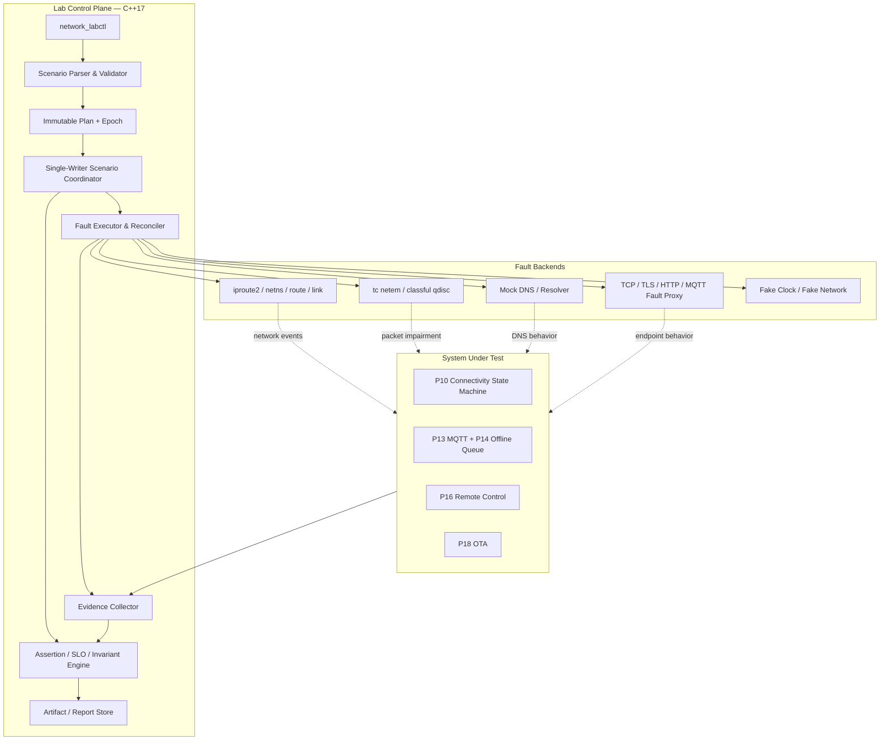
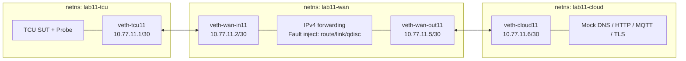
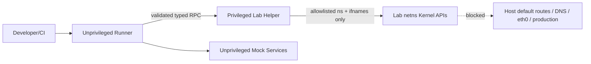
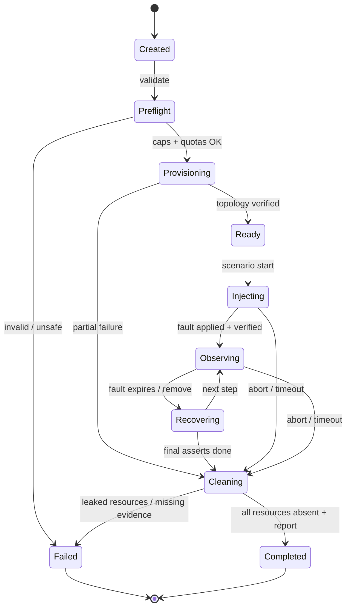
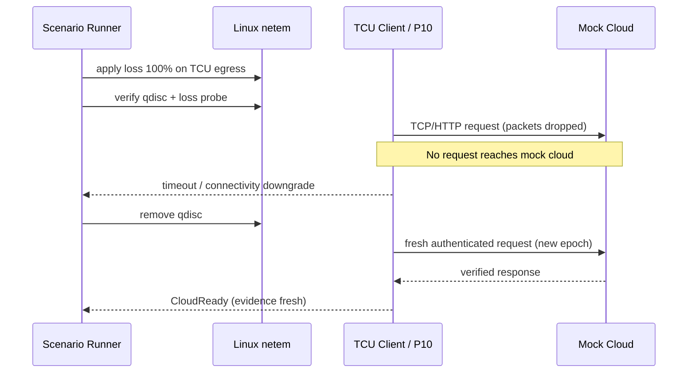
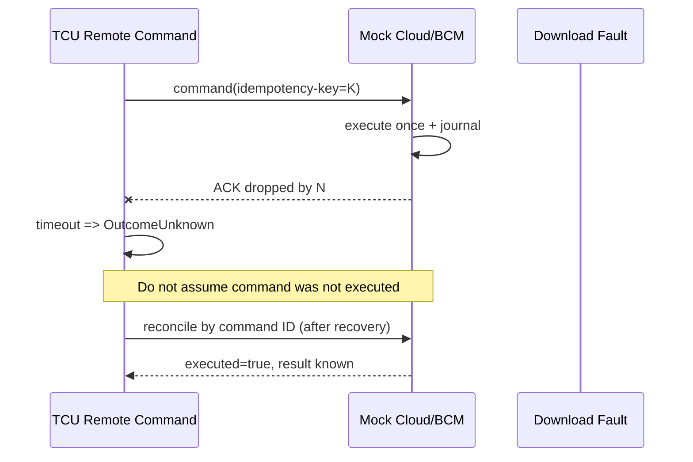

# Project 11 — Network Fault Injection Lab

> **Virtual TCU Lab | System Design · Operational Behavior · What-if/Chaos/Fault Injection · Resilience v1.0**  
> **Ngày:** 2026-10-30 · **Ngôn ngữ:** Tiếng Việt · **Implementation target:** C++17 / Ubuntu Linux (network namespaces)  
> **Đối tượng:** Middle C++ Developer / TCU Application & Middleware  
> **Ưu tiên:** P1 · **Tham chiếu:** P01–P04, P09–P10; tiêu thụ bởi P13 MQTT, P14 Offline Queue, P16 Remote Control, P18 OTA, P30 Integration  
> **Trạng thái:** **Tài liệu thiết kế + test plan; CHƯA có implementation hoàn chỉnh, CHƯA thực thi bộ test, CHƯA chứng minh SUT đạt SLO.**  
> **Safety boundary:** Mọi thử nghiệm chỉ chạy trên network namespace/VM/lab do mình sở hữu. Không thay đổi `eth0`, default route, DNS, firewall hoặc qdisc của host/mạng production; không inject vào xe/modem thật.

---

## 1. Executive Summary — Mục tiêu hệ thống

Xây **Network Fault Injection Lab** có thể chủ động, lặp lại, quan sát và tự khôi phục các sự cố mạng mà TCU phải chịu: **offline, packet loss, latency, jitter, reorder, duplicate, corruption, bandwidth throttling, route loss, DNS failure, IPv4/IPv6 divergence, TLS failure, server failure, reconnect storm, power/network race**. Lab không phải TCU connectivity manager; nó là **test harness chủ động gây lỗi + đo phản ứng của System Under Test (SUT)**, ưu tiên **P10 Connectivity State Machine**, sau đó P13/P14/P16/P18.

Đầu ra yêu cầu: có thể định nghĩa một *scenario* bằng YAML/JSON, provision topology network cách ly, apply fault tại thời điểm định trước, tự động kiểm tra invariants/metrics, thu bằng chứng, cleanup chắc chắn, và xuất kết quả `PASS / FAIL / INCONCLUSIVE` (có giải thích). Mọi trial có `run_id`, seed, config snapshot và kernel/tool version để tái lập.

### 1.1 Deliverables

1. `libtcu_fault_core` — type-safe scenario model, invariant evaluator, timeline executor, state/epoch tracking.
2. `libtcu_fault_backend_linux` — adapter quản lý `ip netns`, `veth`, `tc netem`, optional per-namespace `nft`, `ip route`, `ip link`; không cho phép host network mutation.
3. `libtcu_fault_backend_fake` — fake clock + fake network observer + scripted replies cho unit/model-based tests deterministic.
4. `network_labctl` — CLI `up`, `down`, `verify`, `baseline`, `inject`, `run`, `collect`, `report`, `doctor`.
5. `fault_scenario_runner` — orchestration, timeout/cancellation, safety guard, assertions, rollback, rerun/seed.
6. `mock_dns`, `mock_cloud`, `mock_mqtt`, `traffic_probe`, `tcu_stub` (hoặc kết nối P10) — trong namespace cô lập.
7. `test_catalog/` — functional/negative/load/property/what-if/compound-fault campaigns; Google Test/CTest và Python integration scripts.
8. `artifacts/<run_id>/` — manifest, commands, stdout/stderr, `tc -s`, routes, pcap tùy chọn, metrics, assertions, failure timeline, report.

### 1.2 Định nghĩa thành công

- Có **proof of injection**: fault thực sự tác động lên packet/path/endpoint đúng mục tiêu; không chỉ `tc` trả exit code 0.
- Có **proof of recovery**: SUT không chỉ báo recovered mà còn thực hiện request/app-level probe đúng điều kiện, đúng bearer/epoch; không lẫn callback cũ.
- **Safe by construction**: không thay đổi mạng host hoặc namespace không thuộc run; cleanup idempotent kể cả lỗi một phần.
- **Bounded**: controller giới hạn concurrent scenarios, resources, pending operations, logs và duration.
- **Repeatability**: fake-mode deterministic; Linux netem thực tế chỉ *seeded best-effort*, phụ thuộc kernel/timing/tải máy.
- **Fail-closed conclusions**: thiếu log, pcap, sample, hay injection không có hiệu lực ⇒ `INCONCLUSIVE`, không thể `PASS`.

### 1.3 Non-goals & phạm vi mô phỏng

- Không giả lập toàn bộ RF/PHY LTE/5G, cellular attach, SIM provisioning, eSIM, handover thực, billing, base-station scheduling. P09 là control-plane fake; IP dataplane chạy Linux veth.
- Không mô phỏng chính xác mọi đặc tính modem vật lý, bộ đệm NIC, TCP pacing, offload, carrier-grade NAT hoặc production Internet.
- Không tuyên bố đạt chuẩn AUTOSAR / ISO 26262 / ISO 21434 / HIL / OEM chỉ vì pass local lab.
- Không bảo đảm *deterministic wall-clock* khi chạy kernel network: timers, Linux scheduling, retries và qdisc thay đổi theo môi trường.
- Không dùng packet corruption để kết luận toàn vẹn TLS nếu không tạo ra được corruption chạm tới application; checksum TCP/IP có thể chặn từ trước.
- Không dùng ngắt packet chung để kết luận DNS, TLS hoặc backend cụ thể bị lỗi; cần fault ở đúng layer.

---

## 2. Vai trò trong hệ thống Virtual TCU Lab

| Project | Tích hợp / điểm quan sát | Ownership | Invariants cần đánh giá |
|---|---|---|---|
| P01 Event Bus | publish `FaultApplied`, `FaultRemoved`, `SutHealthChanged` | Lab events không phải delivery guarantee | Không publish trạng thái giả/thuộc epoch cũ |
| P02 IPC | expose test-only control API | IPC không phải network impairment engine | Authz của labctl, pending request bounded |
| P03 Timer | fake clock + monotonic deadline | Scheduling / cancellation | Không trigger fault đã cancel; no double terminal |
| P04 Config/Logging | immutable scenario config + audit | redaction + persistence policy | Invalid config không mutate lab |
| P09 Modem Simulator | SIM/RF/registration URC riêng | control plane | PTY `REGISTERED` không đồng nghĩa IP reachable |
| **P10 Connectivity** | SUT chính: state, probes, retry/backoff | owns connectivity decisions | `CloudReady` chỉ khi evidence tin cậy, đúng epoch |
| P13 MQTT | publish/subscribe, QoS/session | MQTT client/library | Không claim exactly-once business semantics từ QoS đơn thuần |
| P14 Offline Queue | persist, enqueue/replay | Store-and-forward | Bound/durable; không replay dữ liệu sai thứ tự theo contract |
| P16 Remote Control | command request/ACK | business logic | Idempotency/authz/safety; timeout không suy ra chưa thực thi |
| P18 OTA | download/resume/verify | OTA updater | Signature/rollback không bypass khi mạng yếu |
| P30 Full Integration | system-wide chaos | E2E orchestrator | Composite invariants across components |

### 2.1 “Ai chịu lỗi?” — Ranh giới lab vs SUT

- **Lab controller**: trách nhiệm đưa fault vào đúng path/thời điểm, thu bằng chứng và cleanup.
- **Network kernel**: trách nhiệm thực thi qdisc/routes/filter; success của CLI không thay cho packet observation.
- **SUT**: phản ứng theo policy của connectivity, MQTT, offline queue, remote control và OTA; đánh giá bằng expected behavior.
- **Oracle**: không tự đánh đồng `timeout` và `request không được server thực thi`.
- **Simulator server**: phải có log `request_id`, execution state, idempotency key để kiểm tra duplicate/unknown outcome.

---

## 3. Requirement Catalog & Traceability

### 3.1 Functional requirements

| ID | Requirement | Priority | Verification |
|---|---|---|---|
| FR-01 | Tạo và xóa topology bằng namespaces + veth; không tác động host network | Must | Integration + host snapshot diff |
| FR-02 | Inject delay, jitter, loss, burst loss, duplicate, reorder, corrupt, rate, queue limit | Must | `tc -s`, probes, pcap (có điều kiện) |
| FR-03 | Kiểm soát link state/route/MTU/neighbor, uni-/bidirectional | Must | Link/route snapshot + path probe |
| FR-04 | Mô phỏng DNS NXDOMAIN/SERVFAIL/timeout/truncated/stale/bad-answer | Must | DNS mock + query trace |
| FR-05 | Mô phỏng cloud/TCP/TLS/HTTP/MQTT lỗi theo layer | Must | Typed mock + server-side audit |
| FR-06 | Scenario timeline declarative, parallel events và conditional assertions | Must | Fake clock + scenario tests |
| FR-07 | Network fault auto-revert + explicit cleanup idempotent | Must | Forced crash/partial setup trials |
| FR-08 | Resource quotas, allowed interface/namespace checks, privileges tối thiểu | Must | Negative & security tests |
| FR-09 | Report `PASS/FAIL/INCONCLUSIVE/SKIPPED` kèm evidence | Must | Traceability checker |
| FR-10 | Kiểm thử P10 state recovery, stale result rejection, backoff, power policy | Must | BDD + state assertions |
| FR-11 | Hỗ trợ offline telemetry, MQTT, OTA và remote command end-to-end | Should | P13/P14/P16/P18 integration |
| FR-12 | Support `--seed`, `--repeat`, `--duration`, `--timeout`, `--max-resources` | Must | CLI contract |
| FR-13 | Synthetic load có giới hạn và dừng khẩn cấp | Must | Kill/cancel/overload tests |
| FR-14 | Artifact retention, redaction, controlled pcap access | Must | Privacy checks |
| FR-15 | IPv4 primary; IPv6/dual-stack và multi-bearer ở phase 2 | Should | Dual-stack suites |

### 3.2 Non-functional / quality targets (đề xuất cho lab, không phải yêu cầu OEM)

| NFR | Target ban đầu | Cách đo / caveat |
|---|---|---|
| NFR-01 Isolation | **0** thay đổi ngoài namespace/resource của run | Host before/after snapshots; privileged tests |
| NFR-02 Cleanup | 100% namespaces/veth/qdisc của run được xóa sau `down` | Snapshot + retries; nếu fail ⇒ FAIL |
| NFR-03 Controller Memory | Bounded, mục tiêu ≤256 MiB cho 1 runner / 1 lab nhỏ | `/proc`, peak RSS; adjust khi benchmark |
| NFR-04 Pending operations | Giới hạn cấu hình (mặc định 512) | Metric high-watermark + reject excess |
| NFR-05 Fault deadline | Không bảo đảm hard real-time; đo deviation histogram | fake deterministic, real kernel tolerances riêng |
| NFR-06 Reporting | Mọi FAIL/INCONCLUSIVE có fault trace + reason code | Report schema validation |
| NFR-07 Kernel compatibility | Ubuntu Linux kernel có `netem`, `netns`, `veth`, `tc`, CAP_NET_ADMIN | `doctor` preflight, skip rõ |
| NFR-08 Reproducibility | Fake: deterministic; netem: seed/config/platform recorded, probabilistic | Seed không bảo đảm byte-identical timing |
| NFR-09 Stability | Không deadlock/leak/FD leak trong soak 24h (thử nghiệm mục tiêu) | sanitizers + `/proc` + churn |
| NFR-10 Observability | `run_id/step_id/fault_id/epoch` trong mọi event chủ chốt | correlation check |

### 3.3 Tiêu chuẩn pass/fail hợp lý

- **PASS**: injection verified + đủ data + mọi invariant bắt buộc đúng + SLO thống nhất trước trial.
- **FAIL**: có invariant bị vi phạm, host side-effect, resource quota breach, hoặc rollback không dọn sạch.
- **INCONCLUSIVE**: injection không diễn ra như dự kiến, probe dùng cache, metric missing, timing vượt độ chính xác công cụ, hạ tầng thiếu quyền hoặc môi trường nhiễu.
- **SKIPPED**: điều kiện đã được dự báo không hỗ trợ (thiếu CAP_NET_ADMIN/IPv6/feature), phải report lý do — không tính là PASS.

---

## 4. Architecture Decision Records (ADR)

| ADR | Decision | Why / Trade-off |
|---|---|---|
| ADR-11-01 | `ip netns` + `veth` là lab isolated dataplane | Không sửa host default route/firewall; gần với Linux stack |
| ADR-11-02 | Tách **control plane** (scheduler/reconciler) và **data plane** (kernel/netem/mocks) | Khả năng kiểm chứng injection, failure isolation |
| ADR-11-03 | Scenario executor single-writer reducer + bounded command queue | Tránh simultaneous conflicting mutations |
| ADR-11-04 | Immutable `ScenarioPlan` sau validation, epoch tăng khi rerun/restart | Bỏ callback cũ, không nửa config |
| ADR-11-05 | Fault modifications theo **resource ownership** `{run_id,ns,ifname}` | Ngăn cleanup/mutation tài nguyên khác |
| ADR-11-06 | `tc netem` chỉ trên interface lab có allowlist, chủ yếu egress | Không chạm host/prod interface |
| ADR-11-07 | Thay đổi kernel network không giả định transaction atomic | Apply → verify → commit; partial failure → rollback |
| ADR-11-08 | App-level DNS/TLS/HTTP faults dùng mock riêng, không lạm dụng packet loss | Đúng layer, dễ xác minh |
| ADR-11-09 | `steady_clock` cho deadlines, wall clock cho audit, IClock test double | Không ảnh hưởng bởi NTP jump |
| ADR-11-10 | Đánh giá SUT theo **evidence scoped by epoch + bearer + endpoint** | Không claim CloudReady sai bởi kết quả cũ |
| ADR-11-11 | Deterministic fake, seeded network thực; không tuyên bố kết quả kernel bit-for-bit | Trung thực với netem/timing |
| ADR-11-12 | CLI chạy tool bằng argv cố định/`execve` hoặc netlink, không shell interpolation | Tránh command injection |
| ADR-11-13 | Cấm host mutation; privileged helper tách nhỏ, không chạy SUT bằng root mặc định | Giảm blast radius |
| ADR-11-14 | Có watchdog / TTL per run + out-of-band cleanup | Không để fault kéo dài khi runner crash |
| ADR-11-15 | Mỗi assertion gắn **test oracle** và proof-of-injection | Không PASS giả khi netem sai hướng |
| ADR-11-16 | Fault replay với một event có thể “effect unknown” | Không double-apply nếu step response lost |
| ADR-11-17 | Phân biệt client bytes/packets, server observed events và business side effects | TCP/MQTT retransmission không chứng minh exactly-once |
| ADR-11-18 | Fault scope cho IPv4/IPv6, direction, protocol/port chính xác | Tránh kết luận lỗi cloud từ ping |

---

## 5. Architecture, Threat Boundaries & Deployment

### 5.1 Functional view



### 5.2 Linux isolated network topology



**Topology V1** dùng hai subnet riêng: `10.77.11.0/30` (TCU—WAN) và `10.77.11.4/30` (WAN—Cloud). WAN là router trung gian **chỉ giữa hai lab segments**. Không NAT hoặc route đến host Internet. Lab runner có thể nằm host namespace để quản trị các namespace nhưng **mọi lệnh network mutation phải đặt trong namespace được cấp cho run**; việc tạo/vô hiệu `veth` từ host chỉ được thực hiện theo allowlist có kiểm chứng.

### 5.3 Fault direction không được nhầm

- TCU → cloud (upload): `tc netem` tại **egress `veth-tcu11`** trong `lab11-tcu`, hoặc `veth-wan-out11` trong `lab11-wan`.
- Cloud → TCU (download): `tc netem` tại **egress `veth-cloud11`** trong `lab11-cloud`, hoặc `veth-wan-in11` trong `lab11-wan`.
- `netem` chủ yếu tác động **egress**; muốn điều khiển **ingress** của một interface, cần IFB/ingress redirect hoặc đặt netem phía đầu phát/đầu router đối diện. Đặc biệt đo TCP throughput cần xét TCP Small Queues và vị trí qdisc.
- Packet capture hai phía để phân biệt: packet được phát, kernel có drop, server có nhận, application có xử lý.
- Fault chỉ trên DNS/UDP hoặc TCP/8883 cần classful qdisc/filter theo flow, hoặc mock/proxy để không phá mọi loại traffic.

### 5.4 Trust & security boundary



Helper từ chối đường dẫn namespace không đúng prefix; interface không thuộc run; command chứa shell metacharacters; unmanaged qdisc; route ra host; danh sách cấm bypass bằng symlink. Có `audit log`, quotas và **dry-run**. Không chạy helper trên máy production.

---

## 6. Component Responsibilities & C++17 API

### 6.1 Modules

| Component | Responsibility | Failure policy |
|---|---|---|
| `ScenarioParser` | Parse YAML/JSON + typed schema, durations/units | Reject invalid, không mutate |
| `ScenarioValidator` | Ownership, preconditions, conflicting faults, resource quotas | Fail-closed |
| `ScenarioCoordinator` | Single-writer timeline, epoch, cancellation, completion | One terminal state |
| `FaultBackend` | Apply/verify/revert faults | Partial mutation ⇒ reconcile/rollback |
| `NetnsTopologyManager` | Create/liveness/remove namespace + veth | No host changes |
| `TrafficControlAdapter` | netem qdisc, direction, inspect stats | Verify packet-level effect |
| `EndpointFaultAdapter` | DNS/TLS/HTTP/MQTT simulation | Respect transport protocol semantics |
| `SutProbeAdapter` | Health probes/status subscriptions | Explicit stale/unknown |
| `InvariantEngine` | Hard invariants vs soft SLOs | Evidence-aware tri-state verdict |
| `MetricsCollector` | Host/netns metrics, qdisc, SUT logs, optional pcap | Bounded buffer + loss indicator |
| `ReportGenerator` | Repro manifest, evidence, verdict reason | No silent missing evidence |
| `LabJanitor` | TTL, crash recovery, cleanup | Idempotent, artifact retention |

### 6.2 Data model, time & identifiers (illustrative header)

```cpp
#pragma once
#include <chrono>
#include <cstdint>
#include <optional>
#include <string>
#include <vector>

namespace tcu::netlab {

using RunId = std::string;
using FaultId = std::string;
using Epoch = std::uint64_t;

enum class FaultKind {
    LinkDown, RouteDelete, MtuChange, PacketLoss, BurstLoss,
    Delay, Jitter, Duplicate, Reorder, Corrupt, RateLimit,
    DnsTimeout, DnsServfail, DnsWrongAnswer,
    TcpReset, TlsVerifyFail, HttpError, MqttDisconnect
};

enum class Direction { Upload, Download, Both };
enum class Verdict { Pass, Fail, Inconclusive, Skipped };
enum class RunState { Created, Preflight, Provisioning, Ready,
                      Injecting, Observing, Recovering, Cleaning,
                      Completed, Failed, Aborted };

struct ResourceScope {
    std::string namespace_name;   // managed name only
    std::string interface_name;   // must be owned by run
    Direction direction{};
};

struct FaultSpec {
    FaultId id;
    FaultKind kind{};
    ResourceScope scope;
    std::chrono::milliseconds start_after{0};
    std::chrono::milliseconds duration{0};
    std::optional<std::uint64_t> seed;
    double probability_percent{0.0};
    std::chrono::milliseconds latency{0};
    std::chrono::milliseconds jitter{0};
};

struct FaultReceipt {
    FaultId fault_id;
    Epoch epoch{};
    bool command_applied{false};
    bool effect_verified{false};
    std::string evidence_reference;
};

class IFaultBackend {
public:
    virtual ~IFaultBackend() = default;
    virtual FaultReceipt apply(const RunId&, Epoch,
                               const FaultSpec&) = 0;
    virtual bool verify(const RunId&, Epoch,
                        const FaultSpec&) = 0;
    virtual void revert(const RunId&, Epoch,
                        const FaultId&) = 0;
};

class IClock {
public:
    virtual ~IClock() = default;
    virtual std::chrono::steady_clock::time_point now() const = 0;
};

} // namespace tcu::netlab
```

**Đây là interface minh họa, chưa phải source đã compile/test.** Backend thật cần async operations, cancellation, `Expected<T, Error>`, typed scope, audit events và lifecycle context. Không giữ mutex domain trong khi gọi `tc`/IPC/OS blocking.

### 6.3 API contract (control surface)

```text
network_labctl doctor
network_labctl up --run-id <id> --config lab.yaml
network_labctl baseline --run-id <id>
network_labctl run --scenario scenarios/loss_recovery.yaml --seed 20261030
network_labctl verify --run-id <id> --fault-id <fault>
network_labctl collect --run-id <id>
network_labctl report --run-id <id> --format markdown
network_labctl down --run-id <id> --force
```

- `up` tạo topology, **verify connectivity baseline**, trả `READY` hoặc cleanup và FAIL.
- `inject` chỉ chấp nhận scenario đã validate, gắn `epoch`, trả `Applied` **sau** effect verification (nếu chưa đủ bằng chứng có thể `PendingVerification`).
- `down` idempotent: chạy lại sau success vẫn success; nhưng không che lỗi cleanup chưa thực sự sạch.
- `--force` không cho phép xóa bất kỳ interface/namespace nào ngoài manifest của run.
- `report` bắt buộc có kernel version, iproute2 version, topology hash, scenario hash, time source, seed và environment caveats.

### 6.4 Scenario DSL (đề xuất, không phải schema đã implement)

```yaml
schema_version: 1
run:
  name: loss_then_recovery
  seed: 20261030
  timeout_ms: 90000
  topology: isolated_three_namespace
  sut: connectivity_service
  artifact_policy: minimal_redacted
steps:
  - id: baseline
    at_ms: 0
    action: probe
    expect: endpoint_reachable
  - id: inject_loss
    at_ms: 5000
    action: fault_apply
    fault:
      id: uplink_drop
      kind: packet_loss
      namespace: lab11-tcu
      interface: veth-tcu11
      direction: upload
      loss_percent: 100
      duration_ms: 20000
  - id: verify_down
    at_ms: 7000
    action: assert
    expect: cloud_ready_false_after_expiry
  - id: verify_recovery
    at_ms: 40000
    action: assert
    expect: cloud_ready_true_after_fresh_proof
  - id: collect
    at_ms: 45000
    action: collect
assertions:
  - never: cloud_ready_without_authenticated_session
  - never: active_retry_when_power_policy_prohibits
  - always: queues_and_pending_requests_bounded
  - eventually: recovery_after_fault_removed_and_backend_healthy
```

**Cảnh báo:** `loss_percent: 100` trên egress đã chọn sẽ drop packet đi qua interface; nếu health monitor đã cache một session, `CloudReady` có thể vẫn true trong khoảng freshness/heartbeat timeout đã thiết kế. Assertion phải tôn trọng latency detection thay vì đòi switch state ngay lập tức.

---

## 7. Run Lifecycle, State Machine & Guard Conditions



**Invariants của controller**:

1. `ActiveFault(run,fault)` chỉ hợp lệ khi `{run_id,epoch,owner_scope}` còn active.
2. **Một run chỉ có một terminal verdict**; callback cũ sau `Aborted/Completed` bị discard.
3. Apply/rollback có thể partial, **không** coi manifest marker là bằng chứng kernel cleanup.
4. Không quá `max_active_faults`, `max_processes`, `max_threads`, `max_artifact_bytes`, `max_run_duration`.
5. `ScenarioPlan` không đổi trong một run; config reload tạo *new run/version* hoặc epoch mới có explicit barrier.
6. `link down` có thể khiến `tc -s` không tăng counters; phải dùng topology/link-state evidence thay cho packet-only oracle.
7. Faults được apply theo conflict policy: hai root qdisc lên cùng interface không thể đơn giản `add` chồng; `replace` có thể xóa state trước. Conflict cần serialize hoặc tách traffic classes.
8. Output SUT và packet probes luôn gắn **monotonic timestamps**; correlation với wall clock có offset, không so sánh timestamps từ clocks không đồng bộ như chân lý tuyệt đối.

---

## 8. Operational Behavior — Hệ thống làm gì trong từng bước

### 8.1 Preflight (không đổi network)

1. Kiểm tra Linux/OS, `ip`, `tc`, `veth`, `sch_netem`, optional `nft`, permissions (CAP_NET_ADMIN), disk available, cgroup limits, IPv6 và kernel feature flags.
2. Validate syntax + semantics: xác suất trong `[0,100]`, duration > 0, exact `run_id`, unique fault IDs, interface thuộc topology, topology không truy cập external network.
3. Snapshot host diagnostics (routes/DNS/interface/qdisc metadata) để đối chiếu; không đọc/ghi credentials host.
4. Nếu preflight thất bại: `SKIPPED` hoặc `FAIL` theo contract; không tạo namespace nào.

### 8.2 Provision & baseline

1. Tạo namespaces `lab11-tcu`, `lab11-wan`, `lab11-cloud` (trong implementation production thêm suffix unique run ID để tránh collision).
2. Tạo hai cặp `veth`, đặt địa chỉ/route, bật IPv4 forwarding **chỉ trong `lab11-wan`**.
3. Chạy mock cloud trong namespace cloud, SUT trong namespace tcu; chờ readiness theo deadline.
4. Đo baseline ứng dụng: DNS mock, TCP connect, authenticated endpoint (nếu có TLS), không chỉ `ping`.
5. Lưu topology state và baseline metrics; fail baseline ⇒ không inject (hoặc scenario yêu cầu starting-offline rõ ràng).

### 8.3 Apply fault

1. Coordinator schedule step bằng monotonic clock và generation.
2. Backend check allowlist + current qdisc/route state. Tạo proposed change; lock resource ở mức run.
3. Apply `tc qdisc ... netem` hoặc mutate trong namespace; ghi exit code, stdout/stderr.
4. Verify effect: `tc -j -s`, probe differential, namespace snapshots, server-side receive/capture; nếu không chứng minh, trả `INCONCLUSIVE`.
5. Chỉ bắt đầu thời gian quan sát SUT khi xác minh fault và thu timestamp; scenario cho phép timing tolerance.

### 8.4 Observe and judge

- Thu state transitions của SUT (e.g. IPReady, EndpointReachable, CloudReady), retries/backoff, pending count, queue depth, RSS/FD và timestamps.
- So khớp test oracle với **phương thức đo phù hợp**: packet counters cho netem, synthetic query với DNS mock, server receipt cho HTTP/MQTT, TLS handshake/cert validation cho `CloudReady`.
- Retry may be deferred by power policy, data quota hoặc user privacy policy. Không đặt recovery SLA khi policy cố tình cấm reconnect.
- Timeout của command remote mang nghĩa **OutcomeUnknown** trừ khi có business idempotency/ack proof. Không coi `no ACK` = `not executed`.

### 8.5 Remove / recover

1. Stop new injection events, cancel scheduled timers thuộc epoch.
2. Remove đúng fault owned; restore route/link/qdisc snapshot trong namespace, tránh overwrite unrelated resources.
3. Verify path thực sự recovered (lúc cần), chờ SUT fresh authenticated probe/session.
4. Measure recovery latency **từ lúc fault removed được xác minh**, không đo từ lúc CLI phát lệnh remove.
5. Không phát lại non-idempotent business command trừ khi policy idempotency/journal cho phép.

### 8.6 Shutdown / crash recovery

- `SIGTERM`: stop accepting runs, cancel steps, roll back faults, collect bounded evidence, cleanup.
- `SIGKILL` hoặc controller crash: janitor scan signed/owned manifests + run TTL, cleanup về sau; watchdog phải chạy ngoài process bị kill.
- Nếu janitor không thể dọn sạch: **FAIL và cảnh báo rõ resource IDs**, không âm thầm báo healthy.
- Sau cleanup, verify không namespace/veth/rules/qdisc do run sở hữu; snapshot host vẫn nguyên vẹn.

---

## 9. Expected Behaviors — Behavioral Contracts / Given-When-Then

| ID | Given | When | Then / observable oracle |
|---|---|---|---|
| BC-01 | Environment valid | `up` | Chỉ namespace lab được tạo; host routes không đổi |
| BC-02 | Missing `CAP_NET_ADMIN` | `up` | SKIPPED/FAIL rõ; no partial topology |
| BC-03 | Healthy baseline | loss 100% upload | Upload fails; metrics/`tc` confirm; SUT loses reachability sau detection window |
| BC-04 | Healthy baseline | loss 100% download | Request may reach server, response missing; outcome unknown if command |
| BC-05 | Healthy baseline | delay 300 ms | RTT tăng theo direction(s); oracle đo đúng hướng |
| BC-06 | Connected + packet loss | TCP retransmits | Không suy ra app mất data từ packet drops đơn lẻ |
| BC-07 | DNS cached | mock DNS fails | New unique name fails; cached path handled separately |
| BC-08 | Reachable IP | wrong TLS cert | TCP reachable, TLS verification fail, CloudReady false |
| BC-09 | Modem registered | route missing | Registration vẫn true; endpoint/cloud unavailable |
| BC-10 | Stale probe in flight | route/epoch changed | Stale success discarded |
| BC-11 | Cloud session authenticated | network blackhole | CloudReady expiry sau heartbeat/deadline, không bật mãi |
| BC-12 | Offline telemetry | network recovered | Store-and-forward theo bounded queue + ordering policy |
| BC-13 | Remote command sent | ACK lost | `Unknown`/reconcile, no blind replay |
| BC-14 | OTA downloading | socket resets | Resume/abort theo manifest, verify signature before install |
| BC-15 | Two concurrent faults same interface | apply | Deterministic conflict resolution or reject; no hidden qdisc overwrite |
| BC-16 | Fault scheduled | run canceled | No late apply thuộc old epoch |
| BC-17 | `tc` reports success | no traffic matches | INCONCLUSIVE về effect, not PASS |
| BC-18 | Packet trace incomplete | test completed | Evidence gap reported; verdict cannot be false PASS |
| BC-19 | Runner killed mid-fault | janitor executed | Owned faults removed, artifacts identify interruption |
| BC-20 | Runner killed mid-cleanup | janitor restarted | Idempotent resume of cleanup |
| BC-21 | Heavy fault storm | run continues | Quotas/backpressure enforced; no unbounded RAM |
| BC-22 | Packet duplicates | command path | Idempotency prevents repeated business action |
| BC-23 | IPv6 works, IPv4 fails | dual stack probe | Family-aware result, no unsupported “all offline” claim |
| BC-24 | Multiple bearers | cellular fails but Wi-Fi works | SUT chooses policy-valid bearer; not cellular online |
| BC-25 | Host network changed externally | compare snapshot | Run flags environment drift, no unsafe auto-restore host |
| BC-26 | Firewall/mock DNS misconfigured | fault attempted | Detect injection invalid, INCONCLUSIVE, cleanup |
| BC-27 | TLS endpoint 401/403 | app auth | `CloudReady` false even if TCP+TLS succeeded |
| BC-28 | QoS 1 message resent | server idempotency | Transport ACK alone not sufficient to prove one business execution |
| BC-29 | Wall clock jumps | pending fault deadline | Monotonic scheduler unaffected |
| BC-30 | Process restart | new epoch | Old timers, callbacks, probe results cannot mark new epoch ready |

### 9.1 Request/Response during upload blackhole



### 9.2 Download blackhole + unknown command result



### 9.3 Fault cancellation race

```mermaid
sequenceDiagram
  participant U as User/CI
  participant S as Scenario Coordinator
  participant B as Fault Backend
  U->>S: cancel(run, epoch=7)
  S->>S: epoch=8; invalidate scheduled steps
  S->>B: revert owned faults for epoch 7
  B-->>S: verified clean
  Note over S: delayed callbacks from epoch 7 discarded
  S-->>U: Aborted + cleanup evidence
```

---

## 10. Fault Catalog — Các lớp lỗi, injection đúng và oracle đúng

| Layer | Fault examples | Injection mechanism | Verification |
|---|---|---|---|
| Topology | namespace missing, veth missing, wrong peer | `ip netns` / `ip link` only in lab | `ip -d link`, namespace + ping/probe |
| L2 / Neighbor | ARP unavailable, stale neighbor, link flap | `ip neigh` + `ip link` | neighbor table, packet capture |
| L3 / Route | no route, wrong gateway, asymmetric path, IPv6 route | `ip route` / `ip -6 route` within netns | `ip route get`, bidirectional probes |
| L3 / MTU | small MTU, PMTUD blackhole | `ip link set mtu`, ICMP filtering in lab | TCP/UDP size probes, trace |
| L4 / Packet | loss, delay, jitter, duplicate, reorder, corrupt, rate | `tc netem` on **correct egress** | qdisc counters + app-level observable |
| L4 / TCP | half-open, RST, read/write stall, zero-window | TCP fault proxy/test server | socket state, application logs |
| DNS | NXDOMAIN, SERVFAIL, timeout, stale TTL, wrong answer | controlled DNS stub | synthetic uncached query, DNS trace |
| TLS | expired cert, wrong name, untrusted CA, incomplete handshake | mock TLS server + test certificates | TLS verification failure cause |
| HTTP | 429, 500, hanging response, truncation | controlled mock server | request ID, status, body bytes |
| MQTT | broker offline, retained stale, QoS retransmit, duplicate | mock MQTT broker and socket faults | packet capture + broker receipt |
| Host/control | permission denied, helper crash, resource exhaustion | fake backend + isolated privileged helper | controller verdict + cleanup |
| Power/policy | low battery, ignition off, user data disabled | P22 fake policy & P09 URC | retry forbidden as required |

**Lưu ý critical:** `ping` chỉ là ICMP; TCP/TLS/MQTT có thể fail trong khi ping vẫn OK. Ngược lại, ICMP bị chặn nhưng TCP thành công. `tc corrupt` thường bị loại bởi checksums trước application; dùng application payload corruption riêng nếu muốn kiểm thử parser/TLS.

---

## 11. Concurrency, Ordering, Deadlines & Memory

### 11.1 Ownership & thread model

- One `ScenarioCoordinator` thread là **single writer** của run state; callbacks của `tc`, IPC, DNS mock, SUT metrics push `Event{run_id,epoch,step_id}` vào bounded channel.
- Blocking shell/netlink work chạy trong bounded executor; không giữ locks khi chờ process child.
- Có resource lock theo `{ns,interface,qdisc-root}` để serialize conflicting updates; parallel faults ở independent interfaces được phép.
- `cancel()` đánh dấu epoch invalid trước khi cancel timers, sau đó rollback. `stop()` cùng lúc không tạo double-terminal verdict.
- Callback dùng `weak_ptr`/cancellation tokens và không capture raw `this` vượt lifetime.
- Network link events có thể reorder/coalesce; verify bằng snapshot reconcile thay vì rely only incremental notifications.

### 11.2 Queue, time, latency & fairness

| Resource | Default thử nghiệm | Enforced behavior |
|---|---|---|
| Max active scenarios | 1 per topology V1 | Reject hoặc queue có deadline |
| Max faults per scenario | 32 | Validate preflight |
| Command executor in flight | 8 | Backpressure + error explicit |
| Pending event queue | 4096 | Priority cancel/cleanup, count drops; no silent loss of safety events |
| Max scenario duration | 30 min (config) | Watchdog TTL + cleanup |
| Max output log | 128 MiB/run (config) | Rotate/truncate with loss markers |
| Max pcap | 256 MiB/run (config) | Optional selective capture + redact |
| Retry for privileged command | bounded by policy, no infinite loop | classify permanent vs transient |

Các con số là **defaults gợi ý**, phải tune qua benchmark. Nếu event queue overload đến mức mất event quyết định, trial bị `INCONCLUSIVE/FAIL`, không tiếp tục PASS.

### 11.3 Failure classification

- `PERMANENT`: unsupported kernel feature, policy violation, permission denied, invalid schema, unsafe resource; **không retry**.
- `TRANSIENT`: tc process temporarily interrupted, mock server not ready, busy resource; retry bounded với jitter.
- `UNKNOWN_EFFECT`: privileged helper crashed sau mutation nhưng trước ACK; query actual kernel state và reconcile **trước** next command.
- `SUT_ERROR`: violation of test oracle despite correctly injected fault.
- `INSTRUMENTATION_ERROR`: counters/pcap/trace thiếu hoặc sampling mất; verdict `INCONCLUSIVE`.

---

## 12. Security, Privacy, Failure Containment

1. Chỉ cho phép `run_id`/namespace patterns và finite resource allowlists; không parse tên interface từ untrusted input để chạy `/bin/sh -c`.
2. Process chạy SUT/cloud dùng non-root nếu khả thi. Privileged helper giới hạn lệnh, path, duration, cgroup và namespace.
3. Cấm kết nối default namespace Internet và cấm bridge ra NIC thật (no external NAT).
4. Không capture PII, VIN thật, tọa độ thật, production credentials, access tokens. TLS test cert và dữ liệu synthetic.
5. Log/pcap artifacts có retention TTL, redaction, owner ACL và hạn mức lưu trữ.
6. Sandbox cho scenario đầu vào; artifact paths không cho path traversal/symlink escapes.
7. Nhiều run cùng lúc phải có unique namespace name từ `run_id`, `flock`/ownership file chống collision.
8. Janitor cleanup **chỉ tài nguyên có ownership chứng minh được**, không `ip netns delete` toàn bộ tên lạ.
9. Kernel-privileged actions có blast radius; tốt nhất chạy CI trong VM ephemeral, không trên developer host quan trọng.
10. Nếu cleanup fail, dừng pipeline, phơi bày leak state; không tự “repair” host network không sở hữu.

---

## 13. Observability & Experiment Artifact Schema

```text
artifacts/<run_id>/
├── manifest.json              # versions, seed, config hash, owner, TTL
├── topology_before.json
├── topology_after.json
├── host_before.sha256         # sanitized host network snapshot hash
├── host_after.sha256
├── scenario_compiled.json
├── timeline.ndjson            # monotonic timestamps + correlated UTC
├── kernel_qdisc_before.json
├── kernel_qdisc_after.json
├── netns_routes.json
├── sut_state.ndjson
├── mock_cloud.ndjson
├── probes.ndjson
├── resource_metrics.ndjson
├── packet_capture.pcapng      # optional; synthetic traffic only
├── assertions.json
└── report.md
```

### 13.1 Event schema (JSONL)

```json
{"run_id":"lab11-0001","epoch":7,"step_id":"inject_loss","fault_id":"f-up-1","source":"tc_backend","event":"effect_verified","monotonic_ns":5000000000,"utc":"2026-10-30T03:00:05Z","scope":"lab11-tcu/veth-tcu11/upload","evidence":"probes/egress-loss.json"}
```

### 13.2 Core metrics / labels

| Metric | Type | Why |
|---|---|---|
| `lab_fault_apply_total{kind,status}` | counter | Fault success/failure/unknown |
| `lab_fault_effect_verified_total{kind}` | counter | Prevent false injection success |
| `lab_cleanup_residual_resources` | gauge | Cleanup correctness |
| `lab_step_deadline_deviation_ms` | histogram | Timeline accuracy |
| `lab_event_queue_depth` | gauge | Controller backpressure |
| `lab_packet_probe_loss_ratio` | gauge | Measured path impairment |
| `lab_sut_recovery_latency_ms` | histogram | Measured after verified fault removal |
| `lab_stale_callback_dropped_total` | counter | Epoch correctness |
| `lab_assertion_total{verdict,category}` | counter | Coverage + outcome |
| `lab_artifact_bytes` | gauge | bounded artifacts |
| `sut_retry_attempt_total{bearer,reason}` | counter | Retry storm visibility |
| `sut_cloud_ready{bearer,epoch}` | gauge | False-success detection |
| `sut_offline_queue_depth` | gauge | Storage/flush behavior |

Metrics không dùng unbounded labels (`request_id`, raw endpoint, VIN) trong Prometheus; request-level IDs lưu trong bounded logs/traces.

---

## 14. What-if Coverage Methodology (mục tiêu nhiều hơn 1 danh sách dài)

Không thể liệt kê đúng nghĩa **mọi** tình huống trong một hệ thống bất đồng bộ; thay vào đó áp dụng coverage có hệ thống:

1. **Failure layer × Direction × Duration:** L2/L3/L4/DNS/TLS/app/controller × upload/download/both × transient/persistent/flapping.
2. **Timing:** trước, đúng lúc, sau handshake/timeout/retry/reload/shutdown; boundary `t−ε, t, t+ε`.
3. **Cardinality:** 0, 1, N, 100k events; queue empty/full, exactly at limit, one past limit.
4. **State:** Offline/Connecting/CloudReady/Degraded/Recovery/Canceled; no stale success.
5. **Fault combination:** 2–4 correlated faults, với scheduling do fake clock (unit) và real timeline (integration).
6. **Evidence:** mỗi kết quả có mechanism, oracle, observable, priority, result ID; *effect verification* là test riêng.
7. **Negative evidence:** test không đủ dữ liệu ⇒ `INCONCLUSIVE`, không phóng đại độ tin cậy.
8. **Risk driven:** P0 = khả năng false-ready, mất dữ liệu, duplicate command, host mutation, memory/OOM, crash/deadlock, security bypass; P1 = reliability, recoverability; P2 = fidelity/performance nâng cao.

**Cấu trúc mỗi case:** ID | What if | How to inject | Expected behavior / oracle | Evidence | Priority. Các mục tiêu có ghi `(proposed)` phải được duyệt theo SUT/OEM thực tế.

---

## 15. Comprehensive What-if Catalog

> Danh mục chi tiết tự động lập ở các tiểu mục dưới đây. `PASS` chưa được khẳng định; mọi case là **kế hoạch** cho automated test.


### 15.1 — Topology / Provisioning (10 cases)

| ID | What if | Cách inject / Setup | Expected behavior / oracle | Evidence bắt buộc | Pri |
|---|---|---|---|---|---|
| NFI-01-01 | Namespace TCU đã tồn tại từ run khác | precreate same name with different owner | abort without deleting foreign namespace | owner manifest and ip netns list | P0 |
| NFI-01-02 | Một đầu veth tạo thành công, đầu khác fail | fail second ip link operation | rollback first veth and namespaces | link dump plus janitor audit | P0 |
| NFI-01-03 | Topology tạo xong nhưng cloud unreachable baseline | disable WAN forwarding during up | no fault injection and fail baseline | route get plus probe logs | P0 |
| NFI-01-04 | WAN forwarding vẫn tắt sau setup | set sysctl to zero in WAN namespace | doctor or baseline catches before run | namespace sysctl and probes | P0 |
| NFI-01-05 | IP địa chỉ bị trùng trong topology | inject overlapping CIDR in config | schema validation rejects before mutation | validation report and host diff | P0 |
| NFI-01-06 | veth peer chuyển nhầm namespace | inject incorrect netns target in fake backend | refuse ready and cleanup only owned peers | peer metadata and manifest | P0 |
| NFI-01-07 | Một namespace bị xóa thủ công khi scenario active | delete owned lab11-cloud mid-run | fail affected steps and reconcile cleanup | ip netns list plus run timeline | P1 |
| NFI-01-08 | `ip netns` trả success nhưng interface chưa ready | delay address assignment with fake executor | readiness gate waits up to deadline | ip addr and probe timeline | P1 |
| NFI-01-09 | Setup tạo route thoát Internet host | malicious external default route in config | reject unsafe topology preflight | route allowlist validation log | P0 |
| NFI-01-10 | Cùng lúc hai CI runners tạo topology | launch same fixed namespace names | exclusive run lease or unique names prevent collision | lock ownership and netns snapshots | P0 |

### 15.2 — Privilege / Host Safety (10 cases)

| ID | What if | Cách inject / Setup | Expected behavior / oracle | Evidence bắt buộc | Pri |
|---|---|---|---|---|---|
| NFI-02-01 | Không có CAP_NET_ADMIN | run doctor without capability | SKIPPED or FAIL before mutation | preflight and empty resource inventory | P0 |
| NFI-02-02 | Process helper bị kill sau tạo veth | SIGKILL helper at step barrier | effect unknown then reconcile/rollback | host and owned namespace snapshots | P0 |
| NFI-02-03 | Scenario yêu cầu tc trên host eth0 | submit forbidden interface target | reject and record security event | host qdisc baseline unchanged | P0 |
| NFI-02-04 | Scenario cố xóa default route host | request route delete outside managed netns | reject before privileged operation | host route hash and audit | P0 |
| NFI-02-05 | Shell metacharacters trong interface name | send semicolon/newline payload | typed validation rejects and no command execution | CLI audit and files untouched | P0 |
| NFI-02-06 | Symlink trong manifest trỏ ra /etc | replace owned manifest path with symlink | safe open semantics prevent escape | file audit and rejection code | P0 |
| NFI-02-07 | Run duration vượt hạn mức | config duration > policy max | reject or require override explicitly | typed validation trace | P1 |
| NFI-02-08 | Helper bị cấm đọc file mẫn cảm | request pcap path outside artifact root | reject path traversal/permission | artifact path audit | P0 |
| NFI-02-09 | cleanup của run A nhắm resource run B | mix foreign resource ID | refuse deletion of unrelated owner | run B probe still works | P0 |
| NFI-02-10 | Máy host thay đổi route do VPN bên ngoài | modify host route during trial | flag environment drift; do not auto restore host | before/after snapshots | P1 |

### 15.3 — Link / Interface State (10 cases)

| ID | What if | Cách inject / Setup | Expected behavior / oracle | Evidence bắt buộc | Pri |
|---|---|---|---|---|---|
| NFI-03-01 | TCU egress link down giữa TCP connect | ip link set veth-tcu11 down | SUT degrades after observation window, no false-ready | link state plus SUT epoch | P0 |
| NFI-03-02 | Cloud interface down sau request gửi | ip link set veth-cloud11 down | request timeout/unknown outcome, retry per policy | server receipt and client log | P0 |
| NFI-03-03 | Link flap mỗi 100 ms | toggle link for bounded cycles | no busy loop, retry storm, or unbounded resource | retry counters and RSS | P0 |
| NFI-03-04 | Link up event tới trễ sau link down mới | reorder fake netlink callbacks | old event cannot mark new generation UP | epoch trace and final state | P0 |
| NFI-03-05 | Link được up nhưng không có IP | remove address after up | LocalIpReady false and probes scoped | ip addr plus P10 status | P0 |
| NFI-03-06 | Interface rename trong lúc tracking | rename interface in managed namespace | observer resync by ifindex/generation and no crash | netlink dump and logs | P1 |
| NFI-03-07 | MTU reset khi interface is recreated | recreate veth and apply default MTU | validate fresh link capabilities before ready | interface snapshot | P1 |
| NFI-03-08 | Kernel coalesce multiple carrier events | send rapid up/down/up | reconcile snapshot rather than count callbacks | netlink and snapshot diff | P1 |
| NFI-03-09 | Link only download direction fails | down cloud-side veth transient | prove asymmetric effect and unknown command status | bidirectional probe | P0 |
| NFI-03-10 | Interface disappears during tc verification | remove veth immediately after apply | report unknown effect then clean other owned objects | command exit plus inventory | P0 |

### 15.4 — Routing / Gateway / Asymmetry (10 cases)

| ID | What if | Cách inject / Setup | Expected behavior / oracle | Evidence bắt buộc | Pri |
|---|---|---|---|---|---|
| NFI-04-01 | Default route biến mất trong TCU | delete route to cloud subnet | connection degrades; no stale reachability | ip route get and P10 state | P0 |
| NFI-04-02 | Route trỏ sai next hop | replace route with unreachable gateway in lab | timeout or unreachable, not CloudReady | route dump and socket error | P0 |
| NFI-04-03 | Chỉ chiều về thiếu route | delete cloud return route | server may see request, client cannot confirm | dual-ended pcap and audit | P0 |
| NFI-04-04 | Two routes equal metric thay đổi ưu tiên | add conflicting route in lab | probe bound to selected path, generation updated | ip route get and interface trace | P1 |
| NFI-04-05 | Routing table thay đổi giữa DNS và TCP connect | swap route at barrier | stale DNS result not authoritative for new bearer | scoped probe records | P0 |
| NFI-04-06 | Blackhole route được thêm thay vì delete | add explicit blackhole route to endpoint | fail clearly, bounded retries | route dump and error code | P1 |
| NFI-04-07 | Route được restore nhưng DNS vẫn lỗi | remove blackhole while mock DNS remains down | no premature CloudReady | DNS traces and P10 evidence | P0 |
| NFI-04-08 | Rtnetlink notification bị drop | fake observer drops route update | periodic/reconnect resync reconciles state | route snapshot and fresh probes | P0 |
| NFI-04-09 | Hai changes route collide | concurrent replace and delete same CIDR | serialization or reject conflict, not partial route | mutator trace and final route | P0 |
| NFI-04-10 | Wrong source address selected after failover | add multiple source IPs with route changes | probe records source/family/bearer, no false-ready | tcpdump and socket local addr | P0 |

### 15.5 — ARP / Neighbor / L2 Reachability (10 cases)

| ID | What if | Cách inject / Setup | Expected behavior / oracle | Evidence bắt buộc | Pri |
|---|---|---|---|---|---|
| NFI-05-01 | ARP cache empty khi request bắt đầu | flush neigh in TCU namespace | recover neighbor discovery without crash | ip neigh and pcap | P1 |
| NFI-05-02 | Static neighbor MAC sai | add invalid permanent neighbor in lab | TCP fails despite route present, no false-ready | ARP/neighbor state and probe | P0 |
| NFI-05-03 | ARP entry chuyển FAILED rồi REACHABLE | force neighbor expiry and respond again | recover using fresh evidence | ip neigh state transitions | P1 |
| NFI-05-04 | ARP replies bị drop một chiều | filter ARP in isolated namespace | distinguish L2 failure from DNS/cloud failure | ARP capture and P10 reason | P1 |
| NFI-05-05 | Neighbor table flooded đến giới hạn | generate distinct lab neighbor probes under quota | bounded cost and graceful failure | neighbor table + RSS | P1 |
| NFI-05-06 | Gateway IP có duplicate ARP responder | run second mock responder inside lab | detect path inconsistency; avoid trusted cloud proof | packet capture | P1 |
| NFI-05-07 | Neighbor resolved nhưng next-hop không forward | disable forwarding in WAN | no false endpoint readiness | neigh ok plus failed TCP | P0 |
| NFI-05-08 | Interface link reset giữ cache stale | down/up link and neighbor state | fresh probe scoped to new epoch | route and neighbor snapshots | P1 |
| NFI-05-09 | IPv6 ND chỉ thất bại | filter ND in lab IPv6 mode | IPv4 result independent, IPv6 degraded | protocol-specific probes | P1 |
| NFI-05-10 | Link-local IPv6 scope sai | request fe80 without scope id | reject or report scoped failure, no fallback false success | socket error and route | P1 |

### 15.6 — MTU / PMTU / Fragmentation (10 cases)

| ID | What if | Cách inject / Setup | Expected behavior / oracle | Evidence bắt buộc | Pri |
|---|---|---|---|---|---|
| NFI-06-01 | MTU giảm từ 1500 xuống 576 giữa upload | set managed veth mtu 576 | handle EMSGSIZE/PMTU or TCP resegment per policy | ip link + payload probe | P0 |
| NFI-06-02 | Path MTU thấp hơn endpoint MTU | set WAN outgoing MTU smaller | large payload fails/adjusts, small payload works | size sweep and pcap | P0 |
| NFI-06-03 | ICMP fragmentation-needed bị drop | drop ICMP feedback inside lab | detect PMTUD blackhole, bounded timeout | ICMP trace and large transfer | P0 |
| NFI-06-04 | Small payload OK, OTA chunk quá lớn | replay chunk sizes across MTU boundary | avoid indefinite stuck upload/download | bytes-progress + timeout | P0 |
| NFI-06-05 | MTU trở lại sau outage | restore interface MTU | new flow may recover, no stale transfer success | flow progress timeline | P1 |
| NFI-06-06 | UDP datagram vượt MTU | send oversized UDP datagram | documented send error or fragmentation, no memory error | socket output and capture | P1 |
| NFI-06-07 | IPv6 Packet Too Big bị drop | filter ICMPv6 PTB in IPv6 lab | no claim full dual-stack readiness from small probes | trace and large transfer | P0 |
| NFI-06-08 | MSS clamping gây mismatch | set different TCP MSS using lab proxy | transfer integrity verified end to end | byte hash and tcp capture | P1 |
| NFI-06-09 | MTU change xảy ra khi socket reconnect | barrier apply during connect | once terminal and fresh epoch, no crash | socket lifecycle and SUT trace | P0 |
| NFI-06-10 | PMTU cache cũ trên new route | reroute then large transfer | retry/path-change handles stale PMTU info | route info and transfer trace | P1 |

### 15.7 — IPv4 / IPv6 / Dual Stack (10 cases)

| ID | What if | Cách inject / Setup | Expected behavior / oracle | Evidence bắt buộc | Pri |
|---|---|---|---|---|---|
| NFI-07-01 | IPv4 hoạt động, IPv6 blackhole | drop IPv6 only in lab | family-aware probing and permitted fallback | family/source trace | P0 |
| NFI-07-02 | IPv6 hoạt động, IPv4 unreachable | drop IPv4 only | no erroneous global offline if policy supports IPv6 | per-family status | P0 |
| NFI-07-03 | AAAA trả về IPv6 không thể route | mock DNS AAAA unreachable | fallback within bounded connection policy | DNS and socket attempts | P0 |
| NFI-07-04 | A record trả sai còn AAAA đúng | mock DNS A blackhole | select working IPv6, never report IPv4 ready | endpoint trace | P1 |
| NFI-07-05 | DNS64-like behavior mà không có NAT64 | return synthesized AAAA without translation | no false endpoint success | mock DNS + probe | P1 |
| NFI-07-06 | IPv6 address expires during TLS handshake | remove IPv6 address on barrier | invalidate session/result and retry appropriate family | addr + TLS trace | P0 |
| NFI-07-07 | IPv4 reconnect nhận IP khác | reassign IPv4 on TCU iface | invalidate old socket/bearer-scope probes | source addr and epoch | P0 |
| NFI-07-08 | Happy Eyeballs parallel connects trả kết quả ngược thứ tự | delay IPv4, accelerate IPv6 | accept first validated session, cancel stale safely | connection attempt trace | P0 |
| NFI-07-09 | Link-local IP bị coi như global Internet | configure only fe80 IPv6 | do not mark cloud endpoint reachable | addr scope and P10 status | P0 |
| NFI-07-10 | IPv4 and IPv6 đều down nhưng cached DNS còn | blackhole both families after resolution | expire reachability by fresh proof policy | probe aging and status | P0 |

### 15.8 — DNS Core (10 cases)

| ID | What if | Cách inject / Setup | Expected behavior / oracle | Evidence bắt buộc | Pri |
|---|---|---|---|---|---|
| NFI-08-01 | DNS NXDOMAIN cho tên cloud | mock NXDOMAIN uncached QNAME | no TCP endpoint attempt based on stale negative assumptions | DNS request and SUT reason | P0 |
| NFI-08-02 | DNS SERVFAIL nhiều lần | return SERVFAIL with controlled TTL | bounded retries, no false CloudReady | DNS mock count and retry histogram | P0 |
| NFI-08-03 | DNS query timeout | drop DNS response but leave TCP traffic | DNS failure distinguished from network link offline | mock query log and TCP probe | P0 |
| NFI-08-04 | DNS response bị truncate với TC bit | mock UDP TC=1 and TCP fallback if resolver supports | valid fallback or explicit unsupported error | UDP and TCP DNS traces | P1 |
| NFI-08-05 | DNS trả A = 127.0.0.1 | synthetic wrong loopback address | reject insecure/unexpected endpoint without using wrong cloud proof | endpoint pin/policy trace | P0 |
| NFI-08-06 | DNS trả record private lab peer khác | mock wrong A within lab | no accept untrusted backend without TLS identity | TCP+TLS evidence | P0 |
| NFI-08-07 | DNS trả nhiều A record, một record fail | mock two A answers with one blocked | policy-compliant fallback and bounded connect attempts | attempts and deadlines | P1 |
| NFI-08-08 | DNS trả malformed packet | inject malformed DNS response from mock | resolver handles safely, no memory corruption | sanitizer and parse error | P0 |
| NFI-08-09 | DNS trả empty answer NOERROR | mock NODATA | explicit unresolved status and safe retry | DNS reply and SUT state | P1 |
| NFI-08-10 | DNS server listens but returns slow answer | delay DNS application reply past deadline | late answer rejected by epoch/timeout | timeline and request IDs | P0 |

### 15.9 — DNS Cache / Resolver Race (10 cases)

| ID | What if | Cách inject / Setup | Expected behavior / oracle | Evidence bắt buộc | Pri |
|---|---|---|---|---|---|
| NFI-09-01 | DNS positive cache vẫn valid khi server down | prewarm cache then disable mock | distinguish cache use from fresh query, do not PASS false fault test | resolver trace | P0 |
| NFI-09-02 | DNS TTL hết hạn đúng lúc reconnect | fake clock barrier TTL boundary | fresh address resolution required | cache timestamps and DNS count | P0 |
| NFI-09-03 | NXDOMAIN negative cache che phục hồi | first NXDOMAIN then valid A | recovery after negative TTL/policy | query and cache trace | P1 |
| NFI-09-04 | Hai concurrent DNS requests cùng hostname | launch many clients at same time | no race, bounded dedup or requests | pending count and resolver logs | P1 |
| NFI-09-05 | DNS result của bearer cũ đến muộn | change bearer epoch before answer | old answer cannot mark new path reachable | epoch trace | P0 |
| NFI-09-06 | DNS returns changed IP mid-session | swap valid A between attempts | existing session handled by policy; new session resolves current | socket peer address | P1 |
| NFI-09-07 | Resolver library vô tình dùng host /etc/resolv.conf | isolate DNS config then remove lab DNS | verify queries never leak to host nameserver | capture and syscall trace | P0 |
| NFI-09-08 | DNS server bất ngờ trả CNAME loop | mock circular CNAME | bounded resolution, no infinite loop | query count and CPU | P0 |
| NFI-09-09 | Cached AAAA và fresh A không đồng nhất | return updated A only | use per-family TTL and endpoint security | query and connect trace | P1 |
| NFI-09-10 | DNS poisoning response from wrong transaction ID | inject uncorrelated DNS reply in mock | resolver ignores forged response | DNS txn capture | P0 |

### 15.10 — TCP Establishment (10 cases)

| ID | What if | Cách inject / Setup | Expected behavior / oracle | Evidence bắt buộc | Pri |
|---|---|---|---|---|---|
| NFI-10-01 | TCP SYN drop toàn bộ | netem loss on upload targeted port | connect times out bounded, no CloudReady | SYN trace and connect timing | P0 |
| NFI-10-02 | TCP SYN-ACK drop chiều về | apply loss on download only | server receives SYN, client cannot establish | dual-ended pcap | P0 |
| NFI-10-03 | Server nhận SYN nhưng port closed | mock cloud service stopped with host reachable | connection refused is not network offline | errno and SUT reason | P0 |
| NFI-10-04 | Three-way handshake succeeds then immediately RST | test proxy reset after accept | retry/backoff, no false authenticated session | TCP state and app trace | P0 |
| NFI-10-05 | Multiple simultaneous connects exhaust FD limit | run within bounded ulimit | reject excess and cleanup sockets | fd count + error logs | P0 |
| NFI-10-06 | TCP connect hangs while cancellation happens | hold SYN with barrier and cancel run | no late completion or thread leak | epoch and /proc fd | P0 |
| NFI-10-07 | SYN backlog của server đầy | configure bounded mock backlog and burst connects | degraded behavior with bounded retries | server accept/counters | P1 |
| NFI-10-08 | TCP fast open option unsupported | toggle client option in integration fake | clean fallback if configured, no crash | socket calls and logs | P2 |
| NFI-10-09 | Connect succeeds through wrong backend IP | reroute to fake alternate server | TLS identity prevents CloudReady false | peer IP and cert trace | P0 |
| NFI-10-10 | TCP connect completes after scenario changed epoch | delayed handshake barrier | old connection cannot mark new epoch ready | generation and socket table | P0 |

### 15.11 — TCP Stream / Teardown (10 cases)

| ID | What if | Cách inject / Setup | Expected behavior / oracle | Evidence bắt buộc | Pri |
|---|---|---|---|---|---|
| NFI-11-01 | TCP payload arrives split into tiny fragments | proxy splits byte stream | parser reassembles application frames correctly | payload hash and codec test | P0 |
| NFI-11-02 | Multiple application messages coalesce into one read | proxy batches stream bytes | framing preserved, no message loss | decoded message IDs | P0 |
| NFI-11-03 | Half-close FIN from server | mock shutdown(SHUT_WR) | proper EOF handling and no infinite read loop | socket lifecycle | P0 |
| NFI-11-04 | RST during large telemetry publish | reset after partial bytes | incomplete publish not marked successful | server receipt and ack | P0 |
| NFI-11-05 | Connection becomes half-open and no FIN/RST | blackhole traffic after established socket | application heartbeat/timeout eventually detects | idle socket plus SUT timer | P0 |
| NFI-11-06 | TCP write returns EPIPE | close peer before send | no SIGPIPE process kill; expected error surfaced | process status/errno | P0 |
| NFI-11-07 | TCP read returns 0 at exact shutdown | close and stop simultaneously | single close path, no use-after-free | ASan/TSan traces | P0 |
| NFI-11-08 | Write buffer fills when peer stops reading | server reads 0 bytes after accept | bounded buffer/deadline/cancellation | sndbuf and RSS | P0 |
| NFI-11-09 | Large transfer resumes after reconnect | kill connection mid-file then restart | verify offsets/checksums, no silent success | byte counters, file digest | P0 |
| NFI-11-10 | Late bytes from old TCP session after endpoint switch | buffered callbacks across reconnect | old data dropped by session epoch | parser/session trace | P0 |

### 15.12 — UDP / Datagram Semantics (10 cases)

| ID | What if | Cách inject / Setup | Expected behavior / oracle | Evidence bắt buộc | Pri |
|---|---|---|---|---|---|
| NFI-12-01 | UDP packet loss ngẫu nhiên | netem loss 5% on UDP path | app notices missing sequence if protocol includes seq | sent/received IDs | P1 |
| NFI-12-02 | UDP reordering 50% | netem delay+reorder on egress | out-of-order handled per application semantics | sequence trace | P0 |
| NFI-12-03 | UDP duplicate datagram | netem duplicate 10% | idempotent processing or explicit duplicate policy | dedup counter | P0 |
| NFI-12-04 | UDP datagram truncated by recv buffer | send payload > configured buffer | detect truncation and reject invalid message | recvmsg flags and logs | P0 |
| NFI-12-05 | UDP ICMP port unreachable | target nonexistent mock port | no false positive probe readiness | ICMP capture and socket error | P1 |
| NFI-12-06 | UDP multicast unavailable across namespaces | no multicast routing configured | report unsupported path, not false network fault | multicast route + trace | P2 |
| NFI-12-07 | UDP stream changes source port | mock endpoints rotate UDP source port | authentication/session validation per policy | source sockaddr logs | P1 |
| NFI-12-08 | UDP datagram corrupted at app payload | mutate bytes in UDP mock | parser rejects malformed payload | CRC/parser result | P0 |
| NFI-12-09 | Packet burst exceeds SO_RCVBUF | send bounded UDP storm | drops measurable, no unbounded memory | kernel drops and queue depth | P1 |
| NFI-12-10 | UDP timeout occurs with pending cancel | delayed response plus cancellation barrier | exactly one terminal outcome | request IDs/epoch | P0 |

### 15.13 — Random Packet Loss & Statistical Oracle (10 cases)

| ID | What if | Cách inject / Setup | Expected behavior / oracle | Evidence bắt buộc | Pri |
|---|---|---|---|---|---|
| NFI-13-01 | Loss 0% nhưng runner báo offline | inject netem loss 0 on owned interface | verify no impairment and reject false FAIL oracle | tc counters and probes | P0 |
| NFI-13-02 | Loss 100% chỉ upload | tc netem loss 100 on TCU egress | all matching upload probes fail, download not assumed down | directional probes | P0 |
| NFI-13-03 | Loss 100% chỉ download | netem loss on WAN-to-TCU egress | server may execute request, client times out | server log and dual capture | P0 |
| NFI-13-04 | Loss 1% trên sample chỉ 10 packets | netem random with small sample | report insufficient evidence, not exact 1% | sample count/confidence | P0 |
| NFI-13-05 | Loss 5% trong long run | netem seeded 5% with n sufficiently large | measured ratio within predeclared statistical interval | n/drop counts | P1 |
| NFI-13-06 | Loss modifies TCP retransmissions | netem 10% and transfer file | data integrity may remain despite packet loss | digest and retransmit stats | P0 |
| NFI-13-07 | Loss applied wrong interface with zero matching traffic | target unused veth | effect not verified -> INCONCLUSIVE | tc stats + pcap | P0 |
| NFI-13-08 | Loss toggles while TCP stream active | apply/remove midstream | finite recovery/no corrupted bytes | application digest and timeline | P0 |
| NFI-13-09 | Loss parameter NaN or negative | malformed scenario percentage | reject parser without kernel mutation | schema errors | P0 |
| NFI-13-10 | Seed same but host CPU load different | repeat trials at varying load | report variability, do not claim exact replay | histograms/platform manifest | P1 |

### 15.14 — Burst / Correlated Loss / Radio-Like Outages (10 cases)

| ID | What if | Cách inject / Setup | Expected behavior / oracle | Evidence bắt buộc | Pri |
|---|---|---|---|---|---|
| NFI-14-01 | Burst 20s loss liên tục | loss 100% for 20 seconds | SUT enters degraded then recovers by policy | timestamped state transitions | P0 |
| NFI-14-02 | Burst loss 200ms mỗi 1s | schedule periodic outage window | no retry synchronized into storm | retry histogram | P0 |
| NFI-14-03 | Gilbert-Elliott loss model with bad streaks | tc netem gemodel parameters validated | tolerate bursts without unbounded pending | qdisc parameters + queue metrics | P1 |
| NFI-14-04 | Drop request header only | proxy drops first app header frame | timeout/parse error without false success | server-side byte log | P0 |
| NFI-14-05 | Drop ACKs while server executes | outbound request intact, replies blackholed | command OutcomeUnknown and no blind replay | business journal | P0 |
| NFI-14-06 | Repeated long outages fill offline queue | 10+ outage cycles under bounded time | enforce P14 size and retention | queue gauge and disk usage | P0 |
| NFI-14-07 | Burst coincides with heartbeats | align loss with heartbeat sends | false offline avoided per hysteresis, eventual expiry correct | heartbeat logs | P1 |
| NFI-14-08 | Outage shorter than fail threshold | drop 100% for brief bounded window | policy-defined state/hysteresis, no false ready after hard failure | state timeline | P1 |
| NFI-14-09 | Outage ends exactly at retry timeout | release fault and retry timer same tick | single attempt lifecycle, no double finish | fake clock ordering | P0 |
| NFI-14-10 | Burst repeats across network namespace restart | kill and recreate WAN during schedule | invalidated ownership/epoch, cleanup correct | namespace history | P0 |

### 15.15 — Latency / Jitter / Timer Interactions (10 cases)

| ID | What if | Cách inject / Setup | Expected behavior / oracle | Evidence bắt buộc | Pri |
|---|---|---|---|---|---|
| NFI-15-01 | Delay 500ms upload only | tc netem delay 500ms on TCU egress | RTT increases roughly by added one-way delay | ping/TCP RTT trace | P1 |
| NFI-15-02 | Delay 500ms both directions | netem on upload and download egress | RTT roughly baseline + 1000ms, subject to noise | directional latency probes | P1 |
| NFI-15-03 | Jitter 200ms changes packet order | netem delay 300ms 200ms | parser remains correct, reorder evidence tracked | pcap and message IDs | P0 |
| NFI-15-04 | TLS handshake delayed past deadline | proxy sleeps handshake beyond client timeout | no CloudReady from late TLS response | TLS trace and epoch | P0 |
| NFI-15-05 | Network timeouts set below baseline RTT | configure unrealistic deadline vs delay | failures explicit; no busy retry loop | configuration and retries | P1 |
| NFI-15-06 | Latency 10s with pending cancellation | hold proxy response with barrier | cancel promptly, no stale callback | time-series and pending count | P0 |
| NFI-15-07 | High jitter on DNS but TCP healthy | delay DNS response only | correctly attribute DNS timeout | DNS trace and app state | P0 |
| NFI-15-08 | Scheduler wall-clock jumps forward | change fake wall clock, steady clock fixed | deadline unaffected | fake clock assertions | P0 |
| NFI-15-09 | Delay measured on traffic wrong port | inject on isolated class not used by target | effect unverified and report inconclusive | tc class counters | P0 |
| NFI-15-10 | Jitter runs at different host scheduler loads | run lightly/heavily loaded VM | report latency distribution and caveats, no exact guarantee | latency hist and kernel version | P1 |

### 15.16 — Reorder / Duplication / Corruption (10 cases)

| ID | What if | Cách inject / Setup | Expected behavior / oracle | Evidence bắt buộc | Pri |
|---|---|---|---|---|---|
| NFI-16-01 | Reorder UDP packets in same stream | netem delay 30ms reorder 50% | sequence-aware consumer detects order change | packet IDs and consumer log | P0 |
| NFI-16-02 | Reorder TCP packets at network level | netem reorder 25% with delay | TCP presents ordered byte stream to parser | byte digest and pcap | P0 |
| NFI-16-03 | Duplicate UDP packet with same sequence | netem duplicate 20% | business processing idempotent per message key | processed message IDs | P0 |
| NFI-16-04 | Duplicate TCP packet at network level | netem duplicate TCP segments | no duplicated application message from stream API | send/receive digest | P1 |
| NFI-16-05 | Corrupt TCP packet checksum | netem corrupt 5% | retransmit or fail, no accepted corrupted app payload | checksum flags and SHA256 | P0 |
| NFI-16-06 | Corrupt app-level JSON over valid TLS | mock server sends malformed signed payload | parser rejects safely; no state override | parse logs and sanitizer | P0 |
| NFI-16-07 | Reorder starts without base delay | configure reorder 50% only | validate netem semantics; mark effect inconclusive if no observed reorder | qdisc and pcap | P1 |
| NFI-16-08 | Duplicate ACK after timeout | proxy duplicates old protocol response | dedup by request/session epoch, one terminal outcome | correlation trace | P0 |
| NFI-16-09 | Corrupted application payload claims success | mock wrong signature/body hash | signature/CRC verification rejects | failure reason and artifact hash | P0 |
| NFI-16-10 | Reorder and corruption combined | netem reorder+corrupt with seed | no memory unsafety; classify packet/app integrity separately | pcap, sanitizer, parser status | P0 |

### 15.17 — Bandwidth / Queue / Congestion / Bufferbloat (10 cases)

| ID | What if | Cách inject / Setup | Expected behavior / oracle | Evidence bắt buộc | Pri |
|---|---|---|---|---|---|
| NFI-17-01 | Rate limited to 64 kbit/s upload | tc rate 64kbit on TCU egress | telemetry budget respected, bounded pending | throughput and queue depth | P0 |
| NFI-17-02 | Sudden 4G-like low bandwidth | change rate from 10Mbit to 128kbit | policy adapts or times out, no unbounded memory | throughput time series | P0 |
| NFI-17-03 | Huge outbound burst with small qdisc limit | netem limit 32 plus rapid traffic | drops measured, bounded queue, no crash | tc -s and RSS | P0 |
| NFI-17-04 | Queue delay grows during download | inject rate limit and large OTA payload | detect progress degradation, graceful timeout or pause | qdisc backlog and OTA bytes | P0 |
| NFI-17-05 | Traffic from telemetry starves control-plane | run high-rate telemetry alongside heartbeat | priority/fairness policy preserves critical control or reports degrade | per-flow throughput and heartbeat | P0 |
| NFI-17-06 | Bufferbloat extends RTT beyond timeout | add deep queue plus rate cap | no retry storm; explain measured queue latency | RTT histogram and qdisc backlog | P0 |
| NFI-17-07 | Latency plus bandwidth limit reversed in tc config | test unsupported qdisc ordering | validator rejects or verifies desired compound behavior | qdisc hierarchy and measured rate | P1 |
| NFI-17-08 | Ingress shaped wrong direction | place rate on uplink while measuring downlink | detect lack of intended effect -> inconclusive | counters directional | P0 |
| NFI-17-09 | Rate class misclassifies DNS | use filters for DNS vs app port | verify only intended class impaired | class stats and probes | P1 |
| NFI-17-10 | Congestion ends during queue drain | release qdisc with buffered packets | no stale message accepted after deadline/epoch | late packet logs and SUT state | P0 |

### 15.18 — TLS / Certificates / Cloud Authentication (10 cases)

| ID | What if | Cách inject / Setup | Expected behavior / oracle | Evidence bắt buộc | Pri |
|---|---|---|---|---|---|
| NFI-18-01 | Certificate expired | mock TLS server with expired lab cert | strict validation failure, CloudReady false | TLS verification code | P0 |
| NFI-18-02 | Certificate common name does not match hostname | mock wrong hostname | reject; never disable hostname check | TLS verification code | P0 |
| NFI-18-03 | CA unknown to TCU trust store | use untrusted lab CA | reject handshake, no authenticated ready | trust chain evidence | P0 |
| NFI-18-04 | Server handshake hangs after TCP accept | TLS mock pauses before ServerHello | bounded TLS timeout, no stale ready | handshake timeline | P0 |
| NFI-18-05 | Server sends malformed TLS records | TLS mock malformed stream | no crash, TLS failure explicit | sanitizer and TLS logs | P0 |
| NFI-18-06 | Server certificate rotates validly mid-connection | restart server with newly trusted valid cert | reconnect proof uses new cert properly | session/cert fingerprints | P1 |
| NFI-18-07 | TCP reaches TLS endpoint but app returns unauthorized | mock HTTP 401 after TLS | EndpointReachable true, CloudReady false | HTTP auth and P10 layered state | P0 |
| NFI-18-08 | TLS verify fails only on IPv6 endpoint | distinct server cert per family | no family conflation; fallback only by policy | per-family TLS result | P0 |
| NFI-18-09 | Stale TLS handshake completion after bearer switch | pause TLS, swap route/epoch, release result | ignore old session success | epoch and TLS trace | P0 |
| NFI-18-10 | TLS established then token revoked | mock app server rejects token/heartbeat | CloudReady downgrades, no token leakage in logs | app auth logs and redaction test | P0 |

### 15.19 — HTTP / REST / OTA Endpoints (10 cases)

| ID | What if | Cách inject / Setup | Expected behavior / oracle | Evidence bắt buộc | Pri |
|---|---|---|---|---|---|
| NFI-19-01 | HTTP 500 intermittent | mock 500 on every third request | classified retry with budget, no infinite retry | server request log and retry count | P1 |
| NFI-19-02 | HTTP 429 with Retry-After | mock 429 response | respect retry policy, no retry storm | request timestamps | P0 |
| NFI-19-03 | HTTP 200 returns invalid JSON | server returns malformed body | reject payload, no success state | parser and status trace | P0 |
| NFI-19-04 | HTTP 200 body truncated | close mid-body before Content-Length | reject incomplete body and retry safely | byte counts and HTTP parser | P0 |
| NFI-19-05 | Server sends chunked response very slowly | split chunks beyond idle timeout | bounded timeout/cancel, no hang | transfer progress and timer | P0 |
| NFI-19-06 | HTTP redirect to untrusted host | mock 302 to foreign endpoint | block or validate allowlist, no credential leak | redirect trace | P0 |
| NFI-19-07 | OTA Range request server ignores Range | mock server returns 200 for resume | restart/verify safely, no corrupt stitched file | content hashes and offsets | P0 |
| NFI-19-08 | OTA server sends mismatched ETag on retry | modify package ETag mid-download | invalidate partial download and re-verify | ETag and file digest | P0 |
| NFI-19-09 | HTTP PUT reaches server but response lost | download-direction blackhole after execution | unknown outcome, safe idempotency by request ID | server journal | P0 |
| NFI-19-10 | Retry downloads exceed disk quota | serve large OTA package on low-bandwidth profile | enforce storage quota and cleanup | disk usage and install state | P0 |

### 15.20 — MQTT Broker / Session / Delivery (10 cases)

| ID | What if | Cách inject / Setup | Expected behavior / oracle | Evidence bắt buộc | Pri |
|---|---|---|---|---|---|
| NFI-20-01 | Broker refuses TCP connection | stop mock Mosquitto broker | bounded reconnection and offline buffering | TCP errors and queue depth | P0 |
| NFI-20-02 | MQTT CONNACK negative reason | mock auth rejection | no CloudReadyMQTT, classify permanent auth failure | CONNACK reason and backoff | P0 |
| NFI-20-03 | MQTT PUBLISH QoS1 ACK lost | drop PUBACK after broker handles publish | retransmit may occur; business dedup by message ID | broker receipts vs processed IDs | P0 |
| NFI-20-04 | MQTT QoS2 session reset during handshake | kill broker at QoS2 transition | no assumed exactly-once business operation | MQTT packet trace/journal | P0 |
| NFI-20-05 | Broker sends duplicate retained message | configure stale retained payload | validate freshness/sequence before apply | message timestamps and event log | P0 |
| NFI-20-06 | Broker session expiry while offline | advance mock broker session timer | subscribe/session recovery per policy | session state and subscriptions | P1 |
| NFI-20-07 | SUBACK arrives after unsubscribe | gate SUBACK then cancel subscription | do not resubscribe stale epoch | subscription tracker | P0 |
| NFI-20-08 | MQTT keepalive packets dropped selectively | drop PINGRESP in fault proxy | detect lost broker per keepalive policy | ping timeline | P0 |
| NFI-20-09 | MQTT topic injection or wildcard misconfiguration | server sends disallowed command topic | enforce topic allowlist and auth | authorization audit | P0 |
| NFI-20-10 | Large burst of MQTT messages after recovery | release offline queue into broker | bounded publish rate, no starvation or OOM | publish throughput/RSS | P0 |

### 15.21 — Multi-Bearer / IP Change / Failover (10 cases)

| ID | What if | Cách inject / Setup | Expected behavior / oracle | Evidence bắt buộc | Pri |
|---|---|---|---|---|---|
| NFI-21-01 | Cellular link fails while Wi-Fi healthy | simulate two veth bearer paths, down cellular | switch only if power/data/security policy allows | chosen bearer and probes | P0 |
| NFI-21-02 | Wi-Fi comes up during cellular TLS connect | schedule interface add mid-handshake | old probe result scoped, no cross-bearer success | socket source and epoch | P0 |
| NFI-21-03 | Preferred bearer returns then flaps | alternate link up/down quickly | hysteresis avoids ping-pong and retry storm | bearer switch count | P0 |
| NFI-21-04 | One bearer DNS works but TLS blocked | per-bearer scoped faults | no global CloudReady from DNS only | DNS/TLS status by bearer | P0 |
| NFI-21-05 | Both bearers share DNS but different route | bind probes to respective interfaces | accurately attribute failure and recovery | source IP and routing trace | P0 |
| NFI-21-06 | Failover changes local IP while MQTT reconnects | switch route/source and broker session | old socket invalidated, no duplicate business actions | MQTT/session IDs | P0 |
| NFI-21-07 | Data plan exhausted on cellular while Wi-Fi down | policy denies cellular retry | no attempt despite endpoint outage | policy decisions + attempt count | P0 |
| NFI-21-08 | Modem registration recovered but dataplane still down | P09 emits registered while veth down | cellular not treated as Internet ready | layer-specific state | P0 |
| NFI-21-09 | Successful Wi-Fi probe arrives after Wi-Fi disabled | hold callback and disable route | stale success discarded | bearer generation | P0 |
| NFI-21-10 | IPv6-only bearer succeeds while IPv4-only probe fails | route and DNS family-specific | support per policy, no false single-family semantics | family result and status | P1 |

### 15.22 — P10 Connectivity / Health Probe Truthfulness (10 cases)

| ID | What if | Cách inject / Setup | Expected behavior / oracle | Evidence bắt buộc | Pri |
|---|---|---|---|---|---|
| NFI-22-01 | CloudReady already true then traffic blackhole | apply loss after ready | expire ready within configured heartbeat/freshness window | state age and packet loss | P0 |
| NFI-22-02 | Probe returns HTTP 200 from captive-portal-style mock | redirect DNS to other backend | reject untrusted identity, no CloudReady | TLS cert and endpoint IDs | P0 |
| NFI-22-03 | ICMP fails but TCP/TLS success | block ICMP only | not globally offline when trusted endpoint healthy | ICMP vs TLS probes | P0 |
| NFI-22-04 | TCP connects but TLS fails | invalid cert mock | keep layers distinct and CloudReady false | layered snapshot | P0 |
| NFI-22-05 | Successful probe belongs to prior IP address | reassign IP before callback | discard stale proof, run fresh probe | epoch/source address | P0 |
| NFI-22-06 | Cloud server healthy but network interface down | fake cached health result | invalidate health by bearer state | link and snapshot | P0 |
| NFI-22-07 | Probe is routed through wrong bearer | set default route changed mid-probe | result labeled actual source interface, not requested bearer | socket source/ifindex | P0 |
| NFI-22-08 | Probe endpoint replies from local cache/proxy | add mock reverse proxy at lab WAN | do not equate generic HTTP reply to authenticated cloud | TLS identity and app auth | P0 |
| NFI-22-09 | Probe timeout exactly as success callback queued | fake clock equal-deadline barrier | one terminal result, no double completion | state transition count | P0 |
| NFI-22-10 | Probe storms overload remote endpoint | trigger thousands of concurrent probes | limit in-flight probes and backoff | in-flight gauge and server count | P0 |

### 15.23 — Timer / Ordering / Epoch / Deadline (10 cases)

| ID | What if | Cách inject / Setup | Expected behavior / oracle | Evidence bắt buộc | Pri |
|---|---|---|---|---|---|
| NFI-23-01 | Retry timer fires after run canceled | fake scheduler release late callback | no fault reapply and no stale SUT action | epoch + active_fault count | P0 |
| NFI-23-02 | Two fault starts same timestamp on same interface | fake clock co-schedule | deterministic conflict policy or reject | apply order and qdisc state | P0 |
| NFI-23-03 | Fault removal fires before apply completion | delay helper ACK and trigger TTL | reconcile actual state then remove, no orphan qdisc | effect receipt and inventory | P0 |
| NFI-23-04 | Wall clock jumps backward one hour | change fake wall-clock only | monotonic deadlines unchanged | timer deviation trace | P0 |
| NFI-23-05 | Fault duration 0 milliseconds | submit zero-duration spec | reject preflight or defined instant semantics, no half-applied fault | schema test | P1 |
| NFI-23-06 | Timed test outlives watchdog TTL | block scenario coordinator | janitor enforces bounded duration and cleanup | TTL audit | P0 |
| NFI-23-07 | Old run event arrives at new run ID reused | replay old callback with epoch | reject stale identity/event | run ID epoch and trace | P0 |
| NFI-23-08 | Cancel coincides with recovery success | barrier both events same tick | single terminal verdict, no orphan resources | terminal count/namespace list | P0 |
| NFI-23-09 | Time source reports out-of-order timestamps | inject nonmonotonic external timestamp | do not re-order state from untrusted wall time | monotonic trace | P1 |
| NFI-23-10 | Slow evidence collector changes application timing | throttle collector process | report instrumentation-induced drift/inconclusive | collector backlog and deviation | P1 |

### 15.24 — Concurrency / Race / Event Ordering (10 cases)

| ID | What if | Cách inject / Setup | Expected behavior / oracle | Evidence bắt buộc | Pri |
|---|---|---|---|---|---|
| NFI-24-01 | Two threads apply loss to same interface | race concurrent CLI commands | serialize or return conflict; qdisc reflects one accepted plan | operator trace and tc dump | P0 |
| NFI-24-02 | Cancel and apply same fault concurrently | barrier two callbacks | no active fault after cancel acknowledged | manifest and qdisc audit | P0 |
| NFI-24-03 | Cleanup and report read same manifest | race writer and reader | immutable snapshot / atomic file write prevents torn report | JSON schema validation | P0 |
| NFI-24-04 | SUT restart while packet collector flushes | kill/relaunch SUT during capture | collector tags gaps and epochs; no stale evidence | process IDs and logs | P1 |
| NFI-24-05 | DNS mock crashes while runner closes sockets | simultaneous service exit/FD close | no deadlock or use-after-free | sanitizer and process status | P0 |
| NFI-24-06 | Concurrent report generation and artifact rotation | generate report while log rotates | bounded consistent snapshot or explicit gap | artifact hashes | P1 |
| NFI-24-07 | `tc` process exit after runner timeout | delay exit/late ACK | reconcile kernel and ignore stale receipt | command generation and tc state | P0 |
| NFI-24-08 | Network monitor callback floods event queue | inject 100k fake link events | bounded memory and resync strategy | queue size and final snapshot | P0 |
| NFI-24-09 | Thread pool shutdown with pending apply commands | stop executor under load | cancel/revert according terminal policy, no orphan faults | in-flight count and cleanup | P0 |
| NFI-24-10 | Fake backend triggers callback synchronously inside apply | immediate callback reentrancy | no deadlock from lock held across callbacks | unit test deadline | P0 |

### 15.25 — Crash / Restart / Partial Cleanup (10 cases)

| ID | What if | Cách inject / Setup | Expected behavior / oracle | Evidence bắt buộc | Pri |
|---|---|---|---|---|---|
| NFI-25-01 | Runner SIGKILL sau tc apply trước evidence | kill at apply barrier | janitor owns and removes fault; verdict not PASS | qdisc residual inventory | P0 |
| NFI-25-02 | Helper crashes after modifying route before ACK | kill helper after route netlink call | reconcile unknown effect before retry | route get + helper journal | P0 |
| NFI-25-03 | SUT crashes while offline queue full | SIGKILL SUT under store-and-forward | storage survives/reconciles, no false success | db integrity and queue | P0 |
| NFI-25-04 | Mock cloud crashes during HTTPS download | terminate server mid response | timeout/resume policy, no corrupted install | OTA digest and state | P0 |
| NFI-25-05 | Namespace deleted while runner thinks active | manually delete owned lab netns | mark infrastructure failure and cleanup remaining objects | netns inventory and audit | P0 |
| NFI-25-06 | Runner restart while janitor cleaning | kill/restart control process | idempotent cleanup continues from manifest | cleanup step IDs | P0 |
| NFI-25-07 | Machine reboots mid-scenario | test in disposable VM with forced reboot | no host resources on boot, report interrupted run | VM post-boot inventory | P1 |
| NFI-25-08 | Disk full while writing manifest | fill artifact partition inside VM | fail safely, no unowned kernel mutations | disk error and cleanup evidence | P0 |
| NFI-25-09 | Partial removal of qdisc while link is already gone | delete interface before fault revert | treat absent owned interface as cleaned after verifying ownership | inventory and report | P1 |
| NFI-25-10 | Network recovers exactly before process restart | restore link then restart P10 | fresh session proof, not old serialized ready flag | restart epoch/session IDs | P0 |

### 15.26 — Resource Pressure / FDs / CPU / Memory (10 cases)

| ID | What if | Cách inject / Setup | Expected behavior / oracle | Evidence bắt buộc | Pri |
|---|---|---|---|---|---|
| NFI-26-01 | 100k fault events arrive in short burst | fake event storm under quota | bounded queue and clear dropped-event verdict | RSS and event loss | P0 |
| NFI-26-02 | 10k concurrent connection attempts | load client bounded by test budget | FD limit respected, no kernel/host exhaustion | socket count and errors | P0 |
| NFI-26-03 | Mock cloud allocates memory without bound | serve huge body through chunked path | size limits enforced and error surfaced | memory high watermark | P0 |
| NFI-26-04 | Pcap exceeds artifact disk quota | high-rate packets with capture enabled | stop/truncate capture with loss marker, no host disk exhaustion | pcap bytes and report | P0 |
| NFI-26-05 | Logger writes 1M lines during outage | inject high-volume error events | rotation/redaction and bounded logging overhead | file size and CPU | P0 |
| NFI-26-06 | CPU budget throttled to 1 core | use cgroup CPU max on lab process | timers may jitter, recovery correct within adjusted policy | cgroup and timing histogram | P1 |
| NFI-26-07 | Memory pressure kills mock broker | set cgroup memory max low | client handles broker restart safely, no memory leak | OOM event and SUT trace | P1 |
| NFI-26-08 | Process file descriptor leak during 1000 cycles | run connect/disconnect cycles | bounded steady FD count after warmup | /proc/pid/fd slope | P0 |
| NFI-26-09 | Disk quota hits during offline queue insert | fill test SQLite volume | explicit storage-full policy; no false telemetry delivered | SQLite status and logs | P0 |
| NFI-26-10 | Multiple scenario runners saturate VM | start N parallel owned runs with quotas | reject overflow and preserve isolation | quota and run ownership | P0 |

### 15.27 — Configuration / Policy Hot Reload (10 cases)

| ID | What if | Cách inject / Setup | Expected behavior / oracle | Evidence bắt buộc | Pri |
|---|---|---|---|---|---|
| NFI-27-01 | Invalid YAML syntax while run active | submit malformed new config | active immutable plan unaffected | config hash and rejection | P0 |
| NFI-27-02 | Change loss 20% to 100% during same fault | request dynamic update explicitly | controlled replace/verify, no silent qdisc reset | tc states and event receipt | P0 |
| NFI-27-03 | Change active interface target to host eth0 | malicious hot reload | reject entirely; no host mutation | audit and host qdisc hash | P0 |
| NFI-27-04 | Change test secret token while TLS session active | rotate mock token in config | fresh auth required, no token leakage | auth reason and redaction | P0 |
| NFI-27-05 | Change SUT timeout mid-backoff | reload P10 policy while active | re-evaluate per approved version/epoch, no double timer | timer count | P0 |
| NFI-27-06 | Change DNS server after cache prewarm | reload resolver endpoint | distinguish cached from fresh query, no false pass | DNS source trace | P1 |
| NFI-27-07 | Remove route and add conflicting route simultaneously | prepare compound config | transactional logical plan or explicit rollback | route inventory | P0 |
| NFI-27-08 | Update retention policy to 0 mid-capture | hot reload artifacts settings | apply at safe boundary and keep audit minimal | artifact manifest | P1 |
| NFI-27-09 | Reload while 100k events queued | push config snapshot concurrently | bounded memory and snapshot consistency | epoch and high-watermark | P0 |
| NFI-27-10 | Config references missing namespace | stale topology ID in reload | validate and reject; no partial updates | schema errors and snapshots | P0 |

### 15.28 — Observability / Oracles / Metrics / Report (10 cases)

| ID | What if | Cách inject / Setup | Expected behavior / oracle | Evidence bắt buộc | Pri |
|---|---|---|---|---|---|
| NFI-28-01 | `tc` command succeeds but no traffic uses path | impair unused interface | INCONCLUSIVE, not PASS | zero counters and traffic map | P0 |
| NFI-28-02 | Probe logs show offline but qdisc counters zero | disable server rather than actual packet loss | distinguish endpoint fault from packet injection | server process and tc stats | P0 |
| NFI-28-03 | Packet capture timestamps skew from SUT timestamps | inject collector clock offset | correlate monotonic timeline or report drift | clock metadata | P1 |
| NFI-28-04 | PCAP truncated during fault burst | set small pcap quota | mark evidence incomplete and avoid false PASS | capture dropped bytes | P0 |
| NFI-28-05 | Metrics endpoint unavailable during run | kill telemetry exporter | INCONCLUSIVE or limited verdict per mandatory evidence | missing samples report | P0 |
| NFI-28-06 | Prometheus labels include request IDs | run high-cardinality metrics input | reject/sanitize labels and avoid memory blowup | metric series count | P0 |
| NFI-28-07 | Double-counted requests on retry | replay same request ID in mock backend | distinguish attempts vs distinct business operations | request keys and metrics | P0 |
| NFI-28-08 | Successful TLS probe uses endpoint khác SUT | misconfigure oracle endpoint vs SUT target | detect mismatch via scenario hash and endpoint identity | endpoint IDs | P0 |
| NFI-28-09 | Report says PASS despite cleanup leak | leave owned namespace active | final verdict forced FAIL | namespace inventory | P0 |
| NFI-28-10 | Seed omitted from manifest | remove seed field in report builder | schema validation rejects report or marks incomplete | report schema check | P0 |

### 15.29 — Security / Isolation / Data Protection (10 cases)

| ID | What if | Cách inject / Setup | Expected behavior / oracle | Evidence bắt buộc | Pri |
|---|---|---|---|---|---|
| NFI-29-01 | Scenario YAML includes path traversal in artifact name | name ../../outside | reject path outside per-run root | audit and file inventory | P0 |
| NFI-29-02 | Mock cloud unexpectedly connects to Internet | attempt external URL via controlled config | egress blocked by topology and policy | route/netfilter trace | P0 |
| NFI-29-03 | Malicious TLS endpoint asks to log Authorization | simulate sensitive header | redaction preserves no secret in artifacts | grep sanitized files | P0 |
| NFI-29-04 | DNS answer points at host network interface | mock host IP answer | endpoint trust/route policy refuses unintended path | route and cert verification | P0 |
| NFI-29-05 | PCAP contains realistic VIN or location | inject synthetic marked sensitive payload | sanitize or disable raw capture per policy | artifact scan | P0 |
| NFI-29-06 | Fault helper accepts arbitrary executable string | supply command injection payload | typed allowlisted operation only | helper audit and process trace | P0 |
| NFI-29-07 | Two users share same run ID | simulate ownership conflict | reject foreign control and cleanup | owner metadata | P0 |
| NFI-29-08 | Time-of-check to time-of-use resource swap | rename/recreate interface after validation | revalidate ifindex/namespace ownership before change | kernel interface identity | P0 |
| NFI-29-09 | Root helper retains privileges after run | inspect process and privileged file descriptors | privilege lifetime minimized and helper exits | process audit | P1 |
| NFI-29-10 | Expired artifact still readable to another user | simulate TTL expiration/access | retention and ACL remove sensitive traces | filesystem permissions | P1 |

### 15.30 — TCU End-to-End / Business Invariants (10 cases)

| ID | What if | Cách inject / Setup | Expected behavior / oracle | Evidence bắt buộc | Pri |
|---|---|---|---|---|---|
| NFI-30-01 | Telemetry send during 30 minute offline | blackhole uplink and generate vehicle signals | bounded persistence with expected drop policy and replay | P14 SQLite + server IDs | P0 |
| NFI-30-02 | Door lock command request received but ACK lost | drop BCM/cloud ACK at barrier | OutcomeUnknown; reconciliation, no unintended duplicate lock | BCM journal | P0 |
| NFI-30-03 | Vehicle ignition OFF while network reconnecting | inject P09 ignition and P22 low power policy | honor power budget and cancel prohibited retry | timer+power trace | P0 |
| NFI-30-04 | OTA download interrupted repeatedly | rotate loss/route/proxy reset during download | no corrupted installation; resume/rollback based on digest | OTA state and SHA256 | P0 |
| NFI-30-05 | DTC upload server returns 500 then recovers | mock HTTP 500 cycles | bounded retry and no fabricated DTC delivered ACK | server DTC IDs | P1 |
| NFI-30-06 | Cloud command expires while network offline | hold command until TTL elapsed | do not execute expired action after reconnection | expiry check and BCM simulator | P0 |
| NFI-30-07 | Network flap during GPS position publish | alternate loss with fresh/stale GNSS data | never label stale GPS fresh; retention policy obeyed | GPS timestamps + cloud logs | P0 |
| NFI-30-08 | Critical ignition state update races with offline queue replay | inject CAN ignition event during recovery | priority/policy preserved; no unsafe remote command | state/event trace | P0 |
| NFI-30-09 | Multiple TCU services reconnect at once | release network after outage across many clients | jitter/backoff prevents thundering herd | broker connection rate | P0 |
| NFI-30-10 | Remote unlock request sent to wrong endpoint after DNS poisoning | mock alternate endpoint with invalid cert | reject untrusted command path, never execute | TLS+BCM audit | P0 |

**Coverage summary:** 300 scenarios / 30 categories. P0=231, P1=67, P2=2.

---

## 16. Multi-Fault / Compound Failure Campaigns — 50 chiến dịch

**Cách chạy:** chuẩn bị baseline; fault actions theo thứ tự tương đối `t0, t1, ...`; assert hard invariants xuyên suốt và terminal state sau recovery. Dùng **barrier/fake clock** cho race tests; dùng **real netns** để xác minh packet-layer effect. Mỗi campaign có `run_id`, seed, bounded duration và teardown riêng.

| Campaign ID | Combination | Injection timeline | Required invariants / expected outcome | Evidence | Priority |
|---|---|---|---|---|---|
| MF-001 | Loss 100% upload + ACK loss + server command execution | t0 send K; t1 server executes; t2 block reply; t3 timeout | outcome unknown until reconcile; K executed once | server journal and client command states | P0 |
| MF-002 | DNS NXDOMAIN + TLS endpoint failure + delayed old DNS reply | t0 DNS fail; t1 switch endpoint; t2 release old DNS | no stale CloudReady; correct failure layering | DNS/TLS/epoch trace | P0 |
| MF-003 | Route deleted + modem registered + P10 probe success delayed | t0 start probe; t1 delete route; t2 URC registered; t3 release result | registered does not imply endpoint ready | route, probe epoch and P10 state | P0 |
| MF-004 | Link flap + exponential backoff + power policy ban | t0 flap x10; t1 low battery; t2 retry timer fires | no attempt after power ban; bounded earlier retries | retry count and P22 decisions | P0 |
| MF-005 | MQTT broker restart + QoS1 PUBACK lost + offline replay | t0 publish; t1 journal; t2 drop ACK; t3 restart; t4 replay | at-least-once transport accepted; business dedup once | broker journal and message IDs | P0 |
| MF-006 | OTA download + MTU drop + timeout + resume | t0 partial download; t1 reduce MTU; t2 drop PMTUD ICMP; t3 recover | no success on truncated package, verified checksum/signature | OTA file hash and transition | P0 |
| MF-007 | Dual-stack IPv4 blackhole + AAAA stale + route failover | t0 blackhole IPv4; t1 stale AAAA; t2 switch bearer | no false ready; family and source scoped evidence | DNS query and socket source | P0 |
| MF-008 | WAN namespace crash + runner cancellation + janitor cleanup | t0 inject; t1 remove namespace; t2 cancel; t3 janitor | no foreign mutation or resource leak; one terminal | netns inventory and run state | P0 |
| MF-009 | Packet reorder + duplicate UDP + queue at limit | t0 burst; t1 duplicate 20%; t2 reorder 50%; t3 fill queue | bounded, no double business processing | sequence IDs and queue depth | P0 |
| MF-010 | TLS wrong cert + HTTP 200 + ICMP success | t0 valid ping; t1 connect untrusted TLS; t2 mock 200 | CloudReady false regardless ICMP/HTTP payload | TLS verify and P10 layers | P0 |
| MF-011 | Cloud command expires + Internet recovered + queue replay | t0 command queued; t1 blackhole; t2 expire; t3 recover | expired remote command never executed | TTL and BCM journal | P0 |
| MF-012 | Route change + old probe success + SUT restart | t0 probe old path; t1 reroute; t2 restart SUT; t3 old callback | new epoch rejects old success | process PID and epoch trace | P0 |
| MF-013 | Delayed tc helper ACK + fault TTL + runner restart | t0 apply qdisc; t1 helper stalls; t2 TTL; t3 runner restart | query kernel, reconcile once, cleanup verified | tc snapshots and command IDs | P0 |
| MF-014 | DNS cache hit + mock DNS failure + SUT false positive | t0 warm cache; t1 fail resolver; t2 assert DNS failure | evidence must distinguish cache, no false PASS | resolver trace and verdict | P0 |
| MF-015 | TCP SYN-ACK drop + server accept backlog pressure + reconnect storm | t0 load server; t1 drop reverse SYN-ACK; t2 clients retry | bounded attempts and no false connected | packet capture + socket counts | P0 |
| MF-016 | HTTP Range ignored + ETag changes + disk near full | t0 partially download; t1 restart; t2 change file; t3 low disk | no corrupted OTA slot, explicit storage failure | hash, ETag, disk and rollback | P0 |
| MF-017 | DNS returns trusted IP but token revoked + TLS still valid | t0 handshake valid; t1 revoke token; t2 heartbeat | CloudReady false from app auth failure | auth server and snapshot | P0 |
| MF-018 | Cellular down + Wi-Fi up + old cellular response late | t0 cellular request; t1 failover; t2 release cellular response | Wi-Fi ready only after scoped proof | bearer epoch and source IP | P0 |
| MF-019 | Capture quota exceeded + oracle missing data + test finishes | t0 high traffic; t1 cap pcap; t2 collect report | INCONCLUSIVE not PASS, clear missing-evidence reason | report schema and capture loss | P0 |
| MF-020 | Host route changes externally + test cleanup + snapshot mismatch | t0 host VPN route changes; t1 finish trial; t2 diff | report environment drift; never restore unrelated host | before/after host hashes | P0 |
| MF-021 | Power ban + modem URC registered + cloud probe already pending | t0 probe; t1 forbid radio; t2 URC; t3 callback | no prohibited reconnect and no false CloudReady | policy and old probe epoch | P0 |
| MF-022 | DNS dual A+AAAA + 100ms jitter + timeout exact boundary | t0 parallel resolves; t1 jitter responses; t2 deadline fires | single terminal decision and correct family selected | clock and connection attempts | P0 |
| MF-023 | Loss bursts + SQLite offline queue full + recovery | t0 telemetry produced; t1 outage; t2 max storage; t3 recover | bounded retention/drop policy; no data fabricated | queue snapshots and server sequence | P0 |
| MF-024 | Client half-open TCP + TLS heartbeat timer + shutdown | t0 blackhole established socket; t1 heartbeat; t2 stop | shutdown no deadlock; no callback after teardown | thread dump and sanitizer | P0 |
| MF-025 | DTC upload + HTTP 500 + server records request before reply loss | t0 send DTC; t1 server records; t2 drop response; t3 retry | stable ID dedup and accurate delivery state | DTC IDs and journal | P0 |
| MF-026 | PCAP capture off by one direction + tc unused egress | t0 netem on upload; t1 capture download only | injection verdict inconclusive, cannot claim verified loss | traffic counters and pcap scope | P0 |
| MF-027 | Connection retry + wall clock jump + DNS TTL expiry | t0 backoff; t1 adjust wall; t2 TTL expires | timers monotonic and fresh DNS according TTL implementation | timer trace and DNS count | P0 |
| MF-028 | Link down + wrong neighbor entry + restore route | t0 link down; t1 corrupt neighbor; t2 link up + route restore | not recovered until valid L2 proof | neighbor and end-to-end probe | P0 |
| MF-029 | Remote control ACK late + timeout + duplicate cloud command | t0 send K; t1 ACK delayed; t2 timeout; t3 duplicate K | one terminal client state and one business execution | BCM journal and command IDs | P0 |
| MF-030 | Repeated modem resets + P10 event queue saturation + stale URCs | t0 modem reboot xN; t1 event flood; t2 last old URC | state reconciles to current epoch; bounded resources | URC generation and queue depth | P0 |
| MF-031 | Network shaping downlink + OTA throughput collapse + CPU quota | t0 rate limit; t1 OTA; t2 throttle CPU | progress/timeout correct; no crash under slow scheduling | rate, CPU and OTA state | P1 |
| MF-032 | IPv6-only DNS answer + ICMPv6 PTB dropped + large HTTP payload | t0 AAAA only; t1 reduce MTU; t2 block PTB | no false completed download; bounded timeout | IPv6 trace and payload hash | P0 |
| MF-033 | Concurrent `up` same run_id + manifest partial write + janitor | t0 two runners start; t1 interrupt writer; t2 janitor | owner election and safe cleanup; no foreign delete | lease and filesystem audit | P0 |
| MF-034 | Mock cloud returns 401 + proxy responds cached 200 + DNS changes | t0 auth fails; t1 proxy fake success; t2 A switch | never CloudReady without authenticated identity | TLS and app proof | P0 |
| MF-035 | Dynamic qdisc replace + pending frame buffer + run cancel | t0 queue delay; t1 replace fault; t2 cancel | old buffered frames not accepted past epoch; cleanup verified | qdisc and message timestamps | P0 |
| MF-036 | MQTT retained command stale + broker reconnect + replay | t0 retain K; t1 disconnect; t2 expiry; t3 reconnect | stale/expired command rejected and not executed | topic, TTL, BCM audit | P0 |
| MF-037 | Multiple endpoint probes + one endpoint fake success + TLS server down | t0 issue probes; t1 redirect one to spoof; t2 valid server down | policy must require trusted configured endpoint, no global healthy | endpoints and certificate traces | P0 |
| MF-038 | Liveness check success + backpressure queue full + delayed snapshot | t0 bounded event queue full; t1 monitor success; t2 consume late | freshness and epoch enforced; no stale-ready | queue drops and snapshot age | P0 |
| MF-039 | Network namespace deleted mid-test + artifact disk full + forced cleanup | t0 apply loss; t1 delete netns; t2 fill disk; t3 cleanup | owned resources cleared or explicit cleanup FAIL and residual IDs | inventory and stderr | P0 |
| MF-040 | Proxy injects partial TCP frame + TLS close + command cancel | t0 split frame; t1 close socket; t2 cancel request | parser safe, once-only final state, no memory leak | sanitized trace and ASan | P0 |
| MF-041 | Probes at extreme RTT + retry budget exhausted + network recovers | t0 latency high; t1 hit retry budget; t2 remove fault | cool-down/recovery as documented; no hot loop | retry budget and transitions | P1 |
| MF-042 | Outage after server writes response but before client reads | t0 server finishes; t1 blackhole downstream; t2 retry | client outcome unknown, idempotency verification before replay | server receipt and client state | P0 |
| MF-043 | Link restored + DNS still broken + TLS certificate expired | t0 fail link; t1 restore; t2 DNS fail; t3 cert expired | separate layers: IPReady possible; CloudReady false | layered evidence | P0 |
| MF-044 | Two concurrent run cancellation + helper stale ACK + janitor retry | t0 cancel x2; t1 stale helper receipt; t2 janitor repeat | idempotent cancellation, no extra mutation, one verdict | command IDs/epoch and inventory | P0 |
| MF-045 | Network flaps + metrics collector restart + counter reset | t0 100 flaps; t1 restart metrics process; t2 compare | missing data shown, no misleading rate or false pass | metric boot IDs and logs | P0 |
| MF-046 | TCU reboot + broker session expiry + CAN telemetry flood | t0 kill TCU; t1 expire session; t2 buffer signals; t3 restart | controlled re-subscription, storage/backpressure rules | session and telemetry IDs | P0 |
| MF-047 | Simulated roaming data-cost prohibition + DNS healthy + cloud reachable | t0 policy prohibiting cellular; t1 successful network probe | no forbidden data traffic even if technically reachable | policy decision and byte counters | P0 |
| MF-048 | UDP reordering + duplicate MQTT-like command over custom protocol + server crash | t0 reorder+dup; t1 accept command; t2 crash before ACK | idempotency journal and unknown outcome properly handled | business journal + crash timeline | P0 |
| MF-049 | Test passes under fake clock + fails in real kernel timing | t0 replay same scenario fake; t1 netns real; t2 compare | disclose nondeterminism; investigate timing, not hide failure | environment manifest + distributions | P1 |
| MF-050 | Full-system chaos: route flap + packet loss + DNS fail + low battery | t0 baseline; t1 apply four faults; t2 recover in reverse order | no false CloudReady, bounded resources, policy-correct recovery | full SUT timeline and invariants | P0 |

**Campaign total:** 50; P0=47, P1=3, P2=0.

---

## 17. Testing Strategy, Test Pyramid & Traceability

### 17.1 Layers of evidence

| Layer | Tool | Bắt buộc chứng minh |
|---|---|---|
| Unit — pure logic | Google Test/Mock, fake clock, fake backend | scenario parser, validator, state transitions, conflict, cancellation, retry, oracle |
| Property-based / fuzz | libFuzzer/AFL++ (optional), generator | invalid DSL must fail-closed; parser no memory corruption; no illegal state |
| Kernel integration | network namespaces, `iproute2`, `tc netem`, `curl`, controlled mock | actual effect đúng interface, direction, rate, duration |
| Protocol integration | DNS stub, TLS test server, HTTP/MQTT mocks | distinguish transport success, app authentication and business outcome |
| End-to-end | P09/P10/P13/P14/P16/P18 | event timeline, SUT recovery, no lost/duplicate business side effects ngoài contract |
| Performance / soak | cgroups, `/proc`, perf, repeated cycles | CPU/RSS/FD bound, no unbounded backlog, cleanup leak-free |
| Chaos / compound | scripted barrier + seeded kernel faults | invariants preserved under concurrent failures |

### 17.2 Test case format machine-readable

```yaml
id: NFI-13-03
category: random_packet_loss
priority: P0
preconditions:
  - lab_topology_ready
  - mock_cloud_request_journal_enabled
  - baseline_authenticated
injection:
  layer: packet
  direction: download
  netns: lab11-wan
  interface: veth-wan-in11
  loss_percent: 100
  duration_ms: 12000
assertions:
  - server_may_receive_request
  - client_does_not_mark_nonidempotent_command_failed_without_proof
  - no_blind_replay_without_idempotency_key
proof:
  - tc_stats
  - bidirectional_packet_capture
  - cloud_request_journal
  - tcu_request_state
cleanup:
  - remove_owned_qdisc
  - check_zero_owned_resources
```

### 17.3 Oracle hierarchy

1. **Hard safety invariants** (bất kỳ vi phạm nào ⇒ FAIL): host untouched, cert/auth not bypassed, no unsafe command replay, no stale CloudReady, bounded resources, cleanup ownership preserved.
2. **Protocol correctness**: request/response/status/layer semantics đúng theo spec được dự án chọn.
3. **Liveness & recovery**: Eventually reconnect **khi điều kiện cho phép** và trong phạm vi timeframe đã định nghĩa; không đòi liveness nếu power policy đã ban.
4. **Performance SLOs**: recovery latency, retry caps, CPU/RAM; targets configurable theo CI host và hardware giả định.
5. **Instrumentation validity**: injected fault effect confirmed; logs complete enough to judge. Nếu không đạt, `INCONCLUSIVE`.

### 17.4 Traceability matrix mẫu

| Requirement | Behavior contracts | What-if IDs | Verification tier |
|---|---|---|---|
| FR-01 Isolation | BC-01, BC-02, BC-25 | NFI-01-*, NFI-02-*, NFI-29-* | Privileged integration + VM |
| FR-02 Packet impairments | BC-03–BC-06, BC-17 | NFI-13-*, NFI-14-*, NFI-15-*, NFI-16-* | netns + pcap |
| FR-03 Topology/routing | BC-09, BC-23, BC-24 | NFI-03-* to NFI-07-* | netns + status observers |
| FR-04 DNS | BC-07 | NFI-08-*, NFI-09-* | DNS mock + query trace |
| FR-05 TLS/app failure | BC-08, BC-27, BC-28 | NFI-10-*, NFI-11-*, NFI-18-*, NFI-19-*, NFI-20-* | mock endpoint + business journal |
| FR-06 Scheduler | BC-16, BC-29 | NFI-23-*, NFI-24-* | fake clock + TSAN |
| FR-07 Cleanup/recovery | BC-19, BC-20 | NFI-25-*, NFI-29-* | SIGKILL + janitor + snapshots |
| FR-08 Bound/permissions | BC-02, BC-21 | NFI-02-*, NFI-26-* | quotas + protected helper |
| FR-09 Report truth | BC-17, BC-18 | NFI-28-* | JSON schema + negative tests |
| FR-10 P10 response | BC-10, BC-11, BC-30 | NFI-21-*, NFI-22-* | real P10 integration |
| FR-11 TCU E2E | BC-12–BC-14 | NFI-30-*, MF-* | multi-process lab |
| FR-12–FR-15 | BC-23–BC-30 | NFI-07-*, NFI-26–29-* | CLI/CI + extended suite |

### 17.5 Suggested CI gates

- **PR gate (fast):** compile C++17 warnings-as-errors, unit tests, fake-clock deterministic model tests, static analysis, ASan/UBSan (TSan separate job), schema and markdown checks.
- **Integration gate:** ephemeral Ubuntu VM/runner with CAP_NET_ADMIN; per-run namespace; baseline/inject/remove; protocol mocks; verify egress direction; report schema.
- **Nightly:** repeated random seeds, chaos compound scenarios P0, 1000x reconnect cycle, optional 2–4h soak; tool version pinned.
- **Weekly:** 24h soak, throughput/latency envelopes, leak trend and run cleanup stress.
- **Release candidate:** P0 coverage evidence, all multi-fault campaigns prioritized for module, known environment limits signed off. Skips/inconclusives surfaced separately.

**Coverage report cần có:** total/implemented/executed/PASS/FAIL/INCONCLUSIVE/SKIPPED; theo priority, layer, direction, SUT version. Không lấy “300 cases described” làm “300 cases passed”.

---

## 18. Jira Backlog — 36 Implementation-Ready Tickets

Ticket IDs giả định. Ước lượng sprint dành cho một team nhỏ; điều chỉnh nếu chỉ một developer. `AC` = acceptance criteria và evidence.

### Sprint A — Core, safety & deterministic fake backend

| Jira | Work item | Main deliverable | Acceptance criteria (AC) |
|---|---|---|---|
| NFI-101 | Set up C++17/CMake/CTest repo | lib + CLI + unit test skeleton | CI builds warning-clean; `doctor --help` works |
| NFI-102 | Define typed Scenario schema | Plan structs, parser | Unknown fields / unsafe durations rejected |
| NFI-103 | Schema semantic validator | Interface/route/percent/owner rules | 20+ negative unit cases; no mutation |
| NFI-104 | One-writer run coordinator | Run states/epoch | Exactly one terminal verdict under races |
| NFI-105 | Fake clock & deterministic scheduler | IClock, barriers | Exact ordering/cancel in unit tests |
| NFI-106 | Fake network and fault backend | scripted apply/verify/revert | Unknown effect + partial failure replay covered |
| NFI-107 | Fault ownership manifest & lock | unique run ID + lease | Parallel runs cannot overwrite foreign state |
| NFI-108 | Safe privileged command abstraction | fixed argv/netlink, allowlist | Host eth0 attempt rejected with audit |
| NFI-109 | Quotas, watchdog and cancel | max duration/faults/FDs | Limits enforced even when tasks hung |

### Sprint B — Linux namespaces and network impairments

| Jira | Work item | Main deliverable | Acceptance criteria (AC) |
|---|---|---|---|
| NFI-110 | `ip netns`/veth topology manager | up/down/baseline | 3 netns + 2 links, isolated and clean |
| NFI-111 | Route/link/MTU/neighbor adapters | typed fault operations | Direction and readback validated |
| NFI-112 | `tc netem` adapter | loss/delay/jitter/rate/dup/reorder/corrupt | qdisc inspect, apply/verify/revert |
| NFI-113 | Bidirectional impairment probe | upload/download probes | Wrong-side injection detected inconclusive |
| NFI-114 | Packet capture + counter collector | bounded pcap and `tc -s` evidence | No host capture; missing evidence explicit |
| NFI-115 | Partial setup rollback & janitor | leaked resource cleanup | SIGKILL/partial setup leaves no owned resource |
| NFI-116 | Namespace-aware process launcher | mock services in netns | Non-root services; controlled process teardown |
| NFI-117 | Linux preflight doctor | kernel/tool/capability detection | Unsupported feature yields SKIPPED with reason |
| NFI-118 | Network stress and performance suite | bounded traffic generator | resource quotas + report artifact |

### Sprint C — Protocol injection, oracles, integration

| Jira | Work item | Main deliverable | Acceptance criteria (AC) |
|---|---|---|---|
| NFI-119 | DNS mock adapter | NXDOMAIN/SERVFAIL/timeout/TTL | Cache-vs-fresh behavior measurable |
| NFI-120 | TCP fault proxy | RST/half-open/partial-write/delay | Socket lifecycle + correlation IDs covered |
| NFI-121 | Test TLS endpoint | wrong cert/expired/valid | strict verify and CloudReady false on invalid |
| NFI-122 | HTTP and OTA mock | 429/500/partial/Range/ETag | byte hash/journal and resume oracle |
| NFI-123 | MQTT broker harness | QoS/reconnect/subscription scenarios | distinguish protocol retry vs business dedup |
| NFI-124 | P10 state observer integration | layered status + epoch | stale result rejected by P10 oracle |
| NFI-125 | P09 modem simulator integration | control vs dataplane separated | registered + no route never CloudReady |
| NFI-126 | Invariant engine | pass/fail/inconclusive rules | missing evidence never PASS |
| NFI-127 | Report/manifest generator | JSON + Markdown reports | schema-valid seed/kernel/tool/source IDs |

### Sprint D — Resilience, chaos, usability & documentation

| Jira | Work item | Main deliverable | Acceptance criteria (AC) |
|---|---|---|---|
| NFI-128 | P13/P14 offline replay E2E | MQTT + SQLite | bounded queue and ordered policy replay |
| NFI-129 | P16 remote command E2E | idempotency/unknown result | ACK lost doesn't double execute |
| NFI-130 | P18 OTA failure E2E | resume/digest/rollback | no install from unverified bundle |
| NFI-131 | Multi-fault timeline runner | barriers, parallel events | 50 campaigns expressible; P0 runnable in CI |
| NFI-132 | Automatic test catalog generator | scenario IDs → reports | all 300 NFI IDs traceable |
| NFI-133 | ASan/TSan/UBSan + fuzz | concurrency/malformed input testing | no known sanitizer defects in supported suites |
| NFI-134 | Soak and leak detection | 1000 reconnect trials + 24h mode | no upward unbounded trend; owned cleanup |
| NFI-135 | Docs, demo and operator safety | README, runbook, ADRs | clean Ubuntu VM reproduces demo |
| NFI-136 | Architecture review & release gate | risk signoff and acceptance evidence | no P0 unresolved FAIL; skipped/inconclusive disclosed |

### 18.1 Definition of Done (mỗi ticket)

- Code C++17, clang-format/cmake, no compiler warnings theo policy; không copy-paste shell commands thiếu namespace.
- Unit tests cho happy path, negative path, timing boundaries và cancellation.
- Nếu có kernel manipulation: independent proof-of-injection + cleanup check.
- Lỗi phải có reason code, log `run_id/epoch/step_id`, không log secrets.
- Reviewer xác định contract cho uncertainty (`Unknown`, `Inconclusive`) và retries.
- Documentation cập nhật: requirements ↔ behavioral contracts ↔ test case ID ↔ result artifact.

---

## 19. Repository Structure (proposed)

```text
virtual-tcu-lab/
├── projects/11-network-fault-lab/
│   ├── CMakeLists.txt
│   ├── README.md
│   ├── docs/
│   │   ├── system-design.md
│   │   ├── api-contract.md
│   │   ├── operations-runbook.md
│   │   ├── security-boundaries.md
│   │   └── adr/
│   ├── include/tcu/netlab/
│   │   ├── scenario.hpp
│   │   ├── fault.hpp
│   │   ├── backend.hpp
│   │   ├── oracle.hpp
│   │   └── run_context.hpp
│   ├── src/core/
│   │   ├── scenario_parser.cpp
│   │   ├── scenario_validator.cpp
│   │   ├── coordinator.cpp
│   │   ├── timeline.cpp
│   │   └── invariant_engine.cpp
│   ├── src/backends/
│   │   ├── fake_backend.cpp
│   │   ├── linux_netns.cpp
│   │   ├── linux_tc_netem.cpp
│   │   ├── linux_route.cpp
│   │   └── dns_http_fault_proxy.cpp
│   ├── src/observability/
│   │   ├── evidence_collector.cpp
│   │   └── report_generator.cpp
│   ├── apps/
│   │   ├── network_labctl.cpp
│   │   ├── scenario_runner.cpp
│   │   ├── traffic_probe.cpp
│   │   └── mock_cloud.cpp
│   ├── scripts/
│   │   ├── lab_up.sh
│   │   ├── lab_down.sh
│   │   └── linux_doctor.sh
│   ├── configs/
│   │   └── isolated_three_namespace.yaml
│   ├── scenarios/
│   │   ├── baseline.yaml
│   │   ├── loss_recovery.yaml
│   │   ├── dns_fail.yaml
│   │   ├── tls_identity_fail.yaml
│   │   └── multi_fault/
│   ├── tests/
│   │   ├── unit/
│   │   ├── property/
│   │   ├── integration/
│   │   ├── security/
│   │   └── soak/
│   ├── test_catalog/
│   │   ├── scenarios.yaml
│   │   └── traceability.yaml
│   └── artifacts/              # ignored by Git
├── projects/10-connectivity/
└── shared/{event_bus,ipc,timer,logging}/
```

### 19.1 External dependencies

| Dependency | Use | Important note |
|---|---|---|
| Linux `iproute2` (`ip`, `tc`) | netns, link, route, qdisc | version- and kernel-feature dependent |
| Linux kernel `veth`, `netem` | virtual network and impairment | need admin capability in test environment |
| Python stdlib or C++ mock server | mock HTTP/DNS | Python allowed for simulator; core C++17 |
| Mosquitto (optional) | MQTT broker | run isolated, test credentials only |
| CMake/CTest, Google Test | build/test | pin dependencies in CI |
| tcpdump/tshark (optional) | packet evidence | sensitive data policy, capture limits |
| OpenSSL CLI/library | TLS test cert endpoint | test CA only; never production keys |
| Docker/VM (optional) | ephemeral CI environment | Docker alone may not grant required caps |

---

## 20. Ubuntu Lab Setup — Runnable Manual Smoke Test

> **Điều kiện:** Ubuntu trong VM/test machine; quyền sudo; modules `veth`, `sch_netem`; đã cài `iproute2`, `curl`, `python3`, `iputils-ping`. **Không dùng các lệnh trong host production.** Demo dùng *tên cố định* cho dễ đọc; CI production phải tạo tên kèm run ID, check owner và auto-cleanup.

### 20.1 Dependencies

```bash
sudo apt update
sudo apt install -y iproute2 iputils-ping curl python3 jq
sudo modprobe veth
sudo modprobe sch_netem
ip -V
tc -V
```

**Lưu ý:** Linux namespace setup có thể bị chặn trong WSL/container dù `sudo`; nếu thiếu CAP_NET_ADMIN hay kernel feature hãy dùng VM Ubuntu có quyền quản trị thay vì sửa network host.

### 20.2 Create isolated 3-netns topology

```bash
# Run only inside disposable Linux VM / dedicated test machine.
# Fail early if namespaces already exist: do NOT delete foreign names.
for ns in lab11-tcu lab11-wan lab11-cloud; do
  if sudo ip netns list | awk '{print $1}' | grep -qx "$ns"; then
    echo "Namespace $ns already exists; choose unique run ID" >&2
    exit 1
  fi
done

sudo ip netns add lab11-tcu
sudo ip netns add lab11-wan
sudo ip netns add lab11-cloud

sudo ip link add veth-tcu11 type veth peer name veth-wan-in11
sudo ip link set veth-tcu11 netns lab11-tcu
sudo ip link set veth-wan-in11 netns lab11-wan

sudo ip link add veth-wan-out11 type veth peer name veth-cloud11
sudo ip link set veth-wan-out11 netns lab11-wan
sudo ip link set veth-cloud11 netns lab11-cloud

for ns in lab11-tcu lab11-wan lab11-cloud; do
  sudo ip -n "$ns" link set lo up
done

sudo ip -n lab11-tcu addr add 10.77.11.1/30 dev veth-tcu11
sudo ip -n lab11-wan addr add 10.77.11.2/30 dev veth-wan-in11
sudo ip -n lab11-wan addr add 10.77.11.5/30 dev veth-wan-out11
sudo ip -n lab11-cloud addr add 10.77.11.6/30 dev veth-cloud11

sudo ip -n lab11-tcu link set veth-tcu11 up
sudo ip -n lab11-wan link set veth-wan-in11 up
sudo ip -n lab11-wan link set veth-wan-out11 up
sudo ip -n lab11-cloud link set veth-cloud11 up

# Lab-only forwarding, not host sysctl.
sudo ip netns exec lab11-wan sysctl -q -w net.ipv4.ip_forward=1

sudo ip -n lab11-tcu route add 10.77.11.4/30 via 10.77.11.2 dev veth-tcu11
sudo ip -n lab11-cloud route add 10.77.11.0/30 via 10.77.11.5 dev veth-cloud11

sudo ip netns exec lab11-tcu ping -c 2 -W 2 10.77.11.6
```

**Nếu bất kỳ bước nào fail**, xóa *chỉ* các namespace do demo vừa tạo và kiểm tra không còn veth tương ứng; implementation real phải có transactional rollback/trap. Lệnh demo không phải script production-safe vì không có persistent owner manifest.

### 20.3 Start mock cloud (Terminal A)

```bash
# Python HTTP server is an endpoint smoke test, NOT authenticated CloudReady proof.
sudo ip netns exec lab11-cloud \
  python3 -m http.server 8080 --bind 10.77.11.6
```

Terminal B:

```bash
sudo ip netns exec lab11-tcu \
  curl --noproxy '*' --connect-timeout 2 --max-time 5 -v \
  http://10.77.11.6:8080/
```

Expect: HTTP response từ server giả trên `lab11-cloud`. Đây chỉ kiểm chứng IP/TCP/HTTP baseline; để test CloudReady cần server TLS/app-auth riêng.

### 20.4 Packet loss 100% chiều upload

```bash
sudo ip netns exec lab11-tcu \
  tc qdisc replace dev veth-tcu11 root netem loss 100%

sudo ip netns exec lab11-tcu tc -s qdisc show dev veth-tcu11

# Expected to timeout/fail; a non-zero curl status is expected under the fault.
sudo ip netns exec lab11-tcu \
  curl --noproxy '*' --connect-timeout 2 --max-time 3 \
  http://10.77.11.6:8080/ || echo 'Expected upload failure'

sudo ip netns exec lab11-tcu tc qdisc del dev veth-tcu11 root
sudo ip netns exec lab11-tcu \
  curl --noproxy '*' --connect-timeout 2 --max-time 5 \
  http://10.77.11.6:8080/
```

**Phải quan sát:** sau khi apply loss, request mới không đi qua egress; khi remove, TCP/HTTP request mới thành công. `curl` success sau remove chỉ là HTTP reachability chứ không chứng minh TCU app-level cloud authentication.

### 20.5 Delay, loss, jitter, rate and download-only fault

```bash
# Delay 200 ms + jitter 50 ms, only TCU -> WAN leg
sudo ip netns exec lab11-tcu \
  tc qdisc replace dev veth-tcu11 root netem delay 200ms 50ms

# Rate limit (replace prior root qdisc, not stack it)
sudo ip netns exec lab11-tcu \
  tc qdisc replace dev veth-tcu11 root netem rate 512kbit

sudo ip netns exec lab11-tcu tc qdisc del dev veth-tcu11 root

# Only WAN -> TCU: egress on WAN's interface towards TCU
sudo ip netns exec lab11-wan \
  tc qdisc replace dev veth-wan-in11 root netem loss 100%

sudo ip netns exec lab11-wan tc -s qdisc show dev veth-wan-in11
sudo ip netns exec lab11-wan tc qdisc del dev veth-wan-in11 root
```

Đừng đo packet reordering bằng `curl` success/fail một cách đơn giản. `tc netem reorder` cần delay phù hợp và quan sát packet trace. Kiểm thử throughput TCP có giới hạn do TSQ và nơi đặt qdisc.

### 20.6 Route failure, recovery and link fail

```bash
# Remove lab route to cloud
sudo ip -n lab11-tcu route del 10.77.11.4/30 via 10.77.11.2 dev veth-tcu11
sudo ip -n lab11-tcu route get 10.77.11.6 || echo 'Expected no route'

# Restore (owned lab route only)
sudo ip -n lab11-tcu route add 10.77.11.4/30 via 10.77.11.2 dev veth-tcu11
sudo ip -n lab11-tcu route get 10.77.11.6

# Link outage in lab only
sudo ip -n lab11-tcu link set veth-tcu11 down
sudo ip -n lab11-tcu link show veth-tcu11
sudo ip -n lab11-tcu link set veth-tcu11 up
```

### 20.7 Cleanup owned demo namespaces (Terminal A phải stop server trước)

```bash
# Only run if these fixed-name namespaces belong to THIS demo.
sudo ip netns del lab11-tcu
sudo ip netns del lab11-wan
sudo ip netns del lab11-cloud

# Confirm no owned resources remain
sudo ip netns list
ip link show veth-tcu11 2>/dev/null || echo 'veth-tcu11 gone'
ip link show veth-cloud11 2>/dev/null || echo 'veth-cloud11 gone'
```

**An toàn:** nếu namespace chứa foreign process hoặc tên thuộc lab khác, không xóa. Real janitor cần owner manifests + process ownership + lease trước khi cleanup.

---

## 21. Demo Workflow / Acceptance Walkthrough

| Stage | Operator action | Expected result | Proof |
|---|---|---|---|
| D0 — Doctor | inspect kernel, capabilities | PREREQS_OK / clear SKIP | version/capability dump |
| D1 — Up | provision 3 namespaces, mock endpoint | BASELINE_READY | route/link dump + HTTP probe |
| D2 — Inject | loss upload 100% | FAULT_EFFECT_VERIFIED | tc and directional packet evidence |
| D3 — SUT degrade | run P10/TCU app under outage | no fresh CloudReady after expiry | snapshots/heartbeats |
| D4 — Remove | remove qdisc | FAULT_REMOVED_VERIFIED | qdisc gone + fresh probe |
| D5 — Recover | SUT reconnect | fresh CloudReady if trust/auth succeeds | TLS/app session evidence |
| D6 — Compound | DNS fail plus high jitter and modem reset | invariants preserved or FAIL | linked MF campaign |
| D7 — Abort | kill runner/controller during fault | janitor cleans owned resources | post-clean inventory |
| D8 — Report | generate Markdown/JSON | PASS/FAIL/INCONCLUSIVE as warranted | evidence references |
| D9 — Down | remove owned namespaces | no resource leaks | host+lab resource diff |

### 21.1 Example structured logs (illustrative, NOT actual run output)

```text
2026-10-30T03:00:00Z run=lab11-0001 epoch=1 event=preflight_ok
2026-10-30T03:00:01Z run=lab11-0001 epoch=1 event=topology_ready
2026-10-30T03:00:02Z run=lab11-0001 step=baseline result=endpoint_reachable
2026-10-30T03:00:05Z run=lab11-0001 step=inject_loss status=effect_verified direction=upload
2026-10-30T03:00:09Z sut=connectivity_service layer=endpoint status=unreachable epoch=2
2026-10-30T03:00:25Z run=lab11-0001 step=remove_loss status=verified_clean
2026-10-30T03:00:28Z sut=connectivity_service layer=cloud status=ready epoch=3 proof=tls_app_auth
2026-10-30T03:00:29Z run=lab11-0001 event=cleanup_ok owned_resources=0
2026-10-30T03:00:30Z run=lab11-0001 verdict=PASS
```

**Ví dụ giả định:** cuối file Markdown không có log thật, không chứng minh có hệ thống đã chạy.

---

## 22. Risk Register, Remaining Gaps & Test Lab Limitations

| Risk | Severity | Mitigation / residual limit |
|---|---|---|
| Accidental host network changes | Critical | ephemeral VM, helper allowlist, host snapshots, per-netns mutation only |
| False test PASS due to wrong direction/interface | Critical | proof-of-injection + dual-ended probe |
| `netem` statistical variability | High | sample size and confidence bounds; report seed/kernel/load |
| TCP retransmissions hide packet loss | High | app oracle + TCP packet capture and server receipt |
| DNS cache hides DNS fault | High | uncached QNAME + resolver telemetry |
| TLS/HTTP success mistaken for application authentication | Critical | identity + app handshake mandatory for CloudReady |
| ACK lost after business command executes | Critical | idempotency journal + explicit OutcomeUnknown |
| Cleanup after SIGKILL is incomplete | Critical | out-of-process janitor TTL + leak verification |
| Kernel timer/TSQ affects latency fidelity | Medium | document physical/VM differences and acceptance tolerances |
| IPv6 feature not supported in CI runner | Medium | explicit SKIPPED; separate IPv6-capable job |
| Misleading metrics from collector losses | High | bounded capture with loss marker; INCONCLUSIVE |
| High privilege granted to untrusted scenario | Critical | typed helper, no shell interpolation, no external routes |
| High simulation coverage mistaken for automotive certification | High | explicitly require HIL/vehicle testing for deployment claims |

---

## 23. Architecture & Behavior Review Checklist

- [ ] P10 developer agrees on exact `EndpointReachable` vs `CloudReady` semantics.
- [ ] Network test never mutates host NIC, host route, host resolver or default namespace firewall.
- [ ] Scenario owner, namespace name, interface identity and process lifecycle are cryptographically/auditably associated enough for safe cleanup policy.
- [ ] Direction of every `tc` qdisc is verified with probe and independent counters.
- [ ] Mixed `tc` impairments have clear qdisc replacement/composition policy.
- [ ] Real timer tolerance stated; fake clock determinism is not confused with kernel determinism.
- [ ] DNS cache/negative cache/dual-stack probing accounted for.
- [ ] TLS identity and app authentication are separate from TCP connection.
- [ ] Unknown side effects of lost ACK are handled without blind replay.
- [ ] Resource limits enforced on runner, SUT, mock services, pcap and artifacts.
- [ ] `SIGKILL`, reboot and mid-apply/mid-cleanup partial failure have recovery plan.
- [ ] All 300 cases mapped to test IDs; P0 cases assigned to executable suite owners.
- [ ] All 50 multi-fault campaigns have oracles and run scopes.
- [ ] Report can emit INCONCLUSIVE/SKIPPED; no false PASS through missing evidence.
- [ ] Dependencies/version/kernel/test CA pinned or recorded in manifest.
- [ ] Long-running soak, stress and sanitizer suites have budgets in CI.
- [ ] User-supplied scenario data and artifacts cannot escape lab sandbox.
- [ ] Physical-network realism and automotive certification limitations documented.

---

## 24. Open Design Questions for Tech Lead / OEM

1. Target Linux image/OS: Embedded Linux, Android Automotive, QNX? V1 tooling Linux-only, but client adapters can be OS-neutral.
2. P10 connectivity policy: exact heartbeat/freshness TTL, retry budget, backoff, allowed bearer failover.
3. Allowed offline telemetry retention, prioritization, drop policy and privacy constraints.
4. Remote commands that are idempotent vs require reconciliation and journal guarantees.
5. OTA downloader protocol, HTTP Range/ETag policy, package validation/signature and rollback rules.
6. Network stack: raw sockets, libcurl, Boost.Asio, NetworkManager, connman, ModemManager, custom middleware?
7. IPv6-only/dual-stack behavior, DNS64/NAT64, proxy, captive portal policy, VPN and certificate pinning.
8. Resource budgets: RAM, flash, CPU, FD limits, battery/data usage, acceptable recovery latency.
9. Evidence retention, CI privileges/VM runner, privacy approval and production test prohibition.
10. Failure priorities: should a false-ready always fail immediately while a slow recovery can be a warning?

**Một khi Tech Lead xác định các policy trên, cập nhật SLO/acceptance trước khi khẳng định hệ thống đúng hoặc sai.**

---

## 25. Roadmap triển khai thực tế (suggested)

| Milestone | Goal | Evidence / demo |
|---|---|---|
| M1 | Schema + fake backend + clean state machine | unit tests pass; deterministic clock |
| M2 | Isolated 3-netns topology | safe up/baseline/down demo, host untouched |
| M3 | `tc` packet faults + directional probe | upload/download loss/delay captured correctly |
| M4 | DNS/TCP/TLS/HTTP/MQTT mocks | mock failure gives meaningful layered state |
| M5 | P10 and P09 integrated | no CloudReady false; epoch and retry tests |
| M6 | P13/P14/P16/P18 integrated | offline queue, command uncertainty, OTA integrity |
| M7 | 300 What-if mapped and P0 tests automated | traceability + measured outcomes; coverage honestly reported |
| M8 | 50 compound campaigns + soak + report | clean teardown and acceptance evidence |

Tập trung **M1–M3** trước: nếu lab chưa chứng minh được fault gây đúng hiệu ứng, mọi bài stress test về sau đều dễ trở thành false PASS.

---

## 26. References / Source of Truth

Tài liệu gốc tham khảo về kernel/networking (truy cập/đối chiếu ngày 2026-10-30):

1. **`tc-netem(8)` Linux man page** — netem delay, jitter, loss, corrupt, duplicate, reorder, rate, slot, seed và limitations (timer granularity, TSQ): <https://man7.org/linux/man-pages/man8/tc-netem.8.html>
2. **`ip-netns(8)` Linux man page** — namespace lifecycle, process execution trong namespace: <https://man7.org/linux/man-pages/man8/ip-netns.8.html>
3. **`veth(4)` Linux man page** — virtual Ethernet pairs: <https://man7.org/linux/man-pages/man4/veth.4.html>
4. **`ip-route(8)` Linux man page** — route manipulation và `ip route get`: <https://man7.org/linux/man-pages/man8/ip-route.8.html>
5. **`tc(8)` Linux man page** — traffic control / qdisc fundamentals: <https://man7.org/linux/man-pages/man8/tc.8.html>
6. **Linux kernel networking documentation** — Linux network stack and diagnostics: <https://docs.kernel.org/networking/index.html>
7. **RFC 8305 (Happy Eyeballs v2)** — dual-stack connection behavior: <https://www.rfc-editor.org/rfc/rfc8305>
8. **Mosquitto documentation** — MQTT broker for test: <https://mosquitto.org/documentation/>
9. **GoogleTest documentation** — unit, mock and C++ testing framework: <https://google.github.io/googletest/>

### Important implementation notes from netem manual

- `netem` is subject to kernel timer granularity; packet timings are not exact.
- Reordering requires appropriate delay; netem effects depend on packet flow pattern.
- TCP Small Queues can alter throughput experiments based on where qdisc is installed; distinguish **receiver ingress** placement from sender egress when designing high-fidelity TCP tests.
- `seed` helps reproduce random-loss decisions, but does **not** guarantee identical end-to-end timing across machines/runs.

---

## 27. Final Acceptance Definition

**Project 11 được coi là hoàn thành ở mức “implemented and validated in virtual lab” chỉ khi:**

1. `network_labctl up` tạo và chứng minh topology chính xác, isolated; `down` + janitor sạch và không mutate host.
2. Có tests chứng minh **direction-specific** injection ở IP/TCP/DNS/TLS/app, không chỉ return code của `tc`.
3. P10 giữ đúng state: không `CloudReady` giả, stale result bỏ, retry/power policies tuân thủ, reauthentication sau reconnect.
4. MQTT/offline queue/remote control/OTA tests không gây dữ liệu giả, duplicate side effect hoặc unverified software install.
5. Tối thiểu toàn bộ P0 what-if được đánh giá theo `PASS/FAIL/INCONCLUSIVE/SKIPPED`, chưa triển khai case nào phải hiện rõ coverage gap.
6. Các multi-fault campaigns ưu tiên P0 chạy được trong CI (một số high-cost tests vào nightly), có seed/timeline/manifest và artifact reproducible.
7. No known use-after-free/data race/deadlock qua sanitizer và soak suites được xác định; giới hạn này không đồng nghĩa chứng minh tuyệt đối không còn lỗi.
8. Report phản ánh trung thực các giới hạn Linux namespace, `tc netem` và thiếu hardware/HIL/automotive validation.

**Trạng thái hiện tại của file:** thiết kế và test plan để triển khai. **300 What-if + 50 multi-fault campaigns + 36 Jira tickets là phạm vi lập kế hoạch; chưa được thực thi.**
