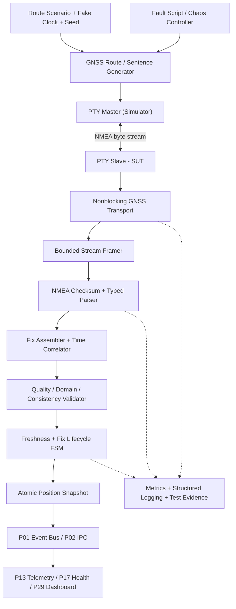
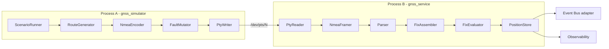
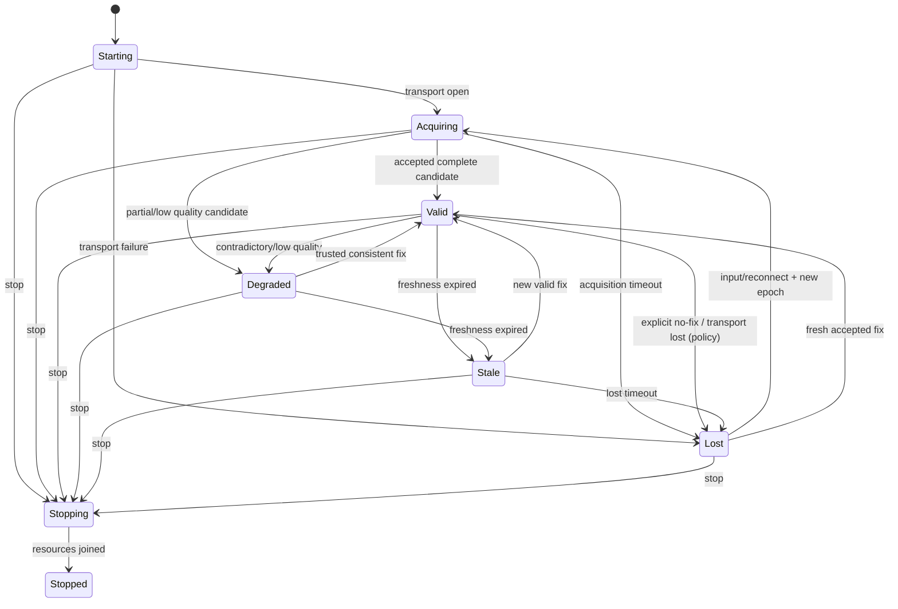

# Project 12 — GNSS/GPS Simulator

> **Virtual TCU Lab | System Design · Operational Behavior · What-if · Fault Injection · Resilience v1.0**  
> **Ngày:** 2026-10-30 · **Ngôn ngữ:** Tiếng Việt · **Implementation target:** C++17 / Ubuntu Linux / Linux PTY  
> **Đối tượng:** Middle C++ Developer · TCU Application, Connectivity & Middleware  
> **Ưu tiên:** P1 · **Phụ thuộc:** P01 Event Bus, P02 IPC, P03 Timer, P04 Config/Logging; **liên kết:** P09 Modem, P10 Connectivity, P11 Network Lab; **cung cấp dữ liệu:** P13 Telemetry, P17 Health, P29 Digital Twin, P30 Full Integration.  
> **Trạng thái:** **TÀI LIỆU THIẾT KẾ + TEST PLAN**; không phải source code thành phẩm; chưa chạy toàn bộ test, chưa chứng minh đạt SLA/OEM.  
> **Giới hạn an toàn:** Toàn bộ dữ liệu vị trí và hành trình là **synthetic**. Không phát tín hiệu RF, không giả mạo GPS ngoài không gian, không truyền dữ liệu vị trí cá nhân, không điều khiển xe thật.

---

## 1. Executive Summary

### 1.1 Vấn đề cần giải quyết

Trong TCU, vị trí GNSS có thể bị mất, đến chậm, chứa dữ liệu lỗi, có timestamp không đáng tin hoặc mâu thuẫn giữa các NMEA sentence. Một lỗi phổ biến là biến **vị trí cũ** thành vị trí `VALID` trong telemetry, hoặc đánh đồng một NMEA sentence có checksum đúng với một fix thực sự hợp lệ. Project này tạo ra cả **GNSS Device Simulator** (bộ phát dữ liệu) và **GNSS Service under Test** (bộ nhận/parse/validate/fuse/publish) nhằm kiểm chứng mọi hợp đồng hành vi.

### 1.2 Deliverables

1. `libtcu_nmea` — stream framer, checksum verifier, typed parsers RMC/GGA/VTG/GSA/GSV/ZDA (phân cấp bắt buộc/tùy chọn).
2. `libtcu_gnss_core` — fix assembler, freshness monitor, quality/consistency evaluator, time mapping, geo helpers, event model.
3. `libtcu_gnss_transport_pty` — serial-like transport: `posix_openpt` hoặc `openpty`, nonblocking raw slave, reconnect, lifecycle.
4. `libtcu_gnss_transport_fake` — in-memory byte transport, fake clock, deterministic callback scheduling, scripted failures.
5. `gnss_simulator` — phát NMEA RMC/GGA tại 1 Hz, route replay, no-fix, fault scripts, drift/jitter, provenance.
6. `gnss_service` — đọc NMEA từ thiết bị giả lập; xuất `PositionSnapshot` + events tới P01/P02.
7. `gnss_labctl` — CLI `run`, `replay`, `inject`, `status`, `doctor`, `report`, `stop`.
8. `test/` — golden vectors, property tests, fuzzing, state model, soak tests, multi-fault orchestration.
9. `artifacts/<run_id>/` — config, seed, NMEA sample đã redacted, timeline, verdict, metrics và logs.

### 1.3 Success criteria (invariants)

- **I-01 No false VALID:** checksum sai / cấu trúc sai / RMC `V` / GGA fix quality `0` không được tạo snapshot vị trí tin cậy `VALID`.
- **I-02 Bounded:** input buffer, NMEA line, queues, pending actions, worker threads, memory, log output đều có giới hạn.
- **I-03 Monotonic freshness:** thời gian hết hạn sử dụng clock monotonic từ lúc **nhận** dữ liệu; sửa giờ hệ thống/GNSS UTC không kéo dài thời hạn snapshot.
- **I-04 Epoch fencing:** data/callback từ stream cũ, generation cũ, route cũ hoặc config cũ không thay đổi trạng thái stream mới.
- **I-05 Atomic snapshot:** lat/lon/speed/time/quality công bố cùng một `fix_epoch` hoặc có nguồn và độ không chắc chắn rõ ràng; không ghép mù hai chu kỳ khác nhau.
- **I-06 Fix lifecycle:** `VALID → STALE → LOST` theo policy; không vô hạn phát lại vị trí cũ như mới.
- **I-07 Numeric safety:** latitude/longitude/distance/speed/time/altitude không NaN/Inf/out-of-domain; phép tính không overflow/division-by-zero.
- **I-08 At-most-one terminal:** mỗi operation control (`start`, `stop`, reload, scenario) có đúng một trạng thái cuối; không double complete.
- **I-09 Fail-closed correctness:** checksum hợp lệ không chứng minh dữ liệu là thật; anomaly/suspected spoof không được xem là kết luận đã xác thực.
- **I-10 Reproducibility:** fake-clock/fake-transport có output deterministic theo seed; Linux PTY có thể biến thiên theo scheduler, phải lưu timing evidence.

### 1.4 Non-goals

- Không mô phỏng RF, vệ tinh, ionosphere, antenna, multipath vật lý, GNSS chip firmware hoặc RTK/PPP chính xác.
- Không là sản phẩm chống spoofing/jamming được chứng nhận; NMEA chỉ là chuỗi text không xác thực cryptographically.
- Không thực thi time synchronization toàn hệ điều hành; chỉ tạo **GNSS time evidence** cho consumer.
- Không yêu cầu map tile/network/GPS hardware: route dùng điểm synthetic; vẽ bản đồ/dashboard là P29.
- Không mặc định bản nâng cấp này tuân thủ NMEA bản quyền, tiêu chuẩn OEM, ISO 26262 hay AUTOSAR.

---

## 2. Scope / Dependency / Ownership

| Thành phần | Role / trách nhiệm | Điều **không** sở hữu |
|---|---|---|
| GNSS Simulator | Sinh route, fix quality, timestamp, NMEA + kịch bản lỗi | Không quyết định TCU business policy |
| Stream Adapter | Nhận raw bytes, reconnect PTY, mark device epoch | Không suy diễn fix quality |
| NMEA Framer | Phân đoạn `$...*HH\r\n` trong luồng bytes | Không tính quãng đường/UTC policy |
| Parser | Kiểm checksum, sentence type, typed field | Không tự sửa dữ liệu malformed |
| Fix Assembler | Ghép record trong cùng epoch/time window | Không giả sử mọi câu phải xuất hiện |
| Fix Validator | Kiểm tra domain, consistency, validity, freshness | Không xác định chắc chắn spoof/jam |
| GNSS State Machine | Publish LOST/STALE/VALID/DEGRADED | Không trực tiếp điều khiển modem |
| P01 Event Bus | Giao location status tới TCU components | Không bảo đảm broker/cloud delivery |
| P13 Telemetry | Dùng snapshot có provenance/quality | Không tự biến STALE thành VALID |
| P29 Dashboard | Hiển thị last known/fresh/unknown rõ | Không dùng UI làm oracle chính |

Mặc định một logical GNSS receiver/stream. Multi-receiver failover chỉ ở extension; không trộn NMEA từ 2 receiver khác nhau khi thiếu source ID.

---

## 3. Requirements Catalog

### 3.1 Functional requirements

| ID | Requirement | Priority | Verification |
|---|---|---|---|
| FR-01 | Nhận NMEA bytes bị chia nhỏ/gộp qua PTY; reconstruct sentence không block vô hạn | MUST | framer unit + PTY integration |
| FR-02 | Check framing, checksum XOR, talker/message allowlist | MUST | golden/malformed corpus |
| FR-03 | Decode `RMC`, `GGA`; `VTG`, `GSA`, `GSV`, `ZDA` optional với policy có version | MUST / SHOULD | parser vector tests |
| FR-04 | Đổi `ddmm.mmmm` và `dddmm.mmmm` sang WGS-84 decimal degrees an toàn | MUST | boundary tests |
| FR-05 | Đổi knots→m/s, degrees, timestamp; tách date/time khi GGA thiếu ngày | MUST | unit + numeric property |
| FR-06 | Fix quality & freshness riêng; publish valid/stale/lost/anomaly kèm `reason_code` | MUST | fake-clock BDD |
| FR-07 | Route replay: stationary, urban, highway, tunnel, loop, antimeridian, pole | MUST | E2E route fixtures |
| FR-08 | Fault scripts: no-fix, checksum, partial, delay, reorder, duplicate, drop, time jumps | MUST | fault catalog |
| FR-09 | Metrics + correlated diagnostic logs có privacy redaction | MUST | log/metric assertions |
| FR-10 | Config validation + atomic hot reload + cancellation/restart safe | MUST | generation tests |
| FR-11 | CLI có `seed`, `rate`, `clock`, `transport`, `route`, `fault-profile` | MUST | CLI tests |
| FR-12 | Google Test/mock clock/test artifact + automated pass/fail/inconclusive | MUST | CI harness |
| FR-13 | Hỗ trợ output synthetic GeoJSON/gpx-like fixture nếu data policy cho phép | SHOULD | fixture validation |
| FR-14 | Giả lập multiple talker/multi-GNSS + optional GSV aggregation | SHOULD | parser/assembly tests |
| FR-15 | Thêm adapter UDP/TCP test-only nếu được tách rõ transport boundary | COULD | non-serial integration |
| FR-16 | Fake time UTC rollover/leap-second presentation (có giới hạn) | SHOULD | time policy tests |

### 3.2 NFR & lab targets (đề xuất, phải benchmark trước khi chốt)

| ID | Target đề xuất | Cách đo / caveat |
|---|---|---|
| NFR-01 | 1 Hz và 10 Hz steady-state; thử burst 100 Hz có hạn mức | sample/s, p95 decode latency |
| NFR-02 | Event queue 1024, line cap 512 bytes (configurable) và hard cap 4096 | max RSS, drop counters; không coi 512 là giới hạn chuẩn NMEA chung |
| NFR-03 | Các budget gợi ý: `stale_after=2s`, `lost_after=5s` ở profile 1 Hz | `steady_clock`, fake tests; policy chỉnh được |
| NFR-04 | Parse/validate lỗi không được terminate service; catch ở worker boundary | malformed fuzz và exception injection |
| NFR-05 | 24h soak ở profile thường: không FD/thread leak, RSS không tăng không giới hạn | Linux `/proc`, sanitizers, valgrind tùy cấu hình |
| NFR-06 | Shutdown không deadlock; bounded deadline do test runner định nghĩa | threads/watchdog, loopback PTY |
| NFR-07 | Published positions có metadata `age`, `source`, `quality`, `epoch` | ABI/contract tests |
| NFR-08 | Replay fake-clock với cùng seed/config cho cùng event trace | deterministic hash |
| NFR-09 | Không có PII thực trong fixture, log và artifact | redact + synthetic-data lint |
| NFR-10 | Error metrics phân biệt `malformed`, `invalid_fix`, `stale`, `transport`, `anomaly` | metric consistency assertions |

---

## 4. Architecture Decisions (ADR)

| ID | Quyết định | Vì sao / trade-off |
|---|---|---|
| ADR-12-01 | Parser và source/simulator **tách process** khi PTY mode | Kiểm thử lỗi I/O thật; in-memory fake mode nhanh và deterministic |
| ADR-12-02 | Dùng **Linux PTY** thay RF/hardware serial | Không cần thiết bị; PTY không tái hiện điện áp, driver/baud thực |
| ADR-12-03 | Receive event loop single-owner per stream | Giảm race khi framing và reassembly |
| ADR-12-04 | Clock interface: monotonic receive time, UTC observation time, simulated time riêng | Không trộn 3 timeline khác nhau |
| ADR-12-05 | Typed records và `expected<T,Error>`-like result trong C++17 | Không dùng exception cho frame malformed thông thường |
| ADR-12-06 | Không công bố fix khi có dữ liệu contradictory vượt policy | Fail closed; có thể gây false negative trong thực tế |
| ADR-12-07 | Fix generation/receiver epoch tăng khi PTY reconnect, source switch hoặc restart | Cấm delayed event từ quá khứ |
| ADR-12-08 | Snapshot immutable, atomic `shared_ptr<const PositionSnapshot>` hoặc lock-protected copy | Reader không thấy trạng thái nửa vời |
| ADR-12-09 | Route/path interpolation qua great-circle/geodesic hoặc local ENU trong vùng nhỏ | Không linear nội suy longitude qua ±180° một cách mù quáng |
| ADR-12-10 | Unsupported sentence: count + skip, không tự tin đoán | Các receiver có vendor extensions khác nhau |
| ADR-12-11 | NMEA checksum chỉ kiểm lỗi truyền, **không xác thực nguồn** | Bảo mật cần trust boundary/provenance khác |
| ADR-12-12 | Test oracle tách **proof-of-injection** và **proof-of-response** | Tránh PASS giả khi script lỗi không có tác dụng |
| ADR-12-13 | Duplicate/late fix không refresh freshness nếu không có new valid observation | Tránh stale masking |
| ADR-12-14 | Khi invalid fix: giữ last known riêng nhưng `current_valid` phải false | Bảo tồn UX mà không che lỗi nguồn |

---

## 5. High-Level Architecture



### 5.1 Component view / boundaries



### 5.2 Trust boundaries

- PTY stream, route JSON và fault scripts đều là **untrusted input** đối với parser/SUT.
- Không cấp quyền quản trị host cho `gnss_service`; simulator chạy dưới user thường.
- Không log raw coordinates ngoài test mode, nếu production dùng PII protection riêng.
- Không đưa sample live GNSS của người dùng vào fixture công khai.

---

## 6. C++17 Public API & Data Contract

```cpp
// Pseudocode / interface proposal - not a compilable complete library.
namespace tcu::gnss {
using SteadyTime = std::chrono::steady_clock::time_point;
using UtcTime = std::chrono::system_clock::time_point;
using Epoch = std::uint64_t;

enum class FixState { Starting, Acquiring, Valid, Degraded, Stale, Lost, Stopping, Stopped };
enum class FixSource { SimulatedPty, RecordedFixture, MockReceiver };
enum class Quality { Unknown, NoFix, Gps, Dgps, RtkFloat, RtkFixed, Estimated };
enum class ParseError { FrameTooLong, BadFraming, BadChecksum, Unsupported, BadFieldCount,
                        InvalidNumeric, OutOfRange, InconsistentFields, BadTime, BadTalker };
enum class RejectReason { None, NoFix, OldEpoch, StaleObservation, InvalidCoordinates,
                          ContradictoryStatus, ImplausibleJump, UntrustedTime };

struct GnssObservation {
    Epoch receiverEpoch{};
    std::uint64_t sequence{};
    std::string talker;  // e.g. "GN", "GP"; bounded + validated
    std::string sentence; // e.g. "RMC", "GGA"
    SteadyTime receivedAt{};
    std::optional<UtcTime> utcOfFix;
    std::optional<double> latitudeDeg;
    std::optional<double> longitudeDeg;
    std::optional<double> speedMps;
    std::optional<double> courseDeg;
    std::optional<double> altitudeMslMeters;
    std::optional<double> hdop;
    Quality quality{Quality::Unknown};
    bool declaredValid{false};
};

struct PositionSnapshot {
    Epoch receiverEpoch{};
    std::uint64_t fixSequence{};
    FixState state{FixState::Starting};
    bool currentValid{false};
    std::optional<double> latitudeDeg, longitudeDeg, speedMps, courseDeg;
    std::optional<double> altitudeMslMeters;
    std::optional<UtcTime> fixUtc;
    SteadyTime receivedAt{};
    std::chrono::milliseconds age{};
    Quality quality{Quality::Unknown};
    RejectReason reason{RejectReason::None};
    bool anomalySuspected{false};
};

struct GnssPolicy {
    std::chrono::milliseconds staleAfter{2000};
    std::chrono::milliseconds lostAfter{5000};
    std::chrono::milliseconds crossSentenceWindow{500};
    std::size_t maxSentenceBytes{512};
    std::size_t maxBufferedBytes{4096};
    std::size_t maxPendingObservations{128};
    double maxSpeedMps{90.0};      // example only; OEM-specific
    double maxAccelerationMps2{15.0};  // example only
};

class IClock {
public:
    virtual ~IClock() = default;
    virtual SteadyTime steadyNow() const noexcept = 0;
    virtual UtcTime systemUtcNow() const = 0;
};

class IGnssByteStream {
public:
    virtual ~IGnssByteStream() = default;
    virtual void start() = 0;
    virtual void stop() noexcept = 0;
    virtual void setReceiver(ByteCallback onBytes) = 0; // typedef in real code
};

class INmeaParser {
public:
    virtual ~INmeaParser() = default;
    virtual ParseResult parse(std::string_view sentence, Epoch epoch, SteadyTime rx) = 0;
};

class IGnssService {
public:
    virtual ~IGnssService() = default;
    virtual void start() = 0;
    virtual void stop() = 0;
    virtual PositionSnapshot snapshot() const = 0;
    virtual Subscription subscribe(PositionCallback callback) = 0;
};
} // namespace tcu::gnss
```

> `ByteCallback`, `ParseResult`, `PositionCallback` và `Subscription` là interface placeholders cần định nghĩa trong source. Đây là **API proposal**; không đánh dấu là code compilable.

### 6.1 NMEA typed representation

- `RmcData`: time, date, status A/V, latitude, longitude, knots, true course, mode nếu có.
- `GgaData`: time of day, lat/lon, fix quality, satellites, HDOP, altitude MSL, geoid separation (nếu có).
- `VtgData`: course true/magnetic, speed knots/kmh; không tự tạo position fix từ VTG.
- `GsaData`: fix mode, DOP, satellite IDs; không thay thế RMC/GGA validity.
- `GsvData`: các trang GSV, satellite health/visibility telemetry; thiếu trang ≠ mất location fix.
- `ZdaData`: date/time optional, không ép RMC+ZDA cùng epoch bằng heuristic mơ hồ.

### 6.2 Internal queues & ownership

- Stream read/framing trên một I/O owner; mutation tới `FixAssembler` từ `DecodedObservationQueue` bounded; reducer single-writer.
- Reader của snapshot được copy/atomic publish; không giữ mutex khi gọi external callback.
- Queue full: ưu tiên lifecycle/no-fix events hơn diagnostic satellite detail; preserve thứ tự fix ở cùng stream epoch, count drops, đánh dấu DEGRADED nếu mất continuity.
- `stop()` cancels timers, ngừng enqueue, wake I/O, drain/discard theo explicit policy, join thread không từ chính thread mà đang chạy.

---

## 7. NMEA Grammar & Correctness Policy

### 7.1 Frame & checksum

Dạng phổ biến: `$ttsss,field1,field2,...*HH\r\n`, với `tt` = talker (thường `GP`, `GN`, `GL`, `GA`, `GB`...), `sss` = sentence type (ví dụ `RMC`). Checksum là XOR từng byte ASCII giữa `$` và `*`, **không gồm hai dấu này**. `\r\n` là separator chuẩn của profile. Cấu hình cho phép receiver profile-specific tolerance nếu cần, nhưng default parser strict.

- `$` không có `*`: buffer tích lũy đến hard cap rồi resync; không giữ vô hạn.
- `*` sai/thiếu 2 ký tự hex: reject.
- Checksum mismatch: reject record, metric tăng, không publish position từ record lỗi.
- Sentence không được hỗ trợ: skip + metrics, không crash; không làm invalid `VALID` fix vốn đã được tạo hợp lệ từ trước, nhưng freshness vẫn hết hạn theo timer.
- Một valid checksum không chứng minh `status = A`, không chứng minh tọa độ hợp lý, và không bảo vệ chống giả mạo có chủ đích.

### 7.2 Field semantics then-and-only-then

- Latitude NMEA: `ddmm.mmmm` + N/S ⇒ `sign × (degrees + minutes/60)`; longitude `dddmm.mmmm` + E/W tương tự.
- Phải kiểm `minutes < 60`, latitude ≤90, longitude ≤180, hemisphere hợp lệ và `std::isfinite`.
- RMC `A` là yêu cầu cần nhưng **chưa đủ** để tạo fix tin cậy; `V` không tạo valid fix.
- GGA `quality=0` là no-fix; các code quality còn lại dùng bảng mapping theo receiver profile, không hard-code số lạ thành `Valid`.
- GGA altitude là **MSL/orthometric height**, không phải ellipsoid height; geoid separation là trường riêng.
- RMC speed: knots × `0.514444444...` → m/s; speed không âm; course trong `[0,360)` hoặc theo policy xử lý 360°; khi đứng yên course có thể không đáng tin.
- GGA time **không có date**; không ghép day của host wall clock một cách mù quáng.
- Multi-GNSS (`GN`) và multiple talker phải tôn trọng source/epoch; vendor-specific extensions optional và có allowlist.

### 7.3 Fix selection policy (v1)

1. Một RMC hợp lệ (checksum + status A + coordinate + UTC date/time coherent) có thể tạo **candidate**.
2. GGA cùng receiver epoch và UTC time-of-day trong `crossSentenceWindow` bổ sung quality/altitude/HDOP; nếu có mâu thuẫn fix quality `0`, không công bố confident `VALID` cho candidate đó.
3. Nếu GGA vắng mặt, RMC-only mode được cấu hình rõ ràng, quality `Unknown/Reduced`, trạng thái `DEGRADED` nếu business policy yêu cầu GGA.
4. Nếu RMC vắng mặt nhưng GGA quality positive, chỉ publish `DEGRADED`/`candidate` nếu policy cho phép time anchoring có kiểm chứng; không tạo UTC date từ đầu.
5. Dữ liệu đến sau deadline assembly thuộc epoch khác phải drop hoặc quarantine; không rewrite snapshot cũ đã công bố.
6. Contradictory data (vị trí, fix status, time, tốc độ) ⇒ anomaly/degraded; không lặng lẽ chọn trường thuận tiện.

### 7.4 Reference test vectors (checksum tính bằng encoder trong tests)

```text
# Nội dung NMEA trước *HH, được encode checksum tự động trong test fixture:
GNRMC,101010.00,A,1018.0000,N,10640.0000,E,12.0,090.0,301026,,,A
GNGGA,101010.00,1018.0000,N,10640.0000,E,1,10,0.9,12.0,M,0.0,M,,
GNRMC,101011.00,V,,,,,,,301026,,,N
```

> Đây là **payload templates**; không gửi nguyên các dòng này qua PTY như NMEA hoàn chỉnh trước khi thêm `$`, checksum XOR và `\r\n`. Ngày/giờ là dữ liệu synthetic.

---

## 8. Core Algorithms

### 8.1 NMEA checksum

```cpp
std::uint8_t nmeaChecksum(std::string_view payload) noexcept {
    std::uint8_t c = 0;
    for (const unsigned char b : payload) c ^= b;
    return c;
}
```

### 8.2 Coordinate decode

```text
raw = finite numeric ddmm.mmmm / dddmm.mmmm
whole_degrees = floor(raw / 100)
minutes       = raw - 100 * whole_degrees
require 0 <= minutes < 60
require degrees in [0,90] for latitude or [0,180] for longitude
if degree at max -> minutes must be 0
decimal = sign(hemisphere) * (whole_degrees + minutes / 60)
reject if non-finite or out of range
```

### 8.3 Arrival order, fix-time correlation & stale

- `rx_time` lấy từ `steady_clock` khi record nhập parser, không từ host UTC.
- `fix_utc` là dữ liệu NMEA của receiver; dùng để correlate candidate, đánh giá time sanity, không dùng trực tiếp cho TTL.
- Duplicate RMC replay của timestamp cũ **không** refresh freshness của last accepted fix.
- Sau 2s không có fresh valid fix (example): `VALID → STALE`; sau 5s: `STALE → LOST` và `currentValid=false`; không lặp `FixLost` mỗi lần tick.
- No-fix reported (`RMC V` hoặc `GGA q=0`) có thể chuyển `VALID→DEGRADED/LOST` ngay tùy policy; không đợi timeout nếu nguồn nói rõ mất fix.

### 8.4 Geodesic sanity checks

- Đối với khoảng cách 2 điểm synthetic, dùng haversine (numeric clamp) hoặc thư viện GeographicLib nếu muốn độ chính xác cao.
- Delta longitude chuẩn hóa về `[-180°,180°]` để đi qua antimeridian mà không suy ra vòng Trái Đất.
- Speed-estimate = distance / ∆t chỉ dùng nếu ∆t > 0 và cả hai fix đủ tin cậy; vẫn cần chấp nhận measurement noise.
- Phát hiện jump bất thường dựa trên threshold cấu hình + margin/accuracy, xuất `SuspectedAnomaly`, không tuyên bố chắc chắn spoof.
- Latitude ở gần cực, bearing undefined khi đứng yên / antipodal; avoid division-by-zero.

---

## 9. State Machine & Operational Behavior



### 9.1 Startup

1. Validate policy + scenario + synthetic-only route; allocate bounded buffers.
2. Open PTY master (simulator), slave via stable path/handshake; configure raw, non-blocking.
3. Allocate `receiverEpoch = epoch+1`; discard partial bytes and pending fixes of old epoch.
4. Bring service into `Acquiring`; consume sentences; never default to `Valid` merely because transport is open.
5. First valid coherent fix transitions to `Valid`/`Degraded` depending on quality.

### 9.2 Normal sequence

```mermaid
sequenceDiagram
  participant Sim as GNSS Simulator
  participant Pty as PTY/Framer
  participant Parser as NMEA Parser
  participant Fix as Fix Assembler
  participant FSM as GNSS FSM
  participant Bus as TCU Event Bus
  Sim->>Pty: RMC bytes (split/gather possible)
  Pty->>Parser: complete RMC, checksum verified
  Parser->>Fix: RMC typed observation
  Sim->>Pty: GGA bytes
  Pty->>Parser: complete GGA
  Parser->>Fix: GGA typed observation
  Fix->>FSM: coherent candidate + quality + receiver epoch
  FSM->>Bus: GnssPositionUpdated(snapshot)
  Note over FSM,Bus: UTC is data; freshness uses monotonic time
```

### 9.3 Partial/no-fix and stale

- Trước khi có fix: `Acquiring` + `currentValid=false`; no-fix repeated không gây event storm.
- Sau một fix tốt, NMEA ngừng: giữ `lastKnown` riêng nhưng chuyển STALE→LOST theo monotonic deadlines.
- NMEA vẫn đến đều nhưng chỉ GSV/GSA không phải fresh coordinate; **không refresh** valid fix.
- RMC `V` dù checksum OK: invalidates new candidate; reject as current position.

### 9.4 Reconnect/restart

- Mất PTY/mất writer => `TransportUnavailable`, release fd, invalidate epoch, bounded backoff hoặc chờ external device service.
- Khi reconnect: tạo epoch mới và **Acquiring**; RMC/GGA còn đang callback epoch cũ bị bỏ.
- Sau service restart, load config nhưng không restore previous `Valid` from persisted cache; chỉ `lastKnown` với source/age và `currentValid=false` nếu được phép.

### 9.5 Scenario playback

- `scenario_rate` điều khiển **dòng thời gian phát**; rate 0 = pause; negative/NaN = invalid config.
- Timestamp NMEA sinh từ timeline scenario, không phụ thuộc thread-scheduler host; real PTY mode đo jitter thật.
- Seek/rewind là **new scenario generation**; reset sequence/time correlation; late playback trước seek không gây cập nhật mới.
- Fault mutation thực hiện có thứ tự: build valid logical fix → NMEA encode → transport mutation/field mutation theo scenario; report injection actually applied.

### 9.6 Shutdown

- Idempotent `stop`: stop scenario emissions, mark `Stopping`, disable callback publication, wake blocked I/O, close own FDs, join worker, flush bounded artifact, `Stopped`.
- Không gọi `join()` self; callbacks không được chạy sau destroy của owner; timeout là tình trạng FAIL có evidence chứ không detach threads để che lỗi.

---

## 10. Behavioral Contracts (Given / When / Then)

| ID | Given | When | Then |
|---|---|---|---|
| BC-01 | no receiver | start service | `Acquiring`, `currentValid=false` |
| BC-02 | coherent RMC/GGA | receive pair | one `PositionUpdated`, synchronized fields |
| BC-03 | valid RMC but missing GGA | receive/time window expires | policy-defined `Degraded` or reject; no invented GGA fields |
| BC-04 | valid previous fix | RMC V | update to nonvalid state; preserve lastKnown separately |
| BC-05 | no new coordinate for 2s | fake advance 2s | `Stale`, no new `PositionUpdated` |
| BC-06 | stale for 5s total | fake advance | `Lost`, one transition event |
| BC-07 | PTY reconnect | old callback arrives | discard old epoch |
| BC-08 | bad checksum line | parse | drop; checksum_error++ |
| BC-09 | partial line | feed fragments | no early dispatch; one dispatch after complete CRLF |
| BC-10 | stream garbage long | feed 1 MiB noise | bounded memory, resynchronize on next `$` |
| BC-11 | timestamp UTC jumps backward | receive new fix | anomaly/time policy, monotonic freshness unaffected |
| BC-12 | antimeridian-crossing route | replay | short cross-180° distance, no spurious 360° jump |
| BC-13 | GGA quality 0 | valid RMC concurrently | contradiction triggers reject/degraded policy |
| BC-14 | queue full | GSV storm | bounded drop + observable metrics; no false Valid |
| BC-15 | `stop` called twice | any state | at-most-once teardown, no crash |
| BC-16 | invalid hot reload | config apply | keep old policy/snapshot; report invalid config |
| BC-17 | sensor says fix valid but implausible teleport | receive | anomaly flag, no unqualified `Valid` acceptance |
| BC-18 | valid checksum malicious forged coordinate | receive | no cryptographic assertion; anomaly checks best effort only |
| BC-19 | OS time changes | real clock jump | no change in monotonic TTL of accepted fix |
| BC-20 | test fault didn't reach SUT | scenario finish | `INCONCLUSIVE`, not PASS |

---

## 11. Concurrency, Lifetime & Memory Model

- I/O thread owns PTY fd; `read` non-blocking + `poll`/`epoll` + wake pipe/eventfd; EAGAIN/EOF handled distinctly.
- Worker queue bounded with backpressure/drop policy; parser does not retain `string_view` beyond owning buffer lifetime.
- Reducer thread is single writer of fix state; observer callbacks run outside state lock via P01 Event Bus.
- `generation` token guards delayed timers/reload callbacks; `shared_ptr`/weak callbacks prevent UAF.
- Deadline priority for freshness must not starve due to GSV spam; use separate coordinator clock or reliable timer path.
- Control API (`start`, `pause`, `seek`, `stop`) serialized through command queue; command ID has exactly one terminal status.
- Parser avoids unrestricted recursion, large stack arrays, unbounded strings/JSON or exceptions per malformed byte.
- `std::atomic` is not sufficient to publish unrelated fields independently; use immutable snapshot/lock.

### 11.1 Resource protection

| Resource | Limit/policy | When exceeded |
|---|---|---|
| raw sentence | default 512 bytes; absolute 4096 | `FrameTooLong`, resync |
| partial stream buffer | 4096 bytes default | discard until next `$`, metric |
| typed observation queue | 1024 default | drop policy + degradation; never overwrite undetected |
| GSV group memory | at most `k` groups/receiver and expiry | discard incomplete groups |
| raw log throughput | sampling/rate limits | summary count, never log PII by default |
| pending timers | bounded | report rejected timer, enforce watchdog |
| open file descriptors | fixed number per simulator/service | cleanup, `EMFILE` error and health signal |

---

## 12. Security, Privacy & Integrity Model

1. **No real location fixtures** in repo; example route is synthetic and labeled.
2. Raw NMEA can expose coordinates/time; redact or disable in logs by default. Preserve raw frames for test only in restricted artifacts if explicitly enabled.
3. Untrusted external NMEA can include oversized fields, binary bytes, malicious delimiters, numeric overflow. Treat parsers as attack surface.
4. NMEA XOR checksum is weak error-detection, **not anti-spoof/anti-replay/authentication**.
5. Detect suspicious jumps/time inconsistencies as **quality alerts**, not proof of RF spoofing or fraud. Do not promise GNSS location authentication.
6. Simulated routes and output must be marked `source=SIMULATED` so production telemetry cannot mistake them for real vehicle positions.
7. Prevent test control endpoint from listening on public interfaces by default. File paths validated against lab directory; no arbitrary host writes.
8. Test data retention configured; artifacts carry run ID and synthetic provenance.

---

## 13. Observability / Metrics / Evidence

| Metric | Definition / scope |
|---|---|
| `gnss_bytes_rx_total` | byte count after stream read |
| `gnss_sentence_complete_total{type}` | framed complete sentences |
| `gnss_checksum_reject_total` | checksum rejects |
| `gnss_schema_reject_total{reason}` | invalid fields/shape/talker |
| `gnss_fix_accepted_total` | new coherent fix accepted |
| `gnss_fix_rejected_total{reason}` | candidates dropped |
| `gnss_current_fix_age_ms` | monotonic age since accepted new observation |
| `gnss_fix_state{state}` | state as labeled gauge |
| `gnss_epoch_total` | receiver restarts/reconnect generations |
| `gnss_queue_depth` / `gnss_queue_drops_total` | overload evidence |
| `gnss_anomaly_suspected_total{reason}` | location/time inconsistency alerts |
| `gnss_serial_errors_total{errno}` | PTY / reader errors |
| `gnss_dispatch_latency_ms` | accepted fix→event dispatch latency |
| `gnss_route_position_error_m` | simulator truth vs decoded position |
| `gnss_injection_applied_total{fault}` | proof-of-injection count |

**Artifact schema (suggested):**

```json
{
  "run_id": "P12-20261030-001",
  "seed": 20261030,
  "test_id": "WF12-001",
  "scenario_generation": 3,
  "device_epoch": 7,
  "scenario_config_hash": "sha256-of-config",
  "fault": {"type": "checksum_corruption", "attempted": true, "observed": true},
  "sut": {"state_before": "Valid", "state_after": "Stale", "false_valid": false},
  "verdict": "PASS",
  "evidence": ["nmea-events.jsonl", "metrics.json", "assertions.json"]
}
```

Use `PASS` nếu đã **chứng minh inject thành công** + đủ evidence + invariant đúng. `FAIL` nếu invariant sai. `INCONCLUSIVE` nếu fault không thật sự tác động hoặc không đủ bằng chứng. `SKIPPED` nếu capability thiếu và được dự báo trước; tuyệt đối không cộng vào PASS.

---

## 14. What-if Coverage Methodology

- **Input equivalence classes:** hợp lệ, thiếu, rỗng, sai checksum, valid-checksum semantic-invalid, cực trị, lỗi sequence, binary noise.
- **Time/space boundaries:** UTC midnight, date rollover, seconds=60 policy, GPS week rollover, ±180°, ±90°, zero distance/time.
- **State transitions:** mỗi state × mỗi event chính + stale/reconnect/restart/shutdown + event race.
- **Resource/failure model:** queue full, FD exhaustion, CPU contention, disk full, crash, PTY broken, timer delayed.
- **Compound faults:** hai hoặc nhiều lỗi xuất hiện trong khoảng giao nhau; xác định happens-before rõ ràng.
- **Oracle separation:** injection thật? stream nhận được? parser reject? state đổi? event phát? consumer có đọc đúng snapshot?
- **Coverage limit:** không thể chứng minh *mọi* trạng thái của GNSS thật, song catalog cần bao phủ có hệ thống các rủi ro chính; mới phát hiện corner case phải thêm regression case có ID.

### 14.1 Phân loại độ ưu tiên

- **P0:** false `VALID`, lost/invalid fix, data corruption, buffer safety, concurrency UAF, time error, wrong provenance/security.
- **P1:** recovery, performance, quality reporting, malformed optional types, config/availability.
- **P2:** hiếm gặp/phụ thuộc OEM profile, extension sentence, platform-specific.

---
## 15. Comprehensive What-if Catalog — 276 test scenarios / 23 nhóm

Mỗi hàng là một **test case riêng**: cách inject cụ thể, kết quả kỳ vọng và bằng chứng cần thu. Không thể tự động coi một case PASS chỉ bằng việc không bị crash. Thời gian/threshold dựa trên config của scenario; P0 có thể đổi tùy hazard assessment của dự án OEM.

### 15.01. Framing & stream resynchronization — 12 cases

| ID | How to inject / What if | Expected behavior (oracle) | Evidence | Pri |
|---|---|---|---|---|
| WF12-001 | Chia 1 sentence thành từng byte PTY | Chỉ parse khi có sentence hoàn chỉnh, đúng 1 lần | framer event count | P0 |
| WF12-002 | Gửi RMC+GGA trong 1 lần write | Tách đúng 2 sentences không gộp payload | typed observation IDs | P0 |
| WF12-003 | Cắt PTY ngay trước `*` | Không xuất candidate từ frame chưa hoàn chỉnh | no accepted fix | P0 |
| WF12-004 | Cắt PTY ngay giữa checksum | Frame dở không được công bố | checksum/framer log | P0 |
| WF12-005 | Gửi ký tự `$` bên trong payload hỏng | Resync theo policy, không tạo sentence giả | framer recover trace | P0 |
| WF12-006 | Gửi 1 MiB bytes không có `$` | Buffer bounded, không OOM | peak RSS/max buffer | P0 |
| WF12-007 | Gửi CRLF tách qua hai reads | Nhận đúng một sentence | dispatch count | P0 |
| WF12-008 | Gửi LF không có CR | Strict mode reject; tolerant mode chỉ theo config | reason code + policy | P0 |
| WF12-009 | Gửi CR lẻ rồi timeout | Flush/reject partial, không kẹt parser | timeout + buffer gauge | P1 |
| WF12-010 | Chèn NUL vào field | Reject malformed binary field | reject reason | P1 |
| WF12-011 | Chèn byte 0xFF vào header | Không vượt bounds, không convert lén | sanitizer report | P1 |
| WF12-012 | Gửi 4097-byte sentence khi hard cap 4096 | Drop và resync nhận frame hợp lệ tiếp theo | drop + recovered count | P1 |

### 15.02. Checksum, talker & sentence dispatch — 12 cases

| ID | How to inject / What if | Expected behavior (oracle) | Evidence | Pri |
|---|---|---|---|---|
| WF12-013 | Đảo 1 bit payload nhưng giữ checksum | Reject checksum mismatch | checksum_reject++ | P0 |
| WF12-014 | Thay checksum bằng `GG` | Reject invalid hexadecimal | parse reason | P0 |
| WF12-015 | Chỉ có 1 ký tự checksum | Reject truncated checksum | framer reason | P0 |
| WF12-016 | Thêm 3 ký tự checksum | Reject extra bytes trong strict mode | framer reason | P0 |
| WF12-017 | Gửi lowercase checksum hợp lệ | Accept nếu parser profile cho phép hex case | profile assertion | P0 |
| WF12-018 | Gửi `GNRMC` thay `GPRMC` | Map đúng multi-GNSS talker, không drop nhầm | parser type count | P0 |
| WF12-019 | Gửi talker `GL` supported | Đúng source/talker metadata | observation talker | P0 |
| WF12-020 | Gửi talker `ZZ` không allowlist | Skip/reject, không crash | unsupported metric | P0 |
| WF12-021 | Gửi sentence `Pxxx` vendor proprietary | Skip trừ khi plugin configured | extension dispatch | P1 |
| WF12-022 | Gửi unknown 3-char sentence | Skip + metric; fix cũ vẫn TTL bình thường | unknown metric + age | P1 |
| WF12-023 | Đưa 2 dấu `*` trong frame | Reject framing mơ hồ | framer reason | P1 |
| WF12-024 | Replay đúng frame nhiều lần | Không tăng accepted fix nếu cùng timestamp + epoch | duplicate counter | P1 |

### 15.03. RMC mandatory fields and semantics — 12 cases

| ID | How to inject / What if | Expected behavior (oracle) | Evidence | Pri |
|---|---|---|---|---|
| WF12-025 | RMC status `V` với lat/lon hợp lệ | Không tạo `Valid` fix | state + reject | P0 |
| WF12-026 | RMC status `A` nhưng lat rỗng | Reject candidate | missing field metric | P0 |
| WF12-027 | RMC status `X` | Reject enum không hợp lệ | typed parser error | P0 |
| WF12-028 | RMC thiếu date | Không bịa date từ host wall time | utc field absent | P0 |
| WF12-029 | RMC thiếu time | Không publish trusted fix time | reject/quality | P0 |
| WF12-030 | RMC 00 knots | Speed=0 m/s, course may be unknown | numeric snapshot | P0 |
| WF12-031 | RMC speed `-0.5` | Reject negative speed | schema reject | P0 |
| WF12-032 | RMC speed `1e309` | Reject overflow/Infinity | finite assertion | P0 |
| WF12-033 | RMC track `361` | Reject/mark invalid course theo profile | course reason | P1 |
| WF12-034 | RMC track rỗng khi đứng yên | Accept fix nhưng course unknown | optional field | P1 |
| WF12-035 | RMC ddmmyy malformed `321399` | Reject impossible date | date parser | P1 |
| WF12-036 | RMC status A với valid checksum nhưng impossible position | Reject semantic-invalid fix | invariant I-01 | P1 |

### 15.04. GGA quality, altitude & correlation — 12 cases

| ID | How to inject / What if | Expected behavior (oracle) | Evidence | Pri |
|---|---|---|---|---|
| WF12-037 | GGA fix quality `0` cùng RMC A | Không publish confident Valid trái status | contradiction reason | P0 |
| WF12-038 | GGA fix quality `1` với cùng time RMC | Bổ sung quality/altitude/HDOP | same fix epoch | P0 |
| WF12-039 | GGA time lệch RMC hơn merge window | Không trộn hai epochs/timepoints | snapshot provenance | P0 |
| WF12-040 | GGA latitude trái RMC 1 độ | Reject/flag inconsistent candidate | position disagreement | P0 |
| WF12-041 | GGA altitude `-100.0,M` | Accept MSL negative nếu finite | altitude value | P0 |
| WF12-042 | GGA altitude `10.0,F` | Reject unsupported unit or convert by explicit profile | unit error | P0 |
| WF12-043 | GGA geoid separation 30 M | Không thay altitude MSL bằng ellipsoid elevation | separate fields | P0 |
| WF12-044 | GGA HDOP -1 | Reject invalid HDOP | field validation | P0 |
| WF12-045 | GGA satellites 0 nhưng quality 1 | Apply consistency policy/degraded | quality reason | P1 |
| WF12-046 | GGA positive fix mà không có RMC | RMC-required mode không tạo full UTC fix | partial candidate | P1 |
| WF12-047 | GGA time only qua midnight | Không tự gán ngày hiện tại thiếu evidence | utc provenance | P1 |
| WF12-048 | GGA vendor quality code lạ | Không map thành RTK Fix ngầm | unsupported quality metric | P1 |

### 15.05. VTG/GSA/GSV/ZDA auxiliary records — 12 cases

| ID | How to inject / What if | Expected behavior (oracle) | Evidence | Pri |
|---|---|---|---|---|
| WF12-049 | VTG đến trước RMC | Không tạo position từ VTG đơn lẻ | snapshot unchanged | P0 |
| WF12-050 | VTG knots và km/h mâu thuẫn | Reject speed enrichment, emit discrepancy | validation reason | P0 |
| WF12-051 | VTG true course trống | Không tạo course=0 mặc định | optional value | P0 |
| WF12-052 | GSA fix mode 1 còn RMC A | Đánh dấu disagreement, policy không false Valid | quality reason | P0 |
| WF12-053 | GSA DOP `NaN` | Reject non-finite | reject metric | P0 |
| WF12-054 | GSV 3 trang đến đúng thứ tự | Aggregate satellites theo talker/epoch | group count | P0 |
| WF12-055 | GSV mất trang 2/3 | Discard/expire group, không giữ vĩnh viễn | gsv TTL | P0 |
| WF12-056 | GSV trang 3 đến trước trang 1 | Policy reorder bounded hoặc reject; không crash | group tracker | P0 |
| WF12-057 | GSV trang có total-pages=255 | Reject/bound memory | resource proof | P1 |
| WF12-058 | GSV nhiều talker cùng satellite ID | Không ghi đè source constellation | composite key | P1 |
| WF12-059 | ZDA date khác RMC cùng fix UTC | Time contradiction flagged | timestamp reason | P2 |
| WF12-060 | Chỉ phát GSV/GSA liên tục mà không RMC/GGA | Current position phải stale/lost | freshness state | P2 |

### 15.06. Numeric lat/lon boundaries & units — 12 cases

| ID | How to inject / What if | Expected behavior (oracle) | Evidence | Pri |
|---|---|---|---|---|
| WF12-061 | Latitude +90° đúng minutes=0 | Accept +90 nếu field encoded đúng | coordinate output | P0 |
| WF12-062 | Latitude +90° và minutes >0 | Reject out-of-range | invalid_lat++ | P0 |
| WF12-063 | Latitude -90° đúng | Accept cực Nam | coordinate output | P0 |
| WF12-064 | Longitude +180° minutes=0 | Accept 180 boundary | coordinate output | P0 |
| WF12-065 | Longitude -180° minutes=0 | Accept -180 boundary | coordinate output | P0 |
| WF12-066 | Longitude +180° minutes>0 | Reject | invalid_lon++ | P0 |
| WF12-067 | NMEA minutes=60.0000 | Reject, không normalize sang degrees+1 | invalid_minutes | P0 |
| WF12-068 | Field chứa dấu `-` khi N/S đã quy định | Reject ambiguous sign syntax | parse error | P0 |
| WF12-069 | Field `0000.0000,S` | Normalize 0 consistent; no NaN/sign bug | numeric comparison | P1 |
| WF12-070 | Field `000.0000,E` longitude | Accept 0.0° hợp lệ | coordinate output | P1 |
| WF12-071 | Field `12abc` | Reject nonnumeric suffix | strict parse | P1 |
| WF12-072 | Field `1e-9999` | Không underflow thành fake precision; validation policy | numeric report | P1 |

### 15.07. Time, date, leap & clock domain — 12 cases

| ID | How to inject / What if | Expected behavior (oracle) | Evidence | Pri |
|---|---|---|---|---|
| WF12-073 | RMC UTC 23:59:59 sang 00:00:00 ngày sau | Giữ thứ tự, không âm delta elapsed | timestamp trace | P0 |
| WF12-074 | NMEA time 24:00:00 | Reject invalid hour | time reason | P0 |
| WF12-075 | NMEA minute 60 | Reject invalid minute | time reason | P0 |
| WF12-076 | Leap-second text 23:59:60 | Handle theo explicit profile; không lén +1 ngày | special time metric | P0 |
| WF12-077 | Day 29/02 năm nhuận | Parse valid calendar | UTC date | P0 |
| WF12-078 | Day 29/02 năm không nhuận | Reject | UTC date reject | P0 |
| WF12-079 | Date 311299 2-digit year | Dùng century policy xác định, không heuristic im lặng | time config | P0 |
| WF12-080 | Date ở mốc GPS week rollover fixture | Không nhảy sai ngày/tự suy week từ NMEA | UTC trace | P0 |
| WF12-081 | System wall clock bị chỉnh +2 giờ | Fix TTL không thay đổi | steady age | P1 |
| WF12-082 | System wall clock bị chỉnh -1 ngày | Không coi fix trở nên mới hơn | state/age | P1 |
| WF12-083 | NMEA fixUtc đi lùi 1 giây bất thường | Flag replay/out-of-order theo policy | time anomaly | P1 |
| WF12-084 | NMEA fixUtc đi trước host UTC 1 ngày | Reject/quarantine trusted time, monotonic lifetime unaffected | time trust reason | P1 |

### 15.08. Fix assembly, contradictory epochs — 12 cases

| ID | How to inject / What if | Expected behavior (oracle) | Evidence | Pri |
|---|---|---|---|---|
| WF12-085 | RMC+GGA same fix time, different receive order | Exactly one coherent composite snapshot | fix_seq + fields | P0 |
| WF12-086 | GGA đến sau merge window | Không apply vào accepted fix cũ vô thời hạn | time correlation | P0 |
| WF12-087 | RMC mới đến trước GGA cũ | Không ghép lộn chu kỳ | fix_time matcher | P0 |
| WF12-088 | RMC A và GGA q0 same epoch | Không false Valid | invariant I-01 | P0 |
| WF12-089 | 2 RMC cùng timestamp, lat khác nhau | Flag contradiction, không refresh TTL | duplicate/conflict counters | P0 |
| WF12-090 | RMC từ epoch 8 và GGA epoch 7 | Không fuse | epoch rejection | P0 |
| WF12-091 | GGA bị mất hoàn toàn | RMC-only policy áp dụng đúng; no invented quality | snapshot provenance | P0 |
| WF12-092 | RMC bị mất hoàn toàn | GGA-only behavior theo policy; no invented date | snapshot UTC evidence | P0 |
| WF12-093 | RMC/GGA từ talkers GN/GP cùng device | Correlate chỉ nếu allowed mapping | source provenance | P1 |
| WF12-094 | RMC source A và GGA source B | Không fuse across receivers | receiver source key | P1 |
| WF12-095 | GGA MSL altitude xuất hiện sau publish | Chỉ publish enrichment nếu policy cho phép/versioned; không mutate snapshot cũ | new snapshot version | P1 |
| WF12-096 | RMC new valid sau inconsistent candidate | Recover with latest truly consistent fix | state transition | P1 |

### 15.09. Freshness, stale, no-fix & lifecycle — 12 cases

| ID | How to inject / What if | Expected behavior (oracle) | Evidence | Pri |
|---|---|---|---|---|
| WF12-097 | Start không có GNSS source | Acquiring/Unavailable, never Valid | state trace | P0 |
| WF12-098 | Có 1 fix rồi ngừng NMEA 2s | Transition Stale theo monotonic | fake clock trace | P0 |
| WF12-099 | Ngừng NMEA 5s | Transition Lost và currentValid=false | state snapshot | P0 |
| WF12-100 | Lặp RMC timestamp cũ mỗi 100ms | Không refresh valid age | accepted sequence | P0 |
| WF12-101 | Chỉ nhận GSV sau last fix | Freshness vẫn hết hạn | age metric | P0 |
| WF12-102 | Có RMC V ngay sau valid | Update no-fix state theo policy | state reason | P0 |
| WF12-103 | No-fix lặp 1000 lần | Không emit 1000 FixLost, bounded log | event count | P0 |
| WF12-104 | Nhận fix tốt sau Lost | Transition Valid, new accepted sequence | recovery count | P0 |
| WF12-105 | No fix quality nhưng tọa độ giống vị trí cũ | Không đánh dấu Valid bằng cache | currentValid false | P1 |
| WF12-106 | Mất PTY và timer stale cùng lúc | Single well-defined terminal lost reason | state timeline | P1 |
| WF12-107 | Subscription chậm bỏ lỡ event Lost | Snapshot API vẫn phản ánh Lost | snapshot read | P1 |
| WF12-108 | Pause simulator nhưng monotonic time chạy | Fix trở nên Stale/Lost nếu không inject fresh data | clock behavior | P1 |

### 15.10. Geospatial & route interpolation — 12 cases

| ID | How to inject / What if | Expected behavior (oracle) | Evidence | Pri |
|---|---|---|---|---|
| WF12-109 | Route qua +179.9° sang -179.9° | Khoảng cách ngắn qua antimeridian | geo distance assertion | P0 |
| WF12-110 | Route gần cực Bắc | Không NaN/Inf trong heading/distance | numeric assertions | P0 |
| WF12-111 | Route ở xích đạo | Dự báo tọa độ đúng | route truth | P0 |
| WF12-112 | Route đứng im 30 phút | Speed ~0, no false movement | stationary drift | P0 |
| WF12-113 | Route tăng tốc đột ngột nhưng trong threshold | Không reject nhầm | threshold decision | P0 |
| WF12-114 | Route teleport 1000 km trong 1 giây | Suspected anomaly/reject based policy | anomaly flag | P0 |
| WF12-115 | Route waypoint có lat=100 | Reject scenario at preflight | route validation | P0 |
| WF12-116 | Route waypoint có negative timestamp delta | Reject nonmonotonic route timeline | scenario validation | P0 |
| WF12-117 | Route 2 điểm đồng nhất | Không chia distance by zero | numeric assert | P1 |
| WF12-118 | Route zero total duration với movement | Reject invalid interpolation | route validator | P1 |
| WF12-119 | Route qua kinh tuyến gốc | Không đổi nhầm hemisphere | latlon comparison | P1 |
| WF12-120 | Route nội suy qua địa điểm antipodal | Gracefully select fallback; no NaN | geo API return | P1 |

### 15.11. Signal degradation, accuracy & anomaly — 12 cases

| ID | How to inject / What if | Expected behavior (oracle) | Evidence | Pri |
|---|---|---|---|---|
| WF12-121 | Fix chuyển từ good HDOP sang rất cao | Set degraded quality; không mặc định precise | quality policy | P0 |
| WF12-122 | Satellite count giảm dần về 0 | Quality degraded/lost theo rules, no false Valid | state metric | P0 |
| WF12-123 | RMC speed 100m/s khi positions đứng yên | Consistency warning; không nhập cả hai như chắc chắn | anomaly trace | P0 |
| WF12-124 | Reported speed 0 nhưng tọa độ nhảy 200m | Flag spatial inconsistency | jump metric | P0 |
| WF12-125 | Timestamp jumps +10min khi route bình thường | Time anomaly, monotonic TTL protected | UTC/steady compare | P0 |
| WF12-126 | Số satellite cao nhưng RMC V | Still NoFix | state check | P0 |
| WF12-127 | No SNR in GSV optional fields | Không coi missing SNR là 0 dB suy đoán | satellite metadata | P0 |
| WF12-128 | GNSS noise giả lập ±5m | Output có uncertainty/quality, không hardcode exact truth | error distribution | P0 |
| WF12-129 | GNSS drift 1m/s trong 30s | Detect suspicious drift theo threshold if observable | anomaly metrics | P1 |
| WF12-130 | Giả lập spoof fake NMEA valid checksum | Không claim nguồn GNSS authenticated | trust metadata | P1 |
| WF12-131 | Giả lập jamming bằng complete signal absence | Stale/Lost; không khẳng định jamming là nguyên nhân | reason code | P1 |
| WF12-132 | Fix 2D nhưng altitude luôn đổi | Không tin altitude như 3D verified | quality/altitude flag | P1 |

### 15.12. PTY, serial I/O & device lifecycle — 12 cases

| ID | How to inject / What if | Expected behavior (oracle) | Evidence | Pri |
|---|---|---|---|---|
| WF12-133 | PTY master đóng khi slave read | EOF/HUP, stop using FD, enter Lost/Acquiring | error logs | P0 |
| WF12-134 | Slave open trước master ready | Retry bounded; do not crash | device health | P0 |
| WF12-135 | PTY path đổi sau restart | Resolve new device path, increment epoch | open trace | P0 |
| WF12-136 | `read()` trả EAGAIN | Event loop waits, no busy spin | CPU sample | P0 |
| WF12-137 | `read()` trả EINTR | Retry safely if not stopping | syscall trace | P0 |
| WF12-138 | `read()` short count | Framer accumulates bytes correctly | observations | P0 |
| WF12-139 | `write()` returns partial count | Simulator writes remainder, not truncate | byte count | P0 |
| WF12-140 | PTY disconnect giữa CRLF | Reject partial, resync after reconnect | state | P0 |
| WF12-141 | Slave configured canonical/echo by mistake | Doctor detects raw mode requirement and fails preflight | termios dump | P1 |
| WF12-142 | FD limit exhausted | Report EMFILE, no spin, cleanup | fd metrics | P1 |
| WF12-143 | Rapidly recreate PTY 1000 cycles | No fd leaks, old callbacks fenced | /proc/fd count | P1 |
| WF12-144 | Stop while poll blocking | Wake and join in bounded time | shutdown duration | P1 |

### 15.13. Replay, scenario clock & deterministic seeds — 12 cases

| ID | How to inject / What if | Expected behavior (oracle) | Evidence | Pri |
|---|---|---|---|---|
| WF12-145 | Same seed/config replay twice in fake mode | Event trace hash identical | trace SHA256 | P0 |
| WF12-146 | Change seed for noise profile | Truth unchanged except specified stochastic data | scenario trace | P0 |
| WF12-147 | Seek backward during playback | New scenario generation; old callbacks dropped | generation ID | P0 |
| WF12-148 | Pause replay for 10s | No fresh frame emitted; real TTL proceeds | emission timeline | P0 |
| WF12-149 | Replay at 0.1x | Emit scaled; no negative timer interval | rate metrics | P0 |
| WF12-150 | Replay at 100x with queue bounded | Backpressure policy; no OOM | queue peak | P0 |
| WF12-151 | Replay with rate NaN | Reject scenario config | validation error | P0 |
| WF12-152 | Replay with negative rate | Reject | validation error | P0 |
| WF12-153 | Replay with future scheduled fault after stop | Fault not applied after stop | scenario events | P1 |
| WF12-154 | Fault script names non-existing event | Report not applied/INCONCLUSIVE | injection proof | P1 |
| WF12-155 | Fault toggles same target concurrently | Serialized mutation, deterministic winner | fault log | P1 |
| WF12-156 | Scenario event has duplicate ID | Reject or enforce explicit idempotency | scenario validator | P1 |

### 15.14. Concurrency, ordering & callback races — 12 cases

| ID | How to inject / What if | Expected behavior (oracle) | Evidence | Pri |
|---|---|---|---|---|
| WF12-157 | 2 threads call start simultaneously | One startup, deterministic return for second | lifecycle log | P0 |
| WF12-158 | 2 threads call stop simultaneously | Idempotent cleanup; no double close | fd + state | P0 |
| WF12-159 | Stop races with GNSS callback | No callback after destroyed owner | TSan/ASan | P0 |
| WF12-160 | Config hot reload races with decode | Observation processed fully old or new policy | config generation | P0 |
| WF12-161 | Reconnect races with stale timer | Old timer cannot override new epoch | state timeline | P0 |
| WF12-162 | Subscriber unsubscribe inside callback | No deadlock; subscription semantics respected | callback trace | P0 |
| WF12-163 | Subscriber throws exception | SUT continues; exception boundary logs once | worker health | P0 |
| WF12-164 | Read snapshot concurrently 100 readers | No torn/mixed position fields | atomic snapshot checks | P0 |
| WF12-165 | RMC/GGA dispatched on different worker threads | Reducer maintains proper correlation/order | sequence trace | P1 |
| WF12-166 | Device removed while read loop parsing bytes | Old data excluded from new epoch | epoch log | P1 |
| WF12-167 | Timer canceled while executing | Explicit no force-interrupt; at-most-once terminal | timer metrics | P1 |
| WF12-168 | Service shutdown from worker callback | Safe deferral/no self-join | thread states | P1 |

### 15.15. Backpressure, resource and stress — 12 cases

| ID | How to inject / What if | Expected behavior (oracle) | Evidence | Pri |
|---|---|---|---|---|
| WF12-169 | Send 100k NMEA/s for 60s | Bounded queues/memory, explicit drops | RSS/drop metric | P0 |
| WF12-170 | Send GSV storm while RMC at 1Hz | Quality/freshness path not starved | accepted fixes | P0 |
| WF12-171 | Log malformed 1M lines | Rate-limited logs, not disk exhaustion | log byte count | P0 |
| WF12-172 | Send maximal-length valid frames repeatedly | No buffer overrun; stable CPU | ASan + RSS | P0 |
| WF12-173 | Send 0-byte reads in tight loop | No busy-spin behavior | CPU profiler | P0 |
| WF12-174 | Force allocation failure in parser | Graceful error/degraded; no process terminate | fault hook result | P0 |
| WF12-175 | Close consumer but producer continues | Backpressure/reject; no unbounded producer memory | queue metrics | P0 |
| WF12-176 | Inject slow observer callback 5s | Deadline checks not blocked behind observer | stale timer | P0 |
| WF12-177 | Vary source rate 1→10→100→1Hz | Counters and state consistent; no leak | throughput trace | P1 |
| WF12-178 | Parser fuzz 10M malformed bytes | No UB/crash/oob; bounded CPU/memory | fuzzer report | P1 |
| WF12-179 | Inject FD leak in test double | Soak detects leak with FAIL | fd trend | P1 |
| WF12-180 | Disk full writing artifacts | SUT unaffected; report INCONCLUSIVE if evidence lost | disk error + verdict | P1 |

### 15.16. Recovery, restart & persistence — 12 cases

| ID | How to inject / What if | Expected behavior (oracle) | Evidence | Pri |
|---|---|---|---|---|
| WF12-181 | Kill simulator process mid sentence | SUT marks disconnected/stale; no partial fix | state | P0 |
| WF12-182 | Kill gnss_service with SIGKILL | External supervisor restarts; no false restored Valid | boot state | P0 |
| WF12-183 | Restart simulator with same PTY path but new session | Receiver epoch increments | epoch metric | P0 |
| WF12-184 | Restore last known coordinates from file | `currentValid=false` until fresh fix | snapshot | P0 |
| WF12-185 | Persisted state JSON truncated | No crash; mark cache invalid | cache error | P0 |
| WF12-186 | Persisted state CRC mismatch | Discard corrupted persisted lastKnown | integrity check | P0 |
| WF12-187 | Kill during config write | Atomic config swap keeps old or new valid file | file checks | P0 |
| WF12-188 | Restart while event bus unavailable | GNSS service lives; deliver policy without false success | bus error metric | P0 |
| WF12-189 | Reopen after EIO then old callback arrives | Old callback ignored | generation gating | P1 |
| WF12-190 | Recover after prolonged NoFix | One valid transition, TTL starts fresh | state sequence | P1 |
| WF12-191 | Recover with RMC only and missing GGA | Policy-defined degrade; no fabricated quality | status | P1 |
| WF12-192 | Power cycle simulator while clock paused | Monotonic deadlines behavior explicit, no stale rollback | clock trace | P1 |

### 15.17. Configuration, compatibility & upgrades — 12 cases

| ID | How to inject / What if | Expected behavior (oracle) | Evidence | Pri |
|---|---|---|---|---|
| WF12-193 | Reload stale_after greater than lost_after | Reject invalid policy, keep old | config reject | P0 |
| WF12-194 | Reload maxSentenceBytes above hard cap | Reject | bounds validator | P0 |
| WF12-195 | Change configured talker allowlist live | All-or-nothing snapshot; no mixed parser | config generation | P0 |
| WF12-196 | Disable RMC requirement while fix pending | Pending fix evaluated in one policy generation | snapshot policy ID | P0 |
| WF12-197 | Change PTY source while parser has partial frame | Clear buffer and new receiver epoch | framer count | P0 |
| WF12-198 | Config JSON contains duplicate keys | Reject or explicit parser handling policy | validation error | P0 |
| WF12-199 | Config missing mandatory units | Reject, no default silently wrong unit | schema test | P0 |
| WF12-200 | Config contains unknown field | Reject strict version or warned explicit allowed mode | compatibility log | P0 |
| WF12-201 | Upgrade code with persisted config old version | Migrate/deny deterministically | config migration | P1 |
| WF12-202 | Change max speed threshold at runtime | New values apply only at safe generation boundary | decision logs | P1 |
| WF12-203 | Reload during stop | Stop wins; no service resurrection | lifecycle | P1 |
| WF12-204 | Configuration file permissions denied | Use previous good snapshot; don't crash | I/O error | P1 |

### 15.18. Security, privacy & unsafe input — 12 cases

| ID | How to inject / What if | Expected behavior (oracle) | Evidence | Pri |
|---|---|---|---|---|
| WF12-205 | Feed NMEA strings with shell metacharacters | Treated as data; no command execution | process trace | P0 |
| WF12-206 | Field contains `%n` log formatter-like bytes | Structured safe log, no format injection | sanitizer/log | P0 |
| WF12-207 | Long path with `../` in scenario artifacts | Reject path traversal outside sandbox | filesystem scan | P0 |
| WF12-208 | Scenario uses symlink to sensitive file | Reject escapes by ownership/path guard | filesystem proof | P0 |
| WF12-209 | Log raw coordinates without test mode | Redact/omit coordinates by default | log grep | P0 |
| WF12-210 | Fixture includes real personal GPS track | Reject at review/lint; synthetic only | fixture provenance | P0 |
| WF12-211 | Test API binds to 0.0.0.0 unexpectedly | Default local-only, doctor fail | socket binding | P0 |
| WF12-212 | Unknown vendor sentence crafted huge fields | Bound/skip, no OOM | parser metrics | P0 |
| WF12-213 | Forged NMEA with valid checksum | Still labelled untrusted source; anomaly best-effort | provenance | P1 |
| WF12-214 | Replay NMEA old epoch on new PTY | Reject by epoch/dedup policy where detectable | trace | P1 |
| WF12-215 | UTC used to set system clock without authorization | No system clock mutation by GNSS service | host clock test | P1 |
| WF12-216 | Raw NMEA artifact retained past TTL | Retention policy enforced, no PII leak | artifact janitor | P1 |

### 15.19. TCU integrations & business contracts — 12 cases

| ID | How to inject / What if | Expected behavior (oracle) | Evidence | Pri |
|---|---|---|---|---|
| WF12-217 | P01 Event Bus queue fills with positions | Bounded publish failure; status exposed via snapshot | event metric | P0 |
| WF12-218 | P02 IPC client reconnects after update | Client can request current immutable snapshot | IPC compare | P0 |
| WF12-219 | P03 scheduler stalls 3 seconds | Freshness corrected on next tick; no false fresh | steady duration | P0 |
| WF12-220 | P04 config reload changes privacy level | Logs/exports follow new privacy policy atomically | log assertions | P0 |
| WF12-221 | P09 modem reports no IP while GNSS valid | Location state independent of IP state | cross-module snapshot | P0 |
| WF12-222 | P10 cloud down but GPS fix valid | Local GNSS remains Valid; upload deferred P14 | module states | P0 |
| WF12-223 | P11 packet loss but local PTY GNSS valid | Do not blame GNSS fix for cloud loss | observations | P0 |
| WF12-224 | P13 telemetry gets stale position | Send explicit stale flag or omit per policy | payload contract | P0 |
| WF12-225 | P14 offline queue replays lastKnown position | Original `fixUtc`, age, quality retained | storage records | P1 |
| WF12-226 | P16 remote control uses stale GPS geofence | No safety authorization based solely on stale GNSS | command policy | P1 |
| WF12-227 | P29 dashboard renders lost fix | Shows lastKnown separately marked stale/lost | UI state fixture | P1 |
| WF12-228 | P30 restart all services at once | No previous synthetic position claimed fresh | end-to-end trace | P1 |

### 15.20. Test infrastructure and verdict correctness — 12 cases

| ID | How to inject / What if | Expected behavior (oracle) | Evidence | Pri |
|---|---|---|---|---|
| WF12-229 | Fault script requests checksum corruption but no bytes delivered | INCONCLUSIVE, never PASS | injection evidence | P0 |
| WF12-230 | Fault injects into master not connected to SUT | INCONCLUSIVE | PTY inode proof | P0 |
| WF12-231 | Mock clock not advanced though test waits real time | Fail harness precondition/inconclusive | clock trace | P0 |
| WF12-232 | Test expected state unsupported by config | Reject scenario before run | plan lint | P0 |
| WF12-233 | Logs missing for crucial transition | INCONCLUSIVE unless alternate proof present | evidence index | P0 |
| WF12-234 | Metrics reset on service restart | Use epoch/counters appropriately; no false negative | restart telemetry | P0 |
| WF12-235 | Asserts numeric equality without tolerance | Use documented tolerances for geo precision | test policy | P0 |
| WF12-236 | Golden NMEA checksum wrong in test fixture | Fail fixture self-test, not SUT | checksum validator | P0 |
| WF12-237 | Stress test hits host OS FD cap unrelated SUT | INCONCLUSIVE for SUT resource finding | host metrics | P1 |
| WF12-238 | Simulator unexpectedly crashes before scheduled fault | Report failure of lab setup, not fake PASS | simulator exit | P1 |
| WF12-239 | Re-run same seed on real PTY with different scheduler timing | Compare semantic trace; timing budget measured separately | replay report | P2 |
| WF12-240 | Skipped optional GSV tests counted as PASS | Disallow; SKIPPED separate | report totals | P2 |

### 15.21. Geodesic & altitude corner cases — 12 cases

| ID | How to inject / What if | Expected behavior (oracle) | Evidence | Pri |
|---|---|---|---|---|
| WF12-241 | Negative altitude below sea level | Accept finite MSL; no clamp-to-zero | alt field | P0 |
| WF12-242 | Altitude expressed in unusual unit `F` | Reject or convert profile, not call meters | unit policy | P0 |
| WF12-243 | Huge finite altitude 1e8m | Reject unreasonable per business policy | range metric | P0 |
| WF12-244 | GGA geoid separation missing | Keep MSL altitude; ellipsoid altitude unavailable | optional fields | P0 |
| WF12-245 | No altitude while RMC position valid | Valid 2D position with altitude unknown | snapshot optional | P0 |
| WF12-246 | Near pole longitudes converge | Distance robust and finite | geo test | P0 |
| WF12-247 | Cross antimeridian eastward | Unwrap longitude only for interpolation, output in range | rendered coordinate | P0 |
| WF12-248 | Cross antimeridian westward | Same small arc in opposite direction | geo test | P0 |
| WF12-249 | Last point repeated 1000 times | No phantom odometer increments | distance accumulated | P1 |
| WF12-250 | Two points separated by ~half earth circumference | Finite distance/bearing handling | numeric result | P1 |
| WF12-251 | Distance under 1 mm with double rounding | Stable zero-ish distance; no negative square root | floating tests | P1 |
| WF12-252 | Latitude long digit precision beyond double | Deterministic rounding; no overflow | codec roundtrip | P1 |

### 15.22. Power, suspend, timing & device wakeup — 12 cases

| ID | How to inject / What if | Expected behavior (oracle) | Evidence | Pri |
|---|---|---|---|---|
| WF12-253 | System suspend 60s while source stopped | Staleness policy explicitly based on clock domain incl. suspend | clock/invariant | P0 |
| WF12-254 | Resume with backlog old NMEA | Old timestamp not silently fresh | receive-time + UTC check | P0 |
| WF12-255 | Ignition off disables GNSS producer | State reports suspended/lost per power policy, not Valid | power trace | P0 |
| WF12-256 | Ignition on triggers start while stop pending | Serialized transition, no lost/wrong epoch | lifecycle | P0 |
| WF12-257 | Wake-up immediately followed by shutdown | Clean FD ownership, no timer leaks | FD count | P0 |
| WF12-258 | Low battery changes update rate 10Hz→1Hz | Policy applied at version boundary | rate output | P0 |
| WF12-259 | Suspend while PTY reconnecting | No retry storm after resume | retry counts | P0 |
| WF12-260 | Stop while route generator is asleep | Wake and shutdown bounded | thread evidence | P0 |
| WF12-261 | CPU clock frequency changes | Use steady-clock semantics; do not infer GPS speed from CPU tick | time metrics | P1 |
| WF12-262 | Replay source sends frames before TCU ready after wake | Buffer/drop policy, no stale retroactive Valid | startup trace | P1 |
| WF12-263 | Two wake requests same millisecond | At most one start sequence | state count | P2 |
| WF12-264 | Shutdown without valid fix ever | No fake Lost→Valid before stopped | event order | P2 |

### 15.23. Simulation accuracy & boundaries — 12 cases

| ID | How to inject / What if | Expected behavior (oracle) | Evidence | Pri |
|---|---|---|---|---|
| WF12-265 | Encode then decode 10k synthetic points | Coordinate error below selected precision tolerance | roundtrip stats | P0 |
| WF12-266 | Speed knots→m/s→knots roundtrip | Error bounded by encoded precision | unit stats | P0 |
| WF12-267 | Synthetic route 10Hz but generate only 1Hz timestamps | Report time granularity mismatch, do not fake 10Hz unique fix | scenario report | P0 |
| WF12-268 | Create HDOP=0.1 pretending 1cm accuracy | Do not infer absolute meter accuracy solely from HDOP | quality metadata | P0 |
| WF12-269 | Route generator outputs date 2038+ | Date policy explicit; 2-digit year ambiguity not silent | calendar cases | P0 |
| WF12-270 | Encoded NMEA length exceeds classic 82-char profile | Profile strict rejects; extended-mode optional | frame metrics | P0 |
| WF12-271 | Simulated tunnel 60s with random lastKnown repeats | Must become Lost; no freshness laundering | TTL trace | P0 |
| WF12-272 | Fake GPS position while LTE disconnects | Local fix unaffected; cloud availability independent | module states | P0 |
| WF12-273 | Route path contains 10 million points | Stream/load bounded; preflight resource budget | RSS/plan validation | P1 |
| WF12-274 | Fault mutations with same seed and schedule | Deterministic fake-mode transcript | hash | P1 |
| WF12-275 | Real PTY delivery latency fluctuates | Measure p95/p99, do not assert exact timing | latency histogram | P1 |
| WF12-276 | Simulator passes all tests but physical receiver not evaluated | Report scope limitation, no production certification | report scope | P1 |

**Coverage note:** 276 là tổng số kịch bản *được mô tả*, không phải số bài test đã chạy. Các ca phải có fixture tự động và CI evidence mới được xem là verified.

---

## 16. Multi-Fault Campaigns — 48 chiến dịch đồng thời

Các campaign **không chỉ chạy tuần tự test đơn lẻ**: fault phải giao nhau trong timeline. Mỗi campaign yêu cầu baseline healthy, injection observed, trace `scenario_generation/device_epoch`, một invariant đặc thù và invariant chung I-01–I-10.

| ID | Compound what-if | Injection timeline | Expected invariant | Pri |
|---|---|---|---|---|
| MF12-001 | RMC V + GGA q1 + timer stale | t=0 accepted fix; t=1 RMC V; t=1.1 GGA q1; t=2 stale timer | No false Valid; one consistent terminal state | P0 |
| MF12-002 | PTY disconnect + split RMC + reconnect | t=0 send half line; t=10ms HUP; t=30ms reopen; t=50ms send remainder | Partial old line cannot merge into new epoch | P0 |
| MF12-003 | Bad checksum + valid RMC replay + clock jump | at t0 corrupt checksum; t1 replay previous; t2 host UTC +1h | No fresh position; TTL monotonic | P0 |
| MF12-004 | GGA late + hot reload + new RMC | t0 RMC epoch E; t1 reload; t2 late GGA; t3 fresh RMC | Never build cross-policy/epoch composite | P0 |
| MF12-005 | Leap second + midnight + year rollover | scenario 23:59:59→23:59:60→00:00:00 and 31 Dec | Explicit configured leap policy; no silent one-day shift | P0 |
| MF12-006 | GSV storm + missing RMC + observer slow | 100k GSV/s; drop RMC; callback sleep 3s | Stale/Lost still occurs; memory bounded | P0 |
| MF12-007 | NoFix burst + reconnect + prior callback | RMC V repeated; PTY restart; old callback delayed | Single loss event; stale callback rejected | P0 |
| MF12-008 | Antimeridian + speed jump + timestamp reversal | route +179→-179 with modified speed/time | Correct geo distance; anomaly assessed per independent fields | P0 |
| MF12-009 | Latitude boundary + parser fuzz + restart | near +90; fuzz malformed bytes; kill/restart | No NaN/UAF; restart starts Acquiring | P0 |
| MF12-010 | Partial write + EOF + pending CRLF | split `*HH\r\n` across writes; close master | No incomplete accepted frame; proper resync | P0 |
| MF12-011 | Backpressure + close consumer + log disk full | queue overload; callback stall; ENOSPC artifacts | Bounded resources; no fake PASS with missing evidence | P0 |
| MF12-012 | Fix quality drop + repeated old coordinates + LTE offline | switch GGA q0; resend old RMC; cloud offline | Local GNSS Lost; telemetry no fake fresh fix | P0 |
| MF12-013 | GPS week rollover fixture + year ambiguity + host clock wrong | synthetic 2-digit year; skew wall clock | Epoch/century policy explicit; no silent UTC correction | P0 |
| MF12-014 | Source switch + old GSV multi-page + same PRN | GNSS receiver A→B amid GSV pages | Source-specific aggregation; no mixed constellation group | P0 |
| MF12-015 | Rapid start-stop + file descriptor exhaustion | 100 parallel start/stop; lower ulimit | No double close/use-after-free; clear resource failure | P0 |
| MF12-016 | Seek backwards + timer due + delayed event | scenario seek t=100→t=10 near timer callback | Old generation timed events ignored | P0 |
| MF12-017 | Test fault silently not applied + SUT appears healthy | disable mutation connector while running checksum trial | Result INCONCLUSIVE (injection not proved) | P0 |
| MF12-018 | Route held stationary + altered reported speed + high HDOP | truth stationary; RMC speed=60; GGA HDOP=50 | Anomaly/degraded; no guaranteed high-confidence speed | P0 |
| MF12-019 | RMC/GGA same time but disagree position + duplicate | 2 RMC lat differ; GGA uses other coordinate | Conflict not hidden by last-write-wins | P0 |
| MF12-020 | Host suspend/resume + old buffered PTY bytes + new writer | suspend 30s; resume drain; reconnect | Age/timestamp/source checks prevent old data as fresh | P0 |
| MF12-021 | Config invalid + policy reload + reconnect | reload stale>lost while device drops | Reject config, preserve previous valid policy | P0 |
| MF12-022 | RMC A + GGA q0 + GSA 3D | simultaneous contradicting quality claims | Conservative quality contract; no confident Valid | P0 |
| MF12-023 | GSV page reorder + queue overload + no fix | GSV pages 3,1,2 while RMC absent | Bound GSV groups; no coordinate refresh | P0 |
| MF12-024 | Bad binary byte + valid checksum after mutation + overlong line | inject 0xFF and oversized frame, recalc XOR | Semantic/framing validation rejects regardless checksum | P0 |
| MF12-025 | NoFix + telemetry offline queue + cloud recovery | GNSS loses fix while MQTT resumes | Offline replay keeps original quality/age and provenance | P0 |
| MF12-026 | Clocks UTC forward + wall clock backward + periodic scheduler lag | inject three independent timeline changes | Staleness remains monotonic; report timing uncertainty | P0 |
| MF12-027 | GPS jump + source anti-spoof heuristic + no GGA | teleport while RMC-only policy on | Flag suspicion with uncertainty, not claim proven spoof | P0 |
| MF12-028 | Kill during atomic config swap + restart + stale cache | SIGKILL between temp write and rename | Boot with old/new valid config; cached pos invalid | P0 |
| MF12-029 | Invalid two-digit date + checksum correct + large speed | RMC `311399`, huge valid number | Reject semantic-invalid; not accept just XOR | P0 |
| MF12-030 | PTY slave swapped + same path symlink + old callback | replace slave link while worker busy | Provenance/device epoch validated; no wrong-device fix | P0 |
| MF12-031 | Thread sanitizer race + rapid unsubscribe + stop | 20 subscribers, callback un/subscription, shutdown | No data race/UAF/deadlock | P0 |
| MF12-032 | GGA quality RTK code + fake satellites 0 + high DOP | quality=4, sats=0, HDOP=100 | Apply receiver-specific validation, avoid false precise label | P0 |
| MF12-033 | Leap-second fixture + RMC/GGA merge window | UTC 23:59:60 in RMC and 00:00:00 GGA | Correlate only under explicit leap policy | P0 |
| MF12-034 | Latitude +90 + longitude swing + stationary truth | at pole vary longitudes dramatically | Distance calculation finite, no phantom cross-Earth motion | P0 |
| MF12-035 | Spurious newline + lowercase checksum + unknown talker | mixed tolerant/strict profile entries | Config policy applies uniformly per generation | P1 |
| MF12-036 | Noise + burst + callback exception | noisy 10Hz for 2min with exception every 100th | Service alive; rejected/wrong input not silently promoted | P1 |
| MF12-037 | UTC fix in future + stale current position + RMC repeats | forward timestamp 24h; replay 1Hz | No false fresh; suspected bad time | P1 |
| MF12-038 | Malformed route + seed replay + invalid fault ID | route lat=200; fault target absent | Preflight fails, no run side effects | P1 |
| MF12-039 | Low battery suspend + GNSS no-fix + reconnect timer | power policy goes sleep during reconnect and RMC V | No wake retry storm; state not Valid | P1 |
| MF12-040 | RTC reset + power cycle + date 00-year ambiguity | host 1970; receiver sends 00 date | Configured century and time trust policy, not automatic guess | P1 |
| MF12-041 | File descriptor leak + repeated PTY fault + artifact loss | restart loop 1k times, force disk full at run end | Observed FD leak produces FAIL, lost evidence INCONCLUSIVE | P1 |
| MF12-042 | RMC V + GGA nofix + GSV old data | receiver announces NoFix but stale GSV updates | NoFix stays NoFix; visible satellite list not position fix | P1 |
| MF12-043 | GN and GP talkers + same coordinates + slightly shifted time | mixed talker stream 1Hz, ±200ms | Merge only according to configured correlation window/source | P1 |
| MF12-044 | Massive valid-looking malformed numeric fields + fuzz | strings of 4096 digits, checksum recomputed | Bounded parse, no Inf/overflow/out-of-bounds | P1 |
| MF12-045 | Route generator pause + SUT stop + late writer close | pause, shutdown, then close master late | Idempotent shutdown and no resurrected state | P1 |
| MF12-046 | Command reload policy + incoming false valid fix + subscriber blocking | policy update while RMC A GGA q0, slow observer | No false Valid, no torn config, bounded queue | P1 |
| MF12-047 | Network chaos P11 + GNSS reconnection + OTA action | cut cloud, reopen PTY, OTA starts | Local GNSS/Connectivity/OTA states remain independent | P1 |
| MF12-048 | High-rate replay + device epoch rollover + sequence near uint64 max | force sequence close to max via injection seam | Sequence rollover handled explicitly; no old equality collision | P1 |

### 16.1 Test execution protocol

1. **Preflight:** verify PTY pair, mock-clock capability, route/sentence fixture, config schema, injection hook and available resources.
2. **Baseline:** send 5 coherent RMC/GGA fixes at 1 Hz and confirm state/quality/trace within selected policy.
3. **Schedule fault:** explicitly record `fault_id`, expected target, `epoch`, inject timestamp, and injection acknowledgment plus observed byte/event effect.
4. **Exercise:** drive fake clock for deterministic tests; real PTY tests record real monotonic timestamps and compare within tolerances.
5. **Assert:** safety invariants before any other SLO; then ordering, status, metrics, boundedness, recovery and cleanup.
6. **Report:** PASS only with evidence; otherwise FAIL/INCONCLUSIVE/SKIPPED. Preserve reproducible seed and minimal failure trace.

### 16.2 Pairwise coverage targets

| Fault axis A | Fault axis B | Primary oracle |
|---|---|---|
| Parser corruption | PTY reset | no mixed frames between epochs |
| Time jump | Stale timer | freshness monotonic |
| Location anomaly | GGA quality contradiction | no false Valid |
| Reload | Late callback | config/epoch fencing |
| High rate | Slow subscriber | bounded memory, deadline fairness |
| Network outage | GNSS valid | independent health dimensions |
| Power suspend | Backlogged NMEA | old observation not fresh |
| Crash | Persisted lastKnown | restored state not current Valid |

---

## 17. Testing Strategy & Traceability

| Layer | Test type / tool | Target evidence |
|---|---|---|
| Pure library | Google Test; property/golden tests | checksum, fields, lat/lon/time/units |
| Parser robustness | libFuzzer/AFL++ or equivalent, ASan/UBSan | no crash, no OOB/UB, minimized corpus |
| FSM | FakeClock + typed events, model-based state coverage | transition matrix, event order, invariants |
| Concurrency | ThreadSanitizer (separate build), controlled barriers | no races/use-after-free |
| PTY integration | `openpty`/`posix_openpt` and PTY failure script | HUP/EIO/EAGAIN, restart evidence |
| Fault scenarios | 276 WF12 cases + 48 MF12 campaigns | injection proof, snapshots, verdict |
| Soak/performance | `/proc`, perf, metrics, 24h target | bounded RSS/threads/FD, latency histograms |
| System / TCU | P01/P02/P03/P10/P11/P13/P29 | independent state, telemetry provenance |

### 17.1 Must-have test invariants

- Every `PositionUpdated` must have a source+epoch+receivedAt and valid finite in-range lat/lon.
- `RMC V` / `GGA q0` / invalid XOR cannot directly produce new confident `Valid` snapshot.
- Location expiry is not extended by old duplicate or optional satellite sentence.
- No cross-receiver/cross-generation fusion; each accepted update is atomic.
- Simulator fault has recorded injection and SUT observation or test marked INCONCLUSIVE.
- All states have deterministic exit path; `stop` after any fault terminates without UAF/deadlock.
- No raw real coordinates leak into logs/fixtures; output remains `SIMULATED`.

### 17.2 Traceability examples

| Risk | Requirements | What-if samples | Compound | Ticket |
|---|---|---|---|---|
| False VALID under contradictory data | FR-03/06 | WF12-037, WF12-085 | MF12-001/022 | JIRA-12-014 |
| Buffer overflow / malformed stream | FR-01/02 | WF12-001, WF12-012 | MF12-024 | JIRA-12-004/005 |
| Stale / RTC time jump | FR-06/16 | WF12-079, WF12-105 | MF12-003/026 | JIRA-12-015/032 |
| Source epoch / shutdown | FR-10 | WF12-090, WF12-159 | MF12-002/031 | JIRA-12-026/030 |
| Spoofing inference / privacy | FR-09 | WF12-139, WF12-209 | MF12-027 | JIRA-12-018/035 |
| False PASS in lab | FR-12 | WF12-217, WF12-218 | MF12-017 | JIRA-12-027 |

> Traceability IDs above are illustrative; CI should compute exact links from test manifest and reject orphan requirement/case.

---

## 18. Jira Backlog — 36 implementation-ready tickets

Mỗi ticket phải có code review, negative tests, sanitizer profile (khi phù hợp), metrics/behavior test và link tới FR/What-if. Sprint là phân nhóm thực hiện, không phải cam kết thời lượng.

### Sprint 1 · Core foundation

| ID | Summary | Technical scope | Acceptance criteria |
|---|---|---|---|
| JIRA-12-001 | Repository/CMake & CI | C++17 libraries, CTest, clang-format, sanitizer profiles | Fresh clone builds + unit smoke on Ubuntu |
| JIRA-12-002 | Synthetic data & trust boundary | Define fixture provenance and synthetic-only lint | No real track accepted into repository |
| JIRA-12-003 | IClock/FakeClock | Inject deterministic monotonic + UTC clocks | Fake advance drives freshness deterministically |
| JIRA-12-004 | NMEA Framer | Incremental bounded parser of `$...*HH\r\n` | Partial/coalesced/corrupt bytes safe |
| JIRA-12-005 | Checksum & Dispatch | XOR verifier, sentence talker/type allowlist | Bad frame rejected; no false candidate |
| JIRA-12-006 | RMC Parser | Typed RMC, date/time, coordinates, speed | RMC A/V, malformed, numeric edge tests pass |
| JIRA-12-007 | GGA Parser | Typed quality, time-of-day, altitude & HDOP | Quality 0 and inconsistent units tested |
| JIRA-12-008 | Coordinate/Unit Utilities | Decode lat/lon, knots, heading, finite checks | Boundary + roundtrip tests pass |
| JIRA-12-009 | Golden Corpus & Parser Fuzz | Known vector fixtures, property generators, fuzz target | ASan/UBSan local corpus without crash |

### Sprint 2 · Integration & state

| ID | Summary | Technical scope | Acceptance criteria |
|---|---|---|---|
| JIRA-12-010 | Linux PTY Transport | nonblocking reader/writer, termios raw mode, EOF/EAGAIN | No truncation/loop under PTY faults |
| JIRA-12-011 | FakeTransport & Event Tracing | Script raw bytes + fake time, record sequence/epochs | Same config/seed same events |
| JIRA-12-012 | Fix Assembler | Correlate RMC/GGA with time window and receiver epoch | No cross-epoch/cross-time mixing |
| JIRA-12-013 | Fix Quality Evaluator | Validate RMC status, GGA quality, consistency | No invalid record labeled confident Valid |
| JIRA-12-014 | Freshness FSM | Acquiring/Valid/Degraded/Stale/Lost and timers | State tests BC-01..BC-20 |
| JIRA-12-015 | PositionSnapshot & API | Immutable snapshots, optional units, source/age metadata | Parallel readers see consistent values |
| JIRA-12-016 | TCU Event Bus Integration | Publish updated/quality/lost events via P01 | No holding state lock while callback |
| JIRA-12-017 | Telemetry/IPC Adapter | Make location snapshot consumable by P02/P13 | Stale/lastKnown provenance retained |
| JIRA-12-018 | Observability & Redaction | Metrics, trace IDs, synthetic log profile | No coordinate leakage by default |

### Sprint 3 · Simulator & chaos

| ID | Summary | Technical scope | Acceptance criteria |
|---|---|---|---|
| JIRA-12-019 | Route Scenario Engine | Waypoints/clock/rate validation and reproducible seed | 1Hz route playback deterministic fake mode |
| JIRA-12-020 | NMEA RMC/GGA Encoder | Generate valid NMEA checksum and config talkers | Encoder→parser property tests pass |
| JIRA-12-021 | Stationary/Tunnel/Highway Profiles | Synthetic route/no-fix/noise scenarios | State and coordinate error tracked |
| JIRA-12-022 | Geo Anti-meridian & Poles | Robust interpolation and distance calculations | Finite values and shortest arc |
| JIRA-12-023 | GSA/GSV/VTG/ZDA Extension | Optional parsers, source-aware group aggregation | No optional record refreshes valid position |
| JIRA-12-024 | Fault Mutation Engine | Corrupt/checksum/drop/fragment/delay/reorder/duplicate | Injector reports observed mutation |
| JIRA-12-025 | Scenario CLI & Validation | labctl commands, config checks, fault IDs | No host-wide side effects, invalid plans denied |
| JIRA-12-026 | Lifecycle/Generation Guards | Pause, seek, reconnect, stop, hot reload | No stale callbacks or resurrected state |
| JIRA-12-027 | Test Verdict & Artifacts | PASS/FAIL/INCONCLUSIVE/SKIPPED with proof | Missing injection cannot be PASS |

### Sprint 4 · Resilience & acceptance

| ID | Summary | Technical scope | Acceptance criteria |
|---|---|---|---|
| JIRA-12-028 | Automate P0 What-if Suite | Prioritized scenario fixtures for P0 cases | Each P0 has executable assert/evidence |
| JIRA-12-029 | Multi-fault Orchestrator | Timeline overlap engine for MF12-001..048 | No sequential-only false campaign |
| JIRA-12-030 | Concurrency Race Suite | TSan, callback barriers, high-churn start/stop | No data race/UAF observed in configured run |
| JIRA-12-031 | Soak & Resource Budget | 24h run with RSS/FD/thread trend tracking | No unbounded growth in target environment |
| JIRA-12-032 | System Suspend & Time Policy | CLOCK_MONOTONIC / CLOCK_BOOTTIME decision seam | Suspend recovery time tests explicit |
| JIRA-12-033 | Crash/Restart & Cache Policy | SIGKILL restart, lastKnown not promoted | Boot never reports stale Valid |
| JIRA-12-034 | Network/Power E2E with P10/P11/P13 | Cross-layer independence & no false telemetry | Cloud offline does not degrade local GNSS |
| JIRA-12-035 | Benchmarks, SLO & Threat Review | Latency, queue depth, security/privacy review | SLO measured, assumptions documented |
| JIRA-12-036 | Runbook & Acceptance Demo | Ubuntu smoke, artifact bundle, review checklist | Reproducible demo and open risk register |

---

## 19. Repository Structure (proposed)

```text
virtual-tcu-lab/
├── CMakeLists.txt
├── cmake/
├── apps/
│   ├── gnss_simulator/main.cpp
│   ├── gnss_service/main.cpp
│   └── gnss_labctl/main.cpp
├── modules/
│   ├── nmea/
│   │   ├── include/tcu/nmea/{framer,checksum,rmc,gga,vtg,gsa,gsv,zda}.hpp
│   │   └── src/
│   ├── gnss_core/
│   │   ├── include/tcu/gnss/{types,fix_assembler,fix_evaluator,state_machine}.hpp
│   │   ├── include/tcu/gnss/{snapshot_store,geo,clock,quality}.hpp
│   │   └── src/
│   ├── gnss_transport/
│   │   ├── include/tcu/gnss/{byte_stream,pty_transport,fake_transport}.hpp
│   │   └── src/
│   ├── gnss_sim/
│   │   ├── include/tcu/sim/{route,encoder,scenario,fault_mutator}.hpp
│   │   └── src/
│   └── gnss_adapters/{event_bus,ipc,telemetry}/
├── configs/
│   ├── gnss_service.json
│   └── receiver_profiles/
├── scenarios/
│   ├── stationary.yaml
│   ├── urban_route.yaml
│   ├── tunnel_loss.yaml
│   ├── antimeridian.yaml
│   └── fault_campaigns/
├── tests/
│   ├── golden_vectors/
│   ├── unit/
│   ├── integration/
│   ├── race/
│   ├── fault_injection/
│   ├── fuzz/
│   └── soak/
├── tools/
│   └── pty_smoke.py
├── artifacts/               # gitignored; synthetic data only
└── docs/
    ├── 12_GNSS_GPS_Simulator_System_Design.md
    ├── api_contract.md
    ├── state_transitions.md
    └── risk_register.md
```

### 19.1 Module dependency rules

- `nmea` là pure library: **không** phụ thuộc Linux, PTY, network hoặc Event Bus.
- `gnss_core` chỉ phụ thuộc typed NMEA + injected `IClock`; không có direct `std::this_thread::sleep_for` trong reducer tests.
- `gnss_transport` là adapter được mock; không truyền raw FD ra business layer.
- `gnss_sim` sinh truth/encoded NMEA riêng; không sử dụng parser production để tạo expected truth oracle, tránh common-mode bug.
- `adapters` kết nối các project khác; không làm parsing hay state decisions.

---

## 20. Ubuntu Lab Setup & Runnable PTY Smoke Test

> Đây là **harness smoke test độc lập**, không phải triển khai hoàn chỉnh `gnss_service`. Nó chứng minh Linux PTY gửi/nhận được NMEA giả lập và tính checksum đúng. Không cần root, RF, modem hay xe thật.

### 20.1 Dependencies

```bash
sudo apt update
sudo apt install -y build-essential cmake ninja-build \
  python3 gdb valgrind libgtest-dev libgmock-dev \
  clang clang-tidy

# Tùy chọn để quan sát PTY khác process:
sudo apt install -y socat
```

### 20.2 Self-contained test: PTY + RMC + GGA + checksum

```bash
python3 - <<'PY'
import os, pty, tty, select

master, slave = pty.openpty()
try:
    tty.setraw(slave)
    os.set_blocking(master, False)
    os.set_blocking(slave, False)

    def encode(payload: str) -> bytes:
        cs = 0
        for b in payload.encode("ascii"):
            cs ^= b
        return f"${payload}*{cs:02X}\r\n".encode("ascii")

    payloads = [
        "GNRMC,101010.00,A,1018.0000,N,10640.0000,E,12.0,090.0,301026,,,A",
        "GNGGA,101010.00,1018.0000,N,10640.0000,E,1,10,0.9,12.0,M,0.0,M,,",
    ]
    tx = b"".join(encode(p) for p in payloads)
    written = os.write(master, tx)
    assert written == len(tx), (written, len(tx))
    readable, _, _ = select.select([slave], [], [], 2.0)
    assert readable, "PTY timeout"
    rx = b""
    while True:
        try:
            chunk = os.read(slave, 4096)
            if not chunk:
                break
            rx += chunk
        except BlockingIOError:
            break

    lines = [line for line in rx.split(b"\r\n") if line]
    assert len(lines) == 2, lines
    for line in lines:
        assert line.startswith(b"$")
        body, ck = line[1:].rsplit(b"*", 1)
        expected = 0
        for b in body:
            expected ^= b
        assert len(ck) == 2 and expected == int(ck, 16)
        print(line.decode("ascii"))
    print("PTY_SMOKE_PASS: two complete, checksum-valid synthetic NMEA sentences")
finally:
    os.close(master)
    os.close(slave)
PY
```

**Expected:** hai câu `$GNRMC...*HH` / `$GNGGA...*HH` và `PTY_SMOKE_PASS`.  Đây mới chỉ là test transport+checksum, **không** kiểm tra semantic correctness, fix assembly hoặc state machine.

### 20.3 Two-process PTY with `socat` (optional)

```bash
# Terminal A. Creates endpoints in /tmp; no access to physical serial ports.
socat -d -d \
  pty,raw,echo=0,link=/tmp/tcu-gnss-sim \
  pty,raw,echo=0,link=/tmp/tcu-gnss-sut

# Terminal B. NMEA reader test-only:
cat /tmp/tcu-gnss-sut

# Terminal C. Sender test-only. Payload is dynamically checksummed:
python3 - <<'PY'
payload = 'GNRMC,101010.00,A,1018.0000,N,10640.0000,E,12.0,090.0,301026,,,A'
checksum = 0
for b in payload.encode('ascii'):
    checksum ^= b
with open('/tmp/tcu-gnss-sim', 'wb', buffering=0) as f:
    f.write(f'${payload}*{checksum:02X}\r\n'.encode('ascii'))
PY
```

Đây là smoke test để quan sát I/O; production service sẽ mở PTY raw/nonblocking, hỗ trợ reconnect/HUP, không đọc bằng `cat`. Các symlink trong `/tmp` chỉ dùng trên máy lab; không dùng đường dẫn tùy ý từ untrusted input.

### 20.4 Build & validation commands (khi đã implement source)

```bash
cmake -S . -B build -G Ninja \
  -DCMAKE_BUILD_TYPE=Debug \
  -DCMAKE_CXX_STANDARD=17
cmake --build build
ctest --test-dir build --output-on-failure

# ASan/UBSan profile: configure through project CMake options; example:
cmake -S . -B build-asan -G Ninja \
  -DCMAKE_CXX_FLAGS='-fsanitize=address,undefined -fno-omit-frame-pointer -g' \
  -DCMAKE_EXE_LINKER_FLAGS='-fsanitize=address,undefined'
cmake --build build-asan
ctest --test-dir build-asan --output-on-failure

# ThreadSanitizer separately, do not mix with AddressSanitizer:
cmake -S . -B build-tsan -G Ninja \
  -DCMAKE_CXX_FLAGS='-fsanitize=thread -fno-omit-frame-pointer -g' \
  -DCMAKE_EXE_LINKER_FLAGS='-fsanitize=thread'
cmake --build build-tsan
ctest --test-dir build-tsan --output-on-failure
```

> Nếu triển khai dùng external deps, option và flags có thể phải điều chỉnh theo toolchain/CI. Unit tests và fuzz targets phải được viết trước khi các lệnh `ctest` thực sự có ý nghĩa.

---

## 21. Scenario Configuration Examples

### 21.1 Healthy highway route — synthetic

```yaml
version: 1
scenario_id: gnss_healthy_highway_01
synthetic_only: true
seed: 20261030
clock: fake
transport: pty
receiver:
  source_id: receiver_A
  talker: GN
  emit_hz: 1
  sentences: [RMC, GGA, VTG]
policy:
  stale_after_ms: 2000
  lost_after_ms: 5000
  cross_sentence_window_ms: 500
  rmc_required: true
  max_sentence_bytes: 512
route:
  datum: WGS84
  units: decimal_degrees
  waypoints:
    - {elapsed_ms: 0,     lat: 10.3000, lon: 106.6667, speed_mps: 0.0}
    - {elapsed_ms: 30000, lat: 10.3050, lon: 106.6700, speed_mps: 18.0}
    - {elapsed_ms: 60000, lat: 10.3100, lon: 106.6800, speed_mps: 16.0}
faults: []
```

> Waypoint speeds là các tham số synthetic. Trước khi productionizing, validator phải kiểm tra sự nhất quán giữa tốc độ đã khai báo và quãng đường/∆t; không dùng route không nhất quán làm golden truth.

### 21.2 Tunnel + corrupted NMEA + recovery

```yaml
version: 1
scenario_id: gnss_tunnel_compound_01
synthetic_only: true
seed: 120012
clock: fake
transport: fake  # deterministic unit/integration tests
route: {fixture: synthetic_tunnel_v1}
faults:
  - id: f01
    at_ms: 10000
    type: set_fix_quality
    value: no_fix
    duration_ms: 15000
  - id: f02
    at_ms: 10050
    type: corrupt_checksum
    target: next_rmc
    count: 2
  - id: f03
    at_ms: 25000
    type: disconnect_transport
    duration_ms: 300
assertions:
  - no_false_valid: true
  - stale_after_ms: 2000
  - lost_after_ms: 5000
  - recovery_requires_fresh_fix: true
  - no_cross_generation_assembly: true
```

Định dạng YAML này là **proposal**; source code parser/runner vẫn phải được triển khai. `duration_ms` của fault áp dụng theo timeline rõ: fault start, active interval và automatic revert. Một fault không được inject sẽ dẫn đến `INCONCLUSIVE` cho assertion phụ thuộc fault đó.

---

## 22. Demo Workflow & Expected Observations

| Step | Action | Expected state / proof |
|---|---|---|
| 1 | Start `gnss_service` nhưng chưa có writer | `Acquiring`, `currentValid=false` |
| 2 | Start healthy route 1Hz, generate 5 RMC+GGA | `Valid`, finite lat/lon, correct source/epoch |
| 3 | Corrupt checksum một frame | checksum error +1; no new accepted fix from frame |
| 4 | Drop all RMC/GGA for 2s | `Stale` per policy; `lastKnown` remains separate |
| 5 | Continue NoFix đến 5s | `Lost`, single loss transition |
| 6 | Restore new coherent pair | `Valid`, new fix sequence, age reset |
| 7 | Inject coordinate teleport & contradictory GGA | anomaly/degraded, never unqualified Valid |
| 8 | Restart writer, resend old partial bytes | old epoch cannot pollute new source |
| 9 | Hot reload invalid `lost_after<stale_after` | old config retained, error returned |
| 10 | Run multi-fault campaign MF12-001 | evidence timeline, expected invariant & verdict |
| 11 | Run 24h soak target | bounded queue/RSS/FD/thread counts documented |
| 12 | Stop and inspect artifacts | no outstanding thread/FD, report reproducible |

### 22.1 Acceptance evidence bundle

```text
artifacts/P12-run-id/
  manifest.json
  scenario.normalized.yaml
  gnss_events.jsonl
  injections.jsonl
  metrics.json
  assertions.json
  verdict.json
  parser_corpus_seed.txt
  environment.txt
  replay_notes.md
```

Không xuất toàn bộ raw coordinates nếu chưa thật sự cần và chưa có quyền truy cập phù hợp.

---

## 23. Failure Modes, Risk Register & Remaining Gaps

| Risk | Impact | Mitigation | Residual limitation |
|---|---|---|---|
| NMEA checksum hợp lệ nhưng nội dung giả | Wrong location | sanity/quality/provenance; mark simulated | không phát hiện chắc chắn RF spoof |
| Mixed RMC/GGA from different fix epochs | Wrong speed/alt/position | time window + receiver generation | receiver có thể timestamp sai |
| `steady_clock` vs suspend policy ambiguity | stale after suspend | define BOOTTIME vs MONOTONIC adapter | scheduler actual wake latency |
| Extended NMEA sentences > classic cap | dropped actual receiver data | receiver profile configurable with hard bound | khác nhau giữa vendors |
| Numeric precision / distance near poles | false teleport or negative distance | stable geodesic/math tests | mô phỏng không phản ánh multipath vật lý |
| Slow consumers / event storm | missed updates / exhausted memory | bounded queues + snapshots + metrics | policy có thể bỏ bớt intermediate fixes |
| Persisted last known shown as fresh | false position confidence | `lastKnown` and `currentValid` distinct | UI/consumer cần tuân thủ contract |
| Test injector silently no-op | false PASS | injected & observed proof required | nondeterminism on real PTY |
| Data privacy exposure | sensitive location logs | synthetic-only, redact, retention | OEM policies to adapt |
| False certainty about GNSS accuracy | misleading KPI | report measured synthetic error & limitations | cannot validate receiver RF accuracy |

### 23.1 Architecture limitations

- PTY giống byte-stream serial, **không** mô phỏng baudrate timing/flow control/electrical noise/multipath đầy đủ; `socat` thêm process scheduling nondeterminism.
- NMEA 0183 có nhiều phiên bản và receiver vendor-specific variations; tối thiểu phải chỉ ra **profile supported** của parser, không nhận blanket NMEA conformance.
- Mô phỏng coordinate noise/drift là thống kê synthetic; không đủ chứng minh xác suất sai số, sensor fusion hoặc độ tin cậy geofence trong xe thực.
- Phần Geo distance dùng Earth model đơn giản có sai số; nếu bài toán đòi precision cao hơn, cần xác định datum/geodesic library và numeric tolerance riêng.
- Secure location authentication, Anti-jamming, RTK GNSS receiver integration, geofence safety và power/clock synchronization real hardware cần design/hazard assessment riêng.

---

## 24. Architecture & Behavior Review Checklist

- [ ] Agree supported NMEA sentences/talker IDs/vendor profile and strict vs tolerant parser settings.
- [ ] Define `Valid`, `Degraded`, `Stale`, `Lost`, `Unknown` semantics and all terminal transitions.
- [ ] Decide whether RMC-only/GGA-only is allowed, and with what quality/provenance.
- [ ] Define accepted UTC source, century heuristic, leap second and GPS week rollover test policy.
- [ ] Define exact stale/lost thresholds, effect of suspend, monotonic clock backend.
- [ ] Ensure lastKnown is never silently currentValid.
- [ ] Ensure `GGA altitude MSL` remains distinct from ellipsoid height.
- [ ] Confirm cross-sentence window and source/epoch fencing on reconnect/reload/seek.
- [ ] Confirm bounded parser/queue/log/descriptor/thread policies and overload priority.
- [ ] Audit NMEA injection path for proof-of-fault and test verdict integrity.
- [ ] Verify fuzz/ASan/UBSan/TSan profiles and E2E tests; document their environment limitations.
- [ ] Define synthetic GPS routes, privacy/data retention and telemetry provenance.
- [ ] Record open assumptions and deliverables as Jira tickets rather than relying on verbal agreements.

---

## 25. Open Design Questions for Tech Lead / OEM

1. GNSS receiver is standalone module, built into modem, or service from infotainment/Android/QNX?
2. Does the actual device provide NMEA, binary UBX/other vendor protocol, GNSS HAL, gpsd, or location middleware?
3. NMEA variant/version and talker IDs: GP/GN/GL/GA/GB? Vendor extensions?
4. Required fix quality, GNSS cold-start/reacquisition profile and accuracy expectations?
5. Can TCU send lastKnown position in telematics? Mandatory stale/age flags?
6. What are `stale_after`, `lost_after`, idle/ignition/power-off requirements?
7. Is GNSS required to run without cellular connectivity? What's cloud upload policy?
8. What consumer requires altitude? Is orthometric height adequate or need ellipsoidal datum?
9. Is mixed GNSS/GPS/IMU dead-reckoning expected? Which module owns fusion?
10. What quality/anomaly threshold is required for geofence/navigation features?
11. What are GNSS data privacy, retention, region/country restrictions?
12. Which embedded OS, compiler/standard library, and process architecture apply?
13. Which real HIL/GNSS RF tests exist to close simulation coverage gaps?

---

## 26. Roadmap Implementation (suggested)

| Phase | Goal | Gates |
|---|---|---|
| Phase 1: Core | checksum, framing, RMC/GGA, numeric conversion | golden corpus, fuzz smoke, BC-01..04 |
| Phase 2: Service | PTY adapter, FixAssembler, FSM, snapshot, event bus | freshness/epoch/race suites |
| Phase 3: Simulator | deterministic route + encoder + faults | scenario replay hashes, no-fix/tunnel demo |
| Phase 4: Resilience | 276 What-if catalog + 48 overlapping campaigns (implement P0 first) | measured evidence, resource bounds, no false Valid |
| Phase 5: Integration | connect P10/P11/P13/P29/P30 and dashboard | stale provenance in telemetry; no false PASS |

Suggested MVP: **RMC/GGA over PTY → parser → FixState → P01 Event Bus → P13 telemetry mock** with stationarity, tunnel/no-fix and reconnect scenarios. Do not expand into GSV/multi-receiver until this path is proven.

---

## 27. References / Source of Truth

1. Trimble — [NMEA-0183 common message elements](https://help.fieldsystems.trimble.com/sps/nmea0183-messages-common-message-elements.htm): talker IDs, fields, degrees/minutes, checksum structure.
2. Trimble — [GGA format and fields](https://help.fieldsystems.trimble.com/r980/nmea0183-messages-gga.htm): fix quality, HDOP, altitude MSL/geoid.
3. GPSD project — [gpsd(8) NMEA sentence support](https://gpsd.gitlab.io/gpsd/gpsd.html): practical RMC/GGA/GSA/GSV/VTG/ZDA parser scope and vendor variability.
4. Linux man-pages — [termios(3)](https://man7.org/linux/man-pages/man3/termios.3.html) and [termios(7)](https://man7.org/linux/man-pages/man7/termios.7.html): raw PTY/serial mode and nonblocking read.
5. GPS.gov — [GPS Week Number Rollover](https://www.gps.gov/news/gps-week-number-rollover): rollover risks for GNSS time consumers.
6. NIST — [GPS time versus UTC](https://www.nist.gov/pml/time-and-frequency-division/how-utcnist-related-coordinated-universal-time-utc-international) and [leap second FAQ](https://www.nist.gov/pml/time-and-frequency-division/leap-seconds-faqs): UTC/GPS time are not interchangeable without policy.
7. Prior Virtual TCU docs: `01_Thread_Safe_Event_Bus_System_Design.md`, `03_Timer_Task_Scheduler_System_Design.md`, `04_Configuration_Logging_Service_System_Design.md`, `09_AT_Command_Modem_Simulator_System_Design.md`, `10_Connectivity_State_Machine_System_Design.md`, `11_Network_Fault_Injection_Lab_System_Design.md`.

> Reference pages are **publicly available explanatory material**, not a claim that this lab implements the proprietary complete NMEA 0183 standard or an OEM GNSS compliance profile.

---

## 28. Final Definition of Done & Verdict

- [ ] All MUST functional requirements mapped to implementation + at least one automated test.
- [ ] RMC/GGA parser passes golden vectors, boundary tests and parser fuzz profile.
- [ ] `FixState` never becomes confidently Valid from invalid checksum, no-fix, stale, contradictory or old-epoch input.
- [ ] RMC/GGA can be correlated without cross-source/cross-time contamination.
- [ ] Current fix and last known fix are separate and survive reconnect/restart correctly.
- [ ] Threading/FD ownership is safe under shutdown, hot reload, HUP and callback races.
- [ ] All P0 What-if tests have reproducible injection and assertions; non-P0 coverage tracked explicitly.
- [ ] Multi-fault campaigns have overlapping faults and per-campaign evidence.
- [ ] PASS/FAIL/INCONCLUSIVE/SKIPPED totals are consistent; no missing evidence masquerades as success.
- [ ] CPU/RSS/FD/queue/latency bounds are benchmarked on selected Ubuntu environment and measured, not merely claimed.
- [ ] Synthetic source labeling, privacy review and operational runbook complete.
- [ ] Known limitations to real GNSS hardware/RF accuracy and safety certification explicitly documented.

**Verdict hiện tại: `DESIGN_READY / IMPLEMENTATION_NOT_STARTED / TESTS_NOT_EXECUTED`.**

**Next Project 13:** MQTT Telematics Client — publish GNSS/vehicle telemetry to broker, subscription commands, QoS/reconnect, retained/session behavior and security, with fault scenarios from P11.
