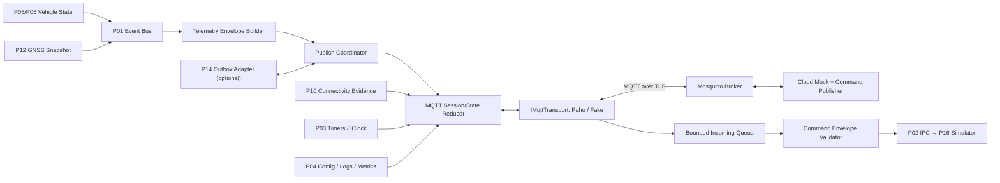
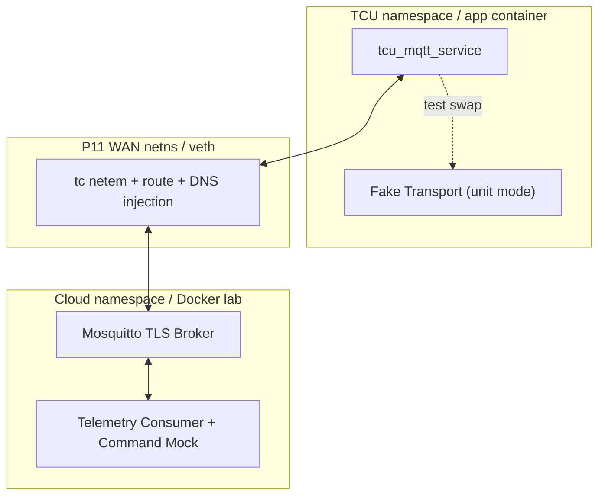
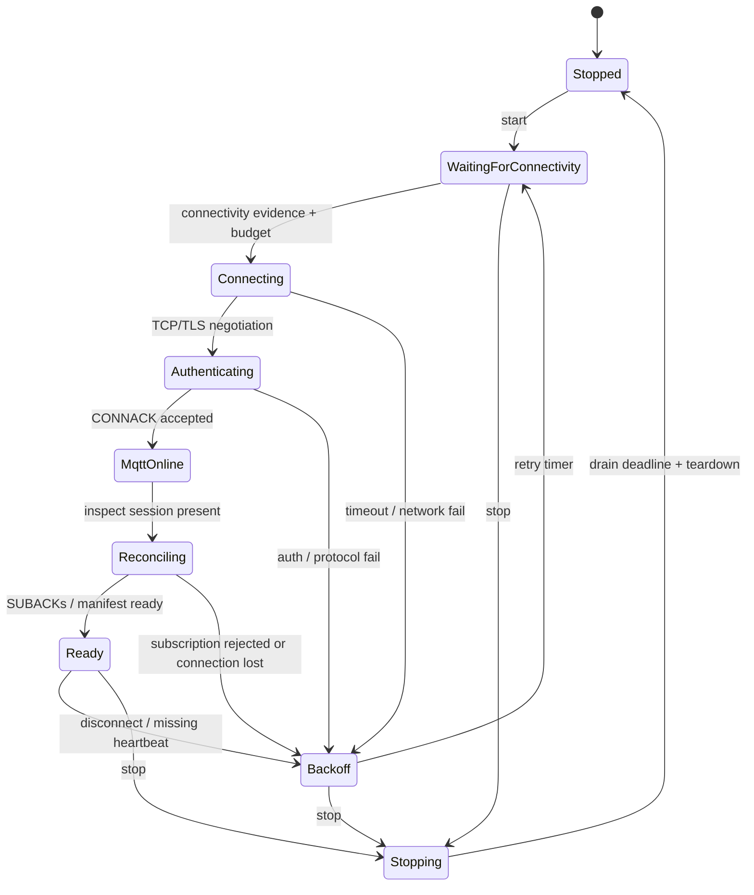
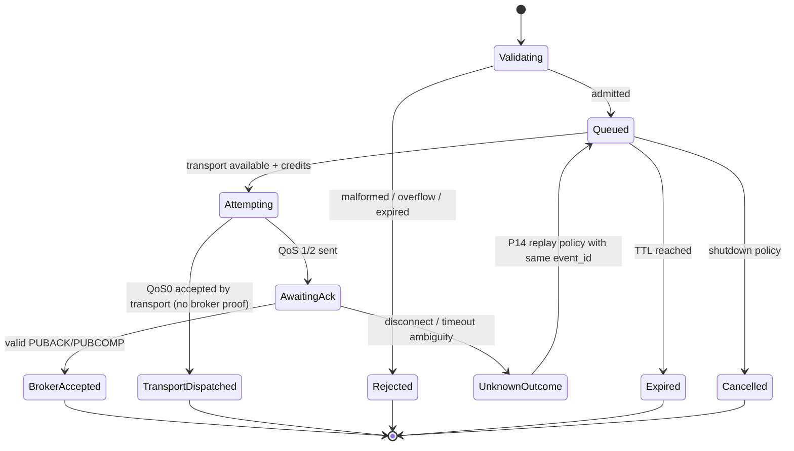
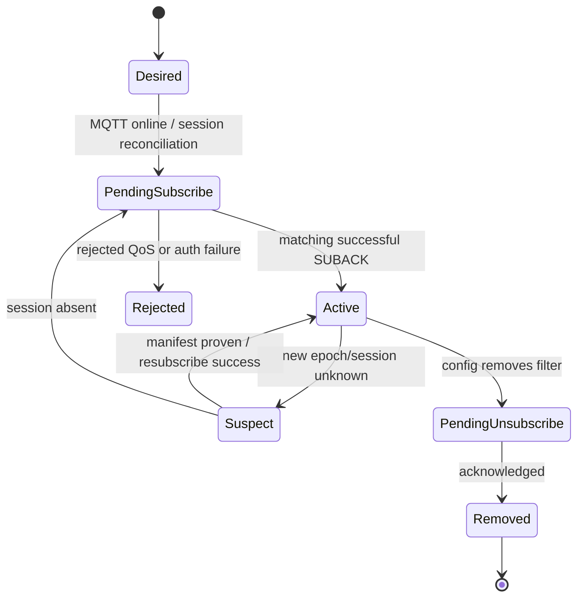
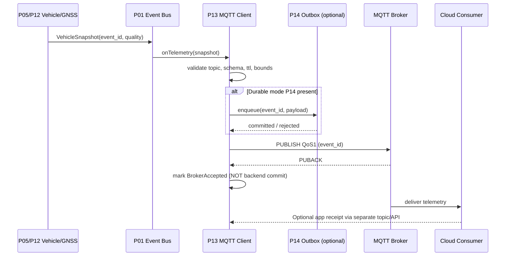
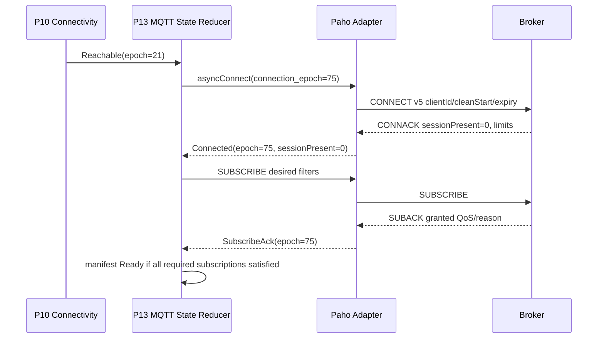
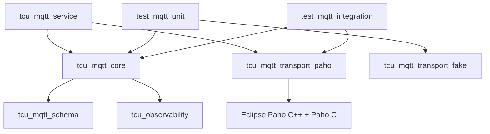

# Project 13 — MQTT Telematics Client

> **Virtual TCU Lab | System Design · Operational Behavior · What-if · Fault Injection · Resilience v1.0**  
> **Ngày:** 2026-10-30 · **Ngôn ngữ:** Tiếng Việt · **Target:** C++17 / Ubuntu Linux / MQTT 5.0 / Eclipse Paho C++ / Mosquitto  
> **Đối tượng:** Middle C++ Developer — Connected Vehicle / TCU Application & Middleware  
> **Độ ưu tiên:** P0 · **Kế thừa:** P01 Event Bus, P02 IPC, P03 Scheduler, P04 Config/Logging, P09 Modem, P10 Connectivity, P11 Network Fault Lab, P12 GNSS.  
> **Mở rộng:** P14 Offline Store-and-Forward, P15 Cloud Simulator, P16 Remote Control, P17 Health, P29 Dashboard, P30 Full Integration.  
> **Tình trạng:** **THIẾT KẾ + KỊCH BẢN KIỂM THỬ**, chưa triển khai và chưa chạy bộ test. Mọi tham số độ trễ/tải là *lab target đề xuất*, không phải SLA của hãng xe.

---

## 1. Executive Summary

### 1.1 Vấn đề

TCU phải publish telemetry/GNSS/health tới broker và tiếp nhận cloud command qua mạng không ổn định. MQTT giúp quản lý publish-subscribe và QoS nhưng **không tự bảo đảm đúng một lần ở tầng nghiệp vụ, backend đã ghi dữ liệu, hay command thực thi an toàn**. Một reconnect không được kiểm soát có thể làm trùng bản ghi, mất subscription, dùng nhầm session, flood bộ nhớ hoặc dispatch command từ kết nối cũ. Dự án tạo một MQTT adapter có hợp đồng hành vi rõ ràng, testable không cần TCU hardware.

### 1.2 Kết quả bàn giao (deliverables)

1. `libtcu_mqtt_core` — state reducer, publish lifecycle, subscription reconciler, inflight tracking, command envelope guards, metrics.
2. `libtcu_mqtt_transport_paho` — adapter Eclipse Paho C++ async client; giới hạn callbacks đi vào serialized event queue.
3. `libtcu_mqtt_transport_fake` — scripted fake broker, fake clock, deterministic callbacks, ACK/control packet fault scripts.
4. `tcu_mqtt_service` — daemon/publish API; kết nối P01/P02/P03/P04, P10/P12 và P14/P16 khi có.
5. `cloud_mqtt_mock` — test subscriber/publisher, record `message_id`/`seq`/arrival, typed cloud command (synthetic).
6. `mqtt_labctl` — `start`, `publish`, `subscribe`, `fault`, `trace`, `report`, `stop`, `doctor`.
7. `tests/{unit,integration,e2e,fuzz,soak,chaos}` — golden payload, BDD, model-based, property-based và multi-fault.
8. `artifacts/<run_id>/` — seed, config, packet/trace đã ẩn thông tin nhạy cảm, publish journal, broker logs, metrics, verdict.
9. Thiết kế message schema có `schema_version`, `device_id`, `event_id`, `source_epoch`, `seq`, `observed_at`, `quality`, `ttl_s`.
10. `docs/` — ADR, topic ACL policy, state diagrams, runbooks, known limitations và traceability.

### 1.3 Invariants quan trọng hơn 'kết nối được'

- **INV-01 Không có false delivery:** `publish accepted by local API` ≠ `sent on socket` ≠ `PUBACK` ≠ `backend committed`; log/metric/API phải gọi đúng tên từng mốc.
- **INV-02 At-most-one local terminal:** mỗi local operation có một kết quả cuối duy nhất dù callback/timeout/shutdown race; kết quả có thể `UNKNOWN` nếu broker xử lý nhưng ACK thất lạc.
- **INV-03 Application idempotency:** mỗi telemetry record có stable `event_id` khi retry; command có `command_id` để downstream P16 de-duplicate và xác thực. MQTT Packet Identifier và DUP flag **không** phải application ID.
- **INV-04 Bounded resources:** giới hạn pending publish, in-flight QoS, payload bytes, inbound callbacks, offline buffers, logs, CPU, reconnect rate, disk.
- **INV-05 Epoch fencing:** callback từ connection/session/config cũ không được thay đổi state, ACK, subscription của epoch mới.
- **INV-06 No stale publication as fresh:** telemetry quá TTL / GNSS `STALE` không được gửi với trạng thái `fresh`; expired drop có metric và reason.
- **INV-07 Reconnect correctness:** `TCP_CONNECTED` ≠ `MQTT_CONNECTED` ≠ `SUBSCRIPTIONS_READY` ≠ `CLOUD_APPLICATION_READY`.
- **INV-08 Fail-closed cloud commands:** chỉ điều phối command khi topic/device/schema/authz/expiry/replay-policy hợp lệ; P13 không tự thực hiện tác vụ lock/unlock.
- **INV-09 Backpressure explicit:** khi offline hoặc broker chậm, reject/defer/drop phải theo policy công khai; không âm thầm dùng RAM không giới hạn.
- **INV-10 Session-aware restore:** clean start/session expiry/session present và subscription ACK phải được phản ánh đúng.
- **INV-11 No secrets in logs:** TLS private keys, password, token, vị trí GPS thực, raw personal payload không được log mặc định.
- **INV-12 Reproducibility/evidence:** fake mode deterministic; real Mosquitto/netem chỉ best-effort timing; chưa chứng minh injection ⇒ `INCONCLUSIVE`.

### 1.4 Những điều không làm (non-goals)

- Không tự implement toàn bộ MQTT wire protocol, TLS stack hoặc crypto primitives; sử dụng adapter thư viện chuẩn.
- P13 **không** tự cung cấp offline persistence production; interface được thiết kế cho P14. Phase 1 cho phép in-memory bounded queue có chính sách mất dữ liệu rõ ràng.
- Không bảo đảm exactly-once business command dựa vào QoS 2; không tự thực hiện lệnh điều khiển phương tiện thật.
- Không dùng credential/cloud thực, thông tin hành trình thật; chỉ dùng device ID, khóa và GNSS giả trong lab.
- Không đánh đồng kết quả từ một broker với hành vi mọi MQTT broker / mạng di động / OEM platform.
- Không claim AUTOSAR, ISO 26262/21434, OEM certification hay HIL test.

---

## 2. Requirements & Traceability

### 2.1 Functional requirements

| ID | Requirement | Priority | Verification |
|---|---|---|---|
| FR-01 | MQTT v5 connect/disconnect qua async transport; hỗ trợ v3.1.1 tùy chọn có behavior tương thích | MUST | CONNACK, reason code, protocol negotiation |
| FR-02 | ClientID ổn định theo synthetic device, unique per active session, xử lý session takeover | MUST | two clients same ID test |
| FR-03 | Publish QoS 0/1, QoS 2 adapter support (nếu enable), retained policy và acknowledgements | MUST | fake protocol test, broker integration |
| FR-04 | Nhận subscribe/unsubscribe ACK và xác định active subscription chính xác | MUST | SUBACK/UNSUBACK, topic ACL tests |
| FR-05 | Safe reconnection: backoff + jitter + rate limit; một owner kiểm soát retry | MUST | fake clock, flapping test |
| FR-06 | Bounded in-flight tracker; correlation app `event_id` tách packet ID/transport token | MUST | load, duplicate/lost ACK tests |
| FR-07 | Xử lý `Session Present`, `Clean Start`, `Session Expiry Interval` của MQTT v5 | MUST | broker restart/expiry tests |
| FR-08 | Enforce `Receive Maximum`, Max Packet Size, QoS limit server; nếu thư viện không hỗ trợ thì reject config hoặc guard ở adapter | MUST | server capability tests |
| FR-09 | Publish telemetry có schema_version, TTL, quality, source_epoch và stable event_id | MUST | golden JSON schema/compat |
| FR-10 | GNSS/vehicle status phân biệt Fresh/Stale/Invalid; không gửi lại expired record như mới | MUST | P05/P06/P12 integration |
| FR-11 | Inbound cloud command envelope validation, freshness, replay guard và dispatch sang P16 test stub | MUST | adversarial payload tests |
| FR-12 | Metrics và logs correlate `run_id`, `connection_epoch`, `event_id`, `command_id` | MUST | log consistency assertions |
| FR-13 | TLS hostname/cert validation mặc định; client cert rotation scenario; ACL/topic isolation | MUST | TLS negative tests |
| FR-14 | Graceful shutdown: reject new jobs, drain tới deadline, cancel terminal không double | MUST | concurrent lifecycle tests |
| FR-15 | Fake transport + fake clock, scripted fault injection, reproducible traces | MUST | repeat same seed |
| FR-16 | Integration with P10 connectivity evidence; avoid probes khi no-route/offline theo policy | MUST | cross-project BDD |
| FR-17 | Optional P14 durable outbox with commit/read/ack ownership rõ ràng | SHOULD | DB crash/replay tests |
| FR-18 | Optional message properties MQTT v5: expiry, content type, correlation data, user properties | SHOULD | v5 property capture |
| FR-19 | Multi-broker failover / bridge behavior theo policy; không tự suy ra session state chung | SHOULD | active/standby tests |
| FR-20 | Health/LWT/heartbeat signal có provenance, không dùng LWT như nguồn tuyệt đối về device power | SHOULD | unexpected disconnect tests |

### 2.2 Non-functional targets — mục tiêu ban đầu cho lab, điều chỉnh sau benchmark

| ID | Mục tiêu gợi ý | Oracle |
|---|---|---|
| NFR-01 | Normal telemetry 1–10 msg/s; burst 1.000 msg/s trong 60 giây; soak 24h | metrics + memory/CPU/FD baseline |
| NFR-02 | Bounded pending 2.048; MQTT inflight tối đa min(local=64, broker Receive Maximum); inbound queue 1.024 | queue high-watermark, overflow events |
| NFR-03 | Payload JSON <= 16 KiB mặc định; hard limit do policy / negotiated max-packet | payload validator; no large allocation |
| NFR-04 | connect timeout 10s, retry backoff 1s–60s ± jitter, max 1 active connect operation | fake-clock and real-time histograms |
| NFR-05 | application telemetry freshness `ttl_s=60` (tùy loại); command `ttl_s <= 15` trong profile lab | steady_clock deadline + signed/validated timestamp policy |
| NFR-06 | E2E observable publish p95 < 250ms ở local healthy lab (gợi ý, **không** là contract) | timestamps ACK vs backend echo tách riêng |
| NFR-07 | Shutdown bounded 5s theo lab; unfinished ops `UNKNOWN`/`CANCELLED` theo rõ định nghĩa | forced-runner timeout, no hang |
| NFR-08 | 0 use-after-free/data race trong ASan/TSan-compatible builds | sanitizers, seeded stress |
| NFR-09 | Security mode production-like yêu cầu TLS và broker authentication; anonymous plain TCP chỉ trong `local-lab` | negative config tests |
| NFR-10 | Fake adapter: same seed, scheduling, config → same trace hash; real network run best effort | deterministic property tests |
| NFR-11 | 0 telemetry `VALID` khi nguồn gốc có trạng thái `INVALID/STALE` không policy override rõ | data lineage assertions |
| NFR-12 | Evidence completeness 100% trên test PASS: applied fault + observation + oracle | report validator |

### 2.3 Matrix 'guarantee' cần hiểu đúng

| Mốc / claim | Điều thực sự được chứng minh | Điều **không** được chứng minh |
|---|---|---|
| `AcceptedByApi` | service đồng ý nhận yêu cầu / giữ trong RAM hoặc store tùy mode | broker nhận, durable qua crash nếu chưa commit |
| `PersistedLocally` | P14 transaction commit thành công và policy durability phù hợp | broker nhận hoặc DB chịu được mọi disk failure |
| `WireAttempted` | thư viện chấp nhận dispatch/send, tùy bằng chứng transport | broker nhận đủ dữ liệu |
| `PUBACK` (QoS 1) | broker peer chấp nhận PUBLISH theo QoS flow | cloud microservice đã lưu DB / business processed |
| `PUBCOMP` (QoS 2) | hoàn thành QoS 2 delivery handshake ở hop này | command thực thi đúng một lần ở domain logic |
| `Broker Delivered to Subscriber` | subscriber mock nhận application message | downstream DB commit |
| `BackendCommitted` | app-level receipt có xác minh và correlation riêng, **nếu triển khai P15** | các hệ thống liên quan đều đồng bộ |
| `CommandReceived` | client P13 nhận envelope | P16 authorized / executed |
| `CommandResult` | P16 trả trạng thái nghiệp vụ hợp lệ | vehicle hardware thật thực hiện; project chỉ simulator |

---

## 3. Design Decisions (ADR)

| ADR | Quyết định | Lý do / trade-off |
|---|---|---|
| ADR-13-01 | MQTT 5.0 là profile chính; MQTT 3.1.1 tùy chọn bằng adapter | cần session/message expiry, reason codes và broker limits |
| ADR-13-02 | Eclipse Paho C++ async thông qua `IMqttTransport` | tránh reimplement packet/TLS; cho phép deterministic mock |
| ADR-13-03 | State reducer single-owner; I/O callback chỉ push `TransportEvent` | giảm race callback-reconnect-shutdown |
| ADR-13-04 | `connection_epoch` / `subscription_generation` / `config_generation` | không trộn response cũ với state mới |
| ADR-13-05 | QoS 1 cho telemetry quan trọng; QoS 0 chỉ cho best-effort; QoS 2 optional | cân bằng reliability/overhead, không hứa business exactly-once |
| ADR-13-06 | Application `event_id` ổn định qua retry và từ P14 outbox; `mqtt_packet_id` không persisted làm business ID | idempotency đúng tầng |
| ADR-13-07 | Một policy reconnect (P10 hoặc P13) được chọn làm owner; cấm hai retry loops cạnh tranh | tránh retry storm |
| ADR-13-08 | Bounded queues, explicit overload result; drop newest/oldest theo loại data | bounded memory và observability |
| ADR-13-09 | Chỉ bật automatic reconnect của thư viện nếu tích hợp được fencing/timer/cancellation; mặc định orchestration ở P13 | tránh hidden reconnect state |
| ADR-13-10 | Subscribe reconciliation sau mọi CONNACK; `Session Present` + manifest reconciliation | broker state không được đoán; SUBACK phản ánh accepted QoS |
| ADR-13-11 | TTL dùng `steady_clock` cho local age, UTC chỉ là metadata có provenance | wall clock jump không hồi sinh dữ liệu |
| ADR-13-12 | Cloud command chỉ validation/dispatch, business authorization/actuation P16 | phân trách nhiệm và giảm blast radius |
| ADR-13-13 | TLS peer hostname verify và cert errors fail closed | không disable verify để chữa network failure |
| ADR-13-14 | MQTT Last Will là observation hint, không phải bằng chứng power state thật | tránh suy luận sai khi graceful disconnect/reconnect |
| ADR-13-15 | Per-run synthetic device_id, credential, broker ACL; không dùng public broker | đảm bảo lab cô lập |
| ADR-13-16 | Report verdict PASS/FAIL/INCONCLUSIVE/SKIPPED; tách injection proof và response proof | tránh false positive |
| ADR-13-17 | QoS 1 PUBACK failure/ambiguous delivery → domain state `UNKNOWN` khi mất chứng cứ; P14 retry cùng event_id | tránh giả success/fail chắc chắn |
| ADR-13-18 | P14 chịu durable outbox ownership, P13 chịu MQTT in-flight/transport ownership; khi P14 chưa có chỉ best-effort | tránh double persistence và state drift |
| ADR-13-19 | Topic allowlist + tenant/device binding, envelope schema limits, replay guard | phòng cloud command lạ và cross-device leakage |
| ADR-13-20 | Test harness cân đo riêng v5 `Server Keep Alive`, `Receive Maximum`, `Maximum QoS`, `Maximum Packet Size` | client phải theo negotiated bounds |

---

## 4. Scope, Trust Boundaries & Deployment

### 4.1 Logical architecture



### 4.2 Deployment topology



**Lưu ý topology:** Docker Compose thuận tiện cho smoke tests; `ip netns`/P11 phù hợp các bài fault network cần bằng chứng packets. Không giả định Docker bridge cung cấp cùng semantics với modem thật. Plain TCP port 1883 chỉ dùng khi bind loopback hoặc hoàn toàn cô lập để bootstrap; bài security bắt buộc dùng TLS và ACL.

### 4.3 Trách nhiệm / ownership

| Thành phần | Sở hữu | Không sở hữu |
|---|---|---|
| P10 Connectivity | trạng thái route/bearer/cloud reachability evidence và policy năng lượng | MQTT v5 Session Present, QoS ack |
| P13 MQTT Client | broker connection, subscription states, MQTT publish acks, inbound command transport | durable outbox, business actuation, cloud DB commit |
| P14 Offline Store | durable records, retention/compaction, replay cursor, atomic state | TLS handshake hay PUBACK callback ownership |
| P15 Cloud Simulator | mock receipt, backend durable-ack optional, command distribution | quyết định trạng thái modem |
| P16 Remote Control | command authz/safety, idempotency, execution result | transport packet ordering guarantee |
| P01/P02/P03/P04 | events, IPC, clock, logging/config | guarantee MQTT delivery |

---

## 5. Data & Topic Contract

### 5.1 Topic layout (synthetic)

| Topic | Direction | QoS / retain | Contract |
|---|---|---|---|
| `lab/v1/vehicle/{device_id}/telemetry` | TCU → broker | QoS 1, retain false | event batches, `event_id`, stable metadata |
| `lab/v1/vehicle/{device_id}/gnss` | TCU → broker | QoS 0/1, retain false | position + `fix_quality`, freshness |
| `lab/v1/vehicle/{device_id}/health` | TCU → broker | QoS 1, retain false | health snapshots and counters |
| `lab/v1/vehicle/{device_id}/command/in` | broker → TCU | QoS 1, retain false | authenticated/scoped command envelope for P16 |
| `lab/v1/vehicle/{device_id}/command/out` | TCU → broker | QoS 1, retain false | `command_id`, `result_state` / reason |
| `lab/v1/vehicle/{device_id}/presence` | TCU broker/LWT | QoS 1, retain true *chỉ nếu policy cho phép* | presence hint + UTC and session generation |

**ACL nguyên tắc:** một device chỉ publish/subscribe topic được cấp; `+`/`#` không được đưa vào topic publish, không cho command wildcard quá rộng; `presence` có expiry và source để tránh hiểu retained `online` là trạng thái realtime. Với LWT MQTT v5 kiểm tra `Will Delay Interval`, keepalive và session timing trước khi suy luận offline.

### 5.2 Telemetry payload mẫu (synthetic)

```json
{
  "schema_version": 1,
  "device_id": "TCU-SIM-001",
  "event_id": "sim-20261030-000041",
  "source_epoch": 15,
  "seq": 41,
  "observed_at_utc": "2026-10-30T03:00:00Z",
  "quality": "VALID",
  "ttl_s": 60,
  "signals": {"speed_kph": 48.2, "ignition_on": true},
  "gnss": {"lat": 10.045, "lon": 105.746, "fix_state": "VALID"}
}
```

- `event_id`: tạo trước khi enqueue/persist; không đổi khi retry; khác MQTT Packet Identifier.
- `seq`: số tăng theo thiết bị **trong source_epoch**, wrap/restart rõ ràng; backend không giả định gap là mất dữ liệu nếu có compaction/drop.
- `quality`: giá trị từ producer, P13 phải validate và không nâng cấp INVALID thành VALID.
- `ttl_s`: áp dụng tại consumer theo contract; local record age tính bằng monotonic clock; nếu khởi động lại và chưa có thời gian đáng tin thì default fail-safe thay vì hồi sinh record.
- Serialization JSON để dễ quan sát; production cân nhắc Protobuf/CBOR và versioned schema.

### 5.3 Cloud command envelope mẫu

```json
{
  "schema_version": 1,
  "device_id": "TCU-SIM-001",
  "command_id": "cmd-test-0107",
  "command_type": "GET_VEHICLE_STATUS",
  "issued_at_utc": "2026-10-30T03:00:00Z",
  "expires_at_utc": "2026-10-30T03:00:15Z",
  "nonce": "synthetic-0107",
  "arguments": {}
}
```

**Quan trọng:** TLS + topic ACL xác thực peer/broker nhưng **không thay cho** kiểm soát nguồn gốc, cấp quyền thực thi, anti-replay, safety và policy của P16. Các trường `issued_at`/`expires_at` chỉ dùng sau khi có chính sách clock trust; phải xử lý clock unknown/rollback. Với demo `GET_VEHICLE_STATUS`, service chỉ phát event sang P16 mock; không thực hiện lock/unlock thật.

---

## 6. C++17 Interfaces & Data Models

```cpp
// API sketch only: illustrates ownership and behavioral contract; not implementation.
namespace tcu::mqtt {

enum class LinkState { Stopped, WaitingForConnectivity, Connecting,
                       Authenticating, MqttOnline, Reconciling, Ready,
                       Backoff, Degraded, Stopping };
enum class PublishStatus { Accepted, Backpressured, RejectedInvalid,
                           RejectedExpired, RejectedStopping };
enum class DeliveryState { Queued, Attempting, AwaitingAck,
                           BrokerAccepted, UnknownOutcome, Expired,
                           Cancelled, FailedPermanent };
struct PublishRequest {
    std::string topic;
    std::string event_id;     // persistent application correlation
    std::vector<std::uint8_t> payload;
    std::uint8_t qos{1};
    bool retain{false};
    std::chrono::steady_clock::time_point expires_at;
};
struct PublishReceipt {
    PublishStatus accepted;
    std::string local_operation_id;
};
struct ConnectionView {
    LinkState state;
    std::uint64_t connection_epoch{};
    bool session_present{};
    bool subscriptions_ready{};
};

class IMqttTransport {
public:
    virtual ~IMqttTransport() = default;
    virtual void asyncConnect(std::uint64_t epoch) = 0;
    virtual void asyncDisconnect(std::uint64_t epoch) = 0;
    virtual void asyncPublish(std::uint64_t epoch,
                              const PublishRequest& request,
                              const std::string& operation_id) = 0;
    virtual void asyncSubscribe(std::uint64_t epoch,
                                const std::string& filter,
                                std::uint8_t qos) = 0;
};
class IClock {
public:
    virtual ~IClock() = default;
    virtual std::chrono::steady_clock::time_point steadyNow() const = 0;
};
class IMqttService {
public:
    virtual ~IMqttService() = default;
    virtual PublishReceipt publish(PublishRequest request) = 0;
    virtual ConnectionView connection() const = 0;
    virtual void requestStop() = 0; // asynchronous shutdown
};
}
```

### 6.1 Threading & ownership

- C++ `MqttService` state reducer **single writer** cho các state transitions và `operation_id` status; chỉ chia sẻ `ConnectionView` immutable cho readers.
- Paho callback phải copy/move payload cần thiết vào bounded incoming event queue; không block on network, không gọi API có thể re-enter hoặc giữ mutex dài trong callback.
- `ack_inflight`: state thuộc connection epoch, correlation bởi local operation token; MQTT packet ID chỉ là chi tiết transport.
- Timeout đăng ký qua P03 với cancellation token; scheduler có thể deliver timer late, reducer phải check epoch + operation terminal.
- Dừng: stop producer -> reject new -> bounded drain -> disarm timers -> teardown transport -> join worker -> snapshot terminal; callback sau stop bị bỏ qua an toàn.

### 6.2 Transport event model

```cpp
using Epoch = std::uint64_t;
struct ConnectedEvent { Epoch epoch; bool session_present; /* server caps */ };
struct DisconnectedEvent { Epoch epoch; int reason_code; };
struct PublishAckEvent { Epoch epoch; std::string operation_id; int reason_code; };
struct SubscribeAckEvent { Epoch epoch; std::string topic_filter; int reason_code; };
struct IncomingMessageEvent {
    Epoch epoch;
    std::string topic;
    std::vector<std::uint8_t> payload;
    bool retained;
};
// std::variant<...> queued to reducer in C++17.
```

**Một cảnh báo về API sketch:** không hứa `operation_id` luôn map 1:1 tới MQTT Packet Identifier qua mọi Paho reconnect. Adapter phải giữ một mapping có thể chứng minh, hoặc dùng token/callback tương ứng của thư viện; nếu không có bằng chứng ACK cho local op thì outcome phải là `UNKNOWN`, không đoán.

---

## 7. State Machines & Event Ordering

### 7.1 Connection lifecycle



**State policy:** xác thực TLS, MQTT CONNACK, SUBACK và app health là các lớp khác nhau. `Ready` chỉ có nghĩa topic subscriptions bắt buộc đạt policy; backend database read/write chưa mặc nhiên `Ready`.

### 7.2 Per-publish lifecycle



**QoS0:** `TransportDispatched` chỉ là một mốc local, không chứng minh broker đã nhận; không chuyển sang `BrokerAccepted` khi không có MQTT ACK.

### 7.3 Subscription state



### 7.4 Event-ordering rules

1. Mọi event có `connection_epoch` và `config_generation`; unknown epoch → metric + ignore.
2. `Connected` phải có hợp lệ CONNACK; TCP connected không đủ.
3. `SUBACK` phải khớp subscription request hiện hành (epoch, topic filter, request generation).
4. Khi CONNACK `Session Present = 0`, coi broker không giữ prior subscription session; rebuild desired list. Nếu `1`, vẫn reconciles local manifest / có khả năng broker/ACL thay đổi.
5. Khi `UNSUBACK` trễ, không xóa subscription của config thế hệ mới.
6. `PublishAck` chỉ effect khi operation đang ở `AwaitingAck` tương ứng và ACK hợp lệ.
7. Retry command **không** được tạo new `command_id`; không retry business side effect ở P13.
8. Sau `Stopping`, callback chỉ được xử lý đủ để dọn tài nguyên, không phát business event mới.

---

## 8. Behavior Contracts — Given / When / Then

| ID | Given | When | Then |
|---|---|---|---|
| BDD-01 | Broker healthy, TLS ok, subscriptions configured | start | `Waiting → Connecting → MqttOnline → Ready`; no false intermediate Ready |
| BDD-02 | `Ready`, QoS 1 telemetry valid | publish | accepted once; broker PUBACK recorded; application commit remains unknown |
| BDD-03 | TCP ok, TLS hostname mismatch | connect | reject, never MQTT Ready, error classified security not transient DNS |
| BDD-04 | Client offline, memory pending full | publish | explicit Backpressured or per-class drop, no unbounded allocation |
| BDD-05 | QoS1 sent, broker stored, PUBACK lost | link cut | outcome ambiguous; future replay same event_id may duplicate at backend |
| BDD-06 | Session expiry reached while disconnected | reconnect with Clean Start false | Session Present 0; resubscribe; do not assume command queue survived |
| BDD-07 | GNSS quality STALE, payload claims fresh | publish | reject/normalize per contract; do not produce false VALID |
| BDD-08 | Receiver sees expired command | inbound | do not dispatch to P16; observable reject reason |
| BDD-09 | Duplicate command id arrives under QoS1 | inbound | P16 mock dedup returns stable result; no second side effect |
| BDD-10 | Publish timeout and ACK share time tick | dispatch | one terminal completion; matching epoch decides ordering |
| BDD-11 | Session takeover by another client using same ClientID | broker disconnect | log takeover suspicion; retry budget; do not spin aggressively |
| BDD-12 | Broker sends Maximum QoS=0 | publish QoS1 | downgrade only if product policy explicitly permits; otherwise reject |
| BDD-13 | Configuration update removes command subscription | old incoming command in flight | generation fence + in-flight command policy; no dispatch after revocation boundary |
| BDD-14 | Stop requested during reconnect | timer fires | no connect after stopping; no use-after-free |
| BDD-15 | Test says TLS failure but traffic did not hit broker | run verdict | `INCONCLUSIVE`; no fabricated PASS |
| BDD-16 | Broker PUBACK acknowledged | backend consumer crashes before database commit | report broker acceptance but no business receipt |
| BDD-17 | v5 Receive Maximum=1 | burst sends 20 QoS1 | at most one unacknowledged QoS1/2 publish on connection (per protocol) |
| BDD-18 | MQTT topic contains '+' or '#' as publish topic | validate | reject topic; no publish |
| BDD-19 | Broker ACL denies command subscription | SUBACK failure | never `Ready` for required command topic; degraded and alarm |
| BDD-20 | Duplicate retained presence online arrives after offline | subscriber mock | stale presence not considered authoritative real-time connection |

---

## 9. Happy-path Sequence Diagrams

### 9.1 Vehicle telemetry upload



### 9.2 MQTT reconnect and subscribe reconciliation



### 9.3 Ambiguous delivery when PUBACK lost

```mermaid
sequenceDiagram
    participant M as TCU Client
    participant B as Broker
    participant C as Cloud Consumer
    M->>B: PUBLISH QoS1 event_id=E1
    B->>C: Deliver E1
    B--xM: PUBACK lost
    Note over M: Timeout → UNKNOWN; not 'not delivered'
    M->>B: Retry/replay same event_id E1 after reconnect
    B->>C: Deliver E1 again (possible)
    Note over C: Dedup E1 by app event_id + persistence
```

---

## 10. Operational Behavior & Recovery Policy

### 10.1 Startup

1. P04 loads immutable config snapshot. Validate device identity, broker URI, topic templates, TLS trust paths and bounded quotas before any socket attempt.
2. Initialize `IClock`, P03 timers and transport event queue. Choose one reconnect owner and disable rival implicit retry loops.
3. Start one reducer worker; publish `WaitingForConnectivity`, never `CloudReady` based on network link alone.
4. P10 reports bearer+route+endpoint evidence; check power policy if integrated.
5. Attempt TCP/TLS → CONNECT → validate CONNACK/capabilities → reconcile desired subscriptions.
6. Mark `Ready` only when **required** subscriptions have successful evidence; optional topics may remain degraded with metrics.

### 10.2 Publish

1. Validate schema/topic/size/TTL/source-quality, reserve bounded queue credit.
2. Assign immutable `event_id` and local operation id. In P14 durable mode persist before telling caller 'durably accepted'.
3. If offline, keep pending within bounded policy (in-memory no durability guarantee); P14 separately governs disk outbox.
4. Before sending re-evaluate expiry/quality; apply negotiated max packet and Receive Maximum.
5. QoS 0: record transport dispatch only; QoS 1/2: wait for ACK handshake and record outcome accurately.
6. If connection lost while awaiting ACK, outcome may be unknown. Replay same event_id only if product policy permits, with idempotent cloud mock.

### 10.3 Receive cloud command

1. Verify message topic matches exact device/allowed topic; enforce max payload, schema version, JSON depth, required fields.
2. Apply clock-trust policy, expiry, source identity, replay guard, P16 authorization boundary.
3. Enqueue validated envelope with generation fence; no synchronous execution in Paho callback.
4. Forward to P16 mock over P02 IPC with correlation and bounded timeout; result command-out uses same command_id.
5. Upon duplicate receipt, consult dedup journal (in P16/P14 extension) and return prior result; never execute side effect twice based solely on MQTT QoS.

### 10.4 Reconnect / failover

- Classify `NO_ROUTE`, `DNS`, `TCP`, `TLS`, `CONNACK_AUTH`, `BROKER_BUSY`, `SESSION_TAKEN_OVER`, `SUBSCRIPTION_DENIED`, `LOCAL_OVERLOAD` separately.
- Security failures (certificate/credentials/ACL) do not trigger unlimited rapid retry. Permanent errors enter `Degraded` until changed config/credential or controlled slow retry.
- Backoff with jitter and energy budget, no overlapping connect operations.
- On epoch change, mark prior in-flight results `UnknownOutcome` as appropriate and invalidate stale callbacks; stable event IDs survive replay in durable mode.
- If multiple brokers, do **not** assume sessions, client state or ACK correlation transfer between brokers without cluster contract.

### 10.5 Shutdown

- Freeze publishers/subscription mutations; stop receiving new app work.
- Drain accepted in-memory work to configured deadline; if P14 owns work, preserve durable rows for restart.
- Cancel timers, disconnect cleanly if possible, stop callback delivery, tear down transport and join owned workers.
- Verify no active operation receives multiple terminal results; publishing a broker ACK after service stop must not resurrect service.

### 10.6 QoS 1 / session semantics — các bẫy phổ biến

- QoS 1 là *at least once* đến peer MQTT. Có thể có duplicate. `DUP=1` không phải bằng chứng đã có bản trước; `DUP=0` không loại trừ duplicate application payload.
- QoS 2 là protocol exactly-once delivery trên hop, không tự làm database transaction hoặc business command exactly once.
- CONNACK Session Present=0 khi broker không còn client session; retained messages khác với queued session messages.
- Clean Start và Session Expiry Interval quyết định behavior phiên MQTT v5; không gán API `cleanSession` của v3.1.1 cho v5 mà không map semantics rõ.
- MQTT 5 Message Expiry Interval chỉ là một phần của message life cycle tại broker, local TTL vẫn phải được kiểm soát trước publish và sau replay.
- Broker may send Server Keep Alive và server limits; client's policy không được bất chấp giới hạn broker.

---

## 11. Reliability, Backpressure & Data-Loss Policies

### 11.1 Admission matrix

| Class | Ưu tiên | Khi queue đầy | TTL và replay |
|---|---|---|---|
| Emergency-relevant synthetic alert | high | Reject explicit; P14 durable path nếu enabled; không che giấu mất event | không tự hứa tuyệt đối, phê chuẩn policy riêng |
| Event telemetry (ignition transition) | high | backpressure producer; optional P14 persist | event_id stable; consumer dedup |
| Periodic speed snapshot | normal | drop-oldest/coalesce **chỉ theo policy của loại này** | expired not replayed as fresh |
| GNSS position | normal | coalesce latest per device if allowed | no stale-to-valid promotion |
| Debug statistics | low | drop/reject + metric | short TTL; no durable guarantee |
| Cloud command inbound | high, safety-sensitive | explicit NACK/status if contract allows; never silently act | P16 dedup/authz + deadline |

### 11.2 In-memory vs P14 durable mode

- **Phase A**: `MemoryOutbox` bounded; service crash may lose pending items. Test phải assert data-loss policy, không gắn nhãn durable.
- **Phase B**: `IOutbox` adapter to P14; persist transaction before accepting durable work, handle DB-failure separately.
- **ACK ownership**: MQTT broker ACK chuyển outbox row sang `broker_acked` theo đúng P14 transaction; không xóa row trước khi durable ACK-state commit nếu policy cần replay.
- **Ambiguity**: khi mất ACK và restart, row vẫn `unknown`; resend same `event_id` ⇒ possible duplicate. Cloud mock phải dedup theo stable ID.
- **Exactly-once goal**: nếu thực sự muốn backend applied exactly once, cần application-level idempotency key + durable dedup ledger + transaction at backend, không chỉ QoS2.

---

## 12. Security & Privacy Model

| Threat / failure | Guard & expected reaction | Test oracle |
|---|---|---|
| MITM/invalid chain/hostname | Verify peer certificate + hostname; fail closed | no `Ready` or application traffic |
| Expired/rotated cert | Controlled reload, session reset, refresh trust; no bypass | correct epoch, old cert rejected |
| Cross-device topic injection | strict topic ACL + device binding | no command dispatch |
| Retained stale command | reject or policy explicit forbid retain on command topics | command execution count zero |
| Replay/duplicate QoS 1 command | P16 durable dedup by command_id and domain policy | one business side effect max |
| Oversized/deep JSON | cap bytes, depth, arrays, numeric validation | reject bounded CPU and memory |
| Credential in logging | redact at source; limit diagnostics | scans no secret strings |
| ClientID collision | recognize takeover, throttle reconnect | no oscillating reconnect storm |
| MQTT wildcard/topic confusion | validate subscriptions/publish topics; no privilege escalation | topic matrix tests |
| Privacy of GNSS | synthetic data, payload minimization, retention/ACL | no real PII in artifacts |
| Local-lab plaintext setup | bind loopback/netns only, not public address | host listener security assertion |
| Unknown wall clock | reject time-sensitive commands or use trusted time source per policy | no command after unverified deadline |

---

## 13. Fault Injection & Observability Plan

### 13.1 Fault sources

1. **Fake MQTT Adapter**: script CONNECT, CONNACK, PUBACK, SUBACK, malformed callback, duplicate, late, reorder, disconnected, session present.
2. **Real Mosquitto (isolated)**: broker kill/restart, ACL deny, auth failure, session expiry, payload limit, TLS certificate variants, client ID collision.
3. **P11 Network Fault Lab**: single-direction packet loss, delay, jitter, DNS, route blackhole, TCP RST, TLS handshake interruption.
4. **P03 Fake Clock**: timeout at same logical tick as ACK, expiry and retry races, clock rollover, wall-clock jumps.
5. **P14 Mock Outbox**: transaction failure, disk full, busy/locked, restart at crash points, corrupted record quarantining.
6. **Resource Injectors**: memory quota, file descriptor limit, CPU throttling, callback stalling, event queue exhaustion.
7. **Fuzz Corpus**: valid/malformed JSON, topic strings, encoding, property ranges, metadata provenance.

### 13.2 Evidence needed to avoid false PASS

For every fault case capture `run_id`, `fault_id`, injection target, proof-of-injection (e.g. broker reason/server log, pcap/probe, fake event schedule), `connection_epoch`, per-event_id transitions, client metrics, broker received events, cloud consumer records, invariant verdict, teardown health.

- `PASS`: injected fault verifiably happened + all mandatory invariants and configured numeric SLO met.
- `FAIL`: invariants violated, timeout incorrectly labeled success, resource bound exceeded, security bypass or cleanup failure.
- `INCONCLUSIVE`: missing proof, fake fault had no effect, broker config not applied, wrong namespace/interface, missing independent oracle.
- `SKIPPED`: feature/environment absent and known before test; not counted as PASS.

### 13.3 Metrics

`mqtt_connection_attempts_total{reason}`, `mqtt_reconnect_backoff_ms`, `mqtt_connected_epoch`, `mqtt_subscription_active{topic}`, `mqtt_suback_rejected_total`, `mqtt_publish_admitted_total`, `mqtt_publish_rejected_total{reason}`, `mqtt_publish_unknown_total`, `mqtt_publish_broker_ack_total`, `mqtt_publish_backend_receipt_total`, `mqtt_inflight_count`, `mqtt_pending_queue_depth`, `mqtt_incoming_dropped_total`, `mqtt_command_rejected_total{reason}`, `mqtt_callback_stale_total`, `mqtt_tls_failures_total`, `mqtt_data_age_ms`, `mqtt_loop_lag_ms`, `mqtt_cpu_pct`, `mqtt_rss_bytes`, `mqtt_fd_count`.

**Metric consistency invariants:** counted admissions = terminal outcomes + pending (snapshot accounting by run epoch); broker-acks ≤ successfully correlatable QoS acks; `backend_receipts` distinct from broker ack; no counter regression; no cardinality explosion by device/event IDs in Prometheus labels.

---

## 14. Test Strategy & Test Oracles

| Level | Tools | Tests | Key oracle |
|---|---|---|---|
| Unit | Google Test/Mock, fake clock, fake MQTT transport | admission, state transition, epoch fencing, TTL | deterministic state/event traces |
| Protocol integration | Mosquitto local, Paho async | QoS ACK, SUBACK, session present, retained, ACL | broker/server observation + client trace |
| System integration | P01/P02/P03/P04/P10/P12/P14/P15/P16 | E2E telemetry and command | stable `event_id` / `command_id` end-to-end |
| Network chaos | P11 `tc netem`, namespaces | loss, delay, partitions, DNS, TLS interruption | verify injection plus SUT reaction |
| Security | isolated TLS broker, ACL fixtures | chain, hostname, expiry, identity, topic authorization | no unauthorized execution, no leak |
| Robustness | libFuzzer/AFL++ (if configured), ASan/UBSan/TSan | payloads, callback races, memory lifecycle | no leaks/UAF/undefined behavior |
| Model-based | randomized event sequences with seed | reconnection/session/ACK transitions | temporal invariants, final state oracle |
| Soak | 24h run + periodic faults | memory, CPU, FD/thread count, recovery | no unbounded growth, bounded timers |

### 14.1 Oracle levels

- **O1 Local**: accepted/rejected, state transitions, local in-flight, clock-based TTL.
- **O2 Broker**: broker logs/counters or server observer confirms QoS ACK/PUBLISH conditions.
- **O3 Cloud mock**: subscriber received, application dedup, optional backend durable receipt.
- **O4 Resource**: RSS, FD, thread count, perf, queue high-watermark.
- **O5 Security**: hostname/cert/ACL assertions and negative access tests.
- **O6 Lab validity**: proof injection + topology/cert config + broker version/config snapshot.

### 14.2 Property-based/state-model assertions

1. `Ready ⇒ MqttConnected ∧ RequiredSubscriptionsAcked ∧ CorrectEpoch`.
2. `ConnectionEpoch(new) > ConnectionEpoch(old)` on every teardown/new connect attempt by spec.
3. `TerminalCount(operation_id) <= 1` for a **local attempt**; replay creates a new attempt tied to same event_id.
4. `brokerAcked(event_id) ⇒ ackCorrelatedToAttempt` (does not imply backend committed).
5. `CommandDispatched(id) ⇒ validatedEnvelope ∧ notExpired ∧ deviceScoped ∧ P16Accepted`.
6. `ActivePending <= pendingLimit`; `InFlight <= negotiatedReceiveMaximum`.
7. `StaleCallback(epoch!=current) ⇒ no state mutation of current session`.
8. `NoLoopAfterStop`: no connect/publish dispatch after final Stopped.
9. `NoExpiredAsFresh`: every emitted telemetry includes correct source quality/age, never falsely upgraded.
10. `NoFalsePass`: missing proof-of-injection ⇒ verdict cannot equal PASS.

---

## 15. What-if Test Catalog — principles

**Cách đọc:** mỗi `WF13-xxx` ghi Scenario, Inject, Expected và Evidence/Oracle. P0 = correctness/security/availability tối quan trọng; P1 = resilience/performance; P2 = mở rộng. Đây là danh mục bao phủ các *lớp lỗi thực tế*, không thể chứng minh đã liệt kê mọi chuỗi lỗi vô hạn. Kết hợp thêm model-based fuzz và multi-fault campaigns ở phần 16.

**Cơ chế áp dụng chung:** run reset state theo fixture; có `seed`/timestamp; test orchestrator không xem local Paho API call thành bằng chứng broker đã nhận; trạng thái `UNKNOWN` dùng khi thiếu quan sát đủ phân định.

### 15.1 01. Startup, config và local identity (10 cases)

| ID | What if? | Cách inject lỗi | Expected behavior / invariant | Evidence cần có | Priority |
|---|---|---|---|---|---|
| WF13-001 | Broker URI trống | Config thiếu hostname | Fail config trước mở socket; error rõ | zero connect attempts + config reject | P0 |
| WF13-002 | Device ID chứa wildcard | device_id=`a/#` | Reject topic substitution; không publish/subscribe | logs + topic assert | P0 |
| WF13-003 | Hai instance local cùng file state | chạy 2 daemon shared state path | lock hoặc isolate state, không ghi đồng thời | storage lock + no corruption | P0 |
| WF13-004 | Startup với config valid nhưng P10 chưa ready | giữ connectivity offline | WaitingForConnectivity, không claim MQTT Ready | state trace + zero SYN | P0 |
| WF13-005 | Config hợp lệ nhưng port broker sai | endpoint refused | Backoff có limit, không busy loop | retry timestamps, CPU | P0 |
| WF13-006 | TLS file path không đọc được | chmod denied cert file | Fail closed, reason local configuration | no plaintext fallback | P0 |
| WF13-007 | Broker DNS chuyển IP giữa startup | rotating DNS mock | áp policy resolver, retry new attempt | DNS record + network trace | P0 |
| WF13-008 | Config reload thay client ID giữa connect | update config epoch | isolate generation; no stale credentials after switch | epoch + MQTT CONNECT client id | P1 |
| WF13-009 | Topic template có path traversal-like segments | template=`../`/invalid syntax policy | validate topic namespace ACL, reject | broker subscribe log | P1 |
| WF13-010 | SUT bị SIGTERM ngay lúc khởi tạo | signal before workers ready | stop idempotent; no leaked threads/socket | teardown + sanitizer | P1 |

### 15.2 02. DNS, IP, TCP và network path (10 cases)

| ID | What if? | Cách inject lỗi | Expected behavior / invariant | Evidence cần có | Priority |
|---|---|---|---|---|---|
| WF13-011 | DNS NXDOMAIN | controlled resolver NXDOMAIN | classify DNS fail, bounded reconnect | DNS query and state | P0 |
| WF13-012 | DNS SERVFAIL then recover | inject SERVFAIL for 3 probes | recover on next attempt, no permanent offline | DNS and connect trace | P0 |
| WF13-013 | DNS timeout while IP route works | blackhole UDP DNS | no infinite block, deadline reached | timer logs | P0 |
| WF13-014 | TCP SYN lost outbound only | netem tx loss for SYN | retry with backoff; no false MQTT online | pcap SYN, no CONNACK | P0 |
| WF13-015 | TCP established then RST | RST mid MQTT session | transition to Backoff; pending ambiguous | tcp trace and operation states | P0 |
| WF13-016 | Route removed after TCP connected | ip route del in netns | detect/disconnect; new epoch on recovery | route snapshot + epoch | P0 |
| WF13-017 | MTU shrinks mid session | reduce link MTU | no unbounded retry/fragment buffer; diagnose | packet captures + memory | P0 |
| WF13-018 | IPv6 unavailable while AAAA exists | dual-stack IPv6 blackhole | IPv4 fallback per policy without spin | connect attempts by family | P1 |
| WF13-019 | Network switches Wi-Fi→cellular after CONNECT | P10 bearer change | invalidate prior endpoint evidence; controlled reconnect | bearer_id + epoch | P1 |
| WF13-020 | Half-open TCP with no FIN/RST | DROP packets without teardown | keepalive/app deadline detects stale link | time to detect + no false Ready | P1 |

### 15.3 03. TLS, certificates và authentication (10 cases)

| ID | What if? | Cách inject lỗi | Expected behavior / invariant | Evidence cần có | Priority |
|---|---|---|---|---|---|
| WF13-021 | Server certificate expired | tls fixture expired cert | refuse connection, no bypass | TLS alert + no CONNECT | P0 |
| WF13-022 | Server certificate CN/SAN mismatch | valid chain wrong hostname | TLS verify fail closed | peer cert details redacted | P0 |
| WF13-023 | Self-signed CA untrusted | unknown CA | handshake denied; no plaintext fallback | TLS outcome + no app bytes | P0 |
| WF13-024 | Trusted CA rotated with config reload | replace trusted CA snapshot | old sessions fenced, new trust applied atomically | generation + cert fingerprints | P0 |
| WF13-025 | Clock before certificate notBefore | synthetic wall clock rollback | enforce trusted-time policy, not silent bypass | trust decision trace | P0 |
| WF13-026 | Client certificate revoked/denied | mTLS broker rejects client | permanent auth state or controlled policy retry | broker auth log | P0 |
| WF13-027 | Client key corrupted | malformed PEM/key mismatch | fail startup/reload safely | parser error, no crash | P0 |
| WF13-028 | Password credential wrong | CONNACK not authorized | no repeated rapid reconnect brute forcing | connack reason + retry schedule | P1 |
| WF13-029 | TLS handshake stalls | drop server handshake flight | bound handshake timer, close socket | timer + FD counts | P1 |
| WF13-030 | TLS session resumed after credential revocation | revocation/ACL update while alive | revalidate app rights via broker/epoch, no assumption old authorization | ACL and publish denial trace | P1 |

### 15.4 04. CONNACK và MQTT v5 capabilities (10 cases)

| ID | What if? | Cách inject lỗi | Expected behavior / invariant | Evidence cần có | Priority |
|---|---|---|---|---|---|
| WF13-031 | CONNACK success but no subscriptions | delay SUBACK | MqttOnline not Ready | state trace | P0 |
| WF13-032 | CONNACK unacceptable protocol version | v5 unsupported broker | fail with reason; fallback v3 only if configured | connect attempt profiles | P0 |
| WF13-033 | Broker sets Maximum QoS 0 | CONNACK MaxQoS=0 | QoS1 publish rejected or explicit downgrade policy | adapter config + broker trace | P0 |
| WF13-034 | Server Receive Maximum = 1 | configure limit=1 | keep unacknowledged QoS1/2 <=1 | packet flight counter | P0 |
| WF13-035 | Server Maximum Packet Size small | CONNACK limit=256 bytes | reject oversized publish before attempt | broker max size + local metric | P0 |
| WF13-036 | Server Keep Alive override shorter | advertise keepalive small | comply negotiated keepalive handling | ping timings | P0 |
| WF13-037 | CONNACK auth failure | reason 0x87 Not authorized | do not mark MQTT connected | reason code + state | P0 |
| WF13-038 | CONNACK receive after connection deadline | delay fake ACK beyond deadline | old callback fenced; no Ready | timer+epoch traces | P1 |
| WF13-039 | CONNACK from old epoch follows new CONNACK | stale fake transport event | ignore old success; retain new state | stale_event metric | P1 |
| WF13-040 | Negotiated parameters absent | v5 CONNACK without optional props | follow protocol defaults, not uninitialized values | bounds effective dump | P1 |

### 15.5 05. Session identity, clean start, expiry (10 cases)

| ID | What if? | Cách inject lỗi | Expected behavior / invariant | Evidence cần có | Priority |
|---|---|---|---|---|---|
| WF13-041 | Clean Start=true with Session Present false | fresh connect | rebuild desired subscriptions | SUBSCRIBE packet count | P0 |
| WF13-042 | Session Present=true with preserved session | reconnect prior session | reconcile without assuming duplicate commands impossible | broker session trace | P0 |
| WF13-043 | Session expired during long offline | offline duration greater expiry | Session Present=false, resubscribe | CONNACK + SUBACK | P0 |
| WF13-044 | Client state lost but broker Session Present=true | corrupt/delete local state | close/reset per protocol policy, never blend states | CONNACK + reconnect trace | P0 |
| WF13-045 | Client expects session but broker lost state | restart broker no persisted session | discard local protocol session and rebuild | session present + fresh subscribe | P0 |
| WF13-046 | Duplicate ClientID takeover | connect 2 clients same ID | classify takeover, throttle, alert, no reconnect ping-pong | broker disconnect reason | P0 |
| WF13-047 | Session expiry=0 | disconnect then reconnect | no offline queued subscriptions assumed | broker retained/session data trace | P0 |
| WF13-048 | Session expiry absurdly large | config input max range | validate limit and required memory policy | config reject/limit | P1 |
| WF13-049 | Clean Start change during hot reload | update session config mid flight | new session generation after clean teardown | epoch trace | P1 |
| WF13-050 | Broker failover to unrelated broker | change endpoint to standby no session replication | do not carry forward session-present assumption | SUBACK reconciliation each endpoint | P1 |

### 15.6 06. Subscription and ACL lifecycle (10 cases)

| ID | What if? | Cách inject lỗi | Expected behavior / invariant | Evidence cần có | Priority |
|---|---|---|---|---|---|
| WF13-051 | SUBACK grant requested QoS | subscribe returns grant=1 | required subscription Active | broker and client state | P0 |
| WF13-052 | SUBACK denies required command topic | ACL deny filter | state Degraded not Ready; no commands processed | SUBACK reason + state | P0 |
| WF13-053 | SUBACK grants QoS lower than requested | requested QoS2 grant QoS0 | apply policy reject or degraded | allowed QoS matrix | P0 |
| WF13-054 | SUBACK lost during reconnect | disconnect before SUBACK | operation unknown; reconcile on reconnect | broker subscribe + epoch | P0 |
| WF13-055 | Unsubscribe then old SUBACK arrives | fake late ACK | never resurrect removed filter | config generation | P0 |
| WF13-056 | Topic wildcard accidentally broad | set `lab/v1/#` for device | reject overbroad without explicit admin policy | config validation | P0 |
| WF13-057 | One optional subscription fails | fail health/debug subscription | required Ready may remain, optional degraded flagged | topic-specific state | P0 |
| WF13-058 | Duplicate SUBACK for same op | fake duplicated callback | idempotent state, no double completion | operation terminal count | P1 |
| WF13-059 | SUBSCRIBE success but broker restarts | kill broker after SUBACK | old Active becomes suspect until new evidence | epoch and subscription registry | P1 |
| WF13-060 | ACL changes while connected | broker revoke command topic | failures/permissions observed, do not assume old rights | broker auth and subscription evidence | P1 |

### 15.7 07. Publish QoS 0 semantics (10 cases)

| ID | What if? | Cách inject lỗi | Expected behavior / invariant | Evidence cần có | Priority |
|---|---|---|---|---|---|
| WF13-061 | QoS0 publish normal | publish Q0 once | mark TransportDispatched not BrokerAccepted | local vs broker audit | P0 |
| WF13-062 | QoS0 packet lost | netem drop publish packet | best effort loss allowed, no phantom ACK | broker count lower than local dispatched | P0 |
| WF13-063 | QoS0 DUP erroneously claimed | adapter fake misreports DUP | reject invalid test adapter/packet or report mismatch | wire trace | P0 |
| WF13-064 | QoS0 publish on disconnected socket | stop network before publish | explicit local error; no success claim | callback + broker count | P0 |
| WF13-065 | QoS0 huge burst | publish 5000 snapshots bounded | bounded queue, drop policy visible | peak queue/RSS/drop count | P0 |
| WF13-066 | QoS0 retained configured inadvertently | retain true for GNSS | topic policy reject stale retained data | broker retained query | P0 |
| WF13-067 | QoS0 duplicate application payload from producer | replay same event_id twice | broker may see duplicates; dedup downstream if necessary | consumer records | P0 |
| WF13-068 | QoS0 link becomes offline after API accepted | cut link before network send | final outcome may be unknown dispatch; no broker guarantee | send timestamps | P1 |
| WF13-069 | QoS0 payload expires while queued | fake clock advance | drop before send with Expired | broker sees none | P1 |
| WF13-070 | QoS0 and QoS1 mixed overload | flood QoS0 while Q1 pending | reserve priority/credits, no QoS1 starvation per policy | fairness trace | P1 |

### 15.8 08. QoS 1 PUBACK + duplicate (10 cases)

| ID | What if? | Cách inject lỗi | Expected behavior / invariant | Evidence cần có | Priority |
|---|---|---|---|---|---|
| WF13-071 | QoS1 PUBACK success | normal broker ack | `BrokerAccepted` for matching attempt only | ack correlation | P0 |
| WF13-072 | QoS1 PUBACK lost | drop broker→TCU ACK direction | UnknownOutcome, replay same event_id possible | broker receives + no client ack | P0 |
| WF13-073 | QoS1 PUBLISH lost | drop TCU→broker payload | not accepted by broker, retry policy bounded | pcap + broker count | P0 |
| WF13-074 | QoS1 DUP=1 after retransmit | simulate resend same packet | broker/client may redeliver, consumer dedup event_id | consumer event ids | P0 |
| WF13-075 | QoS1 DUP=0 but app duplicate | send same app event with new packet ID | still detect same event_id downstream | packet ids + event ids | P0 |
| WF13-076 | PUBACK negative reason | broker reject QoS1 message | FailedPermanent or policy recoverable classification | reason code + status | P0 |
| WF13-077 | PUBACK arrives after timeout | fake delayed ack | local attempt terminal once; stale ack harmless | terminal counters | P0 |
| WF13-078 | PUBACK from old connection after reconnect | old epoch callback | cannot ack new in-flight message | epoch trace | P1 |
| WF13-079 | PUBACK for unknown local operation | fake spurious callback | report protocol/adapter anomaly; do not mark any success | warning + zero ack changes | P1 |
| WF13-080 | PUBACK and shutdown at same time | barrier two events | bounded termination, no double completion | event history + TSan | P1 |

### 15.9 09. QoS 2 and handshake edge cases (10 cases)

| ID | What if? | Cách inject lỗi | Expected behavior / invariant | Evidence cần có | Priority |
|---|---|---|---|---|---|
| WF13-081 | QoS2 normal flow | PUBLISH/PUBREC/PUBREL/PUBCOMP | completion after PUBCOMP at MQTT layer | packet trace | P0 |
| WF13-082 | PUBREC lost | drop PUBREC | library retry follows protocol; no unbounded operations | capture flow + inflight | P0 |
| WF13-083 | PUBREL lost | drop PUBREL | recovery according to session state | packet trace | P0 |
| WF13-084 | PUBCOMP lost | drop PUBCOMP | unknown local completion; retry handshake as protocol | broker trace | P0 |
| WF13-085 | Reconnect during QoS2 state | disconnect after PUBREC | broker/client session state consistent or fail closed | packet/session traces | P0 |
| WF13-086 | Broker clears session mid QoS2 | force expiry/restart | do not assume prior exactly-once state survived | session present + event IDs | P0 |
| WF13-087 | QoS2 protocol downgraded by broker | Maximum QoS=1 | reject publish unless explicit allow policy | negotiated limits | P0 |
| WF13-088 | QoS2 app command duplicate despite protocol | republish command_id through separate session | P16 dedup one execution | command ledger | P1 |
| WF13-089 | QoS2 inbound callback before app journal commits | crash P16 mock at handoff | do not claim business executed; safe unknown state | journal + broker trace | P1 |
| WF13-090 | QoS2 uses excessive inflight slots | flood large QoS2 requests | quotas enforced; no memory unbounded | limits and RSS | P1 |

### 15.10 10. Inflight and ack correlation (10 cases)

| ID | What if? | Cách inject lỗi | Expected behavior / invariant | Evidence cần có | Priority |
|---|---|---|---|---|---|
| WF13-091 | Packet IDs recycled across MQTT sessions | broker session churn | rely on epoch+token, not packet ID alone | ack-to-op mapping | P0 |
| WF13-092 | Two ops same app event_id accidentally | duplicate producer submission | dedup/reject as defined, no state collision | event ledger | P0 |
| WF13-093 | ACK callback called twice | fake callback twice | one terminal; second counted stale/duplicate | terminal counts | P0 |
| WF13-094 | ACK queued before in-flight registration | synchronous fake adapter callback | atomic registration before dispatch or safe ordering | deterministic test | P0 |
| WF13-095 | ACK after operation moved to UnknownOutcome | delayed callback | define transition to BrokerAccepted only if provable; no resurrection of wrong op | operation history | P0 |
| WF13-096 | Inflight limit reached | Receive Maximum exhausted | backpressure/queue until ACK, bounded | in-flight max observed | P0 |
| WF13-097 | Inflight counter underflow | duplicate timeout/ack | saturating validated accounting, no negative counter | counters test | P0 |
| WF13-098 | Operation ID collision after restart | deterministic ID generator reset | include run/process epoch in attempt ID | unique operation IDs | P1 |
| WF13-099 | ACK token points to freed object | destroy request before library callback | lifetime safe with weak handle / reducer owned state | ASan test | P1 |
| WF13-100 | Two callbacks cross-order under load | callback shuffle and concurrency | accepted terminal deterministic by reducer ordering | trace hash | P1 |

### 15.11 11. Offline queue and P14 persistence (10 cases)

| ID | What if? | Cách inject lỗi | Expected behavior / invariant | Evidence cần có | Priority |
|---|---|---|---|---|---|
| WF13-101 | Network offline before publish | P10 Offline | bounded memory hold or P14 commit, no transport attempt | queue + connect logs | P0 |
| WF13-102 | Memory outbox full | 2048 pending exceeded | explicit drop/reject per class | queue bounded + metrics | P0 |
| WF13-103 | Disk outbox full | ENOSPC in P14 fake | durable admission fails, no false committed receipt | DB error + API outcome | P0 |
| WF13-104 | DB commit succeeds then process crash | kill after commit before publish | replay same event_id on restart | journal and consumer records | P0 |
| WF13-105 | Publish accepted but DB commit unknown | crash at fsync boundary | recovery consult durable journal, do not claim success | WAL state + user-visible status | P0 |
| WF13-106 | Broker PUBACK before local ack-state commit | crash before commit | possible duplicate replay; consumer dedups | broker counts + outbox row | P0 |
| WF13-107 | Outbox record corrupted | flip bytes in test fixture | quarantine/reject record, preserve queue progress policy | CRC/parser+quarantine | P0 |
| WF13-108 | Old telemetry already expired | queue 2h with ttl 1m | drop expired, never relabel fresh | no broker publish + dropped metric | P1 |
| WF13-109 | Mixed priority records waiting offline | high priority arrives late | policy fairness/priority without silent starvation | replay order trace | P1 |
| WF13-110 | P14 dependency unavailable | stop DB process during publish | degrade clearly; no unbounded fall-back RAM | metrics + process handles | P1 |

### 15.12 12. Message expiry, time and freshness (10 cases)

| ID | What if? | Cách inject lỗi | Expected behavior / invariant | Evidence cần có | Priority |
|---|---|---|---|---|---|
| WF13-111 | Message expires before dispatch | fake clock advances past expires_at | reject/drop without publish | broker sees zero | P0 |
| WF13-112 | Wall clock jumps forward | date -s mock wall offset | local TTL still monotonic | identical fake TTL outcome | P0 |
| WF13-113 | Wall clock jumps backward | synthetic clock rollback | stale data not resurrected | age computation trace | P0 |
| WF13-114 | GNSS STALE but envelope flags VALID | craft invalid lineage | reject mismatch or explicitly convert to STALE | telemetry audit | P0 |
| WF13-115 | GNSS LOST while periodic telemetry ongoing | GNSS state event loss | omit coordinates or mark unavailable, never old fresh | payload inspection | P0 |
| WF13-116 | MQTT v5 Message Expiry Interval 1s | set expiry=1 and delay subscriber | broker expiry behavior verified without local claim | broker/subscriber evidence | P0 |
| WF13-117 | Broker retention after message expired | reconnect subscriber late | expired message not delivered as fresh | broker/sub result | P0 |
| WF13-118 | TTL starts at producer not at dequeue | hold message 60s queued | measured from created_at/source observation | local age trace | P1 |
| WF13-119 | UTC timestamp has implausible future year | inject year 2100 | reject or mark clock untrusted, no infinite lifetime | time policy metrics | P1 |
| WF13-120 | In-flight message becomes locally expired | PUBACK later than TTL | distinguish transport accepted from freshness; backend may have stale | ack timeline and cloud policy | P1 |

### 15.13 13. Topic, payload schema and serialization (10 cases)

| ID | What if? | Cách inject lỗi | Expected behavior / invariant | Evidence cần có | Priority |
|---|---|---|---|---|---|
| WF13-121 | Publish topic empty | topic `""` | reject before adapter | no PUBLISH | P0 |
| WF13-122 | Publish topic contains wildcard | `lab/+/telemetry` | reject invalid topic | topic validator | P0 |
| WF13-123 | Payload > maximum bytes | 4 MiB JSON with cap 16 KiB | no large allocation; explicit too large | memory peak + reject | P0 |
| WF13-124 | JSON nesting 10000 levels | adversarial deeply nested payload | bounded parser depth; reject | CPU/RSS + no crash | P0 |
| WF13-125 | Malformed UTF-8 in command | inject invalid byte sequence | validation fails; no dispatch | parser result | P0 |
| WF13-126 | Schema v2 unknown mandatory fields | send future schema version | explicit UnsupportedVersion, no guessed execution | rejection metric | P0 |
| WF13-127 | Floating point NaN encoded by serializer | invalid speed value | reject/normalize with strict JSON rules | no NaN in broker payload | P0 |
| WF13-128 | Device id mismatch in payload | topic TCU001 body TCU002 | reject cross-device contamination | topic/payload check | P1 |
| WF13-129 | Payload length near integer overflow | fuzz size boundary | no allocations overflow, no UB | ASan/UBSan | P1 |
| WF13-130 | Many unknown optional fields | schema-compatible extension | preserve supported fields, enforce size/depth | golden compatibility fixture | P1 |

### 15.14 14. Incoming commands and replay safety (10 cases)

| ID | What if? | Cách inject lỗi | Expected behavior / invariant | Evidence cần có | Priority |
|---|---|---|---|---|---|
| WF13-131 | Command with wrong device_id | cloud sends TCU002 on TCU001 topic | drop with unauthorized reason | P16 dispatch count zero | P0 |
| WF13-132 | Command already expired | expires_at in past | reject, no execution | command audit | P0 |
| WF13-133 | Command ID duplicated by QoS1 | deliver same envelope twice | idempotent P16 simulation: one side effect | ledger + callbacks | P0 |
| WF13-134 | Command retained=true | subscribe to retained stale command | reject retained command per topic policy | no actuation | P0 |
| WF13-135 | Command issued_at too far in future | set future timestamp beyond skew | reject until trusted clock policy allows | time trust trace | P0 |
| WF13-136 | Command nonce reused with changed body | same nonce different payload | suspicious replay/tamper reject | command ledger | P0 |
| WF13-137 | Command JSON valid but unknown type | `SET_WHEELSPEED` | unsupported command rejected | reason + no P16 action | P0 |
| WF13-138 | Command payload ok but P16 IPC timeout | IPC drop response | report UnknownOutcome not executed=false | IPC and P16 server traces | P1 |
| WF13-139 | Command queue full during event storm | inbound cap reached | no synchronous unsafe fallback/overflow | queue and command rejects | P1 |
| WF13-140 | Command validation passes then permissions revoked | config epoch change before dispatch | recheck authorization at dispatch boundary | revocation trace | P1 |

### 15.15 15. Reconnect backoff and storm prevention (10 cases)

| ID | What if? | Cách inject lỗi | Expected behavior / invariant | Evidence cần có | Priority |
|---|---|---|---|---|---|
| WF13-141 | Broker refuses TCP repeatedly | broker port closed | exponential backoff+jitter, cap attempts | connection timestamps | P0 |
| WF13-142 | Broker flaps every 100ms | periodic kill/restart | no rapid spin; bounded state transitions | attempt rate + CPU | P0 |
| WF13-143 | Paho auto reconnect also enabled | double owner misconfig | reject conflicting modes at validation | config test | P0 |
| WF13-144 | Retry timer fires after manual stop | schedule retry then stop | no further connect | zero post-stop SYN | P0 |
| WF13-145 | Retry timer fires after successful reconnect | hold old timer | obsolete timer ignored by epoch | attempt count | P0 |
| WF13-146 | Five device simulators reconnect together | synchronized outage recovery | jitter distributes attempts | histogram | P0 |
| WF13-147 | Auth failure returns every attempt | CONNACK Not Authorized | circuit-breaker / slow retries, no credential flood | retry schedule | P0 |
| WF13-148 | Backoff timer overflow from huge max attempts | inject large retry count | saturation at cap, no chrono overflow | monotonic deadlines | P1 |
| WF13-149 | Link restored but cloud still down | P10 endpoint unavailable | do not mark Ready, avoid repeated futile connects | combined state | P1 |
| WF13-150 | Policy forbids reconnect on low battery | P22 low battery event | pause reconnect, no energy budget bypass | retry/energy traces | P1 |

### 15.16 16. Broker restart, failover and takeover (10 cases)

| ID | What if? | Cách inject lỗi | Expected behavior / invariant | Evidence cần có | Priority |
|---|---|---|---|---|---|
| WF13-151 | Broker hard crash with pending QoS1 | SIGKILL broker after receive | UNKNOWN or broker ack by evidence only | crash time + journal | P0 |
| WF13-152 | Broker restart with persistence | restart persistent broker | session handling follows CONNACK, no guess | Session Present | P0 |
| WF13-153 | Broker restart without persistence | ephemeral broker restart | re-subscribe and recover | broker session trace | P0 |
| WF13-154 | Broker address rotates to new IP | DNS switch | new connection epoch, TLS hostname verified | DNS/TLS/cert | P0 |
| WF13-155 | Primary broker down, standby up | endpoint failover | do not carry inflight packet ID across brokers | mapping and IDs | P0 |
| WF13-156 | Broker load balancer flips backend without shared session | route L4 to another broker | treat absent session correctly | CONNACK + subscriptions | P0 |
| WF13-157 | Two clients same ClientID continuously connect | contested ID collision | detect, rate-limit and alarm takeover | broker disconnect reason | P0 |
| WF13-158 | Broker returns Server Busy | MQTT v5 reason code | classify recoverable with bounded retry | reason + delays | P1 |
| WF13-159 | Broker exceeds configured subscriptions | enforce low broker quota | degrade required topic consistently | SUBACK rejection | P1 |
| WF13-160 | Broker time differs from TCU time | server clock offset fixture | rely on monotonic local TTL / trusted UTC contract | TTL trace | P1 |

### 15.17 17. Network faults and asymmetric failure (10 cases)

| ID | What if? | Cách inject lỗi | Expected behavior / invariant | Evidence cần có | Priority |
|---|---|---|---|---|---|
| WF13-161 | Only uplink packet loss 30% | netem TCU→broker | retries and unknown statuses respect QoS | proof + broker count | P0 |
| WF13-162 | Only downlink PUBACK loss 100% | filter PUBACK direction test proxy | not falsely report BrokerAccepted | ACK observation gap | P0 |
| WF13-163 | DNS served stale broker IP | DNS mock outdated A record | timeout/retry, no insecure endpoint override | resolver + TLS | P0 |
| WF13-164 | NAT-like idle timeout | drop idle TCP mapping in proxy | detect via keepalive/reconnect | TCP idle + ping | P0 |
| WF13-165 | High latency 3s RTT | tc netem delay | deadlines policy, no spurious duplicate terminal | latency histogram | P0 |
| WF13-166 | Jitter 0–5s | random delay profile with seed | bounded in-flight, stable state | high watermark | P0 |
| WF13-167 | Packet duplication by middlebox | netem duplicate TCP packets (kernel TCP handles) | do not claim application duplicate necessarily | pcap + app counts | P0 |
| WF13-168 | TCP stream reset in middle of PUBLISH | proxy cut connection | ambiguous delivery classified; no success lie | broker and client trace | P1 |
| WF13-169 | Network changes while TLS handshake | route switch during TLS | close outdated epoch/handshake | TLS and epoch trace | P1 |
| WF13-170 | Server accessible IPv4 but IPv6 blackhole | dual-stack profile | controlled fallback, no infinite hang | IPv4/IPv6 attempts | P1 |

### 15.18 18. Keepalive, LWT and presence (10 cases)

| ID | What if? | Cách inject lỗi | Expected behavior / invariant | Evidence cần có | Priority |
|---|---|---|---|---|---|
| WF13-171 | No PINGRESP | proxy drop PINGRESP | disconnect/recover per keepalive, no eternal Ready | MQTT ping trace | P0 |
| WF13-172 | Keepalive too short for high RTT | configure 1s under 3s latency | config guard or expected flapping with diagnosis | timestamps | P0 |
| WF13-173 | Server Keep Alive overridden | CONNACK ServerKeepAlive=10 | follow negotiated interval | ping cadence | P0 |
| WF13-174 | Unexpected socket death triggers LWT | broker forced client loss | presence offline hint emitted as broker defines | subscriber observation | P0 |
| WF13-175 | Graceful DISCONNECT | client clean shutdown | no unexpected LWT in normal protocol | presence subscriber trace | P0 |
| WF13-176 | Old retained online presence after client crash | retained message preserved | dashboard/consumer treats as hint with age | presence timestamp | P0 |
| WF13-177 | Device reconnect changes session generation | new connect after death | presence epoch updated, stale offline does not override new online | generation comparison | P0 |
| WF13-178 | Broker restart without LWT delivery | hard kill broker | cannot assume LWT delivered or reliable | subscriber and broker trace | P1 |
| WF13-179 | Idle event loop starved | block worker > keepalive interval | classify disconnect; bound event loop lag | loop lag and ping | P1 |
| WF13-180 | LWT payload contains sensitive fields | inject private data into will template | reject config/redact; minimal payload | grep artifacts | P1 |

### 15.19 19. Concurrency, callbacks and lock ordering (10 cases)

| ID | What if? | Cách inject lỗi | Expected behavior / invariant | Evidence cần có | Priority |
|---|---|---|---|---|---|
| WF13-181 | Publish from 100 threads | concurrent producers | no data race; bounded queue admission | TSan + operation IDs | P0 |
| WF13-182 | ACK callback while queue draining | forced callback barrier | no deadlock or double release | TSan + queue counters | P0 |
| WF13-183 | Inbound message during config reload | payload at reload barrier | use correct generation, no mixed policy | generation IDs | P0 |
| WF13-184 | Message callback re-enters publish API | simulated app callback recursion | async queue avoids nested lock deadlock | callback latency | P0 |
| WF13-185 | Disconnected callback after transport freed | force late test callback | weak lifetime handle, no UAF | ASan | P0 |
| WF13-186 | Worker holds mutex while waiting token | inject blocking token | no lock inversion or full service deadlock | watchdog / lock trace | P0 |
| WF13-187 | Timer callback races with reconnect callback | two barriers fire same tick | one chosen transition, no double connect | reducer trace | P0 |
| WF13-188 | Timeout races with PUBACK | deterministic shuffled ordering | one terminal state, stable evidence semantics | terminal counter | P1 |
| WF13-189 | Subscribe callback races with unsubscribe | rapid remove/add same filter | config generation wins, no zombie Active | subscription state | P1 |
| WF13-190 | Shutdown callback races with service destructor | repeated destructor path | safe stop, no callbacks touch freed state | ASan/TSan | P1 |

### 15.20 20. Resource exhaustion and fairness (10 cases)

| ID | What if? | Cách inject lỗi | Expected behavior / invariant | Evidence cần có | Priority |
|---|---|---|---|---|---|
| WF13-191 | 10k publishes/s for 10 minutes | bounded synthetic generator | RSS bounded, no FD/thread growth | RSS graph + queue | P0 |
| WF13-192 | Broker slow ACK rate 1/s | fake ack throttle | in-flight cap and producer backpressure | credits and depth | P0 |
| WF13-193 | Inbound command flood | fake broker 100k msg | bounded memory; no crash/actuation overflow | command drops | P0 |
| WF13-194 | Large log volume from failed TLS | rapid error injection | rate-limit/sampling; not disk full via logs | disk usage + counters | P0 |
| WF13-195 | Max FDs small | ulimit -n 64 | explicit resource error no retry spin | FD count | P0 |
| WF13-196 | Disk full while metrics/logging | fill owned tmpfs | logging degrade, no secret/leak/crash | process health | P0 |
| WF13-197 | High memory fragmentation | mixed payload sizes + cycles | bounded peak, no increasing baseline | allocator profiling | P0 |
| WF13-198 | Priority queue starvation | stream low priority 1m events | high priority alerts processed within agreed budget | per-class latency | P1 |
| WF13-199 | Command callback blocks 5s | slow P16 IPC mock | bounded dispatcher, no broker callback stall | callback latency | P1 |
| WF13-200 | CPU throttled to 1 core 10% | cgroup quota lab | avoid unbounded timers/pending; clear degraded | CPU and queue trace | P1 |

### 15.21 21. Config hot reload and policy versioning (10 cases)

| ID | What if? | Cách inject lỗi | Expected behavior / invariant | Evidence cần có | Priority |
|---|---|---|---|---|---|
| WF13-201 | Valid topic template updated | reload config v1→v2 | reconcile subscriptions atomically and forward publish to new topic | SUBACK + epoch | P0 |
| WF13-202 | Malformed JSON in config reload | inject syntax error | old snapshot active, no partial apply | config generation unchanged | P0 |
| WF13-203 | TLS identity and broker URI both change | atomic reload grouped config | no mixed old cert/new host | TLS trace | P0 |
| WF13-204 | Queue quota shrinks below current usage | update 2048→10 | defined drain/drop policy, no silent loss | high watermark | P0 |
| WF13-205 | QoS level changed during in-flight | QoS1→QoS0 reload | current in-flight completes per old policy, new jobs use new | operation generation | P0 |
| WF13-206 | Subscription ACL revoked during inbound command | simultaneous revoke | no post-revoke dispatch across barrier | command ledger | P0 |
| WF13-207 | Reconnect interval changed while timer armed | config timeout update | cancel/rearm using new generation or define old timer | deadlines | P0 |
| WF13-208 | Malformed topic ACL policy | invalid wildcard or unintended broad grants | reject config, preserve secure version | config validator | P1 |
| WF13-209 | Rotate CA while old connection alive | rolling trust update | controlled reconnect, no old trust accidentally retained | cert/epoch | P1 |
| WF13-210 | Reload during graceful stop | hot reload event after Stopping | reject/no-op; do not restart service | zero new sockets | P1 |

### 15.22 22. Observability and evidence quality (10 cases)

| ID | What if? | Cách inject lỗi | Expected behavior / invariant | Evidence cần có | Priority |
|---|---|---|---|---|---|
| WF13-211 | Broker ACK but metrics missing | disable ack metric update | test `INCONCLUSIVE` not false PASS | broker evidence vs metric | P0 |
| WF13-212 | Metric counters overflow | fake >UINT32_MAX events logical | use 64-bit saturation/guard, no wrap misleading | counter tests | P0 |
| WF13-213 | No packet capture for netem run | disable pcap/proof | run cannot PASS injection assertion | report reasons | P0 |
| WF13-214 | Clock skew between client and broker | skew clocks | correlation by event_id and monotonic timeline, not raw UTC order | trace alignment | P0 |
| WF13-215 | Sensitive token appears in error | authentication error contains password | log redaction must remove | grep audit | P0 |
| WF13-216 | Metrics label includes event ID | sample high-cardinality metadata | enforce bounded labels, no per-id Prometheus explosion | cardinality monitor | P0 |
| WF13-217 | Duplicate ACK counted as two success | send ack twice | broker-ack metric counted once per operation | metric consistency | P0 |
| WF13-218 | False healthy due to cached response | reuse old backend receipt | require matching run_id/epoch/event_id | receipt verification | P1 |
| WF13-219 | Partial artifact write on crash | kill test reporter mid report | mark incomplete; never auto PASS | manifest status | P1 |
| WF13-220 | Test injection pointed to wrong namespace | fault applied to host/wrong lab | preflight ownership rejects or INCONCLUSIVE | interface snapshot | P1 |

### 15.23 23. Security boundaries and malicious input (10 cases)

| ID | What if? | Cách inject lỗi | Expected behavior / invariant | Evidence cần có | Priority |
|---|---|---|---|---|---|
| WF13-221 | Unauthorized publish to another device topic | use TCU001 token on TCU002 topic | broker ACL rejects, no side effect | broker audit | P0 |
| WF13-222 | Unauthorized subscribe wildcard | subscribe `lab/v1/vehicle/#` | ACL rejection & no data leak | SUBACK + cross-device sniff | P0 |
| WF13-223 | Retained malicious command | attacker-publisher in isolated broker | reject retained/unauthorized command | P16 count zero | P0 |
| WF13-224 | Oversized MQTT property bag | fake valid properties large | enforce negotiated packet/cap, reject gracefully | RSS + parser result | P0 |
| WF13-225 | Topic UTF-8 ambiguous/invisible controls | inject unusual Unicode topic | normalize/validate exact policy, no cross-topic confuse | topic ACL tests | P0 |
| WF13-226 | TLS peer cert valid for wrong tenant | separate credentials/tenant config | identity binding prevents cross-tenant actions | cert + topic check | P0 |
| WF13-227 | Replay old but valid signed command | use same command_id after restart | durable dedup or fail-safe per policy | ledger state | P0 |
| WF13-228 | Config file writable by unprivileged user | change mode/world-writable | preflight reject insecure identity storage | perms audit | P1 |
| WF13-229 | Certificate private key in crash dumps | induce crash core dump | redaction/minimize secrets, restrict artifact permissions | artifact scan | P1 |
| WF13-230 | Huge invalid command storm | publish malformed commands at high rate | rate limit, bounded logs, no CPU denial of service | resource metrics | P1 |

### 15.24 24. Shutdown, restart and crash consistency (10 cases)

| ID | What if? | Cách inject lỗi | Expected behavior / invariant | Evidence cần có | Priority |
|---|---|---|---|---|---|
| WF13-231 | SIGTERM during QoS1 in-flight | signal right after send | drain to deadline or UNKNOWN, no fake ACK | broker + journal | P0 |
| WF13-232 | SIGKILL after queue admission | kill before P14 durable commit | memory mode loss explicitly acknowledged | client restart report | P0 |
| WF13-233 | SIGKILL after P14 durable commit | kill before transport send | restart replays same event_id | outbox audit | P0 |
| WF13-234 | Crash during session state persistence | corrupt Paho local persistence | fail cleanly/rebuild with session policy | local state integrity | P0 |
| WF13-235 | Process restarted with same ClientID immediately | overlap old TCP half-open | takeover handled without spin | broker conn trace | P0 |
| WF13-236 | Stop twice from two threads | concurrent stop requests | idempotent completion, no double join | TSan | P0 |
| WF13-237 | Stop while retry timer pending | shutdown first, timer afterwards | old timer ignored, no socket | state trace | P0 |
| WF13-238 | Stop while SUBACK pending | delay SUBACK, call stop | no subscription resurrection or UAF | generation trace | P1 |
| WF13-239 | Shutdown disk outbox unavailable | P14 mock dead on stop | bounded exit and truthful unsaved/unknown status | deadline + journal | P1 |
| WF13-240 | Restart after unclean shutdown with stale creds | rotate credential before reboot | old credentials not reused from cache | new TLS identity trace | P1 |

### 15.25 25. Integration with TCU modules and systemic faults (10 cases)

| ID | What if? | Cách inject lỗi | Expected behavior / invariant | Evidence cần có | Priority |
|---|---|---|---|---|---|
| WF13-241 | P10 reports Online while TLS fails | cloud endpoint reachable but cert invalid | MQTT Degraded, no CloudReady | cross-module state | P0 |
| WF13-242 | P09 modem registered but route absent | fake modem URC registered | no MQTT connect until IP evidence | P10 + P13 trace | P0 |
| WF13-243 | P12 GNSS stale during network outage | lose GPS + broker link | queued payload never relabeled fresh | source snapshot + replay | P0 |
| WF13-244 | P05 CAN speed spike with MQTT online | inject invalid speed signal | envelope rejects invalid/quality downgraded | CAN decoder + payload | P0 |
| WF13-245 | P14 replay and new live telemetry concurrent | reboot into large outbox | fairness and stable event order policy | consumer seq/event ids | P0 |
| WF13-246 | P16 command ACK IPC lost | drop IPC return after execution | status Unknown until authoritative P16 ledger reconciles | P16 journal | P0 |
| WF13-247 | P22 sleep mode triggers while publish pending | power policy stops service | bounded drain and correct wake reconnect | power state + queue | P0 |
| WF13-248 | P18 OTA uses high bandwidth | throttle MQTT when OTA active | priorities prevent starving critical control/status | network QoS trace | P1 |
| WF13-249 | P29 dashboard shows Offline while MQTT connected | application subscriber down | separate broker vs dashboard state clearly | dashboard probe + state | P1 |
| WF13-250 | P30 chaos kills broker, TCU, and outbox | orchestrated repeated crash | invariants hold, unknowns explicit, full cleanup | combined ledger + report | P1 |

### 15.26 Phân loại mức độ kiểm thử và khoảng trống cần xem xét

- **P0 (175):** correctness, security, life cycle, trạng thái và mất dữ liệu nghiêm trọng; phải chạy trước khi merge project.
- **P1 (75):** stress, compatibility và edge failure; đưa vào nightly/soak.
- **Không phải danh sách mọi khả năng toán học:** state-space vô hạn theo timing, payload, OS scheduler, network; cần model-based fuzz tạo interleavings mới.
- Những feature chưa implement (QoS2, multi-broker, P14 durable) không được đánh dấu PASS chỉ vì unit mock trả response; `SKIPPED` kèm lý do và stage.
- Mọi testcase phải chỉ định test fixture, `inject_verified` boolean, `oracle_source`, `verdict`, và output artifacts.

---

## 16. Multi-fault Campaigns — nhiều lỗi đồng thời

**Test harness:** mỗi campaign có timeline (`t0` configure, `t1` trigger, `t2` overlap, `t3` recover), một hoặc nhiều invariants đã định nghĩa và artifact bắt buộc. Nhiều lỗi được bật đồng thời hoặc ở ranh giới race; không chỉ chạy nối tiếp các unit tests. `FAIL` nếu vi phạm invariant; `INCONCLUSIVE` nếu một fault không thật sự diễn ra.

| ID | Timeline / lỗi kết hợp | Expected behavior (oracle) | Proof / artifacts | Priority |
|---|---|---|---|---|
| MF13-001 | t0 setup → t1 QoS1 publish → broker receives → downlink PUBACK lost → TCP reset → reconnect → t2 overlap/recovery → t3 evaluate | ACK outcome UNKNOWN; replay event_id same; cloud dedup; no false backend commit | broker log, client trace, consumer dedup ledger | P0 |
| MF13-002 | t0 setup → t1 TLS cert rotates → config reload → old CONNACK delayed → retry timer fires → t2 overlap/recovery → t3 evaluate | old callbacks fenced; only new TLS identity can reach Ready | cert fingerprint, epoch/state transitions | P0 |
| MF13-003 | t0 setup → t1 CONNECT while P10 bearer changes → DNS A rotates → old TCP SYN succeeds → t2 overlap/recovery → t3 evaluate | single active connection attempt; no old endpoint Ready | bearer route, SYN/CONNACK, epochs | P0 |
| MF13-004 | t0 setup → t1 Broker restarted without persistence → client Session Present assumed → SUBACK lost → t2 overlap/recovery → t3 evaluate | subscriptions not marked Active without evidence; safe retry | broker session, subscribe messages, state | P0 |
| MF13-005 | t0 setup → t1 Broker restarted with persistence → QoS2 PUBREL lost → client crash → t2 overlap/recovery → t3 evaluate | protocol state recovered or explicit UNKNOWN; no business exactly-once claim | broker session and packet trace | P0 |
| MF13-006 | t0 setup → t1 Two clients same ClientID → takeover loop → low-battery policy → t2 overlap/recovery → t3 evaluate | retry throttled/paused; battery policy wins | connect rate, power trace | P0 |
| MF13-007 | t0 setup → t1 GNSS fix STALE → link offline → new VALID position → replay pending → t2 overlap/recovery → t3 evaluate | old snapshot never relabeled fresh; sequence lineage preserved | GNSS snapshots, published JSON | P0 |
| MF13-008 | t0 setup → t1 CAN signal INVALID → telemetry build → P14 DB busy → queue overflow → t2 overlap/recovery → t3 evaluate | explicit reject/drop; no invalid Valid publish; resource bounded | CAN quality, outbox, queue, broker | P0 |
| MF13-009 | t0 setup → t1 PUBACK arrives same tick as operation timeout → shutdown begins → t2 overlap/recovery → t3 evaluate | one terminal per attempt; no UAF or hang | fake tick event reducer trace, TSan | P0 |
| MF13-010 | t0 setup → t1 SUBACK success for old config → topic removed → new ACL denied → t2 overlap/recovery → t3 evaluate | removed topic cannot become Active; error visible | config generations and broker ACL | P0 |
| MF13-011 | t0 setup → t1 Inbound duplicate command → P16 IPC timeout → second duplicate → P16 restart → t2 overlap/recovery → t3 evaluate | one side effect max if durable dedup enabled; otherwise UNKNOWN fail-safe | command ledger, IPC trace | P0 |
| MF13-012 | t0 setup → t1 Retained command payload → clock rollback → session resubscribe → t2 overlap/recovery → t3 evaluate | stale/retained command rejected despite apparent timestamp | payload retained flag and clock evidence | P0 |
| MF13-013 | t0 setup → t1 DNS SERVFAIL → IPv6 blackhole → IPv4 broker healthy → t2 overlap/recovery → t3 evaluate | bounded fallback / no ready until MQTT CONNACK | DNS + IPv6/v4 probes | P0 |
| MF13-014 | t0 setup → t1 QoS1 inflight saturated → high priority alert → CPU throttled → t2 overlap/recovery → t3 evaluate | backpressure and fairness agreed; no unbounded RAM | inflight/queue/latency metrics | P0 |
| MF13-015 | t0 setup → t1 Message expiry reached → PUBACK late → backend consumer delayed → t2 overlap/recovery → t3 evaluate | broker ACK recorded separately; app expiry not overwritten | steady timeline and consumer record | P0 |
| MF13-016 | t0 setup → t1 Paho callback blocks → broker keepalive timeout → disconnect callback races with stop → t2 overlap/recovery → t3 evaluate | no callback-held locks, deterministic stop | loop lag, packet trace, sanitizer | P0 |
| MF13-017 | t0 setup → t1 TLS hostname mismatch → auth retry storm → disk log full → t2 overlap/recovery → t3 evaluate | fail-closed and logging rate-limit; no plaintext fallback | TLS verify, retry stats, disk quota | P0 |
| MF13-018 | t0 setup → t1 Broker Maximum Packet Size decreases → config reload enlarges payload → outbound queue full → t2 overlap/recovery → t3 evaluate | reject oversize before send; no head-of-line starvation | CONNACK caps, metrics | P0 |
| MF13-019 | t0 setup → t1 Receive Maximum=1 → lost PUBACK → reconnect and duplicate publish → t2 overlap/recovery → t3 evaluate | respect window; stable application event_id | inflight trace, broker counts | P0 |
| MF13-020 | t0 setup → t1 Broker LWT offline retained → fast reconnect online → delayed subscriber sees old offline → t2 overlap/recovery → t3 evaluate | presence hint aged/generation-scoped; no false vehicle power state | presence history, session generation | P0 |
| MF13-021 | t0 setup → t1 P14 ACK-state DB commit fails → TCU SIGKILL → broker retained prior ack → t2 overlap/recovery → t3 evaluate | possible replay same event_id, dedup cloud, no false durable ack | P14 WAL, broker event, cloud ledger | P0 |
| MF13-022 | t0 setup → t1 Outbox data corrupted → queue replay + fresh telemetry at startup → t2 overlap/recovery → t3 evaluate | quarantine bad rows, no shift of event_id/order guarantee | storage artifacts, consumer sequence | P0 |
| MF13-023 | t0 setup → t1 Cloud command topic revoked → old command queued → service reconnect → t2 overlap/recovery → t3 evaluate | recheck authorization at dispatch boundary | ACL epoch, command dispatch count | P0 |
| MF13-024 | t0 setup → t1 MQTT protocol unsupported → fallback disabled → network flaps → t2 overlap/recovery → t3 evaluate | no silent downgrade and no rapid retry | CONNECT version + reason | P0 |
| MF13-025 | t0 setup → t1 Topic wildcard misuse → unauthorized cross-device message → audit logger overload → t2 overlap/recovery → t3 evaluate | reject and redact; bounded logs; no leak | ACL audit, log budget | P0 |
| MF13-026 | t0 setup → t1 WAN path blackhole → TCP half-open → P10 wrongly marks endpoint online → t2 overlap/recovery → t3 evaluate | MQTT not Ready; keepalive eventually downgrades | P10 vs P13 state, PINGRESP | P0 |
| MF13-027 | t0 setup → t1 Broker failover to isolated cluster → session absent → old PUBACK delivered late → t2 overlap/recovery → t3 evaluate | new session; old ACK cannot correlate | endpoint ID, session present, epoch | P0 |
| MF13-028 | t0 setup → t1 Mass reconnect 30 devices → auth service rate limits → backoff jitter → t2 overlap/recovery → t3 evaluate | distributed load, no synchronized storms | connection histogram and rejects | P0 |
| MF13-029 | t0 setup → t1 SUT crash during JSON parse → test artifact writer crashes simultaneously → t2 overlap/recovery → t3 evaluate | no fabricated PASS; incomplete artifact INCONCLUSIVE | manifest, runner status | P0 |
| MF13-030 | t0 setup → t1 Broker publish success → cloud DB unavailable → app receipt timeout → t2 overlap/recovery → t3 evaluate | BrokerAccepted only; backend receipt unknown | broker ACK, cloud DB logs | P0 |
| MF13-031 | t0 setup → t1 Modem registers → IP DHCP late → SSL handshake timeout → retry fired early → t2 overlap/recovery → t3 evaluate | no Ready; one connect at a time, no spin | P09 P10 P13 timeline | P0 |
| MF13-032 | t0 setup → t1 Low battery → MQTT command inbound → sleep scheduled → IPC ACK lost → t2 overlap/recovery → t3 evaluate | power policy + P16 safety; unknown effect correctly surfaced | power state + command ledger | P0 |
| MF13-033 | t0 setup → t1 OTA update saturates bandwidth → telemetry deadline expires → link changes → t2 overlap/recovery → t3 evaluate | expire stale data; critical events queue per policy | netem/OTA throughput + TTL | P0 |
| MF13-034 | t0 setup → t1 Two sequential client IDs on same process → session persistence directory reused → t2 overlap/recovery → t3 evaluate | detect or isolate durable session store | persist paths + broker session logs | P0 |
| MF13-035 | t0 setup → t1 Config reload shrink max inflight → broker offers Receive Maximum 1 → callbacks reordered → t2 overlap/recovery → t3 evaluate | enforce lower effective limit, no counter underflow | limits/time traces | P0 |
| MF13-036 | t0 setup → t1 NTP time correction → cert notBefore changes → queued command expiry → t2 overlap/recovery → t3 evaluate | trusted-time policy prevents command false accept | clock trust + command audit | P0 |
| MF13-037 | t0 setup → t1 Unsubscribe while retained PUBLISH arrives → subscribe new topic with same handler → t2 overlap/recovery → t3 evaluate | generation fences, no misrouting | subscription and callback traces | P1 |
| MF13-038 | t0 setup → t1 QoS0 burst → memory pressure → QoS1 ack callback delayed → broker disconnect → t2 overlap/recovery → t3 evaluate | bounded memory; correct distinction QoS0 vs QoS1 outcome | high-watermarks, ack trace | P1 |
| MF13-039 | t0 setup → t1 TLS key rotation invalid on startup → P04 reload valid → old reconnect timer fires → t2 overlap/recovery → t3 evaluate | valid config unlocks controlled reconnect; old timer ignored | config generation + attempted handshake | P1 |
| MF13-040 | t0 setup → t1 Broker persistence disabled → crash → misleading retained presence + absent session → t2 overlap/recovery → t3 evaluate | Ready only after fresh subscribe, presence not authoritative | CONNACK and retained packet | P1 |
| MF13-041 | t0 setup → t1 Network loss → reconnect → broker ACK drop → second P14 replay → client shutdown → t2 overlap/recovery → t3 evaluate | event_id stable through all attempts; bounded unknowns | local ops linked to event id | P1 |
| MF13-042 | t0 setup → t1 Client receives malformed cloud command → P16 service overloaded → logging disk full → t2 overlap/recovery → t3 evaluate | reject safely before downstream; bounded error metrics | dispatch zero, resources | P1 |
| MF13-043 | t0 setup → t1 Unit fake ACKs immediately → real Paho callback delayed → stop races → t2 overlap/recovery → t3 evaluate | adapter contract same invariants; integration proves real behavior | fake versus real traces | P1 |
| MF13-044 | t0 setup → t1 Broker retains old subscription → ACL updated → session present true → command published → t2 overlap/recovery → t3 evaluate | reconcile auth, no unauthorized dispatch | broker ACL and command ledger | P1 |
| MF13-045 | t0 setup → t1 Kill network namespace during reconnect → fixture cleanup fails → reporter receives stale metrics → t2 overlap/recovery → t3 evaluate | report FAIL cleanup or INCONCLUSIVE evidence, never PASS | namespaces + ownership diff | P1 |
| MF13-046 | t0 setup → t1 Cloud consumer duplicate dedup ledger corrupted → broker QoS1 redelivery → backend receipt mismatch → t2 overlap/recovery → t3 evaluate | client reports broker outcome accurately, application error visible | cloud ledger/receipt correlation | P1 |
| MF13-047 | t0 setup → t1 Modem simulator sends URC storm → P10 bearer oscillates → MQTT broker restarts → t2 overlap/recovery → t3 evaluate | retry bounded, old epochs fenced, no false Ready | URC, P10, MQTT, broker traces | P1 |
| MF13-048 | t0 setup → t1 Concurrent publish/subscribe/reload/stop under 24h soak + random packet loss → t2 overlap/recovery → t3 evaluate | no UAF/deadlock/leaks; all event transitions valid | TSan/ASan, RSS, FD, model invariants | P1 |

### 16.1 Tiêu chuẩn campaign

- Script phải chỉ định `seed`, `clock_mode`, `expected_transport_epoch`, `fault_start`, `fault_end`, `deadline`, `cleanup_owned_resources`.
- Mọi campaign lấy 3 lớp evidence: **client trace**, **broker/proxy trace**, **cloud/P16 storage or test oracle**. Nếu một lớp không áp dụng, nêu lý do.
- Trong mỗi campaign xác minh: đúng một local terminal/attempt; callback cũ không làm thay đổi epoch; resource bounded; không đánh đồng broker ACK với backend committed; command không thực thi trái policy.
- Nên chạy permutation (`ACK-before-timeout`, `timeout-before-ACK`, same tick) và randomized seeds; để tái hiện bug, lưu seed + trace/schedule.

---

## 17. Jira Backlog — 4 sprints (36 tickets)

| Jira ID | Sprint | Story / Task | Acceptance criteria / Definition of Done | Depends |
|---|---|---|---|---|
| J13-01 | 1 | Create CMake C++17 repo, formatter, sanitizer presets | Build Debug/Release; tests via ctest; ASan/UBSan preset passes smoke | — |
| J13-02 | 1 | Define MQTT domain models and error taxonomies | Typed state, reason codes, epoch, source IDs; API contract reviewed | J13-01 |
| J13-03 | 1 | Implement IClock and fake deterministic scheduler integration | Same seed+events yields identical state trace; no wallclock TTL | J13-02 |
| J13-04 | 1 | Define IMqttTransport and fake broker adapter | Script CONNECT/PUBACK/SUBACK/disconnect; unit tests verify callbacks | J13-02 |
| J13-05 | 1 | Implement serialized Connection State Reducer | 20 BDD states; no stale epoch mutation; 1 owner of transitions | J13-03, J13-04 |
| J13-06 | 1 | Config validator and security bootstrap | Invalid TLS/topic/clientID/quotas rejected before socket | J13-02 |
| J13-07 | 1 | Implement publish envelope/schema validation | Topic, device ID, quality, TTL, schema/size checks with unit coverage | J13-02 |
| J13-08 | 1 | Implement bounded event queue + backpressure | Configurable caps; overload rejection; memory bounded in burst test | J13-04 |
| J13-09 | 1 | Define metrics, tracing, verdict artifact schema | Run+epoch+event ID correlation; no PII; PASS requires evidence | J13-05 |
| J13-10 | 2 | Implement Paho async transport adapter | Local Mosquitto MQTT5 connect/disconnect verified, callback nonblocking | J13-04, J13-06 |
| J13-11 | 2 | Implement CONNACK capability handling | ReceiveMaximum, MaxPacket, MaxQoS, KeepAlive effective values tested | J13-10 |
| J13-12 | 2 | Subscription manifest and reconciliation engine | SUBACK required vs optional; re-subscribe if session absent | J13-05, J13-10 |
| J13-13 | 2 | Publish coordinator with QoS0/1 status semantics | QoS0 not BrokerAccepted; QoS1 PUBACK mapped to right attempt | J13-07, J13-10 |
| J13-14 | 2 | Inflight tracker, ACK ambiguity and epoch fencing | timeout+ACK races terminal-once, retry same event_id | J13-13 |
| J13-15 | 2 | Reconnect single-owner policy with backoff jitter | No overlapping attempts; state and retry budget tested fake-clock | J13-05, J13-10 |
| J13-16 | 2 | TLS broker fixture + topic ACL tests | Good cert connects; expired/wrong host/cross-device denied | J13-06, J13-10 |
| J13-17 | 2 | Mosquitto integration test harness | Broker startup, subscribe, publish, retained/session tests reproducible | J13-10 |
| J13-18 | 2 | Graceful stop and lifetime testing | SIGTERM/late callbacks safe, bounded shutdown, ASan verified | J13-14 |
| J13-19 | 3 | P01 Event Bus telemetry adapter | Vehicle/GNSS snapshot to versioned telemetry message with provenance | J13-07, J13-13 |
| J13-20 | 3 | P10 connectivity-aware admission and recovery | No Ready from modem-only registered; bearer/epoch scoped | J13-15 |
| J13-21 | 3 | P12 GNSS freshness ingestion | STALE/LOST quality never republished as new Valid | J13-19 |
| J13-22 | 3 | P14 optional durable outbox interface | P14 fake commit and replay with stable event_id, no double storage owner | J13-13 |
| J13-23 | 3 | Cloud MQTT mock subscriber, receipt emulator | Broker ACK vs backend receipt independently observable | J13-17 |
| J13-24 | 3 | Cloud command envelope validator | Topic/device/schema/TTL/nonce/retain guard; no unsafe side effect | J13-07, J13-17 |
| J13-25 | 3 | P16 command router and idempotency stub | P16 mock dedup by command_id; timeout returns UNKNOWN | J13-24 |
| J13-26 | 3 | P11 netem/proxy injection bridge | Fault proof capture for asymmetric loss/DNS/TCP; cleanup scoped | J13-17 |
| J13-27 | 3 | Health and Last Will policy | Presence as hint, retained expiry/generation, no false power state | J13-10 |
| J13-28 | 4 | Implement model-based state explorer | Random event schedules assert 10 invariants; seed replay | J13-05, J13-14 |
| J13-29 | 4 | Automate P0 What-if catalog | 175 WF P0 mapped to test or explicit SKIPPED; proof and verdict | J13-26, J13-28 |
| J13-30 | 4 | Automate multi-fault top campaigns | First 36 P0 multi-fault cases have reproducible injection and oracle | J13-26, J13-28 |
| J13-31 | 4 | Resource and fairness stress suite | 10k/s synthetic burst; no unbounded RSS/FD; report p95 and drops | J13-13 |
| J13-32 | 4 | 24-hour soak with broker flap | Measured RSS/FD/threads trend; no UAF/deadlock; run report | J13-31 |
| J13-33 | 4 | Fuzz payloads, schemas and topic matching | No crash/UB; reject count and corpus coverage documented | J13-07, J13-24 |
| J13-34 | 4 | Security regression matrix | TLS, ACL, client takeover, replay, secrets-redaction covered | J13-16, J13-24 |
| J13-35 | 4 | Runbooks and documentation for Ubuntu | Setup, one-command test, failure injection, cleanup, limitations | J13-29, J13-30 |
| J13-36 | 4 | Final end-to-end demo with P12→broker→mock backend | Telemetry + command response; outage & recovery; evidence-backed results | J13-19, J13-23, J13-25 |

### 17.1 Definition of Done (DoD) áp dụng cho mọi Jira ticket

- Thiết kế/API review với `thread ownership`, errors, cancellation và lifetimes.
- Test happy path + negative path + boundary condition; đưa trace vào CI.
- Mỗi behavior từ ticket có `BDD`/`WF` liên kết; acceptance criteria có oracle đo được.
- Không thêm bypass TLS/log credential/uncapped queue; sanitizer không báo UB/UAF/race trên bài có hỗ trợ.
- Có metrics, diagnostic reason, nguồn evidence và tài liệu cập nhật.
- Case chưa support được ghi `SKIPPED`, không được tính PASS; mọi regression có seed để replay.

---

## 18. Repo Structure & Build Plan

```text
virtual-tcu-lab/
├── CMakeLists.txt
├── cmake/{Warnings,Sanitizers}.cmake
├── apps/
│   ├── tcu_mqtt_service/main.cpp
│   ├── cloud_mqtt_mock/main.cpp
│   └── mqtt_labctl/main.cpp
├── modules/mqtt/
│   ├── core/{state_reducer,publish_coordinator,subscription_manager}/
│   ├── transport/{IMqttTransport,PahoMqttTransport,FakeMqttTransport}/
│   ├── schema/{telemetry_schema,command_schema}/
│   ├── security/{topic_policy,command_envelope_guard}/
│   ├── observability/{metrics,trace_events}/
│   └── integration/{event_bus_adapter,ipc_adapter,outbox_adapter}/
├── configs/{lab,mqtt5,tls,acl}/
├── scripts/{setup_lab.sh,teardown_lab.sh,inject_faults.sh,report.sh}
├── tests/
│   ├── unit/{state_machine,admission,ttl,topic,publish,subscribe}/
│   ├── integration/{mosquitto,qos,session,tls,acl}/
│   ├── chaos/{network,broker,process,multifault}/
│   ├── fuzz/{payload,topic,command}/
│   └── fixtures/{certs,telemetry,commands,broker_configs}/
├── docs/{architecture,adr,requirements,behavioral_contracts,runbook}/
└── artifacts/<run_id>/{manifest,logs,metrics,trace,report}
```

### 18.1 CMake component graph



### 18.2 Versioning and provider configuration

- Pin exact Paho C++ and Paho C versions at build-time; verify MQTT5 feature surface and callback semantics with that specific pair. Do not assume all versions expose identical `connect_options`/properties APIs.
- Pin Mosquitto image/package and copy broker effective configuration into run artifacts; auth/TLS/ACL defaults differ across versions.
- Use C++17 `std::variant`, `std::optional`, `std::shared_ptr` where ownership needs it; favor value/RAII interfaces and no raw owning pointers.
- Build both fake and real transport variants; avoid compile-time mixing of production credentials into tests.

---

## 19. Ubuntu Lab Runbook — không cần modem hay ECU thật

### 19.1 Dependencies (Ubuntu host)

```bash
sudo apt update
sudo apt install -y \
  build-essential cmake ninja-build gdb valgrind \
  libssl-dev mosquitto mosquitto-clients \
  libpaho-mqtt-dev libpaho-mqttpp-dev \
  libgtest-dev libgmock-dev iproute2 tcpdump
```

> Một số bản phân phối Ubuntu không có đúng tên gói `libpaho-mqttpp-dev` hoặc gói chưa hỗ trợ API cần dùng; trường hợp đó pin/build source Paho MQTT C và C++ từ GitHub ở mục Tài liệu. Không khẳng định danh sách package đúng với mọi Ubuntu release.

### 19.2 Local broker bootstrap (chỉ loopback)

```bash
mkdir -p /tmp/tcu-mqtt-lab
cat > /tmp/tcu-mqtt-lab/mosquitto.conf <<'EOF'
listener 1883 127.0.0.1
allow_anonymous true
persistence false
log_type all
EOF

mosquitto -c /tmp/tcu-mqtt-lab/mosquitto.conf -v
```

**Cảnh báo:** chế độ `allow_anonymous true` và TCP không mã hóa **chỉ dùng cho lab trên loopback hoặc namespace cô lập**. Phần test security bắt buộc tạo listener TLS riêng với cert test và ACL; không đưa ví dụ này lên mạng ngoài.

### 19.3 Publish/subscribe smoke test (terminal khác)

```bash
mosquitto_sub -h 127.0.0.1 -p 1883 -V mqttv5 \
  -t 'lab/v1/vehicle/TCU-SIM-001/telemetry' -v

# In another terminal:
mosquitto_pub -h 127.0.0.1 -p 1883 -V mqttv5 -q 1 \
  -t 'lab/v1/vehicle/TCU-SIM-001/telemetry' \
  -m '{"schema_version":1,"device_id":"TCU-SIM-001","event_id":"smoke-0001","quality":"VALID"}'
```

Sau bước này, chỉ có bằng chứng **MQTT broker + subscriber mock** giao tiếp; chưa có ứng dụng C++ P13. Không đưa nó thành kết luận publish logic của dự án đã chạy.

### 19.4 Fake and real transport tests (lệnh dự kiến sau khi implement)

```bash
cmake -S . -B build -G Ninja -DCMAKE_BUILD_TYPE=Debug
cmake --build build --parallel
ctest --test-dir build --output-on-failure

# Ví dụ tên binary/CLI là hợp đồng thiết kế, chưa phải lệnh đã được implement:
./build/apps/mqtt_labctl/mqtt_labctl doctor
./build/apps/mqtt_labctl/mqtt_labctl test --suite mqtt-session --seed 42
./build/apps/mqtt_labctl/mqtt_labctl fault --scenario puback-lost --seed 42
./build/apps/mqtt_labctl/mqtt_labctl report --run latest
```

### 19.5 Lệnh mô phỏng lỗi cần lưu ý

- `kill -9` broker dùng để kiểm thử crash của broker **trong lab riêng**, không dùng host shared service/production.
- P11 `tc netem` thường gây drop ở cấp IP, **không tự lọc chính xác `PUBACK` MQTT**. Muốn drop đúng packet MQTT `PUBACK`, cần **MQTT proxy/fake adapter** có parse/control packet được hoặc packet-level simulator. Không được claim PUBACK-loss nếu chỉ drop 10% TCP packets chung chung.
- Test session present/expiry bằng MQTT5 client + broker lưu session phù hợp; `mosquitto_pub` mỗi lần chạy với client ID/session parameters khác không chứng minh behavior của C++ service.
- Test TLS cần tự tạo test CA/cert, hostname SAN chính xác; không tắt `verify` để cho smoke test đi qua.
- Cleanup: dừng process runner/broker, xóa đúng namespace/rule của run; chạy preflight host diff để tránh ảnh hưởng network thật.

---

## 20. Acceptance Checklist & Demo Scenarios

### 20.1 MVP (P0)

- [ ] Build C++17 real+fake transport; local broker MQTT v5 connect/subscribe.
- [ ] State machine chỉ báo Ready sau khi required SUBACK thành công.
- [ ] Publish QoS1 telemetry: local Accepted, PUBACK, cloud observer tách riêng.
- [ ] QoS0 không bao giờ dùng nhãn BrokerAccepted do protocol ACK.
- [ ] Có stable `event_id`, source quality, TTL, schema version.
- [ ] No false success khi lost PUBACK, backend fail, service crash.
- [ ] Correct session present/expiry và subscription reconciliation.
- [ ] Cloud command validator đảm bảo `device_id`, `command_id`, TTL, retain/topic policies.
- [ ] All queues/resource budgets bounded; reject/overload observable.
- [ ] 175 P0 What-if mapped to automated test hoặc được đánh dấu SKIPPED minh bạch.
- [ ] 36 P0 multi-fault campaigns có scripts, proof và test oracle.
- [ ] Test artifact PASS chỉ khi injection và behavior cùng verified.

### 20.2 Demo E2E (khi P14/P15/P16 đã có)

1. Start Mosquitto + Cloud Simulator + P13 TCU service; gửi 100 vehicle snapshots từ P05 và GNSS P12.
2. Cloud subscriber nhận các event IDs; backend mock ghi unique IDs và trả app receipt tùy chọn.
3. Tắt link TCU→broker 30 giây; tạo snapshots liên tục, quan sát bounded admission/outbox.
4. Khôi phục link; yêu cầu `Session Present` được log, subscriptions reconciled; telemetry phát lại theo policy.
5. Drop đúng `PUBACK` của một PUBLISH trong fake adapter; broker nhận event, client ghi `UNKNOWN`, replay cùng `event_id`; cloud dedup.
6. Inject command `GET_VEHICLE_STATUS` hai lần; P16 mock xử lý đúng một tác dụng logic và phản hồi cùng `command_id`.
7. Stop service khi pending PUBACK; xác minh shutdown trong deadline và không leaking workers.
8. Xuất `artifacts/<run_id>/report.md` với source evidence/metrics và `PASS/FAIL/INCONCLUSIVE/SKIPPED`.

---

## 21. Limitations, Risks & Open Questions

| Câu hỏi | Giá trị hiện tại / quyết định còn mở |
|---|---|
| Broker OEM sử dụng MQTT v3.1.1 hay v5? | Tài liệu chọn v5 cho lab, implementation cần profile rõ; v3 map semantics riêng |
| Cloud có app-level receipt để chứng minh DB commit? | P15 mock tùy chọn; không suy ra từ PUBACK |
| Có yêu cầu durable outbox ngay phase 1? | P13 memory mode best-effort, durability thuộc P14 |
| Queues drop nào khi overload? | Theo class và product policy; mẫu đề xuất chưa phải OEM contract |
| Chuyển broker có shared session cluster không? | Không giả định; failover local phải reconcile lại |
| Device clock tin cậy ở thời điểm cold boot? | Cần policy trust trước khi chấp nhận command deadline/TTL absolute |
| TLS/mTLS credential provisioning thuộc ai? | Demo dùng synthetic test certificates; production thuộc security platform/OEM |
| Command safety gating thuộc P13 hay P16? | P13 validate envelope; P16 authz, idempotency, business safety |
| QoS 2 có bắt buộc không? | Có kiến trúc và test plan; chưa khẳng định implementation MUST nếu OEM không cần |
| What-if danh mục đã đầy đủ chưa? | Không thể liệt kê mọi interleaving; áp dụng fuzz/model-based và production incident feedback |

## 22. Tài liệu tham khảo chính thống

1. **OASIS — MQTT Version 5.0 Standard** (QoS, session expiry, clean start, message expiry, server limits): https://docs.oasis-open.org/mqtt/mqtt/v5.0/mqtt-v5.0.html
2. **Eclipse Paho MQTT C++** (async client, capabilities, persistence, reconnect): https://eclipse.dev/paho/clients/cpp/
3. **Eclipse Paho C++ GitHub** (build/version notes): https://github.com/eclipse-paho/paho.mqtt.cpp
4. **Eclipse Mosquitto Configuration** (listeners, auth, persistence, ACL): https://mosquitto.org/man/mosquitto-conf-5.html
5. **Linux tc-netem Manual** (delay, loss, reorder, limitations): https://man7.org/linux/man-pages/man8/tc-netem.8.html
6. **Google Test**: https://google.github.io/googletest/
7. **P11 Network Fault Lab** và **P10 Connectivity State Machine** — documents trong Virtual TCU Lab, mô phỏng networking và trạng thái connectivity, không thay cho tiêu chuẩn MQTT.

---

## 23. Document Verification & Status

- Tài liệu thiết kế, test plan, Jira backlog và runbook; **không** phải source code hoàn chỉnh.
- Các test cases chưa chạy trên implement; pass/fail là expected result được thiết kế để đánh giá sau này.
- Các tiêu chí định lượng (thời gian, queue, throughput) là **lab defaults**, phải đo benchmark và chốt lại trước release.
- Test fake clock có thể deterministic; MQTT over real Linux TCP/broker/OS scheduling không bảo đảm byte-for-byte replay.
- Gate cho dự án: correctness, no false positive, security fail closed, bounded resources, recovery với evidence và no false claims về data durability.

