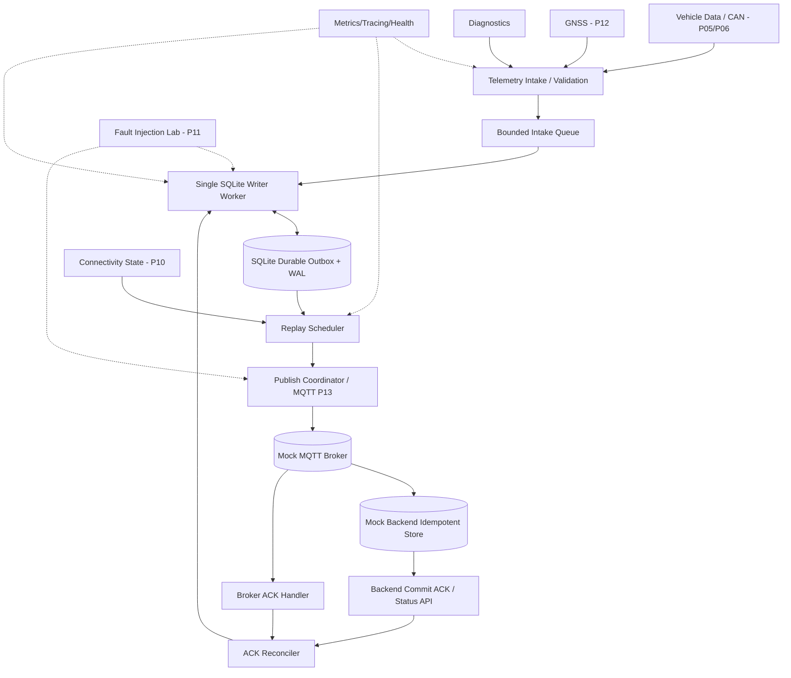
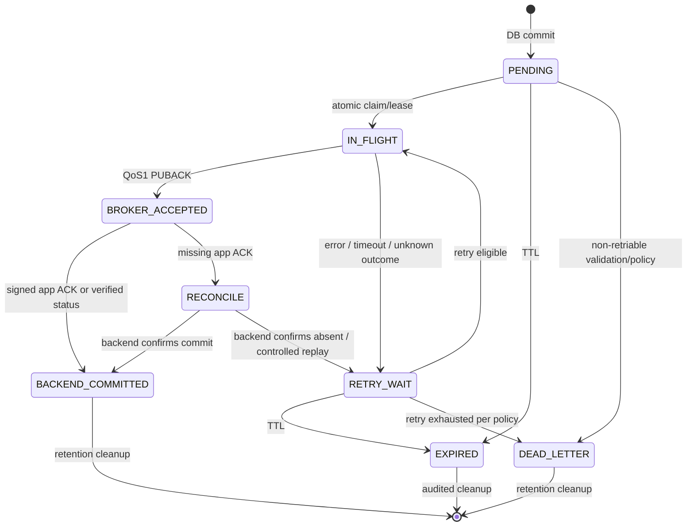
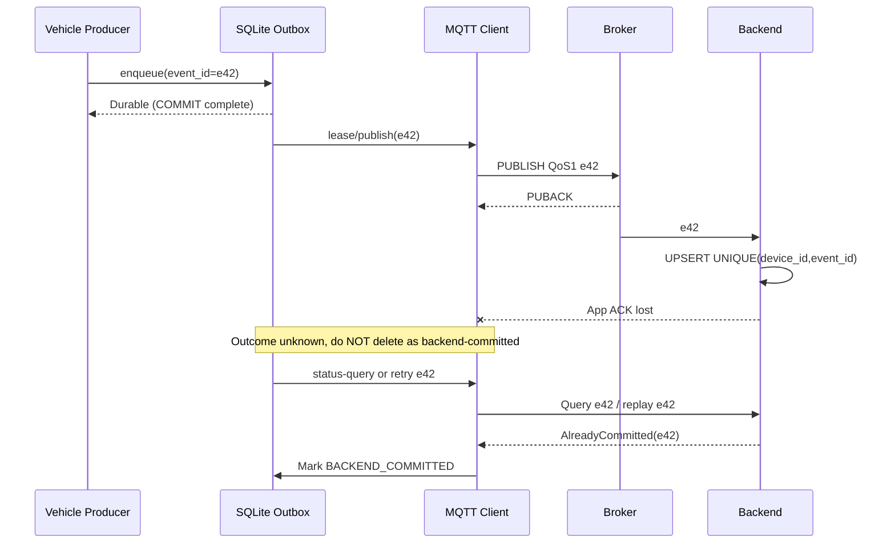
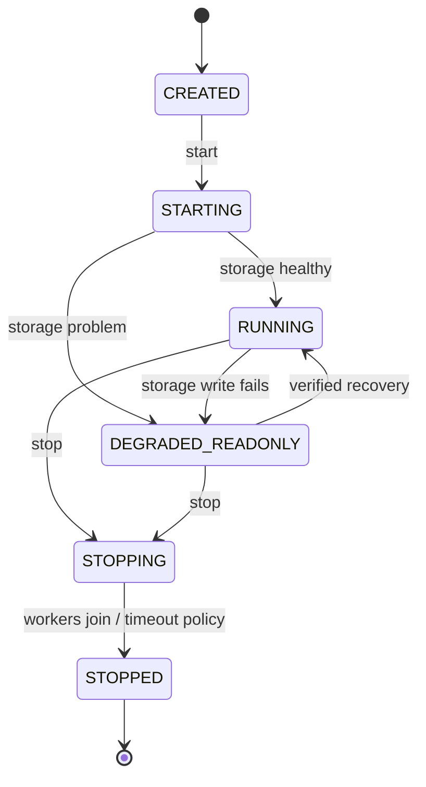

# P14 — Offline Telemetry Store-and-Forward

**Virtual TCU Lab | System Design + Behavior Specification + Resilience / What-if Test Plan**

| Thuộc tính | Giá trị |
|---|---|
| Project | 14 / 30 — Offline Telemetry Store-and-Forward |
| Phiên bản tài liệu | 1.0 |
| Ngày | 2026-10-30 |
| Ngôn ngữ / nền tảng | C++17, Linux (Ubuntu/WSL2), SQLite, MQTT mock |
| Đối tượng | Middle C++ Developer / TCU Application & Middleware |
| Dependencies | P01 Event Bus, P02 IPC, P03 Scheduler, P04 Config/Logging, P10 Connectivity, P11 Fault Injection, P13 MQTT Client |
| Trạng thái | **Design/Test Plan — chưa phải implementation hay chứng nhận độ bền** |

> **Mục đích:** TCU có thể thu thập telemetry khi offline, ghi bền vững theo chính sách đã định, gửi bù khi cloud trở lại, không mất dữ liệu đã xác nhận lưu (trong giới hạn failure model), không báo thành công giả và không vượt ngân sách RAM/disk. Không có thiết kế hữu hạn nào có thể chịu được *mọi* lỗi; bộ What-if là tập phủ có hệ thống, phải mở rộng bằng fuzzing và fault campaigns.

## 0. Executive summary, phạm vi và giả định

### 0.1 Bài toán

TCU nhận sự kiện từ Vehicle Data, GNSS, Diagnostics, Power Manager. Kết nối LTE/5G có thể biến mất vài phút–nhiều ngày. Gửi ngay bằng MQTT rồi loại event sẽ gây mất dữ liệu; giữ mãi trong RAM làm quá tải hoặc mất sau reboot. Hệ thống cần **durable outbox** SQLite, publish có giới hạn, phân loại ACK, retry và retention.

### 0.2 Phạm vi

**In scope:** payload normalization/validation, event IDs, durable local queue, SQLite lifecycle/WAL, prioritization, TTL, quota, batching, lease/in-flight, retry, ACK reconciliation, crash recovery, metrics, deterministic tests, fault injection, tích hợp P13 và mock backend có idempotency.

**Out of scope:** tự viết MQTT protocol/crypto library, xây cloud production, hỗ trợ safety-critical vehicle command qua telemetry outbox, bảo đảm phần cứng flash không hỏng, bảo đảm exactly-once end-to-end khi backend không hỗ trợ idempotency, chứng nhận ASIL/AUTOSAR.

### 0.3 Giả định và điểm cần xác nhận với OEM

- Telemetry là **data-plane only**, không chứa tác vụ điều khiển actuator. Remote commands đi qua service riêng với security/safety policy.
- Một process giữ quyền ghi SQLite (một DB worker). Nhiều producer gọi API bất đồng bộ; bounded input queue chặn overload.
- Persistent volume trên **local filesystem** (không lưu WAL trên network filesystem); kiểm tra thực tế loại media, fsync semantics, wear budget.
- Thiết kế profile `CloudCommit`: chỉ xóa event khi nhận **application-level durable ACK** đã xác thực. Profile `BrokerAccepted` cho telemetry giá trị thấp có thể xóa sau PUBACK nếu OEM chấp nhận rủi ro backend chưa ghi. Không đánh đồng hai profile.
- Thiết kế mặc định dùng QoS 1; gửi trùng có thể xảy ra. Mock backend có unique `(device_id,event_id)` và API tra cứu trạng thái.
- Mọi ngưỡng kích thước/timeouts trong tài liệu là **giá trị lab đề xuất**, cần đo và chốt lại theo sản phẩm; không phải SLA đã được xác minh.

### 0.4 Goals / non-goals và mức ưu tiên

| ID | Requirement | Priority | Test oracle |
|---|---|---|---|
| FR-01 | Enqueue hợp lệ với event ID ổn định, trả kết quả rõ `Durable/Rejected/Unknown` | P0 | DB row và result tương ứng |
| FR-02 | Không trả `Durable` trước SQLite COMMIT đáp ứng durability profile | P0 | Kill/power-loss test tại commit boundary |
| FR-03 | Mất Internet không ngăn thu thập trong quota | P0 | Offline soak, counters |
| FR-04 | Reconnect replay chỉ những event đủ điều kiện, bounded concurrent in-flight | P0 | Scheduler trace và DB snapshot |
| FR-05 | ACK phân biệt Broker vs Backend; không delete sai stage | P0 | ACK-lost/late/forged tests |
| FR-06 | Reboot khôi phục `IN_FLIGHT` mà không giả định đã thành công | P0 | restart/reconciliation tests |
| FR-07 | TTL, ưu tiên, fairness và quota có policy minh bạch | P0 | deterministic time, eviction ledger |
| FR-08 | Lifecycle open/degraded/read-only/shutdown không deadlock | P0 | fault campaigns + sanitizer |
| FR-09 | Metrics, audit reason, dead-letter, diagnostic bundle | P1 | assertions trên logs/metrics |
| FR-10 | Schema migration có rollback/no partial migration | P1 | migration crash matrix |
| NFR-01 | Bounded heap, disk, pending I/O và MQTT in-flight | P0 | resource limit test |
| NFR-02 | Không xử lý payload độc hại/không hợp lệ như telemetry tin cậy | P0 | validator fuzz |
| NFR-03 | Có bằng chứng end-to-end thay vì chỉ `publish()` success | P0 | trace per event + backend DB |
| NFR-04 | Test time deterministic (inject `IClock`) | P1 | no-sleep tests |
| NFR-05 | Không block realtime CAN/GNSS callback bởi SQLite fsync | P0 | latency instrumentation |

## 1. Kiến trúc tổng thể



### 1.1 Ranh giới trách nhiệm

| Thành phần | Owns | Không làm |
|---|---|---|
| `TelemetryIntake` | validate, canonicalize, assign ID, admission | Không gọi SQLite trong CAN callback |
| `SqliteOutboxRepository` | atomic TX, schema, select/lease, ACK transition | Không gửi MQTT |
| `ReplayScheduler` | priority/fairness/TTL/backoff, batches | Không tự suy đoán cloud đã commit |
| `PublishCoordinator` | MQTT publish, correlation, in-flight limit | Không xóa DB khi callback publish() trả success |
| `AckReconciler` | broker/backend ACK, old-generation guard, status query | Không tin ACK thiếu authentication |
| `StorageGuardian` | quota, WAL/health, disk pressure, retention | Không âm thầm drop critical events |
| `RecoveryManager` | startup integrity, incomplete leases, read-only degraded | Không tự reset DB khi corruption |
| `FaultHarness` | deterministic timing, I/O failures, network failure | Không dùng fault injection trên CAN/xe thật |

## 2. Dữ liệu, danh tính và trạng thái

### 2.1 Envelope bất biến

```cpp
struct TelemetryEnvelope {
    std::string event_id;      // stable idempotency key (UUID or provisioned counter)
    std::string device_id;     // authenticated namespace, not trusted from arbitrary producer
    std::string stream_id;     // gnss, vehicle, diagnostics...
    uint64_t stream_seq;      // monotonic within persistent stream, if ordered stream
    int priority;             // 0 critical -> 3 background (policy-defined)
    int schema_version;
    std::vector<std::uint8_t> payload;
    std::chrono::system_clock::time_point event_utc;
    std::chrono::seconds ttl;
};
```

- `event_id` stable qua mọi retry; không tạo ID mới khi resend.
- `stream_seq` cấp trong transaction cùng với insert khi cần thứ tự bền vững. Không dùng uptime-only counter làm ID qua reboot.
- `event_utc` là thời gian từ sensor và có thể chưa đáng tin; `enqueued_at_utc` và `boot_id/steady_age` được tách riêng. TTL sau reboot dựa vào policy về clock trust; **không lấy monotonic timestamp cũ trừ monotonic timestamp của boot mới**.
- Không dùng mỗi hash payload làm event ID: hai readings đồng giá trị vẫn là hai event khác nhau.
- `payload_hash` giúp phát hiện lỗi ngoài dự kiến trong lab, không phải MAC/chữ ký chống tấn công.

### 2.2 State machine record



`BROKER_ACCEPTED` là stage hữu ích cho observability nhưng **không phải** bằng chứng backend đã commit. Với profile `BrokerAccepted`, state có thể chuyển sang terminal `BROKER_FINAL` sau PUBACK; không gán nhầm là `BACKEND_COMMITTED`. Mọi transition dùng expected state + `lease_generation` / `session_epoch` để chống late callback.

### 2.3 Invariants bắt buộc

| ID | Bất biến | Lý do |
|---|---|---|
| INV-01 | Một `(device_id,event_id)` là duy nhất trong outbox active | tránh duplicate insertion |
| INV-02 | Không báo `Durable` nếu transaction chưa xác nhận commit | tránh success giả |
| INV-03 | Mọi retry giữ cùng event ID và payload semantic | backend dedup |
| INV-04 | Không đánh dấu backend commit dựa trên PUBACK | chính xác ngữ nghĩa |
| INV-05 | Late ACK không thay đổi row đã đổi lease/session generation | tránh rollback state |
| INV-06 | Dữ liệu critical không bị silent eviction | audit + safety-of-data |
| INV-07 | Tổng intake queue, DB logical bytes, WAL và pending publish có quota/giám sát | bounded resources |
| INV-08 | Mỗi row chỉ có một terminal disposition reason | không double-close |
| INV-09 | Per-stream order bảo toàn khi ordering mode được bật | trace consistency |
| INV-10 | Sau crash, outcome chưa rõ vẫn là unknown/reconcilable | không tuyên bố mất/đã giao sai |
| INV-11 | Authenticated ACK phải match device/event/payload version | chống forged ACK |
| INV-12 | Thu hồi dữ liệu hết TTL không được hồi sinh do late ACK | consistency |
| INV-13 | Không dùng timestamp đơn hệ khác boot để tính age chính xác | clock safety |
| INV-14 | Không xóa `-wal`/`-shm` bằng tay khi DB đang hoạt động | integrity |
| INV-15 | Dừng service không có nghĩa pending event đã tới cloud | đúng status |

## 3. SQLite storage design

### 3.1 DDL lab baseline

```sql
PRAGMA foreign_keys=ON;
PRAGMA journal_mode=WAL;
PRAGMA synchronous=FULL;
PRAGMA busy_timeout=2000;

CREATE TABLE IF NOT EXISTS meta (
    key TEXT PRIMARY KEY,
    value TEXT NOT NULL
);

CREATE TABLE IF NOT EXISTS stream_counters (
    device_id TEXT NOT NULL,
    stream_id TEXT NOT NULL,
    next_seq INTEGER NOT NULL CHECK(next_seq >= 0),
    PRIMARY KEY(device_id, stream_id)
);

CREATE TABLE IF NOT EXISTS telemetry_outbox (
    row_id INTEGER PRIMARY KEY,
    device_id TEXT NOT NULL,
    event_id TEXT NOT NULL,
    stream_id TEXT NOT NULL,
    stream_seq INTEGER NOT NULL CHECK(stream_seq >= 0),
    priority INTEGER NOT NULL CHECK(priority BETWEEN 0 AND 3),
    schema_version INTEGER NOT NULL,
    payload BLOB NOT NULL,
    payload_sha256 BLOB NOT NULL,
    event_utc_ms INTEGER,
    enqueued_utc_ms INTEGER NOT NULL,
    expiry_utc_ms INTEGER,
    state TEXT NOT NULL CHECK(state IN
      ('PENDING','IN_FLIGHT','BROKER_ACCEPTED','RECONCILE',
       'RETRY_WAIT','BACKEND_COMMITTED','BROKER_FINAL','EXPIRED','DEAD_LETTER')),
    attempts INTEGER NOT NULL DEFAULT 0 CHECK(attempts >= 0),
    next_retry_utc_ms INTEGER,
    lease_generation INTEGER NOT NULL DEFAULT 0,
    lease_owner TEXT,
    lease_boot_id TEXT,
    last_error_code TEXT,
    terminal_reason TEXT,
    created_version INTEGER NOT NULL DEFAULT 1,
    UNIQUE(device_id, event_id),
    UNIQUE(device_id, stream_id, stream_seq)
);

CREATE INDEX IF NOT EXISTS idx_ready
  ON telemetry_outbox(state, priority, next_retry_utc_ms, row_id);
CREATE INDEX IF NOT EXISTS idx_device_stream
  ON telemetry_outbox(device_id, stream_id, stream_seq);
CREATE INDEX IF NOT EXISTS idx_expiry
  ON telemetry_outbox(expiry_utc_ms, state);

CREATE TABLE IF NOT EXISTS delivery_audit (
    audit_id INTEGER PRIMARY KEY,
    event_id TEXT NOT NULL,
    from_state TEXT,
    to_state TEXT NOT NULL,
    reason TEXT NOT NULL,
    transition_utc_ms INTEGER NOT NULL,
    session_epoch INTEGER,
    lease_generation INTEGER
);
```

**Quy tắc schema:** dùng `INTEGER` 64-bit Unix milliseconds; không biến `NULL event_utc_ms` thành `0`. Chỉ ghi `payload_sha256` để phát hiện accidental corruption; nếu cần chống sửa đổi phải dùng MAC/signature & key management. Audit theo retention và quota riêng. DDL trên là baseline; production cần kiểm tra SQLite version, encryption/privacy requirements, index/write amplification, WAL growth và migration strategy.

### 3.2 Transaction boundaries

1. **Enqueue:** validate trước DB; `BEGIN IMMEDIATE` → cấp `stream_seq` nếu cần → insert row → insert audit → `COMMIT` → trả `Durable`. Nếu COMMIT trả lỗi I/O, outcome có thể chưa rõ ở tầng caller: dùng `Unknown` và reconcile theo `event_id`, không retry bằng ID mới.
2. **Claim batch:** `BEGIN IMMEDIATE` → select eligible rows với policy → `UPDATE state=IN_FLIGHT, lease_generation=lease_generation+1,...` → commit → publish outside SQLite transaction.
3. **ACK:** `UPDATE ... WHERE event_id=? AND state=? AND lease_generation=?` → assert changes==1; audit transition cùng transaction. ACK late/no-match là no-op có metric, không phải error fatal.
4. **Retry:** persist reason/backoff/next attempt; use jitter seeded for test. Không spin khi SQLite `BUSY`.
5. **Startup:** mở DB; migration; health check; chuyển incomplete leases sang `RECONCILE`/`RETRY_WAIT` tùy evidence/ACK policy; không khôi phục `IN_FLIGHT` như thành công.
6. **Cleanup:** terminal records xóa theo transaction batch nhỏ và audit; hạn chế checkpoint starvation; nếu disk full, không cần xóa dữ liệu chưa được xác nhận.

### 3.3 WAL / durability trade-offs

- `WAL + synchronous=FULL` cho cấu hình lab coi trọng power-loss durability; SQLite tài liệu nêu FULL sync WAL sau mỗi commit, NORMAL có thể mất commit gần nhất khi power failure. Điều này vẫn phụ thuộc vào việc OS, filesystem và storage thực sự thực thi sync đúng.
- Kiểm tra **journal_mode thực tế trả về `wal`**; không giả định PRAGMA luôn thành công.
- Monitor kích thước `.db`, `-wal`, `-shm`, số checkpoint busy frames, long-lived readers và free disk.
- Không xóa WAL thủ công để “giải phóng chỗ”; dùng checkpoint có kiểm soát qua SQLite API, chạy lúc phù hợp.
- Với disk budget thấp cần đo write amplification, batching và endurance, không tuyên bố `FULL` miễn phí về hiệu năng.

### 3.4 Chính sách quota và eviction

| Trường hợp | Policy lab đề xuất | Status trả producer |
|---|---|---|
| Queue RAM đầy | reject hoặc block bounded theo API/priority, không block CAN thread | `Backpressure` |
| SQLite logical rows đạt quota | ưu tiên cleanup terminal/expired; sau đó low-priority explicit eviction theo policy | `RejectedQuota` hoặc `Durable` nếu insert thành công |
| Priority 0 critical hết quota | không silent drop; reject với alarm/power policy | `RejectedCriticalCapacity` |
| Disk filesystem đầy nhưng DB có chỗ logical | fail closed với `StorageUnavailable`; alert | `Unknown` nếu commit ambiguous |
| WAL vượt budget | throttle writes, investigate reader/checkpoint; tránh xóa file | `StorageDegraded` |
| Retention đến hạn | purge chỉ event đủ điều kiện, reason audit | terminal only |

**Giới hạn vật lý:** input liên tục vô hạn + disk hữu hạn không thể đạt cả “không mất event” lẫn “storage bounded”; API phải báo chấp nhận/từ chối và lưu loss accounting để không tạo illusion of lossless.

## 4. Replay, ACK, ordering và backpressure

### 4.1 Replay scheduler

- Cửa sổ gửi: ví dụ `max_inflight=32`, `batch_size=64`, `max_retries=8` (lab defaults **không phải tiêu chí OEM**).
- Eligible: ready state, TTL/policy verified, power policy allows, connectivity service cho phép và backend capability matched.
- Fairness: Weighted Deficit Round Robin giữa priority/streams, cộng aging bounded. Không bỏ đói low-priority vô thời hạn, trừ khi policy chấp nhận để bảo vệ traffic critical.
- Ordered streams: mỗi stream chỉ cho phép event `stream_seq` đầu tiên chưa terminal nếu `strict_order=true`; throughput thấp hơn. Streams không yêu cầu order có thể phát song song.
- Backoff: exponential + jitter + cap, lưu attempts, circuit breaker cho lỗi bền vững, hạn chế retry storm sau reboot.
- Không giữ SQLite transaction khi gọi MQTT hoặc network.

### 4.2 ACK semantics table

| Evidence | Meaning | Outbox action |
|---|---|---|
| `publish()` method trả success | MQTT client chấp nhận lời gọi / queued locally (tùy API) | không delete |
| QoS0 transport sent | không có broker ACK | chỉ finalize nếu policy cho QoS0 at-most-once |
| QoS1 PUBACK | MQTT broker xác nhận publish theo giao thức | `BROKER_ACCEPTED`; không là backend commit |
| QoS2 flow complete | MQTT QoS2 hop-level completed | không là backend business commit |
| Verified app ACK (`event_id`,`device_id`,`commit_version`) | backend đã ghi bền theo contract | `BACKEND_COMMITTED` |
| Application ACK timeout | outcome unknown | status query/retry với cùng ID |
| Backend status = absent | server xác nhận chưa commit | reschedule cùng ID |
| Backend status = committed | server xác nhận commit | terminal |
| Unauthorized/mismatched ACK | untrusted | reject, security metric |

### 4.3 Trường hợp ACK bị mất — không có exactly-once thần kỳ



### 4.4 Data contract và privacy

Payload là immutable, versioned; decoder downstream phải validate schema. GPS/vehicle telemetry có thể là dữ liệu nhạy cảm: encrypt at rest nếu threat model yêu cầu, TLS in transit, private filesystem permission, remove PII from logs, retention/erase policy, key rotation, avoid sensitive payload in exception text. Mô phỏng bằng tọa độ/vehicle giả.

## 5. C++17 API và thread/lifecycle design

```cpp
enum class EnqueueOutcome { Durable, Duplicate, Backpressure,
    RejectedInvalid, RejectedQuota, RejectedStopped, StorageUnavailable, Unknown };
enum class AckStage { BrokerAccepted, BackendCommitted };

struct EnqueueResult {
    EnqueueOutcome outcome;
    std::string event_id;
    std::string diagnostic_code;
};
struct OutboxStats {
    uint64_t pending, inflight, broker_accepted, retry_wait;
    uint64_t logical_bytes, wal_bytes, dropped_by_policy;
};

class IClock {
public:
    virtual ~IClock() = default;
    virtual std::chrono::steady_clock::time_point steadyNow() const = 0;
    virtual std::chrono::system_clock::time_point utcNow() const = 0;
};

class IOutboxService {
public:
    virtual ~IOutboxService() = default;
    virtual std::future<EnqueueResult> enqueue(TelemetryEnvelope) = 0;
    virtual void onConnectivityChanged(bool ready, uint64_t epoch) = 0;
    virtual void onBrokerAck(std::string eventId, uint64_t leaseGen,
                             uint64_t sessionEpoch) = 0;
    virtual void onBackendAck(std::string eventId, uint64_t leaseGen,
                              uint64_t sessionEpoch, bool authenticated) = 0;
    virtual std::future<OutboxStats> stats() = 0;
    virtual void stop(bool drain, std::chrono::milliseconds deadline) = 0;
};
```

**Concurrency model (lab):** 1 thread nhận/validate enqueue (producer caller không chờ DB trực tiếp); 1 SQLite writer thread xử lý transaction và ACK updates; 1 replay coordinator; MQTT callbacks enqueue bounded completion messages; optional 1 metrics reader connection với reader transactions ngắn. No `sqlite3*` shared concurrently without protection; respect connection threading mode; SQLite writes serialize via single DB worker. Ownership bằng RAII, `weak_ptr`/generation guard ngăn callback sau destruction, `std::atomic<bool>` cho stop, `condition_variable` cho wakeups; không `detach()` worker threads.

### 5.1 Shutdown



- `Drain` không có nghĩa phải chờ cloud online vô hạn. Drain chỉ flush bounded in-memory intake vào DB theo deadline và persist lease dispositions; không mất tính bounded.
- Trên deadline: trả status `StopIncomplete`, giữ rows durable, ngừng gọi APIs từ thread đã chết. Không gọi callback ra ngoài khi nắm SQLite mutex.
- API reentrant/shutdown-safe; `enqueue()` sau STOPPING trả `RejectedStopped` (có thể mở rộng enum trên); callback late không thể hồi sinh service.

## 6. Operational Behavior — hệ thống làm việc như thế nào

### OB-01 Startup sạch

1. Đọc config, kiểm tra owner/path permissions; mở SQLite local FS; xác nhận PRAGMA; migration trong TX phù hợp.
2. Chạy `PRAGMA quick_check` theo startup policy; `integrity_check` cho maintenance hoặc nếu nghi corruption (cân nhắc chi phí).
3. Reconcile leases từ boot cũ, load quotas/counts, đặt service `StorageReady`, đăng ký connectivity callback.
4. Chỉ start replay khi connection state đúng và backend ACK contract được cấu hình.

### OB-02 Enqueue lúc online

Producer → validator → bounded intake queue → SQLite single-writer transaction → return `Durable` → replay scheduler → MQTT → broker ACK → backend ACK → terminal cleanup. **Cấm enqueue trả `Durable` trước COMMIT.**

### OB-03 Enqueue lúc offline

Không gọi MQTT; persist same event, phát metrics `offline_backlog`. Nếu queue/DB vượt quota, ưu tiên policy và trả rejection tường minh, không silently pretend sent.

### OB-04 Reconnect và replay

Connectivity epoch tăng; không dùng callback epoch cũ; rate-limit queue drain để không chiếm toàn bộ mạng. Dừng nếu bearer xuống; hoàn trả hoặc reconcile lease theo proof; retry cùng `event_id`.

### OB-05 MQTT publish success / cloud ACK failure

Giữ row `BROKER_ACCEPTED`/`RECONCILE`; status lookup hoặc retry idempotent. Không xóa vì `PUBACK` nếu profile `CloudCommit`.

### OB-06 Restart/crash

WAL recovery do SQLite; old `IN_FLIGHT` chuyển `RECONCILE` khi lên lại. Incomplete local writes không tự suy đoán accepted. App hỏi DB bằng `event_id` để xử lý Unknown.

### OB-07 Disk pressure

Thực hiện controlled cleanup terminal + expired, giới hạn batch, tăng health metric; không xóa bản ghi critical chưa delivered. Cảnh báo producer và trả `RejectedQuota`/`StorageUnavailable`.

### OB-08 Database corruption

Chuyển DEGRADED, ngừng write/replay nếu không bảo đảm consistency; tạo diagnostic bundle trên bản sao và theo policy bảo mật. Không tự recreate DB trống rồi báo successful recovery, yêu cầu thao tác phục hồi có evidence.

### OB-09 Clock rollback/forward

Wall-clock correction ảnh hưởng TTL; không delete hàng loạt vì thời gian chưa tin cậy. Dựa vào trusted time/counters và policy. Monotonic chỉ dùng trong cùng boot cho timer.

### OB-10 Security event

Fake/late ACK bị bỏ qua; audit identity/epoch; không log full payload. Chỉ backend đã xác thực mới xác nhận durable business commit.

## 7. Reliability / latency / capacity budgets (đề xuất cho LAB)

| Hạng mục | Giá trị ban đầu | Cách đo |
|---|---:|---|
| Intake RAM queue | ≤ 2.000 events | queue watermark |
| SQLite logical outbox | ≤ 100 MiB (cấu hình) | page/row bytes accounting |
| Total filesystem used incl WAL | alert 80%, fail policy 95% | filesystem stats + WAL |
| Max single payload | 64 KiB (cấu hình) | validator |
| Concurrent MQTT publish | 32 | in-flight gauge |
| Replay max throughput | 100 events/s (lab) | event tracing |
| Enqueue P99 on healthy SSD | mục tiêu đo, không hứa trước | histogram |
| Graceful stop deadline | 5 s lab | fake clock + integration |
| Offline retention | 7 days mẫu, theo class | expiration tests |
| Recovery target | test-defined; cần baseline | restart traces |

Tất cả ngân sách cần hiệu chỉnh theo CPU/storage, tuổi flash, nguồn điện, rate thực tế của xe. Một queue tĩnh không bảo đảm throughput; phải đo theo worst-case FSync và MQTT outage.

## 8. Instrumentation, evidence và test oracle

- **Metrics:** `outbox_accepted_total`, `outbox_rejected_{reason}`, `outbox_unknown_commit_total`, `outbox_pending`, `outbox_inflight`, `outbox_bytes`, `outbox_wal_bytes`, `outbox_oldest_age_seconds`, `outbox_replay_total`, `outbox_retry_total`, `outbox_ack_stage_total`, `outbox_backend_commit_total`, `outbox_evicted_total{priority}`, `outbox_lease_recovered_total`, `outbox_sqlite_error_total{code}`, `outbox_checkpoint_busy_total`, `outbox_integrity_degraded`, `outbox_dedup_total`.
- **Trace fields:** `event_id` (synthetic/hashed), `device_id` pseudonym, `stream_id`, `state`, `lease_generation`, `session_epoch`, `transition_reason`, `attempt`, `boot_id`; không log raw GPS/payload bí mật.
- **Evidence:** DB snapshot/state table, backend mock ledger, client trace, MQTT broker trace, network fault timeline, sanitizer reports, memory/disk graphs, process exit code, PRAGMA checks.
- **Pass:** fault được inject **và đo thấy**; expected DB/backend invariant đúng; resource budget không vi phạm; required logs/metrics có.
- **Fail:** một bất biến hoặc ngân sách vi phạm (bao gồm false success).
- **Inconclusive:** injection không có bằng chứng, không quan sát đủ ACK/durability stage, hoặc tester crash.
- **Skipped:** dependency/hardware requirement không có; không được tính pass.
- **Oracle:** backend idempotent ledger UNIQUE device/event; state machine model oracle; clock fake; SQLite checksum/quick_check; differential reference queue; no double terminal transition.

## 9. Risk assessment / failure model

| Nhóm | Nguy cơ | Phòng ngừa |
|---|---|---|
| Delivery semantics | Lost PUBACK/backend ACK → duplicate | stable event ID + idempotent backend + reconcile |
| Persistence | app crash trong commit | WAL + TX + Unknown outcome handling |
| Power loss | storage acknowledgement giả | sync profile + reliable filesystem/hardware validation |
| Capacity | offline kéo dài + full disk | explicit rejection and priority eviction; bounded memory |
| Performance | checkpoint starvation + slow writer | short read TX + metrics/checkpoint management |
| Time | RTC nhảy gây xóa nhầm | trust state, boot-scoped timers |
| Concurrency | callbacks và shutdown race | serialized write + epoch + RAII |
| Security | forged backend commit ACK | authenticated messages + schema/device/event match |
| Privacy | raw GPS lưu/log quá lâu | retention, encryption, redaction |
| Integration | producer nhận `publish success` như `delivered` | typed statuses and contracts |

## 10. Testing pyramid / tools

1. **Unit (Google Test/Mock):** validators, state transitions, bounded queue, priority scheduler, retry, fake clock, ACK fencing, duplicate IDs.
2. **SQLite component:** temp DB on local FS; TX fault hooks at BEGIN/INSERT/COMMIT/FSYNC; migrations; WAL checkpoint; `SQLITE_BUSY/FULL/IOERR/CORRUPT` injection with shim/VFS or controlled filesystem, never production data.
3. **Integration:** P13 MQTT + Mosquitto + mock backend with idempotency DB; container/network namespaces; dynamic network cut via P11.
4. **Deterministic simulation:** seed-based event schedules and fake time; reorder/loss/duplicate ACK events; replay property tests.
5. **Stress/soak:** 1M generated events over controlled time, variable payload sizes, long offline, 24–72h soak according to lab resources; collect resident set size, WAL growth, CPU, writes, lag. These are test goals, not completed runs.
6. **Crash testing:** `SIGKILL` at every persistence boundary; power cut emulated at VM/filesystem level (a process SIGKILL is **not equivalent to physical power loss**).
7. **Security/fuzz:** mutated payloads, malicious IDs, forged ACK, SQLite malformed inputs, configuration misuse.
8. **Tsan/Asan/UBSan/Valgrind:** instrument a supported debug build; treat tool limitations and false positives carefully.

## 11. BDD — behavioral contracts cốt lõi

| ID | Given | When | Then |
|---|---|---|---|
| BDD-01 | storage healthy | enqueue e1 | exactly one active row and `Durable` after COMMIT |
| BDD-02 | offline | enqueue e2 | e2 persists; no MQTT publish attempt |
| BDD-03 | QoS1 PUBACK | CloudCommit profile | row remains until backend ACK |
| BDD-04 | backend ACK lost | reconnect/retry | same event ID; backend stores one logical event |
| BDD-05 | `COMMIT` ambiguous | producer retries same ID | reconcile, no second logical event |
| BDD-06 | queue full | priority-critical event arrives | explicit rejection or controlled admission, no silent loss |
| BDD-07 | disk becomes read-only | enqueue | no `Durable`, storage DEGRADED |
| BDD-08 | restart with in-flight rows | reopen DB | old leases invalid, rows reconciled |
| BDD-09 | late ACK from prior epoch | callback fires | no invalid state transition |
| BDD-10 | TTL expired with untrusted RTC | cleanup | do not delete until time policy allows |
| BDD-11 | backend sends forged ACK | ACK handler | auth failure, event remains |
| BDD-12 | shutdown while callbacks pending | stop | no deadlock, no access after free |

## 12. Test catalog conventions

**Mỗi What-if** có unique ID `P14-WF-xxx`, trigger/injection, expected behavior và evidence. Priority `P0` yêu cầu cho MVP, `P1` cho hardening, `P2` nghiên cứu sâu. **Tất cả scenario là specification, chưa chạy.** Test cases nên được parameterize với 3 delivery profiles (CloudCommit, BrokerAccepted, BestEffort), power modes và payload classes khi phù hợp; chỉ các tổ hợp hợp lệ theo policy mới được coi là expected behavior.

## 13. Catalog 300 What-if scenarios (30 nhóm, 300 case cụ thể)

### 13.01 — API admission / input validation

**Bằng chứng chung:** producer result, validator rejection metrics, SQLite row diff. Kèm trace sự kiện, trạng thái trước/sau và timestamp của fault injector.

| ID | What if? | Cách inject | Expected behavior / oracle | Ưu tiên |
|---|---|---|---|---|
| `P14-WF-001` | Payload length zero | enqueue empty payload | Reject invalid without DB write | P0 |
| `P14-WF-002` | Payload > max size | enqueue 64KiB+1 | Reject before allocating oversized copies | P0 |
| `P14-WF-003` | Unknown schema version | inject future schema id | Reject or quarantine per policy, never silently reinterpret | P0 |
| `P14-WF-004` | Invalid UTF-8 structured payload | inject malformed JSON/UTF-8 | Reject schema-invalid record, no partial insert | P0 |
| `P14-WF-005` | Missing device identity | enqueue without authenticated device | Reject; never use user-supplied unverified device | P0 |
| `P14-WF-006` | Negative priority | enqueue priority=-1 | Reject via explicit validation | P0 |
| `P14-WF-007` | TTL negative/overflow | enqueue invalid duration | Reject; no wraparound expiry | P0 |
| `P14-WF-008` | Producer cancellation before admission | cancel future before queueing | Return cancelled, no DB row | P1 |
| `P14-WF-009` | Producer cancellation after DB COMMIT | cancel during result callback | Keep durable event, return durable/lookup capability | P1 |
| `P14-WF-010` | Caller receives error during shutdown | race enqueue with stop | Return one terminal result, never hang future | P1 |

### 13.02 — Event IDs / sequence assignment

**Bằng chứng chung:** unique indexes, DB stream_counters, backend event ledger. Kèm trace sự kiện, trạng thái trước/sau và timestamp của fault injector.

| ID | What if? | Cách inject | Expected behavior / oracle | Ưu tiên |
|---|---|---|---|---|
| `P14-WF-011` | Duplicate ID with same payload | enqueue twice same device/event | One row; return Duplicate with stable reference | P0 |
| `P14-WF-012` | Duplicate ID with different payload | reuse id with changed payload | Reject conflict, never overwrite original | P0 |
| `P14-WF-013` | Same event ID on two devices | enqueue different device namespaces | Handle as distinct keys according to backend identity | P0 |
| `P14-WF-014` | UUID generator collision | force RNG duplicate | Unique constraint catches collision and reports error | P0 |
| `P14-WF-015` | Boot resets volatile sequence | simulate reboot before next event | Persistent counter prevents reused stream_seq | P0 |
| `P14-WF-016` | Crash after counter increment | kill before insert commit | Counter and row rollback atomically | P0 |
| `P14-WF-017` | Integer sequence max | seed near INT64_MAX | Reject overflow, do not wrap | P0 |
| `P14-WF-018` | Out-of-order producer arrival | deliver seq hints nonmonotonic | Canonical order determined by persistent sequence policy | P1 |
| `P14-WF-019` | Two producers generate same ID | concurrent duplicate enqueue | Exactly one durable logical row | P1 |
| `P14-WF-020` | Timestamp identical for many events | enqueue with same UTC | IDs remain distinct; sorting is deterministic | P1 |

### 13.03 — SQLite durability / COMMIT

**Bằng chứng chung:** transaction trace, VFS injected error, reopened DB contents. Kèm trace sự kiện, trạng thái trước/sau và timestamp của fault injector.

| ID | What if? | Cách inject | Expected behavior / oracle | Ưu tiên |
|---|---|---|---|---|
| `P14-WF-021` | Crash before BEGIN | kill before transaction | No committed row, no Durable result | P0 |
| `P14-WF-022` | Crash after INSERT before COMMIT | kill at pre-commit hook | Rollback uncommitted row | P0 |
| `P14-WF-023` | Crash during COMMIT | kill in commit hook | Caller Unknown; recovery inspects event ID | P0 |
| `P14-WF-024` | COMMIT succeeds then process dies | kill before response | Row survives; retry same ID returns Duplicate | P0 |
| `P14-WF-025` | COMMIT returns SQLITE_IOERR | fault VFS xWrite/xSync | No false Durable; reconcile unknown outcome | P0 |
| `P14-WF-026` | synchronous NORMAL vs FULL | compare power-cut VM scenario | Document differing loss window, do not infer durability under NORMAL | P0 |
| `P14-WF-027` | journal_mode WAL unsupported | force unsupported VFS | Startup fails or explicit fallback requiring approval | P0 |
| `P14-WF-028` | Autocommit accidental | inject write outside TX in code test | Test detects broken atomic counter+row relationship | P1 |
| `P14-WF-029` | Long-running write TX | pause writer after BEGIN | Bounded blocked producers and latency alarm | P1 |
| `P14-WF-030` | SQLite BUSY on commit | hold competing writer transaction | Bounded retry or error, no livelock | P1 |

### 13.04 — Crash window / restart semantics

**Bằng chứng chung:** boot IDs, recovered lease rows, status query logs. Kèm trace sự kiện, trạng thái trước/sau và timestamp của fault injector.

| ID | What if? | Cách inject | Expected behavior / oracle | Ưu tiên |
|---|---|---|---|---|
| `P14-WF-031` | SIGKILL while queued in RAM | kill before durable commit | No Durable ACK, loss accounted to producer | P0 |
| `P14-WF-032` | SIGKILL after durable enqueue | kill immediately after COMMIT | Pending row recovered | P0 |
| `P14-WF-033` | SIGKILL after lease claim | kill before publish | Lease recovered for replay | P0 |
| `P14-WF-034` | SIGKILL after MQTT send | kill before PUBACK | Outcome Unknown; replay same event ID | P0 |
| `P14-WF-035` | SIGKILL after PUBACK | kill before DB update | Reconcile; may duplicate on retry, no false backend commit | P0 |
| `P14-WF-036` | SIGKILL after backend commit | kill before app ACK | Status query/dedup resolves | P0 |
| `P14-WF-037` | SIGKILL after app ACK | kill before local terminal COMMIT | Reconcile via backend, do not create new ID | P0 |
| `P14-WF-038` | Two quick successive restarts | kill in recovery again | No permanently stuck lease | P1 |
| `P14-WF-039` | Boot ID reused accidentally | force same boot-id fixture | Lease generation still fences callbacks; reject invalid boot identity | P1 |
| `P14-WF-040` | Recovery interrupted by storage error | inject I/O failure during reconciliation | Enter DEGRADED, keep records for repair | P1 |

### 13.05 — WAL / checkpoint / journal files

**Bằng chứng chung:** WAL size/time graph, checkpoint result, reader lifetime. Kèm trace sự kiện, trạng thái trước/sau và timestamp của fault injector.

| ID | What if? | Cách inject | Expected behavior / oracle | Ưu tiên |
|---|---|---|---|---|
| `P14-WF-041` | WAL grows under ingest | sustain write throughput | Bounded by threshold/policy, alert if growth persists | P0 |
| `P14-WF-042` | Checkpoint blocked by reader | hold read TX indefinitely | Detect starvation, close reader, no deletion of WAL file | P0 |
| `P14-WF-043` | Checkpoint returns BUSY | inject concurrent reader/writer | Retry bounded; don't block ingest unbounded | P0 |
| `P14-WF-044` | Checkpoint competes with ENQUEUE | trigger TRUNCATE during burst | Latency budget observed, fallback/reschedule | P0 |
| `P14-WF-045` | WAL file disappears externally | delete file only in isolated copy test | Detect storage fault/corruption, no fake success | P0 |
| `P14-WF-046` | SHM permissions denied | chmod DB directory | Fail open clearly, no silent fallback | P0 |
| `P14-WF-047` | Unexpected journal_mode switch | external process changes pragma | Detect mismatch, do not assume settings | P0 |
| `P14-WF-048` | Checkpoint fails with disk full | fill filesystem while checkpoint | Preserve consistency, degrade/alert | P1 |
| `P14-WF-049` | Large transaction spikes WAL | enqueue huge batch | Apply batch caps; WAL limit observed | P1 |
| `P14-WF-050` | Read-only connection holds snapshot | long statistics query | Use short reads, checkpoint recovers after close | P1 |

### 13.06 — SQLite contention / locks

**Bằng chứng chung:** SQLITE_BUSY counters, stopwatch, scheduler trace. Kèm trace sự kiện, trạng thái trước/sau và timestamp của fault injector.

| ID | What if? | Cách inject | Expected behavior / oracle | Ưu tiên |
|---|---|---|---|---|
| `P14-WF-051` | Second writer process starts | open another writer and BEGIN IMMEDIATE | One writer wins; other bounded BUSY handling | P0 |
| `P14-WF-052` | Two reader threads query | parallel short reads | Consistent snapshots, no unsafe shared connection | P0 |
| `P14-WF-053` | Writer blocked by migration lock | hold schema lock | Startup fails bounded with diagnostics | P0 |
| `P14-WF-054` | Busy timeout too long | set huge busy_timeout fixture | Config validation rejects operationally unsafe value | P0 |
| `P14-WF-055` | Busy timeout too short | set 1ms and stress | Backpressure/retry, not silent loss | P0 |
| `P14-WF-056` | Reentrant repository call from callback | callback triggers stats/enqueue | No deadlock due to callback outside lock | P0 |
| `P14-WF-057` | Lock order inversion | inject opposite mutex acquisition | TSan/deadlock watchdog catches issue | P0 |
| `P14-WF-058` | SQLITE_LOCKED from shared connection misuse | fault shared-cache path | Proper error handling; serialized worker design | P1 |
| `P14-WF-059` | Producer count exceeds concurrency plan | launch 1000 producers | Bounded queue; no SQLite handle race | P1 |
| `P14-WF-060` | Reader transaction leaked | omit sqlite finalize in injected error | RAII closes statement and checkpoint resumes | P1 |

### 13.07 — Disk capacity / ENOSPC

**Bằng chứng chung:** filesystem free-bytes trace, SQLite error, admission audit. Kèm trace sự kiện, trạng thái trước/sau và timestamp của fault injector.

| ID | What if? | Cách inject | Expected behavior / oracle | Ưu tiên |
|---|---|---|---|---|
| `P14-WF-061` | Filesystem fills during INSERT | small loopback volume to ENOSPC | No Durable false; protect last good rows | P0 |
| `P14-WF-062` | Filesystem fills during COMMIT | inject ENOSPC at journal sync | Unknown or error and reconcile | P0 |
| `P14-WF-063` | Filesystem fills during ACK write | no space to persist terminal status | Do not discard row; ack can be reconciled | P0 |
| `P14-WF-064` | Disk free bytes below reserve | configure reserve=10MiB | Apply admission policy and alert early | P0 |
| `P14-WF-065` | Other process consumes quota | write external file into volume | Degrade without taking down entire TCU process | P0 |
| `P14-WF-066` | WAL consumes remainder | hold reader + ingest | Pressure alarm; correct checkpoint handling | P0 |
| `P14-WF-067` | Disk freed after ENOSPC | remove unrelated test file | Health check then controlled resume | P0 |
| `P14-WF-068` | Filesystem reports zero free erroneously | fake statvfs inconsistency | Fail safe; corroborate actual write outcome | P1 |
| `P14-WF-069` | No space for audit table | force audit insert ENOSPC | Atomic TX: no row with missing required audit | P1 |
| `P14-WF-070` | Disk fills during cleanup | fault VACUUM/checkpoint | Cleanup defers safely, no implicit row loss | P1 |

### 13.08 — Filesystem / permissions / media failure

**Bằng chứng chung:** errno, file permissions, startup state and disk ledger. Kèm trace sự kiện, trạng thái trước/sau và timestamp của fault injector.

| ID | What if? | Cách inject | Expected behavior / oracle | Ưu tiên |
|---|---|---|---|---|
| `P14-WF-071` | Storage mounted read-only at startup | remount lab volume ro | Service enters DEGRADED_READONLY | P0 |
| `P14-WF-072` | Storage flips read-only in runtime | fault mount between enqueues | No success after write failure | P0 |
| `P14-WF-073` | DB path becomes symlink | replace file with symlink in sandbox | Reject unsafe ownership/path if policy disallows | P0 |
| `P14-WF-074` | Directory inaccessible | chmod parent directory | Fail startup with actionable diagnostic | P0 |
| `P14-WF-075` | Inode exhaustion | create many small files | Treat ENOSPC-like admission failure | P0 |
| `P14-WF-076` | Short write / fsync EIO | VFS hook injecting short write | Report Unknown/Error; preserve previous valid rows | P0 |
| `P14-WF-077` | Storage device disconnected | detach loop device in lab | Safe degraded mode, no busy spin | P0 |
| `P14-WF-078` | File descriptor exhaustion | set RLIMIT_NOFILE low | Bounded recovery, no descriptor leak | P1 |
| `P14-WF-079` | Filesystem latency spike | delay I/O 5s | Intake backpressure; CAN thread not blocked | P1 |
| `P14-WF-080` | DB mistakenly placed on NFS | simulate configured network mount | Reject unsupported WAL deployment | P1 |

### 13.09 — Corruption / integrity

**Bằng chứng chung:** quick_check/integrity_check, quarantine snapshot, state transitions. Kèm trace sự kiện, trạng thái trước/sau và timestamp của fault injector.

| ID | What if? | Cách inject | Expected behavior / oracle | Ưu tiên |
|---|---|---|---|---|
| `P14-WF-081` | DB header bytes corrupted | mutate DB copy while closed | DEGRADED, no silent DB recreation | P0 |
| `P14-WF-082` | WAL header corrupted | mutate WAL copy while closed | Detect/open failure, retain forensic copy | P0 |
| `P14-WF-083` | Single row payload byte flipped | mutate fixture payload/hash | Hash mismatch quarantined; not uploaded as valid | P0 |
| `P14-WF-084` | Index corruption | mutate test DB index pages | Integrity check and repair process, no blind replay | P0 |
| `P14-WF-085` | Schema has unexpected table | replace DB with foreign schema | Reject incompatible data, no overwrites | P0 |
| `P14-WF-086` | Malformed page at startup | use corrupt SQLite fixture | Stop writes, diagnostic evidence | P0 |
| `P14-WF-087` | Corrupt row among valid rows | inject invalid record via fixture | Policy quarantine individual row only if DB still structurally sound | P0 |
| `P14-WF-088` | Integrity check takes too long | large DB maintenance | Use bounded maintenance window, not block realtime path | P1 |
| `P14-WF-089` | Backup copy missing WAL data | copy only .db while live | Verification catches inconsistent snapshot; use SQLite backup API | P1 |
| `P14-WF-090` | Automatic recovery retry loop | persistent SQLITE_CORRUPT | No crash-loop that erases evidence | P1 |

### 13.10 — Schema migration / compatibility

**Bằng chứng chung:** schema_version, migration journal, pre/post snapshot. Kèm trace sự kiện, trạng thái trước/sau và timestamp của fault injector.

| ID | What if? | Cách inject | Expected behavior / oracle | Ưu tiên |
|---|---|---|---|---|
| `P14-WF-091` | Older schema on startup | create v1 DB with migration to v2 | Migration atomic and data preserved | P0 |
| `P14-WF-092` | Newer unsupported schema | open v99 fixture | Fail compatible-safe, never downgrade implicitly | P0 |
| `P14-WF-093` | Crash mid migration | SIGKILL after DDL step | Atomic rollback/restart detection | P0 |
| `P14-WF-094` | Migration runs twice | restart immediately after success | Idempotent, no duplicate indexes/columns | P0 |
| `P14-WF-095` | Large migration hits disk limit | limit volume before copy | Rollback cleanly; no partial state | P0 |
| `P14-WF-096` | Checksum column introduced | migrate legacy rows | Mark integrity status based on actual known data, no invented hash | P0 |
| `P14-WF-097` | Configuration disagrees with schema | mismatched ack profile/meta | Refuse unsafe replay until reconciled | P0 |
| `P14-WF-098` | Two binaries race migration | start two versions together | Single migrator lock, deterministic winner | P1 |
| `P14-WF-099` | Downgrade binary after upgrade | run old binary on v2 DB | Fail with explicit unsupported schema | P1 |
| `P14-WF-100` | Malformed migration script | inject syntax error | No partial migration or data loss | P1 |

### 13.11 — Quota / retention / eviction

**Bằng chứng chung:** per-class counters, rejection and eviction audit. Kèm trace sự kiện, trạng thái trước/sau và timestamp của fault injector.

| ID | What if? | Cách inject | Expected behavior / oracle | Ưu tiên |
|---|---|---|---|---|
| `P14-WF-101` | Quota at exactly limit | fill to N then enqueue N+1 | Document boundary and reject/evict correctly | P0 |
| `P14-WF-102` | Offline 14 days with 7-day TTL | fake clock advance | Expire based on trusted policy, report loss | P0 |
| `P14-WF-103` | Critical record arrives while quota full | fill with background events | Evict allowable low priority or explicit critical rejection | P0 |
| `P14-WF-104` | Only critical records remain | force critical-only full DB | Reject new critical with alarm, never silent delete | P0 |
| `P14-WF-105` | Retention purge interrupted by crash | kill during delete transaction | Atomic progress; no half terminal records | P0 |
| `P14-WF-106` | TTL expires while in-flight | advance clock just before ACK | Single terminal outcome by transition policy | P0 |
| `P14-WF-107` | Audit history quota hit | spam terminal transitions | Audit storage bounded or export strategy; no silent orphan records | P0 |
| `P14-WF-108` | Producer flood bypasses per-source quota | one stream sends 1M events | Per-source admission prevents starvation | P1 |
| `P14-WF-109` | DB payload bytes under quota but WAL not | hold reader growing WAL | Filesystem quota still enforced | P1 |
| `P14-WF-110` | Priority policy hot reload | change eviction class during cleanup | Apply one policy generation atomically | P1 |

### 13.12 — Priority / fairness / ordered streams

**Bằng chứng chung:** dispatch trace, stream_seq, bounded starvation durations. Kèm trace sự kiện, trạng thái trước/sau và timestamp của fault injector.

| ID | What if? | Cách inject | Expected behavior / oracle | Ưu tiên |
|---|---|---|---|---|
| `P14-WF-111` | Critical traffic continuously arrives | send P0 forever and P3 periodically | Configured fairness or explicit starvation policy measured | P0 |
| `P14-WF-112` | Multiple streams same priority | drive uneven producers | Per-stream fairness prevents monopoly | P0 |
| `P14-WF-113` | Strict ordered stream missing seq 3 | enqueue seq 1/2/4 with artificial hole | Policy blocks or gap-reports stream as defined | P0 |
| `P14-WF-114` | Old background event vs new urgent | seed backlog | Urgent prioritized without starving background beyond budget | P0 |
| `P14-WF-115` | Priority altered after enqueue | attempt mutation | Immutability enforced or audited versioned policy | P0 |
| `P14-WF-116` | Batch straddles priorities | trigger batch select | Scheduling stable under same snapshot | P0 |
| `P14-WF-117` | Head-of-line blocking on failed event | force first item permanent error | Dead-letter/quarantine lets eligible followers progress per policy | P0 |
| `P14-WF-118` | Same stream resent out of order | reorder ACK arrivals | DB state consistent, backend sequence handling documented | P1 |
| `P14-WF-119` | Fairness counters overflow | force high credit fixture | Saturating arithmetic/reset, no overflow | P1 |
| `P14-WF-120` | Strict order + expiring head event | head expires while queued | Gap recorded and next event released only under policy | P1 |

### 13.13 — Leases / in-flight accounting

**Bằng chứng chung:** lease generation, row state, inflight gauge. Kèm trace sự kiện, trạng thái trước/sau và timestamp của fault injector.

| ID | What if? | Cách inject | Expected behavior / oracle | Ưu tiên |
|---|---|---|---|---|
| `P14-WF-121` | Two workers claim same row | force concurrent claim API | Only one lease succeeds | P0 |
| `P14-WF-122` | Lease expired with publish running | fake deadline | Old worker result fenced; no double terminal transition | P0 |
| `P14-WF-123` | Lease owner dies | SIGKILL sender worker | Recovery reconciles old lease | P0 |
| `P14-WF-124` | Lease generation wraps | seed near INT64_MAX | Reject/increase epoch safely, never alias old callback | P0 |
| `P14-WF-125` | Publish callback twice | inject repeated callback | Idempotent ACK handling | P0 |
| `P14-WF-126` | Publish callback arrives after row deleted | late ACK on terminal row | No-op + metric | P0 |
| `P14-WF-127` | Lease claim commits but publish admission fails | mock client rejects | Move to RETRY_WAIT with reason | P0 |
| `P14-WF-128` | In-flight count reaches max | publish 33 events with limit32 | No 33rd simultaneous publish | P1 |
| `P14-WF-129` | Lease renewal starves SQL worker | flood renewal calls | Bounded scheduling, service remains responsive | P1 |
| `P14-WF-130` | Backend ACK arrives before broker ACK | reorder callbacks | Monotonic progression to BackendCommitted when verified | P1 |

### 13.14 — Retry / backoff / circuit breaker

**Bằng chứng chung:** attempt log, jitter seed, timer trace. Kèm trace sự kiện, trạng thái trước/sau và timestamp của fault injector.

| ID | What if? | Cách inject | Expected behavior / oracle | Ưu tiên |
|---|---|---|---|---|
| `P14-WF-131` | Permanent DNS failure | fail DNS continuously | Exponential backoff with cap, no busy loop | P0 |
| `P14-WF-132` | Immediate repeated broker disconnect | toggle socket | Retry rate remains bounded | P0 |
| `P14-WF-133` | Server responds retriable overload | mock 503/retryable app status | Honor policy/backoff, no data deletion | P0 |
| `P14-WF-134` | Server responds non-retriable schema reject | app-level reject | Dead-letter with reason, not endless retry | P0 |
| `P14-WF-135` | Retries exhausted | force N retries | Disposition per class, no silent loss | P0 |
| `P14-WF-136` | Retry timer fires after stop | fake timer callback | No new publish or UAF | P0 |
| `P14-WF-137` | Device clock jumps forward | change realtime | Steady retry timer not prematurely fired | P0 |
| `P14-WF-138` | Device clock jumps backward | change realtime | Retry not postponed indefinitely in current boot | P1 |
| `P14-WF-139` | Multiple retries share same deterministic jitter | seed PRNG same across 1k devices | Avoid synchronized fleet retry storms in design | P1 |
| `P14-WF-140` | Circuit half-open concurrent probes | close/open breaker | Only bounded trial requests admitted | P1 |

### 13.15 — MQTT QoS / session / transport

**Bằng chứng chung:** broker packet trace, callback sequence, protocol state. Kèm trace sự kiện, trạng thái trước/sau và timestamp của fault injector.

| ID | What if? | Cách inject | Expected behavior / oracle | Ưu tiên |
|---|---|---|---|---|
| `P14-WF-141` | QoS0 publish returns success | mock acceptance | No claim of broker durable ACK | P0 |
| `P14-WF-142` | QoS1 PUBACK lost | drop PUBACK | Retry with same app event ID; broker may duplicate | P0 |
| `P14-WF-143` | QoS2 completes but backend offline | MQTT QoS2 handshake | No backend commit inferred | P0 |
| `P14-WF-144` | Broker restarts during publish | kill broker before ACK | Unknown outcome reconciled | P0 |
| `P14-WF-145` | Client ID collision/takeover | connect duplicate client id | Session fencing; controlled reconnect | P0 |
| `P14-WF-146` | Session Present=false unexpectedly | drop persistent session | Resubscribe/replay per policy | P0 |
| `P14-WF-147` | Packet ID reused by MQTT client library | simulate library reconnect | Correlation uses event IDs + session epoch | P0 |
| `P14-WF-148` | Keepalive timeout in send burst | drop PINGRESP | Suspend/reconnect; no false completion | P1 |
| `P14-WF-149` | Publish exceeds broker packet maximum | send oversized payload | Reject/dead-letter based on negotiated max | P1 |
| `P14-WF-150` | Shared broker connection multiplexing | two streams publish concurrently | Correct correlation and backpressure | P1 |

### 13.16 — Backend ACK / application commit

**Bằng chứng chung:** backend ledger, authenticated ack envelope, DB terminal state. Kèm trace sự kiện, trạng thái trước/sau và timestamp của fault injector.

| ID | What if? | Cách inject | Expected behavior / oracle | Ưu tiên |
|---|---|---|---|---|
| `P14-WF-151` | Broker PUBACK but backend write fails | fail backend DB commit | Keep outbox row under CloudCommit profile | P0 |
| `P14-WF-152` | Backend commit succeeds but app ACK lost | drop app ACK | Status lookup or dedup on replay | P0 |
| `P14-WF-153` | Backend ACK lacks event_id | send malformed ACK | Reject, row remains | P0 |
| `P14-WF-154` | Backend ACK references wrong device | forge identity | Reject, security metric | P0 |
| `P14-WF-155` | Backend ACK references wrong payload version | forge version | Reject, prevent false terminal | P0 |
| `P14-WF-156` | Backend status query unavailable | timeout status service | Retain/retry per policy | P0 |
| `P14-WF-157` | Backend reports commit after expiration | late verified commit | Terminal resolution defined, no resurrection | P0 |
| `P14-WF-158` | Backend sends ACK before MQTT callback | reorder callbacks | Monotonic state transition to committed | P1 |
| `P14-WF-159` | Backend ACK duplicate | deliver same ACK twice | Exactly one terminal transition | P1 |
| `P14-WF-160` | Backend ACK signature expired | mock invalid signed envelope | Reject unless trusted rotation policy validates | P1 |

### 13.17 — Duplicate delivery / idempotency

**Bằng chứng chung:** unique backend key constraint and request traces. Kèm trace sự kiện, trạng thái trước/sau và timestamp của fault injector.

| ID | What if? | Cách inject | Expected behavior / oracle | Ưu tiên |
|---|---|---|---|---|
| `P14-WF-161` | QoS1 duplicates delivery | inject DUP publishes | Exactly one logical backend event | P0 |
| `P14-WF-162` | Two TCU restarts replay same event | kill/restart twice | Backend dedup prevents duplicate record | P0 |
| `P14-WF-163` | Event ID reused with changed payload | send conflict | Backend flags integrity conflict, not merge silently | P0 |
| `P14-WF-164` | Backend dedup retention expires too soon | advance backend retention | Detect risk; keep compatible dedup horizon | P0 |
| `P14-WF-165` | Status query races with retry | simultaneous query and send | Stable event ID, backend ledger unchanged | P0 |
| `P14-WF-166` | Two backend replicas accept same ID | simulate concurrent handlers | Global unique constraint or agreed conflict resolution | P0 |
| `P14-WF-167` | Client reuses MQTT packet ID for different event | simulate reconnect | App event key prevents cross-matching | P0 |
| `P14-WF-168` | Response duplicates from multiple sources | deliver app ACK twice via two paths | One terminal result | P1 |
| `P14-WF-169` | Event replay after local cleanup | restore old backup | Backend dedup resolves if retention sufficient | P1 |
| `P14-WF-170` | Mixed device namespaces share event ID | publish under two device IDs | Scoped uniqueness matches contract | P1 |

### 13.18 — Ordering / aggregation / batch atomicity

**Bằng chứng chung:** stream_seq audit and backend commit order. Kèm trace sự kiện, trạng thái trước/sau và timestamp của fault injector.

| ID | What if? | Cách inject | Expected behavior / oracle | Ưu tiên |
|---|---|---|---|---|
| `P14-WF-171` | Network reorders publishes | delay older packet | Per-stream order policy detects or prevents inversion | P0 |
| `P14-WF-172` | Batch partly reaches broker | drop connection halfway | Only confirmed events advance; others reconcile | P0 |
| `P14-WF-173` | Aggregation window closes during reboot | kill aggregation worker | No invented complete batch; persist policy | P0 |
| `P14-WF-174` | Large batch fails due to one bad record | inject poison payload | Isolate offending record; others progress | P0 |
| `P14-WF-175` | Batch ACK references missing member | malformed response | Never terminalize unmatched event | P0 |
| `P14-WF-176` | Duplicate stream sequence from bug | inject unique constraint conflict | Reject invalid insertion | P0 |
| `P14-WF-177` | Strict FIFO across two priorities requested | configure conflicting policy | Validation flags incompatible settings | P0 |
| `P14-WF-178` | Out-of-order backend processing | delay workers | Sequence gap alert if required | P1 |
| `P14-WF-179` | Batch size=0 or enormous | invalid config | Reject unsafe config | P1 |
| `P14-WF-180` | Ack arrives for future sequence | forge out-of-window ACK | Validate event membership, no early delete | P1 |

### 13.19 — Clock / TTL / trusted time

**Bằng chứng chung:** fake clock, RTC trust state, stored expiry decisions. Kèm trace sự kiện, trạng thái trước/sau và timestamp của fault injector.

| ID | What if? | Cách inject | Expected behavior / oracle | Ưu tiên |
|---|---|---|---|---|
| `P14-WF-181` | RTC starts at 1970 | boot without RTC sync | TTL uncertain, no mass premature expiry | P0 |
| `P14-WF-182` | NTP jumps forward 30 days | set future UTC | Quarantine expiration decision until trust policy permits | P0 |
| `P14-WF-183` | NTP jumps backward 3 years | set past UTC | No endlessly extended retention without bounded fallback policy | P0 |
| `P14-WF-184` | GPS clock disagrees with NTP | feed conflicting timestamps | Trust decision explicit, logged | P0 |
| `P14-WF-185` | DST/timezone changes | alter TZ | Store timestamps UTC, unaffected | P0 |
| `P14-WF-186` | Leap second source anomalies | inject special timestamp | No parser overflow or premature expiry | P0 |
| `P14-WF-187` | Monotonic reset at reboot | restart with fake monotonic zero | Do not compare old boot monotonic times | P0 |
| `P14-WF-188` | TTL expires during MQTT flight | advance accepted clock | One terminal disposition, no inconsistent replay | P1 |
| `P14-WF-189` | Aged telemetry without event_utc | send null UTC | Mark unknown age; apply allowed policy | P1 |
| `P14-WF-190` | Clock overflow at int64 bounds | seed max timestamp | Reject overflow, no undefined behavior | P1 |

### 13.20 — Power / suspend / lifecycle

**Bằng chứng chung:** boot trace, power policy, DB status on restart. Kèm trace sự kiện, trạng thái trước/sau và timestamp của fault injector.

| ID | What if? | Cách inject | Expected behavior / oracle | Ưu tiên |
|---|---|---|---|---|
| `P14-WF-191` | Ignition OFF during enqueue | trigger power event | Finish bounded DB commit or reject explicitly | P0 |
| `P14-WF-192` | Power save while offline backlog huge | enter low battery mode | Throttled replay/ingest per priority | P0 |
| `P14-WF-193` | Suspend during fsync | freeze process/VM | Recovery uses actual transaction outcome, not assumed | P0 |
| `P14-WF-194` | Sudden process SIGTERM | terminate gracefully | Persist accepted records, drain bounded | P0 |
| `P14-WF-195` | SIGKILL during shutdown | kill after shutdown start | No corruption on restart | P0 |
| `P14-WF-196` | Sleep/wake causes duplicate connectivity callback | replay same event | Idempotent state update | P0 |
| `P14-WF-197` | Wake triggers retry storm | queue huge backlog | Gradual replay rate, battery budget | P0 |
| `P14-WF-198` | System shutdown has 100ms deadline | force short deadline | No unbounded blocking, durable statuses reported | P1 |
| `P14-WF-199` | System resumes with stale session epoch | inject callback old epoch | Ignore stale callback | P1 |
| `P14-WF-200` | Brownout repeated boot loops | restart service rapidly | Backoff/recovery remains bounded, no wipe | P1 |

### 13.21 — Multithreading / memory safety

**Bằng chứng chung:** TSan/ASan results, trace IDs, deadlock watchdog. Kèm trace sự kiện, trạng thái trước/sau và timestamp của fault injector.

| ID | What if? | Cách inject | Expected behavior / oracle | Ưu tiên |
|---|---|---|---|---|
| `P14-WF-201` | Publish completion races with timeout | trigger both same tick | Single state transition | P0 |
| `P14-WF-202` | Cancel races with enqueue COMMIT | interleave threads | One deterministic accepted/unknown result | P0 |
| `P14-WF-203` | Stats snapshot races with writes | read during 1M enqueues | Consistent counters or documented approximate metrics | P0 |
| `P14-WF-204` | Shutdown races with callback destructor | schedule callback late | No use-after-free | P0 |
| `P14-WF-205` | Two producer queues overflow concurrently | race admission | Hard bound not exceeded | P0 |
| `P14-WF-206` | Retry callback holds lock and reenters | instrument reentrant callback | No deadlock | P0 |
| `P14-WF-207` | Memory allocation failure on enqueue | inject bad_alloc | Typed error, no partial durable success | P0 |
| `P14-WF-208` | Exception from subscriber handler | throw from callback | Isolation; writer still functions | P1 |
| `P14-WF-209` | Thread start fails | simulate resource exhaustion | Startup fails cleanly, close resources | P1 |
| `P14-WF-210` | Concurrent config reload + replay | barrier interleaving | Use one policy generation per batch | P1 |

### 13.22 — Load / resource exhaustion / soak

**Bằng chứng chung:** RSS/CPU/FD/disk time series, counters. Kèm trace sự kiện, trạng thái trước/sau và timestamp của fault injector.

| ID | What if? | Cách inject | Expected behavior / oracle | Ưu tiên |
|---|---|---|---|---|
| `P14-WF-211` | 100,000 enqueues/s burst | load generator burst | RAM bounded, rejected count accurate | P0 |
| `P14-WF-212` | Millions of small events | 24h deterministic source | No unbounded metadata allocations | P0 |
| `P14-WF-213` | 10k clients call stats | hammer stats service | Writer starvation prevented | P0 |
| `P14-WF-214` | One huge payload repeated | max-sized flood | Admission caps throughput and bytes | P0 |
| `P14-WF-215` | Backend delivers no ACK for hours | drop app ACK | In-flight bounded; reconcile policy, no permanent lock | P0 |
| `P14-WF-216` | Long MQTT offline with high ingestion | disable broker for test days | Explicit quota hit and loss accounting | P0 |
| `P14-WF-217` | Repeated WAL checkpoints | force frequent checkpoints | No massive unexplained latency regression | P0 |
| `P14-WF-218` | High CPU due to retry poll | inject network down | No busy loop; CPU bound measured | P1 |
| `P14-WF-219` | File descriptor leak on reconnect | cycle broker 100k times | Stable FD count | P1 |
| `P14-WF-220` | Queue fairness under 1M events | mix priorities | Starvation bound or policy violation visible | P1 |

### 13.23 — Connectivity changes / multi-bearer

**Bằng chứng chung:** connectivity epoch, MQTT trace, pending row state. Kèm trace sự kiện, trạng thái trước/sau và timestamp của fault injector.

| ID | What if? | Cách inject | Expected behavior / oracle | Ưu tiên |
|---|---|---|---|---|
| `P14-WF-221` | Network drops mid payload | cut veth after partial packet | Unknown outcome, stable ID retry | P0 |
| `P14-WF-222` | Wi-Fi to cellular handover | change bearer while in flight | Old session fenced; replay governed by status | P0 |
| `P14-WF-223` | Cellular to Wi-Fi handover | simulate reversed transition | No duplicate terminal writes | P0 |
| `P14-WF-224` | Connectivity Ready falsely reported | mock ready but DNS fails | Transport error keeps rows pending | P0 |
| `P14-WF-225` | Connection repeatedly flaps | toggle link 100x/min | Debounce/backoff, no excessive publish | P0 |
| `P14-WF-226` | IPv4 works, IPv6 unreachable | blackhole v6 | Connectivity/profile probe prevents false ready | P0 |
| `P14-WF-227` | DNS record changes | rotate broker IP | Reconnect with fresh resolution per policy | P0 |
| `P14-WF-228` | TLS certificate rotated while offline | reload trust bundle | No insecure fallback | P1 |
| `P14-WF-229` | Metered bearer budget exhausted | set data limit | Pause non-critical replay, retain records | P1 |
| `P14-WF-230` | Cloud region failover | switch endpoint during pending ACK | Event ID namespace and reconcile consistent | P1 |

### 13.24 — Data-plane / command separation

**Bằng chứng chung:** topic audit and service permission checks. Kèm trace sự kiện, trạng thái trước/sau và timestamp của fault injector.

| ID | What if? | Cách inject | Expected behavior / oracle | Ưu tiên |
|---|---|---|---|---|
| `P14-WF-231` | Remote unlock command inserted as telemetry | enqueue command-like payload | Reject wrong data classification | P0 |
| `P14-WF-232` | Cloud command ACK sent through outbox | route improperly | Keep separate command lifecycle and ACK semantics | P0 |
| `P14-WF-233` | Dangerous topic name in config | configure publish to control topic | Policy validation rejects | P0 |
| `P14-WF-234` | Telemetry producer supplies priority0 without authorization | spoof producer | Enforce source policy, no privilege escalation | P0 |
| `P14-WF-235` | Canary event contains executable script | inject string payload | Treat as data; no shell execution | P0 |
| `P14-WF-236` | Replay triggers BCM state change accidentally | mock topic routing error | Integration test blocks actuator path | P0 |
| `P14-WF-237` | Telemetry expired but remote request pending | mix workloads | Independent lifecycle, no cross deletion | P0 |
| `P14-WF-238` | Duplicate telemetry response mistaken for command ACK | inject overlapping ID | Different message namespaces enforced | P1 |
| `P14-WF-239` | Publisher credentials permit subscribe control topic | test ACL | Minimum privilege validation | P1 |
| `P14-WF-240` | Misconfigured routing from telemetry to diagnostics control | hot reload invalid rule | Reject unsafe configuration | P1 |

### 13.25 — Security / privacy / tampering

**Bằng chứng chung:** auth logs, payload redaction tests, filesystem permissions. Kèm trace sự kiện, trạng thái trước/sau và timestamp của fault injector.

| ID | What if? | Cách inject | Expected behavior / oracle | Ưu tiên |
|---|---|---|---|---|
| `P14-WF-241` | ACK from unauthorized cloud identity | send forged signed message | Reject, keep row pending | P0 |
| `P14-WF-242` | TLS disabled by runtime config | attempt unsafe reload | Fail validation for protected profile | P0 |
| `P14-WF-243` | Secrets appear in SQLite logs | inject secret-shaped test payload | Redaction tests catch accidental disclosure | P0 |
| `P14-WF-244` | DB file world-readable | chmod 0644 | Startup policy warns/fails as specified | P0 |
| `P14-WF-245` | Database copied to other device | restore under different identity | Do not replay as original device | P0 |
| `P14-WF-246` | Key rotation while offline | rotate encryption key | Recover old rows via versioned key lifecycle | P0 |
| `P14-WF-247` | Encryption key missing on boot | remove test key | DEGRADED, no plaintext fallback | P0 |
| `P14-WF-248` | Payload tampered at rest | flip payload bytes | Integrity failure, quarantine | P1 |
| `P14-WF-249` | Very long malicious event ID | fuzz ID 1MB | Reject bounded length, SQL parameterization | P1 |
| `P14-WF-250` | Retention erase request arrives | delete approved data class | Consistent secure erase policy caveat for SQLite WAL/backups | P1 |

### 13.26 — Metrics / audit / false success

**Bằng chứng chung:** prometheus snapshot, audit table, backend ledger. Kèm trace sự kiện, trạng thái trước/sau và timestamp của fault injector.

| ID | What if? | Cách inject | Expected behavior / oracle | Ưu tiên |
|---|---|---|---|---|
| `P14-WF-251` | Metrics worker is offline | stop exporter | Queue continues, internal counters still correct | P0 |
| `P14-WF-252` | Accepted count disagrees with DB rows | inject counter update loss | Reconcile gauges to DB periodically | P0 |
| `P14-WF-253` | Dropped event lacks reason | simulate quota rejection | Explicit reason metric/event | P0 |
| `P14-WF-254` | Backend committed count increments on PUBACK | inject bad callback mapping | Invariant checker detects false commit | P0 |
| `P14-WF-255` | Audit trail duplicated by retry | deliver same transition twice | One audit terminal transition per row | P0 |
| `P14-WF-256` | Log disk fills | write huge logs to shared volume | Log backpressure does not corrupt outbox | P0 |
| `P14-WF-257` | Missing correlation ID | send malformed callback | Reject, diagnostic count | P0 |
| `P14-WF-258` | Metrics cardinality explosion | unique event_id label per event | Do not use IDs as high-cardinality metric labels | P1 |
| `P14-WF-259` | Health dashboard shows Online with DB DEGRADED | storage error while MQTT live | Health surfaces independent subsystems | P1 |
| `P14-WF-260` | Crash before metrics flush | SIGKILL after commit | DB ground truth remains; metrics reconstructed | P1 |

### 13.27 — Configuration / hot reload

**Bằng chứng chung:** config generations, schedule trace, DB state. Kèm trace sự kiện, trạng thái trước/sau và timestamp của fault injector.

| ID | What if? | Cách inject | Expected behavior / oracle | Ưu tiên |
|---|---|---|---|---|
| `P14-WF-261` | Change quota lower than current usage | reload smaller quota | Reject or enter drain-only without deleting critical rows | P0 |
| `P14-WF-262` | Change ACK profile CloudCommit -> BrokerAccepted | attempt while inflight | Require controlled migration/reconciliation, no silent reclassification | P0 |
| `P14-WF-263` | Change retry max during wait | reload value | Apply documented policy generation | P0 |
| `P14-WF-264` | Invalid JSON reload | provide broken config | Keep last-known-good configuration | P0 |
| `P14-WF-265` | Change DB path while running | modify storage path | Reject; requires managed restart | P0 |
| `P14-WF-266` | Change encryption mode mid-session | reload on live data | Refuse unsafe transition without migration plan | P0 |
| `P14-WF-267` | Change priority weights under backlog | reload weights | No data race; fairness resets well-defined | P0 |
| `P14-WF-268` | Reload during COMMIT | signal reload inside transaction | Transaction consistent under old generation | P1 |
| `P14-WF-269` | Repeated config file writes | rapid replace 100 times | Debounce and atomic complete-file load | P1 |
| `P14-WF-270` | Config version decreases | roll back to old schema | Reject incompatible or downgrade policy | P1 |

### 13.28 — Backup / maintenance / upgrade

**Bằng chứng chung:** backup integrity, restored ledger, migration trace. Kèm trace sự kiện, trạng thái trước/sau và timestamp của fault injector.

| ID | What if? | Cách inject | Expected behavior / oracle | Ưu tiên |
|---|---|---|---|---|
| `P14-WF-271` | Live database backup attempted by raw cp | copy .db without WAL | Detect stale/incomplete backup and reject procedure | P0 |
| `P14-WF-272` | SQLite backup API runs under load | backup while enqueueing | Snapshot consistent, bounded impact | P0 |
| `P14-WF-273` | Restore old backup after backend delivered more events | rollback local state | Backend dedup or reconcile prevents duplicate logical commits | P0 |
| `P14-WF-274` | Restore backup with another device ID | cross-device restore | Reject identity mismatch | P0 |
| `P14-WF-275` | Backup destination fills | simulate ENOSPC | Existing DB unaffected; backup failure visible | P0 |
| `P14-WF-276` | Software upgrade changes payload serialization | deploy v2 decoder | Backward compatibility or quarantine unsupported rows | P0 |
| `P14-WF-277` | Upgrade interrupted after binary switch | kill startup migration | Rollback safe with migration version | P0 |
| `P14-WF-278` | Maintenance VACUUM triggers flash wear concern | run frequent vacuum | Rate-limit, document wear and latency tradeoff | P1 |
| `P14-WF-279` | Cleanup runs against actively leased row | schedule purge during flight | Lease/terminal predicate prevents premature deletion | P1 |
| `P14-WF-280` | WAL backup includes sensitive GPS | inspect backup artifact | Apply privacy and encryption policy | P1 |

### 13.29 — Cross-project integration

**Bằng chứng chung:** P10/P11/P13 traces plus outbox/backend DB. Kèm trace sự kiện, trạng thái trước/sau và timestamp của fault injector.

| ID | What if? | Cách inject | Expected behavior / oracle | Ưu tiên |
|---|---|---|---|---|
| `P14-WF-281` | P10 reports CloudReady but P13 disconnected | force states inconsistent | Outbox relies on actual publish transport readiness | P0 |
| `P14-WF-282` | P13 retries internally as P14 retries | enable both independently | Avoid uncontrolled duplicate retry amplification | P0 |
| `P14-WF-283` | P03 timer callback after P14 stop | stop scheduler order reversed | Epoch/weak_ptr fencing protects lifecycle | P0 |
| `P14-WF-284` | P04 logging fails while P14 commits | inject log error | No rollback of valid outbox TX due to optional logger | P0 |
| `P14-WF-285` | P05 CAN producer burst while offline | flood vcan signal events | CAN handling remains non-blocking | P0 |
| `P14-WF-286` | P12 GNSS marks stale after queued snapshot | send stale update | Envelope preserves quality and never recasts old valid GPS as new | P0 |
| `P14-WF-287` | P02 IPC disconnect while enqueue future pending | kill producer process | Clear Unknown/Durable semantics; no unbounded wait | P0 |
| `P14-WF-288` | P11 fault rule applied to wrong link | mis-target tc filter | Test marked Inconclusive, not Pass | P1 |
| `P14-WF-289` | P13 broker PUBACK + P14 backend ACK mismatch | reorder mismatched IDs | Never delete wrong event | P1 |
| `P14-WF-290` | P22 PowerManager suspends retries | activate low battery policy | Priority/energy decisions observable | P1 |

### 13.30 — Fault harness / test oracle quality

**Bằng chứng chung:** test harness assertion, seed, injection audit, artifact manifest. Kèm trace sự kiện, trạng thái trước/sau và timestamp của fault injector.

| ID | What if? | Cách inject | Expected behavior / oracle | Ưu tiên |
|---|---|---|---|---|
| `P14-WF-291` | Injected disk full does not actually hit DB volume | fill wrong mount | Test Inconclusive | P0 |
| `P14-WF-292` | Packet-loss target wrong direction | drop server egress rather than client path | Validate packet counters before PASS | P0 |
| `P14-WF-293` | SIGKILL fires before target code phase | kill too early | Case Inconclusive unless precondition observed | P0 |
| `P14-WF-294` | Fake clock accidentally uses real sleep | test with timeout | Fix deterministic clock; do not count flaky success | P0 |
| `P14-WF-295` | Fault campaign leaves tc rules active | terminate harness mid-test | Cleanup ownership-scoped and verified | P0 |
| `P14-WF-296` | Oracle DB corrupted alongside SUT | share same database fixture | Use independent backend ledger/reference oracle | P0 |
| `P14-WF-297` | Run with randomized seeds but no seed recorded | fuzz failure | Fail test harness quality gate | P0 |
| `P14-WF-298` | Test passes with unobserved ACK | drop observer messages | Inconclusive, not pass | P1 |
| `P14-WF-299` | Stress run exceeds available machine budget | host OOM killer fires | Separate host failure from SUT failure | P1 |
| `P14-WF-300` | Test harness reports PASS despite invariant mismatch | mutate verifier | Mutation testing must catch false pass | P1 |

## 14. Multi-fault campaigns — 50 tổ hợp lỗi có timeline

**Quy tắc thực thi:** (T0) tạo trạng thái sạch + snapshot; (T1) đưa đến precondition có trace; (T2) chèn fault A; (T3) đưa fault B/C vào khi trạng thái trung gian vẫn đang active; (T4) quan sát/thu bằng chứng; (T5) tháo fault có kiểm chứng; (T6) assert invariants và recovery. Dùng barrier/fake clock để kiểm soát thứ tự; ghi seed, build SHA, DB snapshot và artifact manifest. Kết quả **không thể PASS** nếu fail injector không xác minh được điều kiện kích hoạt.

### Storage & power

| ID | Tổ hợp | T2–T3: injection timeline | Invariants/expected outcome |
|---|---|---|---|
| `P14-MF-001` | COMMIT + power cut + producer retry | Enqueue e1, kill VM at commit barrier, restart, retry same e1 | No false Durable; at most one logical row and one backend record |
| `P14-MF-002` | WAL checkpoint + ENOSPC + SIGKILL | Hold reader, fill volume, checkpoint, kill service | Recover good rows; integrity check or DEGRADED |
| `P14-MF-003` | Full disk + critical enqueue + telemetry flood | Fill volume and send P0/P3 concurrently | Critical never silently evicted, all rejections counted |
| `P14-MF-004` | Read-only filesystem + pending ACK + restart | Remount read-only before backend ACK then restart | Row not erased; reconcile after writable |
| `P14-MF-005` | SQLite BUSY + rapid shutdown + callback | Lock DB; start stop; deliver ACK | Stop bounded; no terminal twice or deadlock |
| `P14-MF-006` | Schema migration + low disk + restart | Migrate v1 to v2, inject full disk and reboot | No mixed schema, safe reopen |
| `P14-MF-007` | Write fsync failure + PUBACK + app ACK | Break disk sync during ACK update | Cloud state may commit but outbox stays Unknown/reconcilable |
| `P14-MF-008` | Long reader + WAL growth + checkpoint | Hold read snapshot, flood writes, request truncate | No manual WAL delete, quota alert |
| `P14-MF-009` | Corrupt row + valid backlog + replay | Mutate one payload in isolated fixture, start replay | Poison event quarantined, intact records preserved |
| `P14-MF-010` | Inode exhaustion + audit insert + cleanup | Run out of inodes during transition, cleanup concurrently | Audit consistency preserved, failure explicit |

### Network delivery / ACK ambiguity

| ID | Tổ hợp | T2–T3: injection timeline | Invariants/expected outcome |
|---|---|---|---|
| `P14-MF-011` | QoS1 publish + PUBACK loss + broker restart | Publish e2, drop ACK, restart broker, reconnect | Same event_id, no false backend commit |
| `P14-MF-012` | Backend commit + app ACK loss + duplicate replay | Persist e3 on backend, drop ACK, force reconnect | Backend exactly one logical record |
| `P14-MF-013` | Status query times out + retry + delayed ACK | Query e4 stalls, resend, deliver old ACK | At most one terminal state, valid generation check |
| `P14-MF-014` | Broker success + backend DB outage + quota pressure | PUBACK then backend down while disk fills | Keep undelivered row; admission controlled |
| `P14-MF-015` | Network flap + session takeover + send queue overflow | Switch client ID contender and link repeatedly | Epoch fencing, bounded in-flight |
| `P14-MF-016` | TLS rotate + offline backlog + old connection callback | Change certificate, reconnect, inject stale ack | Reject outdated session/cert data |
| `P14-MF-017` | IPv4/v6 route failover + delayed PUBACK + timer | Change route during flight then trigger timeout | Do not double close event |
| `P14-MF-018` | Backend receives reordered batch + strict sequence | Delay first batch member and reorder second | Ordering policy enforced or gap flagged |
| `P14-MF-019` | QoS2 complete + backend 500 + service reboot | Finish QoS2 handshake, backend fails, restart | No mislabeling as backend committed |
| `P14-MF-020` | Cloud endpoint failover + dedup retention expiry | Switch region after long offline then replay old IDs | Risk surfaced, never claim exactly once without global dedup |

### Time / quota / prioritization

| ID | Tổ hợp | T2–T3: injection timeline | Invariants/expected outcome |
|---|---|---|---|
| `P14-MF-021` | RTC jumps forward + TTL cleanup + fresh MQTT ACK | Advance clock, invoke purge while ACK arrives | Time trust policy prevents premature delete |
| `P14-MF-022` | RTC jumps back + old batch + reboot | Rollback wall time, restart and replay | No immortal retention or incorrect now calculation |
| `P14-MF-023` | Critical priority flood + low-priority starvation + quota | Saturate P0 then insert P3 until full | Fairness matches policy; evictions audited |
| `P14-MF-024` | Long offline + storage full + urgent event | Hold network down for days, insert urgent event | Explicit admission/eviction; no invisible loss |
| `P14-MF-025` | Strict order + poisoned head + ACK duplicate | Make sequence1 invalid, inject duplicate ACK for seq2 | No out-of-order false commit; gap handled |
| `P14-MF-026` | New config quota + existing backlog + cleanup | Shrink max bytes during purge | Atomic policy generation, no critical purge |
| `P14-MF-027` | Retention deletion + status query race + clock update | Start prune, query commit, apply NTP jump | One terminal disposition |
| `P14-MF-028` | Backend slow + priority changes + in-flight cap | Sustain 30s ACK latency, edit weights | In-flight never above cap and low priority policy measurable |
| `P14-MF-029` | Battery low + backlog + urgent diagnostic event | Stop nonessential transfer, enqueue critical diagnostic | Battery/priority constraints applied |
| `P14-MF-030` | Same payload with different event IDs + dedup cache pressure | Submit repeated identical readings under distinct IDs | Distinct logical events kept within quotas |

### Concurrency / lifecycle / IPC

| ID | Tổ hợp | T2–T3: injection timeline | Invariants/expected outcome |
|---|---|---|---|
| `P14-MF-031` | Concurrent producers + writer crash + restart | Send many enqueues, kill writer, recover | Each request Durable/Unknown/Rejected with no silent loss |
| `P14-MF-032` | Shutdown + retry deadline + old MQTT ACK | Schedule all at same deterministic tick | No UAF/deadlock; old ACK fenced |
| `P14-MF-033` | Config reload + DB migration + active lease | Change profile while migrating and sending | Unsafe reload refused; single schema/policy generation |
| `P14-MF-034` | Statistics reader + checkpoint + SIGTERM | Read long query, checkpoint, terminate | Resources close and restart recovers |
| `P14-MF-035` | OOM fault + pending COMMIT + callback double | Simulate allocator failure and duplicated callback | No inconsistent DB row, no double completion |
| `P14-MF-036` | IPC producer reconnect + unknown enqueue + duplicate ID | Disconnect result channel after commit, reconnect and resend | Existing row discovered by ID |
| `P14-MF-037` | Power sleep + timer storm + broker reconnect | Freeze, advance fake time, resume all callbacks | No burst beyond rate limit, no stale callbacks |
| `P14-MF-038` | Crash loop + quick_check + network ready | Restart repeatedly while backend online | Storage verification gates replay |
| `P14-MF-039` | Thread pool exhaustion + SQL lock + graceful stop | Occupy workers, hold lock, request stop | Deadline obeyed, no runaway threads |
| `P14-MF-040` | Many simultaneous ACKs + retention cleanup + stats | Deliver 1000 ACKs while deleting terminal rows | Counters/audit consistent, no duplicate terminal |

### Security / observability / test validity

| ID | Tổ hợp | T2–T3: injection timeline | Invariants/expected outcome |
|---|---|---|---|
| `P14-MF-041` | Forged ACK + valid delayed ACK + replay | Deliver fake first, valid later, then resend | Fake rejected, valid resolves one event |
| `P14-MF-042` | DB identity mismatch + restore backup + cloud ready | Restore another device's DB at startup | Safe failure, no cross-device publish |
| `P14-MF-043` | Key rotation + missing prior key + pressure | Rotate secrets, remove legacy key, saturate disk | DEGRADED without plaintext fallback |
| `P14-MF-044` | Metrics exporter crash + data replay + DB errors | Stop metrics and inject IOERR during backlog | DB truth remains; health reconstructs |
| `P14-MF-045` | Fault injected wrong interface + MQTT reconnect success | Break unrelated link while test expects outage | Test INCONCLUSIVE, never PASS |
| `P14-MF-046` | Chaos runner crashes + network rule persists + retry | Kill harness while tc rule active, restart tests | Cleanup detects orphaned fault rule |
| `P14-MF-047` | Fuzz mutated ACK + invalid JSON telemetry + heavy traffic | Parallel fuzz callbacks and high load | No parser crash, no false terminal |
| `P14-MF-048` | Backup/restore + retention erase request + WAL | Erase subject data then restore old snapshot | Policy explicitly prevents unauthorized resurrection |
| `P14-MF-049` | SQL corruption + false-positive quick_check + missing evidence | Corrupt fixture, stub incomplete observer | Test FAIL/INCONCLUSIVE, never fake PASS |
| `P14-MF-050` | Multiple simultaneous faults + host OOM + testcase timeout | Combine 100% loss, ENOSPC, broker crash, RAM limit | Preserve artifacts and separate host failure from system failure |

## 15. Fault-injection DSL / mẫu automated scenario

```yaml
id: P14-MF-012
name: backend-commit-ack-lost-then-duplicate-replay
preconditions:
  storage: healthy
  mqtt: connected
  ack_profile: CloudCommit
  backend_idempotency: enabled
steps:
  - enqueue: {event_id: 'sim-000012', stream_id: 'vehicle'}
  - assert: {enqueue_result: Durable}
  - wait_for: {backend_commit: 'sim-000012'}
  - inject: {drop_app_ack_for: 'sim-000012'}
  - inject: {disconnect_mqtt: true}
  - inject: {reconnect_mqtt: true}
  - advance_clock_ms: 30000
  - wait_for: {ack_reconciliation_or_replay: 'sim-000012'}
  - assert:
      backend_unique_rows: 1
      local_terminal_states_max: 1
      event_id_unchanged: true
      false_backend_committed: false
  - remove_faults: true
  - assert: {faults_removed_verified: true}
artifacts: [sut.log, sqlite_snapshot.db, backend_ledger.json, faults.json]
```

Các hook như `drop_app_ack_for` là API **cần implement trong test harness**, không phải lệnh đã chạy sẵn. `backend_unique_rows:1` phải đọc từ DB backend mô phỏng độc lập, không tin chỉ một metric phía TCU.

## 16. Performance and recovery experiments

| Test | Workload | Metrics | Exit criterion (cần đo thực tế) |
|---|---|---|---|
| PERF-01 | steady 100 events/s, payload 512 B | enqueue P50/P95/P99, sync time | budget sau baseline |
| PERF-02 | offline 24h 10 events/s | logical DB/WAL size, rejection | bounded within configured quota |
| PERF-03 | recover backlog 50k rows | drain rate, reconnect rate, bandwidth | no starved priority, bounded inflight |
| PERF-04 | 10k concurrent producers | RAM, queue, sqlite busy | no crashes, explicit backpressure |
| PERF-05 | heavy read snapshot + write | checkpoint starvation | warning and eventual checkpoint after reader close |
| PERF-06 | repeated 1000 crash windows | consistency, unknown outcomes | no false Durable/false BackendCommitted |
| PERF-07 | 24h fault soak | fd/RSS/CPU curves | no monotonic resource leak beyond budget |
| PERF-08 | low-memory cgroup test | OOM behavior, recovery | no silent loss of Durably accepted rows |

## 17. Demo Ubuntu / lab runbook

### 17.1 Cài dependencies (môi trường test)

```bash
sudo apt update
sudo apt install -y build-essential cmake ninja-build gdb \
  libsqlite3-dev sqlite3 libssl-dev \
  mosquitto mosquitto-clients python3 python3-venv \
  valgrind iproute2
```

### 17.2 Tạo DB scratch và xác nhận WAL, không thao tác dữ liệu thật

```bash
mkdir -p ./build/p14-lab
sqlite3 ./build/p14-lab/outbox.db \
  'PRAGMA journal_mode=WAL; PRAGMA synchronous=FULL; PRAGMA busy_timeout=2000;'
sqlite3 ./build/p14-lab/outbox.db 'PRAGMA journal_mode; PRAGMA synchronous; PRAGMA quick_check;'
```

Để tạo schema, chạy DDL mục 3.1 trong file `schema.sql` khi implementation đã được bổ sung. Các bước dưới đây là **runbook mục tiêu**, không ám chỉ executable đã tồn tại.

### 17.3 Mô hình test executable (sẽ implement)

```text
terminal 1:  mock_backend --db ./build/p14-lab/backend.db --port 18080
terminal 2:  mosquitto -p 1883 -v
terminal 3:  ./build/bin/telemetry_producer --rate 10 --seconds 300
terminal 4:  ./build/bin/tcu_outbox_service --config ./configs/lab.yaml
terminal 5:  ./build/bin/chaos_runner --scenario ./scenarios/P14-MF-012.yaml
```

**Pass visual demo:** offline → producer enqueue returns Durable → SQLite rows accumulate → connect → MQTT publish → backend commit → rows become terminal → database cleanup → no falsely delivered rows. Repeat by killing service after each significant boundary and inspecting DB/backend ledger.

### 17.4 Command mẫu kiểm tra số liệu sau test

```bash
sqlite3 ./build/p14-lab/outbox.db \
  'SELECT state, count(*), sum(length(payload)) FROM telemetry_outbox GROUP BY state;'
sqlite3 ./build/p14-lab/outbox.db 'PRAGMA quick_check;'
sqlite3 ./build/p14-lab/outbox.db 'PRAGMA wal_checkpoint(PASSIVE);'
ls -lh ./build/p14-lab/outbox.db*
```

`wal_checkpoint(PASSIVE)` không bảo đảm WAL được truncate; không bao giờ tự `rm outbox.db-wal` khi DB đang mở.

## 18. Repository structure

```text
virtual-tcu-lab/
  projects/14-offline-store-forward/
    README.md
    CMakeLists.txt
    configs/lab.yaml
    sql/001_init.sql
    sql/002_upgrade.sql
    include/tcu/outbox/
      IOutboxService.hpp
      IClock.hpp
      TelemetryEnvelope.hpp
      OutboxTypes.hpp
    src/
      TelemetryIntake.cpp
      SqliteOutboxRepository.cpp
      ReplayScheduler.cpp
      AckReconciler.cpp
      StorageGuardian.cpp
      RecoveryManager.cpp
      OutboxService.cpp
    mocks/
      MockBackend.cpp
      MockMqttAdapter.cpp
      FakeClock.cpp
      FaultingSqliteVfs.cpp
    apps/
      tcu_outbox_service.cpp
      telemetry_producer.cpp
      chaos_runner.cpp
    tests/
      unit/
      sqlite_component/
      integration/
      recovery/
      fuzz/
      scenarios/
    docs/
      behavior.md
      threat_model.md
      failure_matrix.md
      trace_examples.md
```

## 19. Jira implementation backlog (36 tickets)

### Sprint 1 — durable core

| Ticket | Task | Acceptance criteria (DoD) | Dependencies |
|---|---|---|---|
| `P14-JIRA-01` | Create CMake skeleton + CI + sanitizers | Build debug/release, gtest and ASan/UBSan targets; smoke test passes | P01/P04 |
| `P14-JIRA-02` | Define telemetry envelope/validation | Reject invalid types, sizes and producer identities with typed outcomes | P05/P12 |
| `P14-JIRA-03` | Implement secure event-ID namespace | Stable unique event IDs, conflicting duplicate handled | none |
| `P14-JIRA-04` | Implement SQLite DB bootstrap PRAGMAs | Validate WAL, synchronous profile, busy timeout, local-FS path | SQLite |
| `P14-JIRA-05` | Implement schema and indexes | Apply DDL and enforce uniqueness/constraints | P14-03 |
| `P14-JIRA-06` | Implement single SQLite worker | No parallel shared write connection, bounded work queue | P14-03 |
| `P14-JIRA-07` | Implement atomic enqueue transaction | Counter+row+audit atomic; Durable only after COMMIT | P14-05 |
| `P14-JIRA-08` | Implement DB query/stats API | Snapshot consistency; no long-running reader TX | P14-06 |
| `P14-JIRA-09` | Build FakeClock and test fixtures | Time tests deterministic and no real sleeps | P03 |

### Sprint 2 — replay & delivery

| Ticket | Task | Acceptance criteria (DoD) | Dependencies |
|---|---|---|---|
| `P14-JIRA-10` | Implement lease claim transaction | Only one active claim per row; generation fencing | P14-07 |
| `P14-JIRA-11` | Implement replay batch scheduling | Respects eligibility and max-inflight | P14-10 |
| `P14-JIRA-12` | Implement priority/fairness policies | Weighted scheduling with deterministic test seeds | P14-11 |
| `P14-JIRA-13` | Implement MQTT transport adapter | Calls P13, preserves ID and QoS fields | P13 |
| `P14-JIRA-14` | Implement broker ACK handling | PUBACK does not mean BackendCommitted | P14-13 |
| `P14-JIRA-15` | Implement backend commit ACK parser | Auth/device/ID/version checks before terminal | P14-14 |
| `P14-JIRA-16` | Implement application status reconciliation | Unknown outcomes status query or replay same ID | P14-15 |
| `P14-JIRA-17` | Implement bounded retry/backoff | No retry storm; jitter with cap and budget | P03/P10 |
| `P14-JIRA-18` | Implement ordered stream option | Per-stream strict order or explicit gap behavior | P14-12 |

### Sprint 3 — resilience, security

| Ticket | Task | Acceptance criteria (DoD) | Dependencies |
|---|---|---|---|
| `P14-JIRA-19` | Implement boot recovery and stale lease handling | Restart reconciles in-flight; no false success | P14-10 |
| `P14-JIRA-20` | Implement storage quota/admission | Bound bytes/rows including WAL pressure; explicit reject | P14-07 |
| `P14-JIRA-21` | Implement TTL/retention/eviction | No untrusted-clock mass expiration; protected classes | P14-20 |
| `P14-JIRA-22` | Implement SQLite error state mapping | Correct IOERR/FULL/BUSY/READONLY/CORRUPT outcomes | P14-06 |
| `P14-JIRA-23` | Implement WAL checkpoint monitoring | Detect starvation; never delete WAL manually | P14-04 |
| `P14-JIRA-24` | Implement schema migration v1->v2 | Atomic migration; incompatible version fails safe | P14-05 |
| `P14-JIRA-25` | Implement crash-safe shutdown | Bounded drain, joins, no UAF | P14-06 |
| `P14-JIRA-26` | Implement metrics / audit / trace | Independently observable acceptance/delivery/error stages | P04 |
| `P14-JIRA-27` | Implement data privacy controls | Redacted logs, secure path, retention rules | P14-17 |

### Sprint 4 — verification and integration

| Ticket | Task | Acceptance criteria (DoD) | Dependencies |
|---|---|---|---|
| `P14-JIRA-28` | Create idempotent backend mock | Unique device/event record, query status and injectable ACK loss | P13 |
| `P14-JIRA-29` | Implement SQLite failure VFS hooks | Fault each transaction boundary deterministically | P14-07 |
| `P14-JIRA-30` | Implement 300 What-if parameterized suite | Automate P0 first; evidence/priority/coverage IDs | P14-29 |
| `P14-JIRA-31` | Implement 50 multi-fault campaigns | Timeline barriers, cleanup and artifact capture | P11 |
| `P14-JIRA-32` | Integrate P10/P11/P13 lab | Offline/reconnect/faults end-to-end on localhost | P10/P11/P13 |
| `P14-JIRA-33` | Run sanitizer/fuzz/stress tests | No known race/leak; report gaps and failures honestly | P14-30 |
| `P14-JIRA-34` | Benchmark capacity and flash-budget profile | Document measured throughput/latency/write amplification | P14-06 |
| `P14-JIRA-35` | Produce architecture review and threat model | Review ambiguity, ACK, clock, quota and encryption contract | all |
| `P14-JIRA-36` | Create demo / operational runbooks | Repro scripts, health indicators and restoration procedures | all |

## 20. Definition of Done (DoD) and release gate

### Gate G0 — functional correctness

- [ ] Enqueue/duplicate/invalid/Unknown API semantics measured; every acceptance returns correct durability status.
- [ ] WAL+FULL startup profile validated on selected local FS; actual PRAGMA outputs logged.
- [ ] Crash recovery handles every injected transition boundary; no unchecked permanent lease.
- [ ] Backend mock implements global unique event identity and authenticated ACK contract.

### Gate G1 — resilience

- [ ] 100% **implemented** P0 What-if tests PASS (record counts and exceptions explicitly; do not equate specified with executed).
- [ ] All multi-fault P0 campaign assertions evaluated; any FAIL/INCONCLUSIVE/Skipped visible.
- [ ] No critical event silently evicted; quota/rejections/audit counters reconcile.
- [ ] No false backend commit due to PUBACK, late ACK, status unknown, or server restart.
- [ ] No deadlocks/UAF and no unexplained sustained resource growth in documented workload profile.

### Gate G2 — operations & security

- [ ] Recover/backup/upgrade test with fixture snapshots; integrity-check and checkpoint policy documented.
- [ ] PII/certificates/secrets do not leak through telemetry logs, exceptions or diagnostic bundles.
- [ ] Failure simulation scoped to sandbox/VM and leaves no persistent host `tc`/mount rules.
- [ ] Trace artifacts include device ID pseudonym/event ID/boot & session epochs/fault timestamps.
- [ ] Benchmark report contains machine spec, workload, SQLite version, build SHA, filesystem, synchronous mode and results.

## 21. Requirement traceability

| Requirements | Main implementation | What-if categories | Evidence |
|---|---|---|---|
| FR-01, FR-02 | Intake + SqliteRepository | 01–04, 19 | reopened DB/producer result |
| FR-03, FR-07 | StorageGuardian | 07, 11, 12, 22 | quota audit, row count |
| FR-04, FR-06 | Replay/Recovery | 04, 13, 14, 20, 23 | lease generation and backend ledger |
| FR-05 | AckReconciler | 15–17 | broker vs backend evidence |
| FR-08 | Lifecycle/Workers | 20, 21, 27 | sanitizer and shutdown trace |
| FR-09, FR-10 | Metrics/Migration | 10, 26, 28 | schema/audit/metrics |
| NFR-01–05 | limits/security/integration | 22–25, 29, 30 | resource graph, fuzz, e2e |

## 22. Design decisions / alternatives

| Decision | Option chosen | Trade-off / alternative |
|---|---|---|
| Persistence | SQLite WAL + FULL for durability-oriented lab | NORMAL faster but power-loss window; log-based DB alternative |
| Writer | single DB worker thread | serializes writes, simplifies ownership; throughput constrained |
| Delivery | MQTT QoS1 + app-level ACK with backend idempotency | QoS2 does not equal business exactly-once |
| Replay | DB lease & epoch fencing | additional writes; protect stale callbacks |
| Data ordering | configurable strict per-stream | strict FIFO creates head-of-line blocking |
| Retry | persisted attempt/backoff + status-query | more complexity but avoids false certainty |
| Full disk | explicit admission failure; class-specific audited eviction | impossible infinite lossless storage |
| Corruption | fail/degrade + forensic snapshot, not auto-wipe | requires operator repair |
| Time | UTC event + trusted-time state + boot-local monotonic timer | cross-boot age can be uncertain |

## 23. Open questions cần hỏi Tech Lead/OEM

1. ACK ở mức nào cho từng telemetry class: broker, backend DB commit hay best-effort?
2. Backend có `event_id` unique và status query API không? Dedup retention bao lâu?
3. Có yêu cầu mất điện đột ngột/flash endurance/SSD/eMMC/UFS cụ thể không?
4. Media filesystem, mount options, encryption-at-rest, secure erasure và key management là gì?
5. Memory/disk quota, producer rate, offline duration, maximum loss budget cho từng priority?
6. Dữ liệu nào là critical, dữ liệu nào được drop, liệu có GDPR/PDPA/privacy retention requirement?
7. Có yêu cầu ordering theo device, stream, timestamp, sequence? Nếu thiếu event đầu tiên thì xử lý ra sao?
8. Power/sleep policy có cho phép fsync hay replay khi ignition off / low battery không?
9. TCU có thể làm việc multi-process/multi-tenant cùng một DB không? Ai là write owner?
10. Hệ thống có cần di chuyển outbox qua firmware A/B update và factory reset không?
11. Có trusted UTC khi boot không? Nếu mất GNSS/NTP, TTL xử lý thế nào?
12. Nguồn kiểm thử power loss/HIL nào có thể sử dụng ở giai đoạn integration thực tế?

## 24. Technical references (đã đối chiếu tài liệu chính thức)

- SQLite WAL mode, performance, checkpoint starvation, local filesystem caveats: https://www.sqlite.org/wal.html
- SQLite PRAGMA, `synchronous=FULL` vs `NORMAL`: https://www.sqlite.org/pragma.html
- SQLite pitfalls / power loss and filesystem assumptions: https://www.sqlite.org/howtocorrupt.html
- SQLite UPSERT / uniqueness conflicts: https://www.sqlite.org/lang_upsert.html
- SQLite DB file/WAL format: https://www.sqlite.org/fileformat.html
- OASIS MQTT v5 standard / QoS: https://docs.oasis-open.org/mqtt/mqtt/v5.0/mqtt-v5.0.html
- Eclipse Mosquitto: https://mosquitto.org/documentation/

**Ghi chú nguồn:** các link xác nhận hành vi của SQLite/MQTT, nhưng *không* xác nhận phần mềm P14 đã chạy. Tính bền vững cuối cùng của fsync phụ thuộc phần cứng, nguồn điện, filesystem, OS và threat model thực tế.

## 25. Limits of simulation / honesty of evidence

- `SIGKILL` kiểm tra application-crash safety nhưng không tái tạo tất cả hành vi mất nguồn, torn writes, unstable flash hoặc power controller.
- SQLite FULL và WAL không bảo vệ khỏi phần cứng nói dối về flush, bit rot, key loss hoặc corruption bên ngoài.
- MQTT QoS không tự bảo đảm exactly-once end-to-end business processing; cần idempotent backend và ACK có hợp đồng rõ ràng.
- 300 scenario + 50 campaigns **không phải** tập hợp toán học đầy đủ của mọi hoán vị lỗi. Kết hợp property-based tests, fuzz, model checking, mutation testing, boundary testing và feedback từ bugs thực tế để mở rộng.
- Bất cứ test nào thiếu bằng chứng fault đã thực sự xảy ra phải là **INCONCLUSIVE**, không phải PASS.
- Không dùng dữ liệu định vị thật hoặc credentials thật trong lab; không inject fault trên production/xe thật.

## 26. Deliverables / handoff checklist

- [ ] `libtcu_outbox` (C++17, CMake) và mock backend.
- [ ] SQLite schema/migration scripts + integrity/checkpoint ops guide.
- [ ] Deterministic fake clock, faulting SQLite VFS và mock MQTT adapter.
- [ ] 300 What-if entries có traceability sang tests (`P14-WF-xxx`).
- [ ] 50 multi-fault scenario definitions (`P14-MF-xxx`).
- [ ] 36 Jira tickets, PRs, build/test artifacts và measured benchmark.
- [ ] System design review, decision log, threat model, reliability proof gaps.

---

**Kết luận:** Project P14 là bài thực hành *crash consistency + distributed delivery semantics + resource governance* rất sát với TCU thực tế. Tiêu chuẩn chất lượng quan trọng nhất: **không báo lưu/giao dữ liệu thành công khi không có bằng chứng**, và luôn đưa kết quả không rõ ràng vào một trạng thái có thể reconcile với cùng danh tính event.

