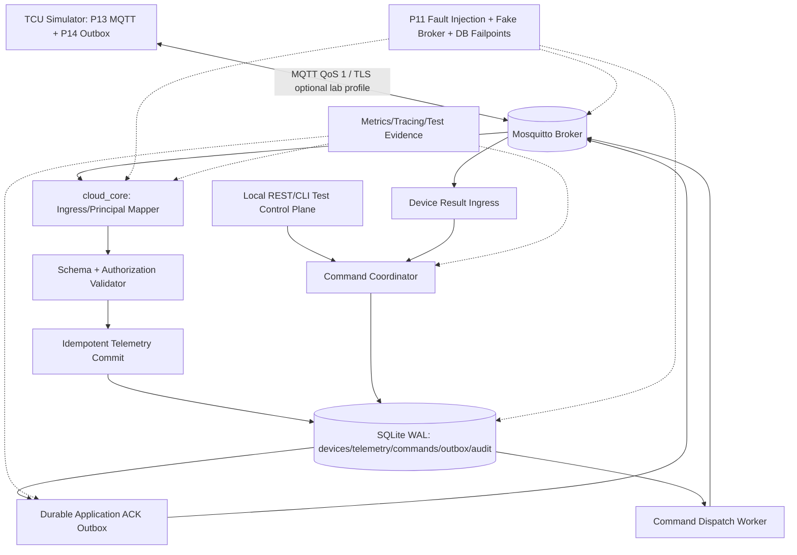
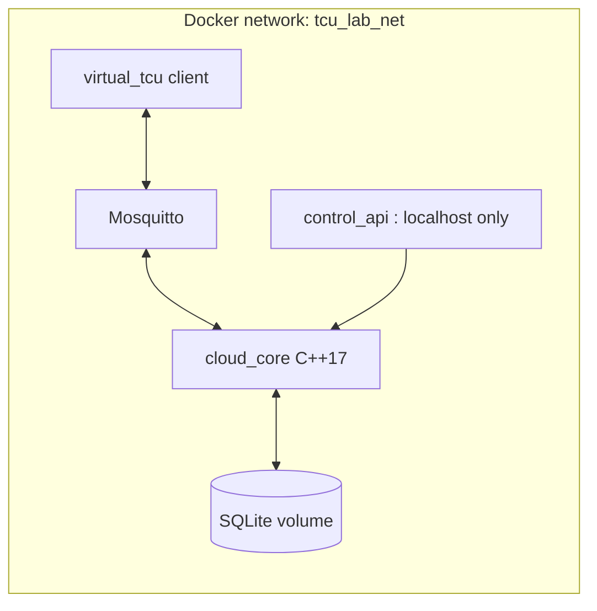
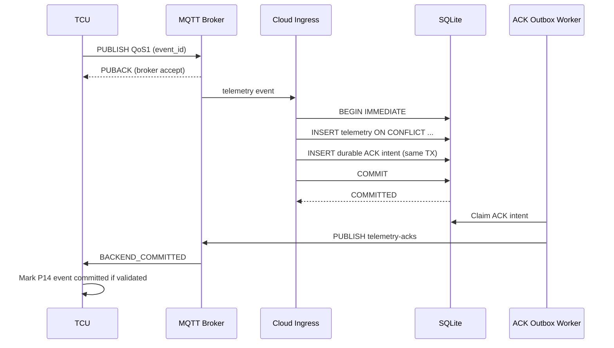
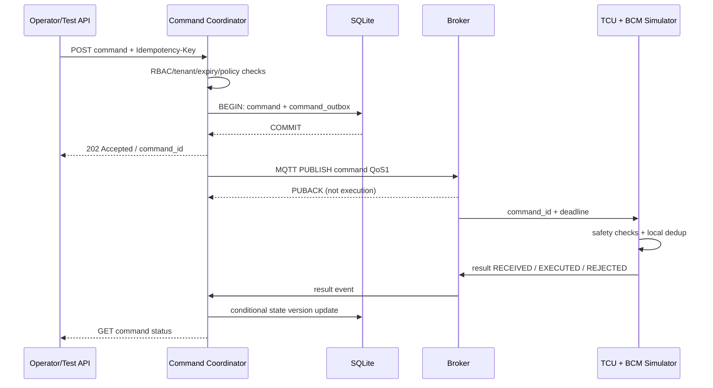
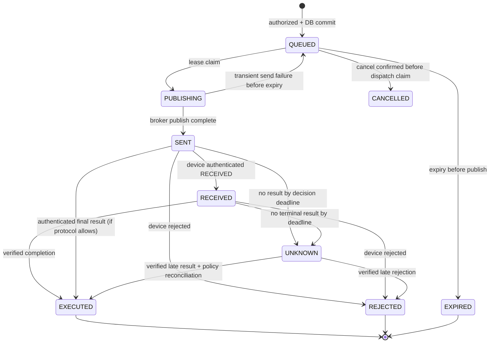
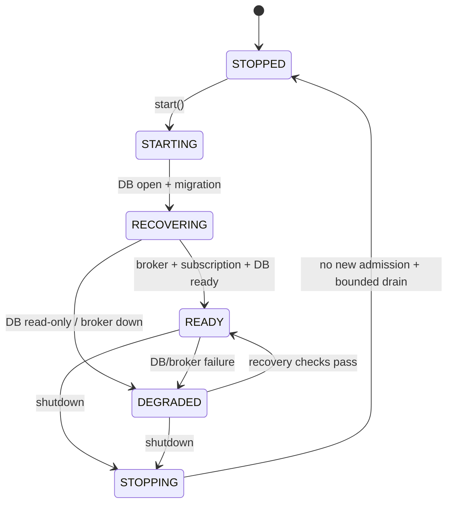

# P15 — Cloud Backend Simulator

**Virtual TCU Lab | System Design + Operational/Behavior Specification + Comprehensive What-if & Multi-fault Test Plan**

| Thuộc tính | Giá trị |
|---|---|
| Project | **15 / 30 — Cloud Backend Simulator** |
| Phiên bản | 1.0 — Design baseline |
| Ngày | 2026-10-30 |
| Ngôn ngữ | Tiếng Việt; API/schema/code sử dụng thuật ngữ kỹ thuật tiếng Anh |
| Stack tham khảo | **C++17**, CMake, Eclipse Paho MQTT C++, Mosquitto MQTT 5, SQLite 3, Python test harness, Docker Compose, Ubuntu |
| Đối tượng | Middle C++ Developer — TCU/Connected Vehicle middleware, backend integration |
| Dependencies | P01 Event Bus, P02 IPC (tùy), P03 Scheduler, P04 Config/Logging, P10 Connectivity, P11 Network Fault Lab, P12 GNSS, P13 MQTT Client, P14 Durable Outbox |
| Trạng thái | **System Design & test specification; chưa implement hoặc thực thi toàn bộ tests** |

> **Mục đích:** Xây dựng cloud backend **giả lập trên localhost/mạng Docker cô lập** để TCU gửi telemetry, lưu bền vững, nhận **application-level ACK**, nhận command từ cloud, gửi kết quả và thử lỗi mạng/database/crash. Thiết kế lấy **correctness và khả năng kiểm chứng** làm ưu tiên; không tuyên bố các giao thức cấp thấp, bảo mật production hoặc an toàn xe thật chỉ nhờ mô phỏng. "Tất cả What-if" là mục tiêu khám phá có hệ thống, không thể liệt kê vô hạn mọi trạng thái/hỏng hóc.

## 0. Executive summary và quyết định thiết kế

### 0.1 Bài toán

P13 có MQTT client và P14 có offline outbox. Để luyện được *end-to-end semantics*, cần một server giả có đủ khả năng **commit DB**, **idempotent dedup**, **persist ACK intent**, **publish ACK**, **queue command**, **correlate device result** và tạo lỗi deterministically. Nếu chỉ chạy Mosquitto rồi `mosquitto_sub`, `PUBACK` sẽ bị hiểu nhầm thành "cloud đã lưu" hoặc "lệnh xe đã thực thi".

### 0.2 Phạm vi có và không có

**In scope**: quản lý devices/tenants giả lập; identity và topic-to-principal mapping; MQTT ingress/egress; telemetry schema validation; deduplication dựa trên `(tenant_id, device_id, event_id)`; SQLite transaction; durable ACK outbox; command REST/CLI giả; per-command idempotency; safe state machine; bounded work queues; replay, retry, observability, fault injection, contract tests và tích hợp P10/P11/P13/P14.

**Out of scope**: broker MQTT tự viết; cloud deployment multi-region thật; production IAM, PKI/HSM; hệ thống bảo đảm chức năng an toàn ISO 26262; điều khiển actuator xe thực; chứng nhận TLS/crypto; vận hành multi-tenant Internet production. Độ bền trên power-loss phần cứng phụ thuộc OS, filesystem và storage thực tế.

### 0.3 Chọn stack

- `mosquitto`: broker MQTT 5 có persistence, listener và ACL; **broker chịu trách nhiệm protocol ACK**, không phải backend DB.
- `cloud_core` **C++17**: MQTT consumer/publisher, validation, routing, idempotency, SQLite repositories, ACK-outbox worker, command state machine, recovery.
- `control_api` Python/FastAPI **chỉ làm local test control plane**: HTTP endpoint và fault endpoints. Có thể thay bằng C++ REST adapter nếu team yêu cầu C++ thuần. **Không cho test endpoint lộ ra Internet**.
- SQLite ở lab: một writer/coordinator chủ đạo, WAL; giữ transactions ngắn, không MQTT publish bên trong database transaction. Có thể chuyển PostgreSQL khi mở rộng multi-instance, nhưng không mặc định cam kết SQLite tự hỗ trợ active-active cloud.
- Paho C++ là client được dùng, **không phải viết parser MQTT thủ công**. Mẫu build phải khóa phiên bản thư viện tương thích và thử trên môi trường thật.

### 0.4 SLO/KPI thử nghiệm — giá trị gợi ý, chưa được đo

| ID | Chỉ tiêu thử nghiệm | Giá trị lab khởi đầu | Cách đo |
|---|---|---:|---|
| SLO-01 | ACK application sau DB commit, p95 ở steady-state local | <= 500 ms | monotonic traces; không tính fault profiles |
| SLO-02 | 1.000 telemetry msg/s / 1 backend instance | chạy 10 phút, error 0 với payload <= 2 KiB | load generator + SQLite audit |
| SLO-03 | RAM bounded | <= 256 MiB cho cloud_core (lab) | RSS/ASan/profiler |
| SLO-04 | Work queue | <= 10.000 entries | metrics mỗi giây |
| SLO-05 | Active in-flight command per device | <= 16, policy mặc định 1 cho actuator cùng nhóm | DB assert |
| SLO-06 | Shutdown drain grace | 5 s (configurable) | trace và no-hang |
| SLO-07 | Test determinism | 100 lượt chạy cùng seed cho core logic, không flake | fake clock/fake broker |
| SLO-08 | Duplicate insertion | 0 row nghiệp vụ thứ hai cho cùng key | SQL count |

**SLO là giả định lab**, không phải yêu cầu OEM hay số đo công bố. Thay đổi theo máy, fsync và payload.

## 1. Requirements — yêu cầu chức năng và phi chức năng

| ID | Requirement | Priority | Test oracle |
|---|---|---|---|
| FR-01 | Enroll/update/revoke device identity thuộc tenant đúng | P0 | DB registry + topic ACL |
| FR-02 | Ingest telemetry với principal được broker xác thực | P0 | auth context và audit |
| FR-03 | Validate payload/schema/version/size/range | P0 | invalid -> no committed row |
| FR-04 | Dedup với key `(tenant,device,event_id)` và so hash | P0 | exactly one canonical row |
| FR-05 | ACK `BACKEND_COMMITTED` chỉ sau DB commit | P0 | kill at commit; DB trace |
| FR-06 | ACK intent tồn tại bền vững cùng transaction ingest | P0 | crash after commit before publish |
| FR-07 | Support ACK resend an toàn, không ghi trùng | P0 | ack-loss replay |
| FR-08 | REST/CLI tạo command có idempotency key và authorization | P0 | API/DB assertions |
| FR-09 | Command state machine không suy diễn `EXECUTED` từ PUBACK | P0 | result timeline |
| FR-10 | Kiểm tra expiry, preconditions và vehicle safety policy | P0 | rejected commands never forwarded |
| FR-11 | Command outcome UNKNOWN không bị coi FAILED/EXECUTED | P0 | ACK loss tests |
| FR-12 | Device result phải match principal, command_id và epoch/version | P0 | spoof/replay tests |
| FR-13 | Reconnect/restart reconstruct state, reconcile outbox | P0 | restart recovery tests |
| FR-14 | Expose metrics, audit logs, health/readiness phân biệt | P1 | queries/log assertions |
| FR-15 | Deterministic fault injection + evidence per test | P0 | test artifacts |
| FR-16 | Có retention/migration/quota/backup policy | P1 | disk/restore tests |
| NFR-01 | Bounded resources, retry budgets, bounded payloads | P0 | stress metrics |
| NFR-02 | Fail closed cho auth, permissions và malformed commands | P0 | adversarial tests |
| NFR-03 | Không giữ database lock khi chờ mạng | P0 | lock duration + load tests |
| NFR-04 | Concurrency safe; no double terminal transition | P0 | TSAN/model tests |
| NFR-05 | Test/reproduction theo seed và virtual time | P0 | deterministic replay |
| NFR-06 | Không leak secrets, PII, token vào logs | P0 | log scan |
| NFR-07 | Crash/restart không tạo "success" giả | P0 | process kill matrix |

## 2. System Architecture — tổng thể



### 2.1 Trust boundaries

1. **Untrusted device payload**: `device_id` trong JSON không phải danh tính; broker authentication/plugin map principal -> allowed tenant/device. Cloud cross-check topic và payload. Trong dev mode anonymous loopback **không được dùng để kết luận auth đã an toàn**. **Quan trọng: Paho MQTT subscriber không tự nhận được danh tính publisher đã xác thực**; app không thể chứng minh publisher chỉ dựa vào topic/JSON.
2. **Broker transport ACK**: `PUBACK` nghĩa là broker xác nhận nhận QoS 1 PUBLISH theo MQTT; không phải ứng dụng đã COMMIT dữ liệu.
3. **Application ACK**: backend chỉ phát sau commit DB; ACK có `event_id`, `device_id`, `status`, `schema_version`, `server_record_id`, `correlation`, `issued_at`. TCU phải bảo vệ tính xác thực bằng kết nối/ACL và device-specific trust.
4. **Command control plane**: operator role + tenant scope + explicit command allowlist; server kiểm tra và TCU **vẫn phải kiểm tra điều kiện an toàn tại xe**.
5. **Fault plane**: chỉ hỗ trợ tài khoản/test runner nội bộ, namespace/container lab; không expose endpoint phá dữ liệu ra môi trường công khai.

**Hai mức xác thực cần tách rõ:**

- **LAB/ACL-only:** Mosquitto xác thực client và kiểm soát quyền publish theo topic; cloud subscriber nhận topic + payload và đối chiếu registry/tenant. Đây là kiểm soát tại **trust boundary của broker**, không phải xác thực publisher độc lập ở backend. Khi broker hoặc adapter bị bypass/compromise, application **không đủ dữ kiện** để nhận ra giả mạo, phải đánh dấu test security là chưa bao phủ.
- **Hardened/identity-attested:** dùng broker plugin/gateway đáng tin cung cấp identity của publisher qua **authenticated sideband** hoặc dùng payload ký số end-to-end với public key gắn device, bao gồm topic/device/tenant/event_id trong dữ liệu được xác thực. `IAuthenticatedIngress` chỉ cho transaction đi tiếp nếu identity proof hợp lệ và đúng mapping. **MQTT v5 User Properties tự khai không phải chứng cứ xác thực.** Thử nghiệm "ACL bypass + spoof" yêu cầu bật profile này để mong đợi app tự chặn.

Không tuyên bố `IMqttTransport` hay Paho tự cung cấp broker publisher identity; interface xác thực cần adapter/plugin hoặc signature verification riêng, được unit-test và tích hợp độc lập.

### 2.2 Thành phần và trách nhiệm

| Module | Owns | Không được làm |
|---|---|---|
| `DeviceRegistry` | identities, tenant mapping, revoked flag | Không dựa mỗi payload `device_id` |
| `MqttIngress` | subscribe, sanitize input, enqueue; attach **attested** principal khi profile hỗ trợ | Không suy diễn verified publisher từ topic hoặc MQTT User Properties |
| `TelemetryValidator` | max payload, schema, type/range, schema version | Không tự sửa dữ liệu sai thành valid |
| `TelemetryRepository` | atomic dedup + payload hash + storage | Không publish MQTT trong TX |
| `ApplicationAckOutbox` | persistent ACK intent, lease, retry, publish | Không đánh đồng `PUBACK` với TCU đã xử lý ACK |
| `CommandCoordinator` | auth, idempotency, business state transitions | Không auto-reexecute unknown commands |
| `CommandPublisher` | publish command via MQTT, backoff, limit | Không mark `EXECUTED` khi broker ACK |
| `ResultReconciler` | validate device result, monotonic terminal state | Không tin forged/late result |
| `FaultHarness` | failpoints, fake time/broker, evidence | Không gây lỗi ra host/public network |
| `Health/Observability` | metrics/tracing/readiness/audit | Không log secrets/PII thô |

### 2.3 Logical deployment



`control_api` dùng Unix socket/loopback HTTP đến `cloud_core`, **không đọc ghi trực tiếp DB** nếu cần consistency và authorization. Trong Docker Compose, chỉ map cổng control API ra `127.0.0.1` khi dev. MQTT listener trong lab có thể nội bộ 1883; profile security riêng kiểm thử TLS + ACL.

## 3. Topic Contract, payload và Application ACK

### 3.1 Topic map (example; design-owned)

| Topic | Producer -> Consumer | QoS | Retain | Ghi chú |
|---|---|---:|---|---|
| `v1/devices/{device_id}/telemetry` | TCU -> Backend | 1 | no | ingestion với stable event_id |
| `v1/devices/{device_id}/telemetry-acks` | Backend -> TCU | 1 | no | **application** commit ACK, không phải PUBACK |
| `v1/devices/{device_id}/commands` | Backend -> TCU | 1 | no | expire, TCU validate safety/idempotency |
| `v1/devices/{device_id}/command-results` | TCU -> Backend | 1 | no | RECEIVED/EXECUTED/REJECTED/result |
| `v1/devices/{device_id}/status` | TCU -> Backend | 1 | policy | advisory only; LWT không chứng minh ứng dụng healthy |

Không cho thiết bị subscribe wildcard của thiết bị khác; MQTT broker ACL và application tenant checks cần cùng enforce. **Retained command bị cấm** để tránh thực thi lệnh cũ khi reconnect. MQTT 5 `Message Expiry Interval` là bổ sung có ích nhưng **không thay thế application expiry check**.

### 3.2 Telemetry schema (example)

```json
{
  "schema_version": 1,
  "device_id": "TCU001",
  "event_id": "evt-20261030-001",
  "stream": "gnss",
  "stream_seq": 42,
  "event_time_utc": "2026-10-30T03:00:00Z",
  "payload": {"lat": 10.0, "lon": 106.0, "quality": "VALID"}
}
```

`event_id` must remain unchanged on retries. `stream_seq` cho phép phát hiện gaps nhưng **không coi missing seq là lý do tự động ACK những event chưa nhận**. Nếu event_time nằm ngoài policy, backend phân loại suspicious/future/stale thay vì âm thầm sửa thành server time.

### 3.3 ACK schema (example)

```json
{
  "schema_version": 1,
  "device_id": "TCU001",
  "event_id": "evt-20261030-001",
  "status": "BACKEND_COMMITTED",
  "server_record_id": "rec-01",
  "server_time_utc": "2026-10-30T03:00:01Z"
}
```

`BACKEND_COMMITTED` được phép tạo **chỉ sau durable transaction thành công**. Khi nhận duplicate có cùng payload hash, backend có thể ACK lại record cũ; nếu cùng event_id nhưng nội dung khác, trả `CONFLICT`/quarantine và không overwrite canonical row. ACK cần correlation match chính xác và TCU không được chấp nhận ACK từ nguồn không được xác thực.

### 3.4 Command request, result và outcome

```json
{
  "schema_version": 1,
  "command_id": "cmd-001",
  "device_id": "TCU001",
  "type": "QUERY_STATUS",
  "parameters": {},
  "created_at_utc": "2026-10-30T03:01:00Z",
  "expires_at_utc": "2026-10-30T03:01:30Z",
  "policy_version": 1,
  "nonce": "nonce-001"
}
```

Mặc định **chỉ demo `QUERY_STATUS`**. `DOOR_LOCK` có thể demo **với BCM simulator** khi TCU xác thực, kiểm tra ignition/speed/door policy và backend được cấp quyền. Tuyệt đối không kết nối lệnh này với xe thật. `command_id` là idempotency key ở TCU, `operator_request_id` là idempotency key ở API; hai key có lifecycle khác nhau.

Result `RECEIVED` chứng minh ứng dụng TCU đã nhận; `EXECUTED` chỉ do TCU/BCM simulator đưa ra sau confirmation thích hợp. `PUBLISHED` hoặc MQTT PUBACK **không đồng nghĩa** command đã tới TCU. Khi ACK thất lạc, trạng thái có thể là `UNKNOWN` — không được tự diễn giải là `FAILED` và tạo command mới tùy tiện.

## 4. Data design và transaction boundaries

### 4.1 Database schema reference (SQLite 3)

```sql
PRAGMA foreign_keys=ON;
PRAGMA journal_mode=WAL;
PRAGMA synchronous=FULL; -- lab profile muốn kiểm tra durability; cần đo và giả định fsync đúng

CREATE TABLE tenants (
  tenant_id TEXT PRIMARY KEY,
  status TEXT NOT NULL CHECK(status IN ('ACTIVE','SUSPENDED'))
);
CREATE TABLE devices (
  tenant_id TEXT NOT NULL,
  device_id TEXT NOT NULL,
  status TEXT NOT NULL CHECK(status IN ('ACTIVE','REVOKED')),
  provisioned_at_ms INTEGER NOT NULL,
  PRIMARY KEY(tenant_id, device_id),
  FOREIGN KEY(tenant_id) REFERENCES tenants(tenant_id)
);
CREATE TABLE telemetry (
  tenant_id TEXT NOT NULL,
  device_id TEXT NOT NULL,
  event_id TEXT NOT NULL,
  payload_hash TEXT NOT NULL,
  schema_version INTEGER NOT NULL,
  stream TEXT NOT NULL,
  stream_seq INTEGER,
  event_utc_ms INTEGER,
  ingested_at_ms INTEGER NOT NULL,
  payload BLOB NOT NULL,
  PRIMARY KEY(tenant_id, device_id, event_id),
  FOREIGN KEY(tenant_id, device_id) REFERENCES devices(tenant_id, device_id)
);
CREATE TABLE ack_outbox (
  id INTEGER PRIMARY KEY AUTOINCREMENT,
  tenant_id TEXT NOT NULL,
  device_id TEXT NOT NULL,
  event_id TEXT NOT NULL,
  status TEXT NOT NULL CHECK(status IN ('PENDING','LEASED','PUBLISHED')),
  attempt_count INTEGER NOT NULL DEFAULT 0,
  next_retry_ms INTEGER NOT NULL DEFAULT 0,
  lease_epoch INTEGER NOT NULL DEFAULT 0,
  ack_body BLOB NOT NULL,
  UNIQUE(tenant_id, device_id, event_id)
);
CREATE TABLE commands (
  tenant_id TEXT NOT NULL,
  command_id TEXT NOT NULL,
  device_id TEXT NOT NULL,
  operator_request_id TEXT NOT NULL,
  request_hash TEXT NOT NULL,
  command_type TEXT NOT NULL,
  expires_at_ms INTEGER NOT NULL,
  state TEXT NOT NULL CHECK(state IN
      ('QUEUED','PUBLISHING','SENT','RECEIVED','EXECUTED','REJECTED','EXPIRED','CANCELLED','UNKNOWN')),
  state_version INTEGER NOT NULL DEFAULT 0,
  created_at_ms INTEGER NOT NULL,
  PRIMARY KEY(tenant_id,command_id),
  UNIQUE(tenant_id,operator_request_id),
  FOREIGN KEY(tenant_id,device_id) REFERENCES devices(tenant_id,device_id)
);
CREATE TABLE command_outbox (
  tenant_id TEXT NOT NULL,
  command_id TEXT NOT NULL,
  attempt INTEGER NOT NULL DEFAULT 0,
  next_retry_ms INTEGER NOT NULL DEFAULT 0,
  lease_epoch INTEGER NOT NULL DEFAULT 0,
  status TEXT NOT NULL CHECK(status IN ('PENDING','LEASED','DONE')),
  PRIMARY KEY(tenant_id,command_id)
);
CREATE TABLE command_results (
  tenant_id TEXT NOT NULL,
  command_id TEXT NOT NULL,
  result_id TEXT NOT NULL,
  source_device_id TEXT NOT NULL,
  received_at_ms INTEGER NOT NULL,
  result_body BLOB NOT NULL,
  PRIMARY KEY(tenant_id,command_id,result_id)
);
CREATE TABLE audit_events (
  id INTEGER PRIMARY KEY AUTOINCREMENT,
  at_ms INTEGER NOT NULL,
  tenant_id TEXT,
  principal TEXT NOT NULL,
  operation TEXT NOT NULL,
  outcome TEXT NOT NULL,
  correlation_id TEXT NOT NULL
);
CREATE INDEX idx_ack_retry ON ack_outbox(status,next_retry_ms);
CREATE INDEX idx_command_next ON command_outbox(status,next_retry_ms);
CREATE INDEX idx_tlm_device_time ON telemetry(tenant_id,device_id,ingested_at_ms);
```

**Ghi chú SQL:** `UNIQUE` idempotency keys vẫn tồn tại sau khi telemetry được dọn chỉ nếu giữ tombstone/receipt theo retention policy. Nếu xóa luôn idempotency keys, duplicate đến muộn có thể lại được insert; thiết kế production nên có `telemetry_receipts`/tombstones giữ lâu hơn tối đa replay horizon. Bản lab **không xóa telemetry keys** trong các test dedup. `ack_outbox.PUBLISHED` nghĩa là publish broker-completion theo adapter, không phải TCU chắc chắn đã consume ACK.

### 4.2 Transaction ingest: atomic business commit + ACK intent



Transaction không chứa network I/O. Duplicate với **same key & same canonical payload hash** tạo ACK cho record đã commit; duplicate **different hash** là `CONFLICT`, có audit và không overwrite. Nếu transaction outcome không biết do process crash, recovery dựa vào DB, không suy đoán.

### 4.3 Command ingest, publish và result



Do cùng command có thể bị redeliver, TCU phải có **durable local deduplication** nếu command có side effect. Cloud không bảo đảm exactly-once actuator execution. Mặc định command đã `SENT` và kết quả unknown **không tự tạo command_id mới**; thay vào đó query/reconcile/allow operator resolution.

### 4.4 Transition rules



`CANCELLED` chỉ áp dụng nếu cancellation được xác nhận **trước** dispatch linearization point; nếu đã `PUBLISHING/SENT`, yêu cầu hủy không chứng minh lệnh sẽ không thực thi, phải trả `UNKNOWN`/phân loại phù hợp và đối chiếu TCU. `UNKNOWN` là trạng thái có thể **reconciled** thành terminal state nếu nhận proof xác thực. `EXPIRED` chỉ có ý nghĩa "không được bắt đầu gửi/thực thi mới sau deadline"; một command đã thực thi trước deadline mà result đến muộn vẫn cần audit, không âm thầm overwrite kết quả. Dùng monotonic deadlines khi process còn sống, persisted UTC deadlines với clock-trust policy sau restart.

### 4.5 Idempotency SQL algorithm (pseudocode)

```text
BEGIN IMMEDIATE
  SELECT device where tenant/principal status == ACTIVE
  SELECT telemetry WHERE key=(tenant,device,event_id)
  IF not found:
    INSERT canonical telemetry record (with validated payload_hash)
    INSERT ack_outbox intent BACKEND_COMMITTED
  ELSE IF existing.hash == canonical_payload_hash:
    UPSERT ACK intent (preserve stable receipt and retryability)
  ELSE:
    record conflict audit; do NOT overwrite/ACK as COMMITTED
COMMIT
```

Nếu không thể COMMIT, **không được gửi ACK `BACKEND_COMMITTED`**. Audit cho conflict có thể dùng transaction riêng nếu main TX bị rollback; phải không phá quy tắc `no false ACK`. `canonical_payload_hash` yêu cầu canonical encoding ổn định theo schema/version (không hash JSON string chưa normalize nếu thứ tự key khác nhau).

## 5. C++17 APIs, lifecycle và concurrency

### 5.1 Interfaces (design contract, không phải implementation hoàn chỉnh)

```cpp
struct DevicePrincipal {
  std::string tenantId;
  std::string deviceId;
  std::string authenticatedClientId; // trusted plugin/verified signature only
  bool identityAttested = false;      // false for topic-only lab mode
};
struct TelemetryRecord {
  std::string eventId;
  std::string stream;
  int schemaVersion;
  std::vector<std::uint8_t> canonicalPayload;
};
enum class CommitStatus { Committed, Duplicate, Conflict, Rejected, Unavailable };
struct CommitReceipt {
  CommitStatus status;
  std::string serverRecordId;
  bool durableAckIntentCreated;
};
class ITelemetryIngestor {
public:
  virtual ~ITelemetryIngestor() = default;
  virtual CommitReceipt ingest(const DevicePrincipal&, const TelemetryRecord&) = 0; // hardened: identityAttested must be true
};
class ICommandService {
public:
  virtual ~ICommandService() = default;
  virtual std::string submit(const std::string& operatorPrincipal,
                             const std::string& tenantId,
                             const std::string& requestId,
                             const std::string& commandJson) = 0;
  virtual bool applyDeviceResult(const DevicePrincipal&, const std::string& resultJson) = 0;
};
class IMqttTransport {
public:
  virtual ~IMqttTransport() = default;
  virtual void subscribe(const std::string& topic, int qos) = 0;
  virtual void publish(const std::string& topic,
                       const std::vector<std::uint8_t>& data, int qos) = 0;
};
class IClock {
public:
  virtual ~IClock() = default;
  virtual std::chrono::steady_clock::time_point steadyNow() const = 0;
  virtual std::chrono::system_clock::time_point utcNow() const = 0;
};
```

`std::chrono` headers, `<string>`, `<vector>`, `<cstdint>` phải có trong code thật. Interface tách fake client, database failpoints và fake clock để unit test không cần broker/hardware.

### 5.2 Thread and queue model

- **MQTT callback thread:** validate framing/basic size, resolve authenticated context, enqueue bounded jobs; tránh SQLite blocking I/O trực tiếp trong callback. Khi overload: có bounded admission policy, không tạo ACK application giả.
- **Validation workers:** schema/parser với giới hạn CPU, payload; báo rejection có audit, không gửi ACK committed.
- **Single DB writer or serialized writes:** transaction atomic cho telemetry/ack intent và command/outbox; tránh concurrent `SQLITE_BUSY` storm. Read-only queries có pool riêng và busy timeout hữu hạn.
- **ACK dispatcher:** lease/publish/retry, idempotent, generation guards. `PUBLISHED` không đồng nghĩa TCU consume.
- **Command dispatcher:** độc lập với telemetry, per-device bounded priority/fairness, no unbounded retry.
- **Result reconciler:** optimistic version/terminal check, audit stale/untrusted results.
- **Observability:** log/metrics không được block hot path hoặc ghi dữ liệu nhạy cảm.

### 5.3 Lifecycle



**Readiness** không phải **liveness**. `READY` cho telemetry ingest đòi DB-write healthy; MQTT broker connected alone không đủ. Có thể tách readiness cho command/telemetry để một lỗi module không tạo false readiness toàn hệ thống.

### 5.4 Concurrency invariants

- Mỗi `(tenant,device,event_id)` có tối đa một row canonical active; stable receipt suốt dedup horizon.
- Mỗi `(tenant,operator_request_id)` ánh xạ một command canonical; same key + different body -> conflict.
- Terminal result chỉ chuyển trạng thái hợp lệ với `state_version` CAS; late result không gây double completion.
- Callback từ MQTT session epoch cũ không được thay state của session mới tùy tiện.
- Per-device authorization + topic mapping được kiểm tra trước khi ghi.
- Không giữ DB mutex trong lúc network publish/await; không callback app dưới repository lock.
- Graceful shutdown cấm nhận work mới, workers còn lại dừng theo bounded policy; không use-after-free.

## 6. Operational behavior — hệ thống thực sự làm gì

### 6.1 Startup/Provision

1. Load configuration; validate schema, secrets path, DB path, QoS, payload budgets.
2. Open SQLite, `PRAGMA quick_check` khi profile yêu cầu, migrate schema trong transaction và recovery ack/command leases từ run cũ.
3. Connect broker, subscribe telemetry/result topics với ACL phù hợp; `READY` chỉ khi dependencies cần thiết hoạt động.
4. Provision `tenant-A` và `TCU001` bằng CLI test; credentials/ACL được cập nhật qua controlled broker config, không tin nguồn JSON tuỳ ý.
5. Emit startup epoch và metrics, không tự re-execute pending actuator command cũ.

### 6.2 Normal telemetry

1. TCU gửi telemetry QoS1; broker có thể PUBACK trước khi backend nhận.
2. Broker enforcement map connection principal -> allowed publish topic. Cloud lấy trusted publisher proof từ plugin/gateway hoặc chữ ký (hardened), còn profile ACL-only chỉ kiểm tra topic/registry và **không tự xác thực publisher**; reject mismatch/quarantine theo mức bảo đảm được cấu hình.
3. Validate schema, payload, limits; compute canonical hash; commit data và ack intent atomic.
4. ACK worker publish application ACK; P14 kiểm tra ACK và đánh dấu local event committed.
5. Duplicate replay đi qua same key; ACK lại previous committed receipt; không insert row mới.

### 6.3 Command lifecycle

1. Test API tạo `QUERY_STATUS` với `Idempotency-Key` + caller principal; validate scope, device, expiry, parameter schema, policy.
2. Commit command và command outbox; response `202 Accepted` chỉ xác nhận **command queued durably**, không phải xe đã làm.
3. Publisher gửi QoS1; nếu broker ACK, update state `SENT` (không được đánh dấu executed).
4. TCU validate command source, expiry, anti-replay/idempotency, safety; gửi `RECEIVED` rồi terminal `EXECUTED`/`REJECTED` nếu có outcome xác minh.
5. Cloud persist result, CAS state; CLI GET hiển thị trạng thái. Timeout -> `UNKNOWN` nếu outcome không thể xác định.

### 6.4 Khi mất broker/DB/crash

- Broker down: không nhận message mới; DB vẫn cho health/queries, pending ACK/commands giữ lại; retry có jitter và budget.
- DB full/read-only: không tạo `BACKEND_COMMITTED`, đánh dấu ingest DEGRADED, bounded backlog/reject observable; broker ACK có thể đã tồn tại nhưng không suy diễn application ACK.
- Restart sau COMMIT trước ACK: recovery scan `ack_outbox` và publish lại đúng ACK.
- Crash khi command đã tới TCU nhưng result mất: giữ `UNKNOWN` / reconcile; không cấp command ID mới tự động.
- Disk corruption: fail safely, quarantine/recovery path; không tự xóa storage và giả lập dữ liệu lành.
- Bad schema rollout: reject config/swap atomic, giữ version đang hoạt động; không trộn decoder cũ/mới trong cùng message.

## 7. Invariants và error budgets

| Invariant | Oracle cần kiểm chứng |
|---|---|
| INV-01 No false cloud commit | `BACKEND_COMMITTED` -> row durable exists |
| INV-02 Telemetry dedup | unique composite key; no payload overwrite on conflict |
| INV-03 Tenant isolation | cross-tenant access returns denied + audit |
| INV-04 No false execution | `EXECUTED` only authenticated valid final result |
| INV-05 Command idempotency | duplicate API key -> same ID or body conflict |
| INV-06 No unsafe auto-retry | UNKNOWN outcome never generates *new* side-effect command |
| INV-07 Bounded resources | RAM, queue, open FDs, in-flight bounded |
| INV-08 No stale callback authority | old session/version callbacks cannot complete new operation |
| INV-09 Explicit loss | drops/quarantine only with metrics and audit reason |
| INV-10 Recoverability | restart replays durable intents, not app business effects blindly |
| INV-11 Security fail closed | invalid cert/topic/principal cannot reach permitted operation |
| INV-12 No double terminal transition | state_version CAS + audit |
| INV-13 Clean shutdown | no deadlock/use-after-free/relaunch unintended services |
| INV-14 Truthful test result | missing injection proof -> INCONCLUSIVE, not PASS |

## 8. Evidence, instrumentation và test oracle

Every test cần: test ID + seed + config SHA256 + git commit + dependency versions + fault timeline + broker trace + DB snapshot/query + component state transitions + relevant metrics + pass/fail assertion. Đặt artifacts dưới `test-results/<run_id>/<test_id>/` và redact secrets. Dùng `trace_id`, `event_id`, `command_id`, `session_epoch`, `db_txn_id` theo scope; **không log token/password/private key**.

| Metric | Ý nghĩa |
|---|---|
| `ingest_messages_total{outcome}` | accepted, invalid, duplicate, conflict, unauthorized |
| `telemetry_commit_latency_ms` | end-to-end commit after enqueue |
| `ack_outbox_pending` | ACK durable chờ publish |
| `ack_republish_total{reason}` | restart/timeout/broker failure |
| `commands_by_state` | QUEUED/SENT/RECEIVED/EXECUTED/... |
| `command_result_rejected_total{reason}` | spoof/late/invalid/unknown ID |
| `db_busy_total`, `db_io_error_total` | database faults |
| `mqtt_disconnect_total{reason}` | broker/network instability |
| `queue_depth{module}` | backpressure and caps |
| `auth_denied_total{reason}` | visibility on denied events |
| `retry_count_total{operation}` | storm detection |
| `process_rss_bytes`, `fd_count` | resource budgets |

**Kết quả runner:** `PASS` chỉ khi fault được inject và assertions đều đúng; `FAIL` khi invariant vi phạm; `INCONCLUSIVE` khi không xác minh được fault/trace; `SKIPPED` khi không hỗ trợ môi trường hoặc điều kiện tiền đề thiếu. Không tính INCONCLUSIVE thành PASS.

## 9. Testing pyramid và verification strategy

| Layer | Mục tiêu | Tools |
|---|---|---|
| Unit | validation, dedup, state transitions, canonical hash, TTL, policy | GoogleTest/GoogleMock, fake clock, in-memory SQLite |
| Property-based | idempotency, no false ACK, monotonic states | RapidCheck hoặc custom generated seeds |
| Contract | MQTT topic/payload/version/ACL expectations | Paho/Mosquitto, JSON schema tests |
| Integration | broker + cloud_core + SQLite + P13/P14 | Docker Compose, pytest/cpp harness |
| Fault injection | DB failpoints, broker restart, network loss, process kill | P11, `tc netem`, `kill`, controlled fs faults |
| Security | tenant isolation, ACL, invalid cert, forged result | Mosquitto ACL tests + negative auth cases |
| Load/soak | TPS, RSS, ACK delay, disk growth, retry storms | load generator, perf, ASan/TSan where supported |
| State/fuzz | malformed JSON/UTF8, duplicate events/commands, interleavings | libFuzzer/AFL++, fake transport |

**Không dùng network timing test để xác nhận giao thức cho parser logic**: fake broker + virtual clock kiểm chứng deterministic; end-to-end bằng broker thật xác minh integration. Chaos tests chạy trên lab cô lập, reset DB/namespace theo run ID.

## 10. Behavioral contracts — Given / When / Then

1. **BC-01:** Given telemetry hợp lệ; When DB commit và ACK worker publish; Then TCU nhận `BACKEND_COMMITTED`, DB có đúng một row.
2. **BC-02:** Given broker đã PUBACK nhưng DB lỗi; When backend không commit; Then **không có** application commit ACK.
3. **BC-03:** Given `(device,event_id)` đã commit; When MQTT redeliver identical payload; Then duplicate được nhận diện, no second telemetry insert.
4. **BC-04:** Given same key, different canonical hash; When ingest; Then reject CONFLICT và giữ record cũ.
5. **BC-05:** Given crash ngay sau DB commit; When backend restart; Then ACK intent vẫn còn và gửi lại.
6. **BC-06:** Given repeated `POST /commands` with same operator key/body; Then returns same command_id, không tạo command thứ hai.
7. **BC-07:** Given command publisher nhận PUBACK; Then `EXECUTED` vẫn false until verified device result.
8. **BC-08:** Given result từ tenant/device không đúng; Then reject + audit without state update.
9. **BC-09:** Given command timeout sau khi gửi; Then state UNKNOWN, không tự tạo lệnh side effect mới.
10. **BC-10:** Given broker restart và pending durable ACK; Then recovery phát lại ACK không mất committed data.
11. **BC-11:** Given CPU/disk constrained; Then system applies bounded admission and never false ACK.
12. **BC-12:** Given unauthorized device topic; Then deny even if JSON payload looks valid.
13. **BC-13:** Given command expired before first publish; Then no publish, mark EXPIRED.
14. **BC-14:** Given out-of-order device result; Then CAS transition respects valid state ordering.
15. **BC-15:** Given stop and callback arrive concurrently; Then deterministic terminal behavior, no UAF/deadlock.
16. **BC-16:** Given test fault not applied as intended; Then runner result INCONCLUSIVE rather than PASS.

## 11. What-if catalog format và prioritization

- `P0`: mất/corrupt dữ liệu, false business success, sai tenant/quyền, side-effect command, deadlock/UAF/crash, unbounded resources.
- `P1`: feature degradation, recoverability, operational edge cases không phá core invariant.
- `P2`: nice-to-have/scale-extension/long-horizon profile.
- Mỗi case có `ID`, **What-if?**, **Inject / Setup**, **Expected behavior**, **Evidence / Oracle**, `Priority`.
- Các case kiểm tra **lab design contract**, không khẳng định behavior bắt buộc của mọi OEM/broker. Các yêu cầu tùy định nghĩa sản phẩm được đánh dấu "policy".

## 12. Catalog 300 What-if scenarios (30 nhóm, 10 case/nhóm)

Trong các bảng sau, **Inject** mô tả cách giả lập trong môi trường cô lập, **Expected** là behavioral contract của lab, **Evidence** là oracle kiểm chứng. Đánh P0 cho các case làm sai dữ liệu/trạng thái hoặc quyền; một số test vận hành P1. Không có `PASS` khi thiếu bằng chứng fault thực sự xảy ra.

### 12.01 — Device enrollment và provisioning

| Test ID | What if? | Inject / Setup | Expected behavior | Evidence / Oracle | Priority |
|---|---|---|---|---|---|
| `CB-WI-01-01` | Device chưa đăng ký gửi telemetry | Publish từ TCU999 không có record registry | Reject/deny; không insert telemetry hay ACK committed | registry query + audit denied | P0 |
| `CB-WI-01-02` | Enrollment thành công nhưng broker ACL chưa cập nhật | Provision DB rồi giữ ACL cũ | Chưa có quyền publish cho tới khi ACL được áp dụng; không bỏ qua broker enforcement | CONNACK/PUB test + ACL snapshot | P0 |
| `CB-WI-01-03` | Device bị revoke giữa lúc gửi | Pause ingress trước auth; revoke rồi resume | Kiểm tra lại revocation ở commit boundary theo policy, không commit sau effective revoke | DB device version + transaction trace | P0 |
| `CB-WI-01-04` | Hai enrollment cùng device ID | Concurrent provision requests | Unique registry; một identity canonical, caller còn lại nhận conflict/idempotent result | DB unique + response IDs | P0 |
| `CB-WI-01-05` | Device ID có ký tự wildcard | Enroll `TCU+/#` | Reject ID không an toàn cho MQTT topic, không tạo ACL mở rộng | validator output + topic ACL | P0 |
| `CB-WI-01-06` | Device chuyển tenant trái phép | Update registry từ tenant A sang B không có migration authority | Deny; không làm rò dữ liệu tenant A | permissions log + DB join | P0 |
| `CB-WI-01-07` | Enrollment bị kill giữa commit | Failpoint before/after COMMIT | Không có partial principal/registry state; result reconcile theo DB | transactions + registry rows | P0 |
| `CB-WI-01-08` | Device provisioning timestamp từ clock sai | Set host time skew lớn | Timestamp không ảnh hưởng identity uniqueness/revocation logic | steady decisions + DB snapshots | P0 |
| `CB-WI-01-09` | Provision credential nhưng API trả 500 | Crash after DB commit before HTTP response | Retry cùng request key không tạo credential/record trùng | replay API + unique constraint | P1 |
| `CB-WI-01-10` | Mass enrollment 10.000 IDs | Batch 10k requests under quota | Bounded queue/rate limits; tránh SQLite lock storm | latency percentiles + RSS + row counts | P1 |

### 12.02 — Device identity, tenant isolation và principal binding

| Test ID | What if? | Inject / Setup | Expected behavior | Evidence / Oracle | Priority |
|---|---|---|---|---|---|
| `CB-WI-02-01` | Payload khai device B nhưng MQTT principal A | Publish cross-device JSON | Reject mismatch; không ghi theo B | auth principal + DB zero row | P0 |
| `CB-WI-02-02` | Topic device B dùng credential A | Publish vào `devices/B/telemetry` | Broker ACL deny; application cũng deny nếu message vượt broker | broker ACL trace + app rejection | P0 |
| `CB-WI-02-03` | Trùng event_id ở hai devices | Send same event_id from A/B | Hai namespace tách biệt; không dedup xuyên device | SQL composite key count | P0 |
| `CB-WI-02-04` | Trùng event_id ở hai tenants | Send same ID to tenant A/B | Tách tenant; không lộ event hoặc ACK của tenant kia | tenant-scoped query | P0 |
| `CB-WI-02-05` | Client ID MQTT bị giả mạo | Reuse client_id của device khác | Server dựa authenticated principal, không dựa mỗi MQTT client ID | identity proof + audit | P0 |
| `CB-WI-02-06` | Tenant suspended giữa ingest | Suspend after payload validation before commit | Final auth guard denies new commit according policy | DB state epoch + denied metric | P0 |
| `CB-WI-02-07` | Device API query không đủ tenant scope | Call GET /devices/{id} from other tenant | 403/404 non-disclosing policy; no content leak | HTTP body + audit | P0 |
| `CB-WI-02-08` | ACK gửi nhầm topic tenant/device | Corrupt publisher route in fake transport | Guard prevents send or test fails; no cross-device ACK | topic trace + correlation | P0 |
| `CB-WI-02-09` | Deleted device ID được tái sử dụng | Reprovision old ID during replay horizon | Old generation fenced by credential/epoch; don't associate old events blindly | generation + stored event lineage | P0 |
| `CB-WI-02-10` | Device principal cache bị stale | Cache allow, then revoke and publish | Cache invalidation/TTL yields fail closed at sensitive boundary | cache version + DB auth check | P0 |

### 12.03 — Authentication, broker identity và TLS

| Test ID | What if? | Inject / Setup | Expected behavior | Evidence / Oracle | Priority |
|---|---|---|---|---|---|
| `CB-WI-03-01` | Sai MQTT username/password | Connect invalid credentials | Broker rejects; no ingestion | CONNACK reason + broker log | P0 |
| `CB-WI-03-02` | TLS certificate hết hạn | Advance test clock beyond cert expiry | Handshake reject, no insecure fallback | TLS trace + no DB insert | P0 |
| `CB-WI-03-03` | Cert CN hợp lệ nhưng không map device | Authenticate wrong identity mapping | App rejects unmapped principal | mapping log + DB | P0 |
| `CB-WI-03-04` | Broker TLS bị downgrade | Attempt plaintext on secure-only profile | Connection fails, no insecure retry | wire trace + config | P0 |
| `CB-WI-03-05` | CA certificate rotate khi client active | Rotate CA with overlap and reconnect | Authorized device reauth; invalid chains denied | handshake + rotation metrics | P0 |
| `CB-WI-03-06` | Private key không đọc được | Remove secret file permissions | Startup DEGRADED/fail closed; no anonymous fallback | readiness + logs no key | P0 |
| `CB-WI-03-07` | Invalid client certificate chain | Send self-signed untrusted cert | Reject; no topic access | TLS errors + broker audit | P0 |
| `CB-WI-03-08` | Revoked certificate vẫn có connection cũ | Revoke while MQTT session alive | Enforce explicit disconnect/recheck policy, not rely solely on future connections | disconnect + ACL version | P0 |
| `CB-WI-03-09` | Misconfigured allow_anonymous=true | Load insecure config in hardened profile | Config validation refuses READY | config validator + listener inspect | P1 |
| `CB-WI-03-10` | TLS handshake flood | Simulate capped bursts of invalid handshakes in isolated lab | Rate-limit/work bounded, valid device remains serviceable within SLO | CPU, FD, reject and valid-client latency | P1 |

### 12.04 — MQTT topic permissions và broker ACL

| Test ID | What if? | Inject / Setup | Expected behavior | Evidence / Oracle | Priority |
|---|---|---|---|---|---|
| `CB-WI-04-01` | Device subscribes another device ACK | Subscribe `devices/B/telemetry-acks` as A | SUBACK denied; no cross-device delivery | subscription reason + trace | P0 |
| `CB-WI-04-02` | Device publishes commands topic | Publish `devices/A/commands` as device | Broker denies write; backend catches if broker bypassed | topic ACL log | P0 |
| `CB-WI-04-03` | Wildcard subscribe all telemetry | Device subscribes `v1/devices/+/telemetry` | Denied for device principal | SUBACK code + broker config | P0 |
| `CB-WI-04-04` | Topic contains encoded/odd UTF8 | Send malformed or edge Unicode topic | MQTT library rejects malformed; app rejects unexpected name | parser log + fuzz result | P0 |
| `CB-WI-04-05` | Topic normalizer mismatch | Mixed slashes/case/extra segment | Strict routing, no regex overmatch | route test table | P0 |
| `CB-WI-04-06` | Retained command injected by privileged tester | Publish retain=true to commands | Consumer refuses retained command under policy, clears test topic safely | retained flag + no side effect | P0 |
| `CB-WI-04-07` | ACL reload during active session | Replace ACL under load | Desired deny enforcement verified, no assumed instantaneous state | broker reload + effective access probes | P0 |
| `CB-WI-04-08` | Broker allows publish but app tenant map missing | Misconfigure ACL intentionally in lab | Application refuses commit; defense-in-depth | DB count + error metric | P0 |
| `CB-WI-04-09` | System topics leaked to devices | Subscribe `$SYS/#` under device principal | Denied unless explicitly read scope | SUBACK + captured messages | P0 |
| `CB-WI-04-10` | ACL file invalid during startup | Put malformed acl_file | Fail startup/readiness; do not silently open topic permissions | broker logs + connection denied | P0 |

### 12.05 — MQTT QoS, DUP và protocol-level ACK

| Test ID | What if? | Inject / Setup | Expected behavior | Evidence / Oracle | Priority |
|---|---|---|---|---|---|
| `CB-WI-05-01` | PUBACK đến trước backend COMMIT | Delay backend DB while broker accepts QoS1 | TCU P14 still waits application ACK | broker trace + outbox row state | P0 |
| `CB-WI-05-02` | QoS1 message được redeliver | Duplicate same PUBLISH/event_id | Single canonical telemetry row, repeat app ACK allowed | DB count + two MQTT traces | P0 |
| `CB-WI-05-03` | MQTT packet ID reused next session | Reconnect, reassign packet ID with new event_id | Dedup by event_id, never packet ID | correlation log + DB count | P0 |
| `CB-WI-05-04` | QoS0 telemetry mất | Drop QoS0 upstream packet | No guarantee backend commit; observe data gap; don't false ACK | P11 capture + missing seq metric | P0 |
| `CB-WI-05-05` | QoS2 delivery vẫn trùng nghiệp vụ ở app retry | Repeat logical event with new PUBLISH | Idempotency still holds with stable event_id | DB unique count | P0 |
| `CB-WI-05-06` | PUBACK negative reason code | Configure broker quota/invalid topic | Publish attempt reports failure; no business success | reason code + state | P0 |
| `CB-WI-05-07` | Maximum packet size exceeded | Oversized MQTT payload | Rejected at broker/app; bounded allocations | broker reason + RSS | P0 |
| `CB-WI-05-08` | Receive Maximum saturated | Publish > broker flow-control window | Respect broker limits and bounded queue | in-flight metrics + broker stats | P0 |
| `CB-WI-05-09` | Session Present=false after reconnect | Delete broker session then reconnect | Resubscribe/reconcile; no assumption previous session valid | CONNACK + subscriptions | P1 |
| `CB-WI-05-10` | Broker sends duplicate retained status | Reconnect status subscriber | Retained status advisory only, not proof service currently online | last-seen + heartbeat checks | P1 |

### 12.06 — Broker session, reconnect, expiry và takeover

| Test ID | What if? | Inject / Setup | Expected behavior | Evidence / Oracle | Priority |
|---|---|---|---|---|---|
| `CB-WI-06-01` | Broker restart khi backend subscribed | Kill/restart Mosquitto | cloud_core reconnects/backoff and resubscribes if needed | reconnect logs + recovered delivery | P0 |
| `CB-WI-06-02` | Session expires during offline period | Advance broker test session expiry | No silent assumption pending commands were delivered | session flags + command state | P0 |
| `CB-WI-06-03` | Same client ID connects twice | Start two cloud_core sessions with identical ID | Takeover observed; single active ownership via fencing | broker events + epoch counters | P0 |
| `CB-WI-06-04` | Keepalive timeouts under jitter | Delay PINGRESP/PINGREQ | Reconnect by configured strategy; avoid tight loops | retry histogram | P0 |
| `CB-WI-06-05` | Network flaps 100 times/minute | P11 repeated netem link faults | Bounded retry/jitter and memory; no duplicate DB insert | RSS + attempts + SQL counts | P0 |
| `CB-WI-06-06` | Broker retained database lost | Clear broker state, restart lab | Backend reconstructs subscriptions/outbox; does not claim old delivery | broker session + DB intents | P0 |
| `CB-WI-06-07` | Stale MQTT callback from old epoch | Hold callback, reconnect, release old callback | Epoch guard prevents new state contamination | epoch trace + state assertions | P0 |
| `CB-WI-06-08` | Broker DNS changes while connected | Rotate local service endpoint | Reconnect resolves new address; no fixed stale endpoint assumptions | DNS trace + socket endpoints | P0 |
| `CB-WI-06-09` | Reconnect while graceful shutdown | Trigger stop during reconnect timer | No new connection after STOPPING; no UAF | TSAN + connect attempt counter | P0 |
| `CB-WI-06-10` | Broker publishes duplicate command after reconnect | Deliver same command twice to TCU | TCU dedup by stable command_id; backend never invents second ID | TCU side effect counter + cloud state | P0 |

### 12.07 — Telemetry framing/JSON parser robustness

| Test ID | What if? | Inject / Setup | Expected behavior | Evidence / Oracle | Priority |
|---|---|---|---|---|---|
| `CB-WI-07-01` | Empty payload | Publish zero bytes | Rejected; no null dereference, no ACK committed | ingestion result + ASan | P0 |
| `CB-WI-07-02` | Invalid UTF8 | Publish bad encoding bytes | Rejected with bounded parser behavior | sanitizer + invalid metric | P0 |
| `CB-WI-07-03` | Truncated JSON | Cut payload mid-object | Rejected; no row | parser error + DB query | P0 |
| `CB-WI-07-04` | Deeply nested JSON 1000 levels | Generate nested object under size cap | Depth limit rejects without stack overflow | CPU/stack metrics | P0 |
| `CB-WI-07-05` | Huge numeric integer overflow | Set stream_seq=10^100 | Reject type/range; do not wrap to negative | validator + DB absence | P0 |
| `CB-WI-07-06` | NaN or Infinity encoded non-standard | Send NaN tokens | Reject unless schema explicitly supports representation | schema error | P0 |
| `CB-WI-07-07` | Duplicate JSON keys conflicting IDs | Two device_id/event_id keys | Reject ambiguous payload; never choose permissive last-win | canonicalizer decision | P0 |
| `CB-WI-07-08` | Large string + escape explosion | Small escaped syntax expanding past cap | Limit decoded size/work; reject safely | RSS/CPU bounded | P0 |
| `CB-WI-07-09` | Embedded NUL in ID field | Encode `device_id` with NUL | Reject or strict canonical validation | fuzz assertion | P0 |
| `CB-WI-07-10` | Valid payload arrives in fragmented MQTT reads | Transport fragments at random boundaries | Paho delivers completed MQTT message; app sees correct payload | byte-level match + DB row | P0 |

### 12.08 — Schema evolution, type validation và compatible versions

| Test ID | What if? | Inject / Setup | Expected behavior | Evidence / Oracle | Priority |
|---|---|---|---|---|---|
| `CB-WI-08-01` | Unknown major schema version | schema_version=999 | Reject/version-error, don't misinterpret fields | version metric + DB absent | P0 |
| `CB-WI-08-02` | Optional field missing in v1 | Remove defined optional field | Accept with documented default; hash canonical consistently | schema unit test | P0 |
| `CB-WI-08-03` | Required event_id missing | Omit event_id | Reject, no server-generated key that breaks replay dedup | validator + DB | P0 |
| `CB-WI-08-04` | Unknown fields unexpectedly present | Add unknown sensitive field | Policy reject or forward-compatible ignore, never log secrets | schema policy + log audit | P0 |
| `CB-WI-08-05` | Latitude above 90 | GNSS lat=120 VALID | Reject/mark invalid semantic data | validator + telemetry status | P0 |
| `CB-WI-08-06` | Timestamp leap-day invalid | event_time=2025-02-29 | Reject invalid timestamp | time parse test | P0 |
| `CB-WI-08-07` | Field type changes numeric->string | stream_seq="42" | Reject without coercion unless explicit version migration | schema output | P0 |
| `CB-WI-08-08` | Rollout v2 while v1 devices active | Concurrent v1/v2 payloads | Both supported with versioned decoders and isolated hashes | per-version counts | P0 |
| `CB-WI-08-09` | Schema reload while message mid-flight | Pause parser and hot-reload | A message uses one immutable schema snapshot | schema generation logs | P0 |
| `CB-WI-08-10` | Rollback schema after v2-only data persisted | Revert to v1 deployment | Existing records remain readable/raw; no destructive downgrade | DB migration test | P0 |

### 12.09 — Idempotent telemetry ingest & conflicts

| Test ID | What if? | Inject / Setup | Expected behavior | Evidence / Oracle | Priority |
|---|---|---|---|---|---|
| `CB-WI-09-01` | Same event_id same payload replay | Send identical event 100 times | One canonical row; ACK may repeat | SQL count=1 + ACK IDs | P0 |
| `CB-WI-09-02` | Same event_id different payload | Replay changed speed with same key | Conflict/quarantine, no overwrite | payload hash + DB old row | P0 |
| `CB-WI-09-03` | Same payload new event_id | Send two legitimate equal readings | Two rows, not hash-based dedup | DB count=2 | P0 |
| `CB-WI-09-04` | Retry after timeout before COMMIT | Interrupt before commit and resend | Exactly one eventual record if one commits; no false ACK | transactional trace | P0 |
| `CB-WI-09-05` | Retry after COMMIT but before ACK publish | Kill backend at commit boundary | Recovery finds row and sends matching ACK | DB + ack_outbox | P0 |
| `CB-WI-09-06` | Concurrent identical ingestion on two workers | Barrier synchronize duplicate jobs | Unique index arbitrates; no double insert | db uniqueness + trace | P0 |
| `CB-WI-09-07` | Duplicate ACK packet received by TCU | Publish same app ACK twice | P14 idempotent delete/mark, no state regression | local outbox + metrics | P0 |
| `CB-WI-09-08` | Event ID case/encoding variation | `evtA` vs `evta` | Identity normalization documented, no accidental collision | key oracle | P0 |
| `CB-WI-09-09` | Event ID reused after retention deletion | Delete old row then replay event | Tombstone/receipt horizon prevents silent double count or defined retention limitation | receipt/tombstone query | P0 |
| `CB-WI-09-10` | Hash collision simulated | Fake hashing returns same hash for differing payload | Collision defense policy includes byte-equivalence/strong hashes; no silent overwrite | fake hash oracle + stored payload | P0 |

### 12.10 — Database transactions, atomic commit & durability

| Test ID | What if? | Inject / Setup | Expected behavior | Evidence / Oracle | Priority |
|---|---|---|---|---|---|
| `CB-WI-10-01` | Crash before BEGIN | Kill ingress before DB TX | No committed row or ACK | DB query after restart | P0 |
| `CB-WI-10-02` | Crash between telemetry INSERT and ACK intent | Kill within active TX | Atomic rollback: neither telemetry nor ACK intent | row counts after restart | P0 |
| `CB-WI-10-03` | Crash after ACK intent before COMMIT | Kill before COMMIT | Neither visible as durable | DB journal check | P0 |
| `CB-WI-10-04` | Crash immediately after COMMIT return | Kill at next instruction | Record and ACK intent survive under durability assumptions | recovery + quick_check | P0 |
| `CB-WI-10-05` | COMMIT returns SQLITE_IOERR | Failpoint commit I/O | No BACKEND_COMMITTED until outcome reconciled; no false ACK | injected SQLite result + ACK absence | P0 |
| `CB-WI-10-06` | Read transaction blocks writer | Hold read lock under WAL constraints | Busy retry bounded; no hang | busy metrics + deadline | P0 |
| `CB-WI-10-07` | Two DB writer threads race | Concurrent insert & command store | Serializable commits / single writer; no SQLITE_MISUSE | TSAN + SQLite logs | P0 |
| `CB-WI-10-08` | SQLite connection used from wrong thread | Force cross-thread call in fake adapter | Debug guard rejects or serialized strategy; no undefined use | thread owner assert | P0 |
| `CB-WI-10-09` | DDL migration crashes halfway | Interrupt transactional migration | Old schema intact or new complete, never partial | schema_version + integrity | P0 |
| `CB-WI-10-10` | Filesystem lies about fsync in simulated power loss | Configure degraded durability harness | Mark result outside supported durability model; no fake guarantee | fsync trace + lab caveat | P0 |

### 12.11 — Application ACK outbox/retry/reconciliation

| Test ID | What if? | Inject / Setup | Expected behavior | Evidence / Oracle | Priority |
|---|---|---|---|---|---|
| `CB-WI-11-01` | ACK publish fails after commit | Disconnect broker before outbox flush | ACK row remains retryable, never lose committed event | ack_outbox pending count | P0 |
| `CB-WI-11-02` | ACK PUBACK lost after send | Drop broker ACK to cloud ACK publisher | ACK retry allowed, duplicate ACK safe | message trace + TCU state | P0 |
| `CB-WI-11-03` | ACK arrives at TCU before its local DB commit | Artificial reorder in TCU mock | TCU correlates/persists safely; no incorrect deletion | P14 event log | P0 |
| `CB-WI-11-04` | ACK queue full under burst | Flood 20k telemetry with small queue | Bounded work; DB writes admitted only if ACK intent durable | queue stats + DB consistency | P0 |
| `CB-WI-11-05` | ACK for unknown event_id | Publish forged/extra ack in device simulator | P14 ignores unknown; no unrelated delete | local DB remaining | P0 |
| `CB-WI-11-06` | ACK status mismatches server DB | Corrupt fake ack payload | TCU rejects; backend alarm on invariant | DB vs ACK oracle | P0 |
| `CB-WI-11-07` | Two dispatchers lease same ACK | Run concurrency barrier | Lease epoch ensures at-most-one current owner; repeat publish still safe | lease logs + P14 | P0 |
| `CB-WI-11-08` | ACK status PUBLISHED then TCU never receives | Drop downstream publish | Backend can reissue ACK on TCU replay/reconcile | TCU retry + backend duplicate path | P0 |
| `CB-WI-11-09` | ACK outbox cleanup races retry | Delete row while worker publishes | Generation fence/idempotent terminal cleanup; no UAF | TSAN + DB state | P0 |
| `CB-WI-11-10` | ACK for revoked device while old backlog remains | Revoke device after commit before ACK | Authorization/retention policy explicit; don't leak to new identity | generation and audit | P0 |

### 12.12 — Ordering, stream sequence and late telemetry

| Test ID | What if? | Inject / Setup | Expected behavior | Evidence / Oracle | Priority |
|---|---|---|---|---|---|
| `CB-WI-12-01` | Sequence 7 arrives before 6 | Reorder publish | Store both; no implicit loss/dedup by ordering | DB streams counts | P0 |
| `CB-WI-12-02` | Sequence gap 100->105 | Drop frames in P11 | Expose gap metric; do not invent unseen events | seq gap diagnostic | P0 |
| `CB-WI-12-03` | Replayed old telemetry arrives after new data | Send old event during reconnect | Keep event timestamp provenance, not overwrite latest state without freshness checks | latest state vs event store | P0 |
| `CB-WI-12-04` | Clock jumps backward on TCU | Change device event_time | Mark clock-quality untrusted; don't use device time as DB transaction time | trusted_at metadata | P0 |
| `CB-WI-12-05` | Server wall clock moves forward hours | clock jump host | Retry deadlines use monotonic during boot; persisted expiry reconciles cautiously | fake clock trace | P0 |
| `CB-WI-12-06` | Duplicated stream_seq with new event_id | Send seq 42 twice with different IDs | Preserve both or flag conflict under stream policy, not automatic global dedup | stream ledger | P0 |
| `CB-WI-12-07` | Concurrent streams same seq | GNSS + vehicle seq=1 | Namespace by stream identity | DB query | P0 |
| `CB-WI-12-08` | Malformed timezone suffix | Send local time without TZ | Validate ISO8601 UTC policy; don't silently assume timezone | parse errors | P0 |
| `CB-WI-12-09` | Timestamp in far future | Send event year 2100 | Quarantine/flag, avoid changing device latest to future | status + DB | P1 |
| `CB-WI-12-10` | Late ACK referencing previous subscription epoch | Release queued ACK after reconnect | P14 checks event_id/principal, not blind epoch rejection if valid durable result | valid ack/reconciliation trace | P1 |

### 12.13 — Backpressure, throughput and fairness

| Test ID | What if? | Inject / Setup | Expected behavior | Evidence / Oracle | Priority |
|---|---|---|---|---|---|
| `CB-WI-13-01` | Telemetry 10x target throughput | Flood 10k msg/s | Bounded admission/DB queue; measurable drops/rejections, no OOM | RSS + queue depth | P0 |
| `CB-WI-13-02` | One device floods all other devices | Send 100x rate from device A | Per-device fairness/quotas keep device B progressing | per-device throughput | P0 |
| `CB-WI-13-03` | ACK sender is slow | Artificial 2s publish delay | Durable ACK queue grows only within quota; controlled pressure | ack backlog & latency | P0 |
| `CB-WI-13-04` | DB fsync becomes slow | Delay commit 500ms | Ingress queue bounded, callbacks stay responsive | callback latency + queue | P0 |
| `CB-WI-13-05` | Command work starved by telemetry flood | Flood telemetry while sending QUERY_STATUS | Reserved command capacity/fair scheduling | command latency | P0 |
| `CB-WI-13-06` | Many small JSON packets vs one giant JSON | Alternate mix under caps | CPU/time budget per message and total queue enforced | CPU profiling | P0 |
| `CB-WI-13-07` | 10k concurrent clients connect | Controlled synthetic clients | Limits prevent FD exhaustion; healthy subset remains serviced | FD count + accept rate | P0 |
| `CB-WI-13-08` | Rate limiter counter overflow | Fake counter near max integer | Saturation/guard; no quota bypass | unit property test | P0 |
| `CB-WI-13-09` | Worker queue length becomes negative in race | High concurrent enqueue/dequeue | Atomic invariants, no corruption | TSAN + queue count | P0 |
| `CB-WI-13-10` | Shutdown during high load | Stop with 100k pending jobs | Stop admission, bounded drain; work after shutdown not accepted | lifecycle trace | P0 |

### 12.14 — SQLite storage health, disk pressure and retention

| Test ID | What if? | Inject / Setup | Expected behavior | Evidence / Oracle | Priority |
|---|---|---|---|---|---|
| `CB-WI-14-01` | Filesystem at 100% full | Fill test volume before telemetry insert | DB error, no application ACK, preserve existing data | disk usage + DB checksum | P0 |
| `CB-WI-14-02` | WAL file grows unexpectedly | Hold reader while writer heavy load | Checkpoint policy/space alarms, bounded admission | WAL bytes + readers | P0 |
| `CB-WI-14-03` | Database page corruption | Flip a page in copied lab DB | Detect via integrity check, enter DEGRADED/quarantine | quick_check + no ACK | P0 |
| `CB-WI-14-04` | DB file permission denied | chmod read-only before startup | Readiness false for ingest, no false success | error + probe | P0 |
| `CB-WI-14-05` | WAL disappears unexpectedly | Delete WAL only in isolated copy | Fail integrity/recover explicitly; never assume no data loss | DB before/after counts | P0 |
| `CB-WI-14-06` | Disk returns ENOSPC then recovers | Fill then free volume | Resume writes after successful health checks, no phantom ACK | health transitions + DB | P0 |
| `CB-WI-14-07` | Retention deletes data too early | Shrink retention below replay horizon | Preserve dedup receipts/tombstones; no duplicate later | tombstone records | P0 |
| `CB-WI-14-08` | Vacuum blocks new ingestion | Trigger manual VACUUM under load | Maintenance window/limits; graceful degraded behavior | latencies + queue | P0 |
| `CB-WI-14-09` | DB restored from older backup | Restore snapshot behind current TCU outbox | Reconcile replay idempotently; mark possible lost commits | replay counts + audit | P1 |
| `CB-WI-14-10` | Broken SQLite index detected | Corrupt test DB index page | Integrity checks flag issue; do not auto-claim healthy | quick_check + startup state | P1 |

### 12.15 — Backend process crash, restart & recovery

| Test ID | What if? | Inject / Setup | Expected behavior | Evidence / Oracle | Priority |
|---|---|---|---|---|---|
| `CB-WI-15-01` | SIGKILL cloud_core during telemetry validation | Kill before DB insert | No commit; device eventually retries; no app ACK | DB count + P14 outbox | P0 |
| `CB-WI-15-02` | SIGKILL after DB COMMIT before ACK dispatch | Failpoint at post-commit hook | ACK intent survives and is retried after restart | ack_outbox + trace | P0 |
| `CB-WI-15-03` | SIGKILL after command publish before state update | Kill in publisher callback | Outcome unknown, reconcile without new command_id | command row + device effects | P0 |
| `CB-WI-15-04` | System reboot with pending leases | Simulate restart with unexpired DB leases | Recovery reclaims by epoch/expiry safely | lease_owner + counts | P0 |
| `CB-WI-15-05` | Crash loop 10 times/minute | Supervisor restarts repeatedly | Backoff/crash-loop protection, no storm of command side-effects | restart count + TCU effects | P0 |
| `CB-WI-15-06` | Worker exception thrown from parser callback | Throw test exception | Boundary catches, marks error, process remains consistent | logs + worker health | P0 |
| `CB-WI-15-07` | Segfault while MQTT reconnects | SIGSEGV in process lab | Supervisor recovers, stale callbacks not reused, no false readiness | coredump + epoch | P0 |
| `CB-WI-15-08` | Restart with wrong DB schema version | Modify schema_version ahead | Fail with actionable diagnosis, no destructive rollback | logs + DB unchanged | P0 |
| `CB-WI-15-09` | Graceful shutdown interrupted by SIGKILL | Stop then kill during drain | On restart durable intents recover; no phantom terminal | DB + outbox | P1 |
| `CB-WI-15-10` | Startup cache diverges from DB | Corrupt in-memory snapshot before readiness | Rebuild/reconcile cache, do not trust invalid snapshot | cache hash + DB | P1 |

### 12.16 — Command submission, authorization and API idempotency

| Test ID | What if? | Inject / Setup | Expected behavior | Evidence / Oracle | Priority |
|---|---|---|---|---|---|
| `CB-WI-16-01` | Unauthorized user submits command | Call POST without permission | 403 and no command row | API response + audit | P0 |
| `CB-WI-16-02` | Same idempotency key same body retry | Send POST 100 times | Return same command_id, single row/outbox | SQL query | P0 |
| `CB-WI-16-03` | Same idempotency key different body | Retry POST with changed parameters | 409 conflict, no second command | hash + SQL | P0 |
| `CB-WI-16-04` | Unknown command type | POST `ENGINE_OVERRIDE` | Reject allowlist, no MQTT publish | API + broker capture | P0 |
| `CB-WI-16-05` | Invalid command JSON | Malformed/null/huge parameters | Reject with bounded parser work | ASan + response | P0 |
| `CB-WI-16-06` | Valid user wrong tenant | Submit for device in other tenant | Deny; no ID leakage | RBAC + audit | P0 |
| `CB-WI-16-07` | Request expires before transaction | Set short TTL and block queue | Reject/EXPIRED before dispatch, no side effect | time trace | P0 |
| `CB-WI-16-08` | Operator cancels command before publish | Cancel QUEUED command | Mark cancelled policy-state; dispatcher does not publish | DB + broker trace | P0 |
| `CB-WI-16-09` | Operator cancels after SENT | Cancel command already delivered | Do not claim cancel guarantees no execution; result UNKNOWN/policy | status response + TCU effects | P0 |
| `CB-WI-16-10` | HTTP 202 response lost after durable submit | Drop TCP response | Retry key retrieves same command, avoids second execution | unique row + command_id | P0 |

### 12.17 — Command lifecycle, deadlines and state transitions

| Test ID | What if? | Inject / Setup | Expected behavior | Evidence / Oracle | Priority |
|---|---|---|---|---|---|
| `CB-WI-17-01` | Command TTL expires while QUEUED | Fake clock reaches deadline | EXPIRED; must not publish | broker trace empty | P0 |
| `CB-WI-17-02` | Command TTL expires after SENT | Drop result until deadline | UNKNOWN, not EXPIRED meaning definitely not executed | state history | P0 |
| `CB-WI-17-03` | Device reports RECEIVED twice | Duplicate result | Idempotent state transition, no repeated completion | version stays monotonic | P0 |
| `CB-WI-17-04` | EXECUTED result arrives before RECEIVED | Reorder outputs | Valid final result accepted by policy, late RECEIVED cannot regress | state_version trace | P0 |
| `CB-WI-17-05` | REJECTED arrives after EXECUTED | Send conflicting terminal result | Record anomaly, no overwrite final decision without reconciliation procedure | DB + audit | P0 |
| `CB-WI-17-06` | Two terminal results race | Parallel EXECUTED/REJECTED | CAS ensures one accepted terminal; conflict logged | DB state_version | P0 |
| `CB-WI-17-07` | Deadline advances during state update | Pause after initial time check | Recheck at dispatch boundary, no new expired send | mock clock | P0 |
| `CB-WI-17-08` | Backdated command_created_at | Supply fake time in request | Server issues trusted timestamp/expiry validation | DB times | P0 |
| `CB-WI-17-09` | Command state_version overflow in test | Seed huge version | Detect overflow/limit, not wrap to authorize old updates | model test | P0 |
| `CB-WI-17-10` | Unrecognized result status | Return `DONEISH` | Reject/no state update, audit malformed result | result parser + DB | P0 |

### 12.18 — Command publish unknown outcome & device dedup

| Test ID | What if? | Inject / Setup | Expected behavior | Evidence / Oracle | Priority |
|---|---|---|---|---|---|
| `CB-WI-18-01` | Broker accepts command but PUBACK lost | Drop PUBACK upstream | Backend doesn't create new command_id; status remains uncertain | broker + DB + device counter | P0 |
| `CB-WI-18-02` | Device executes then command-result packet lost | Drop result message | Backend state UNKNOWN; no auto-side-effect retry | TCU effect count=1 | P0 |
| `CB-WI-18-03` | Broker disconnects before command delivery | Cut link pre-send | Retry same command ID while unexpired per policy | MQTT capture | P0 |
| `CB-WI-18-04` | Command is delivered twice after reconnect | Force duplicate publish | TCU durable dedup prevents double actuator effect | simulated BCM effect counter | P0 |
| `CB-WI-18-05` | TCU reboot clears volatile dedup cache | Restart TCU and replay command | Persistent dedup/policy prevents unauthorized second effect | P14/TCU store + effects | P0 |
| `CB-WI-18-06` | Command outbox lease expires while send active | Slow publisher beyond lease TTL | Lease epoch fencing; duplicate publish safe under device dedup | lease/version + TCU counter | P0 |
| `CB-WI-18-07` | Ack of older publish arrives after newer attempt | Hold callbacks by epoch | Old completion can't mark newer attempt executed | correlation/epoch | P0 |
| `CB-WI-18-08` | Command not yet accepted by broker but API returns 202 | Delay outbound connection | API 202 clearly means queued only; GET status QUEUED | HTTP semantics + DB | P0 |
| `CB-WI-18-09` | Command published with retain=true by bug | Fake transport receives retain request | Guard rejects; no retained dangerous command | transport invocation assert | P0 |
| `CB-WI-18-10` | Command max attempts exhausted | Force repeated transient send failure | Transition to UNKNOWN/eligible manual review per policy, not silent discard | retry count + state | P0 |

### 12.19 — Command results, correlation and spoof detection

| Test ID | What if? | Inject / Setup | Expected behavior | Evidence / Oracle | Priority |
|---|---|---|---|---|---|
| `CB-WI-19-01` | Result from wrong device | TCU002 sends result for TCU001 command | Reject, audit spoof, original pending remains | principal mapping + DB | P0 |
| `CB-WI-19-02` | Unknown command_id in result | Publish result for nonexistent ID | Reject/quarantine with bounded storage | SQL + metrics | P0 |
| `CB-WI-19-03` | Same result_id repeated | Duplicate MQTT result | Single result ledger row, no duplicate transition | result row count | P0 |
| `CB-WI-19-04` | Same result_id different body | Replay with changed outcome | Conflict recorded, do not override prior proof | payload hash + audit | P0 |
| `CB-WI-19-05` | Result schema_version unsupported | Submit future version | Reject/version negotiation, no undefined parse | parser test | P0 |
| `CB-WI-19-06` | Result for tenant A on B topic | Cross-tenant forge in test harness | ACL and application reject | topic + tenant joins | P0 |
| `CB-WI-19-07` | Device says EXECUTED but no evidence/receipt allowed | Omit required confirmation token for side-effect command | Hold unverified state per policy, don't claim verified execution | policy rule + status | P0 |
| `CB-WI-19-08` | Late valid EXECUTED after UNKNOWN | Deliver authenticated late result | Reconcile UNKNOWN->EXECUTED with audit and timestamp provenance | state history | P0 |
| `CB-WI-19-09` | Late result after device re-provision | Replay prior generation message | Reject/fence or segregate old identity generation | principal epoch | P0 |
| `CB-WI-19-10` | Fabricated result with valid JSON but no auth | Inject bypassing broker auth in fake adapter | Reject; trust identity not payload | auth test + DB | P0 |

### 12.20 — Vehicle safety policy and remote command guard

| Test ID | What if? | Inject / Setup | Expected behavior | Evidence / Oracle | Priority |
|---|---|---|---|---|---|
| `CB-WI-20-01` | Door unlock while speed > 0 in simulator | Set speed=50 then submit unlock | Cloud policy and TCU local policy reject unsafe operation | BCM output remains unchanged | P0 |
| `CB-WI-20-02` | Speed signal stale before unlock | Simulate missing CAN speed freshness | Fail closed under configured safety policy | stale flag + rejection | P0 |
| `CB-WI-20-03` | Ignition state unavailable | Remove ignition signal | Safe rejection/UNKNOWN, never assume ignition OFF | state trace | P0 |
| `CB-WI-20-04` | Command is QUERY_STATUS only | Submit read-only query | Execute without actuator change; observe response | telemetry/BCM counters | P0 |
| `CB-WI-20-05` | Power manager requests sleep before command | Enter low power while command queued | Defer/reject by policy; no unsafe wake cycle | power state + command outcome | P0 |
| `CB-WI-20-06` | Vehicle condition changes after cloud approval | Approve while parked then set moving before TCU receive | TCU rechecks latest safety condition and denies | TCU logs + BCM | P0 |
| `CB-WI-20-07` | Two conflicting door commands race | Concurrent lock/unlock with same vehicle | Serialize by actuator group/defined priority, no inconsistent final result | command order + state | P0 |
| `CB-WI-20-08` | Operator lacks elevated remote-control role | Submit door command with read-only token | Reject before enqueue | RBAC audit | P0 |
| `CB-WI-20-09` | Command nonce replay during valid TTL | Replay same signed command | Anti-replay/dedup; no second actuator operation | persistent dedup log | P0 |
| `CB-WI-20-10` | Remote command after policy version revoked | Invalidate policy version before TCU receive | TCU rejects stale policy/authorization | policy generation + result | P0 |

### 12.21 — TCU offline, queued commands and wakeup semantics

| Test ID | What if? | Inject / Setup | Expected behavior | Evidence / Oracle | Priority |
|---|---|---|---|---|---|
| `CB-WI-21-01` | TCU offline when command created | Disconnect device then submit QUERY_STATUS | Persist queue with expiry; no false delivery claim | DB + broker + command state | P0 |
| `CB-WI-21-02` | TCU reconnects after expiry | Reconnect after expires_at | No command dispatch/execution | broker capture + effects | P0 |
| `CB-WI-21-03` | TCU reconnects just before expiry | Reconnect with 1ms left | Deterministic deadline guard, may expire safely; no late unsafe execute | fake clock | P0 |
| `CB-WI-21-04` | MQTT session has old command queued | Broker persisted session from before expiry | Device checks application expiry and rejects | P13 result trace | P0 |
| `CB-WI-21-05` | LWT says online but TCU service dead | Kill application leaving broker connection alive briefly | Do not treat broker connected/LWT alone as command-ready | heartbeat + service health | P0 |
| `CB-WI-21-06` | Device asleep at command time | Set Power Manager sleep | Queue/reject/wakeup policy explicit; never force actuator path blindly | power + command state | P0 |
| `CB-WI-21-07` | Device comes online but registry revoked | Revoke then reconnect | Deny delivery/processing according policy | ACL + API | P0 |
| `CB-WI-21-08` | Device changes connectivity bearer during command | P10 Wi-Fi->cellular handover | Keep stable command_id, no two effects | P10 logs + TCU dedup | P0 |
| `CB-WI-21-09` | Status heartbeat old but retained | Deliver retained `online` from yesterday | Don't assume live, use TTL/freshness | status quality metadata | P0 |
| `CB-WI-21-10` | Burst 100 queued commands for one device | Queue under quota | Bound pending commands; prioritize/cancel/expire per policy | queue depth + expiration counts | P0 |

### 12.22 — Concurrency, races, callbacks, and deadlocks

| Test ID | What if? | Inject / Setup | Expected behavior | Evidence / Oracle | Priority |
|---|---|---|---|---|---|
| `CB-WI-22-01` | Revocation races telemetry commit | Barrier around auth/commit | Authorization linearization defined, no post-revoke unauthorized commit | epoch + DB | P0 |
| `CB-WI-22-02` | ACK cleanup races retry callback | Trigger both under barrier | Stable state, no double-free or missing durable intent | TSAN + SQL | P0 |
| `CB-WI-22-03` | Command cancel races MQTT publish | Cancel just as publish begins | Consistent dispatch boundary; no claim guaranteed cancel after send | state trace | P0 |
| `CB-WI-22-04` | Device result races command expiry | Same virtual timestamp and event order | Exactly one authoritative terminal/reconciled state | CAS result | P0 |
| `CB-WI-22-05` | Broker reconnect callback races shutdown | Fire callback after stop | No use-after-free/ghost subscribe | ASan/TSAN + lifecycle | P0 |
| `CB-WI-22-06` | Migration races live reader | Start migration mid-query | Transaction isolation, no invalid schema read | SQLite errors + audit | P0 |
| `CB-WI-22-07` | Logger callback recurses into ingestion | Trigger log sink to publish event | No recursive deadlock/unbounded loop | stack depth + watchdog | P0 |
| `CB-WI-22-08` | DB busy handler blocks callback thread | Hold writer lock and callback | Callback bounded; DB work off thread | profiler + heartbeat | P0 |
| `CB-WI-22-09` | Two command dispatchers claim same job | Parallel claim barrier | Lease generation avoids conflicting ownership; duplicates still safe | DB lease + traces | P0 |
| `CB-WI-22-10` | Concurrent observer GET /commands during update | Query in tight loop | Each response contains coherent state_version, no torn JSON | API snapshots | P0 |

### 12.23 — Secrets, token expiry, certificate rotation

| Test ID | What if? | Inject / Setup | Expected behavior | Evidence / Oracle | Priority |
|---|---|---|---|---|---|
| `CB-WI-23-01` | Operator token expired at submit | Replay expired JWT/test token | 401/403; no command row | auth middleware + DB | P0 |
| `CB-WI-23-02` | Operator permission revoked mid-request | Revoke after initial permission cache | Commit boundary rejects per policy, no stale authority | permission epoch | P0 |
| `CB-WI-23-03` | Secrets appear in debug log | Inject token-like secret into error path | Redactor hides value; automated secret scan passes | log grep | P0 |
| `CB-WI-23-04` | TLS key rotation during MQTT session | Rotate broker/server cert + reconnect | Trusted chain reconnection; invalid chain denied | cert traces | P0 |
| `CB-WI-23-05` | Misconfigured test endpoint exposes fault trigger | Probe from outside localhost/container net | Firewall/bind denies access | connection result | P0 |
| `CB-WI-23-06` | API auth disabled flag in production-like config | Set `AUTH_DISABLED=true` | Validator rejects hardened mode | startup exit + logs | P0 |
| `CB-WI-23-07` | Command signature verification bypass via null field | Omit/empty security metadata | Fail closed, not optional truthy check | parser + auth status | P0 |
| `CB-WI-23-08` | Old certificate still allowed past overlap | Advance test clock beyond grace | Reject reauth; audit credentials | TLS status | P0 |
| `CB-WI-23-09` | DB encryption key unavailable at startup | Remove key file in optional encrypted profile | Fail closed/degraded; no plaintext fallback | DB file inspection | P0 |
| `CB-WI-23-10` | Fault script echoes secrets to shell history | Run test injection CLI with token argument | Use secret files/env and scrub traces, no exposure | shell/log audit | P0 |

### 12.24 — Rate limits, resource abuse and protocol fuzzing

| Test ID | What if? | Inject / Setup | Expected behavior | Evidence / Oracle | Priority |
|---|---|---|---|---|---|
| `CB-WI-24-01` | Single device floods malformed messages | 100k invalid publishes in isolated lab | Per-device rate limiter and bounded parser CPU | CPU + rejects | P0 |
| `CB-WI-24-02` | High-cardinality event IDs flood metrics | Unique event_id per message | Labels exclude raw IDs; metrics memory bounded | TSDB/mock metrics count | P0 |
| `CB-WI-24-03` | Huge REST body | POST > configured max bytes | 413 before parse; bounded memory | HTTP status + RSS | P0 |
| `CB-WI-24-04` | Slow HTTP client keeps connection open | Stream request 1 byte/s | Read timeout/connection cap | FD + timeout | P0 |
| `CB-WI-24-05` | Unexpected binary MQTT payload | Send random bytes | Reject and survive fuzz; no parser crash | libFuzzer/ASan | P0 |
| `CB-WI-24-06` | JSON decompression bomb (if gzip supported) | Supply highly compressible payload | Bound expanded bytes and CPU; otherwise reject encoding | memory + parser | P0 |
| `CB-WI-24-07` | Repeated auth failures | Password brute-force simulation with benign test creds | Rate limit/audit; healthy device permitted | auth metric + p95 | P0 |
| `CB-WI-24-08` | Many simultaneous ACK replay requests | 10k same event_id | Bounded dedup reads/outbox; constant canonical count | CPU/DB | P0 |
| `CB-WI-24-09` | Command params with huge array nesting | Fuzz parameter AST depth/size | Reject before enqueue, bounded allocations | DB absence + memory | P0 |
| `CB-WI-24-10` | Million command-status polling requests | Local synthetic GET flood | Rate-limit and protect command dispatcher fairness | p95 dispatch + server RSS | P0 |

### 12.25 — Observability, audit integrity and alerting

| Test ID | What if? | Inject / Setup | Expected behavior | Evidence / Oracle | Priority |
|---|---|---|---|---|---|
| `CB-WI-25-01` | Log sink disk full | Fill log volume | Avoid crashing data plane, increase dropped-log alert | process alive + alert | P0 |
| `CB-WI-25-02` | Missing trace_id on event | Inject message with no trace | Generate server correlation while preserving event_id; not conflate | trace completeness | P0 |
| `CB-WI-25-03` | Clock jump affects latencies | Jump system time during commit | Latency computed with monotonic clock, no negative histogram | metrics | P0 |
| `CB-WI-25-04` | Audit write fails on privileged command | Simulate audit repository failure | Fail closed for sensitive command action per policy | DB command absence | P0 |
| `CB-WI-25-05` | Duplicate events counted as unique accepted | Publish duplicate | Separate `duplicate` metric, no double ingest counter | metrics vs SQL | P0 |
| `CB-WI-25-06` | High cardinality device IDs in labels | 10k devices stream | Aggregate labels/limit cardinality; retain IDs in structured logs securely | metric series count | P0 |
| `CB-WI-25-07` | PII/GNSS exact coords in general log | Debug log full payload | Redact/hide sensitive fields, retain correlation only | log scan | P0 |
| `CB-WI-25-08` | Readiness says ready when DB read-only | Chmod DB readonly | Readiness false for ingest; liveness can remain true | probes + failures | P0 |
| `CB-WI-25-09` | Alarm fires on normal broker restart | Restart intentionally for test | Alerts correlated to planned maintenance/test, remain visible | alarm lifecycle | P0 |
| `CB-WI-25-10` | Test runner result PASS without fault injected | Disable fault backend secretly | Mark INCONCLUSIVE / FAIL injection-proof check | injector logs + status | P0 |

### 12.26 — Configuration reload, deployment and schema migration

| Test ID | What if? | Inject / Setup | Expected behavior | Evidence / Oracle | Priority |
|---|---|---|---|---|---|
| `CB-WI-26-01` | Config reload with invalid JSON | Write invalid config then signal reload | Keep last good config, no partial new state | config generation hash | P0 |
| `CB-WI-26-02` | New rate limit too small | Hot reload threshold | New policy applied atomically, no queue corruption | state snapshots | P0 |
| `CB-WI-26-03` | MQTT topic prefix changes during inflight ACK | Reload routing config | ACK uses original envelope/route epoch or migrates explicitly | topic trace | P0 |
| `CB-WI-26-04` | Two schema versions of cloud_core rolling | Run two versions sharing broker/DB in test | Compatibility contract, avoid double dispatch without owner fencing | DB state + service epochs | P0 |
| `CB-WI-26-05` | Deployment restarts mid-migration | Kill migration process | Database schema atomic/repairable, no partial DDL state | version + integrity | P0 |
| `CB-WI-26-06` | Downgrade code against newer DB | Deploy old binary | Refuse unsafe version, no destructive reset | startup output | P0 |
| `CB-WI-26-07` | Config contains unknown security option | Insert `allow_everything=true` | Hardened validation rejects unknown security setting | config validator | P0 |
| `CB-WI-26-08` | Dynamic device authorization cache reload | Revoke in registry and refresh config | No stale permissions at sensitive boundary | auth epoch + denies | P0 |
| `CB-WI-26-09` | Broker listener port changed while reconnecting | Switch endpoint in lab | Bounded recovery and no duplicate command IDs | connect trace + state | P0 |
| `CB-WI-26-10` | Partial deployment of cloud core and API | Restart one component only | APIs report degraded gracefully; no inconsistent DB direct writes | health + result state | P0 |

### 12.27 — Integration P10/P11/P12/P13/P14 and end-to-end contracts

| Test ID | What if? | Inject / Setup | Expected behavior | Evidence / Oracle | Priority |
|---|---|---|---|---|---|
| `CB-WI-27-01` | P14 outbox has 1000 events after offline | Reconnect P10; replay P14 | Backend commits each event once and sends app ACKs | P14 queue count + cloud DB | P0 |
| `CB-WI-27-02` | P11 drops backend ACK direction only | tc netem cloud->TCU loss | TCU retains until ACK, replay stable event_id, cloud dedups | packet capture + SQL | P0 |
| `CB-WI-27-03` | P12 GNSS fix is STALE | Emit stale location telemetry | Backend stores quality STALE, dashboard cannot show VALID | quality metadata query | P0 |
| `CB-WI-27-04` | P13 broker ACK received but backend DB halted | Pause cloud_core DB worker | P14 does not remove event without app ACK | local outbox status | P0 |
| `CB-WI-27-05` | P10 CloudReady false while MQTT socket connected | Inject invalid backend app handshake | No false overall readiness; distinguish layer state | P10 state + app probes | P0 |
| `CB-WI-27-06` | P14 replays after local clock reset | Reboot with time skew then connect | Backend uses event ID and provenance, no silent time rewrite | timestamps + dedup | P0 |
| `CB-WI-27-07` | P05 CAN signals stale while command queued | Simulate missing speed CAN signal | Remote command rejected by TCU safety policy | command result + CAN monitor | P0 |
| `CB-WI-27-08` | P03 timer fires during command result ingest | Reorder expiry callback vs result | Conditional terminal state consistent | fake scheduler trace | P0 |
| `CB-WI-27-09` | P01 Event Bus consumer blocks telemetry pipeline | Block subscriber after backend ACK | Bounded TCU flow; cloud not accountable for local consumer side-effect | P01 queues + cloud DB | P1 |
| `CB-WI-27-10` | P02 IPC command response lost between TCU services | Drop IPC response after BCM simulator effect | Remote result UNKNOWN/reconcile, no unbounded new command | IPC log + effect count | P1 |

### 12.28 — Shutdown, cleanup, test harness isolation and multi-fault readiness

| Test ID | What if? | Inject / Setup | Expected behavior | Evidence / Oracle | Priority |
|---|---|---|---|---|---|
| `CB-WI-28-01` | Docker compose stop during transaction | Stop container with short grace | DB transaction atomic; restart ack reconciliation | DB quick_check + pending intents | P0 |
| `CB-WI-28-02` | Fault harness crashes mid-netem rule | Kill test orchestrator during active fault | Cleanup owned namespaces/rules on restart; host network unaffected | ip netns/tc state | P0 |
| `CB-WI-28-03` | Two concurrent test runs share DB volume | Start both without namespaced run IDs | Runner rejects collision or creates isolated DB volumes | volume map + run ID | P0 |
| `CB-WI-28-04` | Test resets DB while cloud still writing | Trigger reset before stop | Guard prevents destructive reset; tests fail loudly | running process + DB checksum | P0 |
| `CB-WI-28-05` | Cannot reproduce flaky race | Rerun with recorded seed, virtual times | Trace/seed available; mark flaky unresolved not PASS | artifacts + repeat outcomes | P0 |
| `CB-WI-28-06` | SQLite WAL remains after container cleanup | Delete run-specific volumes only after stop | No leftover resource or cross-run contamination | filesystem before/after | P0 |
| `CB-WI-28-07` | SIGTERM comes twice | Send repeated signals | Idempotent shutdown, no UAF/crash | exit code + sanitizer | P0 |
| `CB-WI-28-08` | Device event arrives during shutdown drain | Publish after admission closed | Reject/no false ACK; persisted accepted work completes by policy | admission trace | P0 |
| `CB-WI-28-09` | System recovers from long multi-fault campaign | Run 1h chaos with induced broker/DB/net faults | Invariants preserved, bounded resources, eventual recovery when faults removed | DB oracle + RSS + alerts | P1 |
| `CB-WI-28-10` | Test evidence missing broker capture | Remove packet trace during scenario | Result INCONCLUSIVE, never PASS solely on app log | runner evaluation | P1 |

### 12.29 — Privacy, payload minimization and data lifecycle

| Test ID | What if? | Inject / Setup | Expected behavior | Evidence / Oracle | Priority |
|---|---|---|---|---|---|
| `CB-WI-29-01` | Telemetry contains personal info unexpectedly | Insert unapproved email/phone in payload | Schema/privacy policy rejects or redacts before persistence | DB query + log scanner | P0 |
| `CB-WI-29-02` | GDPR-like delete request intersects replay | Purge device data while TCU replays | Explicit deletion tombstones and retention policy; no silent re-creation | deletion ledger + SQL | P0 |
| `CB-WI-29-03` | Data export API crosses tenant boundary | Export tenant B data using A token | Deny and audit, zero leaked rows | HTTP response + export checksum | P0 |
| `CB-WI-29-04` | GNSS precise location logged to debug | Enable verbose logger under GNSS load | Redact exact coordinates from generic logs | log grep + sampling | P0 |
| `CB-WI-29-05` | Unencrypted DB backup exposed in lab | Export SQLite snapshot to shared directory | Security profile rejects unsafe destination/permissions | file mode + audit | P0 |
| `CB-WI-29-06` | Device re-provisioned with same ID but new owner | Replay telemetry from old credentials | Old principal generation isolated; don't mix owner history | receipt generation + DB | P0 |
| `CB-WI-29-07` | Deletion occurs during ACK retry | Delete telemetry while ACK leased | No misleading ACK for deleted data; policy-specific deleted receipt | ACK payload + delete journal | P0 |
| `CB-WI-29-08` | Retention clock wrong by years | Jump UTC before cleanup | Block destructive deletion if clock trust uncertain | retention trace + row counts | P0 |
| `CB-WI-29-09` | Malformed metadata injection in audit/export | Put control chars in event_id | Escape/sanitize output and reject invalid IDs | parser tests + audit export | P0 |
| `CB-WI-29-10` | Audit privacy redaction breaks incident correlation | Enable redaction and run duplicate conflict | Pseudonymous stable correlation remains without exposing secrets | trace join + no PII | P0 |

### 12.30 — REST status querying, pagination and consistency

| Test ID | What if? | Inject / Setup | Expected behavior | Evidence / Oracle | Priority |
|---|---|---|---|---|---|
| `CB-WI-30-01` | Unknown event ID queried | GET /telemetry/unknown | 404 without revealing other device existence | response + audit | P0 |
| `CB-WI-30-02` | Cross-tenant pagination token reused | Take A cursor and query B | Reject tenant/scope mismatch | signed cursor + denied metric | P0 |
| `CB-WI-30-03` | Status GET races with DB commit | Hold commit while polling | Read coherent pre/post transaction state, no half-committed record | snapshot + SQL | P0 |
| `CB-WI-30-04` | Long pagination while retention runs | Fetch pages while rows expire | Snapshot/cursor semantics documented; no duplicate/corrupt cursor | page ID list + DB | P0 |
| `CB-WI-30-05` | Cursor token tampered | Flip encoded cursor bytes | Reject invalid signature/format; bounded parse | HTTP 400 + auth log | P0 |
| `CB-WI-30-06` | Search query with SQL metacharacters | Input quotes/SQL injection strings | Parameter binding; no SQL execution or data exposure | DB integrity + test | P0 |
| `CB-WI-30-07` | Huge page size requested | limit=1e9 | Enforce cap, no OOM/huge response | status + RSS | P0 |
| `CB-WI-30-08` | Negative/overflow offset | Send -1/2^63 | Reject cleanly, no wraparound | response + sanitizer | P0 |
| `CB-WI-30-09` | Read replica/cache stale after command update | Pause cache invalidation | Return version/consistency metadata; never label stale state as current | state_version + cache epoch | P1 |
| `CB-WI-30-10` | Command status GET after backend restart | Restart and query last-known command | Durable state reconstructed; UNKNOWN outcome not changed to failed | DB vs API status | P1 |

## 13. Multi-fault campaigns — 50 chiến dịch lỗi phối hợp có timeline

Cấu trúc mọi campaign: **T0** tạo baseline, **T1–T3** kích hoạt các lỗi theo thứ tự đã ghi, **T4** bỏ lỗi/restart, **T5** thu bằng chứng và assert invariants. Mỗi campaign cần seed, run_id, fault-application proof, chính sách rollback. Tránh chạy đồng thời trên mạng máy thật.

| Campaign ID | Tình huống phối hợp | Timeline T1–T3 (có thứ tự) | Expected/invariants | Evidence / oracle |
|---|---|---|---|---|
| `CB-MF-01` | DB commit + ACK loss + TCU replay | Commit event; drop cloud->TCU ACK; reconnect/replay same event | One canonical row and eventual ACK; no false application state | SQL unique count + P14 outbox state |
| `CB-MF-02` | Broker restart + DB busy + buffered duplicate | Hold SQLite lock; restart broker; release duplicate batch | Bounded retries and one canonical commit | commit trace + MQTT capture |
| `CB-MF-03` | Cloud SIGKILL after COMMIT + ACK worker lease + restart | Kill at COMMIT success; leave ACK leased; restart | Recover ACK intent with new epoch; no missing ACK | ack_outbox rows + epoch |
| `CB-MF-04` | TCU clock rollback + stale GNSS + offline replay | Shift clock back; mark GNSS stale; replay backlog | Quality preserved, no false fresh position or dropped event due to clock | time quality flags + DB |
| `CB-MF-05` | Backend disk full + broker QoS1 PUBACK + TCU outbox | Fill DB volume; allow broker PUBACK; attempt ingest | No app ACK; TCU preserves pending event | disk error + P14 status |
| `CB-MF-06` | Tenant revoked + in-flight payload + ingress cache stale | Ingress validates; revoke; resume DB stage | No commit after effective revocation boundary | registry epoch + SQL |
| `CB-MF-07` | Duplicate event key + changed payload + ACK retry | Commit first, replay altered payload, then retry ACK | Conflict audited; canonical payload unchanged | payload hashes + ACK body |
| `CB-MF-08` | ACK outbox disk fault + broker recovery + batch replay | Fail ACK intent writes while ingest; restore broker | No false commit ACK; recovery from DB-only coherent data | transactional snapshots |
| `CB-MF-09` | Schema reload + event batch + worker crash | Pause decoder; apply v2 config; kill worker; restart | Each record uses one versioned schema snapshot; no partial record | schema epoch + DB |
| `CB-MF-10` | Cloud recovery + session absent + TCU message expiry | Drop MQTT session; restart cloud; deliver expired event | Re-subscribe, apply app TTL policy, no invented success | CONNACK + timestamps + DB |
| `CB-MF-11` | Command sent + PUBACK lost + broker takeover | Publish command, lose PUBACK, connect duplicate cloud client | Same command ID, no repeated actuator side effect | broker trace + BCM counter |
| `CB-MF-12` | Command executed + device result lost + API retry | Execute in TCU; drop result; repeat POST with same key | Same command ID; state UNKNOWN until reconciled | SQL + TCU effect counter |
| `CB-MF-13` | Command expires + TCU reconnect + retained broker packet | Queue; expire while offline; inject retained old command; reconnect | Device rejects expired/retained command, no effect | result + command capture |
| `CB-MF-14` | Safety speed change + cloud approval + delayed delivery | Approve at speed=0; delay; speed=30 before delivery | Local TCU recheck rejects unsafe command | CAN state + BCM unchanged |
| `CB-MF-15` | Operator revoked + API timeout + retry | Accept request just before revocation; lose HTTP response; retry | Identical idempotent request/authorization boundary; no second command | audit + DB keys |
| `CB-MF-16` | Cancel command + send callback + expiry | Fire cancellation, publish complete, deadline simultaneously | No false cancelled-but-never-sent claim; state history coherent | state_version + broker capture |
| `CB-MF-17` | TCU reboot + dedup store failure + duplicate command | Execute once; reboot with corrupt local command receipt; broker redeliver | Fail-safe no second effect or mark unsafe gap explicitly | BCM counter + local diagnostics |
| `CB-MF-18` | Spoofed result + real late result + command UNKNOWN | Send fake EXECUTED, timeout, then authenticated real result | Fake rejected; reconciled state reflects real result only | principal + DB transition |
| `CB-MF-19` | Conflicting lock/unlock + sleep policy + command burst | Submit both while TCU transitions sleep | Serialize/deny per policy; no inconsistent door state | power state + BCM events |
| `CB-MF-20` | Cloud dispatcher double claim + broker duplicate + result reorder | Force leases expired; two workers publish; reorder device results | Single command canonical; TCU dedup and valid terminal result | lease epoch + result IDs |
| `CB-MF-21` | TCP loss + DNS rotation + TLS cert expiry | Disconnect network; rotate endpoint; advance cert expiry; recover | Fail closed until valid cert; no fallback plaintext | TLS trace + config |
| `CB-MF-22` | Broker ACL reload + tenant transfer + stale session | Change tenant mapping and ACL under connected device | No cross-tenant data or command leakage | ACL probes + DB |
| `CB-MF-23` | Unauth flood + DB slow + valid telemetry | Flood bad credentials; delay commits; send valid device event | Healthy client processed within configured degraded budget; bounded resources | p95, RSS, auth denials |
| `CB-MF-24` | Huge JSON + nested payload + high CPU contention | Fuzz large parse while load generator active | Parser limits apply; no starvation/OOM | perf + rejected counters |
| `CB-MF-25` | Certificate rotation + retained status + stale command | Rotate cert; send retained status/old command after reconnect | Retained status not treated live; old command not executed | timing + side-effect counter |
| `CB-MF-26` | Secret file unreadable + service restart + anonymous broker mode | Remove key, restart core with misconfigured broker | Hardened profile refuses READY and auth bypass | health + ACL inspection |
| `CB-MF-27` | Clock jump + TLS validity + command expiry | Advance system time; evaluate cert and command deadlines | No insecure bypass; expiry policy conservative | auth trace + command state |
| `CB-MF-28` | ACL bypass injected + topic spoof + payload spoof | Fake adapter bypasses broker ACL; wrong topic/payload principal | Hardened identity-attested ingress rejects mismatch (ACL-only cannot prove publisher) | principal trace + SQL |
| `CB-MF-29` | Broker overload + rate-limit reconfig + concurrent reconnects | Flood subscriptions; lower quotas; restart broker | Bounded queues and reconnects; no tenant scope leakage | queue + ACL + RSS |
| `CB-MF-30` | TLS reconnect + shutdown + stale MQTT callback | Rotate cert; stop cloud; deliver old callback | No reconnect after STOPPING, no UAF | TSAN + callback epoch |
| `CB-MF-31` | WAL checkpoint + disk pressure + reader starvation | Hold read txn; flood writes; fill volume | Controlled DEGRADED, no false app ACK and DB intact | WAL bytes + quick_check |
| `CB-MF-32` | DB restore older snapshot + TCU backlog + ACK tombstone expiry | Restore snapshot; replay old events; expire receipts in test | Detect replay horizon gap, preserve consistency or explicit data-loss alarm | receipt horizon audit |
| `CB-MF-33` | DB writer crash + competing submitters + callback cancel | Kill writer while two threads insert command/telemetry | Transaction atomic, in-memory futures complete with explicit UNKNOWN/ERROR | SQL + caller states |
| `CB-MF-34` | Audit failure + privileged command + network degraded | Fail audit commit; submit actuator command while network down | Sensitive action fails closed, no pending dispatch | audit and command row counts |
| `CB-MF-35` | Hot migration + old cloud binary + session takeover | Apply migration; start older binary with same client ID | Old binary refuses unsafe schema; single owner only | schema + owner epoch |
| `CB-MF-36` | Logger disk full + telemetry flood + process restart | Fill log volume while ingest, restart service | Data-plane recovery bounded; no secret dump or false ACK | metrics + DB + logs |
| `CB-MF-37` | Retention job + ACK lease + deleted telemetry | Force retention and worker lease same instant | No ACK referencing deleted undocumented receipt; tombstone policy preserves idempotency | SQL join + trace |
| `CB-MF-38` | File permission change + incomplete transaction + DB recovery | chmod path during TX then restart | No partial commit; recovery reports accurate state | integrity + WAL replay |
| `CB-MF-39` | Clock rollback + lease expiry + multiple workers | Jump UTC; run two ACK dispatchers | Monotonic/epoch fencing prevents repeated owner corruption | lease generation + virtual time |
| `CB-MF-40` | Network down + app restart + DB read-only | Cut network, restart cloud, chmod DB | DEGRADED not READY; no app committed ACK until restored | probes + SQL |
| `CB-MF-41` | 100k device reconnects + 10x telemetry + command burst | Synthetic overload of three streams | All queues bounded, command fairness preserved within defined quota | RSS, latency, queue caps |
| `CB-MF-42` | Long soak + flapping + disk growth | 24h accelerated time with P11 flaps and telemetry | No leak; defined retention and eventual reconciliation | RSS slope + storage + DB counts |
| `CB-MF-43` | Fault injector crashes + tc rules remain + test rerun | Kill harness mid-rule, restart with same run_id | Owned network rules cleaned; no host-wide network changes | ip/tc snapshot |
| `CB-MF-44` | Multiple runs share ports + DB volume | Start two test suites concurrently | Detect conflicts/isolate; no test passing on foreign data | run UUID + volume mapping |
| `CB-MF-45` | API response loss + DB commit + command result immediately | Drop HTTP result; execute command; client retries key | One command and accurate final state, no duplicate side effect | API + SQL + BCM |
| `CB-MF-46` | Command UNKNOWN + late true execution + duplicate forged result | Timeout, inject forged + real late response | Authenticated real result reconciles; fake ignored | audit + state version |
| `CB-MF-47` | Schema v2 rollout + TCU v1 replay + ACK backward compatibility | Upgrade server while offline TCU replays v1 | Support negotiated compatible versions; no mis-correlated ACK | schema coverage + P14 |
| `CB-MF-48` | Health probe false-positive + DB IO errors + broker good | Make broker good, DB bad, probe both | Ingest readiness false; monitoring does not report all-green | readiness + error counts |
| `CB-MF-49` | Multi-tenant flood + revocation + config hot reload | Flood tenant A; revoke B; reload limit config | No cross-tenant commit; bounded queues, consistent policy generation | ACL + DB + metrics |
| `CB-MF-50` | Chaos 1h with seeded DB/network/callback faults + final cleanup | Schedule seeded faults every minute, then remove all and reboot | No INV violations; end-to-end reconciliation and no leaked netns/volumes | invariant engine + resource diff |

## 14. Fault injection DSL và test scenario mẫu

### 14.1 Test scenario JSON (specification, runner sẽ implement sau)

```json
{
  "id": "CB-MF-01",
  "seed": 20261030,
  "isolation": "docker-network-and-run-scoped-db",
  "given": ["device:TCU001 active", "telemetry P14 outbox pending"],
  "timeline": [
    {"at_ms": 0, "action": "send_telemetry", "event_id": "evt-101"},
    {"at_ms": 20, "action": "pause_after_sqlite_commit", "target": "cloud_core"},
    {"at_ms": 21, "action": "drop_topic_direction", "topic": "telemetry-acks", "direction": "cloud_to_tcu"},
    {"at_ms": 22, "action": "resume", "target": "cloud_core"},
    {"at_ms": 60, "action": "restart_service", "target": "mosquitto"},
    {"at_ms": 100, "action": "restore_network"},
    {"at_ms": 110, "action": "force_replay", "event_id": "evt-101"}
  ],
  "assert": [
    "sql.telemetry_count(TCU001,evt-101)==1",
    "sql.ack_intent_exists(TCU001,evt-101)",
    "tcu.outbox_event_status(evt-101)==BACKEND_COMMITTED",
    "metrics.false_ack_total==0"
  ],
  "evidence": ["broker.pcap", "cloud_core.trace.jsonl", "sqlite_snapshot.db", "tcu_outbox.json"],
  "cleanup": ["restore_tc_rules", "stop_run_containers", "remove_run_network"]
}
```

Dùng **barriers/failpoints**, fake clock và DB fake cho deterministic unit tests; không giả định `sleep(100ms)` đủ bắt race. Với live broker, mỗi run lưu raw timestamps và trace; trường hợp trigger không chính xác phải `INCONCLUSIVE`. Với `tc netem`, test chiều upload/downlink riêng; `tc` thường áp dụng hàng đợi egress, nên phải đặt đúng interface theo direction.

### 14.2 Ví dụ test pseudocode

```cpp
TEST(TelemetryIngest, CrashAfterCommitStillHasAckIntent) {
  FakeClock clock;
  SqliteTestDb db; // temp dir, real SQLite WAL profile
  IngestService service(db, clock);
  service.injectCrashPoint(CrashPoint::AfterCommitBeforeAckPublish);

  const auto msg = makeTelemetry("tenant-A", "TCU001", "evt-42");
  simulateProcessCrash([&] { service.ingest(msg); }); // controlled integration harness

  SqliteTestDb recovered = reopenFromSameDirectory();
  EXPECT_EQ(1, recovered.telemetryCount("tenant-A", "TCU001", "evt-42"));
  EXPECT_EQ(1, recovered.ackIntentCount("tenant-A", "TCU001", "evt-42"));
}
```

Lưu ý `simulateProcessCrash` trong code trên là **test harness cần tự cài đặt** (ví dụ child process + fork/exec/kill trong integration tests), không phải hàm từ Google Test hay thư viện có sẵn. In-memory SQLite **không dùng** để chứng minh crash durability.

### 14.3 Property-based invariants / model check

- Với mọi dãy `ingest(event)`, `duplicate(event)`, `failDB`, `restart`, `publishAck`, không có `BACKEND_COMMITTED` cho key thiếu row durable.
- Với mọi dãy `submitCommand`, `retryPOST`, `publish`, `deviceResult`, `expire`, `cancel`, một `operator_request_id` không tạo hơn một `command_id` canonical.
- Với mọi interleaving callback và retry, `state_version` tăng đơn điệu; không thể có hai terminal outcomes mâu thuẫn cùng được accepted.
- Với mọi `tenant_id`, mọi query và write đều giữ tenant scope xuyên các lớp API, MQTT, storage, metrics logs.
- Với mọi point-in-time `STOPPING`, không có command **mới** được accepted sau admission barrier.

## 15. Performance, soak & recovery experiments

| Experiment | Input | Target/measurement | Failure criteria |
|---|---|---|---|
| PERF-01 | 1k msg/s telemetry trong 10 phút | latency p50/p95/p99, RSS, DB rows | ACK sai, OOM, unexpected DB duplicates |
| PERF-02 | TCU offline 1h rồi replay 100k events | drain time, backlog, dedup, ACK repeat | queue không bounded hoặc event bị ACK giả |
| PERF-03 | 10k concurrent API polls | GET p95 và command dispatch fairness | starvation / unbounded FD |
| PERF-04 | 10k duplicate event IDs | one row, ACK retries bounded | row thứ hai hoặc lock storm |
| PERF-05 | broker restart mỗi 10s, 10 phút | no retry storm, eventual recovery | failure after faults cleared |
| PERF-06 | disk pressure, WAL checkpoint | degradation + no false ACK | corruption, silent data loss |
| PERF-07 | 24h accelerated chaos/soak | RSS slope, FD leaks, no stuck leases | sustained leak or unrecovered pending |
| PERF-08 | 1k device MQTT reconnect burst | bounded resources + per-client fairness | connection churn runaway |

Các ngưỡng acceptance phải được chốt sau baseline chạy thực tế. Soak trên máy laptop không tương đương SLO của cloud production.

## 16. Ubuntu / Docker Lab runbook

### 16.1 Requirements

Ubuntu 22.04/24.04 hoặc môi trường Linux tương đương, Docker Engine/Compose, GCC/Clang C++17, CMake, Ninja, SQLite3, Mosquitto clients, `jq`, `python3`. Linux network namespace và `tc netem` cần quyền phù hợp, tốt nhất trong VM/Docker lab riêng. Không expose broker anonymous lên LAN/Internet.

```bash
sudo apt update
sudo apt install -y build-essential cmake ninja-build git \
  sqlite3 libsqlite3-dev libssl-dev jq mosquitto-clients \
  python3 python3-venv iproute2
# Docker Engine/Compose: cài theo tài liệu chính thức tùy distro.
```

### 16.2 Bootstrap Mosquitto local broker (chỉ demo isolation)

`docker-compose.yml` tối thiểu cho broker riêng biệt, **chưa bao gồm cloud_core vì source code chưa implement**:

```yaml
services:
  broker:
    image: eclipse-mosquitto:2
    volumes:
      - ./config/mosquitto.conf:/mosquitto/config/mosquitto.conf:ro
      - broker_data:/mosquitto/data
    networks: [tcu_lab]
    # Không publish 1883 ra host trong demo này
networks:
  tcu_lab: {}
volumes:
  broker_data: {}
```

`config/mosquitto.conf` cho **sandbox-only**:

```conf
listener 1883 0.0.0.0
allow_anonymous true
persistence true
persistence_location /mosquitto/data/
log_dest stdout
```

> WARNING: `allow_anonymous true` chỉ cho mạng Docker cô lập của bản demo. Security tests phải chuyển sang TLS/auth/ACL và `allow_anonymous false`; không mở cổng này cho mạng công cộng.

```bash
mkdir -p config
# Tạo hai file từ snippets trên, sau đó:
docker compose config
docker compose up -d broker
docker compose exec broker mosquitto_sub -h localhost \
  -t 'v1/devices/+/telemetry' -v
# Terminal khác: publish mẫu, lệnh này chỉ chứng minh broker hoạt động.
docker compose exec broker mosquitto_pub -h localhost \
  -t 'v1/devices/TCU001/telemetry' -q 1 \
  -m '{"schema_version":1,"device_id":"TCU001","event_id":"evt-1","stream":"vehicle","stream_seq":1,"event_time_utc":"2026-10-30T03:00:00Z","payload":{"ignition":true}}'
```

**Quan trọng:** `mosquitto_pub -q 1` thành công ở bước này **chỉ chứng minh broker có QoS1 PUBLISH**, chưa có cloud_core, DB commit hay app ACK. Khi `cloud_core` được build, thêm Compose service nội bộ có bind volume cho DB; giữ migration và credentials dưới thư mục cấu hình riêng, không hardcode secrets vào image.

### 16.3 Integration runbook sau khi implement

```bash
# Lệnh mục tiêu; chạy được sau khi các targets/scripts tương ứng đã được implement.
cmake -S . -B build -G Ninja -DCMAKE_BUILD_TYPE=Debug
cmake --build build --parallel
ctest --test-dir build --output-on-failure
# docker compose up -d broker cloud_core control_api virtual_tcu
# python3 tools/run_scenario.py --id CB-MF-01 --seed 20261030
# python3 tools/assert_invariants.py --run-id <RUN_ID>
```

### 16.4 Expected demo behavior (after implementation)

1. Provision tenant/device; `/health/readiness` reports DB and broker independently.
2. TCU publishes telemetry `evt-1`; broker sends PUBACK; cloud commits SQL, ACK outbox publishes `BACKEND_COMMITTED`.
3. Replay `evt-1`; one telemetry row, duplicate metric increases; ACK may publish again.
4. Disable cloud DB; broker still PUBACKs; no backend application ACK, TCU P14 preserves event.
5. Restore DB; TCU replays; backend dedups and confirms.
6. POST `QUERY_STATUS` with stable Idempotency-Key; GET status shows QUEUED -> SENT -> RECEIVED -> EXECUTED only after TCU result.
7. Repeat POST with same key; receive same command ID; no duplicate simulated effect.
8. Inject command ACK loss; status may remain UNKNOWN; no auto-creation of new side-effect command.

## 17. Suggested repository structure

```text
virtual-tcu-lab/
  projects/p15_cloud_backend_simulator/
    README.md
    CMakeLists.txt
    configs/
      broker/mosquitto.conf
      broker/acl.conf
      cloud_core.json
      device_profiles.json
    include/tcu/cloud/
      device_principal.hpp
      telemetry_ingestor.hpp
      command_service.hpp
      mqtt_transport.hpp
      repositories.hpp
      ack_outbox.hpp
    src/
      main.cpp
      mqtt_ingress.cpp
      mqtt_publisher.cpp
      telemetry_validator.cpp
      sqlite_repository.cpp
      ack_outbox_worker.cpp
      command_coordinator.cpp
      result_reconciler.cpp
      auth_context.cpp
      metrics.cpp
    db/
      migrations/001_init.sql
      migrations/002_receipt_tombstones.sql
    control_api/
      main.py
      requirements.txt
    tests/
      unit/
      contract/
      integration/
      security/
      property/
      multi_fault/
    tools/
      run_scenario.py
      assert_invariants.py
      seed_devices.py
      generate_telemetry.py
      export_evidence.py
    docs/
      protocols.md
      command-state-machine.md
      failure-model.md
      api-contracts.md
    docker-compose.yml
```

## 18. Jira backlog — 36 implementation tickets (4 sprint tham khảo)

### 18.1 Sprint 1 — Core and Storage

| Jira | Ticket / Scope | Deliverable | Acceptance criteria |
|---|---|---|---|
| `CB-101` | CMake project + CI + sanitizer baseline | Build C++17 library/app, unit smoke test; no warnings policy | ctest + ASan/UBSan baseline |
| `CB-102` | Define schemas/topics and version contracts | Document JSON schemas, topic routing, MQTT QoS/expiry | Contract tests invalid/valid |
| `CB-103` | Implement device registry + tenant DB migration | Tenant/device composite keys and revoked states | Foreign keys, tests, migrations atomic |
| `CB-104` | Implement authenticated principal mapping | Resolve broker identity/topic to tenant/device, fail closed | Cross-device spoof test passes |
| `CB-105` | Implement bounded MQTT ingress queue | No DB blocking in MQTT callback, backpressure metrics | Queue stress + callback latency |
| `CB-106` | Implement telemetry validation/canonical hashing | Schema/type/range/size, stable payload equivalence | Fuzz seeds + schema tests |
| `CB-107` | Implement SQLite transactional telemetry insert | Single canonical row for each composite event key | Concurrent duplicate test |
| `CB-108` | Implement conflict/quarantine semantics | Same event_id different payload not overwritten | Hash-conflict test + audit |
| `CB-109` | Implement ACK intent in same DB transaction | No ACK committed without durable telemetry record | Kill boundary integration test |

### 18.2 Sprint 2 — ACK and Command

| Jira | Ticket / Scope | Deliverable | Acceptance criteria |
|---|---|---|---|
| `CB-110` | Build ACK outbox worker with retry lease | Publish app ACK after commit, epoch fencing | Crash/restart/duplicate-ACK tests |
| `CB-111` | Implement backend restart recovery | Reclaim leases, rebuild subscriptions, readiness gates | SIGKILL matrix passes |
| `CB-112` | Add telemetry observability and receipts API | Trace/metrics and scoped status query | DB oracle correlation |
| `CB-113` | Create local operator control API | Auth/test-only API POST/GET with explicit statuses | API contract + localhost bind |
| `CB-114` | Implement command idempotency key | Same request replay returns stable command_id | Same/different-body tests |
| `CB-115` | Implement command authorization and allowlist | Per-tenant scope + QUERY_STATUS default | Cross-tenant tests denied |
| `CB-116` | Implement persistent command state machine | Guarded state/version and UNKNOWN semantics | Property transitions tests |
| `CB-117` | Implement command outbox dispatch worker | MQTT publish QoS1, bounded retries, expiry guard | Failure/reconnect test |
| `CB-118` | Implement authenticated device result reconciliation | Only matching principal/command reaches terminal state | Spoof/duplicate/late tests |

### 18.3 Sprint 3 — Security and Faults

| Jira | Ticket / Scope | Deliverable | Acceptance criteria |
|---|---|---|---|
| `CB-119` | Broker ACL + secure profile | No cross-device topics; hardened mode requires verified publisher identity | MQTT SUB/PUB negative tests |
| `CB-120` | TLS trust/certificate rotation lab | Reject invalid cert and handle overlap window | Expired/revoked tests |
| `CB-121` | Command policy/safety simulator integration | Safe read-only default, optional BCM mock lock guard | Stale CAN/speed safety tests |
| `CB-122` | Build fake broker and controllable IClock | Deterministic tests for timeout/session callbacks | Seed replay tests no flake |
| `CB-123` | Inject SQLite commit/recovery failpoints | Crash at BEGIN/INSERT/ACK intent/COMMIT boundaries | No false ACK invariant |
| `CB-124` | Integrate P11 network fault injection | Loss/reorder/latency in each MQTT direction | Evidence of fault injection |
| `CB-125` | Implement test runner PASS/FAIL/INCONCLUSIVE | Report artifacts, proof injection, cleanup | Intentional bad setup -> INCONCLUSIVE |
| `CB-126` | Add fuzz/property-based test suite | Parser, dedup, command transitions, payload limits | No sanitizer findings in targets |
| `CB-127` | Build security abuse regression suite | Tenant, topic, principal, replay, rate limit | No unauthorized DB/command row |

### 18.4 Sprint 4 — Full Integration and Hardening

| Jira | Ticket / Scope | Deliverable | Acceptance criteria |
|---|---|---|---|
| `CB-128` | Connect P13 MQTT client to broker/cloud_core | Publish/subscribe with true end-to-end ACK | P13-P15 contract demo |
| `CB-129` | Connect P14 durable outbox | Offline replay, dedup, app ACK reconciliation | P14 queue drains without duplicate rows |
| `CB-130` | Connect P10 and P12 GNSS health semantics | CloudReady and GNSS quality retained distinctly | Stale location test |
| `CB-131` | Run 300 What-if catalog and record coverage | Generate automated fixtures per CB-WI-ID | Coverage matrix with evidence status |
| `CB-132` | Run 50 multi-fault campaigns | Seed/time-controlled orchestration and cleanup | No P0 invariants violated |
| `CB-133` | Load/soak metrics & bounded resource tests | 1k msg/s target baseline, 24h soak | Report p95/RSS/queue/DB metrics |
| `CB-134` | Implement retention, backup/restore and migration | Receipt horizons, corrupted DB handling | Restore/replay tests |
| `CB-135` | Produce API/runbook/security docs | Diagrams, threat boundary, operational playbook | Repro on clean VM |
| `CB-136` | Final integration release gate + demo | All P0 gates and known limitations published | Demo evidence + sign-off checklist |

## 19. Definition of Done (DoD), release gates & risk register

### 19.1 P0 release gate

- [ ] Không có app `BACKEND_COMMITTED` trước commit SQLite; DB và ACK intent atomic.
- [ ] Duplicates có cùng ID/body không tạo row thứ hai; cùng ID/khác body -> CONFLICT.
- [ ] Không có topic/tenant principal spoof được accept; broker ACL và **identity-attested app profile** đều có tests riêng. Không chấm PASS cho app identity spoof test trong ACL-only mode.
- [ ] API submit same idempotency key/body không tạo command mới; different body -> conflict.
- [ ] Không chuyển command `EXECUTED` chỉ dựa vào PUBACK; no side-effect auto-retry on UNKNOWN.
- [ ] Crash/restart ở các transaction boundaries không tạo false success; recovery status có chứng cứ.
- [ ] Các bounded queues, payload limits, retry budgets không vượt cấu hình và không tăng tài nguyên vô hạn.
- [ ] Không có sanitizer finding nghiêm trọng, TSAN interleavings rõ ownership/lifecycle.
- [ ] Tất cả P0 What-if **đã chạy** phải có evidence; các P0 chưa chạy được báo `NOT RUN`, không bị tính PASS.
- [ ] Mỗi multi-fault campaign có fault injection proof và cleanup; chưa có proof -> INCONCLUSIVE.
- [ ] Tài liệu giới hạn: vCAN/PTy/MQTT fake/cloud localhost không chứng minh automotive production safety, PKI hoặc real LTE.

### 19.2 Risk register

| Risk | Severity | Mitigation |
|---|---|---|
| False cloud durable ACK | Critical | one DB TX with ACK intent, crash failpoints |
| Double actuation due to command replay | Critical | stable command_id, TCU durable dedup, local safety policy |
| Cross-tenant data/control leak | Critical | broker ACL, identity-attested ingress, API RBAC, property tests |
| Missing ACK + broker sessions | High | app ACK outbox, replay, stable event_id |
| Clock trust / expiry errors | High | monotonic + persisted UTC + clock trust policy |
| Disk full/corrupt WAL | High | no false ACK, DEGRADED, backup/restore tests |
| SQLite writer bottleneck | Medium | single writer, short TX, load and alternative PostgreSQL evaluation |
| Simulator overconfidence | High | explicit failure model + HIL/security validation outside lab |

## 20. Requirement traceability (examples)

| Requirement | Primary component | Representative test cases/campaigns |
|---|---|---|
| FR-01/02 tenant + device registry (hardened profile requires attested identity) | DeviceRegistry/Auth | CB-WI-01-01, CB-WI-02-02, CB-MF-06 |
| FR-03 schema | TelemetryValidator | CB-WI-07-04, CB-WI-08-01 |
| FR-04 dedup | TelemetryRepository | CB-WI-09-01, CB-WI-09-02, CB-MF-01 |
| FR-05/06 durable app ACK | DB + ACK outbox | CB-WI-10-02, CB-WI-11-01, CB-MF-03 |
| FR-08 command API | CommandCoordinator | CB-WI-16-02, CB-WI-16-03, CB-MF-15 |
| FR-09/11 unknown outcome | CommandPublisher | CB-WI-18-02, CB-WI-18-03, CB-MF-11 |
| FR-12 result authentication | ResultReconciler | CB-WI-19-01, CB-WI-19-10, CB-MF-18 |
| NFR-01 bounded | Backpressure | CB-WI-13-01, CB-WI-26-01, CB-MF-41 |
| NFR-02 fail-closed | Auth/Policy | CB-WI-03-02, CB-WI-20-01, CB-MF-27 |
| NFR-03/04 concurrency | DB and workers | CB-WI-22-05, CB-WI-22-09, CB-MF-13 |

## 21. Design trade-offs / alternatives

| Decision | Chọn cho lab | Alternatives/trade-offs |
|---|---|---|
| Backend core | C++17 + Paho MQTT C++ | Python nhanh để mock nhưng không luyện C++ concurrency thật |
| Persistence | SQLite WAL | PostgreSQL tốt hơn cho nhiều server, nhưng nặng lab |
| Data guarantee | App-level ACK backed by TX | PUBACK-only nhanh nhưng không bảo đảm DB commit |
| Duplicate handling | `(tenant,device,event_id)` + canonical hash | Payload hash only dễ xóa nhầm legitimate duplicate reading |
| Command execution | TCU result + local dedup | Broker QoS2 vẫn không bảo đảm exactly-once actuator |
| Clock | steady for in-process deadlines; UTC+trust after reboot | dùng UTC đơn giản nhưng dễ lỗi với clock jump |
| Deployment | Docker Compose local | k8s không cần thiết ở MVP, phức tạp fault model |
| Fault tests | fake clock + failpoint + network lab | sleep-only tests flaky và dễ false pass |

## 22. Open questions cần xác nhận với OEM/Tech Lead

1. Cloud app ACK định nghĩa là DB commit, Kafka enqueue hay business processing hoàn tất?
2. Telemetry retention, data sovereignty/PII classification và chính sách xóa receipt/tombstones?
3. TCU command nào có side effect và safe-state conditions cụ thể? Có yêu cầu ISO 26262/hazard analysis riêng không?
4. Device identity dùng X.509 mTLS, SIM/eSIM binding, token, OEM PKI hay broker auth plugin? Có broker-publisher identity sideband hoặc E2E signature để cloud verify độc lập không?
5. API command state `UNKNOWN` cho phép reconciliation kiểu nào? Có query status trên TCU không?
6. Telemetry order semantics per stream và SLA khi offline nhiều ngày?
7. Có thể dùng SQLite/mock backend cho learning, hay bắt buộc PostgreSQL/MQTT v3.1.1?
8. TTL và timestamp có thể tin RTC/GNSS không? Clock trust state do module nào cấp?
9. Command dedup cần durable bao lâu so với broker session/replay horizon?
10. Mức độ bảo mật và threat model đối với lab test API/fault endpoints?

## 23. Technical references (đã tham khảo tài liệu chính thức)

1. **OASIS MQTT 5.0 specification** — QoS 1/2 semantics, PUBACK vs application behavior, Session Expiry, Message Expiry, CONNACK Session Present: https://docs.oasis-open.org/mqtt/mqtt/v5.0/mqtt-v5.0.html
2. **Eclipse Mosquitto configuration documentation** — listeners, `allow_anonymous`, broker ACL, persistence, password/auth plugins: https://mosquitto.org/man/mosquitto-conf-5.html
3. **Eclipse Paho MQTT C++** — supported C++17 toolchain, CMake build and async client: https://github.com/eclipse-paho/paho.mqtt.cpp
4. **SQLite UPSERT** — uniqueness conflict semantics: https://www.sqlite.org/lang_upsert.html
5. **SQLite WAL** — readers/writers and checkpointing: https://www.sqlite.org/wal.html
6. **SQLite PRAGMA synchronous** — durability modes and limitations: https://www.sqlite.org/pragma.html#pragma_synchronous
7. **Linux tc netem** — packet loss/reorder/delay simulation in P11: https://man7.org/linux/man-pages/man8/tc-netem.8.html
8. **GoogleTest** — unit/integration testing: https://google.github.io/googletest/

**Source scope:** official docs describe protocol/library capabilities; all thresholds, app-level ACK schema, topic paths, dedup/command states and SLO in this document are **proposed design decisions**, not universal MQTT/AUTOSAR requirements.

## 24. Simulation limits / evidence honesty

- Lab can validate many failure states but **cannot prove resistance to every physical/Internet/real-world attack**; chaos + fuzzing expand coverage without completeness guarantee.
- MQTT QoS2 is not a substitute for application command idempotency or vehicle actuator-side validation.
- Broker callback `PUBACK` does not prove backend application commit; HTTP 202 does not prove car action; `EXECUTED` must come from authenticated valid device result and safety policy.
- SQLite `PRAGMA synchronous=FULL` improves durability guarantees **assuming OS/filesystem/storage honor sync semantics**; it cannot validate power-cut behavior on actual flash/ECU by itself.
- Fake broker cannot replace broker interoperability tests; anonymous localhost profile cannot be used as security evidence. Paho subscriber alone does not provide publisher identity and the ACL-only profile must not be mistaken for application end-to-end authentication.
- Test environment must report execution truthfully: `DESIGNED`, `IMPLEMENTED`, `PASS`, `FAIL`, `INCONCLUSIVE`, `SKIPPED` are different. This file presently has **DESIGNED** cases, not PASS results.

## 25. Deliverables & handoff checklist

- [x] Functional/nonfunctional requirements and assumptions.
- [x] Architecture, trust boundaries, state machines and sequences.
- [x] MQTT topic/payload contracts and C++17 interface proposals.
- [x] SQL reference schema, transaction and idempotency rules.
- [x] Operational behavior / lifecycle / recovery contracts.
- [x] 300 individually identified What-if cases with inject/expect/evidence.
- [x] 50 multi-fault campaigns with temporal sequence and assertions.
- [x] 36 Jira backlog tickets and verification gates.
- [x] Ubuntu/Docker lab plan, repository structure, runbook, references.
- [ ] Implement `cloud_core` and `control_api`.
- [ ] Run tests on real implementation, archive evidence and performance results.
- [ ] Validate security/TLS/PKI profile and real product safety requirements separately.

**Next Project 16:** Remote Vehicle Control — xây command handler phía TCU và BCM simulator, nối với Cloud Command Coordinator ở P15, phân tích safety checks, expiry, idempotency và "unknown outcome" sâu hơn.

