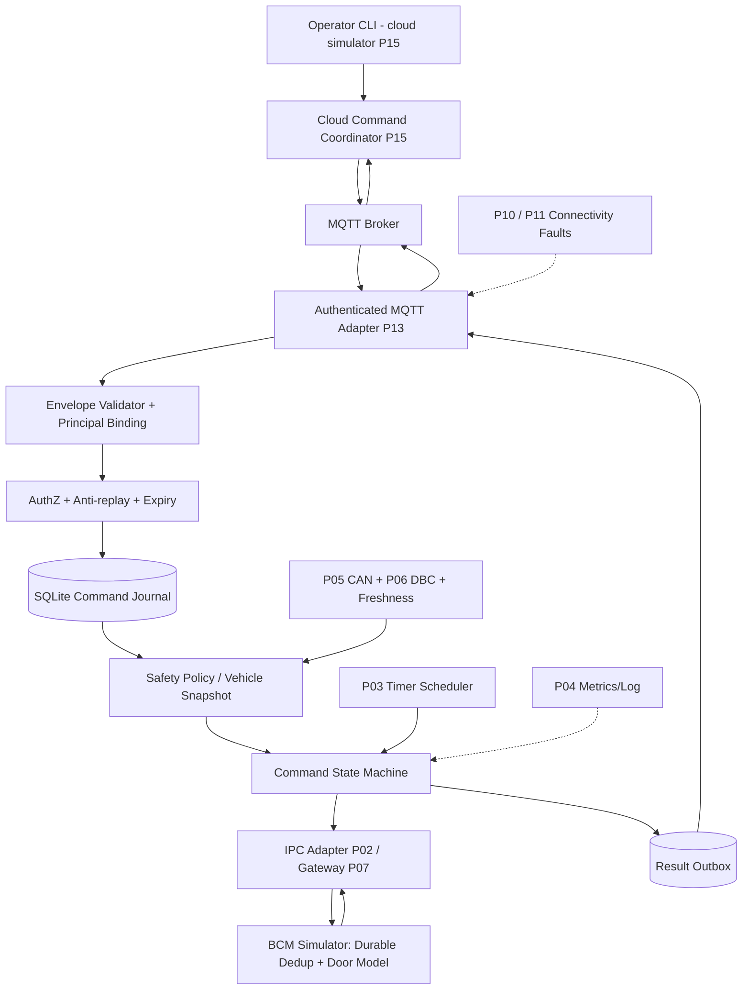
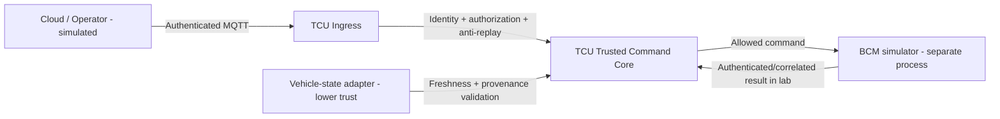
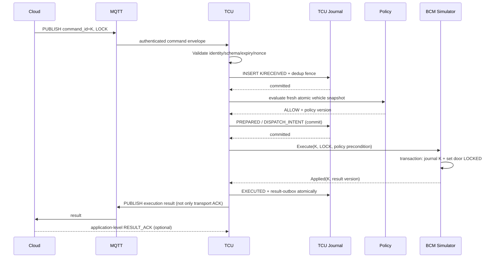
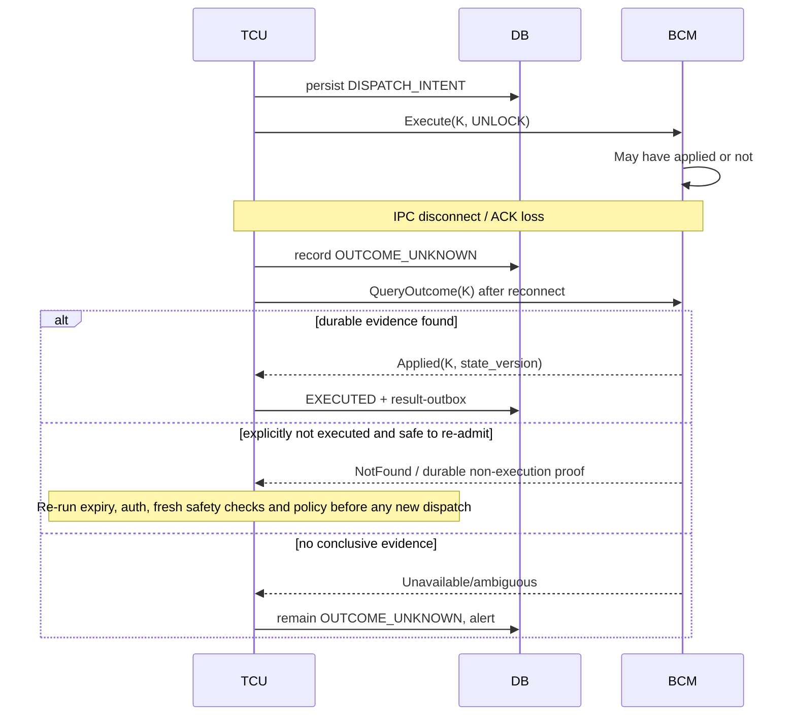
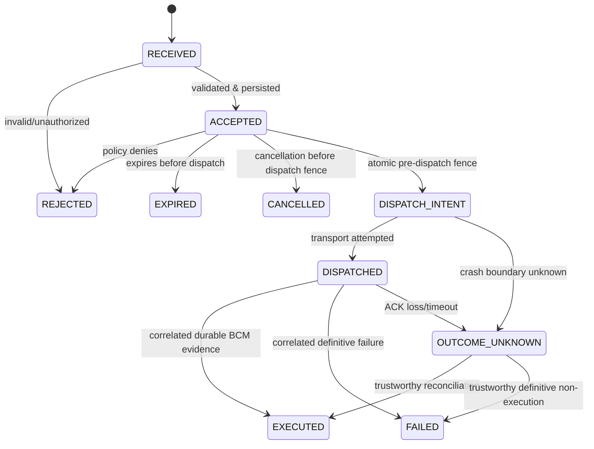

# P16 — Remote Vehicle Control (RCV)

**Virtual TCU Lab | System Design, Operational Behavior, Safety & Security Contracts, Comprehensive What-if/Fault Injection Test Plan**

| Thuộc tính | Giá trị |
|---|---|
| Dự án | **16 / 30 — Remote Vehicle Control** |
| Version | **1.0 — Design baseline (chưa implement)** |
| Ngày | 2026-10-30 |
| Ngôn ngữ | Tiếng Việt; tên API/protocol bằng tiếng Anh |
| Platform giả định | Ubuntu Linux x86-64, **C++17**, CMake, SQLite, Mosquitto, Paho MQTT C++, Google Test/Mock, Python fault harness |
| Độ khó | Middle C++ Developer; trọng tâm state machine, concurrency, security boundaries, durability, fault tolerance |
| Phụ thuộc | P01 Event Bus, P02 IPC, P03 Scheduler, P04 Config/Logging, P05 CAN, P06 DBC, P07 Gateway, P10 Connectivity, P11 Network Fault Lab, P13 MQTT Client, P14 Outbox, P15 Cloud Backend |
| Giới hạn | **Chỉ chạy trên simulator**; không hướng dẫn điều khiển khóa cửa/actuator xe thật, không chứng nhận ISO 26262/ISO 21434 |
| Trạng thái | **Specification + test design**; chưa xác nhận pass các kiểm thử |

> **Mục tiêu:** Cho phép cloud gửi lệnh `LOCK`/`UNLOCK` tới TCU giả lập; TCU xác minh nguồn gốc, quyền và điều kiện an toàn; quản lý lệnh bền vững, dispatch đến **BCM Simulator** thông qua fake IPC/Gateway; trả kết quả theo *thực tế được quan sát*; chịu được mất mạng, duplicate, timeout, crash, race, state stale, dữ liệu bị giả mạo và sự cố chồng chéo. Ở hệ thống phân tán, không được xem `MQTT PUBACK` hoặc `IPC send succeeded` là xe đã khóa/mở thành công.

**Chính sách giả lập, không phải quy định OEM:** `UNLOCK` chỉ cho phép khi vehicle parked được xác nhận và thông tin trạng thái còn mới; `LOCK` áp dụng cùng policy mặc định để lab đơn giản và an toàn. Các điều kiện thực tế thay đổi theo mẫu xe, security architecture, pháp lý và OEM. **Không có cơ chế tự động bỏ qua safety checks**.

## 0. Executive summary & design decisions

### 0.1 Những quyết định quan trọng nhất

1. **Trước dispatch:** xác thực danh tính thực tế (không tin JSON `device_id`), kiểm tra allowlist, quyền, TTL, nonce/replay, policy và trạng thái xe có chất lượng đủ tốt.
2. **Persistent command journal:** ghi nhận command ID, payload hash, policy version, trạng thái và ý định dispatch vào transaction trước khi gửi yêu cầu có side effect. Không giữ SQLite transaction khi chờ IPC/cloud.
3. **Idempotency hai tầng:** TCU dedup theo `(principal_namespace, command_id)`; BCM Simulator có command journal bền vững riêng theo `command_id`, lưu kết quả thực thi và trạng thái door trước/sau. Chỉ simulator bảo đảm được reconciliation khi giữ đủ journal; không tuyên bố exactly-once với BCM thật.
4. **Không retry mù lệnh actuator:** nếu đã dispatch nhưng ACK mất, chuyển `OUTCOME_UNKNOWN`, query status/reconcile theo khả năng simulator. Nếu không có chứng cứ đáng tin, giữ `UNKNOWN` thay vì tự động gửi lại.
5. **Safety gate ngay trước boundary side-effect:** đọc snapshot trạng thái vehicle nhất quán và đánh giá policy lần cuối trước dispatch. Cảnh báo TOCTOU: không thể bảo đảm trạng thái xe ngoài đời vẫn giữ nguyên sau check; BCM/Gateway cũng phải có quyền từ chối theo thiết kế thực tế.
6. **Cloud result semantics:** `RECEIVED`, `REJECTED`, `ACCEPTED`, `DISPATCHED`, `EXECUTED`, `FAILED`, `UNKNOWN` khác nhau. `MQTT PUBACK` của kết quả không đồng nghĩa operator/backend đã ghi nhận; dùng P14/P15 application ACK nếu cần.
7. **Epoch/generation fencing:** connection epoch, service incarnation và per-command revision để chặn callback từ đời cũ, timeout đến muộn, stale ACK.
8. **Bounded resources:** giới hạn payload, inflight, queue, retry, DB, audit; không silent drop command; trạng thái không rõ ràng phải hiển thị rõ.
9. **Default deny:** nếu identity/policy/vehicle state/clock trust/storage/integrity không rõ → không phát lệnh.
10. **Test evidence:** một case chỉ `PASS` khi fault **đã được inject** và tất cả oracle được xác minh; thiếu chứng cứ → `INCONCLUSIVE`.

### 0.2 Scope / Non-scope

**In scope:** command `LOCK`/`UNLOCK`, authorization, anti-replay, validation, freshness, vehicle state policy, command lifecycle, SQLite journal, async IPC request, BCM Simulator, reply reconciliation, MQTT result outbox, concurrency, restart recovery, chaos tests và CLI demo.

**Out of scope:** ECU/BCM thật, key programming/bypass, triển khai remote-start/horn/windows hoặc cấp quyền xe thật; hardware secure element, PKI production, formal safety case, real CAN arbitration, HIL compliance và đo độ trễ qua cellular thật. Không mặc định ứng dụng OEM nào cũng dùng MQTT hoặc CAN theo kiến trúc trong tài liệu.

### 0.3 Assumptions & threat model

- TCU chỉ nhận command sau khi có **authenticated principal** từ trust boundary đã được xác lập (MQTT TLS và/hoặc token/signature được verify bởi một component đáng tin). Payload `device_id` chỉ là một claim cần đối chiếu với principal.
- Command version 1 có `command_id` 128-bit opaque, `target_device_id`, `action`, `issued_at_utc`, `expires_at_utc`, `nonce`, `policy_context`, `key_id`, `signature`/authenticated envelope; idempotency key không tái sử dụng cho payload khác.
- Bảo mật tốt nhất là chứng thực cả nội dung lệnh end-to-end nếu cloud→broker→device có nhiều trust boundary. Không tự viết crypto; dùng thư viện đã kiểm tra.
- BCM Simulator có quyền `PREPARE/EXECUTE/QUERY_STATUS` tùy lựa chọn thiết kế. Thao tác `LOCK/UNLOCK` đều là **set state idempotent** trong mô phỏng; trạng thái vật lý vẫn có thể không quan sát được khi lỗi.
- `vehicle_motion`, `ignition`, `gear`, `door_state` là những facts khác nhau; policy chỉ dùng facts được khai báo đủ mới và đủ tin cậy; không dùng speed=0 một mình để chứng minh xe đã đỗ.
- Kiểm thử fail-closed trước dispatch và tránh kết luận sai sau dispatch quan trọng hơn availability.

### 0.4 Lab acceptance targets — mục tiêu gợi ý, chưa đo

| ID | Target | Method |
|---|---|---|
| SLO-01 | 0 command bị `EXECUTED` mà không có bằng chứng BCM authenticated/trusted | query journal + assertion |
| SLO-02 | 0 duplicate BCM executions cho một command ID trong simulator (cùng payload) | durable simulator counter |
| SLO-03 | 0 unsafe command dispatch khi precondition stale/unknown | safety decision trace |
| SLO-04 | p95 admission decision <= 100 ms (localhost, steady-state, không fsync heavy) | monotonic histogram |
| SLO-05 | bounded intake queue <= 1,024; inflight <= 64 global, <= 1 per actuator/device | RSS + metrics |
| SLO-06 | 0 unhandled callback/exception, ASan/UBSan/TSan clean (trên coverage dùng được) | CI results |
| SLO-07 | crash at mỗi persistence/dispatch checkpoint: không xuất hiện false success | deterministic killpoint matrix |
| SLO-08 | 24 h soak 10 requests/s + faults, no unbounded memory/FD growth | RSS/FD and DB time series |
| SLO-09 | 100 runs / deterministic schedule: state hash & event trace khớp | fake clock + seeded runner |

**Không coi con số trên là OEM requirements.** Đo trên môi trường cụ thể rồi thay đổi budget; ASan/TSan có thể cần build riêng; mọi benchmark phải ghi lại phần cứng và profile.

## 1. Functional & Non-functional requirements

| ID | Requirement | Priority | Test oracle |
|---|---|---|---|
| FR-01 | Chỉ nhận authenticated/principal-bound command, scoped đúng device/tenant | P0 | auth trace + 0 gateway write trái quyền |
| FR-02 | Reject malformed schema, unsupported action, over-limit payload, unknown version | P0 | validation result + audit |
| FR-03 | Check expiry/nonce/replay trên time trust policy | P0 | replay store + expiry trace |
| FR-04 | Phân biệt admission ACK với execution result | P0 | command journal trace |
| FR-05 | Vehicle safety gate fail-closed khi state thiếu/stale/contradictory | P0 | zero unsafe dispatch |
| FR-06 | Persistent command journal trước side effect | P0 | crash at boundaries |
| FR-07 | Duplicate cùng ID + payload → trả trạng thái cũ, không thực thi lại | P0 | execution counter = 1 |
| FR-08 | Duplicate cùng ID, payload khác → security conflict | P0 | mismatch hash and no dispatch |
| FR-09 | Async transport request/correlation/deadline/epoch | P0 | request IDs, terminal once |
| FR-10 | BCM Simulator có durable execution journal và QueryOutcome | P0 | simulator journal query |
| FR-11 | Timeout sau dispatch → UNKNOWN; reconcile không blind retry | P0 | dispatch count and terminal state |
| FR-12 | Result outbox lưu bền vững cùng thay đổi state | P0 | crash after state commit |
| FR-13 | Recovery kiểm tra commands mid-flight, không đánh dấu fail/success bừa | P0 | recovery trace |
| FR-14 | Bounded memory, queue, inflight và audit, backpressure | P0 | load metrics |
| FR-15 | Config hot reload không áp policy đã bị revoke tại boundary | P0 | version fencing |
| FR-16 | Logging/metrics không lộ token/PII, đủ evidence | P0 | redaction scan |
| FR-17 | Fault injection/test runner có kết quả PASS/FAIL/INCONCLUSIVE/SKIPPED | P0 | standardized evidence |
| FR-18 | Shutdown hoàn tất và loại bỏ callbacks/timers thuộc incarnation cũ | P0 | no double completion/TSan |
| NFR-01 | Không dùng sleep wall clock để điều khiển policy; injectable steady clock | P0 | fake-clock tests |
| NFR-02 | Không block MQTT callback khi chờ SQLite/BCM/Cloud | P0 | callback latency |
| NFR-03 | Database mutation atomic và schema có constraints | P0 | SQLite check / crash matrix |
| NFR-04 | Không dùng một `speed=0` làm đủ bằng chứng parked | P0 | unsafe state tests |
| NFR-05 | Review trust model, safety policy và command semantics trước deploy | P0 | security/safety review |

## 2. System architecture



**Component boundaries:**

| Component | Owns | Does not own |
|---|---|---|
| CommandIngress | MQTT receive, transport epoch, bounded decode queue | admission success decision |
| CommandValidator | schema, hash canonicalization, signature verification integration | durable dedup transaction |
| CommandAuthorizer | principal binding, roles, tenant/device ACL, expiry and nonce policy | BCM output |
| CommandRepository | immutable envelope hash, durable state/revision/outbox; uniqueness | IPC waits |
| VehicleStateProvider | atomic snapshots, validity, provenance, age, contradiction flags | safety policy definitions |
| SafetyPolicyEngine | deterministic approve/reject with reasons and policy snapshot/version | assume sensor truth on its own |
| CommandCoordinator | state transitions, inflight quotas, timer and reconciliation | cryptographic primitives |
| BcmAdapter | send/receive/timeout, epoch correlation | infer physical state from send() success |
| BCM Simulator | idempotent execution, fake door state, query outcome, injectable faults | real-world actuator control |
| ResultOutbox | persist and resend application result until backend ACK | claim user saw result |

### 2.1 Trust boundaries



Có **hai loại sự thật** cần tách: (1) một *intention/decision* đã được ghi vào journal; (2) BCM đã thay đổi trạng thái door model. Không suy diễn (2) chỉ từ (1).

### 2.2 Sequence: command success



### 2.3 Sequence: ambiguous outcome after transport loss



**Quan trọng:** `NotFound` không tự động là bằng chứng chưa thực thi nếu BCM journal có thể mất, rotate hoặc không đồng bộ. Bản thiết kế mặc định **không retry sau uncertain send**, trừ khi môi trường mô phỏng cung cấp bằng chứng tồn tại bền vững và quyền re-dispatch rõ ràng.

## 3. Message contract & policies

### 3.1 Example envelope — chỉ dành cho simulator

```json
{
  "schema_version": 1,
  "tenant_id": "LAB",
  "target_device_id": "TCU-001",
  "command_id": "b4f4de12-412e-47c8-9f74-af7e47bb0086",
  "action": "LOCK",
  "issued_at_utc": "2026-10-30T03:00:00Z",
  "expires_at_utc": "2026-10-30T03:00:30Z",
  "nonce": "d8cbf3bf009b4e23",
  "actor_id": "lab-operator",
  "policy_context": { "require_parked": true },
  "key_id": "lab-key-01",
  "signature": "<test-signature-base64>"
}
```

Signature là placeholder, **không dùng chữ ký giả trong production**. Chữ ký được verify trên byte canonicalized theo một định nghĩa byte-level chính xác; không tự sign JSON bằng cách stringify tùy thư viện. Signature không thay thế authorization. `tenant_id`/`device_id` khai trong payload phải match authenticated principal.

### 3.2 Response semantics

| Status | Ý nghĩa | Có chứng minh door state? |
|---|---|---|
| `RECEIVED` | TCU đã thấy command; chưa qua toàn bộ policy | Không |
| `REJECTED` | Command bị từ chối trước dispatch | Không |
| `ACCEPTED` | Auth/validation và journal admission đạt | Không |
| `DISPATCHED` | TCU đã phát yêu cầu IPC; outcome chưa biết | Không |
| `EXECUTED` | BCM Simulator xác nhận thực thi có correlation và state version | **Có trong simulator**, không phải xe thật |
| `FAILED` | Simulator trả kết quả đã xác minh không thực thi/thực thi thất bại theo contract | Không suy diễn tự động |
| `OUTCOME_UNKNOWN` | Chưa xác minh được tác dụng phụ sau dispatch | Không |
| `EXPIRED` | Hết hạn **trước** dispatch | Không |
| `CANCELLED` | Bị hủy **trước** dispatch fence | Không |

`FAILED`, `EXPIRED`, `CANCELLED` không được ghi đè lên một command đã có thể thực thi. Nếu result không rõ, ghi `OUTCOME_UNKNOWN`, không phát hai terminal outcomes mâu thuẫn. `OUTCOME_UNKNOWN` có thể được nâng cấp thành `EXECUTED` hoặc `FAILED` qua reconciliation có chứng cứ; không coi UNKNOWN là một final success/failure.

### 3.3 Command state machine



**Invariant:** Không chuyển `DISPATCHED/OUTCOME_UNKNOWN` về `ACCEPTED` để resend cùng hành động một cách mù quáng; `DISPATCH_INTENT` ghi trước send làm crash-window có thể ambiguous, đây là đánh đổi an toàn có chủ đích.

### 3.4 Safety gate — policy giả lập

- `vehicle_motion == PARKED` **và** `gear == PARK` (nếu có), `speed` hợp lệ trong ngưỡng, `ignition` theo policy, mỗi input có age <= configured freshness và provenance đã xác minh; không suy diễn từ một nguồn đơn lẻ.
- Battery/supply state có thể từ chối hoặc trì hoãn nếu BCM không an toàn; emergency/manual override **không có** trong project.
- Bất kỳ fact `UNKNOWN`, `STALE`, `CONTRADICTORY`, `UNTRUSTED` đều làm `DENY`.
- Safety gate chạy lúc admission và ngay trước dispatch; mỗi decision ghi `snapshot_revision`, `policy_version`, `reason_code` để audit.
- Trong thế giới thực, vehicle-local controller thường cần làm final gate theo policy của OEM; **TCU không được coi là safety authority duy nhất**.
- Đối với `UNLOCK`, hạn chế extra: chỉ actor có permission riêng, chống replay nghiêm ngặt, rate-limited, audit; policy cụ thể vẫn do OEM xác định.

## 4. Persistent data model & atomic boundaries

SQLite dùng cho lab với `WAL` và `synchronous=FULL` trên local filesystem. Đây là profile thử nghiệm, không bảo đảm durability nếu storage/`fsync` không tuân thủ. Transaction được giữ ngắn, không gọi IPC/Internet trong SQLite transaction.

```sql
PRAGMA foreign_keys=ON;
PRAGMA journal_mode=WAL;
PRAGMA synchronous=FULL;

CREATE TABLE IF NOT EXISTS commands (
  command_id TEXT NOT NULL,
  principal_namespace TEXT NOT NULL,
  device_id TEXT NOT NULL,
  canonical_hash TEXT NOT NULL,
  action TEXT NOT NULL CHECK(action IN ('LOCK','UNLOCK')),
  state TEXT NOT NULL CHECK(state IN (
    'RECEIVED','REJECTED','ACCEPTED','EXPIRED','CANCELLED',
    'DISPATCH_INTENT','DISPATCHED','EXECUTED','FAILED','OUTCOME_UNKNOWN'
  )),
  revision INTEGER NOT NULL DEFAULT 0 CHECK(revision >= 0),
  policy_version INTEGER,
  vehicle_snapshot_revision INTEGER,
  transport_epoch INTEGER,
  result_code TEXT,
  created_utc_ms INTEGER NOT NULL,
  updated_utc_ms INTEGER NOT NULL,
  PRIMARY KEY(principal_namespace, command_id)
);
CREATE INDEX IF NOT EXISTS idx_commands_device_state ON commands(device_id, state);

CREATE TABLE IF NOT EXISTS replay_nonces (
  principal_namespace TEXT NOT NULL,
  nonce_hash TEXT NOT NULL,
  expires_utc_ms INTEGER NOT NULL,
  command_id TEXT NOT NULL,
  PRIMARY KEY(principal_namespace, nonce_hash)
);

CREATE TABLE IF NOT EXISTS result_outbox (
  result_id TEXT PRIMARY KEY,
  command_id TEXT NOT NULL,
  principal_namespace TEXT NOT NULL,
  command_revision INTEGER NOT NULL,
  payload_json TEXT NOT NULL,
  delivery_state TEXT NOT NULL CHECK(delivery_state IN ('PENDING','SENT','ACKED')),
  created_utc_ms INTEGER NOT NULL,
  UNIQUE(principal_namespace, command_id, command_revision),
  FOREIGN KEY(principal_namespace, command_id)
    REFERENCES commands(principal_namespace, command_id)
);

-- In a separate BCM Simulator database, not shared as one cross-process txn:
CREATE TABLE IF NOT EXISTS bcm_execution_journal (
  command_id TEXT PRIMARY KEY,
  payload_hash TEXT NOT NULL,
  action TEXT NOT NULL,
  result_code TEXT NOT NULL,
  resulting_door_state TEXT NOT NULL,
  door_state_revision INTEGER NOT NULL
);
```

**Transaction boundaries:**

1. Admission: insert command + replay nonce trong **một** transaction. Duplicate cùng ID/hash trả status cũ; duplicate khác hash ⇒ conflict; nonce reused với ID khác ⇒ reject.
2. Pre-dispatch: verify policy, chạy compare-and-swap `ACCEPTED → DISPATCH_INTENT` với revision; persist before side effect.
3. BCM: transaction riêng ghi journal dedup + thay đổi mô hình door state atomic trong cùng DB BCM. Nếu lỗi giữa BCM COMMIT và IPC response → TCU `UNKNOWN`, nhưng BCM `QueryOutcome(command_id)` phục hồi đúng.
4. Result: update command revision/state + insert result-outbox trong **một** transaction; MQTT publish sau commit.
5. Restart: scan `DISPATCH_INTENT`, `DISPATCHED`, `OUTCOME_UNKNOWN`; query reconciliation, không tự replay side-effect.
6. Cleanup: giữ command ID/hash/nonces đủ lâu hơn mọi cửa sổ redelivery+command TTL; bảo đảm retention policy không mở lại replay của lệnh cũ.

### 4.1 Critical crash matrix

| Killpoint | Persistent observation | Recovery action |
|---|---|---|
| Before admission COMMIT | No admitted record (or rolled back) | New request must re-validate |
| After admission COMMIT, before ACK | ACCEPTED exists | Duplicate returns stored status, no second admission |
| Before DISPATCH_INTENT COMMIT | ACCEPTED | Fresh policy evaluation before future dispatch |
| After DISPATCH_INTENT COMMIT, before IPC send | DISPATCH_INTENT | Treat outcome as ambiguous unless send-proof exists; reconcile safely |
| During IPC send / response loss | DISPATCHED/UNKNOWN | Query BCM journal, no blind retry |
| After BCM COMMIT before IPC ACK | BCM journal Applied; TCU UNKNOWN | Reconcile to EXECUTED once |
| After TCU EXECUTED+outbox COMMIT before result publish | EXECUTED + pending outbox | Publish same result_id on restart |
| After backend result commit before RESULT_ACK received | Outbox may resend result | Cloud P15 dedups by result_id |

## 5. C++17 interfaces / ownership

```cpp
#pragma once
#include <chrono>
#include <cstdint>
#include <functional>
#include <memory>
#include <optional>
#include <string>

namespace tcu::remote {
enum class Action { Lock, Unlock };
enum class CommandState {
  Received, Rejected, Accepted, Expired, Cancelled,
  DispatchIntent, Dispatched, Executed, Failed, OutcomeUnknown
};
struct AuthenticatedPrincipal {
  std::string tenantId;
  std::string deviceId;
  std::string actorId;
  std::string credentialId;
};
struct CommandEnvelope {
  std::string commandId;
  std::string deviceId;
  Action action;
  std::string nonce;
  std::string canonicalHash;
  std::chrono::system_clock::time_point expiresAt;
};
struct VehicleStateSnapshot {
  std::uint64_t revision{0};
  bool parked{false};
  bool valid{false};
  std::chrono::steady_clock::time_point observedAt{};
};
struct PolicyDecision {
  bool allowed{false};
  std::string reason;
  std::uint64_t policyVersion{0};
};
struct CommandReceipt {
  std::string commandId;
  CommandState state;
  std::string reason;
  std::uint64_t revision{0};
};
struct BcmOutcome {
  enum class Kind { Applied, DefinitelyRejected, Unknown } kind;
  std::string commandId;
  std::uint64_t doorRevision{0};
};
class IClock {
public:
  virtual ~IClock() = default;
  virtual std::chrono::steady_clock::time_point monotonicNow() const = 0;
  virtual std::chrono::system_clock::time_point trustedUtcNow() const = 0;
  virtual bool trustedUtcAvailable() const = 0;
};
class IVehicleStateProvider {
public:
  virtual ~IVehicleStateProvider() = default;
  virtual VehicleStateSnapshot readConsistent() const = 0;
};
class ISafetyPolicy {
public:
  virtual ~ISafetyPolicy() = default;
  virtual PolicyDecision evaluate(
      Action action, const VehicleStateSnapshot& snapshot) const = 0;
};
class IBcmAdapter {
public:
  using Completion = std::function<void(BcmOutcome)>;
  virtual ~IBcmAdapter() = default;
  virtual void executeAsync(std::string commandId, Action action,
                            std::uint64_t epoch, Completion done) = 0;
  virtual void queryOutcomeAsync(std::string commandId,
                                 Completion done) = 0;
};
class IRemoteControlService {
public:
  virtual ~IRemoteControlService() = default;
  virtual CommandReceipt admit(const AuthenticatedPrincipal& principal,
                               const CommandEnvelope& cmd) = 0;
  virtual CommandReceipt query(const AuthenticatedPrincipal& principal,
                               const std::string& id) const = 0;
  virtual CommandReceipt cancelBeforeDispatch(
      const AuthenticatedPrincipal& principal, const std::string& id) = 0;
  virtual void start() = 0;
  virtual void stop() = 0;
};
}  // namespace tcu::remote
```

API trên là **conceptual interface**, không phải implementation hoàn thiện. Chỗ xử lý signature/payload canonicalization/real-world session security nằm ở ingress adapter và không minh họa như phương thức `bool` có thể bị bỏ qua. Repository yêu cầu mutation theo `expected_revision`, uniqueness và transactional outbox; không lấy state snapshot rồi sửa không có CAS. `executeAsync` phải có shutdown lifetime contract (weak_ptr/epoch token), completion **at most once** ở coordinator dù transport callback lặp.

### 5.1 Concurrency & scheduling

- MQTT callback chỉ validate tối thiểu và đẩy vào bounded queue; không block trên SQLite hoặc BCM.
- Một coordinator strand/serialized executor **per device/actuator**, tránh `LOCK` và `UNLOCK` cùng chạy hoặc reorder; tác vụ khác device có thể chạy song song.
- Journal writes đi qua một DB worker hoặc serialized transaction executor, không giữ mutex qua callback/IPC.
- Timer Scheduler P03 dùng steady clock, request-scoped cancellation tokens; callback mang `command_revision` và `service_generation`.
- Lock order tài liệu hóa: không gọi user callback khi giữ `state_mutex`; không chờ `future.get()` trong event loop.
- Queue full: reject admission bằng mã rõ ràng, không drop silently. Sau khi đã journaled phải bảo đảm hàng đợi xử lý/recovery có thể rebuild từ journal.

## 6. Operational behavior — cách hệ thống hoạt động

### 6.1 Startup

1. Load P04 config và verify signature/permissions; fail startup nếu policy/key metadata không hợp lệ.
2. Open SQLite journal, enforce schema version, `quick_check` cho lab, acquire single-owner lock; lỗi quan trọng ⇒ `NOT_READY`.
3. Rebuild pending outbox, nonce replay index, command states; tạo reconciliation queue cho `DISPATCH_INTENT/DISPATCHED/OUTCOME_UNKNOWN`.
4. Load policy `deny-by-default`, P05/P06 snapshot provider, P02 IPC adapter, fake clock hoặc trusted time provider.
5. Khởi động MQTT subscription và chỉ báo `READY` khi path bắt buộc hoạt động (nếu backend offline vẫn có thể `DEGRADED` nhận/bảo lưu command theo policy).
6. Không tự dispatch lại in-flight commands trước khi reconciliation; không báo `EXECUTED` từ journal state `DISPATCH_INTENT`.

### 6.2 Receive / validate / admit

1. MQTT ingress ghi `correlation_id`, transport epoch và authenticated principal; payload có kích thước giới hạn.
2. Validate strict schema (không extra fields nếu policy strict), canonical hashing, signature, target binding, action enum, expiry, nonce.
3. Atomic admission transaction: dedup ID/hash, replay nonce và `RECEIVED/ACCEPTED` status.
4. Nếu reject trước admission do auth thì audit một cách hạn chế, không leak nội dung bí mật.
5. Kết quả `ACCEPTED` nghĩa là **đã đăng ký yêu cầu**, không có nghĩa cửa đã được tác động.

### 6.3 Safety gate / dispatch

1. Coordinator claim command theo device lock; đọc snapshot xe nhất quán (timestamp & provenance).
2. Revalidate **effective authorization/revocation**, trusted-time/TTL và policy trên snapshot mới; reject nếu stale/unknown/conflict, quyền đã bị thu hồi hoặc policy revoked.
3. Commit `DISPATCH_INTENT` cùng policy version/snapshot revision và expected command revision.
4. Dispatch một lần tới BCM Simulator; IPC trả send status chỉ là *transport evidence*.
5. Chờ correlated BCM outcome qua async response, timeout hoặc recovery query.

### 6.4 Completion / ambiguous outcome

- `Applied`: chỉ chấp nhận khi command ID, device, epoch (nếu relevant), request key và BCM state version khớp; ghi `EXECUTED + outbox` atomic.
- `DefinitivelyRejected`: ghi `FAILED` với reason và evidence. Một `NOT_FOUND` đơn thuần không đủ chứng minh không thực thi nếu journal có thể mất.
- Timeout/disconnect/unknown response sau send: `OUTCOME_UNKNOWN`, kích hoạt reconciliation, không retry mù.
- Từ `OUTCOME_UNKNOWN` chỉ chuyển sang `EXECUTED/FAILED` khi nhận evidence mới hợp lệ; mọi terminal state có revision CAS và không double completion.

### 6.5 Cancel, expiration, and policy changes

- Cancel thành công chỉ khi command chưa vượt `DISPATCH_INTENT` fence; sau fence phản hồi `CANNOT_CONFIRM_CANCELLATION`/`UNKNOWN` thay vì tuyên bố đã hủy.
- `expires_at` là ranh giới phát lệnh mới, **không** được dùng để xóa evidence sau dispatch; callback/result có thể đến muộn và phải reconcile.
- Policy/config reload có snapshot generation; command đã accepted nhưng chưa dispatch phải re-evaluate ở boundary.
- `UNLOCK` có permission mạnh hơn `LOCK`; không tự động thực hiện command cũ khi xe vừa từ moving sang parked nếu TTL/policy không còn phù hợp.

### 6.6 Shutdown / crash / restart

- Close intake, return BUSY/NOT_READY cho new requests theo contract; freeze new dispatch; commit state đã biết và flush bounded outbox.
- Cancel timers and fence callbacks; không chờ vô hạn nếu IPC/DB hung; ghi `UNKNOWN` cho side-effects có thể đã xảy ra.
- Kill `-9` phải phục hồi từ SQLite, không dựa destructor; startup reconciliation kiểm tra BCM journal trước khi quyết định.

## 7. Global invariants (bắt buộc đo được)

| ID | Invariant |
|---|---|
| INV-01 | Không bao giờ dispatch khi principal chưa authenticated và authorized |
| INV-02 | Không dispatch nếu snapshot safety thiếu, stale, contradictory hoặc không trusted |
| INV-03 | Trong một namespace, cùng `command_id` và payload hash không tạo dispatch thứ hai; cùng ID khác payload bị conflict |
| INV-04 | Không báo `EXECUTED` từ PUBACK, IPC write success, timer hoặc `send()` return |
| INV-05 | Một command không có hai kết quả final mâu thuẫn; `UNKNOWN` chỉ được reconcile bằng proof |
| INV-06 | Không làm mất command state đã commit mà không có evidence của lỗi storage ngoài assumptions |
| INV-07 | Không blind retry sau ambiguous side-effect; không tự retry lệnh UNLOCK khi không biết BCM đã thực hiện hay chưa |
| INV-08 | Callback từ service generation/epoch cũ không thể điều khiển state của incarnation mới |
| INV-09 | Mọi queue/inflight/DB payload bounded; overload có observable reason/metrics |
| INV-10 | Lệnh từ tenant/device A không thể sửa device B, dù body hoặc topic giả mạo |
| INV-11 | Kết quả được persist cùng state; result publish có thể lặp nhưng có `result_id` ổn định |
| INV-12 | New policy deny áp dụng trước *new dispatch*; config invalid không làm mất valid policy snapshot |
| INV-13 | Thời điểm callback không quyết định trusted time; clock rollback không hợp thức hóa command đã expired |
| INV-14 | Mỗi kết quả `PASS` đi kèm evidence đã inject lỗi, invariant check và trace ID |

## 8. Metrics, logs, audit and evidence

| Metric / evidence | Meaning |
|---|---|
| `command_received_total{action,device}` | Tổng command nhận (cardinality giới hạn/định danh không đưa vào metric production) |
| `command_rejected_total{reason}` | Mã từ chối (auth, policy, stale, expired, replay, quota) |
| `command_state_total{state}` | Tình trạng command sau transition |
| `bcm_execute_attempts_total` | Số lần transport dispatch thực tế |
| `bcm_applied_total` | Chỉ từ BCM Simulator durable evidence |
| `command_unknown_gauge` | Số command chưa kết luận outcome |
| `reconciliation_success_total` | Recover thành công nhờ durable proof |
| `journal_commit_failure_total` | DB errors / fsync failures |
| `outbox_pending_gauge` | Kết quả đã lưu chưa được backend ACK |
| `safety_snapshot_age_ms` | Độ tuổi dữ liệu safety thời điểm dispatch |
| `command_processing_latency_ms` | Latency monotonic theo state/stage |
| `queue_depth` / `pending_inflight` | Bounded resource proof |
| `fault_injection_applied_total` | Xác nhận fault thực sự có hiệu lực |

**Evidence bundle mỗi test:** `scenario.json`, `seed.txt`, `injector_ack.json`, `tcu_trace.jsonl`, `bcm_journal.sql`, `tcu_journal.sql`, `pcap` nếu có, `metrics.json`, `assertions.json`, `verdict.json`. Logs dùng command correlation ID và redaction; không ghi raw token, chữ ký, PIN hay credentials.

## 9. Behavioral contracts — Given / When / Then

| ID | Given | When | Then |
|---|---|---|---|
| BC-01 | Authenticated, valid, fresh parked vehicle | `LOCK` accepted and BCM replies Applied | Exactly one BCM execution, TCU `EXECUTED`, backend result published |
| BC-02 | Vehicle moving or state not trusted | `UNLOCK` arrives | `REJECTED`, zero BCM dispatch |
| BC-03 | BCM committed but IPC ACK lost | Dispatch times out | `OUTCOME_UNKNOWN` then evidence-driven reconciliation |
| BC-04 | Same command delivered twice | MQTT reconnect/redelivery | Same canonical state, single BCM side effect |
| BC-05 | Same ID with different payload | Duplicate arrival | `CONFLICT`, no re-execution |
| BC-06 | Command expires before dispatch | Timer fires | `EXPIRED`, never execute |
| BC-07 | Command already dispatch-intent | Cancel arrives | Do not promise cancellation, investigate outcome |
| BC-08 | DB cannot persist admission | New valid command arrives | No dispatch; resource failure returned |
| BC-09 | Service killed after dispatch intent | New process starts | Reconcile; do not blindly resend |
| BC-10 | Policy changed to stricter rule | Accepted command waits | Re-evaluate before dispatch, deny if unsafe |
| BC-11 | ACK/result callback from old generation | New process has same command ID | Old callback discarded, no stale status override |
| BC-12 | Result publish received by broker, backend ACK missing | Outbox retries same result ID | Cloud dedup; no new BCM execution |

## 10. Test strategy & fault injection methodology

### 10.1 Testing pyramid

1. **Pure unit:** schema validator, canonical hash, permission matrix, freshness, policy evaluation, state transition table, fake clock, deterministic scheduler.
2. **Component:** CommandCoordinator + FakeBcmAdapter + in-memory repository with failpoints; property-based generation of state transition sequences.
3. **Persistence integration:** real SQLite, killpoints pre/post COMMIT, `SQLITE_BUSY/FULL/IOERR`, WAL checkpoint and restart.
4. **Process integration:** P02 IPC and separate BCM Simulator journal; process restarts, late replies, socket truncation, epoch races.
5. **End-to-end:** P15→MQTT P13→TCU P16→BCM Simulator→result outbox→P15. Fault P11 network lab, P05/P06 vehicle data lab.
6. **Fuzz/soak/model:** payload fuzz, replay permutations, schedule permutations, multi-fault campaigns; ASan, UBSan, TSan where applicable.

### 10.2 Verbatim verdict contract

- `PASS`: injected fault confirmed by instrumented hook or network/OS evidence **and** all required invariants hold.
- `FAIL`: injected fault confirmed but at least one invariant/expected result violated.
- `INCONCLUSIVE`: no proof fault applied, missing crucial logs, ambiguous test setup, or unmet precondition.
- `SKIPPED`: declared unsupported profile/environment; explicitly state reason.

**Coverage goal:** all P0 single-fault cases + all P0 multi-fault campaigns + crash boundary matrix; remaining cases are prioritized for hardening. *Không có kiểm thử hữu hạn nào chứng minh chịu mọi tổ hợp lỗi.*

### 10.3 Test oracle/fixtures

- FakeClock has separately controlled monotonic and trusted UTC time (UTC may become untrusted), no real sleeps for unit tests.
- BCMSim records `execution_count[command_id]` and independent door-state versions; QueryOutcome supports injected `Applied/DefinitelyRejected/Unknown`.
- Fault hooks: `after_admission_commit`, `before_dispatch_fence`, `after_dispatch_fence`, `after_ipc_send`, `after_bcm_commit`, `before_ipc_ack`, `after_result_commit`, `before_outbox_publish`.
- SnapshotProvider emits revision/provenance/freshness and can simulate CAN timeouts, contradictory signals, source restart.
- Network simulator injects MQTT DUP, packet delay, ACK loss, broker restart, cert auth failure; **transport ACK** must not be interpreted as business status.


## 11. What-if catalog — 300 actionable scenarios (30 nhóm x 10)

Mỗi case có **fault injection/setup**, **expected behavior**, **evidence/oracle**. Tất cả case phải chạy trên **BCM/TCU simulator**. Không cần hardware xe. `P0` = có thể gây sai quyền, sai safety, duplicate actuation, false success, data loss hoặc crash; `P1` = ưu tiên bổ sung resilience/performance. Thứ tự mức P0/P1 là gợi ý, cần risk review.

Không có danh sách hữu hạn nào chứa được mọi khả năng hỏng hóc; 300 case dưới đây là baseline có cấu trúc. Với mỗi nhóm còn cần fuzz input, kiểm thử ranh giới, schedule interleavings, property-based state machines và chiến dịch nhiều lỗi đồng thời.

### 11.01 — Envelope schema / serialization

| Test ID | What if? | Inject / setup | Expected behavior | Evidence / oracle | Priority |
|---|---|---|---|---|---|
| `RVC-WI-01-01` | Missing command_id | Remove command_id from otherwise valid JSON | Reject with schema error, no journal admission or dispatch | parser trace, rejection reasons, and BCM dispatch counter | P0 |
| `RVC-WI-01-02` | Unsupported schema_version | Set schema_version=999 | Reject and emit supported-version reason without permissive fallback | parser trace, rejection reasons, and BCM dispatch counter | P0 |
| `RVC-WI-01-03` | Unknown action string | Use action=OPEN_TRUNK | Reject, never translate unknown action into UNLOCK | parser trace, rejection reasons, and BCM dispatch counter | P0 |
| `RVC-WI-01-04` | Duplicate JSON key | Send two action keys LOCK/UNLOCK | Reject ambiguous duplicate fields before canonical hash | parser trace, rejection reasons, and BCM dispatch counter | P0 |
| `RVC-WI-01-05` | Oversize request | Publish 1 MiB body beyond 4 KiB lab cap | Reject with size limit before allocating unbounded buffers | parser trace, rejection reasons, and BCM dispatch counter | P0 |
| `RVC-WI-01-06` | Deeply nested JSON | Send depth 10000 object in policy_context | Bound parse depth and reject, no stack overflow | parser trace, rejection reasons, and BCM dispatch counter | P0 |
| `RVC-WI-01-07` | Invalid UTF-8 bytes | Inject truncated multibyte sequence | Reject invalid encoding without crash | parser trace, rejection reasons, and BCM dispatch counter | P0 |
| `RVC-WI-01-08` | Integer/string coercion | Encode schema_version as "1" | Strict validator rejects coercion, no silent type change | parser trace, rejection reasons, and BCM dispatch counter | P0 |
| `RVC-WI-01-09` | Case variant action | Send "unlock" instead of UNLOCK | Reject unless explicitly supported versioned normalization | parser trace, rejection reasons, and BCM dispatch counter | P0 |
| `RVC-WI-01-10` | Trailing garbage | Append non-whitespace after JSON root | Reject entire envelope, never execute partial parsed command | parser trace, rejection reasons, and BCM dispatch counter | P0 |


### 11.02 — Identity binding and tenancy

| Test ID | What if? | Inject / setup | Expected behavior | Evidence / oracle | Priority |
|---|---|---|---|---|---|
| `RVC-WI-02-01` | Cross-device target spoof | Authenticate as TCU-A, body targets TCU-B | Reject target/principal mismatch before journal | authenticated principal logs, topic ACL, per-device journal & BCM writes | P0 |
| `RVC-WI-02-02` | Cross-tenant spoof | Sign command for LAB-A but use LAB-B topic | Reject, no writes in either other-tenant namespace | authenticated principal logs, topic ACL, per-device journal & BCM writes | P0 |
| `RVC-WI-02-03` | Untrusted device_id in JSON | Modify device_id after broker accepted message | Verify payload binding against authenticated principal | authenticated principal logs, topic ACL, per-device journal & BCM writes | P0 |
| `RVC-WI-02-04` | Spoof MQTT client ID | Reuse TCU-A client ID with TCU-B credential | Authenticated credential wins, ID alone grants no access | authenticated principal logs, topic ACL, per-device journal & BCM writes | P0 |
| `RVC-WI-02-05` | Revoked device credential | Revoke credential between subscribe and inbound publish | Reject per revocation policy at admission boundary | authenticated principal logs, topic ACL, per-device journal & BCM writes | P0 |
| `RVC-WI-02-06` | Operator cross-device permission | Create command for device not on operator ACL | Deny, audit reason without leaking target details | authenticated principal logs, topic ACL, per-device journal & BCM writes | P0 |
| `RVC-WI-02-07` | Topic wildcard abuse | Publish command to wildcard-like target name | Reject malformed topic/device ID, do not broaden authorization | authenticated principal logs, topic ACL, per-device journal & BCM writes | P0 |
| `RVC-WI-02-08` | Mixed-case device alias | Use tcu-001 instead of canonical TCU-001 | Normalize only by explicit mapping, otherwise reject | authenticated principal logs, topic ACL, per-device journal & BCM writes | P0 |
| `RVC-WI-02-09` | Stale identity cache | Revoke principal, continue using cached authorization | Recheck auth generation or expiry, reject stale principal | authenticated principal logs, topic ACL, per-device journal & BCM writes | P0 |
| `RVC-WI-02-10` | Key rotation overlap | Use retiring credential within allowed grace then after grace | Accept only in defined interval and reject after revocation | authenticated principal logs, topic ACL, per-device journal & BCM writes | P0 |


### 11.03 — Authorization and policy roles

| Test ID | What if? | Inject / setup | Expected behavior | Evidence / oracle | Priority |
|---|---|---|---|---|---|
| `RVC-WI-03-01` | Viewer requests UNLOCK | Submit valid signed command with VIEW role | Reject privilege escalation | RBAC decision, principal chain, no BCM writes for denied commands | P0 |
| `RVC-WI-03-02` | Lock-only role requests UNLOCK | Provide LOCK-only permission | Reject UNLOCK even though LOCK is permitted | RBAC decision, principal chain, no BCM writes for denied commands | P0 |
| `RVC-WI-03-03` | Empty permissions | Present principal with zero roles | Reject, no fallback default allow | RBAC decision, principal chain, no BCM writes for denied commands | P0 |
| `RVC-WI-03-04` | Admin role from untrusted body | Set actor_role=ADMIN in payload | Ignore body claim; use verified principal authorization | RBAC decision, principal chain, no BCM writes for denied commands | P0 |
| `RVC-WI-03-05` | Role changed mid-flight | Revoke role before pre-dispatch fence | Deny dispatch under effective current authorization | RBAC decision, principal chain, no BCM writes for denied commands | P0 |
| `RVC-WI-03-06` | Tenant permission cache corrupt | Fault-inject cache record with missing scope | Fail closed and record policy error | RBAC decision, principal chain, no BCM writes for denied commands | P0 |
| `RVC-WI-03-07` | Authorization provider timeout | Suspend authz component | Deny/defer; never authorize by timeout | RBAC decision, principal chain, no BCM writes for denied commands | P0 |
| `RVC-WI-03-08` | Permission mismatch by action | Auth allows LOCK, command mutation becomes UNLOCK | Payload signature/hash mismatch and deny | RBAC decision, principal chain, no BCM writes for denied commands | P0 |
| `RVC-WI-03-09` | Policy with unknown permission type | Reload invalid RBAC mapping | Reject config snapshot, retain last valid deny rules | RBAC decision, principal chain, no BCM writes for denied commands | P0 |
| `RVC-WI-03-10` | Two operators collide | Concurrent LOCK and UNLOCK from different actors | Apply per-device serialization and permission checks for both | RBAC decision, principal chain, no BCM writes for denied commands | P0 |


### 11.04 — Authentication, signature and cryptography

| Test ID | What if? | Inject / setup | Expected behavior | Evidence / oracle | Priority |
|---|---|---|---|---|---|
| `RVC-WI-04-01` | Modified signed body | Change action byte after signing | Reject signature; no dispatch | signature verification trace, key ID and principal audit | P0 |
| `RVC-WI-04-02` | Wrong key ID | Send envelope signed by unknown key ID | Reject without permissive key search | signature verification trace, key ID and principal audit | P0 |
| `RVC-WI-04-03` | Empty signature | Remove signature from end-to-end-auth profile | Reject unless documented authenticated alternate profile is used | signature verification trace, key ID and principal audit | P0 |
| `RVC-WI-04-04` | Unsigned but broker-authenticated | Use profile explicitly requiring payload signature | Reject regardless of MQTT connection success | signature verification trace, key ID and principal audit | P0 |
| `RVC-WI-04-05` | Replay old valid signature | Replay old full signed request with new MQTT packet ID | Dedup/expiry rules block new side effect | signature verification trace, key ID and principal audit | P0 |
| `RVC-WI-04-06` | Wrong algorithm identifier | Declare unsupported signing algorithm | Reject; never downgrade to weaker algorithm | signature verification trace, key ID and principal audit | P0 |
| `RVC-WI-04-07` | Key store unavailable | Inject failure reading trusted verification key | Fail closed, do not execute | signature verification trace, key ID and principal audit | P0 |
| `RVC-WI-04-08` | Signature canonicalization mismatch | Reorder/whitespace JSON against byte-level specification | Verify only exact canonical representation and prevent ambiguous re-serialization | signature verification trace, key ID and principal audit | P0 |
| `RVC-WI-04-09` | Trust anchor rotated mid-verify | Rotate key generation during verification | Use coherent key snapshot, no mixed acceptance | signature verification trace, key ID and principal audit | P0 |
| `RVC-WI-04-10` | Certificate revoked after connect | Revoke certificate during established session | Apply specified session revocation boundary; do not treat connection as lifetime permission | signature verification trace, key ID and principal audit | P0 |


### 11.05 — Replay, nonces and idempotency

| Test ID | What if? | Inject / setup | Expected behavior | Evidence / oracle | Priority |
|---|---|---|---|---|---|
| `RVC-WI-05-01` | Identical command delivered 100 times | Publish same ID/hash/nonce 100 times | Return same canonical state, at most one BCM apply | nonce database, hash comparison, BCM execution_count by key | P0 |
| `RVC-WI-05-02` | Same ID, changed action | Resend ID with LOCK switched to UNLOCK | Reject conflict, do not overwrite original journal | nonce database, hash comparison, BCM execution_count by key | P0 |
| `RVC-WI-05-03` | Same nonce, different command ID | Reuse nonce under same principal | Reject replay attempt | nonce database, hash comparison, BCM execution_count by key | P0 |
| `RVC-WI-05-04` | Same command across restart | Kill service then replay command | Journal dedup survives reboot | nonce database, hash comparison, BCM execution_count by key | P0 |
| `RVC-WI-05-05` | Same ID across principals | Send same ID under independent principals | Namespace separation maintained, no cross-tenant collision | nonce database, hash comparison, BCM execution_count by key | P0 |
| `RVC-WI-05-06` | Nonce store full | Fill replay nonce quota before valid request | Deny safely, never bypass nonce check | nonce database, hash comparison, BCM execution_count by key | P0 |
| `RVC-WI-05-07` | Old nonce purged too soon | Reduce retention then replay still-deliverable command | Retention bound prevents second execution or explicit reject | nonce database, hash comparison, BCM execution_count by key | P0 |
| `RVC-WI-05-08` | Concurrent duplicates at admission | Start 100 threads with identical ID | Atomic unique constraint gives one canonical admission | nonce database, hash comparison, BCM execution_count by key | P0 |
| `RVC-WI-05-09` | Replay after backend broker restart | Reconnect persistent MQTT session delivering duplicate | No new actuator effect | nonce database, hash comparison, BCM execution_count by key | P0 |
| `RVC-WI-05-10` | Hash collision simulation | Mock canonical hash function collision | Compare stable canonical bytes or cryptographic digest policy, never accept altered payload silently | nonce database, hash comparison, BCM execution_count by key | P0 |


### 11.06 — TTL, time trust and expiry

| Test ID | What if? | Inject / setup | Expected behavior | Evidence / oracle | Priority |
|---|---|---|---|---|---|
| `RVC-WI-06-01` | Already expired at receipt | Set expires_at earlier than trusted now | Reject expired | clock confidence, expiry reason, pre-dispatch timestamp and no BCM writes | P0 |
| `RVC-WI-06-02` | Expiry exactly at boundary | Set expires_at == now | Use documented exclusive expiry rule, no dispatch | clock confidence, expiry reason, pre-dispatch timestamp and no BCM writes | P0 |
| `RVC-WI-06-03` | TTL expires in queue | Block dispatcher until after expiry | Mark EXPIRED before dispatch | clock confidence, expiry reason, pre-dispatch timestamp and no BCM writes | P0 |
| `RVC-WI-06-04` | Wall clock moves backward | Shift UTC -1h after admission | Never extend previously-established monotonic deadline | clock confidence, expiry reason, pre-dispatch timestamp and no BCM writes | P0 |
| `RVC-WI-06-05` | Wall clock jumps forward | Shift UTC +1d before dispatch | Do not dispatch expired; clock trust policy controls false expiry | clock confidence, expiry reason, pre-dispatch timestamp and no BCM writes | P0 |
| `RVC-WI-06-06` | Untrusted RTC at startup | Boot without reliable UTC sync | Reject time-dependent unlock rather than assume clock valid | clock confidence, expiry reason, pre-dispatch timestamp and no BCM writes | P0 |
| `RVC-WI-06-07` | Long-lived malicious command | Set TTL=30 days above max | Reject duration limit | clock confidence, expiry reason, pre-dispatch timestamp and no BCM writes | P0 |
| `RVC-WI-06-08` | Missing issued_at | Omit issued_at but sign otherwise valid body | Reject in strict schema | clock confidence, expiry reason, pre-dispatch timestamp and no BCM writes | P0 |
| `RVC-WI-06-09` | Issued_at in future | Advance issued_at +1h | Reject beyond configured clock skew budget | clock confidence, expiry reason, pre-dispatch timestamp and no BCM writes | P0 |
| `RVC-WI-06-10` | Timezone ambiguity | Encode timestamps without Z/offset | Reject ambiguous time interpretation | clock confidence, expiry reason, pre-dispatch timestamp and no BCM writes | P0 |


### 11.07 — Vehicle-state freshness

| Test ID | What if? | Inject / setup | Expected behavior | Evidence / oracle | Priority |
|---|---|---|---|---|---|
| `RVC-WI-07-01` | Speed missing | Provide gear PARK but no speed signal | Reject for missing mandatory fact | sensor age, provenance, snapshot revision and zero unsafe dispatch | P0 |
| `RVC-WI-07-02` | Gear missing | Provide speed 0 but no gear state | Reject, parked cannot be inferred | sensor age, provenance, snapshot revision and zero unsafe dispatch | P0 |
| `RVC-WI-07-03` | Ignition stale | Freeze ignition update past max_age | Reject for stale required fact | sensor age, provenance, snapshot revision and zero unsafe dispatch | P0 |
| `RVC-WI-07-04` | Motion status UNKNOWN | Mark motion confidence UNKNOWN | Reject even if speed 0 | sensor age, provenance, snapshot revision and zero unsafe dispatch | P0 |
| `RVC-WI-07-05` | Vehicle speed out of range | Inject -1 or huge speed after DBC decode | Mark invalid and reject | sensor age, provenance, snapshot revision and zero unsafe dispatch | P0 |
| `RVC-WI-07-06` | Signal from old CAN generation | Reconnect vcan then deliver stale sample | Ignore old generation, avoid fresh-status confusion | sensor age, provenance, snapshot revision and zero unsafe dispatch | P0 |
| `RVC-WI-07-07` | State timestamp in future | Stamp measurement 5 min ahead | Reject invalid freshness/provenance | sensor age, provenance, snapshot revision and zero unsafe dispatch | P0 |
| `RVC-WI-07-08` | One sample jumps moving to parked | Send one anomalous parked frame | Require configured consistent snapshot, reject unstable transition | sensor age, provenance, snapshot revision and zero unsafe dispatch | P0 |
| `RVC-WI-07-09` | Different sources disagree | Speed 30 but gear PARK | Deny contradictory snapshot | sensor age, provenance, snapshot revision and zero unsafe dispatch | P0 |
| `RVC-WI-07-10` | Signal sequence regresses | Deliver old revision after newer moving snapshot | Reject old revision, prevent unsafe overwrite | sensor age, provenance, snapshot revision and zero unsafe dispatch | P0 |


### 11.08 — Safety policy / precondition boundaries

| Test ID | What if? | Inject / setup | Expected behavior | Evidence / oracle | Priority |
|---|---|---|---|---|---|
| `RVC-WI-08-01` | Vehicle moving during UNLOCK | Set speed 40 and motion MOVING | Deny dispatch | policy version, decision reasons, BCM writes and timing traces | P0 |
| `RVC-WI-08-02` | Vehicle moving during LOCK | Set speed 40 for default lab policy | Deny under configured conservative lab policy | policy version, decision reasons, BCM writes and timing traces | P0 |
| `RVC-WI-08-03` | Parked but handbrake unknown | Mark mandatory parking brake unknown when enabled | Deny because policy precondition incomplete | policy version, decision reasons, BCM writes and timing traces | P0 |
| `RVC-WI-08-04` | Vehicle parked then moves before fence | Switch motion MOVING between admission and dispatch | Re-evaluate and deny new dispatch | policy version, decision reasons, BCM writes and timing traces | P0 |
| `RVC-WI-08-05` | State changes after dispatch | Switch to MOVING immediately after fence | TCU records decision basis; BCM policy may reject, no false safety promise | policy version, decision reasons, BCM writes and timing traces | P0 |
| `RVC-WI-08-06` | Low battery disables actuator | Inject power state BELOW_THRESHOLD | Reject/defer according to fixed policy, no try anyway | policy version, decision reasons, BCM writes and timing traces | P0 |
| `RVC-WI-08-07` | Policy service unavailable | Make policy evaluator return error | Fail closed and audit | policy version, decision reasons, BCM writes and timing traces | P0 |
| `RVC-WI-08-08` | Conflicting rules | Load two incompatible safety clauses | Reject config rather than choose permissive rule | policy version, decision reasons, BCM writes and timing traces | P0 |
| `RVC-WI-08-09` | Unknown action safety mapping | Add new remote action not in policy table | Reject unsupported action | policy version, decision reasons, BCM writes and timing traces | P0 |
| `RVC-WI-08-10` | Policy version revoked | Replace allowed policy version while queued | New dispatch uses effective policy, not stale allow | policy version, decision reasons, BCM writes and timing traces | P0 |


### 11.09 — State-machine correctness

| Test ID | What if? | Inject / setup | Expected behavior | Evidence / oracle | Priority |
|---|---|---|---|---|---|
| `RVC-WI-09-01` | ACK before ACCEPTED event | Inject immediate BCM callback synchronously | Process safely with dispatch fence and no illegal transition | transition log, monotonic revision, terminal counter, journal rows | P0 |
| `RVC-WI-09-02` | Duplicate terminal callback | Send Applied twice from BCM adapter | Single EXECUTED transition; count duplicate callback | transition log, monotonic revision, terminal counter, journal rows | P0 |
| `RVC-WI-09-03` | FAILED after EXECUTED | Inject negative response after Applied | Ignore conflict, mark anomalous evidence | transition log, monotonic revision, terminal counter, journal rows | P0 |
| `RVC-WI-09-04` | EXECUTED after FAILED | Send late Applied after definitive failure | Quarantine contradiction, never overwrite final without adjudication | transition log, monotonic revision, terminal counter, journal rows | P0 |
| `RVC-WI-09-05` | Expired after DISPATCHED | Fire expiry timer after send | Do not mark EXPIRED; retain unknown/known outcome | transition log, monotonic revision, terminal counter, journal rows | P0 |
| `RVC-WI-09-06` | Cancelled after DISPATCHED | Call cancel when send already occurred | Reject cancellation guarantee; avoid fabricated CANCELLED | transition log, monotonic revision, terminal counter, journal rows | P0 |
| `RVC-WI-09-07` | Transition skips dispatch fence | Attempt ACCEPTED->EXECUTED directly | Reject invalid state mutation | transition log, monotonic revision, terminal counter, journal rows | P0 |
| `RVC-WI-09-08` | Concurrent CAS from two workers | Both claim same ACCEPTED command | Exactly one successful revision fence | transition log, monotonic revision, terminal counter, journal rows | P0 |
| `RVC-WI-09-09` | State enum corrupted | Read unknown state string from DB | Fail-safe recovery/quarantine, never assume success | transition log, monotonic revision, terminal counter, journal rows | P0 |
| `RVC-WI-09-10` | Restart in DISPATCH_INTENT | Boot with persisted fence but no transport evidence | Reconcile conservatively without auto-reissue | transition log, monotonic revision, terminal counter, journal rows | P0 |


### 11.10 — Command journal and crash consistency

| Test ID | What if? | Inject / setup | Expected behavior | Evidence / oracle | Priority |
|---|---|---|---|---|---|
| `RVC-WI-10-01` | Crash before admission COMMIT | Kill process immediately before commit | No partial command/nonce; safe re-admit with revalidation | SQLite rows, killpoint marker, checksum, response states | P0 |
| `RVC-WI-10-02` | Crash after admission COMMIT | Kill before application ACK | Duplicate returns canonical state without second admission | SQLite rows, killpoint marker, checksum, response states | P0 |
| `RVC-WI-10-03` | Crash before dispatch intent COMMIT | Kill after policy allow but before fence commit | No send without durable fence, later re-evaluate | SQLite rows, killpoint marker, checksum, response states | P0 |
| `RVC-WI-10-04` | Crash after dispatch intent COMMIT | Kill before IPC send syscall | Treat unknown as designed, no blind resend | SQLite rows, killpoint marker, checksum, response states | P0 |
| `RVC-WI-10-05` | Crash during IPC write | Kill while write returns partial/uncertain | Outcome UNKNOWN, reconcile and do not assume not executed | SQLite rows, killpoint marker, checksum, response states | P0 |
| `RVC-WI-10-06` | Crash after BCM COMMIT before ACK | Kill BCM or TCU at response boundary | Reconcile from BCM journal, exactly one simulator apply | SQLite rows, killpoint marker, checksum, response states | P0 |
| `RVC-WI-10-07` | Crash after TCU result COMMIT | Kill before outbox publish | Restart publishes same durable result | SQLite rows, killpoint marker, checksum, response states | P0 |
| `RVC-WI-10-08` | Crash during outbox update | Kill while marking ACKED | Recover PENDING/ACKED safely, duplicate result tolerated | SQLite rows, killpoint marker, checksum, response states | P0 |
| `RVC-WI-10-09` | Filesystem sync lies | Simulate lost fsync durability under fault backend | Detect unsupported durability assumption; do not claim guarantee | SQLite rows, killpoint marker, checksum, response states | P0 |
| `RVC-WI-10-10` | Concurrent migration and command intake | Run schema migration while admitting command | Block/serialize upgrade, no partial schema writes | SQLite rows, killpoint marker, checksum, response states | P0 |


### 11.11 — IPC framing and transport

| Test ID | What if? | Inject / setup | Expected behavior | Evidence / oracle | Priority |
|---|---|---|---|---|---|
| `RVC-WI-11-01` | IPC disconnected before send | Close socket before executeAsync | No assumed execution, error and retry policy conservative | IPC trace, connection generation, BCM invocation count | P0 |
| `RVC-WI-11-02` | Partial IPC request write | Inject short write and EPIPE | Frame codec does not treat fragment as complete command | IPC trace, connection generation, BCM invocation count | P0 |
| `RVC-WI-11-03` | Multiple IPC messages coalesced | Write two command frames in one recv | Exact framing, no merged request | IPC trace, connection generation, BCM invocation count | P0 |
| `RVC-WI-11-04` | Response frame truncated | Close stream mid-result | Do not parse partial success | IPC trace, connection generation, BCM invocation count | P0 |
| `RVC-WI-11-05` | Wrong request correlation ID | Return Applied for different command ID | Reject mismatch and quarantine response | IPC trace, connection generation, BCM invocation count | P0 |
| `RVC-WI-11-06` | Response from old IPC generation | Reconnect then deliver old callback | Fence old generation; no state mutation | IPC trace, connection generation, BCM invocation count | P0 |
| `RVC-WI-11-07` | BCM process restarts mid-request | Kill BCM before/after commit | Reconcile durable outcome, no false failure | IPC trace, connection generation, BCM invocation count | P0 |
| `RVC-WI-11-08` | IPC send queue full | Block receiver and fill transport queue | Bound resources, do not mark executed | IPC trace, connection generation, BCM invocation count | P0 |
| `RVC-WI-11-09` | IPC protocol version mismatch | Use incompatible ABI/protocol frame | Fail negotiation, no actuator dispatch | IPC trace, connection generation, BCM invocation count | P0 |
| `RVC-WI-11-10` | IPC local credential spoof | Connect unauthorized local process to socket | Unix peer identity authorization denies send/query | IPC trace, connection generation, BCM invocation count | P0 |


### 11.12 — BCM Simulator execution behavior

| Test ID | What if? | Inject / setup | Expected behavior | Evidence / oracle | Priority |
|---|---|---|---|---|---|
| `RVC-WI-12-01` | Door already locked + LOCK | Start door LOCKED then send LOCK | Idempotent set-state, result reflects no physical transition, one command record | BCM journal, door revision, application result | P0 |
| `RVC-WI-12-02` | Door already unlocked + UNLOCK | Start door UNLOCKED then send UNLOCK | Idempotent result, no extra actuation | BCM journal, door revision, application result | P0 |
| `RVC-WI-12-03` | BCM rejects by local safety | TCU allows but BCM policy denies | Return definitive rejection; TCU FAILED not EXECUTED | BCM journal, door revision, application result | P0 |
| `RVC-WI-12-04` | BCM state change COMMIT fails | Inject SQLite IOERR on BCM journal transaction | No Applied ACK, outcome UNKNOWN or definitive non-apply if provable | BCM journal, door revision, application result | P0 |
| `RVC-WI-12-05` | BCM ACK lost after apply | Drop IPC response after durable apply | TCU UNKNOWN then QueryOutcome resolves EXECUTED | BCM journal, door revision, application result | P0 |
| `RVC-WI-12-06` | BCM receives duplicate Execute | Send same command ID twice | BCM journal reports prior outcome, effect counter remains 1 | BCM journal, door revision, application result | P0 |
| `RVC-WI-12-07` | BCM sees same ID changed payload | Resend ID with altered action | Reject conflict, do not change door state | BCM journal, door revision, application result | P0 |
| `RVC-WI-12-08` | BCM journal corrupted | Corrupt journal record before recovery | Do not assume NotFound means not executed | BCM journal, door revision, application result | P0 |
| `RVC-WI-12-09` | BCM reports impossible door revision | Return older revision than recorded | Reject stale/inconsistent evidence | BCM journal, door revision, application result | P0 |
| `RVC-WI-12-10` | BCM reboots after apply | Restart separate BCM process with persisted DB | QueryOutcome returns Applied and matching revision | BCM journal, door revision, application result | P0 |


### 11.13 — Outcome UNKNOWN / reconciliation

| Test ID | What if? | Inject / setup | Expected behavior | Evidence / oracle | Priority |
|---|---|---|---|---|---|
| `RVC-WI-13-01` | QueryOutcome unavailable | Disable BCM query endpoint after ACK loss | Keep UNKNOWN, no blind retry | query evidence, state transitions and dispatch counter | P0 |
| `RVC-WI-13-02` | QueryOutcome returns NotFound without guarantees | Purge BCM journal then respond NotFound | Do not treat absence as proof of non-execution | query evidence, state transitions and dispatch counter | P0 |
| `RVC-WI-13-03` | QueryOutcome returns Applied | Recover exact command_id/hash and revision | Promote UNKNOWN->EXECUTED exactly once | query evidence, state transitions and dispatch counter | P0 |
| `RVC-WI-13-04` | QueryOutcome returns definitive Reject | Return signed correlated non-execution proof | Promote UNKNOWN->FAILED according to contract | query evidence, state transitions and dispatch counter | P0 |
| `RVC-WI-13-05` | Reconciliation response late | Let request timeout then return old response | Accept only if command and incarnation match current query | query evidence, state transitions and dispatch counter | P0 |
| `RVC-WI-13-06` | Concurrent reconciliation workers | Run two workers for one UNKNOWN | Single CAS transition; no duplicate result outbox | query evidence, state transitions and dispatch counter | P0 |
| `RVC-WI-13-07` | Repeated reconnection storms | Toggle IPC availability 100 times | Bound reconciliation frequency, not dispatch frequency | query evidence, state transitions and dispatch counter | P0 |
| `RVC-WI-13-08` | Unknown lifetime exceeds deadline | Keep BCM down for 1h | Remain UNKNOWN plus alert; no invented failure | query evidence, state transitions and dispatch counter | P0 |
| `RVC-WI-13-09` | Operator manually retries uncertain action | Send different command_id same UNLOCK immediately | Apply actuator-group concurrency/policy; don't use fresh ID to bypass ambiguity gate | query evidence, state transitions and dispatch counter | P0 |
| `RVC-WI-13-10` | BCM evidence conflicts across replicas | Fake two outcomes with same command ID | Quarantine conflict, no arbitrary success | query evidence, state transitions and dispatch counter | P0 |


### 11.14 — Cloud result / ACK pipeline

| Test ID | What if? | Inject / setup | Expected behavior | Evidence / oracle | Priority |
|---|---|---|---|---|---|
| `RVC-WI-14-01` | MQTT PUBACK for command | Broker acknowledges publish inbound | Do not treat as vehicle EXECUTED | outbox rows, result ID, backend observed outcomes | P0 |
| `RVC-WI-14-02` | MQTT PUBACK for result | Broker acknowledges result outbound | Do not treat as backend DB committed | outbox rows, result ID, backend observed outcomes | P0 |
| `RVC-WI-14-03` | Backend result ACK lost | Drop application result ACK after cloud COMMIT | Resend same result_id, backend dedups | outbox rows, result ID, backend observed outcomes | P0 |
| `RVC-WI-14-04` | Result published twice | Force duplicate QoS1 delivery | One canonical backend result per result_id | outbox rows, result ID, backend observed outcomes | P0 |
| `RVC-WI-14-05` | Result arrives before admission notice | Reorder MQTT messages intentionally | Backend correlates by command_id; no missing execution proof | outbox rows, result ID, backend observed outcomes | P0 |
| `RVC-WI-14-06` | Result from different device | Spoof result namespace at backend | Reject principal mismatch and prevent state contamination | outbox rows, result ID, backend observed outcomes | P0 |
| `RVC-WI-14-07` | Outbox full | Block backend ACK and fill result queue | Bound storage, surface DEGRADED; do not drop committed result silently | outbox rows, result ID, backend observed outcomes | P0 |
| `RVC-WI-14-08` | Unknown then executed | Reconcile UNKNOWN->EXECUTED after earlier UNKNOWN publication | Version result states and send updated authoritative revision | outbox rows, result ID, backend observed outcomes | P0 |
| `RVC-WI-14-09` | Result content changed under same ID | Publish same result_id with different payload hash | Backend detects conflict, TCU audit alarm | outbox rows, result ID, backend observed outcomes | P0 |
| `RVC-WI-14-10` | Result publication during shutdown | Delay MQTT callback and stop service | No use-after-free; pending outbox recovered | outbox rows, result ID, backend observed outcomes | P0 |


### 11.15 — Network/MQTT disturbances

| Test ID | What if? | Inject / setup | Expected behavior | Evidence / oracle | Priority |
|---|---|---|---|---|---|
| `RVC-WI-15-01` | Cloud offline before command | Disconnect MQTT before issue | No inbound execution; upstream reports queued/not delivered correctly | broker logs, connectivity epochs, state journal | P0 |
| `RVC-WI-15-02` | MQTT duplicate QoS1 | Redeliver same command packet after reconnect | Dedup command_id, one BCM execution | broker logs, connectivity epochs, state journal | P0 |
| `RVC-WI-15-03` | MQTT session resumed with old retained command | Preload retained command topic | Reject retained/expired remote command according to policy | broker logs, connectivity epochs, state journal | P0 |
| `RVC-WI-15-04` | Broker takeover same client ID | Force a second client with same ID | Old epoch fenced; no stale command acceptance | broker logs, connectivity epochs, state journal | P0 |
| `RVC-WI-15-05` | TLS verification fails after reconnect | Use untrusted server cert in isolated lab | Fail connection, never bypass verification | broker logs, connectivity epochs, state journal | P0 |
| `RVC-WI-15-06` | DNS resolves to fake broker | Redirect DNS to unauthorized endpoint | TLS/identity rejects and no commands accepted | broker logs, connectivity epochs, state journal | P0 |
| `RVC-WI-15-07` | Result ACK and reconnect cross | Lose result application ACK just before reconnect | Outbox replay with same result ID | broker logs, connectivity epochs, state journal | P0 |
| `RVC-WI-15-08` | Network flapping during IPC dispatch | Toggle cloud link but keep local BCM alive | Do not reissue local side-effect due cloud reconnect | broker logs, connectivity epochs, state journal | P0 |
| `RVC-WI-15-09` | MQTT topic ACL suddenly revoked | Change broker ACL then reconnect | No unauthorized subscription processing, status DEGRADED | broker logs, connectivity epochs, state journal | P0 |
| `RVC-WI-15-10` | Rapid clock/network session changes | Skew clock and rotate MQTT session | Time-trust and session epoch checks prevent stale validity | broker logs, connectivity epochs, state journal | P0 |


### 11.16 — Concurrency and race conditions

| Test ID | What if? | Inject / setup | Expected behavior | Evidence / oracle | Priority |
|---|---|---|---|---|---|
| `RVC-WI-16-01` | Two threads dispatch same command | Race two coordinator workers after admission | Only one wins revision fence and sends to BCM | TSan traces, state CAS, thread/backtrace evidence | P0 |
| `RVC-WI-16-02` | LOCK and UNLOCK arrive simultaneously | Start two conflicting command IDs same device | Per-device executor serializes; each command gets independently checked safety policy | TSan traces, state CAS, thread/backtrace evidence | P0 |
| `RVC-WI-16-03` | Cancel races with dispatch fence | Release cancellation at same instant as CAS | Either CANCELLED with zero dispatch or cannot-cancel with uncertain outcome; never both | TSan traces, state CAS, thread/backtrace evidence | P0 |
| `RVC-WI-16-04` | Timeout races with Applied ACK | Trigger both at same monotonic instant | One coherent state; delayed proof reconciles safely | TSan traces, state CAS, thread/backtrace evidence | P0 |
| `RVC-WI-16-05` | Config reload races with safety evaluation | Swap policy snapshot before dispatch COMMIT | Evaluate coherent version and honor effective version | TSan traces, state CAS, thread/backtrace evidence | P0 |
| `RVC-WI-16-06` | Shutdown races with MQTT callback | Stop service while callback enters queue | No use-after-free, no dispatch after shutdown fence | TSan traces, state CAS, thread/backtrace evidence | P0 |
| `RVC-WI-16-07` | Timer cancelled while callback executes | Run cancel and timeout callback concurrently | No double completion; callback sees generation token | TSan traces, state CAS, thread/backtrace evidence | P0 |
| `RVC-WI-16-08` | BCM query races with BCM result | Deliver Applied and reconciliation concurrently | Single authoritative EXECUTED update/outbox revision | TSan traces, state CAS, thread/backtrace evidence | P0 |
| `RVC-WI-16-09` | Duplicate MQTT callbacks reentrant | Invoke same callback recursively | Serialized admission/dedup, no deadlock | TSan traces, state CAS, thread/backtrace evidence | P0 |
| `RVC-WI-16-10` | Read status during state mutation | Query concurrently with COMMIT | Observe consistent snapshot, not half-applied state | TSan traces, state CAS, thread/backtrace evidence | P0 |


### 11.17 — Queue overload and memory pressure

| Test ID | What if? | Inject / setup | Expected behavior | Evidence / oracle | Priority |
|---|---|---|---|---|---|
| `RVC-WI-17-01` | 100000 unique commands burst | Flood intake within simulated ACL | Bound queue and inflight, return BUSY/429 equivalent, no silent drop | RSS/FD limits, queue occupancy, rejection counters | P0 |
| `RVC-WI-17-02` | Very slow BCM service | Sleep BCM fake worker while intake continues | Backpressure and per-device inflight cap | RSS/FD limits, queue occupancy, rejection counters | P0 |
| `RVC-WI-17-03` | One noisy device dominates | Flood one device amid quiet device | Fair queue partition/scheduling preserves reasonable service for other device | RSS/FD limits, queue occupancy, rejection counters | P0 |
| `RVC-WI-17-04` | Command size near maximum | Burst max-size signed payloads | Bound total bytes not just entry count | RSS/FD limits, queue occupancy, rejection counters | P0 |
| `RVC-WI-17-05` | Callback retained closures leak | Deliver many async callbacks with uncompleted futures | Resources return to baseline after timeout/stop | RSS/FD limits, queue occupancy, rejection counters | P0 |
| `RVC-WI-17-06` | Result outbox grows unbounded | Disable cloud ACK for 24h | Apply disk quota and alarm; preserve committed results or enter fail-safe admission stop | RSS/FD limits, queue occupancy, rejection counters | P0 |
| `RVC-WI-17-07` | Thread explosion | Simulate 10000 concurrent requests | Fixed-size worker pool; no thread per command | RSS/FD limits, queue occupancy, rejection counters | P0 |
| `RVC-WI-17-08` | FD exhaustion | Apply low RLIMIT_NOFILE | Graceful DEGRADED, no busy loop or unauthorized bypass | RSS/FD limits, queue occupancy, rejection counters | P1 |
| `RVC-WI-17-09` | Memory allocation fails | Fault-inject std::bad_alloc at parse/admission | Fail without dispatch, service retains invariants or controlled crash recovery | RSS/FD limits, queue occupancy, rejection counters | P1 |
| `RVC-WI-17-10` | Slow consumer and queue full | Freeze logging and broker during load | Metrics/critical path nonblocking; no deadlocks | RSS/FD limits, queue occupancy, rejection counters | P1 |


### 11.18 — Database/storage fault tolerance

| Test ID | What if? | Inject / setup | Expected behavior | Evidence / oracle | Priority |
|---|---|---|---|---|---|
| `RVC-WI-18-01` | SQLITE_BUSY on admission | Hold database writer lock | Bound retry; no dispatch before successful admission | SQLite return codes, integrity checks, journal/outbox consistency | P0 |
| `RVC-WI-18-02` | SQLITE_FULL before dispatch fence | Fill test filesystem | No send unless durable fence was committed | SQLite return codes, integrity checks, journal/outbox consistency | P0 |
| `RVC-WI-18-03` | SQLITE_IOERR on state transition | Inject write error during EXECUTED update | Do not falsely report durable result; recover from BCM proof | SQLite return codes, integrity checks, journal/outbox consistency | P0 |
| `RVC-WI-18-04` | WAL checkpoint fails | Prevent checkpoint due disk error | Continue only within policy/storage limits, no corruption claims | SQLite return codes, integrity checks, journal/outbox consistency | P0 |
| `RVC-WI-18-05` | DB file permissions revoked | Change directory to read-only during run | Enter NOT_READY/DEGRADED, no unsafe dispatch | SQLite return codes, integrity checks, journal/outbox consistency | P0 |
| `RVC-WI-18-06` | WAL file removed externally | Remove test WAL while DB open in isolated environment | Detect corruption/integrity hazard, halt side effects | SQLite return codes, integrity checks, journal/outbox consistency | P0 |
| `RVC-WI-18-07` | Schema version too new | Open DB created by newer version | Refuse unsafe downgrade/migration | SQLite return codes, integrity checks, journal/outbox consistency | P0 |
| `RVC-WI-18-08` | Corrupt command row | Edit state to unsupported enum in copied DB | Quarantine/stop, never convert to successful dispatch | SQLite return codes, integrity checks, journal/outbox consistency | P0 |
| `RVC-WI-18-09` | Concurrent DB readers hold snapshot | Long-running reader blocks checkpoint | Bound WAL growth and alert without blocking safety logic indefinitely | SQLite return codes, integrity checks, journal/outbox consistency | P0 |
| `RVC-WI-18-10` | Power cut emulation at fsync | Kill at commit and simulate storage persistence variants | Rebuild only verifiable committed rows; report limits of emulator | SQLite return codes, integrity checks, journal/outbox consistency | P0 |


### 11.19 — Configuration and policy reload

| Test ID | What if? | Inject / setup | Expected behavior | Evidence / oracle | Priority |
|---|---|---|---|---|---|
| `RVC-WI-19-01` | Invalid config syntax | Write broken JSON then reload | Retain last valid snapshot; emit error | policy snapshot ID, config signature, decision history | P0 |
| `RVC-WI-19-02` | Policy relaxes to allow all | Tamper unsigned policy file | Reject unsigned config in signed-policy profile | policy snapshot ID, config signature, decision history | P0 |
| `RVC-WI-19-03` | Policy becomes stricter while queued | Admit under v1, activate v2 deny before dispatch | Re-evaluate under v2, deny | policy snapshot ID, config signature, decision history | P0 |
| `RVC-WI-19-04` | Race reload with active IPC | Reload while command beyond dispatch fence | Do not retroactively claim cancellation; reconcile outcome | policy snapshot ID, config signature, decision history | P0 |
| `RVC-WI-19-05` | Max queue reduced below depth | Reload smaller cap under load | No abrupt memory corruption; enforce defined drain policy | policy snapshot ID, config signature, decision history | P0 |
| `RVC-WI-19-06` | Nonce retention shortened below TTL | Reload unsafe replay retention | Reject config due invariant constraints | policy snapshot ID, config signature, decision history | P0 |
| `RVC-WI-19-07` | Credential/key rotation in progress | Swap policy/key versions mid-verify | Use atomic verified config snapshot | policy snapshot ID, config signature, decision history | P0 |
| `RVC-WI-19-08` | Configuration observer throws | Inject exception in listener callback | Do not partially activate new policy, report failure | policy snapshot ID, config signature, decision history | P1 |
| `RVC-WI-19-09` | Restart with invalid persisted policy | Corrupt file before boot | Fail closed/NOT_READY, never use permissive defaults | policy snapshot ID, config signature, decision history | P1 |
| `RVC-WI-19-10` | Config roll-back to older version | Apply signed but revoked older policy | Version anti-rollback policy refuses stale config | policy snapshot ID, config signature, decision history | P1 |


### 11.20 — Power and vehicle lifecycle

| Test ID | What if? | Inject / setup | Expected behavior | Evidence / oracle | Priority |
|---|---|---|---|---|---|
| `RVC-WI-20-01` | TCU enters sleep while command queued | Trigger P22 sleep transition before dispatch | Suspend/deny according to policy; no stealth dispatch | ignition/sleep events, command journal, no dispatch when asleep | P0 |
| `RVC-WI-20-02` | Wakeup caused by command | Deliver remote command under configured wakeup constraints | Only authorized, bounded wakeup; no bypass safety | ignition/sleep events, command journal, no dispatch when asleep | P0 |
| `RVC-WI-20-03` | Low battery during command | Drop battery level right before dispatch | Re-evaluate and deny/defer before fence | ignition/sleep events, command journal, no dispatch when asleep | P0 |
| `RVC-WI-20-04` | Power loss after BCM side effect | Kill TCU after simulator apply | Recover via BCM journal; no duplicate apply | ignition/sleep events, command journal, no dispatch when asleep | P0 |
| `RVC-WI-20-05` | Ignition changes midway | Change ignition after admission before dispatch | Re-read fresh snapshot and reject if incompatible | ignition/sleep events, command journal, no dispatch when asleep | P0 |
| `RVC-WI-20-06` | Rapid wake/sleep flapping | Toggle power 100 times under load | No lost durable commands or unexpected dispatch | ignition/sleep events, command journal, no dispatch when asleep | P0 |
| `RVC-WI-20-07` | Power policy unavailable | Disconnect power manager IPC | Fail closed for protected actions | ignition/sleep events, command journal, no dispatch when asleep | P0 |
| `RVC-WI-20-08` | Power state stale | Freeze power sample beyond max_age | No assumption of ACTIVE/safe state | ignition/sleep events, command journal, no dispatch when asleep | P0 |
| `RVC-WI-20-09` | Graceful shutdown interrupted by hard kill | Send SIGTERM then SIGKILL | Restart journal repairs within crash assumptions | ignition/sleep events, command journal, no dispatch when asleep | P0 |
| `RVC-WI-20-10` | Battery recovery after expired command | Restore power after command TTL passes | Expired command remains non-dispatchable | ignition/sleep events, command journal, no dispatch when asleep | P0 |


### 11.21 — Audit/privacy/observability behavior

| Test ID | What if? | Inject / setup | Expected behavior | Evidence / oracle | Priority |
|---|---|---|---|---|---|
| `RVC-WI-21-01` | Audit writer unavailable | Stop log sink during denied command | Do not bypass authorization; surface audit degraded; critical policy may reject | audit events, redaction scan, correlation IDs | P0 |
| `RVC-WI-21-02` | Secret present in payload | Inject test token/credential in extra field | Reject if unsupported, never log raw secret | audit events, redaction scan, correlation IDs | P0 |
| `RVC-WI-21-03` | Signature appears in debug log | Enable verbose instrumentation under test | Redaction filter excludes signature material | audit events, redaction scan, correlation IDs | P0 |
| `RVC-WI-21-04` | Command ID missing from trace | Simulate logging context propagation failure | Fail audit completeness checks without treating missing proof as PASS | audit events, redaction scan, correlation IDs | P0 |
| `RVC-WI-21-05` | Metrics cardinality attack | Send millions of unique command IDs | Avoid per-command metric labels; bounded cardinality | audit events, redaction scan, correlation IDs | P0 |
| `RVC-WI-21-06` | Log rotation during dispatch | Force rotation at every state change | No state mutation blocked; trace evidence preserved or marked incomplete | audit events, redaction scan, correlation IDs | P0 |
| `RVC-WI-21-07` | Clock skew in audit timestamp | Jump wall clock while monotonic progressing | Events ordered by sequence/revision, not wall clock alone | audit events, redaction scan, correlation IDs | P0 |
| `RVC-WI-21-08` | Result and denial share ID | Inject duplicate rejections interleaved with execution | Audit distinguishes attempts from execution and revisions | audit events, redaction scan, correlation IDs | P1 |
| `RVC-WI-21-09` | Disk full on audit sink | Fill log disk while DB separate | Do not silently report success if critical audit requirement not met | audit events, redaction scan, correlation IDs | P1 |
| `RVC-WI-21-10` | Cross-tenant query of audit | Query logs with tenant B credentials for A | Scope enforcement; no leak of command history | audit events, redaction scan, correlation IDs | P1 |


### 11.22 — Lifecycle and recovery

| Test ID | What if? | Inject / setup | Expected behavior | Evidence / oracle | Priority |
|---|---|---|---|---|---|
| `RVC-WI-22-01` | Restart with empty DB mistakenly | Point new process to wrong data dir | Detect identity/continuity mismatch, refuse side-effect processing | process generation, restart trace, journal state comparison | P0 |
| `RVC-WI-22-02` | Two TCU instances active | Launch two workers on same DB/device | Single-owner/fencing prevents double dispatch | process generation, restart trace, journal state comparison | P0 |
| `RVC-WI-22-03` | Hot restart while inflight | Kill old process and start new before old callback ends | Old generation cannot mutate new state | process generation, restart trace, journal state comparison | P0 |
| `RVC-WI-22-04` | Stop while DB commit active | Request stop during admission COMMIT | Commit/rollback resolve before shutdown, no half-state | process generation, restart trace, journal state comparison | P0 |
| `RVC-WI-22-05` | Stop while BCM ACK pending | Trigger stop after send | Persist ambiguous state; recover on restart | process generation, restart trace, journal state comparison | P0 |
| `RVC-WI-22-06` | Initialization order wrong | Start MQTT ingress before journal ready | Readiness prevents side effects and false accepted commands | process generation, restart trace, journal state comparison | P0 |
| `RVC-WI-22-07` | Health check false-positive | Make MQTT alive while database broken | Service readiness is NOT_READY, not success | process generation, restart trace, journal state comparison | P0 |
| `RVC-WI-22-08` | BCM restarts with missing journal | Reset BCM data dir after TCU timeout | Reconciliation stays UNKNOWN, no auto-retry | process generation, restart trace, journal state comparison | P0 |
| `RVC-WI-22-09` | TCU recovers after >TTL | Restart long after command expiry | Don't dispatch old queued request; uncertain already-dispatched remains recorded | process generation, restart trace, journal state comparison | P0 |
| `RVC-WI-22-10` | Crash-loop recovery | Kill startup repeatedly at reconciliation | Keep bounded retries and durable provenance, no side effects | process generation, restart trace, journal state comparison | P0 |


### 11.23 — Real-time ordering, timers, and callbacks

| Test ID | What if? | Inject / setup | Expected behavior | Evidence / oracle | Priority |
|---|---|---|---|---|---|
| `RVC-WI-23-01` | Late ACK after timeout | Delay Applied response past deadline | UNKNOWN may reconcile to EXECUTED, never second dispatch | fake-clock state history, timer firing sequence, callback generations | P0 |
| `RVC-WI-23-02` | ACK arrives before timer registration | Return synchronous callback in fake adapter | Correct one-shot completion, no missed cancel cleanup | fake-clock state history, timer firing sequence, callback generations | P0 |
| `RVC-WI-23-03` | Stale timer from old incarnation | Run old timer after restart | Generation check prevents mutation | fake-clock state history, timer firing sequence, callback generations | P0 |
| `RVC-WI-23-04` | Multiple timeout events | Fire same timer 10 times | At most one timeout transition and alarm | fake-clock state history, timer firing sequence, callback generations | P0 |
| `RVC-WI-23-05` | Negative timeout config | Set timeout=-1 during reload | Reject config, no infinite waits | fake-clock state history, timer firing sequence, callback generations | P0 |
| `RVC-WI-23-06` | Timer overflow | Set huge timeout near chrono max | Reject or safely clamp, never overflow into immediate expiry | fake-clock state history, timer firing sequence, callback generations | P0 |
| `RVC-WI-23-07` | Fake clock advances backward | Move monotonic clock backward in test double | Detect violated clock contract, safe failure | fake-clock state history, timer firing sequence, callback generations | P0 |
| `RVC-WI-23-08` | Response arrives at exact deadline | Schedule ACK/timeouts same tick in both orders | Deterministic documented tie-break, never double completion | fake-clock state history, timer firing sequence, callback generations | P1 |
| `RVC-WI-23-09` | Timer fired after cancellation | Deliver already-queued callback after cancel | No revived command dispatch | fake-clock state history, timer firing sequence, callback generations | P1 |
| `RVC-WI-23-10` | Mass 10000 timers expire | Advance clock by 1h with many pending deadlines | Bound processing latency/queue; no starvation of safety checks | fake-clock state history, timer firing sequence, callback generations | P1 |


### 11.24 — Interactions with OTA, diagnostics, telemetry

| Test ID | What if? | Inject / setup | Expected behavior | Evidence / oracle | Priority |
|---|---|---|---|---|---|
| `RVC-WI-24-01` | OTA occupying storage | Start OTA download saturating disk | No unjournaled remote dispatch; backpressure | cross-module resource arbitration, command state and priority | P0 |
| `RVC-WI-24-02` | Diagnostics programming session active | Activate protected diagnostic session | Remote control blocked per lab policy | cross-module resource arbitration, command state and priority | P0 |
| `RVC-WI-24-03` | CAN data stale during MQTT reconnect | Pause CAN then reconnect cloud | Don't trust restored cloud connectivity as vehicle safe | cross-module resource arbitration, command state and priority | P0 |
| `RVC-WI-24-04` | High-rate telemetry overload | Publish telemetry storm while receiving UNLOCK | Command admission remains bounded/fail-closed, no starvation | cross-module resource arbitration, command state and priority | P0 |
| `RVC-WI-24-05` | Gateway route reload | Change P07 routing while command pending | Wait for compatible route or reject, no misrouting | cross-module resource arbitration, command state and priority | P0 |
| `RVC-WI-24-06` | IPC shared worker deadlock | Block P02 IPC callback while P16 waits | Async separation avoids deadlock | cross-module resource arbitration, command state and priority | P0 |
| `RVC-WI-24-07` | Remote command and modem reset | Reset modem after BCM side effect | BCM result persisted and delivered when cloud available | cross-module resource arbitration, command state and priority | P0 |
| `RVC-WI-24-08` | GNSS unavailable | Stop P12 GPS feed during LOCK | Only require GNSS if policy explicitly needs it; no accidental dependency | cross-module resource arbitration, command state and priority | P1 |
| `RVC-WI-24-09` | Power manager denies wakeup | Force P22 wake policy DENY | No actuator dispatch via bypass path | cross-module resource arbitration, command state and priority | P1 |
| `RVC-WI-24-10` | Event Bus overload | Flood P01 events while sensor status changes | Safety reads authoritative revisioned snapshot, not dropped event alone | cross-module resource arbitration, command state and priority | P1 |


### 11.25 — Multi-device / multi-tenant isolation

| Test ID | What if? | Inject / setup | Expected behavior | Evidence / oracle | Priority |
|---|---|---|---|---|---|
| `RVC-WI-25-01` | Same command ID different tenants | Submit identical IDs to two namespaces | Independent journals with distinct principal binding | per-device execution counters, tenant ACL and fairness metrics | P0 |
| `RVC-WI-25-02` | Device A backlog, device B command | Block A while B idle | No global head-of-line starvation beyond capacity policy | per-device execution counters, tenant ACL and fairness metrics | P0 |
| `RVC-WI-25-03` | A device sends to B's BCM port | Spoof IPC device binding for A->B | Adapter rejects, no B side effect | per-device execution counters, tenant ACL and fairness metrics | P0 |
| `RVC-WI-25-04` | Hot config for A while B inflight | Swap A's policy only | B's coherent policy snapshot unaffected | per-device execution counters, tenant ACL and fairness metrics | P0 |
| `RVC-WI-25-05` | Tenant A key revoked | Rotate A credential during B command | B authorization unchanged | per-device execution counters, tenant ACL and fairness metrics | P0 |
| `RVC-WI-25-06` | Duplicate nonces across tenants | Submit same nonce under separate principals | Per-namespace replay policy correct; no cross-tenant dedup | per-device execution counters, tenant ACL and fairness metrics | P0 |
| `RVC-WI-25-07` | Result from B presented as A | Modify result payload target | Backend/TCU correlation rejects mismatch | per-device execution counters, tenant ACL and fairness metrics | P0 |
| `RVC-WI-25-08` | Race 100 devices reconnect | Restart all MQTT sessions simultaneously | Bound aggregate resources and preserve per-device order | per-device execution counters, tenant ACL and fairness metrics | P1 |
| `RVC-WI-25-09` | One tenant exceeds quota | Flood A beyond quota while B sends once | Quota isolation prevents unauthorized cross-impact as specified | per-device execution counters, tenant ACL and fairness metrics | P1 |
| `RVC-WI-25-10` | Unregister device during inflight command | Revoke A mid-execution | No new dispatch; previous unknown side effect accurately reported | per-device execution counters, tenant ACL and fairness metrics | P1 |


### 11.26 — API abuse / input adversarial cases

| Test ID | What if? | Inject / setup | Expected behavior | Evidence / oracle | Priority |
|---|---|---|---|---|---|
| `RVC-WI-26-01` | SQL injection-looking command_id | Use ID string containing quotes and SQL metacharacters | Use parameterized queries, no SQL execution | parser fuzz results, denied calls, load and crash reports | P0 |
| `RVC-WI-26-02` | Path traversal in device_id | Use ../../etc in claimed device ID | Strict identifier grammar, no path usage | parser fuzz results, denied calls, load and crash reports | P0 |
| `RVC-WI-26-03` | Null bytes in identity | Embed \u0000 in device_id | Reject malformed identity, no truncation alias | parser fuzz results, denied calls, load and crash reports | P0 |
| `RVC-WI-26-04` | Huge array in policy_context | Supply 100000 entries | Reject size/complexity before memory explosion | parser fuzz results, denied calls, load and crash reports | P0 |
| `RVC-WI-26-05` | Excessive unknown fields | Add 1000 unrecognized keys | Strict parse, bounded CPU and error | parser fuzz results, denied calls, load and crash reports | P0 |
| `RVC-WI-26-06` | Repeated invalid signatures | Flood 100000 invalid signed commands | Rate limiting and bounded verify resources, fail closed | parser fuzz results, denied calls, load and crash reports | P0 |
| `RVC-WI-26-07` | Malformed MQTT topic segments | Send empty, dot, slash, or wildcard segment | Topic grammar rejects/ACL blocks | parser fuzz results, denied calls, load and crash reports | P0 |
| `RVC-WI-26-08` | Oversized nonce | Send 64 KiB nonce | Reject at schema bounds, no replay-store amplification | parser fuzz results, denied calls, load and crash reports | P1 |
| `RVC-WI-26-09` | Identity Unicode confusables | Use visually similar device ID characters | Canonical restricted grammar prevents impersonation | parser fuzz results, denied calls, load and crash reports | P1 |
| `RVC-WI-26-10` | Compression bomb payload | Send compressed envelope when unsupported | Reject compression format, no automatic expansion | parser fuzz results, denied calls, load and crash reports | P1 |


### 11.27 — Data integrity and versioning

| Test ID | What if? | Inject / setup | Expected behavior | Evidence / oracle | Priority |
|---|---|---|---|---|---|
| `RVC-WI-27-01` | Payload hash changes after admission | Mutate in-memory command before dispatch | Immutable envelope prevents mismatch; detect corruption | hashes, schema revisions, incompatible-result rejection | P0 |
| `RVC-WI-27-02` | BCM result schema downgraded | Respond with unsupported result version | Reject, UNKNOWN until valid evidence | hashes, schema revisions, incompatible-result rejection | P0 |
| `RVC-WI-27-03` | Result references unknown command | Forge Applied for nonexistent command ID | Ignore/quarantine result, no journal creation | hashes, schema revisions, incompatible-result rejection | P0 |
| `RVC-WI-27-04` | Command ID reused after retention | Purge command journal too early then replay | Retention guard prevents unsafe re-dispatch | hashes, schema revisions, incompatible-result rejection | P0 |
| `RVC-WI-27-05` | Stale DB replica snapshot | Force reads from lagging replica in model | No dispatch from stale non-authoritative snapshot | hashes, schema revisions, incompatible-result rejection | P0 |
| `RVC-WI-27-06` | Transaction boundary crossed wrongly | Publish result before state COMMIT via fault hook | Invariant catches; do not claim final state | hashes, schema revisions, incompatible-result rejection | P0 |
| `RVC-WI-27-07` | Corrupt outbox result revision | Change revision in queued result | Backend/TCU detects mismatch; rejects stale result | hashes, schema revisions, incompatible-result rejection | P0 |
| `RVC-WI-27-08` | BCM door revision wraps | Set counter near uint64 max | Safe rejection/fault state, no ambiguous ordering | hashes, schema revisions, incompatible-result rejection | P0 |
| `RVC-WI-27-09` | Migration reinterprets old state | Upgrade schema translating UNKNOWN->FAILED | Reject migration or preserve ambiguity semantics | hashes, schema revisions, incompatible-result rejection | P0 |
| `RVC-WI-27-10` | Config/data version mismatch | Launch new binary with old schema and policy version | Startup compatibility validation, NOT_READY if unsafe | hashes, schema revisions, incompatible-result rejection | P0 |


### 11.28 — Fault injection harness integrity

| Test ID | What if? | Inject / setup | Expected behavior | Evidence / oracle | Priority |
|---|---|---|---|---|---|
| `RVC-WI-28-01` | Fault injection misses intended socket | Apply netem to unrelated interface | INCONCLUSIVE; do not mark PASS | injector receipt, independent oracle, host isolation | P0 |
| `RVC-WI-28-02` | Callback drop hook not armed | Run ACK-loss case without intercepting ACK | INCONCLUSIVE with missing inject receipt | injector receipt, independent oracle, host isolation | P0 |
| `RVC-WI-28-03` | Test starts from dirty BCM DB | Reuse previous state without reset | Precondition mismatch: reject or reset fixture | injector receipt, independent oracle, host isolation | P0 |
| `RVC-WI-28-04` | Two fault triggers fire out of order | Schedule kill before required COMMIT hook | INCONCLUSIVE, record actual timeline | injector receipt, independent oracle, host isolation | P0 |
| `RVC-WI-28-05` | Runner crashes mid-test | Kill Python harness after injecting fault | Cleanup owned resources; case UNRESOLVED/INCONCLUSIVE not PASS | injector receipt, independent oracle, host isolation | P0 |
| `RVC-WI-28-06` | Host network altered accidentally | Try injecting tc on default interface | Deny outside isolated lab namespace | injector receipt, independent oracle, host isolation | P0 |
| `RVC-WI-28-07` | Evidence file truncated | Delete half trace before verdict | INCONCLUSIVE, cannot claim correct behavior | injector receipt, independent oracle, host isolation | P0 |
| `RVC-WI-28-08` | Incorrect backend expectation | Check only MQTT PUBACK for execution | Oracle rejects false success criterion | injector receipt, independent oracle, host isolation | P0 |
| `RVC-WI-28-09` | Nondeterministic seeds | Run repeated test with random unrecorded seed | Fail reproducibility gate until seed logged | injector receipt, independent oracle, host isolation | P0 |
| `RVC-WI-28-10` | Fault teardown fails | Leave namespace/netem after scenario | Report teardown FAIL and isolate next test | injector receipt, independent oracle, host isolation | P0 |


### 11.29 — Performance, load, long-running operation

| Test ID | What if? | Inject / setup | Expected behavior | Evidence / oracle | Priority |
|---|---|---|---|---|---|
| `RVC-WI-29-01` | Sustained 10 req/s 24h | Run long soak with deterministic device simulator | No runaway memory, unique journal entries, all outcomes accounted | p95/99 latency, RSS, FD growth, DB size and failure counters | P0 |
| `RVC-WI-29-02` | Burst 10000 req/s 60s | Stress admission with bounded queue | Predictable rejection/backpressure, no crash | p95/99 latency, RSS, FD growth, DB size and failure counters | P0 |
| `RVC-WI-29-03` | SQLite checkpoint under peak load | Trigger checkpoint at max command rate | Bound latency and no unjournaled dispatch | p95/99 latency, RSS, FD growth, DB size and failure counters | P0 |
| `RVC-WI-29-04` | Slow crypto verify | Inject 500ms verify delay each request | No event loop block or authorization bypass | p95/99 latency, RSS, FD growth, DB size and failure counters | P0 |
| `RVC-WI-29-05` | Deep telemetry CPU pressure | Saturate CPU with telemetry simulator | Command deadlines/safety still evaluated correctly or fail safely | p95/99 latency, RSS, FD growth, DB size and failure counters | P0 |
| `RVC-WI-29-06` | Clock scheduling starvation | Flood timers + IPC responses | No lost callback safety fencing; latency alarms | p95/99 latency, RSS, FD growth, DB size and failure counters | P0 |
| `RVC-WI-29-07` | BCM query storm | Trigger 1000 UNKNOWN reconciliation retries | Rate limits and query coalescing, no storm | p95/99 latency, RSS, FD growth, DB size and failure counters | P0 |
| `RVC-WI-29-08` | Audit log sink slow | Throttle disk writes to 1 KB/s | Bound memory and maintain fail-safe audit policy | p95/99 latency, RSS, FD growth, DB size and failure counters | P1 |
| `RVC-WI-29-09` | Database reaches retention threshold | Fill command journal to quota | Admission halt/retention policy safe, never erase live dedup keys | p95/99 latency, RSS, FD growth, DB size and failure counters | P1 |
| `RVC-WI-29-10` | Long offline result backlog | Disconnect cloud 48h after many executes | Result durable, bounded and recoverable per storage policy | p95/99 latency, RSS, FD growth, DB size and failure counters | P1 |


### 11.30 — Full end-to-end recovery and adversarial combinations

| Test ID | What if? | Inject / setup | Expected behavior | Evidence / oracle | Priority |
|---|---|---|---|---|---|
| `RVC-WI-30-01` | Cloud sent command; TCU never received | Drop inbound publish for full TTL | No BCM execution; backend reports non-delivered/expired accurately | P15/P13/P16/BCM journals, full correlation IDs and multi-process traces | P0 |
| `RVC-WI-30-02` | TCU admitted; BCM unavailable | Kill BCM before dispatch | Never claim success; stay queued/unknown according to fence | P15/P13/P16/BCM journals, full correlation IDs and multi-process traces | P0 |
| `RVC-WI-30-03` | BCM executed; Cloud never receives result | Drop outbound results repeatedly | One BCM effect; result outbox eventual replay | P15/P13/P16/BCM journals, full correlation IDs and multi-process traces | P0 |
| `RVC-WI-30-04` | Cloud cancel crosses BCM execution | Issue cancel just after dispatch fence | No false cancellation guarantee | P15/P13/P16/BCM journals, full correlation IDs and multi-process traces | P0 |
| `RVC-WI-30-05` | Offline then command expires | Buffer cloud command through offline interval longer than TTL | Reject expired at TCU before side effect | P15/P13/P16/BCM journals, full correlation IDs and multi-process traces | P0 |
| `RVC-WI-30-06` | Rotate credentials during two-stage command | Change both broker and BCM identity while command pending | Separate auth/correlation gates, no unauthorized execution | P15/P13/P16/BCM journals, full correlation IDs and multi-process traces | P0 |
| `RVC-WI-30-07` | Vehicle transitions parked->moving during network gap | Update vehicle state while command queued | Dispatch gate uses fresh moving state, rejects | P15/P13/P16/BCM journals, full correlation IDs and multi-process traces | P0 |
| `RVC-WI-30-08` | TCU and BCM restart in opposite order | Restart TCU then BCM under unknown state | Do not dispatch anew; reconcile or remain UNKNOWN | P15/P13/P16/BCM journals, full correlation IDs and multi-process traces | P0 |
| `RVC-WI-30-09` | Disk near full while broker reconnects | Concurrently restore MQTT and fill journal disk | No unjournaled actuator dispatch, surface DEGRADED | P15/P13/P16/BCM journals, full correlation IDs and multi-process traces | P0 |
| `RVC-WI-30-10` | Crash plus stale ACK plus operator retry | Kill after BCM commit, deliver old ACK, send duplicate ID | One BCM apply, coherent result after reconciliation | P15/P13/P16/BCM journals, full correlation IDs and multi-process traces | P0 |


### 11.31 Coverage refinement — tìm lỗi chưa nghĩ tới bằng cách có hệ thống

1. **Boundary value analysis:** `TTL={-1,0,1,limit,limit+1}`, payload bytes `{0,1,max,max+1}`, `queue={0,1,cap,cap+1}`, signal age `{0, threshold, threshold+1}`.
2. **Pairwise / 3-wise state covering:** dimensions `network × vehicle_state × power × command_state × BCM_state × DB_state × policy_generation × clock_trust`; lập covering array để tránh chỉ test từng chiều.
3. **Model-based tests:** sinh mọi transition có thể với 100 seeds, dùng invariant checker so sánh state model và DB journal sau mỗi bước.
4. **Schedule fuzzing:** hoán đổi thứ tự callback timer, IPC ACK, cancel, shutdown, config reload, security revoke, vehicle-signal update.
5. **Crash loop permutation:** kill tại mỗi durable boundary, reboot TCU/BCM riêng lẻ hoặc cả hai; thử recovery với / không có evidence.
6. **Protocol fuzz:** giữ nguyên broker/IPC transport, fuzz payload và framing trong test harness cô lập (không phát lên thiết bị thật).
7. **Soak + adverse transitions:** chạy 24h nhiều thiết bị, network flaps, DB pressure, randomly aborted commands; phân tích RSS/FD growth, deadlocks và UNKNOWN backlog.
8. **Oracles independent:** đối chiếu TCU journal, BCM journal, cloud result state, wire trace và fault injector receipts, không tin duy nhất log của module đang được kiểm thử.

## 12. Multi-fault campaigns — 50 chiến dịch có timeline

Mỗi campaign phải chạy với **fake clock + fault hooks** trước, rồi mới chạy process/network integration. Kết quả phải ghi lại `seed`, phiên bản binary/config, thời gian từng fault và cả bằng chứng lệnh đã/không thực thi ở BCM simulator. Timeline là **thứ tự sự kiện cần tạo**, không phụ thuộc `sleep()` không kiểm soát.

| ID | Campaign | T0 | T1 | T2 | Required invariants / expected outcome | Evidence |
|---|---|---|---|---|---|---|
| `RVC-MF-01` | Cloud command duplicate + valid admission + BCM ACK loss | Cloud sends K twice | BCM applies then ACK dropped | TCU reconnects/query K | One BCM apply, UNKNOWN then EXECUTED from evidence | BCM execution_count and reconciliation trace |
| `RVC-MF-02` | Two commands conflict + moving-state transition | LOCK and UNLOCK queue same device | Vehicle changes PARKED->MOVING | Coordinator reaches second dispatch gate | No unsafe second dispatch; strict per-device ordering | decision snapshots and command revisions |
| `RVC-MF-03` | Signature rotation + broker reconnect + stale callback | Start verification with key generation 1 | Rotate to generation 2 and reconnect MQTT | Deliver old callback with generation 1 | No mixed key snapshot or stale session acceptance | signature decision and epoch fences |
| `RVC-MF-04` | DB COMMIT + forced kill + cloud duplicate | Commit admission for K | SIGKILL before admission ACK | Cloud retries K after restart | Only one canonical command record and no duplicate effect | unique DB key and BCM count |
| `RVC-MF-05` | BCM COMMIT + TCU kill + result publication outage | BCM applies UNLOCK | Kill TCU before BCM ACK | Disconnect cloud during recovery | TCU reconciles via BCM journal; result stays in outbox | both DBs and outbox trace |
| `RVC-MF-06` | Expiry timer + dispatch fence + cancel | Accept near TTL boundary | Run cancel and expiration concurrently | Release dispatch CAS same tick | Exactly one valid outcome, never cancel after possible side effect | CAS revision and dispatch count |
| `RVC-MF-07` | CAN stale + MQTT reconnect + queued unlock | Admit while parked | Stop vehicle CAN frames | Restore cloud connection and drain queue | UNLOCK denied at pre-dispatch freshness gate | signal age and zero BCM write |
| `RVC-MF-08` | DB FULL + policy becomes stricter + new command | Use nearly full disk | Activate stricter policy | Submit valid signed command | No unjournaled dispatch; reject due storage or policy | DB return and policy audit |
| `RVC-MF-09` | IPC truncated frame + BCM restart + old ACK | Send half frame then disconnect | Restart BCM | Deliver simulated old-frame ACK | No fabricated EXECUTED, outcome only from trusted journal | IPC sequence and proof |
| `RVC-MF-10` | Nonce store exhaustion + burst + clock skew | Fill nonce table | Skew trusted UTC into untrusted | Flood 1000 valid-looking UNLOCKs | Fail closed and bound resources | nonce DB and queues |
| `RVC-MF-11` | Broker persistent session + expired command + TCU reboot | Queue command on broker | Wait past expiry | Restart TCU and reconnect | Expired command not dispatched | TTL trace and BCM count |
| `RVC-MF-12` | BCM denial + duplicated negative ACK + timer | BCM returns definite denial | Duplicate denial callback | Fire timeout after result | Single FAILED with no UNKNOWN overwrite | revision log |
| `RVC-MF-13` | Result COMMIT + cloud result ACK lost + backend restart | TCU commits EXECUTED/outbox | Cloud receives result but ACK dropped | Restart backend and TCU | Stable result_id and canonical backend record | outbox/backend dedup rows |
| `RVC-MF-14` | Invalid policy reload + power change + queued command | Admit under valid policy | Try invalid reload | Transition to LOW_BATTERY | Dispatch checks last valid strict policy and current battery | policy generation and decision log |
| `RVC-MF-15` | Dual TCU process + race to dispatch + BCM dedup | Launch two instances targeting same DB | Both claim K | Release admission lock | Only owner executes; BCM durable dedup secondary fence | owner lease and execution counter |
| `RVC-MF-16` | Audit disk full + authz timeout + spoofed payload | Fill audit partition | Make authz provider unavailable | Send cross-device target spoof | Reject, no actuator effect, evidence of audit degradation | auth log/reject and BCM journal |
| `RVC-MF-17` | WAL checkpoint failure + restart + pending result | Force checkpoint errors | Commit execution result | Kill TCU and restart | No lost committed result within FS profile; no false EXECUTED | DB quick_check and outbox |
| `RVC-MF-18` | Policy revoke + delayed IPC + query outcome | TCU dispatch-intent under v1 | Revoke policy to v2 | Deliver BCM Applied late | Report actual Applied; do not claim cancellation by policy retroactively | policy version and BCM proof |
| `RVC-MF-19` | Network flap + operator retry + ambiguous BCM outcome | Dispatch K | Drop ACK then flap network | Operator retries K and submits K2 | K dedup, K2 handled by ambiguity policy; no blind second action | per-device arbitration log |
| `RVC-MF-20` | Clock rollback + old nonce + replay after TTL | Admit command and expire it | Rollback UTC | Replay signed bytes with old nonce | No renewed execution; monotonic deadline/nonce deny | time trust/nonce trace |
| `RVC-MF-21` | Stale vehicle speed + sensor provenance spoof + queue surge | Freeze speed | Inject contradictory replacement from unknown producer | Flood commands | All protected dispatch blocked, bounded queue | sensor provenance and queue stats |
| `RVC-MF-22` | Command action mutation + duplicate ID + IPC reconnect | Admit K LOCK | Retry K UNLOCK under same ID | Reconnect IPC and deliver old ACK | Conflict rejects altered command; prior K state intact | hash and command journal |
| `RVC-MF-23` | BCM journal unavailable + query NotFound + operator retry | BCM applies K then loses journal | TCU times out and queries | BCM returns NotFound, operator resubmits | TCU remains UNKNOWN; no inference of no effect | BCM pre/post state and history |
| `RVC-MF-24` | DB busy + shutdown + callback attempt | Hold SQLite writer | Stop coordinator while callback arrives | Release writer late | No hang/unsafe dispatch; pending state reconciled | thread dump + DB commits |
| `RVC-MF-25` | Remote command while OTA + battery low + CAN disconnect | Start OTA consuming disk | Drop supply voltage | Bring CAN interface down | No remote execution without verified safe snapshot | resource metrics and dispatch count |
| `RVC-MF-26` | MQTT ACL revoke + result outbox pressure + restart | Complete K locally | Revoke broker publish ACL | Restart TCU with large result backlog | Result pending until authorized; no repeat BCM effect | outbox and ACL trace |
| `RVC-MF-27` | Credential expiry + cached auth + delayed dispatch | Cache authorization | Expire/revoke credential | Wake queued job | Pre-dispatch entitlement check denies new dispatch | auth generation and dispatch trace |
| `RVC-MF-28` | In-flight remote UNLOCK + service shutdown + late ACK | Dispatch command | Send SIGTERM and fence shutdown | Return ACK after coordinator stopped | No UAF/state corruption; recovery uses durable proof | sanitizer and DB state |
| `RVC-MF-29` | Queue limit shrink + inflight commands + config reload | Fill queue to old cap | Reload new lower quota | Send more commands | No memory spike/partial state, backpressure clearly reported | queue depth and config generation |
| `RVC-MF-30` | Multiple tenant commands + result spoof + broker duplicate | Send A and B commands | Inject result for A on B context | Redeliver B command | No cross-tenant effect or result acceptance; per-device dedup | ACL and DB composite keys |
| `RVC-MF-31` | Large invalid payload + CPU stress + proper command | Flood 1 MiB malformed JSON | Pin CPU with telemetry | Send a valid LOCK | Fail invalid fast; valid request processed or safely rejected by quota | rejection metrics and latency |
| `RVC-MF-32` | IPC status query delayed + BCM reboot + stale QueryOutcome | Start recovery query for K | Reboot BCM with journal persisted | Deliver pre-reboot stale response and new response | Only correlated durable newest proof can resolve | BCM revision and epoch |
| `RVC-MF-33` | Result ACK before result publish callback + queue cleanup | Enqueue committed result | Deliver test ACK early | Run outbox worker late | ACK scoped to known result_id/revision; no pending item lost | outbox state history |
| `RVC-MF-34` | Policy rollback + previously accepted command + door state stale | Accept command under policy v3 | Try activate signed old v1 | Freeze door state | No unsafe old-policy dispatch, auditable deny | version anti-rollback and freshness |
| `RVC-MF-35` | GNSS loss + CAN stale + offline telemetry | Disable GNSS and vcan | Queue remote LOCK | Disconnect cloud | No fake safe vehicle state; outbox consistency preserved | sensor quality and journal |
| `RVC-MF-36` | BCM conflict response + coordinator retry timer + canceled timer | BCM detects payload hash conflict | Arm timeout then cancel it | Deliver conflict and old timer | One definitive failure/UNKNOWN according to evidence, no second execution | state-machine assertions |
| `RVC-MF-37` | Disk quota + huge audit + crash after dispatch fence | Fill logs and DB near quota | Commit DISPATCH_INTENT and kill | Recover with low storage | No blind resend; escalate UNKNOWN and integrity alarms | DB records + BCM side effects |
| `RVC-MF-38` | Two-device fairness + single-device storm + network disconnect | Flood A commands | Send one B command | Disconnect cloud and reconnect | No cross-device mixup; admission fairness policy measurable | per-device quotas/results |
| `RVC-MF-39` | TLS trust failure + forged cloud status + misleading PUBACK | Use invalid broker cert | Forge EXECUTED payload upstream | Force PUBACK from test broker | TCU does not accept command or claim execution | TLS trace and BCM count |
| `RVC-MF-40` | Can-interface down + stale ACK + timeout tie | Dispatch command with parked snapshot | Bring CAN down and delay BCM ACK | Release timeout and old ACK same tick | No new dispatch; reliable evidence governs outcome | snapshot revisions and terminal counts |
| `RVC-MF-41` | Result outbox storage error + BCM Applied + backend retry | BCM applies K | Fail transaction updating TCU result/outbox | Cloud retries K | Reconcile and restore result without BCM re-execute | BCM journal/TCU DB |
| `RVC-MF-42` | Expiry + backend retries + reconnect loop | Set TTL=5s | Queue repeated MQTT duplicates offline | Reconnect after 10s | No execution; expired history/replay retained | command TTL and dedup counters |
| `RVC-MF-43` | Fault hook misses + harness crash + cleanup | Target wrong netns | Kill runner during case | Attempt result verification | Mark INCONCLUSIVE, cleanup owned resources | inject receipt and residual netns list |
| `RVC-MF-44` | Memory pressure + timer storm + shutdown | Constrain memory | Expire 10000 timers | Request shutdown during callback storm | No unbounded memory; controlled safe stop or crash recovery | RSS/ASan and journal |
| `RVC-MF-45` | Abnormal BCM revision + reconciliation + duplicate result | BCM returns non-monotonic door revision | QueryOutcome again | Backend repeats old ACK | Reject inconsistent proof; preserve UNKNOWN/audit anomaly | BCM revision and outbox version |
| `RVC-MF-46` | Vehicle moving-to-parked glitch + policy reload + operator UNLOCK | Inject one parked glitch among moving frames | Update policy snapshot | Submit UNLOCK | Require stable trusted parked state, no dispatch | sensor coherence trace |
| `RVC-MF-47` | Old session callback + device re-enrollment + duplicate ID | Disconnect old MQTT client | Re-enroll same device under new identity generation | Deliver old callback and same command ID | Generation and principal binding prevent unauthorized new side effect | credential generation and command journal |
| `RVC-MF-48` | Result outbox replay + backend DB outage + broker restart | Complete K once | Backend DB goes down | Restart broker and retry result | No fabricated backend committed status; result eventually deduped | P15 DB and P16 outbox |
| `RVC-MF-49` | OTA and diagnostics contention + shutdown + crash | Start OTA and diag session | Submit command then shut down service | SIGKILL during cleanup | No unsafe dispatch; consistent command recovery | policy trace and journal |
| `RVC-MF-50` | Full E2E soak + all major fault classes | Run 24h load across 20 devices | Rotate broker/disk/CAN/BCM faults with seeds | Recover all services | No violated global invariants, all ambiguous outcomes flagged and evidence complete | CI report, invariant matrix, RSS/FD timeline |


### 12.1 Multi-fault execution template

```yaml
scenario_id: RVC-MF-05
seed: 16005
profile: lab-simulated-only
preconditions:
  - valid_authenticated_principal
  - vehicle_state: PARKED_FRESH
  - bcm_journal_empty_for_command: K
steps:
  - at: T0
    action: publish_command
    command_id: K
    command_action: UNLOCK
  - at: after_bcm_commit
    action: inject_ipc_ack_loss
    require_injector_receipt: true
  - at: after_ipc_ack_loss
    action: sigkill_tcu
  - at: after_restart
    action: disconnect_cloud_network
  - at: after_reconciliation
    action: reconnect_cloud_network
assert:
  - bcm_execution_count_K_equals_1
  - tcu_never_claims_executed_without_bcm_proof
  - outcome_eventually_reconciles_and_result_outbox_drains
  - no_use_after_free_or_deadlock
evidence:
  - fault_injector_receipts
  - tcu_journal_dump
  - bcm_journal_dump
  - command_state_trace
verdict_if_fault_missing: INCONCLUSIVE
```

### 12.2 Test verdict logic (pseudo-code)

```python
def verdict(expected_faults, receipts, invariants, environment_supported=True):
    if not environment_supported:
        return "SKIPPED"
    if any(f not in receipts for f in expected_faults):
        return "INCONCLUSIVE"
    if any(not invariant.passed for invariant in invariants):
        return "FAIL"
    return "PASS"
```

Không tự động `PASS` chỉ vì process không crash. Hệ thống có thể sống nhưng thực thi hai lần, bỏ qua authorization hoặc tuyên bố kết quả sai.

## 13. Runnable Ubuntu simulator lab

### 13.1 Prerequisites

```bash
sudo apt update
sudo apt install -y build-essential cmake ninja-build pkg-config \
  libgtest-dev libgmock-dev libsqlite3-dev libssl-dev \
  mosquitto mosquitto-clients iproute2 can-utils \
  valgrind gdb clang llvm
# Ubuntu kernel phải hỗ trợ vcan; WSL/Docker có thể cần kernel/capabilities tương ứng
sudo modprobe vcan
sudo ip link add dev vcan0 type vcan 2>/dev/null || true
sudo ip link set vcan0 up
```

Để cô lập network failures, sử dụng network namespaces của P11, **không** chạy `tc netem` trên interface mạng chính của host. Project chỉ sử dụng CAN giả lập, không cắm module vào xe.

### 13.2 Start broker (localhost only)

```bash
# Terminal A — local lab, không phơi cổng ra mạng ngoài
cat > /tmp/tcu_p16_mosquitto.conf <<'CONF'
listener 18883 127.0.0.1
allow_anonymous true
CONF
mosquitto -c /tmp/tcu_p16_mosquitto.conf -v

# Terminal B — chỉ để kiểm thử message flow, KHÔNG phải trust profile production
mosquitto_sub -h 127.0.0.1 -p 18883 -t 'lab/tcu/+/result' -v
```

**Cảnh báo:** broker cấu hình `allow_anonymous true` chỉ để quan sát flow trên loopback. Các bài auth/authz bắt buộc dùng broker mock authenticated-principal hoặc môi trường test có mTLS/ACL; **không** coi JSON field `actor_id` là identity proof.

### 13.3 Mock vehicle snapshot / BCM

```bash
# Các lệnh CLI sau là giao diện mục tiêu phải implement, KHÔNG tồn tại sẵn:
# ./build/bcm_sim --db /tmp/tcu-p16-bcm.sqlite --socket /tmp/tcu-p16-bcm.sock
# ./build/tcu_remote_service --config configs/lab.json
# ./build/tcu_lab_cli vehicle set --gear PARK --speed 0 --motion PARKED --valid true
# ./build/tcu_lab_cli command send --action LOCK --device TCU-001 --id K-001
# ./build/tcu_lab_cli command query --id K-001
# ./build/tcu_lab_cli fault drop-bcm-ack --command-id K-001

# Dùng candump quan sát bus giả khi có vehicle gateway mock chạy:
candump vcan0
```

Không copy các lệnh CLI placeholder rồi kỳ vọng chúng chạy ngay: chúng là **deliverables** của Jira backlog, cần implement. Có thể xây fake in-process nhanh hơn trước khi nối IPC/vCAN.

### 13.4 Suggested repository structure

```text
virtual-tcu-lab/
├── projects/p16-remote-control/
│   ├── CMakeLists.txt
│   ├── README.md
│   ├── include/tcu/remote/
│   │   ├── command_types.hpp
│   │   ├── command_service.hpp
│   │   ├── vehicle_state.hpp
│   │   ├── safety_policy.hpp
│   │   ├── bcm_adapter.hpp
│   │   └── repository.hpp
│   ├── src/
│   │   ├── command_validator.cpp
│   │   ├── command_coordinator.cpp
│   │   ├── sqlite_command_repository.cpp
│   │   ├── safety_policy.cpp
│   │   ├── bcm_ipc_adapter.cpp
│   │   ├── result_outbox.cpp
│   │   └── service_lifecycle.cpp
│   ├── apps/
│   │   ├── tcu_remote_service_main.cpp
│   │   ├── bcm_sim_main.cpp
│   │   └── tcu_lab_cli_main.cpp
│   ├── configs/lab.json
│   ├── db/schema.sql
│   ├── tests/unit/
│   ├── tests/integration/
│   ├── tests/fault_injection/
│   ├── tests/multifault/
│   ├── scripts/run_lab.sh
│   ├── scripts/verify_evidence.py
│   └── docs/
│       ├── system_design.md
│       ├── state_machine.md
│       ├── threat_model.md
│       └── test_matrix.md
└── shared/{event_bus,ipc,scheduler,logging,mqtt,can}/
```

### 13.5 CMake / toolchain baseline

```cmake
cmake_minimum_required(VERSION 3.16)
project(tcu_remote_control LANGUAGES CXX)
set(CMAKE_CXX_STANDARD 17)
set(CMAKE_CXX_STANDARD_REQUIRED ON)
set(CMAKE_CXX_EXTENSIONS OFF)
option(ENABLE_SANITIZERS "Enable ASan and UBSan" OFF)
if(ENABLE_SANITIZERS AND CMAKE_CXX_COMPILER_ID MATCHES "Clang|GNU")
  add_compile_options(-fsanitize=address,undefined -fno-omit-frame-pointer)
  add_link_options(-fsanitize=address,undefined)
endif()
# TODO: add actual targets and dependencies in P16-01.
```

## 14. Evidence-first workflow and reproducibility

**A single test run must store:** runtime OS/compiler/versions, binary commit hash, test seed, config versions, scenario preconditions, fault injector receipt, command state trace, TCU and BCM SQLite snapshots, result outbox and backend status, sanitizer logs and final verdict.

Suggested flow: `reset_fixture → assert_preconditions → arm_fault → issue_command → trigger_fault → assert_injection → assert_invariants → recover → compare_durable_state → cleanup`. Use deterministic wait for named hooks, **not sleeps of arbitrary duration**.

Define and assert `execution_count[K]` inside BCM simulator; `journal rows == one canonical command`, `result_id` stable; `no_false_success` from independent journals. If even one essential source is missing, mark `INCONCLUSIVE`.

## 15. Performance, soak and recovery experiments

| Experiment | Workload | Must observe | Stop / fail signal |
|---|---|---|---|
| PERF-01 | 100 commands, 1 device, no faults | Admission p50/p95, end-to-end p95, DB fsync cost | Wrong status or unsafe dispatch |
| PERF-02 | 10k burst to one device | Admission control, per-device inflight=1 | Unbounded RSS or duplicate command execution |
| PERF-03 | 100 devices x 10 commands | Fairness, independent namespace and serialization | Cross-device event or starvation beyond policy |
| PERF-04 | 24h 10 commands/s with duplicate delivery | Memory/FD stability, dedup and audit | Leak or false success |
| PERF-05 | Broker disconnected 48h after executions | Outbox disk usage, retain/replay and quota policy | Silent result loss |
| PERF-06 | BCM down 1h with UNKNOWN outcomes | Reconciliation budgets and alerting | Blind re-dispatch |
| PERF-07 | Random killpoints every 100ms in bounded simulator | Crash consistency and restart recovery | Journal contradicted by BCM proof |
| PERF-08 | 10000 callbacks/s with stop/restart | Epoch fencing and thread safety | Double transition/deadlock/UAF |

Capture latency percentiles only under declared hardware/profile. Performance targets must not override authorization, freshness or durability invariants.

## 16. Jira backlog — 36 tickets, suggested 4 sprints

The sequence below is a proposed implementation backlog, not actual company Jira data. Each ticket maps to at least one what-if case. `RVC-xxx` identifiers are local IDs.

| Ticket | Sprint | Implementation task | Definition of Done / acceptance | Dependencies | Key test |
|---|---|---|---|---|---|
| `RVC-001` — Bootstrap C++17 repo, CMake, CI | 1 | Create modules/tcu_remote, apps/bcm_sim, tests and toolchain | Clean CMake configure/build/test on Ubuntu; compile with -Wall/-Wextra | none | `RVC-WI-01-01` |
| `RVC-002` — Define strict remote command schema | 1 | Validate version, action, bounded fields, canonical bytes | All schema test vectors reject malformed input before journal | RVC-001 | `RVC-WI-01-01` |
| `RVC-003` — Authenticated principal adapter | 1 | Bind MQTT connection credential and target device | Wrong topic/body/principal rejected in unit and integration tests | RVC-002 | `RVC-WI-02-01` |
| `RVC-004` — Authorization and permission matrix | 1 | Implement role and per-device grants, revocation versions | VIEWER cannot unlock; role revoked before fence blocks dispatch | RVC-003 | `RVC-WI-03-01` |
| `RVC-005` — End-to-end signature verification adapter | 1 | Integrate test credential store and versioned canonicalizer | Modified signed bytes/key revocation fail closed; no hand-rolled crypto | RVC-002 | `RVC-WI-04-01` |
| `RVC-006` — Replay nonce and TTL policy | 1 | Validate issued/expires and persist nonce uniqueness | Replay, future timestamp and UTC untrusted test cases pass | RVC-005 | `RVC-WI-05-03` |
| `RVC-007` — SQLite journal schema & migrations | 1 | Define command table, indexes, state constraints and versioned migration | DDL quick_check OK, malformed state fails and migration is atomic | RVC-001 | `RVC-WI-10-01` |
| `RVC-008` — Command admission transaction | 1 | Persist canonical ID/hash/nonce with unique namespace constraint | 100 concurrent duplicates -> one row; changed hash => conflict | RVC-006,RVC-007 | `RVC-WI-05-08` |
| `RVC-009` — Vehicle snapshot and quality adapter | 1 | Consume P05/P06 signals with age/provenance/revision | Stale/contradictory data never appears valid | P05,P06 | `RVC-WI-07-09` |
| `RVC-010` — Pure safety-policy evaluator | 2 | Implement default deny parked policy and reason codes | Moving/unknown/invalid facts deny; tested via fake clock | RVC-009 | `RVC-WI-08-01` |
| `RVC-011` — Atomic policy snapshot/version reload | 2 | Implement signed config reload and policy generation | Invalid snapshot rejected; queued command rechecked at dispatch | RVC-010,P04 | `RVC-WI-19-03` |
| `RVC-012` — Versioned command state machine | 2 | Implement transitions and monotonic revision CAS | Illegal transitions and terminal conflict rejected | RVC-007 | `RVC-WI-09-07` |
| `RVC-013` — Per-device command coordinator | 2 | Serialize conflicting actions with fair multi-device scheduling | LOCK/UNLOCK cannot cross; no unbounded head-of-line blocking | RVC-012 | `RVC-WI-16-02` |
| `RVC-014` — Persisted dispatch intent fence | 2 | Write dispatch intent before requesting BCM side-effect | Crash after fence recovers UNKNOWN without blind resend | RVC-008,RVC-012 | `RVC-WI-10-04` |
| `RVC-015` — Fake BCM adapter and injectable outcomes | 2 | Implement async Execute/QueryOutcome, epoch and callbacks | Missing/late/duplicate callbacks handled with at-most-once completion | RVC-012 | `RVC-WI-11-05` |
| `RVC-016` — BCM simulator durable execution journal | 2 | Persist dedup by command ID and door state revision | Duplicate Execute keeps apply counter 1 across BCM restart | RVC-015 | `RVC-WI-12-06` |
| `RVC-017` — Unix domain socket IPC integration | 2 | Wire P02 framing, peer credential check and reconnect | Partial frame/unauthorized peer/old epoch cannot yield Applied | RVC-015,RVC-016 | `RVC-WI-11-10` |
| `RVC-018` — Timeout and generation fencing | 2 | Hook P03 timers to per-command revision/epoch | Timeout and ACK tie races produce coherent outcome | RVC-012,P03 | `RVC-WI-23-08` |
| `RVC-019` — OUTCOME_UNKNOWN reconciliation worker | 3 | Query BCM proof after ambiguous dispatch, no blind retry | NotFound without durable guarantee stays UNKNOWN; Applied resolves once | RVC-016 | `RVC-WI-13-02` |
| `RVC-020` — Cancellation semantics and dispatch race | 3 | CAS cancellation before fence; after fence report uncertain | Race test yields no false CANCELLED when side-effect possible | RVC-014 | `RVC-WI-09-06` |
| `RVC-021` — Result outbox persistence | 3 | Store state change and result intent in one transaction | Crash after EXECUTED before publish replays stable result_id | RVC-008,RVC-012 | `RVC-WI-14-03` |
| `RVC-022` — MQTT result publishing and backend ACK | 3 | Publish versioned outcomes through P13/P15 and dedup ACK | PUBACK never equals backend commit; duplicate results canonical | RVC-021,P13,P15 | `RVC-WI-14-02` |
| `RVC-023` — End-to-end lab command CLI | 3 | Issue signed test commands, query status and inject faults | CLI drives LOCK/UNLOCK simulator without any real ECU | RVC-017,RVC-022 | `RVC-WI-30-01` |
| `RVC-024` — Test clock, scheduler and deterministic runner | 3 | Add FakeClock, seed, explicit callback scheduling | 100 repeated same-seed runs yield identical transition traces | RVC-018,P03 | `RVC-WI-23-08` |
| `RVC-025` — Crash killpoint harness | 3 | Pause/kill at admission/fence/BCM commit/outbox points | Recovery matrix produces no false success in all killpoints | RVC-014,RVC-016,RVC-021 | `RVC-WI-10-06` |
| `RVC-026` — SQLite storage fault suite | 3 | Inject BUSY/FULL/IOERR/WAL and integrity errors | No actuator dispatch without durable fence; proper DEGRADED | RVC-025 | `RVC-WI-18-02` |
| `RVC-027` — MQTT and network fault suite | 3 | Integrate P11 loss/delay/reorder/TLS/ACL failure | Broker reconnection never duplicates BCM side effects | RVC-022,P11 | `RVC-WI-15-02` |
| `RVC-028` — Vehicle safety and TOCTOU suite | 4 | Script state revisions and policy changes at dispatch boundaries | No pre-fence unsafe dispatch in deterministic test sequences | RVC-010,RVC-014 | `RVC-WI-08-04` |
| `RVC-029` — Security adversarial and fuzz suite | 4 | Fuzz schema, identity, signature, nonce and topic grammar | No unauthorized dispatch or parser crash under configured budgets | RVC-002,RVC-003,RVC-005 | `RVC-WI-26-04` |
| `RVC-030` — Concurrency sanitizer suite | 4 | Run state-machine and callback stress under TSan/ASan | No actionable races/leaks/UAF; all ambiguities have trace | RVC-013,RVC-018,RVC-019 | `RVC-WI-16-04` |
| `RVC-031` — Bounded queues and admission control | 4 | Implement quotas by device/global, overload return and metrics | 100k burst bounded RSS, queue/inflight and fairness | RVC-013 | `RVC-WI-17-01` |
| `RVC-032` — Audit logging, redaction and metrics | 4 | Instrument critical gates and export evidence bundle | Sensitive tokens absent; no PASS without injector proof | RVC-001,P04 | `RVC-WI-21-02` |
| `RVC-033` — Service lifecycle / SIGTERM recovery | 4 | Implement startup gate, drain, stop, generation tokens | No dispatch after stop fence and no callback UAF | RVC-019,RVC-021 | `RVC-WI-22-05` |
| `RVC-034` — Multi-fault orchestrator and campaign runner | 4 | Implement timeline DSL and independent oracle checks | All 50 campaigns runnable or marked SKIPPED with reason | RVC-024,RVC-025,RVC-027,RVC-032 | `RVC-WI-28-01` |
| `RVC-035` — 24h soak + performance profile | 4 | Measure RSS, FD, p95/p99 and DB growth with fault schedules | Record hardware/profile, resource bounds and safety invariants | RVC-031,RVC-034 | `RVC-WI-29-01` |
| `RVC-036` — Final design review, docs and handoff | 4 | Publish architecture, AD/BCM contracts, risk register, demo runbook | All P0 tests evidenced, unresolved UNKNOWN semantics documented | RVC-001–RVC-035 | `RVC-WI-30-10` |


### 16.1 Implementation ordering / dependencies

- **Sprint 1 (RVC-001–009):** C++ baseline, strict schema, principal/authz/signature/nonce, durable journal, vehicle snapshot.
- **Sprint 2 (RVC-010–018):** safety policy, command state machine, per-device coordinator, dispatch intent, BCM adapter, durable BCM simulator, IPC, timer/epoch.
- **Sprint 3 (RVC-019–027):** UNKNOWN reconciliation, cancellation, result outbox, MQTT backend result, CLI, deterministic test harness, crash/SQLite/network suites.
- **Sprint 4 (RVC-028–036):** safety TOCTOU, fuzz/adversarial, sanitizers, bounded resources, logs, lifecycle, multi-fault, soak, final review.

**Definition of Done per ticket:** code+review, unit/integration tests, fault-injection evidence (nếu liên quan), API/behavior docs, no P0 invariant violations, build sanitizers where supported, graceful cleanup. Kết quả `SKIPPED` và `INCONCLUSIVE` không được tính là pass.

## 17. Requirement-to-test traceability

| Requirement | Design elements | Proof / relevant test IDs |
|---|---|---|
| FR-01/FR-02 | Principal adapter, validator, authorization | WI-01, WI-02, WI-03, WI-04, WI-26 |
| FR-03 | Nonce store, trusted clock, deadline | WI-05, WI-06, WI-23 |
| FR-05 | Vehicle snapshot, safety evaluator, dispatch fence | WI-07, WI-08, WI-19, WI-20 |
| FR-06/FR-07 | Command journal and dedup, BCM journal | WI-05, WI-10, WI-12, WI-18 |
| FR-09/FR-11 | IPC adapter, UNKNOWN reconciler | WI-11, WI-13, WI-16, WI-23 |
| FR-12 | Transactional result outbox | WI-14, WI-15, WI-18 |
| FR-13/FR-18 | Startup recovery, generation fencing | WI-10, WI-16, WI-22, WI-30 |
| FR-14 | Quotas, fair coordinator, metrics | WI-17, WI-21, WI-25, WI-29 |
| FR-15/FR-17 | Signed policy, independent test oracle | WI-19, WI-28 and MF-01..50 |

## 18. Design trade-offs and failure philosophy

| Choice | Advantage | Limitation |
|---|---|---|
| Persist dispatch intent before IPC send | Never send intentionally without durable state | Crash after fence before syscall creates conservative UNKNOWN |
| Set-state LOCK/UNLOCK command in BCM simulator | Idempotency and outcome query testable | Real actuator/controller may not offer such contract |
| Default deny on stale vehicle facts | Prevents dispatch with unknown state | Lower availability if sensor lost |
| One inflight command per actuator/device | Simple conflict ordering | Lower throughput; requires fair scheduling for many devices |
| SQLite local WAL + FULL | Simple transactional lab model | Real power-loss guarantees depend on host/storage; not multi-node consensus |
| MQTT + application result outbox | Separates transport acceptance and execution evidence | Needs cloud-side idempotent result database |
| Signature verification + verified principal | Defense in depth across broker boundary | Complex key lifecycle; cannot prove true cryptographic security from simulator |
| BCM durable journal | Deterministic reconciliation in lab | Physical hardware may not provide trustworthy persistent evidence |

### 18.1 Top risks requiring a Tech Lead / OEM decision

1. Which actions are allowed while engine ON, gear PARK, doors open, low battery or movement? Lab policy is a placeholder.
2. Who is the **final safety authority**? Gateway/BCM hardware must not rely solely on TCU state from untrusted sensors.
3. What authenticated identity exists at TCU when MQTT broker forwards a message? Does it carry an end-to-end signed payload?
4. What does the production BCM guarantee: idempotent command ID, query outcome, or merely transport ACK?
5. How are time validity, replay protection and key rotation assured across cold boot without trustworthy RTC?
6. Can a command be cancelled after dispatch? What status must cloud show when an ACK is lost?
7. How long must the command journal, nonce history and security/audit logs be retained?
8. Which data and actions are safety-/security-critical and which standards/processes apply to the program?
9. Is remote command routed over CAN, SOME/IP, UDS, proprietary IPC or a vehicle gateway with separate authorization?
10. What is the accepted strategy for LOST/UNKNOWN outcomes when there is **no durable BCM execution proof**?

## 19. Reference documents / official specifications

- [OASIS MQTT v5.0 standard](https://docs.oasis-open.org/mqtt/mqtt/v5.0/mqtt-v5.0.html) — QoS/session/ACK semantics. MQTT delivery guarantees are **not** the same as application execution guarantees.
- [SQLite Write-Ahead Logging](https://www.sqlite.org/wal.html) — transaction, checkpoint and durability trade-offs.
- [SQLite transactional behavior](https://www.sqlite.org/transactional.html) — atomic transactions under stated assumptions.
- [Linux SocketCAN documentation](https://docs.kernel.org/networking/can.html) — P05/P07 simulated CAN infrastructure.
- [Linux Unix Domain Sockets — unix(7)](https://man7.org/linux/man-pages/man7/unix.7.html) — local IPC and peer credential mechanisms.
- [GoogleTest](https://google.github.io/googletest/) — unit and component testing framework.

Source citations above support protocol/tool assumptions, **not** the lab safety policy. Safety policy is intentionally simulated and requires OEM/engineering review prior to any real-vehicle adaptation.

## 20. Limitations of simulation & evidence honesty

This document is a **design/test plan**, not shipped code. Neither a 300-case catalog nor passing simulated tests can prove every possible fault has been covered. CAN `vcan` cannot reproduce actual arbitration, cable faults or bus-off physical behavior; PTY/IPC cannot reproduce ECU failure modes exactly; SQLite local disk does not establish durability on an automotive storage stack; mock credential validation does not certify a production PKI; simulated `LOCK/UNLOCK` is never a substitute for vehicle safety engineering or HIL testing.

A real connected-car system must validate security and vehicle safety requirements with qualified engineers, OEM-specific constraints, hardware interfaces and formal review process. **No real vehicle/actuator integration is authorized by this lab design.**

## 21. Deliverables & handoff checklist

- [ ] `libtcu_remote_control` C++17 library with API, state machine and deterministic tests.
- [ ] Authenticated command envelope validation and scoped authorization/replay controls.
- [ ] SQLite command journal, migrations, output result outbox, startup recovery.
- [ ] Vehicle state adapter and fail-closed safety evaluator with provenance/freshness.
- [ ] BCM Simulator with durable dedup and queryable outcome.
- [ ] IPC integration to BCM Simulator (or FakeBcmAdapter in unit tests).
- [ ] Cloud simulator MQTT input/result and application result ACK integration.
- [ ] All **300 scenario IDs**, **50 multi-fault campaigns**, **36 Jira tickets** imported into test tracker.
- [ ] Each P0 case has `PASS` evidence or documented unresolved `FAIL/INCONCLUSIVE`; no unsupported PASS.
- [ ] Sanitizer/fuzz/soak results, limitations and open risk register attached.
- [ ] README for Ubuntu isolated simulator, teardown and rerun by seed.

---

**Definition of success:** Không chỉ chương trình chạy không crash mà còn **không có command trái quyền/không an toàn được dispatch, không giả kết quả thành công, không tự thực thi trùng khi outcome chưa rõ, không rò rỉ dữ liệu, và có recovery/evidence kiểm chứng được**.
