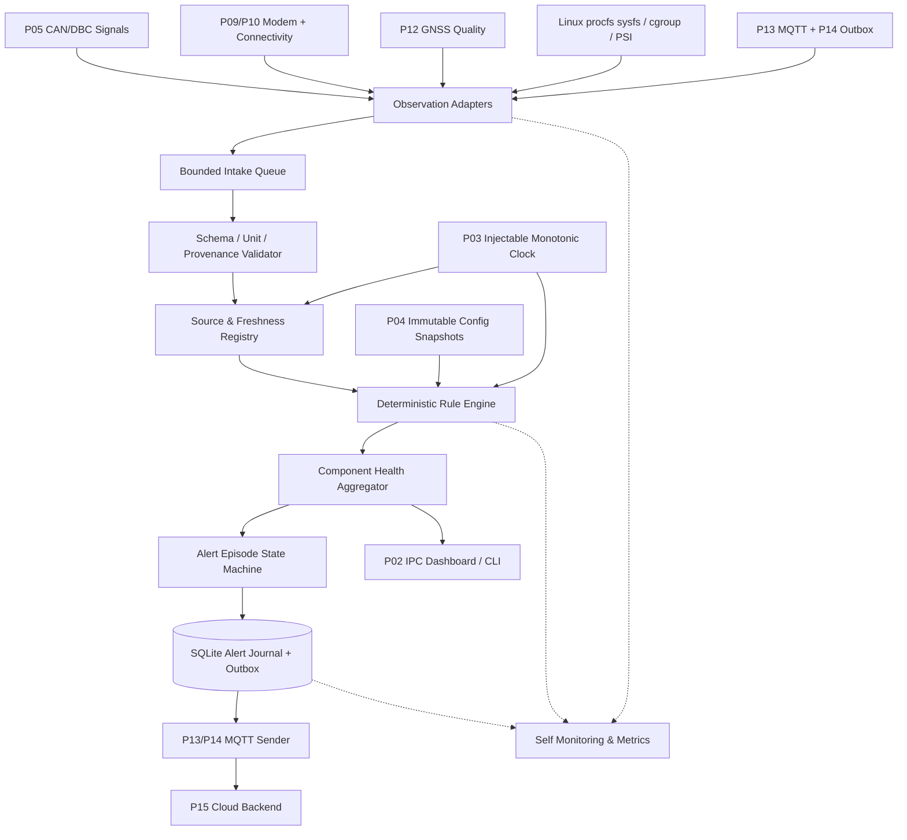
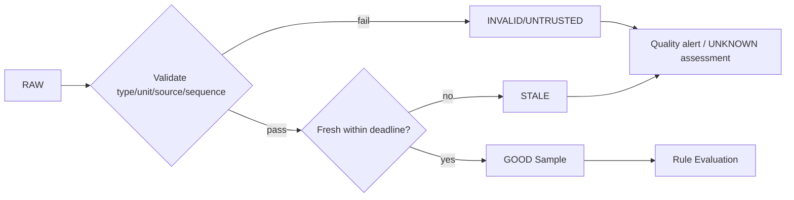
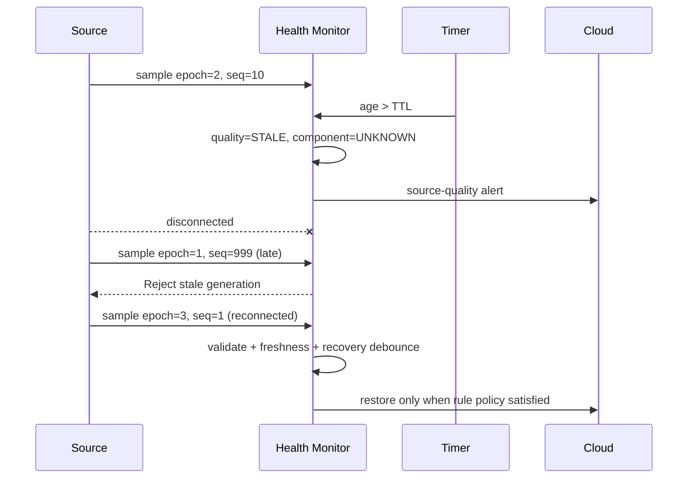
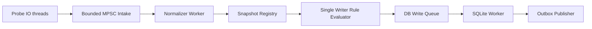
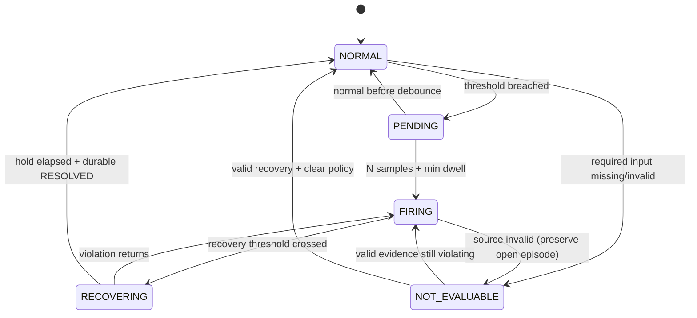
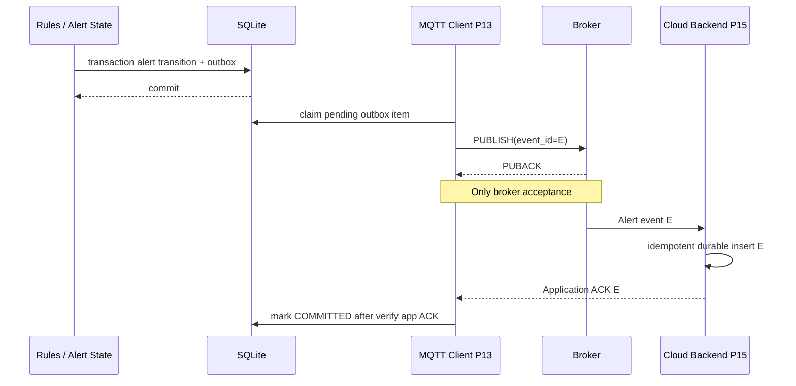
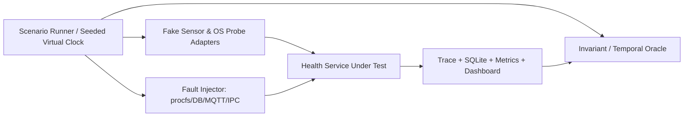
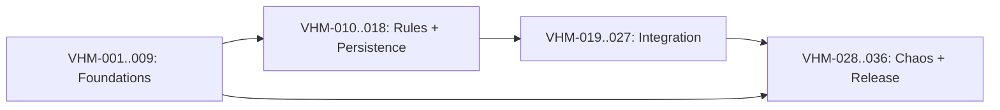

# P17 — Vehicle Health Monitoring (VHM)

**Virtual TCU Lab | System Design + Operational Behaviors + C++17 APIs + Resilience / What-if Test Catalog**

| Thuộc tính | Giá trị |
|---|---|
| Dự án | **17 / 30 — Vehicle Health Monitoring** |
| Phiên bản | **1.0 — thiết kế, chưa implement** |
| Ngày | 2026-10-30 |
| Đối tượng | Middle C++ Developer (Linux/Automotive TCU), QA Automation, SRE simulation |
| Môi trường giả định | Ubuntu Linux x86-64, C++17, CMake, Google Test/Mock, SQLite, Mosquitto, Python harness, Docker Compose |
| Phụ thuộc | P01 Event Bus; P02 IPC; P03 Timer; P04 Config/Logging; P05/P06 Vehicle Signals; P09/P10 Modem/Connectivity; P12 GNSS; P13 MQTT; P14 Outbox; P15 Cloud; P16 Remote Commands |
| Quan hệ với dự án tiếp theo | P18 OTA Download Manager; P20 Diagnostics; P22 Power; P24 Watchdog |
| Phạm vi | **Chỉ mô phỏng và giám sát**, không điều khiển actuator/xe thật; không thay thế OBD/UDS diagnostics hoặc quy trình safety/security OEM |
| Sản phẩm | `libtcu_health`, `tcu-healthd`, `health-simulator`, fake probes, fault-injection harness, SQLite history, MQTT health publisher |

> **Mục tiêu:** Giám sát sức khỏe **phần mềm TCU** (CPU, RAM, disk, process liveness, queues, timers, modem/network/cloud, CAN/GNSS, logging) và các **quan sát trạng thái xe mô phỏng** (battery voltage, ignition, DTC summary, freshness). Hệ thống chuyển raw observations thành health assessments có chất lượng chứng cứ rõ ràng, phát sinh cảnh báo ổn định (không alert storm), lưu vết khi offline, và tự phục hồi *chức năng giám sát* khi gặp crash, quá tải, mất dữ liệu hoặc lỗi chồng chéo.

**Nguyên tắc cốt lõi:** `UNKNOWN` / `STALE` / `UNTRUSTED` **không được biến thành `HEALTHY`**. Một chỉ số vượt ngưỡng chưa đủ kết luận xe hỏng, và telemetry không chứng minh tình trạng an toàn cơ khí. Monitor mặc định **không tự thực hiện thao tác có side effect trên xe**; các khuyến nghị recovery được xuất dưới dạng advisory để module khác đánh giá quyền và safety policy.

## 0. Executive summary

### 0.1 Quyết định thiết kế

1. **Observation ≠ diagnosis:** giữ riêng giá trị quan sát, đơn vị, provenance, chất lượng, timestamp, chính sách đánh giá và kết luận. Không gọi `battery_low` khi đo voltage mất nguồn/gặp lỗi ADC.
2. **Đa tầng:** `Probe → Normalize/Validate → Freshness → Rule Engine → Component Assessment → Aggregate Health → Alert State Machine → Durable Outbox → Cloud`.
3. **Data quality là first-class:** `GOOD`, `INVALID`, `STALE`, `MISSING`, `UNTRUSTED`, `UNSUPPORTED`; trạng thái `UNKNOWN` được truyền lên aggregate, không được quy về green.
4. **Monotonic time** cho deadline, freshness, hysteresis, cooldown; UTC chỉ để trình bày và liên kết với cloud nếu đồng hồ đủ tin cậy. Mỗi observation có `boot_id`, `source_epoch`, `sequence`.
5. **Rule evaluation deterministic:** inputs immutable snapshot, single serial evaluator theo component/shard, không mutate rule state từ callback IO; timer/callback cũ bị chặn bởi config generation.
6. **Hysteresis + debounce + cooldown:** ngăn flapping; severity và propagation được định nghĩa per rule; alarm threshold thường khác recovery threshold. Critical unknown không được che bởi OK từ subsystem khác.
7. **Alert journal + outbox atomic:** open/resolve và ý định publish được lưu trong một transaction; MQTT PUBACK không tương đương cloud commit; replay giữ nguyên alert/event ID.
8. **Admission & resources bounded:** queue, measurement cardinality, CPU sampler budget, DB quota, alert rate, log storage; shed noncritical load theo thứ tự có thể giải thích, không giấu lỗi quan trọng.
9. **Self-monitoring không tự chứng minh khỏe:** đo `last_eval_at`, source gaps, telemetry outbox age, queue overflow, evaluator stall; independent watchdog bên ngoài được khuyến nghị để phát hiện process hoàn toàn treo.
10. **No hidden repair:** auto-restart, clearing DTC, forcing modem reset, override remote-lock policies nằm **ngoài** scope P17; P17 chỉ đưa evidence/advisory.
11. **Invariant-driven testing:** case chỉ PASS nếu fault đã inject đúng, oracle có bằng chứng, có kiểm tra side effect/corruption và resource metrics.
12. **Giới hạn giả lập:** có thể test logic/reliability dưới fault model, không chứng minh độ đúng sensor vật lý, health của xe thật hay compliance với ISO 26262.

### 0.2 Giả định và ranh giới tin cậy

- P05/P06 cung cấp `SignalSnapshot` có validity/provenance/age; P12 cung cấp GNSS quality; P10 kết nối nhiều lớp (registered/IP/cloud). P17 không suy ra health từ một cờ `connected=true`.
- TCU giả lập chạy Linux có `/proc`/`/sys` khi được cấp quyền. Process/container có thể bị giới hạn namespace/cgroup; các phép đo host và container phải tách rõ `scope`.
- Dữ liệu từ Event Bus/IPC, MQTT hoặc file cấu hình là **untrusted** cho đến khi validate schema, source identity và giới hạn tài nguyên. Cross-process metrics cần định danh instance/process start time để ngăn PID reuse.
- Chỉ lưu dữ liệu cần cho vận hành: không xuất tọa độ GPS thô, VIN, tokens hoặc payload lệnh trong health alerts mặc định. Nếu có device identity thì dùng synthetic ID trong lab.
- DTC được coi là **diagnostic observation** từ simulator; monitor không tự đọc DTC qua UDS/OBD theo hướng gây side effects và không tự reset DTC.

### 0.3 Out of scope

Hardware driver riêng cho ADC, battery management thật, fuel/gas safety, real CAN bus-off physics, chứng nhận ASIL, quản trị quyền operator production, điều khiển door/ignition/start, remote code execution, giám sát sức khỏe y khoa, cloud fleet analytics quy mô lớn, và tự kết luận xe đã sửa xong chỉ vì alert được ACK.

### 0.4 Acceptance targets — tham khảo, phải đo trên môi trường cụ thể

| ID | Mục tiêu lab gợi ý | Oracle |
|---|---|---|
| SLO-01 | 0 kết luận `HEALTHY` khi input bắt buộc `UNKNOWN/STALE/INVALID` | property-based + aggregate assertions |
| SLO-02 | 0 critical alert lost giữa SQLite commit và publish, trong durability profile được chọn | crashpoint replay + journal diff |
| SLO-03 | 0 duplicate logical alert open cho cùng `(device, rule, entity, episode)` | unique constraint + replay tests |
| SLO-04 | Rule evaluation p99 <= 100 ms cho 1.000 metrics/s trên cấu hình lab | histogram monotonic |
| SLO-05 | end-to-end alert within 2 s sau debounce threshold (localhost/no overload) | injected timestamps; percentile |
| SLO-06 | queue <= 4.096, active alert cardinality <= 10.000 (lab defaults) | high-watermark + RSS |
| SLO-07 | critical unknown được hiển thị trong 1 evaluation interval khi source mất | fake-clock timeline |
| SLO-08 | 24h soak có fault injection, 0 unbounded RSS/FD/thread/DB growth | time series + leak tools |
| SLO-09 | output deterministic qua 100 seed-identical runs trên fake adapters | trace hash + invariant checks |
| SLO-10 | 0 token/precise GPS/PII trong logs/alerts mặc định | redaction scan |
| SLO-11 | alert transition at most once per episode revision | DB revision + exactly-one transition state |
| SLO-12 | khi monitor crash, external watchdog báo service liveness fail | independent heartbeat probe |

`SLO-*` là **mục tiêu thử nghiệm**, không phải yêu cầu OEM, và chưa đạt cho đến khi có kết quả kiểm thử.

## 1. Functional & Non-functional requirements

| ID | Requirement | Priority | Verification |
|---|---|---|---|
| FR-01 | Đăng ký probe dạng push/pull, có owner, unit, sampling interval, scope | P0 | registry tests |
| FR-02 | Validate type/range/unit/sign/NaN/infinity/source ID/version | P0 | data-fuzz corpus |
| FR-03 | Track `boot_id`, `epoch`, `sequence`, event-time và receive monotonic-time | P0 | reorder/restart tests |
| FR-04 | Mark samples `MISSING/STALE/INVALID` theo TTL riêng, không silently last-known-good | P0 | fake-clock freshness tests |
| FR-05 | Normalize CPU%, RSS, disk, temperature/synthetic voltage với provenance | P0 | process/cgroup/host unit tests |
| FR-06 | Theo dõi queue depth, backlog age, reconnect attempts, cloud readiness | P0 | module integration tests |
| FR-07 | Rule thresholds + hysteresis + debounce + cooldown + suppression có reason | P0 | temporal property tests |
| FR-08 | Per-component assessment không ép `UNKNOWN` thành green; aggregate có precedence | P0 | matrix tests |
| FR-09 | Durable lifecycle `OPEN/ACKNOWLEDGED/RESOLVED`; ACK chỉ nhận biết, không tự resolve | P0 | DB/outbox tests |
| FR-10 | Persist transition và outbox trong một SQLite transaction | P0 | transaction crash matrix |
| FR-11 | Retry/reconcile cloud ACK theo P14/P15, giữ stable event ID | P0 | duplicate & offline tests |
| FR-12 | Config/schema hot reload atomic; invalid config giữ bản cũ | P0 | generation fencing tests |
| FR-13 | Bounded queue, cardinality caps, prioritization, no silent critical drops | P0 | overload tests |
| FR-14 | Safe shutdown, restart, no stale callback write, no double transition | P0 | concurrency tests |
| FR-15 | Self-observability: probe_errors, eval_lag, source_lag, outbox_depth, queue_drop | P0 | independent oracle |
| FR-16 | Fault harness điều khiển virtual time, fake probes, process crash, DB errors | P0 | deterministic repeatability |
| FR-17 | Expose snapshot to local CLI/dashboard IPC, status semantics rõ ràng | P1 | contract tests |
| FR-18 | Recommendations/advisories cho P22/P24, không tự điều khiển actuator | P1 | no-side-effect guard |
| FR-19 | Support degradation khi không có `/proc/pressure`/permissions | P1 | optional-source tests |
| FR-20 | Structured evidence, support export & offline inspect | P1 | artifact schema tests |
| NFR-01 | Không block probe callback vì SQLite/MQTT hoặc policy evaluation | P0 | slow-sink tests |
| NFR-02 | Không có global mutex giữ trong lúc callback hoặc IO blocking | P0 | lock instrumentation |
| NFR-03 | Sử dụng `steady_clock` cho timeout, không dựa RTC | P0 | clock-jump tests |
| NFR-04 | Không trộn host/container/process denominators khi tính CPU% | P0 | topology change tests |
| NFR-05 | Tất cả thresholds đều có unit, rule version và explicit severity | P0 | schema validation |
| NFR-06 | Security: least privilege, schema validation, redaction, bounded labels | P0 | security tests |
| NFR-07 | Không quảng cáo compliance safety/security chỉ nhờ pass simulation | P0 | document audit |

## 2. System architecture



### 2.1 Components & ownership

| Component | Owns | Không được suy diễn/quản lý |
|---|---|---|
| `ProbeRegistry` | nguồn đo, timeout, sampling policy, scope, owner | tính tin cậy của module xe khi thiếu evidence |
| `LinuxResourceSampler` | CPU, RSS, FD, disk, PSI và error states | process identity chỉ từ PID |
| `ObservationValidator` | schema, unit, limits, provenance, quality | tự sửa dữ liệu nguy hiểm thành GOOD |
| `SnapshotStore` | latest sample + source epoch + monotonic freshness | durable audit trail |
| `FreshnessTracker` | stale/missing/unknown transitions | xem nhận frame muộn như dữ liệu mới |
| `RuleEngine` | threshold/debounce/hysteresis per generation | gọi network/DB trong critical section |
| `ComponentAggregator` | `OK/WARN/CRITICAL/UNKNOWN/DEGRADED` with reasons | chữa lỗi hay tự restart service |
| `AlertCoordinator` | episode state & revision; ack semantics | coi ACK của người vận hành là hết lỗi |
| `AlertRepository` | SQLite transactions, unique keys, outbox | gửi MQTT trong DB transaction |
| `HealthPublisher` | transport/retry, ACK correlation, epoch fencing | chứng nhận cloud đã commit từ PUBACK |
| `HealthApi` | read-only status/metrics/export | cho phép remote mutate thresholds không auth |
| `FaultHarness` | deterministic fault + oracle evidence | claim PASS khi injection thất bại |

### 2.2 Process boundaries

- **MVP:** một process `tcu-healthd`; internal modules dùng P01 Event Bus để nhận probe samples, P03 Scheduler để kiểm tra freshness. Store và evaluator có dedicated execution contexts để không block CAN/MQTT callbacks.
- **Integration:** source adapters từ P02 IPC hoặc P01; P15 MQTT broker/backend nằm ngoài process. SQLite là durable local store.
- **Optional advanced:** separate `health-agent` ngoài process để kiểm tra liveness. Dùng systemd watchdog hoặc external observer; process tự báo mình đang alive không đủ nếu event loop đã treo.
- **Trust/privilege:** đọc `/proc` với quyền tối thiểu; mọi hành động sửa kernel settings/TC hoặc tác động vào service thuộc **test harness được cô lập**, không thuộc `tcu-healthd`.

### 2.3 Source quality pipeline



### 2.4 Sequence: normal observation to alert

```mermaid
sequenceDiagram
  participant Source as Battery Simulator
  participant V as Validation/Freshness
  participant R as Rule Engine
  participant A as Alert Coordinator
  participant DB as SQLite
  participant Cloud as P13/P15 Cloud
  Source->>V: BatteryVoltage(11.8 V, GOOD, epoch=9)
  V->>R: Immutable observation
  R->>R: Debounce/hysteresis policy
  R->>A: Threshold crossed (OPEN candidate)
  A->>DB: BEGIN; insert episode; enqueue alert event; COMMIT
  DB-->>A: committed
  A->>Cloud: publish alert event, stable event_id
  Cloud-->>A: Application ACK (if supported)
  Note over A,Cloud: ACK does not resolve the underlying condition
```

### 2.5 Sequence: sensor lost, recovery and stale event



## 3. Observation, source and health data models

### 3.1 Schema contract

```json
{
  "schema_version": 1,
  "device_id": "TCU-LAB-001",
  "source": "vehicle.battery_voltage",
  "source_instance": "bcm-sim-01",
  "source_epoch": 7,
  "sequence": 1123,
  "metric_name": "battery_voltage",
  "scope": "vehicle_simulator",
  "unit": "V",
  "value": 11.8,
  "quality": "GOOD",
  "received_monotonic_ns": 10953120000,
  "observed_utc": "2026-10-30T04:00:00Z",
  "utc_trust": "SYNCED",
  "boot_id": "lab-boot-a",
  "config_generation": 12
}
```

- Mỗi metric key là `(source, source_instance, metric_name, scope)`, cardinality bounded bởi allowlist; label tự do **không** được trở thành key tùy ý.
- `source_epoch` tăng khi process/source reconnect và reset sequence; nếu không chứng minh được epoch thì mark `UNKNOWN` và yêu cầu handshake lại.
- `received_monotonic_ns` chỉ so sánh **trong cùng boot/incarnation**; sau restart phải reset freshness, không deserialize raw steady-clock timestamp làm deadline mới.
- `observed_utc` là optional, không dùng nó để quyết định freshness nếu clock trust thiếu; event time mang tính giải thích hơn là điều khiển.

### 3.2 Quality, severity, component health — *không phải cùng một enum*

| Loại | Giá trị | Ý nghĩa |
|---|---|---|
| ObservationQuality | `GOOD`, `INVALID`, `STALE`, `MISSING`, `UNTRUSTED`, `UNSUPPORTED` | tình trạng bằng chứng |
| RuleStatus | `NORMAL`, `PENDING`, `FIRING`, `RECOVERING`, `SUPPRESSED`, `NOT_EVALUABLE` | đời sống rule |
| AlertSeverity | `INFO`, `WARNING`, `CRITICAL` | mức ưu tiên thông báo |
| ComponentHealth | `OK`, `DEGRADED`, `CRITICAL`, `UNKNOWN` | kết luận component |
| AlertLifecycle | `OPEN`, `ACKNOWLEDGED`, `RESOLVED` | trạng thái episode; ACK không làm hết lỗi |
| ServiceState | `STARTING`, `RUNNING`, `DEGRADED`, `STOPPING`, `STOPPED` | lifecycle health daemon |

**Aggregation contract:** component có `CRITICAL` được đánh `CRITICAL`, nhưng thiếu bắt buộc không được phát `OK`. Trạng thái gộp có thể biểu diễn `(severity, confidence, missing_dependencies)` thay vì một enum đơn giản; ví dụ `CRITICAL + PARTIAL_EVIDENCE`. Không để `UNKNOWN` che mất một critical evidence đã xác thực; cũng không để một metric GOOD che những dependencies bắt buộc đang mất.

### 3.3 Example rules (chỉ là policy mô phỏng, KHÔNG phải ngưỡng battery OEM)

```yaml
schema_version: 1
max_metrics: 2048
max_queue: 4096
rules:
  - id: LAB_LOW_BATTERY_VOLTAGE
    metric: vehicle.battery_voltage
    unit: V
    warning_below: 12.0
    critical_below: 11.2
    recovery_above: 12.4
    debounce_count: 3
    debounce_min_ms: 1000
    clear_hold_ms: 5000
    freshness_ttl_ms: 2000
    priority: critical
  - id: LAB_PROCESS_RSS_HIGH
    metric: tcu_healthd.rss_mib
    unit: MiB
    warning_above: 256
    critical_above: 512
    recovery_below: 220
    debounce_count: 4
    debounce_min_ms: 2000
    clear_hold_ms: 10000
    freshness_ttl_ms: 3000
    priority: important
```

*Trong thực tế voltage cần xem xét điều kiện ignition/alternator, battery chemistry, nhiệt độ, noise và OEM signal validity. Rule lab chỉ dùng dữ liệu synthetic và không được tái sử dụng nguyên xi trên xe thật.*

## 4. C++17 API design

```cpp
#pragma once
#include <chrono>
#include <cstdint>
#include <functional>
#include <memory>
#include <optional>
#include <string>
#include <vector>

namespace tcu::health {

enum class Quality { Good, Invalid, Stale, Missing, Untrusted, Unsupported };
enum class HealthLevel { Ok, Degraded, Critical, Unknown };
enum class AlertState { Open, Acknowledged, Resolved };

struct Observation {
    std::string sourceId;
    std::string metricName;
    std::string sourceInstance;
    std::string scope;
    std::string unit;
    double value = 0;
    Quality quality = Quality::Missing;
    std::uint64_t sourceEpoch = 0;
    std::uint64_t sequence = 0;
    std::uint64_t bootGeneration = 0;
    std::chrono::steady_clock::time_point receivedAt{};
    std::optional<std::chrono::system_clock::time_point> observedUtc;
};

struct HealthAssessment {
    std::string componentId;
    HealthLevel level = HealthLevel::Unknown;
    std::vector<std::string> reasons;
    std::uint64_t configGeneration = 0;
    std::chrono::steady_clock::time_point evaluatedAt{};
};

struct AlertTransition {
    std::string episodeId;
    std::string eventId;
    std::string ruleId;
    AlertState newState;
    std::uint64_t revision;
    std::string reasonCode;
};

struct IClock {
    virtual ~IClock() = default;
    virtual std::chrono::steady_clock::time_point now() const = 0;
};

struct IObservationSource {
    virtual ~IObservationSource() = default;
    virtual bool start(std::function<void(Observation)> sink) = 0;
    virtual void stop() noexcept = 0;
};

struct IHealthRuleEngine {
    virtual ~IHealthRuleEngine() = default;
    virtual std::vector<HealthAssessment> evaluate(
        const std::vector<Observation>& consistentSnapshot,
        std::uint64_t configGeneration) = 0;
};

struct IAlertRepository {
    virtual ~IAlertRepository() = default;
    virtual bool persistTransitionAndOutbox(const AlertTransition&) = 0;
};

struct IHealthService {
    virtual ~IHealthService() = default;
    virtual bool start() = 0;
    virtual bool submit(Observation observation) = 0;
    virtual std::vector<HealthAssessment> snapshot() const = 0;
    virtual void stop() noexcept = 0;
};
}  // namespace tcu::health
```

**API contract:** `submit=true` chỉ là accepted-into-intake queue, không phải observation trusted/alert delivered. `persistTransitionAndOutbox=true` chỉ là local DB transaction committed theo durability profile; không có nghĩa cloud đã biết. Dùng `IClock` và `IObservationSource` fake cho deterministic tests. Thực tế cần `Result<T, Error>`, bounded batch IDs, snapshot revision và shutdown cancellation token trong implementation.

### 4.1 Concurrency design



- **Single-writer state:** mỗi rule/episode chỉ một coordinator sở hữu mutable state, tránh callback A và timer B đồng thời mở/resolve cùng alert.
- **Snapshot consistency:** evaluator nhận vector immutable + revision; một chu kỳ đánh giá không trộn nửa config generation cũ với nửa mới.
- **I/O isolation:** Linux sampling/SQLite/MQTT có deadline và queue riêng; `Slow consumer` không khiến callback CAN/GNSS block.
- **Backpressure:** queue đầy có policy per data class; ưu tiên freshness loss, critical transitions và liveness. Chỉ số high-frequency có thể coalesce theo key và giữ evidence drop count; critical alert transitions phải durable hoặc đưa ra degraded/failure rõ ràng, không silent drop.
- **Locks:** không giữ mutex khi gọi user callbacks, IPC, SQLite, MQTT. Shutdown không join thread khi đang giữ lock mà thread kia cần.
- **Generation fencing:** `bootGeneration`, `configGeneration`, `sourceEpoch`, evaluation revision và publication epoch; stale tasks không được commit kết quả cho đời mới.

## 5. Rule evaluation, timing and aggregation

### 5.1 Algorithm (pseudocode)

```text
onObservation(raw):
    verify source ID, allowed metric key, type, unit, value finiteness
    if invalid -> produce QualityIssue(reason); do NOT update GOOD numeric snapshot
    mark latest source-quality INVALID for this metric; mandatory assessment NOT_EVALUABLE
    if epoch old or sequence replay -> quarantine; record rejected metric
    record received monotonic time; update current source registry
    enqueue evaluation request with config_generation

onEvaluationTick(now):
    snapshot = sourceRegistry.readConsistentSnapshot()
    for required metric not present: quality = MISSING
    for metric with age > configured TTL: quality = STALE
    evaluation = ruleEngine.evaluate(snapshot, config_generation)
    for rule:
        if quality prevents evaluating: mark NOT_EVALUABLE / UNKNOWN
        else compare thresholds with unit and hysteresis
        apply debounce_count + min_dwell using steady_clock
        apply recovery hold and cooldown using steady_clock
        emit transition only when rule revision changes
    aggregate per component preserving critical and quality uncertainty
    persist alert episode transition + outbox in ONE transaction
    publish snapshot to IPC; asynchronously upload alert outbox
```

### 5.2 Example state machine for one rule



Một alert đã OPEN không tự được RESOLVED khi data source mất; trạng thái condition có thể chuyển sang **Unknown while alert remains open**, đồng thời tạo `SOURCE_LOST` alert độc lập với ID khác. Không xóa evidence cũ chỉ vì một source reported OK nhưng còn quá stale.

### 5.3 CPU, memory, disk and resource sampling

- **CPU process:** tính delta `(utime + stime)` trong `/proc/<pid>/stat` và delta wall monotonic, chia theo `CLK_TCK`. Định nghĩa rõ `cpu_pct_one_core` hay `%quota`; PID có thể reuse nên kiểm tra process start-time và boot ID. Nếu thread/process chết giữa hai mẫu → `UNKNOWN`, không chia zero. Cgroups CPU quota phải được kiểm tra riêng.
- **Memory:** RSS/MiB có thể không đại diện đầy đủ cgroup memory usage; tách RSS process, cgroup current/max, swap/OOM counters và PSI nếu có. Không gọi 0 byte khi file thiếu.
- **Disk:** cần theo dõi capacity + inode, fs read-only, SQLite/WAL size và write latency; filesystem permission có thể hạn chế đọc/ghi.
- **Network:** `Registered`, `IP Ready`, `Endpoint Reachable`, `Cloud Authenticated`, `Backend ACK` là trạng thái khác nhau. P17 hiển thị riêng; không tự suy luận internet từ modem registration.
- **PSI:** `/proc/pressure/{cpu,memory,io}` có thể dùng khi kernel hỗ trợ; nếu thiếu thì mark `UNSUPPORTED` và không coi là zero. Tài liệu: https://www.kernel.org/doc/html/latest/accounting/psi.html

### 5.4 Example severity & confidence matrix

| Evidence | Component assessment | Giải thích |
|---|---|---|
| Battery voltage synthetic < critical; good samples đủ debounce | `CRITICAL` | data+policy chứng minh rule firing |
| Voltage source stale, không có evidence khác | `UNKNOWN` | không suy luận low/normal |
| CPU cao 10 giây, sample validated | `DEGRADED` / `CRITICAL` theo rule | high usage không đồng nghĩa process chết |
| MQTT disconnected nhưng local probes OK | cloud connectivity `DEGRADED` | local health vẫn có thể healthy |
| GNSS stale trong tunnel simulation | GNSS `UNKNOWN` | không gán vị trí/health khỏe |
| DTC summary báo code active, source trusted | diagnostic `DEGRADED/CRITICAL` theo rule mapping | không suy diễn nguyên nhân cơ khí |
| Critical active + source dependency missing | `CRITICAL + PARTIAL_EVIDENCE` | giữ severity có bằng chứng và missing flags |

## 6. Alert episode, durable storage and cloud delivery

### 6.1 SQLite schema (minimal baseline)

```sql
PRAGMA journal_mode = WAL;
PRAGMA synchronous = FULL; -- simulator durability profile; verify returned PRAGMAs
PRAGMA foreign_keys = ON;

CREATE TABLE IF NOT EXISTS alert_episodes (
  episode_id TEXT PRIMARY KEY,
  device_id TEXT NOT NULL,
  rule_id TEXT NOT NULL,
  entity_key TEXT NOT NULL,
  state TEXT NOT NULL CHECK(state IN ('OPEN','ACKNOWLEDGED','RESOLVED')),
  severity TEXT NOT NULL CHECK(severity IN ('INFO','WARNING','CRITICAL')),
  revision INTEGER NOT NULL DEFAULT 1 CHECK(revision >= 1),
  first_seen_utc TEXT,
  last_updated_utc TEXT,
  reason_code TEXT NOT NULL,
  config_generation INTEGER NOT NULL,
  UNIQUE(device_id, rule_id, entity_key, episode_id)
);

CREATE TABLE IF NOT EXISTS alert_outbox (
  event_id TEXT PRIMARY KEY,
  episode_id TEXT NOT NULL,
  revision INTEGER NOT NULL,
  event_type TEXT NOT NULL CHECK(event_type IN ('OPEN','ACK','RESOLVE','QUALITY')),
  payload_json TEXT NOT NULL,
  delivery_state TEXT NOT NULL CHECK(delivery_state IN ('PENDING','INFLIGHT','COMMITTED')),
  attempt_count INTEGER NOT NULL DEFAULT 0 CHECK(attempt_count >= 0),
  FOREIGN KEY(episode_id) REFERENCES alert_episodes(episode_id),
  UNIQUE(episode_id, revision, event_type)
);

CREATE TABLE IF NOT EXISTS rule_state (
  rule_id TEXT NOT NULL,
  entity_key TEXT NOT NULL,
  config_generation INTEGER NOT NULL,
  last_episode_id TEXT,
  state TEXT NOT NULL,
  revision INTEGER NOT NULL,
  PRIMARY KEY(rule_id, entity_key)
);

CREATE INDEX IF NOT EXISTS idx_alert_outbox_pending
 ON alert_outbox(delivery_state, attempt_count);
```

Một transition phải xảy ra trong cùng transaction với ghi outbox và cập nhật rule state. `event_id` cố định khi retry; backend sử dụng idempotency per device+event. `COMMITTED` chỉ được đặt khi có **application-level ACK đáng tin** theo giao thức lab; `PUBACK` chỉ biểu thị broker nhận packet tương ứng. Nếu không có app ACK, trạng thái phải khác rõ ràng và retention policy không được tuyên bố confirmed delivery.

`ACKNOWLEDGED` là trạng thái *operator biết cảnh báo*, không có nghĩa tình trạng đã trở về bình thường. `RESOLVED` chỉ khi condition hồi phục theo rule và đủ evidence; ACK và condition là hai trục độc lập ở thiết kế mở rộng. Schema tối giản dùng `state` để minh họa; bản triển khai nên tách `condition_state` (`ACTIVE/RECOVERED`) và `operator_ack_at` nhằm hỗ trợ ACK sau RESOLVE và audit đúng.

### 6.2 Recovery after restart

1. Verify database integrity/schema version and open appropriate durability profile; corruption/permission errors => service `DEGRADED`, not silent wipe.
2. Load durable alert state; new boot means **all volatile freshness and debounce timers reset**. Previous active alerts remain open with `EVIDENCE_UNAVAILABLE` until new observations confirm.
3. Rehydrate outbox (including `INFLIGHT` unconfirmed); retry with original stable `event_id` and backoff. Avoid duplicate transitions using `revision` and DB uniqueness.
4. Do not resume old monotonic deadlines using serialized `steady_clock::time_point`. Recalculate from new observations; annotate restart gap.
5. Reject late callbacks from previous process/source/config generation; verify cloud ACK identity before marking delivered.

### 6.3 Outbox / ACK semantics



## 7. Operational behaviors / Given-When-Then contracts

| Contract | Given | When | Then |
|---|---|---|---|
| B-01 Startup cold | config + SQLite valid | service starts | probes registered, mandatory unknown until evidence, no false OK |
| B-02 Valid sample | allowed metric, source epoch valid | observation arrives | snapshot updates, rule evaluated once per revision |
| B-03 Invalid sample | NaN/out of range/wrong unit | sample arrives | reject or mark INVALID; keep quality issue, no false numeric result |
| B-04 Freshness expiry | no sample within TTL | fake time advances | STALE/UNKNOWN, source-health alert as configured |
| B-05 Open alert | threshold breach stable | debounce met | one OPEN episode + one outbox event in same transaction |
| B-06 Recovery | values cross recovery threshold | clear hold met | RESOLVE with evidence, not merely ACK |
| B-07 Flapping | values alternate around threshold | quick changes | bounded transitions, cooldown/hysteresis active |
| B-08 Operator ACK | episode remains active | cloud ACK received | store acknowledgment; do not resolve condition |
| B-09 Cloud offline | alerts produced | broker unreachable | durable outbox + bounded retries, no false delivery |
| B-10 Process crash | unconfirmed outbox exists | service restarts | reconcile/replay same event IDs; unknown freshness after restart |
| B-11 DB unavailable | transition required | write fails | no success claim; degraded + emergency signal/evidence |
| B-12 Config reload valid | new rules pass schema | reload | atomic generation swap, no mixed generation |
| B-13 Config reload invalid | threshold/unit invalid | reload | keep last good config and alert config error |
| B-14 Sampling pressure | 10k metrics/sec simulated | queue fills | bounded storage; explicit drop/coalesce metrics |
| B-15 Shutdown | inflight rules+outbox | stop | no new acceptance; bounded drain; no UAF/deadlock |
| B-16 Monitor hung | event loop stops | external watchdog checks | watchdog detects missed heartbeat; self-report not counted |
| B-17 Engine reboot | persisted alert active | new boot observed | retain prior alert, mark data unknown until new samples |
| B-18 Vehicle DTC | trusted DTC summary present | active DTC reported | create diagnostic observation, not physical root-cause claim |
| B-19 Correlated faults | modem fails and cloud offline | both fire | preserve separate component status, de-duplicate root-cause notification per policy |
| B-20 Privacy | source contains raw GPS/token | alert generated | no secret/raw precise location in health payload by default |

## 8. Failure model, threat model and safety policies

**Failures modelled:** dropped/duplicate/reordered samples, wrong units, time jumps, source reconnect, procfs permission/partial reads, cgroup changes, PID reuse, high CPU/memory/IO, queue saturation, DB busy/full/corrupt, WAL issues, MQTT broker issues, config tampering, unauthorized API, data exfiltration through labels/logs, crash/reboot, downstream ACK duplication, concurrency races, and compound faults.

**Threat/security:** unauthenticated source must not spoof health OK; dynamic metric label cardinality attack must be bounded; arbitrary JSON keys/config paths/SQL must be validated; no shell execution from alert content; rate limit query/export; redact tokens/VIN/GPS; permission separation between monitor and destructive fault harness. In production, use signed/admitted config and authenticated IPC/cloud boundaries.

**Fail-closed vs fail-operational:** health monitor should continue collecting unaffected sources if one source fails, but it must not claim missing source healthy. A failure in the monitor is independently observable via watchdog; not every error requires killing the process. If critical persistence fails, `monitor_storage_degraded` must be visible in a channel that does not depend solely on that broken storage; cannot promise durable audit when disk is failed.

## 9. Observability & metrics

| Metric | Meaning / key labels | Important caveat |
|---|---|---|
| `health_samples_total{source,quality}` | count accepted/rejected by bounded source ID | do not put UUID/username as label |
| `health_source_age_seconds{source}` | age since last trusted observation | monotonic clock, reset on reboot |
| `health_source_stale_total` | stale transitions | not same as quality-flapping count |
| `health_rule_evaluations_total{result}` | evaluated/skipped/errors | denominator for evaluation health |
| `health_eval_lag_ms` | scheduler delay | self-monitor independent when possible |
| `health_alert_transitions_total{severity,type}` | durable state transitions | differs from publish attempts |
| `health_alert_outbox_depth` | unconfirmed alerts | includes inflight unknown |
| `health_alert_publish_attempts_total` | MQTT publish attempts | not number of successful backend commits |
| `health_queue_depth`, `health_queue_dropped_total` | internal overload | critical drops must be observable |
| `health_sqlite_commit_duration_ms` | DB write latency | high latency can cause eval backlog |
| `health_monitor_heartbeat_age_s` | heartbeat lag | external observer needed for stopped process |
| `health_process_rss_mib`, `health_process_cpu_pct` | resource usage | label scope/denominator explicitly |

**Logging example:** `event=HEALTH_RULE_TRANSITION rule=LAB_LOW_BATTERY_VOLTAGE episode=e-123 state=OPEN evidence_quality=GOOD source_epoch=5 config_generation=9 reason=BELOW_CRITICAL value=11.0 unit=V` — phải bỏ token, GPS precision và command payload. Log level/correlation ID cấu hình có giới hạn tốc độ.

## 10. Deterministic simulation architecture



- **Unit layer:** Fake clock, in-memory observation adapter, fake DB and MQTT, exact step scheduling (no real sleeps), property-based generators.
- **Integration layer:** real SQLite + Mosquitto + P13/P14 + event bus; faults: forced DB error/busy, broker restart, process killpoints, IPC reconnect.
- **OS layer:** `/proc`, cgroups, file permissions, disk quota, process PID reuse where possible via harness; test only inside disposable namespace/container/VM.
- **Chaos layer:** timed multi-fault timeline + reproducible seed, capture `injected=true`, preconditions, observation, complete state trace, SQL snapshot, resource curves.
- **Out-of-scope physical fault:** voltage/current sensor accuracy and actual vehicle safety; use explicit `SIMULATED` evidence labels.

### 10.1 Test verdict

- **PASS:** preconditions met, injection verified, all expected invariants and recovery checks satisfied.
- **FAIL:** verified injection, at least one oracle violation.
- **INCONCLUSIVE:** fault did not actually occur, insufficient evidence, or oracle instrumentation failed.
- **SKIPPED:** known unsupported environment or out-of-scope with documented reason.

### 10.2 Required evidence per test

`case_id`, build SHA, config hash, seed, boot/source/config generation, fake-clock trace, injected fault proof, before/after snapshots, rule/episode revisions, SQLite commits, MQTT IDs+ACK class, RSS/FD/CPU, safety boundary observed, verdict, reason. Không đính kèm secrets/PII.

## 11. Base safety, correctness and liveness invariants

| ID | Invariant |
|---|---|
| INV-01 | No `OK` when any mandatory source missing/untrusted/stale without explicit policy exception |
| INV-02 | No untrusted numeric value contributes to threshold evaluation |
| INV-03 | Critical trusted finding not erased by unrelated source `OK` |
| INV-04 | No duplicate logical OPEN transition for same episode revision |
| INV-05 | ACK from operator does not resolve active condition |
| INV-06 | An alert event ID remains stable across transport replay |
| INV-07 | Outbox confirmed only by validated application ACK, not MQTT PUBACK |
| INV-08 | No stale generation callback commits new state |
| INV-09 | Monotonic timer state never reused across reboot |
| INV-10 | At most one owner mutates each rule/alert lifecycle at a time |
| INV-11 | No unbounded metric/label/queue/outbox growth; overflow is observable |
| INV-12 | Rule transitions and outbox events atomic or explicitly failed |
| INV-13 | No actuator/ECU control command emitted by health monitor |
| INV-14 | Logs/health payloads do not expose configured sensitive fields |
| INV-15 | A dead/stuck monitor is discoverable outside the same stuck execution loop |
| INV-16 | No alert resolved without trustworthy recovery evidence and required dwell |
| INV-17 | Source epoch/sequence validation prevents old data from becoming fresh |
| INV-18 | Every PASS has verified fault injection and independent oracle evidence |

## 12. What-if catalog methodology

Catalog sau có **30 nhóm × 10 trường hợp = 300 What-if**; từng case có ID, fault injection, expected behavior và evidence. `P0`: dữ liệu sai, false green, false success, safety/trust, corruption, concurrency; `P1`: reliability/performance; `P2`: nâng cao. Đây là *systematic coverage plan* chứ **không phải mọi sự cố có thể tồn tại về mặt toán học**. Tạo thêm test từ production incidents, OEM contracts và fuzzing.

**Các ký hiệu:** `GOOD/STALE/INVALID/...` = observation quality; `OPEN/RESOLVED` = alert episode; `UNKNOWN` = sức khỏe component không đủ bằng chứng. `trace` gồm state transitions, epochs, revision, metrics; `DB` gồm journal/outbox; `SUT` = hệ thống đang kiểm thử.

### 12.01 — Source discovery & lifecycle

| ID | What if / cách inject | Expected behavior | Evidence | Ưu tiên |
|---|---|---|---|---|

| **VHM-WIF-01-01** | Probe không khởi động; **Inject:** Fake source.start() trả false | Component UNKNOWN và probe error; service không crash | start result + source status | P0 |
| **VHM-WIF-01-02** | Probe khởi động rất chậm; **Inject:** Chặn start vượt startup deadline | Không block các probe khác; UNKNOWN đến khi available | startup timeline | P0 |
| **VHM-WIF-01-03** | Probe kết nối rồi rớt; **Inject:** Đóng IPC sau 2 samples | Mark missing/stale, reconnect bounded | age + reconnect counter | P0 |
| **VHM-WIF-01-04** | Một source đăng ký hai lần; **Inject:** Đăng ký trùng source ID | Reject hoặc coalesce theo declared policy, không double-count | registry cardinality | P0 |
| **VHM-WIF-01-05** | Source bị rename trong runtime; **Inject:** Publish metric với source ID mới không allowlist | Quarantine, không âm thầm tạo metric mới | registry reject count | P0 |
| **VHM-WIF-01-06** | Source bị disabled theo config; **Inject:** Disable source bắt buộc | Reject config hoặc đánh UNKNOWN rõ lý do | config validator trace | P0 |
| **VHM-WIF-01-07** | Optional probe không có trên kernel; **Inject:** PSI file vắng mặt | UNSUPPORTED chứ không phải value=0 | quality field | P1 |
| **VHM-WIF-01-08** | Source trả exception; **Inject:** Fake probe throw runtime_error | Catch ở boundary, mark UNKNOWN, worker sống | exception + heartbeat | P1 |
| **VHM-WIF-01-09** | Probe trả snapshot rỗng; **Inject:** Return empty batch | Không xem như sample OK, freshness vẫn chạy | last_good_age | P1 |
| **VHM-WIF-01-10** | Probe restart liên tục; **Inject:** Thay epoch 100 lần/giây | Bound reconnect, không tăng registry vô hạn | epoch counter + RSS | P1 |

### 12.02 — Payload validation & unit integrity

| ID | What if / cách inject | Expected behavior | Evidence | Ưu tiên |
|---|---|---|---|---|

| **VHM-WIF-02-01** | Giá trị NaN; **Inject:** Inject float NaN vào CPU metric | INVALID, không compare threshold | validation reject | P0 |
| **VHM-WIF-02-02** | Giá trị vô cực; **Inject:** Inject +Inf/-Inf vào voltage | INVALID, không alert dựa trên số | quality trace | P0 |
| **VHM-WIF-02-03** | Kiểu dữ liệu sai; **Inject:** Gửi string thay numeric | Reject schema, không parse ép kiểu ngầm | schema error | P0 |
| **VHM-WIF-02-04** | Sai đơn vị voltage; **Inject:** Gửi 12000 mV dưới key V | Reject unit hoặc normalize theo schema tường minh | unit audit | P0 |
| **VHM-WIF-02-05** | RSS âm; **Inject:** Inject rss=-1 | Reject, không chuyển unsigned gây overflow | reject counter | P0 |
| **VHM-WIF-02-06** | CPU 10000% vì denominator sai; **Inject:** Inject inconsistent sample | INVALID/UNKNOWN; check CPU scope/denominator | sample provenance | P0 |
| **VHM-WIF-02-07** | Payload quá lớn; **Inject:** Inject 5 MB metric JSON | Reject trước allocate lớn; bounded memory | max payload/RSS | P1 |
| **VHM-WIF-02-08** | Field không biết; **Inject:** Gửi unknown required version field | Reject incompatible version/maintain old snapshot | schema version | P1 |
| **VHM-WIF-02-09** | Metric name unicode/control chars; **Inject:** Inject control characters trong key | Reject/sanitize, không làm lỗi log/schema | log scan | P1 |
| **VHM-WIF-02-10** | Metric hợp lệ nhưng quality UNTRUSTED; **Inject:** Inject numeric 12.5 with UNTRUSTED | Không dùng để đánh component OK | aggregate trace | P0 |

### 12.03 — Freshness & missing data

| ID | What if / cách inject | Expected behavior | Evidence | Ưu tiên |
|---|---|---|---|---|

| **VHM-WIF-03-01** | Không có first sample; **Inject:** Start chưa publish | Mandatory component UNKNOWN | snapshot at t0 | P0 |
| **VHM-WIF-03-02** | Một sample rồi im lặng; **Inject:** Advance fake clock quá TTL | Mark STALE, open source-loss alert | age + alert | P0 |
| **VHM-WIF-03-03** | Sample ngay trước TTL; **Inject:** Advance TTL-1ms | Vẫn GOOD nếu valid và same epoch | quality boundary | P0 |
| **VHM-WIF-03-04** | Sample đúng bằng TTL; **Inject:** Advance exactly TTL | Áp dụng rõ >= hay > theo contract; deterministic | boundary assertion | P0 |
| **VHM-WIF-03-05** | Sample sau khi đã stale; **Inject:** Send fresh higher-seq sample | Quay GOOD sau validate; recovery debounce | transition history | P0 |
| **VHM-WIF-03-06** | Nguồn optional stale; **Inject:** Stop optional probe | Không ảnh hưởng core mandatory health; show gap | component dependency map | P0 |
| **VHM-WIF-03-07** | Nguồn mandatory stale; **Inject:** Stop required battery signal | Không báo HEALTHY; UNKNOWN + reason | health snapshot | P0 |
| **VHM-WIF-03-08** | Freshness tick bị trễ; **Inject:** Block scheduler 4x TTL | Khi chạy lại tính age thực, không freshness giả | scheduler lag | P1 |
| **VHM-WIF-03-09** | Stale sample được phát lại; **Inject:** Replay old event with new receipt time | Sequence/event origin prevents false freshness | epoch+sequence trace | P0 |
| **VHM-WIF-03-10** | Nhiều source stale cùng lúc; **Inject:** Advance clock past all TTL | Correlate cause theo rule, không silent suppress root quality | alert list | P0 |

### 12.04 — Source epoch, ordering & replay

| ID | What if / cách inject | Expected behavior | Evidence | Ưu tiên |
|---|---|---|---|---|

| **VHM-WIF-04-01** | Sequence lặp cùng epoch; **Inject:** Send seq 42 twice | Dedup, không double evaluation | eval count | P0 |
| **VHM-WIF-04-02** | Sequence thấp hơn; **Inject:** Send seq 100 then 99 | Reject older sample, giữ newest | snapshot sequence | P0 |
| **VHM-WIF-04-03** | Epoch cũ sau reconnect; **Inject:** Send epoch 3 after epoch 4 | Reject as stale generation | epoch mismatch log | P0 |
| **VHM-WIF-04-04** | Epoch mới reset sequence; **Inject:** Send epoch 5 seq 1 after epoch 4 seq 100 | Accept if new epoch verified | new snapshot | P0 |
| **VHM-WIF-04-05** | Epoch tự tăng do payload giả; **Inject:** Send unauthenticated epoch leap | Do not trust epoch claim; quarantine | source identity trace | P0 |
| **VHM-WIF-04-06** | Sequence max uint64; **Inject:** Send max then 0 without epoch | No implicit wrap without protocol contract | rejected sample | P0 |
| **VHM-WIF-04-07** | Time source cũ vượt source mới; **Inject:** Old callback delayed 5s | Fencing prevents overwriting latest data | snapshot revision | P1 |
| **VHM-WIF-04-08** | Hai adapters dùng chung source ID; **Inject:** Publish conflicting identities | Detect namespace collision, quarantine | identity map | P1 |
| **VHM-WIF-04-09** | Duplicate with different value; **Inject:** Same epoch/seq but changed voltage | Reject conflict; alert integrity issue | conflict hash | P0 |
| **VHM-WIF-04-10** | Reorder burst; **Inject:** Publish seq [10,12,11,13] | Only monotonic accepted samples applied | accepted order | P1 |

### 12.05 — Linux CPU & process accounting

| ID | What if / cách inject | Expected behavior | Evidence | Ưu tiên |
|---|---|---|---|---|

| **VHM-WIF-05-01** | PID biến mất giữa read; **Inject:** Kill tracked process during /proc scan | UNKNOWN, no exception escape | proc read errors | P0 |
| **VHM-WIF-05-02** | PID reuse; **Inject:** Spawn replacement with same PID namespace scenario | Check start-time/boot, reject old deltas | process identity tuple | P0 |
| **VHM-WIF-05-03** | First CPU sample; **Inject:** Only one /proc snapshot | UNKNOWN until valid delta | cpu sample count | P0 |
| **VHM-WIF-05-04** | CPU delta negative; **Inject:** Injected counter reset | Reset baseline, no negative CPU | denominator trace | P0 |
| **VHM-WIF-05-05** | Wall delta zero; **Inject:** Fake clock no advance | No division by zero; NOT_EVALUABLE | error reason | P0 |
| **VHM-WIF-05-06** | CPU quota thay đổi; **Inject:** Switch cgroup cpu.max | Recompute denominator with new generation | quota history | P0 |
| **VHM-WIF-05-07** | Nhiều CPU cores; **Inject:** Inject process uses 2 cores | Document process_core_pct vs quota_pct | reported scope | P1 |
| **VHM-WIF-05-08** | /proc/stat bị truncate; **Inject:** Fake incomplete proc line | INVALID not default 0 | parse errors | P1 |
| **VHM-WIF-05-09** | Sampling CPU làm spike; **Inject:** Sample at 1 ms intervals | Sampling budget caps overhead | monitor cpu trace | P1 |
| **VHM-WIF-05-10** | Process state zombie; **Inject:** Mark tracked pid zombie | Not considered responsive/healthy | process state | P1 |

### 12.06 — Memory, FD & allocation pressure

| ID | What if / cách inject | Expected behavior | Evidence | Ưu tiên |
|---|---|---|---|---|

| **VHM-WIF-06-01** | RSS tăng từng bước; **Inject:** Increase fake RSS over threshold | Debounced alert, correct unit MiB | rule history | P0 |
| **VHM-WIF-06-02** | RSS giảm về ngưỡng; **Inject:** Decrease just below warning | No premature resolve until recovery threshold/dwell | alert state | P0 |
| **VHM-WIF-06-03** | Cgroup memory.max missing; **Inject:** Fake absent file | UNSUPPORTED, no fabricated limit | quality field | P0 |
| **VHM-WIF-06-04** | Memory pressure cao nhưng RSS ổn; **Inject:** Inject PSI memory full while RSS steady | Separate pressure alert with scope | PSI samples | P0 |
| **VHM-WIF-06-05** | Process bị OOM kill; **Inject:** Trigger cgroup OOM event | External source reports crash, monitor unknown if itself died | oom counter | P0 |
| **VHM-WIF-06-06** | FD gần giới hạn; **Inject:** Open many local FDs in sandbox | Warn before EMFILE, bounded ingestion | fd counter | P0 |
| **VHM-WIF-06-07** | FD count read permission denied; **Inject:** Block /proc/pid/fd | UNKNOWN, no zero FD claim | errno | P1 |
| **VHM-WIF-06-08** | Metric label explosion; **Inject:** 100k unique source labels | Registry cardinality cap + reject evidence | cardinality/RSS | P1 |
| **VHM-WIF-06-09** | Allocator throws bad_alloc; **Inject:** Fake repository allocation failure | Bound cleanup/partial rollback; no false success | exception trace | P0 |
| **VHM-WIF-06-10** | Memory leak sau 24h; **Inject:** Soak with repeated reconnects | No unbounded RSS/FD growth | resource slope | P1 |

### 12.07 — Disk, filesystem & storage health

| ID | What if / cách inject | Expected behavior | Evidence | Ưu tiên |
|---|---|---|---|---|

| **VHM-WIF-07-01** | Disk capacity dưới ngưỡng; **Inject:** Use sandbox filesystem quota | Warn/critical based on explicit rule | statvfs+rule | P0 |
| **VHM-WIF-07-02** | Inode hết dù còn dung lượng; **Inject:** Exhaust sandbox inodes | Separate inode alert, do not call disk healthy | inode metrics | P0 |
| **VHM-WIF-07-03** | Filesystem read-only; **Inject:** Remount test FS or fake EROFS | DB DEGRADED, no commit claimed | errno + service status | P0 |
| **VHM-WIF-07-04** | SQLite báo BUSY; **Inject:** Hold conflicting write txn | Bounded retry/timeouts; no infinite lock | busy count | P0 |
| **VHM-WIF-07-05** | SQLite báo FULL; **Inject:** Inject SQLITE_FULL on transaction | Rollback and retain dirty episode candidate | db+alert trace | P0 |
| **VHM-WIF-07-06** | DB bị corruption; **Inject:** Open copy with malformed pages | Quarantine, no auto-delete/reset | integrity errors | P0 |
| **VHM-WIF-07-07** | WAL không checkpoint; **Inject:** Hold reader and grow WAL | Bound WAL/alert pressure; recover after reader exit | wal size | P1 |
| **VHM-WIF-07-08** | DB commit chậm; **Inject:** Delay fsync in fake store | Sampler unaffected, queue bounded | latency + queue | P1 |
| **VHM-WIF-07-09** | Disk vừa full vừa logging storm; **Inject:** Force ENOSPC + high log rate | Critical error exposed out-of-band; no spin | CPU + degraded state | P0 |
| **VHM-WIF-07-10** | Data retention chạy giữa alert mở; **Inject:** Trigger cleanup concurrently | Never prune active/unconfirmed episode without policy | db diff | P1 |

### 12.08 — Sampling, queue & backpressure

| ID | What if / cách inject | Expected behavior | Evidence | Ưu tiên |
|---|---|---|---|---|

| **VHM-WIF-08-01** | 10k samples trong 1 giây; **Inject:** Burst fake probes | Bounded queue; exact drop/coalesce metrics | queue highwater | P0 |
| **VHM-WIF-08-02** | Critical sample khi queue đầy; **Inject:** Fill with low-priority metrics then inject critical | Reserve capacity/priority for critical or explicit failure | decision trace | P0 |
| **VHM-WIF-08-03** | Slow evaluator; **Inject:** Sleep evaluator 5s | Producer nonblocking; freshness truth preserved | latency + age | P0 |
| **VHM-WIF-08-04** | Slow DB writer; **Inject:** Block SQLite for 10s | Coalesce values, preserve durable alerts policy | outbox + drop counter | P0 |
| **VHM-WIF-08-05** | Single noisy probe; **Inject:** Flood one metric key | Per-source quota prevents starvation | fairness counters | P0 |
| **VHM-WIF-08-06** | Many low-cardinality probes; **Inject:** 50 sources at max rate | Stable scheduling and bounded CPU | throughput | P0 |
| **VHM-WIF-08-07** | Burst after reconnect; **Inject:** Replay 1h snapshots at once | Old event times not marked fresh; throttle | source age | P1 |
| **VHM-WIF-08-08** | Queue drop counter overflow; **Inject:** Set uint64 near max in fake | Saturate/error not wrap to zero misleadingly | counter invariant | P1 |
| **VHM-WIF-08-09** | Consumer worker dies; **Inject:** Throw exception in evaluator | Supervisor detects, degrade not hang silently | worker heartbeat | P1 |
| **VHM-WIF-08-10** | Fairness during overload; **Inject:** Mix critical and info traffic | Critical assessment not indefinitely starved | priority latency | P0 |

### 12.09 — Synthetic battery / electrical observations

| ID | What if / cách inject | Expected behavior | Evidence | Ưu tiên |
|---|---|---|---|---|

| **VHM-WIF-09-01** | Voltage below warning threshold; **Inject:** Inject 11.9V three valid samples | Warning after debounce only | sample trace | P0 |
| **VHM-WIF-09-02** | Voltage below critical threshold; **Inject:** Inject 10.9V with valid quality | Critical with explicit evidence | alert severity | P0 |
| **VHM-WIF-09-03** | Voltage oscillates around 12V; **Inject:** Alternate 11.9/12.1 rapidly | No repeated open/resolve storm | episode count | P0 |
| **VHM-WIF-09-04** | ADC input disconnected; **Inject:** Mark sensor quality MISSING | Voltage UNKNOWN, not 0V | quality+reason | P0 |
| **VHM-WIF-09-05** | Unit milliVolt mislabeled Volt; **Inject:** Inject 12000 with unit V | Semantic range rejection | validation trace | P0 |
| **VHM-WIF-09-06** | Battery signal contradictory; **Inject:** Inject 11.0V and 13.8V same seq from two trusted sources | Conflict/UNKNOWN, not random winner | source conflict | P0 |
| **VHM-WIF-09-07** | Ignition OFF changes expected voltage; **Inject:** Switch ignition in simulator | Use configured context-specific rule/explicit unsupported | rule version | P1 |
| **VHM-WIF-09-08** | Voltage spike at one sample; **Inject:** Inject 8.0V single transient | Debounce holds, no unconfirmed critical | timeline | P0 |
| **VHM-WIF-09-09** | Sensor timestamp too old; **Inject:** Send voltage from 10 minutes ago | Do not declare current battery health | age evidence | P1 |
| **VHM-WIF-09-10** | Synthetic battery reconnect; **Inject:** Source epoch changes after fault | Recovery requires fresh stable samples | new epoch + episode | P1 |

### 12.10 — Vehicle state & power context

| ID | What if / cách inject | Expected behavior | Evidence | Ưu tiên |
|---|---|---|---|---|

| **VHM-WIF-10-01** | Ignition state missing; **Inject:** Suppress ignition source | Context-dependent rule becomes UNKNOWN | dependency trace | P0 |
| **VHM-WIF-10-02** | Speed zero mistaken for parked; **Inject:** Inject speed=0 but gear unknown | Do not conclude parked from speed alone | context decision | P0 |
| **VHM-WIF-10-03** | Ignition flaps rapidly; **Inject:** Toggle ON/OFF 20 Hz | Debounce power-context transitions | transition count | P0 |
| **VHM-WIF-10-04** | Power mode SLEEP; **Inject:** Signal synthetic sleep state | Reduce optional sampling per policy; heartbeat externally defined | sampling schedule | P0 |
| **VHM-WIF-10-05** | Wake during probe shutdown; **Inject:** Wake event before stop finishes | Single lifecycle transition, no UAF | generation trace | P0 |
| **VHM-WIF-10-06** | Low battery and high CPU; **Inject:** Inject both | Separate findings; advisory not direct actuation | alerts+no commands | P0 |
| **VHM-WIF-10-07** | Power cycle while alert active; **Inject:** Restart boot ID | Old alert preserved; freshness reset | journal | P1 |
| **VHM-WIF-10-08** | Supply voltage negative; **Inject:** Inject -1 V | INVALID; no physical fault asserted | validator | P1 |
| **VHM-WIF-10-09** | Vehicle snapshot mixed generation; **Inject:** Ignition old and voltage new | Cannot evaluate context rule as coherent | snapshot revision | P1 |
| **VHM-WIF-10-10** | Power manager unavailable; **Inject:** Drop P22 IPC | Monitor DEGRADED/UNKNOWN, does not force wake | IPC errors | P1 |

### 12.11 — Modem & network connectivity

| ID | What if / cách inject | Expected behavior | Evidence | Ưu tiên |
|---|---|---|---|---|

| **VHM-WIF-11-01** | SIM absent; **Inject:** P09 reports SIM missing | Modem connectivity degraded, not system-wide death | component map | P0 |
| **VHM-WIF-11-02** | Registered without IP; **Inject:** Set registered=true IP=false | No InternetReady claim | layers snapshot | P0 |
| **VHM-WIF-11-03** | IP exists without DNS; **Inject:** Inject DNS fail | Endpoint unhealthy, distinct from IP | probe evidence | P0 |
| **VHM-WIF-11-04** | Cloud TLS rejected; **Inject:** Expire mock cert | CloudAuth false, never CloudReady | TLS error | P0 |
| **VHM-WIF-11-05** | Two bearer paths; **Inject:** Cellular down while Wi-Fi up | Bearer-specific alert, aggregate according policy | path state | P0 |
| **VHM-WIF-11-06** | Network flapping; **Inject:** Toggle link each second | Alert hysteresis avoids storm | episodes | P0 |
| **VHM-WIF-11-07** | Modem reset during sample; **Inject:** Old callback arrives after reconnect | Reject stale source epoch | epoch trace | P0 |
| **VHM-WIF-11-08** | Route changed while probe active; **Inject:** Change route epoch | No stale successful probe marked current | probe revision | P0 |
| **VHM-WIF-11-09** | Reconnect storm consumes CPU; **Inject:** High retry attempts | Detect retry-rate anomaly without self-generated storm | retry metrics | P1 |
| **VHM-WIF-11-10** | Network always down; **Inject:** Hold offline 3h virtual time | Alert persisted; no alert resend infinite busy-loop | outbox/CPU | P1 |

### 12.12 — Cloud readiness & delivery observability

| ID | What if / cách inject | Expected behavior | Evidence | Ưu tiên |
|---|---|---|---|---|

| **VHM-WIF-12-01** | MQTT TCP connected but auth rejected; **Inject:** Simulate CONNACK error | Cloud not healthy | MQTT status | P0 |
| **VHM-WIF-12-02** | PUBACK without backend commit; **Inject:** Publish alert but fail DB at cloud | Keep unconfirmed delivery state | ACK class | P0 |
| **VHM-WIF-12-03** | Backend ACK lost; **Inject:** Cloud commits then drops app ACK | Replay same event ID; backend dedup | event IDs | P0 |
| **VHM-WIF-12-04** | Cloud sends duplicate ACK; **Inject:** Inject same ACK 10x | At most one outbox commit | state revision | P0 |
| **VHM-WIF-12-05** | ACK belongs to prior connection; **Inject:** Replay ACK from old epoch | Reject stale correlation | epoch log | P0 |
| **VHM-WIF-12-06** | Broker down when critical opens; **Inject:** Stop Mosquitto | Durable alert outbox retained | SQLite state | P0 |
| **VHM-WIF-12-07** | Outbox grows past quota; **Inject:** Block cloud until quota | Bound storage with explicit priority/backpressure policy | disk+outbox | P1 |
| **VHM-WIF-12-08** | Cloud clock ahead by 1 hour; **Inject:** Change mock backend UTC | No local freshness corruption | steady trace | P1 |
| **VHM-WIF-12-09** | Cloud API returns 429; **Inject:** Throttle emulator | Backoff and honor retry policy, not CPU spin | attempts | P1 |
| **VHM-WIF-12-10** | Link healthy but app ACK latency grows; **Inject:** Delay backend commit 5min | Expose delivery lag, not green delivery | delivery age | P1 |

### 12.13 — GNSS quality and position monitoring

| ID | What if / cách inject | Expected behavior | Evidence | Ưu tiên |
|---|---|---|---|---|

| **VHM-WIF-13-01** | GNSS has no fix; **Inject:** P12 quality NO_FIX | GNSS health UNKNOWN/DEGRADED, no location-valid claim | position quality | P0 |
| **VHM-WIF-13-02** | GNSS RMC and GGA disagree; **Inject:** Inject contradictory sentences | Surface source inconsistency, do not select arbitrary valid fix | P12 status | P0 |
| **VHM-WIF-13-03** | Position timestamp stale; **Inject:** Send old GNSS sample | Not current health/position | age | P0 |
| **VHM-WIF-13-04** | Position leaps unrealistically; **Inject:** Inject 1000 km jump | Quality anomaly; not physical vehicle malfunction claim | anomaly counter | P0 |
| **VHM-WIF-13-05** | Tunnel signal loss; **Inject:** Drop NMEA for 2min | Alert source loss with cooldown, no false route | status transition | P0 |
| **VHM-WIF-13-06** | NMEA checksum invalid; **Inject:** Corrupt checksum | Parser rejects; monitor records invalid input | parse metrics | P0 |
| **VHM-WIF-13-07** | UTC GNSS jumps backward; **Inject:** Inject backward ZDA | UTC trust degraded, monotonic timers stable | time trace | P0 |
| **VHM-WIF-13-08** | GNSS source reconnect; **Inject:** Restart PTY | Epoch fencing, no old fix as new | source epoch | P1 |
| **VHM-WIF-13-09** | GNSS quality GOOD but source unauthenticated; **Inject:** Spoof source ID | UNTRUSTED, no healthy fix | auth trace | P0 |
| **VHM-WIF-13-10** | GNSS is unsupported on device; **Inject:** Disable capability in config | UNSUPPORTED not false critical by default | feature flags | P0 |

### 12.14 — CAN vehicle signal health

| ID | What if / cách inject | Expected behavior | Evidence | Ưu tiên |
|---|---|---|---|---|

| **VHM-WIF-14-01** | CAN interface down; **Inject:** ip link set vcan0 down in lab | Signal source unknown/stale, alert transport | interface state | P0 |
| **VHM-WIF-14-02** | CAN ID never received; **Inject:** Remove periodic frame | Required signal transitions STALE | last frame age | P0 |
| **VHM-WIF-14-03** | Repeated same frame; **Inject:** Replay seq duplicate via adapter | Do not incorrectly refresh if source lacks true freshness | snapshot | P0 |
| **VHM-WIF-14-04** | Wrong DBC mapping; **Inject:** Inject incompatible decoder generation | Reject/UNKNOWN, no wrong unit alert | DBC hash | P0 |
| **VHM-WIF-14-05** | CAN payload corrupted semantically; **Inject:** Invalid signal range | Mark INVALID, no invented vehicle failure | decoder result | P0 |
| **VHM-WIF-14-06** | CAN frames arrive out of order; **Inject:** Replay old timestamp | Do not overwrite newest signal | sequence trace | P0 |
| **VHM-WIF-14-07** | CAN queue overload; **Inject:** Flood vcan0 | Bound queues; record loss and freshness degradation | highwater | P1 |
| **VHM-WIF-14-08** | Gateway restart; **Inject:** Restart P07 gateway | Old generation discarded; recover after new evidence | gateway epoch | P1 |
| **VHM-WIF-14-09** | Battery valid, ignition invalid; **Inject:** Mixed signal quality | Context-dependent health UNKNOWN | aggregate | P1 |
| **VHM-WIF-14-10** | Critical CAN indicator disappears; **Inject:** Stop signal after one critical | Preserve alert and mark evidence lost, not resolved | episode history | P0 |

### 12.15 — Diagnostics and DTC summary

| ID | What if / cách inject | Expected behavior | Evidence | Ưu tiên |
|---|---|---|---|---|

| **VHM-WIF-15-01** | DTC count increases; **Inject:** Send synthetic active DTC list | Notify changed code count, stable IDs | DTC snapshot | P0 |
| **VHM-WIF-15-02** | DTC disappears from one sample; **Inject:** Remove code once | Do not immediately resolve without valid clear policy | temporal rule | P0 |
| **VHM-WIF-15-03** | Malformed DTC code; **Inject:** Send invalid DTC format | Reject/integrity alert, no fake diagnostic | validator | P0 |
| **VHM-WIF-15-04** | UDS server timeout; **Inject:** P20 fake replies late | Mark diagnostics UNAVAILABLE; no assumed no-DTC | request timeline | P0 |
| **VHM-WIF-15-05** | DTC source stale; **Inject:** Drop summary events | Do not show zero active faults | quality | P0 |
| **VHM-WIF-15-06** | Same DTC repeated 100x; **Inject:** Replay identical summary | No 100 duplicate alerts | episode IDs | P0 |
| **VHM-WIF-15-07** | DTC severity unknown; **Inject:** Provide unmapped code | Classify UNKNOWN severity, not automatic critical | mapping version | P0 |
| **VHM-WIF-15-08** | DTC clear command included in data; **Inject:** Inject payload containing action field | Data-only parser never dispatches diagnostic command | no IPC TX | P1 |
| **VHM-WIF-15-09** | DTC code from wrong ECU; **Inject:** Spoof ECU source | Reject identity/namespace mismatch | source evidence | P1 |
| **VHM-WIF-15-10** | Two DTC sources disagree; **Inject:** ECU sim and cache diverge | Expose conflict/UNKNOWN, do not arbitrary choose | conflict log | P0 |

### 12.16 — Rule engine and threshold semantics

| ID | What if / cách inject | Expected behavior | Evidence | Ưu tiên |
|---|---|---|---|---|

| **VHM-WIF-16-01** | Threshold comparator sai dấu; **Inject:** Voltage exactly warning_below | Strict/weak inequality documented; deterministic boundary | boundary assertion | P0 |
| **VHM-WIF-16-02** | Sai unit trong rule; **Inject:** Load threshold 200 mV against metric V | Config invalid unless explicit conversion | config diagnostics | P0 |
| **VHM-WIF-16-03** | Recovery threshold thấp hơn trigger; **Inject:** Load inverted hysteresis | Reject invalid rule, retain last config | validator log | P0 |
| **VHM-WIF-16-04** | Hai rule cùng metric chồng nhau; **Inject:** Configure warn/critical on RSS | Higher severity wins without duplicate root episode | rule output | P0 |
| **VHM-WIF-16-05** | Unsupported expression operator; **Inject:** Load unknown comparator | Reject, do not silently ignore | schema validation | P0 |
| **VHM-WIF-16-06** | Rule phụ thuộc vòng tròn; **Inject:** Configure rule A depends B, B depends A | Reject dependency cycle | dependency graph | P0 |
| **VHM-WIF-16-07** | Metric optional dùng làm mandatory; **Inject:** Reload dependency graph | Only explicit mandatory affects aggregate OK | config diff | P1 |
| **VHM-WIF-16-08** | Arithmetic overflow; **Inject:** Compute rate with huge counters | Check overflow, NOT_EVALUABLE | sanitizer + result | P1 |
| **VHM-WIF-16-09** | Hot source value changes during evaluation; **Inject:** Concurrent publish | Evaluator uses coherent immutable revision | snapshot hash | P1 |
| **VHM-WIF-16-10** | Conflicting aggregate conditions; **Inject:** One critical, one unknown source | Expose critical plus missing evidence; never false OK | aggregate reasons | P0 |

### 12.17 — Debounce, hysteresis, cooldown and temporal edges

| ID | What if / cách inject | Expected behavior | Evidence | Ưu tiên |
|---|---|---|---|---|

| **VHM-WIF-17-01** | Violation only one sample; **Inject:** Inject single brief spike | No OPEN until count and dwell met | rule timeline | P0 |
| **VHM-WIF-17-02** | Count passes before dwell; **Inject:** Deliver 5 samples instantly | Still PENDING until minimum time | fake clock | P0 |
| **VHM-WIF-17-03** | Dwell passes without enough samples; **Inject:** Advance time after 1 sample | Still PENDING | counter | P0 |
| **VHM-WIF-17-04** | Exactly recovery threshold; **Inject:** Set value equal recovery_above | Boundary deterministic per rule contract | transition trace | P0 |
| **VHM-WIF-17-05** | Flapping across both thresholds; **Inject:** Alternate high/low at 100ms | Bound transitions, no alert storm | episode count | P0 |
| **VHM-WIF-17-06** | Cooldown expires during stale data; **Inject:** Advance fake time with no samples | Never clear solely by cooldown | quality + state | P0 |
| **VHM-WIF-17-07** | Alert active and sample invalid; **Inject:** Inject NaN during firing | Keep episode open, quality unknown | journal | P1 |
| **VHM-WIF-17-08** | Critical supersedes warning; **Inject:** Raise metric from warn to critical | Update severity in same episode or explicit policy | episode revision | P0 |
| **VHM-WIF-17-09** | Rapid critical then normal; **Inject:** Brief critical less than debounce | No false critical open | timer trace | P0 |
| **VHM-WIF-17-10** | Fake clock advances in large jump; **Inject:** Jump +1 day monotonic | One deterministic state reconciliation, no timer storm | transition count | P1 |

### 12.18 — Alert episode lifecycle and operator acknowledgement

| ID | What if / cách inject | Expected behavior | Evidence | Ưu tiên |
|---|---|---|---|---|

| **VHM-WIF-18-01** | Duplicate OPEN candidate; **Inject:** Dispatch same evaluation twice | One open revision only | DB unique key | P0 |
| **VHM-WIF-18-02** | ACK arrives before OPEN cloud delivery; **Inject:** Inject authorized ACK early | Accept only verified existing episode/revision policy | ACK audit | P0 |
| **VHM-WIF-18-03** | ACK arrives after RESOLVED; **Inject:** Send late ACK | Store separately or reject, never reopen | episode state | P0 |
| **VHM-WIF-18-04** | ACK for wrong device; **Inject:** Forge device ID | Reject; no cross-tenant mutation | authorization trace | P0 |
| **VHM-WIF-18-05** | ACK with stale revision; **Inject:** Replay old ACK | No overwrite of newer episode state | revision counter | P0 |
| **VHM-WIF-18-06** | OPEN then rapid RESOLVE; **Inject:** Values valid recovery briefly | Clear hold prevents premature resolve | time trace | P0 |
| **VHM-WIF-18-07** | New violation after resolve; **Inject:** Trigger again after valid clear | New episode ID, history remains | DB episodes | P1 |
| **VHM-WIF-18-08** | Operator ACK while critical remains; **Inject:** ACK active critical | Condition stays ACTIVE, notification state ACKED | state fields | P0 |
| **VHM-WIF-18-09** | Manual suppress without reason; **Inject:** Submit suppression missing audit fields | Reject or require scoped reason/expiry | audit log | P1 |
| **VHM-WIF-18-10** | Alert severity downgrade; **Inject:** Change from critical to warning | Explicit transition with evidence; no silent disappearance | revision/event list | P1 |

### 12.19 — Durable outbox, idempotency and replay

| ID | What if / cách inject | Expected behavior | Evidence | Ưu tiên |
|---|---|---|---|---|

| **VHM-WIF-19-01** | Crash before transition COMMIT; **Inject:** Killpoint before COMMIT | No partial alert success; re-evaluate from new valid evidence | DB diff | P0 |
| **VHM-WIF-19-02** | Crash after COMMIT before publish; **Inject:** Killpoint after commit | Replay saved event ID on restart | outbox rows | P0 |
| **VHM-WIF-19-03** | Broker PUBACK lost; **Inject:** Drop MQTT PUBACK | Not mark BackendCommitted, retry identity stable | MQTT capture | P0 |
| **VHM-WIF-19-04** | Application ACK lost; **Inject:** Cloud commit then ACK drop | Replay same event ID, cloud dedups | backend unique row | P0 |
| **VHM-WIF-19-05** | Two publishers claim same row; **Inject:** Start concurrent publisher workers | Lease/revision ownership prevents double mutation | claim journal | P0 |
| **VHM-WIF-19-06** | Outbox inflight at reboot; **Inject:** Kill process in INFLIGHT | Recover lease, no false completed state | DB transitions | P0 |
| **VHM-WIF-19-07** | Unbounded retries with permanent failure; **Inject:** Cloud permanently rejects | Retry cap/backoff + actionable degraded status | attempt count | P1 |
| **VHM-WIF-19-08** | Event ID collision; **Inject:** Force UUID mock duplicate | Reject conflict, no overwriting unrelated alert | UNIQUE errors | P0 |
| **VHM-WIF-19-09** | Outbox retention before cloud commit; **Inject:** Run cleanup on PENDING | Never delete critical unconfirmed without explicit quota policy | DB diff | P0 |
| **VHM-WIF-19-10** | Application ACK with forged event ID; **Inject:** Inject unrelated ACK | Reject, keep original pending | ACK correlation | P1 |

### 12.20 — Configuration hot reload & schema migrations

| ID | What if / cách inject | Expected behavior | Evidence | Ưu tiên |
|---|---|---|---|---|

| **VHM-WIF-20-01** | Valid config changes threshold; **Inject:** Reload new YAML during sampling | Atomic generation switch; new rule revision | config hash | P0 |
| **VHM-WIF-20-02** | Malformed YAML; **Inject:** Inject syntax error | Retain last good config; alarm config reload error | current generation | P0 |
| **VHM-WIF-20-03** | Negative TTL; **Inject:** Set freshness_ttl_ms=-1 | Reject before activation | validator | P0 |
| **VHM-WIF-20-04** | Duplicate rule IDs; **Inject:** Load two same IDs | Reject, no undefined winner | uniqueness check | P0 |
| **VHM-WIF-20-05** | Remove active rule; **Inject:** Delete rule while alert OPEN | Resolve/suppress only via explicit lifecycle migration policy | migration trace | P0 |
| **VHM-WIF-20-06** | Change severity while alert open; **Inject:** Reload severity mapping | Audit revision, no silent rewrite | episode log | P0 |
| **VHM-WIF-20-07** | Config changes during timer callback; **Inject:** Trigger reload + expiry same tick | Old-generation callbacks cannot apply new config | epoch trace | P1 |
| **VHM-WIF-20-08** | Schema migration interrupted; **Inject:** Killpoint in DB migration | Rollback or recover idempotently | SQLite version | P1 |
| **VHM-WIF-20-09** | Config file permission denied; **Inject:** Chmod config 000 | Retain valid snapshot; not default empty | errno + hash | P1 |
| **VHM-WIF-20-10** | Load huge rule count; **Inject:** Generate 100k rules | Enforce max rules/dependency complexity | RSS + validation | P1 |

### 12.21 — Time sources, boot and clock jumps

| ID | What if / cách inject | Expected behavior | Evidence | Ưu tiên |
|---|---|---|---|---|

| **VHM-WIF-21-01** | UTC jumps forward one year; **Inject:** Change system UTC via fake clock | Freshness/retry use steady and unaffected | timer trace | P0 |
| **VHM-WIF-21-02** | UTC jumps backward one year; **Inject:** Change wall clock | No endless debounce or negative age | durations | P0 |
| **VHM-WIF-21-03** | Monotonic fake time freezes; **Inject:** Stop fake clock progress | Monitor evaluator liveness observer detects stall | external watchdog | P0 |
| **VHM-WIF-21-04** | Monotonic jump forward; **Inject:** Advance 1h virtually | No 1h of callbacks executed in tight loop | callback count | P0 |
| **VHM-WIF-21-05** | Reboot changes boot ID; **Inject:** Reinitialize service | Do not deserialize old steady deadlines | boot history | P0 |
| **VHM-WIF-21-06** | GNSS UTC vs NTP conflict; **Inject:** Provide conflicting time trust | UTC trust degraded; alerts local time annotate uncertain | time quality | P0 |
| **VHM-WIF-21-07** | DST timezone change; **Inject:** Change display timezone | No effect on decisions, only formatted timestamp | status diff | P1 |
| **VHM-WIF-21-08** | Leap second representation; **Inject:** Inject 23:59:60 externally | Validate/normalize UTC per contract, don't crash | parser results | P0 |
| **VHM-WIF-21-09** | Timestamp overflows; **Inject:** Inject int64 max ns | Reject overflow/saturate known value | sanitizer | P1 |
| **VHM-WIF-21-10** | Sample observed in future; **Inject:** Inject UTC +1 day, receipt steady now | Flag time disagreement, not arbitrary freshness from UTC | time evidence | P1 |

### 12.22 — Concurrency, races and callback lifetime

| ID | What if / cách inject | Expected behavior | Evidence | Ưu tiên |
|---|---|---|---|---|

| **VHM-WIF-22-01** | Two threads publish same key; **Inject:** Parallel same-epoch samples | Only monotonic sequence wins | TSan+snapshot | P0 |
| **VHM-WIF-22-02** | Timeout and sample same instant; **Inject:** Barrier timer and sample | Exactly one deterministic quality revision | trace hash | P0 |
| **VHM-WIF-22-03** | Rule fires while shutdown; **Inject:** Barrier rule commit and stop | Complete or reject atomically, no UAF | DB + sanitizer | P0 |
| **VHM-WIF-22-04** | Config reload while evaluator active; **Inject:** Pause evaluator at snapshot | Generation fencing protects assessment | revision log | P0 |
| **VHM-WIF-22-05** | ACK and RESOLVE race; **Inject:** Barrier ACK and rule recovery | Both semantics retained without lost update | DB state | P0 |
| **VHM-WIF-22-06** | Source unsubscribe inside callback; **Inject:** Self-unregister probe | No deadlock, callback lifetime safe | deadlock watchdog | P0 |
| **VHM-WIF-22-07** | DB callback after repository destruction; **Inject:** Delay async response after stop | Stale completion dropped without UAF | ASan | P0 |
| **VHM-WIF-22-08** | Metrics snapshot while writes; **Inject:** 100 readers + 10 producers | Consistent snapshot no torn values | snapshot invariant | P1 |
| **VHM-WIF-22-09** | Timer cancel concurrent with execute; **Inject:** Race cancel/fire 10k times | At most one owner of callback result | task counter | P1 |
| **VHM-WIF-22-10** | Thread pool starvation; **Inject:** Block all workers with fake probes | Critical event has bounded fallback or explicit overload | queue + liveness | P0 |

### 12.23 — Startup, shutdown, restart & crash recovery

| ID | What if / cách inject | Expected behavior | Evidence | Ưu tiên |
|---|---|---|---|---|

| **VHM-WIF-23-01** | Cold start with empty DB; **Inject:** New clean lab boot | All mandatory health UNKNOWN until evidence | initial snapshot | P0 |
| **VHM-WIF-23-02** | Startup DB unavailable; **Inject:** Inject SQLITE_CANTOPEN | Service DEGRADED, no fabricated persistence guarantee | startup logs | P0 |
| **VHM-WIF-23-03** | Startup one probe missing; **Inject:** Fail GNSS adapter only | Other sources sampled; GNSS UNKNOWN | source statuses | P0 |
| **VHM-WIF-23-04** | SIGTERM during DB commit; **Inject:** Send graceful signal at commit barrier | Transaction atomic, bounded shutdown | killpoint journal | P0 |
| **VHM-WIF-23-05** | SIGKILL while alert active; **Inject:** Kill daemon | External watchdog detects, active alert remains durable | watchdog+DB | P0 |
| **VHM-WIF-23-06** | Crash during outbox publish; **Inject:** SIGKILL after send before ACK | Replay same event_id, no false backend confirmed | broker+DB | P0 |
| **VHM-WIF-23-07** | Restart with stale cache file; **Inject:** Persist old latest metrics artificially | Do not mark them fresh from previous boot | boot ID | P0 |
| **VHM-WIF-23-08** | Repeated crash loop; **Inject:** Kill/restart daemon 20 times | Restart budget/backoff external; no data wipe | restart count | P0 |
| **VHM-WIF-23-09** | Stop called twice; **Inject:** Invoke stop concurrently | Idempotent stop, no double join | TSan | P1 |
| **VHM-WIF-23-10** | Start while already running; **Inject:** Invoke start twice | Reject/no duplicate threads or probes | thread count | P1 |

### 12.24 — Authentication, authorization & untrusted inputs

| ID | What if / cách inject | Expected behavior | Evidence | Ưu tiên |
|---|---|---|---|---|

| **VHM-WIF-24-01** | Unauthenticated probe claims HEALTHY; **Inject:** Publish fake source ID | UNTRUSTED, cannot clear alert | principal binding | P0 |
| **VHM-WIF-24-02** | Read-only dashboard API called for mutation; **Inject:** Send unexpected PUT change | Reject with auth/405, no state modification | API audit | P0 |
| **VHM-WIF-24-03** | Cross-tenant alert ACK; **Inject:** Use tenant A credential on B episode | Reject; isolate all state | auth trace | P0 |
| **VHM-WIF-24-04** | Configuration unsigned in strict profile; **Inject:** Tamper config file | Reject activation, continue trusted config | config signer | P0 |
| **VHM-WIF-24-05** | Log message injection; **Inject:** Inject newline and control payload | Structured sanitize, no forged log entry | log scanner | P0 |
| **VHM-WIF-24-06** | JSON recursion bomb; **Inject:** Send deeply nested payload | Depth/size cap, bounded parse | RSS + rejection | P0 |
| **VHM-WIF-24-07** | Rule expression injection; **Inject:** Inject arbitrary executable string | No shell/eval; schema reject | process exec audit | P1 |
| **VHM-WIF-24-08** | Symlink attack on DB path; **Inject:** Point DB to unintended file in sandbox | Safe ownership/path handling, fail closed | filesystem audit | P1 |
| **VHM-WIF-24-09** | Metric IDs enumerated externally; **Inject:** Probe unknown alert IDs via API | No leakage across authorization boundary | API response | P1 |
| **VHM-WIF-24-10** | Token rotation midway publish; **Inject:** Change credential generation | Old session callback fenced; no false cloud OK | auth+epoch trace | P0 |

### 12.25 — Self monitoring, watchdog & observer paradox

| ID | What if / cách inject | Expected behavior | Evidence | Ưu tiên |
|---|---|---|---|---|

| **VHM-WIF-25-01** | Monitor event loop deadlocks; **Inject:** Pause evaluator forever | Independent heartbeat timeout raises monitor-down | external watchdog | P0 |
| **VHM-WIF-25-02** | Monitor keeps sending heartbeat but evaluator stuck; **Inject:** Fake heartbeat thread alive only | Health check includes evaluation progress, not just process existence | eval revision | P0 |
| **VHM-WIF-25-03** | External watchdog process dies; **Inject:** Stop watchdog service | Monitoring coverage degraded, not falsely asserted | watchdog liveness | P0 |
| **VHM-WIF-25-04** | Heartbeat arrives late; **Inject:** Delay heartbeat under CPU stall | Grace policy avoids false reboot yet detects sustained failure | deadline trace | P0 |
| **VHM-WIF-25-05** | Monitor CPU overload; **Inject:** Generate expensive rules | Self-load metrics and bounded evaluations | cpu usage | P0 |
| **VHM-WIF-25-06** | Monitor cannot write its own alerts; **Inject:** Inject DB full | Out-of-band degraded channel, document audit gap | stderr/independent signal | P0 |
| **VHM-WIF-25-07** | Health publisher hung; **Inject:** Block MQTT thread | Local health still updating, delivery lag flagged | queue age | P1 |
| **VHM-WIF-25-08** | Rule engine yields contradictory status; **Inject:** Inject programmer bug in fake evaluator | Invariant checker flags fail, no silent green | oracle trace | P1 |
| **VHM-WIF-25-09** | Watchdog false restart loop; **Inject:** Use too-short watchdog interval | Config validation, restart budget external | restart count | P0 |
| **VHM-WIF-25-10** | Monitor unexpectedly disappears; **Inject:** Kill entire container | External observer marks service unknown/down; no fabricated last status | external snapshot | P1 |

### 12.26 — Cross-project integration & semantics

| ID | What if / cách inject | Expected behavior | Evidence | Ưu tiên |
|---|---|---|---|---|

| **VHM-WIF-26-01** | P10 CloudReady stale; **Inject:** P10 callback old connection epoch | Do not mark current connectivity healthy | epoch mismatch | P0 |
| **VHM-WIF-26-02** | P14 Outbox commits but upload pending; **Inject:** Inject offline queue lag | Delivery degraded, storage may be healthy | component distinctions | P0 |
| **VHM-WIF-26-03** | P16 Remote Command UNKNOWN; **Inject:** Inject lost BCM ACK | Health monitors command uncertainty, not call it failed/executed | command outcome | P0 |
| **VHM-WIF-26-04** | P05 reports speed=0 with gear unknown; **Inject:** Send state snapshot | No inferred parked/safe state from health | context policy | P0 |
| **VHM-WIF-26-05** | P12 GNSS LOST but CAN healthy; **Inject:** Disable GNSS only | Distinct component health, aggregate missing reason | status map | P0 |
| **VHM-WIF-26-06** | P15 backend commit ACK arrives after reconnect; **Inject:** Replay app ACK from prior session | Correlate by event ID and authenticated backend status | ACK trace | P0 |
| **VHM-WIF-26-07** | P18 OTA download running; **Inject:** Synthetic OTA load drives CPU high | Maintenance context with explicit suppression audit, not hide true OOM | policy audit | P1 |
| **VHM-WIF-26-08** | P22 sleep mode entered; **Inject:** Pause optional probes | Declared sleep-policy quality; no false stale critical on optional sources | power snapshot | P0 |
| **VHM-WIF-26-09** | P24 watchdog reports restart; **Inject:** Inject service restart report | Track incident, do not assume restart fixed root cause | incident timeline | P1 |
| **VHM-WIF-26-10** | P20 diagnostics unavailable; **Inject:** Drop UDS summary | Diagnostics UNKNOWN, system otherwise continues | component health | P1 |

### 12.27 — OS namespaces, cgroups & platform portability

| ID | What if / cách inject | Expected behavior | Evidence | Ưu tiên |
|---|---|---|---|---|

| **VHM-WIF-27-01** | /proc not mounted; **Inject:** Run in restricted container | Resource probes UNSUPPORTED/UNKNOWN; no zeros | probe status | P0 |
| **VHM-WIF-27-02** | cgroup v1 vs v2; **Inject:** Run alternate fake layout | Version-specific adapter, no mixed units | detected version | P0 |
| **VHM-WIF-27-03** | Host vs container CPU mismatch; **Inject:** Throttle container quota | Explicit scope and denominator in output | metric fields | P0 |
| **VHM-WIF-27-04** | CPU hotplug; **Inject:** Change online CPU set | Adjust denominator, reset delta if needed | cpu topology | P0 |
| **VHM-WIF-27-05** | Read /proc races process exit; **Inject:** Loop spawn/exit process | No crash or stale PID association | error counter | P0 |
| **VHM-WIF-27-06** | Permission denied reading sysfs; **Inject:** Use unprivileged user | Graceful degraded measurement | errno | P0 |
| **VHM-WIF-27-07** | Memory pressure metrics unsupported; **Inject:** Hide PSI file | UNSUPPORTED with documented fallback | quality | P1 |
| **VHM-WIF-27-08** | Filesystem mount changes; **Inject:** Swap mounted test path | Re-sample capacity with mount identity | mount generation | P1 |
| **VHM-WIF-27-09** | Clock source interrupted by suspend; **Inject:** Simulate suspended/resumed monotonic policy | Document elapsed-time semantics, enforce freshness after resume | time trace | P1 |
| **VHM-WIF-27-10** | QNX/RTOS deployment variant; **Inject:** Use fake OS adapters with no procfs | Architecture decoupled; unsupported metrics explicit | portability test | P1 |

### 12.28 — Privacy, logging & audit robustness

| ID | What if / cách inject | Expected behavior | Evidence | Ưu tiên |
|---|---|---|---|---|

| **VHM-WIF-28-01** | Precise GPS appears in health event; **Inject:** Publish GNSS debug field | Redaction/aggregation strips coordinates by default | payload scan | P0 |
| **VHM-WIF-28-02** | VIN appears in log; **Inject:** Inject VIN value | Redact/hash per policy; no plaintext persistence | log scan | P0 |
| **VHM-WIF-28-03** | TLS private key accidentally logged; **Inject:** Return credential in exception text | Sanitize errors before logging | secret scan | P0 |
| **VHM-WIF-28-04** | Excessive log volume; **Inject:** Trigger same warning 1M times | Rate limit logs while keeping incident counters | log size | P0 |
| **VHM-WIF-28-05** | Logs unavailable due disk full; **Inject:** Force ENOSPC | Health core continues as possible, exposes audit gap | error stderr | P0 |
| **VHM-WIF-28-06** | Alert payload schema changes; **Inject:** Change backend schema version | Reject incompatible not silently drop essential fields | schema test | P0 |
| **VHM-WIF-28-07** | Timezone formatting ambiguous; **Inject:** Switch locale/timezone | UTC + boot generation in audit; no misleading ordering | timestamps | P1 |
| **VHM-WIF-28-08** | Duplicate correlation ID; **Inject:** Force collision in logs | Include episode ID/source ID and revision to disambiguate | trace identity | P1 |
| **VHM-WIF-28-09** | Read API leaks other device; **Inject:** Query unauthorized device | Deny access, no cross-tenant data | auth test | P1 |
| **VHM-WIF-28-10** | Telemetry retention expired; **Inject:** Run cleanup on old data | Retain required active episode/audit metadata under explicit policy | DB diff | P1 |

### 12.29 — Test harness, evidence & false PASS prevention

| ID | What if / cách inject | Expected behavior | Evidence | Ưu tiên |
|---|---|---|---|---|

| **VHM-WIF-29-01** | Fault injection command fails; **Inject:** Block tc/netem permission | INCONCLUSIVE, never PASS | injection stderr | P0 |
| **VHM-WIF-29-02** | Expected alert missing because sampler stopped; **Inject:** Pause entire runner accidentally | INCONCLUSIVE without SUT proof | heartbeat proof | P0 |
| **VHM-WIF-29-03** | Oracle reads stale DB snapshot; **Inject:** Hold read transaction | Require revision/commit visibility, no false verdict | DB version | P0 |
| **VHM-WIF-29-04** | Fake time advances but real timer used; **Inject:** Mix clocks intentionally | Detect nondeterminism, test FAIL | timeline skew | P0 |
| **VHM-WIF-29-05** | Test runner process crashes; **Inject:** SIGKILL runner | Cleanup owned namespaces/files, preserve evidence where possible | resource inventory | P0 |
| **VHM-WIF-29-06** | Fault applies wrong interface; **Inject:** Inject loss on WAN wrong direction | Verify packet capture counters first | tcpdump/netem evidence | P0 |
| **VHM-WIF-29-07** | Same seed yields different trace; **Inject:** Replay 100 times | Report flaky/inconclusive, capture scheduler interleaving | trace hashes | P1 |
| **VHM-WIF-29-08** | Clock drift between observers; **Inject:** Give source/sink different clocks | Use correlation event IDs and monotonic per process, not compare raw steady values | correlation audit | P1 |
| **VHM-WIF-29-09** | Metric oracle unavailable; **Inject:** Disable metrics exporter | INCONCLUSIVE even if no crash | evidence completeness | P0 |
| **VHM-WIF-29-10** | Stress test passes but sanitizer fails; **Inject:** Run ASan/TSan builds separately | Overall gate FAIL until error resolved | sanitizer logs | P1 |

### 12.30 — Long duration, chaos & saturation

| ID | What if / cách inject | Expected behavior | Evidence | Ưu tiên |
|---|---|---|---|---|

| **VHM-WIF-30-01** | 24h soak nominal; **Inject:** Sustain nominal telemetry synthetic | Stable RSS/FD, bounded DB, responsive alerts | time-series | P0 |
| **VHM-WIF-30-02** | 24h soak with intermittent outage; **Inject:** Flip modem every minute | No alert storm/data loss beyond declared policy | episode counts | P0 |
| **VHM-WIF-30-03** | Repeated boot cycles; **Inject:** Restart 1k times | No unbounded journal duplicates or runtime leaks | DB count/FD | P0 |
| **VHM-WIF-30-04** | Sustained 10k samples/s; **Inject:** Load fake probes above capacity | Bound queue; explicit overload; stable critical latency policy | throughput | P0 |
| **VHM-WIF-30-05** | Cumulative counter wrap; **Inject:** Simulate 64-bit near-wrap | No false huge rate or negative reading | rate test | P0 |
| **VHM-WIF-30-06** | SQLite VACUUM under load; **Inject:** Run maintenance with active alerts | No inconsistent transitions; service degraded if blocked | DB+latency | P0 |
| **VHM-WIF-30-07** | Interleaved alert storms and reconnect; **Inject:** Trigger 100 rules + offline | Bound outbox, preserve critical per policy | outbox depth | P0 |
| **VHM-WIF-30-08** | System time jump during cloud outage; **Inject:** Jump UTC both directions | No TTL/freshness misclassification | steady trace | P1 |
| **VHM-WIF-30-09** | Multiple service restarts with pending ACK; **Inject:** Kill P13/P14/P17 repeatedly | Event IDs stable; no false backend commits | correlation trace | P0 |
| **VHM-WIF-30-10** | Full chaos campaign seeded; **Inject:** Combine CPU pressure, source loss, DB busy, broker crash | All INV checks; otherwise FAIL; record limits of lab | artifact bundle | P1 |

## 13. Multi-fault campaigns — đồng thời, có timeline và pass/fail oracle

Khác với test một lỗi, multi-fault phải cố tình đặt lỗi tại các **transaction/transition windows**. Runner điều khiển fake clock và barrier; với lỗi OS/SQLite dùng killpoint/IPC barrier. Mỗi campaign chạy tối thiểu các thứ tự `A→B`, `B→A`, `A||B` nếu có ý nghĩa; thực hiện lặp lại với 100 seed ở unit/simulation profile. **Không sử dụng `sleep()` làm đồng hồ test chính**.

**Chuẩn oracle chung:** mọi campaign phải kiểm tra INV-01..INV-18 theo phạm vi; assert không false healthy, không double alert state transition, không data corruption, không actuator command; resource bounded; evidence sau recovery. Nếu inject một phần thất bại thì verdict `INCONCLUSIVE`, không mặc nhiên PASS.

| ID | Campaign | Timeline / Fault sequence | Expected invariant / behavior | Evidence |
|---|---|---|---|---|

| **VHM-MF-01** | Source expires exactly at threshold | T0: Source TTL tick; T1: Last-good sample arrives same tick; T2: Rule evaluation barrier; run with barriers/alternate orders | Exactly one coherent quality decision, not stale-and-good commit race | source revision + evaluation trace |
| **VHM-MF-02** | Cold boot with simultaneous missing probes | T0: P05 unavailable; T1: P12 unavailable; T2: P10 temporarily down; run with barriers/alternate orders | Each component UNKNOWN; no aggregate false healthy | startup statuses |
| **VHM-MF-03** | Epoch switch plus late sample | T0: Source epoch 8→9; T1: Deliver delayed epoch-8 sample; T2: Rule pending critical; run with barriers/alternate orders | Old value cannot clear or open new-generation episode | epoch/revision |
| **VHM-MF-04** | Parser invalid and high rate | T0: Inject malformed observations; T1: Flood 10k/s; T2: Stall evaluator; run with barriers/alternate orders | Bounded queue; invalid data not used as good | drop + validator counts |
| **VHM-MF-05** | Conflicting sources under reload | T0: Voltage sources disagree; T1: Change source precedence config; T2: Delayed source callback; run with barriers/alternate orders | No arbitrary green; atomic policy snapshot | config/source versions |
| **VHM-MF-06** | Battery alert and ignition context lost | T0: Synthetic voltage critical; T1: Ignition becomes stale; T2: Recovery hold timer fires; run with barriers/alternate orders | Keep trustworthy critical + flag context missing | alert revisions |
| **VHM-MF-07** | DTC update with CAN loss | T0: DTC summary active; T1: CAN interface down; T2: Previous good speed replay; run with barriers/alternate orders | Diagnostic issue preserved, vehicle state unknown | DTC/CAN snapshots |
| **VHM-MF-08** | GNSS recovers during modem reset | T0: GNSS fix epoch advances; T1: Modem resets; T2: Old GNSS callback arrives; run with barriers/alternate orders | Position quality separate, no stale or false ready | source and modem epochs |
| **VHM-MF-09** | Process PID reused during CPU spike | T0: Tracked process exits; T1: Fake PID reused; T2: CPU sample delta computed; run with barriers/alternate orders | Reset baseline; no fictitious CPU rate | pid/start time |
| **VHM-MF-10** | Cgroup quota changes mid sampling | T0: CPU quota halves; T1: Process CPU increases; T2: Concurrent probe snapshot; run with barriers/alternate orders | Denominator and scope consistent; no mixed revision | quota/cpu history |
| **VHM-MF-11** | OOM and health agent crash | T0: Memory pressure severe; T1: Health process OOM killed; T2: External watchdog polls; run with barriers/alternate orders | Watchdog flags monitor failure; no final false green | external observer |
| **VHM-MF-12** | FD exhaustion and SQLite write | T0: FDs at limit; T1: SQLite open fails; T2: Critical rule fires; run with barriers/alternate orders | No false durable alert; visible degraded state | errno + journal |
| **VHM-MF-13** | Disk full and cloud offline | T0: SQLite FULL; T1: Broker down; T2: Critical voltage alert opens; run with barriers/alternate orders | No success claim; critical issue visible out-of-band; data-loss boundary explicit | DB/error channel |
| **VHM-MF-14** | WAL checkpoint and shutdown | T0: Long SQLite reader; T1: WAL checkpoint attempt; T2: SIGTERM during commit; run with barriers/alternate orders | No partial alert/outbox transition; bounded stop | SQLite integrity |
| **VHM-MF-15** | DB busy and sensor storm | T0: Write lock held; T1: 10k samples burst; T2: Freshness timeout; run with barriers/alternate orders | No unbounded queue; unknown when evidence stale | queues + status |
| **VHM-MF-16** | Duplicate ACK and crashpoint | T0: Backend ACK twice; T1: Crash during outbox update; T2: Restart service; run with barriers/alternate orders | One delivered revision; app ACK validated | outbox rows |
| **VHM-MF-17** | Cloud commit then lost ACK | T0: Backend commits alert; T1: Drop application ACK; T2: Broker restarts; run with barriers/alternate orders | Replay exact same event ID, no double backend row | backend DB |
| **VHM-MF-18** | PUBACK after MQTT session expiry | T0: MQTT session expires; T1: PUBACK from old epoch; T2: New connection authenticates; run with barriers/alternate orders | No wrong ack correlation/false delivery | mqtt epoch |
| **VHM-MF-19** | Config swap during alarm opening | T0: Trigger PENDING→OPEN; T1: Reload thresholds; T2: Persist barrier; run with barriers/alternate orders | Single generation owns transition; no duplicate episode | generation + DB |
| **VHM-MF-20** | Removed rule with active critical | T0: OPEN critical episode; T1: Reload removes rule; T2: Cloud offline; run with barriers/alternate orders | No silent deletion; explicit migrated/suppressed audit | audit + outbox |
| **VHM-MF-21** | Threshold drops while stale | T0: Source becomes STALE; T1: Reload lowers warning threshold; T2: Timer expiry; run with barriers/alternate orders | No interpretation of stale data as new healthy/critical metric | quality rule trace |
| **VHM-MF-22** | Negative TTL and flood | T0: Invalid config -1ms; T1: Large producer burst; T2: Reload attempt; run with barriers/alternate orders | Reject config; preserve last-good thresholds, no crash | config hash + RSS |
| **VHM-MF-23** | RTC jump and replay | T0: UTC +1yr; T1: Cloud ACK lost; T2: Retry timer active; run with barriers/alternate orders | Steady deadline unaffected, stable event IDs | monotonic/outbox |
| **VHM-MF-24** | Reboot and old monotonic deadline | T0: Boot ID changes; T1: Deserialize previous alert state; T2: Old timer fires; run with barriers/alternate orders | No old timer transition; new freshness UNKNOWN | boot ID + states |
| **VHM-MF-25** | Timer cancel versus rule recovery | T0: Recovery dwell expires; T1: Cancel timer concurrently; T2: Last violating sample arrives; run with barriers/alternate orders | No double resolution; condition evaluated with coherent revision | state trace |
| **VHM-MF-26** | Critical alert plus false operator ACK | T0: Critical OPEN; T1: Spoof wrong-tenant ACK; T2: Cloud reconnect; run with barriers/alternate orders | Reject ACK and keep critical condition | authorization+DB |
| **VHM-MF-27** | Dashboard reads amid config reload | T0: 100 readers; T1: Config swaps; T2: Aggregator writes assessment; run with barriers/alternate orders | Each reader sees one coherent generation | snapshot hashes |
| **VHM-MF-28** | Metric cardinality and denial traffic | T0: 100k unregistered metric names; T1: High-frequency legit battery sample; T2: DB latency injection; run with barriers/alternate orders | Legit critical not starved; labels bounded | queue fairness |
| **VHM-MF-29** | Watchdog alive but evaluator stuck | T0: Evaluator deadlock; T1: Heartbeat thread alive; T2: External progress checks; run with barriers/alternate orders | Progress-based check flags failure, not false alive | eval revision |
| **VHM-MF-30** | Watchdog restart storm | T0: Aggressive watchdog timeout; T1: CPU pressure; T2: Repeated service restart; run with barriers/alternate orders | Restart budget protects system, no journal loss | restart counter |
| **VHM-MF-31** | Power sleep plus suppressed probes | T0: P22 enters sleep; T1: Optional sensors stop; T2: Critical mandatory voltage arrives; run with barriers/alternate orders | Optional status policy explicit; critical handled | power + rule trace |
| **VHM-MF-32** | Wake and hot reload and timeout | T0: P22 wake; T1: Config reload; T2: Old sleep TTL expires; run with barriers/alternate orders | No stale generation invalidation of new measurements | config/power epochs |
| **VHM-MF-33** | MQTT reconnect plus old CloudReady | T0: Broker new session; T1: Old connection callback; T2: Cloud health sample received; run with barriers/alternate orders | Old callback ignored; CloudReady only on current proof | connection epoch |
| **VHM-MF-34** | CAN bus down plus speed=0 cache | T0: Interface down; T1: Last-known speed=0; T2: P16 command UNKNOWN; run with barriers/alternate orders | No inferred vehicle safe/parked/healthy | provenance no command |
| **VHM-MF-35** | Untrusted DTC and trusted voltage | T0: DTC source spoofed; T1: Battery voltage valid low; T2: Rule evaluation; run with barriers/alternate orders | Battery critical retained; DTC untrusted separate | source trust trace |
| **VHM-MF-36** | DB corruption at startup and critical probe | T0: Corrupt test DB; T1: Critical voltage arrives; T2: Cloud offline; run with barriers/alternate orders | No false durable success, independent degraded evidence | integrity + fallback |
| **VHM-MF-37** | Resource stall and slow probe | T0: CPU/IO PSI high; T1: Procfs sampler blocks; T2: Freshness timer fires; run with barriers/alternate orders | Probe timed out, metrics stale, evaluator still runs | lag metrics |
| **VHM-MF-38** | OOM fault during JSON parse | T0: Oversized JSON payload; T1: Allocator failure; T2: Valid critical sample next; run with barriers/alternate orders | Recover bounded; valid sample not silently lost | RSS + acceptance |
| **VHM-MF-39** | Security token rotation and alert upload | T0: Credential rotated; T1: Old MQTT connection callback; T2: Outbox replay; run with barriers/alternate orders | Fence old session; no fabricated cloud commit | auth trace |
| **VHM-MF-40** | Logger disk full and alert flood | T0: Log ENOSPC; T1: 1000 warning alerts; T2: Cloud disabled; run with barriers/alternate orders | Rate limits; durable/alarm error states explicit | disk/log counts |
| **VHM-MF-41** | Retention and unconfirmed critical event | T0: Retention job starts; T1: Critical outbox pending; T2: SQLite writer restarts; run with barriers/alternate orders | Never prematurely prune uncommitted critical event | DB diff |
| **VHM-MF-42** | GNSS UTC conflict and clock jump | T0: GNSS vs NTP disagree; T1: UTC -1day; T2: Sensor stale tick; run with barriers/alternate orders | Monotonic freshness correct; UTC trust reported | time quality |
| **VHM-MF-43** | Source returns recovery during shutdown | T0: SIGTERM; T1: Fresh voltage recovery sample; T2: DB transition barrier; run with barriers/alternate orders | Either committed valid recovery or remains open; no UAF | DB + sanitizer |
| **VHM-MF-44** | Worker throw plus delayed IPC callback | T0: Rule worker throws; T1: IPC old callback arrives; T2: Restart evaluator; run with barriers/alternate orders | Exception isolated and stale generation fenced | exception+epoch |
| **VHM-MF-45** | Duplicate sample during cloud replay | T0: Same sample repeated; T1: Backend ACK lost; T2: Outbox replay storm; run with barriers/alternate orders | One logical episode and stable event_id | episode counts |
| **VHM-MF-46** | Mixed container scope and process restart | T0: CPU quota change; T1: Process PID reuse; T2: cgroup directory replaced; run with barriers/alternate orders | No invalid mixed resource deltas/false green | scope + process IDs |
| **VHM-MF-47** | Runner partial injection during chaos | T0: netem action denied; T1: DB busy injected; T2: Scenario finishes; run with barriers/alternate orders | INCONCLUSIVE, not PASS; cleanup owned resources | injection evidence |
| **VHM-MF-48** | Long soak with clock changes | T0: 24h workload; T1: Repeated UTC jumps; T2: Periodic process crashes; run with barriers/alternate orders | Bound memory/journal; no time-based false resolution | soak metrics |
| **VHM-MF-49** | High-load triage with partial evidence | T0: Source loss 50%; T1: CPU saturation 90%; T2: Outbox lag large; run with barriers/alternate orders | Explicit degraded/unknown; resource bounds and priorities | component report |
| **VHM-MF-50** | Full-system seeded chaos | T0: P09 modem reset + P05 bus down; T1: P14 SQLite BUSY + P15 broker restart; T2: P17 reload + P22 sleep; run with barriers/alternate orders | All applicable INV hold; precise failures recorded, no false PASS | full trace bundle |

### 13.1 Đo lường chất lượng multi-fault

- **No false green** = số snapshot `OK` khi thiếu một mandatory input / tổng snapshot vi phạm; target = 0.
- **Alert correctness** = số lifecycle transitions hợp lệ / tổng transitions; theo rule spec và quality timeline; target = 100% trong deterministic harness.
- **Durability correctness** = committed alert transitions có corresponding outbox / tổng committed transitions; target = 100%.
- **Recovery correctness** = trạng thái sau restart nhất quán với journal/boot generation, không có kết luận freshness giữ từ boot cũ.
- **Resource budget** = high-watermark queue, bytes, CPU, FD, DB/WAL; test FAIL nếu vượt hard cap, ngay cả không crash.
- **Injection verification** = fault được chứng minh đúng nơi/đúng chiều; thiếu bằng chứng dẫn đến INCONCLUSIVE.
- **No side effect** = không có thao tác thay đổi cửa/ignition/ECU state phát bởi Health Monitor; target = 0.

## 14. Test strategy & release gates

| Layer | Tools | Typical tests | Gate |
|---|---|---|---|
| Unit | Google Test/Mock, fake clock, fake probes | parser, threshold edges, snapshot, hysteresis | All P0 deterministic cases pass |
| Property-based | generated sequences and thresholds | monotonicity, no false healthy, identity | 10k seeded traces, zero invariant violation |
| SQLite integration | SQLite file/temp DB, faulting VFS/killpoints | atomic outbox, corrupt/readonly/full | No false COMMIT; migration recovery |
| Service integration | P01/02/03/04, P09/10, P13/14/15 | status, IPC, MQTT ACK/replay | all cross-service P0 pass |
| Linux integration | sandbox `/proc`, cgroups, PSI | RSS, CPU, FD, quota, permissions | explicit UNSUPPORTED paths |
| Concurrency | ASan, UBSan, TSan separate builds | shutdown, races, double transition | 0 sanitizer findings in covered executions |
| Fault & chaos | Python harness, process SIGKILL, mock probes | WIF P0 + MF barrier campaign | all critical invariants hold |
| Load/soak | 24h synthetic sensors + faults | queue, disk, CPU, leaks | targets measured and reported |
| Security/privacy | fuzz input, auth test, redaction scan | cross-tenant, secrets, payload size | no unauthorized mutation/leak |

Test `P0` fail phải chặn release lab; `P1/P2` được phân loại outstanding với lý do. Số lượng trường hợp test nằm trong tài liệu **chưa được chạy**, không tương đương test coverage tự động.

## 15. Jira backlog — 36 tickets (4 sprints, acceptance criteria)

**Definition of Done chung:** C++17 build `-Wall -Wextra -Wpedantic -Werror` (cần điều chỉnh theo toolchain); Google Test for changed behavior; fake clock tests không flake; metrics+logs có reason code; fault injection có evidence; tài liệu/API cập nhật; PR review; no leaked secrets; no sanitizer failure ở build phù hợp. Ước lượng story points là gợi ý, không phải lịch cam kết.

### 15.1 Sprint 1

| Jira | Task | Scope | Acceptance criteria | SP |
|---|---|---|---|---|

| **VHM-001** | Bootstrap health library + CMake | Skeleton `libtcu_health`, `tcu-healthd`, Google Test | Build, test, install, ctest in clean Ubuntu | 3 |
| **VHM-002** | Define observation schema and quality enums | Versioned metric schema, unit, scopes, source IDs | Reject unsupported version/unknown mandatory field | 5 |
| **VHM-003** | Implement fake clock + probe interface | Steady clock injection and deterministic probe | 100 repeatable time-bound tests, no sleep requirement | 5 |
| **VHM-004** | Implement probe registry / allowlist | Registration, capabilities, bounded metric IDs | Duplicate/unknown source rejected and counted | 5 |
| **VHM-005** | Implement validator + unit normalization | Finite checks, range, unit, schema | NaN/Inf/wrong unit/overflow remain INVALID | 8 |
| **VHM-006** | Implement source epoch / sequence fencing | Source identity, reconnect, reorder logic | Old epochs/repeated sequence not accepted as fresh | 8 |
| **VHM-007** | Implement freshness snapshot store | Latest-good with TTL and quality reasons | Missing/stale transitions reproducible at TTL edges | 8 |
| **VHM-008** | Implement Linux procfs sampler adapter | CPU/RSS/FD probes with PID/starttime | No invalid deltas; process exit handled | 8 |
| **VHM-009** | Add config schema + immutable snapshots | Rule dependencies, thresholds, unit contracts | Invalid reload rejects atomically with last good version | 5 |

### 15.2 Sprint 2

| Jira | Task | Scope | Acceptance criteria | SP |
|---|---|---|---|---|

| **VHM-010** | Implement deterministic rule evaluator | Immutable input + one writer per rule | Same seed same outputs; no mixed versions | 8 |
| **VHM-011** | Implement hysteresis and debounce | Trigger, recovery, dwell and count | Boundary tests, no repeated alerts on flapping | 8 |
| **VHM-012** | Implement component health aggregation | Unknown/critical and provenance reasoning | No false OK with mandatory missing/invalid | 8 |
| **VHM-013** | Implement stale/source-lost alerts | Quality failure reporting with root-cause grouping | Loss and recovery events are explicit; bounded duplicate count | 5 |
| **VHM-014** | Implement alert episode state machine | OPEN/ACK/RESOLVE + revision semantics | ACK does not clear; recovery requires evidence | 8 |
| **VHM-015** | Design SQLite schema + migrations | DB schema indexes FK, unique constraint | Migration rollback/upgrade and integrity checks pass | 8 |
| **VHM-016** | Atomic alert journal and outbox | One transaction stores transition and event | Crashpoint matrix shows no partial commit | 8 |
| **VHM-017** | Implement rule / source metrics | Bounded-cardinality metrics and reason logs | All mandatory metrics emitted with capped labels | 5 |
| **VHM-018** | Implement bounded queue + priorities | Sampling admission, high watermark, drop reporting | Load keeps memory bounded; critical not silently dropped | 8 |

### 15.3 Sprint 3

| Jira | Task | Scope | Acceptance criteria | SP |
|---|---|---|---|---|

| **VHM-019** | Implement P01/P02 adapters | Event bus/IPC incoming observation adapters | Fake and real adapters pass same contract | 5 |
| **VHM-020** | Implement P05/P06 vehicle health adapter | CAN/DBC signal quality with epoch and TTL | Stale/invalid CAN never appears vehicle healthy | 8 |
| **VHM-021** | Implement P09/P10 connectivity adapter | Modem/network/cloud state separation | Registered != InternetReady != CloudReady | 5 |
| **VHM-022** | Implement P12 GNSS quality adapter | Fix quality, source loss, stale status | GNSS stale does not imply fresh position | 5 |
| **VHM-023** | Implement DTC summary observer | Read-only synthetic DTC mapping | Unknown DTC severity never inferred as physical cause | 5 |
| **VHM-024** | Implement P13/P14 cloud publisher | MQTT/retry/backoff, stable event IDs | PUBACK != backend commit, duplicate safe | 8 |
| **VHM-025** | Implement read-only health IPC/CLI | Snapshot/status/history with auth boundary | Concurrent reads coherent and not allow mutate | 5 |
| **VHM-026** | Implement watchdog progress integration | Monitor evaluator progress externally | Hang detected even when heartbeat thread alive | 8 |
| **VHM-027** | Implement safe shutdown/restart recovery | Reconnect/old timer/DB inflight fencing | No UAF/deadlock, active episode persists | 8 |

### 15.4 Sprint 4

| Jira | Task | Scope | Acceptance criteria | SP |
|---|---|---|---|---|

| **VHM-028** | Build deterministic What-if runner | Scenario schema, fake clock, fault barriers | Case verdict requires verified injection+oracle | 8 |
| **VHM-029** | Automate WIF groups 01–10 | 100 scenarios input/process/vehicle | All group P0 assertions and evidence captured | 8 |
| **VHM-030** | Automate WIF groups 11–20 | 100 scenarios connectivity/rules/alerts | All group P0 assertions and evidence captured | 8 |
| **VHM-031** | Automate WIF groups 21–30 | 100 scenarios timing/security/soak | All group P0 assertions and evidence captured | 8 |
| **VHM-032** | Automate 50 multi-fault campaigns | Barrier-driven mixed failures | All P0 invariants; alternate interleavings where applicable | 13 |
| **VHM-033** | Add fuzz/property-based suites | Observation parsers, thresholds, sequence | No crashes/invariant violation across seeded corpus | 8 |
| **VHM-034** | Add sanitizers + race CI jobs | ASan/UBSan + TSan separate configurations | Tested code zero unexplained sanitizer reports | 8 |
| **VHM-035** | Document Ubuntu lab + reproducible demo | Scripts, sample config, manifests and screenshots | Fresh clone can execute full simulated happy/failure demo | 5 |
| **VHM-036** | 24h soak / performance gate + release report | Queue/DB growth, CPU, sampling lag | Publish hardware/software profile and quantified residual risks | 8 |

### 15.5 Dependency graph



**Recommended implementation order:** Parser/quality → fake clock/freshness → deterministic rule engine → alert state machine → SQLite journal/outbox → adapters → fault harness → multi-fault. Không cố xây dashboard production trước khi có quality contracts.

## 16. Repo layout and build matrix

```text
virtual-tcu-lab/
  projects/p17-vehicle-health/
    CMakeLists.txt
    README.md
    config/health.rules.yaml
    docs/17_Vehicle_Health_Monitoring_System_Design.md
    apps/
      healthd_main.cpp
      health_cli_main.cpp
      vehicle_health_simulator.cpp
    include/tcu/health/
      observation.hpp
      quality.hpp
      clock.hpp
      probe.hpp
      health_service.hpp
      rule_engine.hpp
      alert_repository.hpp
    src/
      core/validator.cpp
      core/freshness_tracker.cpp
      core/rule_engine.cpp
      core/alert_coordinator.cpp
      storage/sqlite_alert_repository.cpp
      probes/linux_procfs_probe.cpp
      adapters/can_health_adapter.cpp
      adapters/connectivity_health_adapter.cpp
      adapters/gnss_health_adapter.cpp
      delivery/mqtt_alert_publisher.cpp
    tests/
      unit/quality_test.cpp
      unit/freshness_test.cpp
      unit/hysteresis_test.cpp
      unit/aggregation_test.cpp
      unit/alert_lifecycle_test.cpp
      integration/sqlite_outbox_test.cpp
      integration/mqtt_replay_test.cpp
      concurrency/shutdown_race_test.cpp
      chaos/scenarios/*.yaml
      chaos/multifault/*.yaml
    tools/
      run_lab.sh
      fault_runner.py
      seed_probe_data.py
      verify_evidence.py
    docker-compose.yml
```

**Build profiles:** `Debug` + sanitizers, `RelWithDebInfo` for profiling, pure fake adapters for unit tests, and Linux/SQLite/Mosquitto backend for integration. `TSan` có thể không tương thích với một số runtime/build profile; chạy ở profile riêng và ghi nhận sự không hỗ trợ.

### 16.1 Example minimal CMake bootstrap

```cmake
cmake_minimum_required(VERSION 3.16)
project(tcu_health LANGUAGES CXX)
set(CMAKE_CXX_STANDARD 17)
set(CMAKE_CXX_STANDARD_REQUIRED ON)
add_library(tcu_health STATIC
    src/core/validator.cpp
    src/core/freshness_tracker.cpp
    src/core/rule_engine.cpp)
target_include_directories(tcu_health PUBLIC include)
target_compile_options(tcu_health PRIVATE -Wall -Wextra -Wpedantic)
add_executable(tcu-healthd apps/healthd_main.cpp)
target_link_libraries(tcu-healthd PRIVATE tcu_health)
include(CTest)
# Add GoogleTest only after dependency is installed and targets exist.
```

**Đây là skeleton thiết kế**, chưa có các source files nên chưa thể chạy `cmake --build` cho P17 từ tài liệu đơn lẻ.

## 17. Ubuntu lab runbook — isolated simulation

### 17.1 Install recommended development tools

```bash
sudo apt update
sudo apt install -y build-essential cmake ninja-build gdb valgrind \
  libgtest-dev libgmock-dev sqlite3 libsqlite3-dev \
  mosquitto mosquitto-clients jq python3 python3-venv iproute2
```

Chạy trên Ubuntu native hoặc VM; WSL2 cần kiểm tra hỗ trợ systemd/cgroups/procfs, và permission. Không cần vật lý ECU/TCU. Fault vào cgroup/systemd chỉ áp dụng trên **VM/container lab** do bạn sở hữu; không inject tài nguyên root vào máy production.

### 17.2 Mock local MQTT broker for eventual integration

Terminal A:

```bash
mosquitto -p 1883 -v
```

Terminal B:

```bash
mosquitto_sub -h 127.0.0.1 -p 1883 -t 'lab/health/#' -v
```

Terminal C (test publisher, **chỉ demo topic**, không chứng minh P17 đã implement):

```bash
mosquitto_pub -h 127.0.0.1 -p 1883 \
  -t 'lab/health/TCU-LAB-001' \
  -m '{"rule_id":"LAB_LOW_BATTERY_VOLTAGE","state":"OPEN","evidence_quality":"GOOD"}'
```

Ở production dùng authentication/TLS/ACL; broker local unencrypted chỉ dành cho lab cô lập.

### 17.3 Baseline OS observations (không phải output của healthd)

```bash
cat /proc/pressure/cpu 2>/dev/null || echo 'PSI unsupported'
cat /proc/pressure/memory 2>/dev/null || echo 'PSI unsupported'
cat /proc/pressure/io 2>/dev/null || echo 'PSI unsupported'
df -h .
df -i .
```

Nếu file thiếu hoặc quyền không đủ, bạn không được điền giá trị `0.00` giả vào dashboard. `/proc/<pid>/stat` cần parser kiểm soát trường `comm` đặt trong dấu ngoặc và có thể chứa dấu cách; không token-split cả dòng bằng whitespace một cách ngây thơ.

### 17.4 Scenario YAML for test harness — illustrative contract

```yaml
scenario_id: VHM-WIF-03-02
seed: 17003
clock: fake_steady
config_generation: 8
preconditions:
  - mandatory_source: vehicle.battery_voltage
  - source_quality: GOOD
steps:
  - at_ms: 0
    action: send_sample
    metric: vehicle.battery_voltage
    value: 12.6
    unit: V
    epoch: 3
    sequence: 1
  - at_ms: 2050
    action: advance_fake_clock
    by_ms: 2050
  - at_ms: 2050
    action: evaluate
fault_injection_proof:
  - assert_age_ms_at_least: 2000
oracles:
  - assert_quality: STALE
  - assert_component_not: OK
  - assert_no_unsafe_side_effects: true
```

A real scenario runner must define action schemas/clock step semantics unambiguously; đây là **mẫu input**, không phải test đã chạy. Tránh cộng đôi thời gian `at_ms` và `by_ms` trong implementation: `at_ms` là lịch tác động, `by_ms` chỉ là delta khi action được định nghĩa như vậy.

### 17.5 SQLite schema self-check

```bash
sqlite3 /tmp/vhm_schema_test.db 'PRAGMA quick_check;'
```

`quick_check=ok` chỉ xác nhận một phần nhất quán cơ sở dữ liệu, **không chứng minh crash durability**. Kiểm tra `PRAGMA foreign_key_check` riêng, và dùng `integrity_check` khi cần toàn diện hơn. Trên RAM/tmpfs, kết luận power-loss không có giá trị tương đương thiết bị lưu trữ thực.

### 17.6 Demonstration plan

1. Khởi chạy source simulators và `tcu-healthd`: dashboard bắt đầu từ `UNKNOWN`, sau observations GOOD mới có thể `OK`.
2. Inject 3 mẫu voltage thấp ổn định và đủ dwell: tạo đúng 1 alert OPEN, lưu SQLite và xuất local status.
3. Mất MQTT 10 phút: alert ở local outbox chưa confirmed; không báo cloud đã ghi.
4. Restart `tcu-healthd`: active episode vẫn còn, source freshness UNKNOWN trong boot mới.
5. Phục hồi nguồn đo và đủ recovery hold: emit RESOLVED; nếu cloud đã lên lại, replay same stable event IDs.
6. Inject procfs permission denied, CPU pressure, queue overload, config reload: hoạt động còn lại duy trì với degraded/unknown đúng lý do.
7. Chạy 1 campaign `VHM-MF-13` (disk full + cloud offline + critical alert), xác minh fault thực sự inject và không fake delivery/durability.
8. Chạy ASan/UBSan/TSan và soak testing, lưu report theo case IDs.

**Bằng chứng cuối demo:** `status.json`, `alerts.sqlite`, `events.ndjson`, `mqtt_capture.pcap` (nếu cần), `metrics.csv`, `injector.json`, `verdict.json`, `test_build_info.json` — tất cả không chứa credentials hoặc dữ liệu xe thật.

## 18. Testing special notes & pitfalls

1. **Quan sát không đúng ≠ xe lỗi:** sensor stale hay invalid làm health conclusion UNKNOWN; phải tránh gọi “engine failure” nếu chỉ không nhận CAN signal.
2. **No false certainty:** critical alert đang active thì source mất không tự resolve; ảnh hưởng confidence chứ không thay thế severity đã có chứng cứ.
3. **Health daemon cannot guarantee its own liveness:** phải có observer bên ngoài, ví dụ systemd watchdog được cấu hình chính xác.
4. **RSS vs memory pressure:** RSS thấp vẫn có thể gặp memory PSI/cgroup OOM; không đồng nhất.
5. **Process CPU semantics:** `% of one core`, `% of total host`, và `% of cgroup quota` là ba metrics khác nhau; phải ghi scope.
6. **Alert ACK != condition resolved:** acknowledger không làm voltage hồi phục.
7. **PUBACK != backend durable commit:** chỉ application ACK với verified event identity mới có thể xác nhận cloud commit.
8. **Config reload:** không làm mất lịch sử incident nếu rule bị remove; cần migration/audit.
9. **TTL across reboot:** `steady_clock` timestamp từ boot cũ không dùng trực tiếp qua reboot.
10. **Do not overclaim:** fuzzer pass hay 300 what-if defined không chứng minh hệ thống chịu mọi lỗi; test coverage phải tiến hóa theo incident/threat model.

## 19. Key open questions for actual OEM implementation

- Những signal nào là mandatory, và TTL/freshness sẽ khác nhau theo ignition/sleep state thế nào?
- Health Monitor hoạt động trên Linux, QNX, Android Automotive hay Adaptive AUTOSAR? Những probe nào thực sự hỗ trợ?
- Telemetry health alert đi trực tiếp MQTT hay qua service bus/outbox khác? Backend có application-level ACK và dedup không?
- Tình huống nào cho phép advisory chuyển thành restart action? Ai sở hữu authority và safety policy?
- Có DTC mapping được OEM approve hay chỉ được hiện raw DTC summary?
- SLO thực tế cho alert latency, persistence và storage quota trên TCU hardware là bao nhiêu?
- Dữ liệu sức khỏe nào được phép upload theo privacy/security requirements của dự án?
- Trạng thái `UNKNOWN` được biểu diễn thế nào trong UI/mobile/backend và alerts?

## 20. References, technical notes & disclaimer

- Linux PSI — Pressure Stall Information: https://www.kernel.org/doc/html/latest/accounting/psi.html
- Linux procfs reference: https://man7.org/linux/man-pages/man5/proc.5.html
- Linux proc_pid_stat and PID reuse parsing: https://man7.org/linux/man-pages/man5/proc_pid_stat.5.html
- systemd sd_notify / watchdog semantics: https://www.freedesktop.org/software/systemd/man/latest/sd_notify.html
- SQLite WAL modes: https://www.sqlite.org/wal.html
- SQLite PRAGMA / quick_check / foreign_key_check / synchronous: https://www.sqlite.org/pragma.html
- GoogleTest documentation: https://google.github.io/googletest/
- Eclipse Mosquitto: https://mosquitto.org/documentation/
- Linux SocketCAN: https://docs.kernel.org/networking/can.html

**Nguồn chỉ là tài liệu kỹ thuật tham khảo.** Ngưỡng và schemas minh họa, không phải đặc tả OEM hoặc tiêu chuẩn chẩn đoán xe. Chưa tạo implementation C++ hoàn chỉnh và chưa chạy 300 What-if hay 50 campaigns. Bất kỳ tuyên bố đạt SLO nào cần gắn cùng build, môi trường, dataset, phép đo và bằng chứng.

## 21. Review / Definition of Ready checklist

- [ ] Mandatory/optional source dependency map được phê duyệt.
- [ ] Mỗi metric có unit, scope, source provenance, TTL và boot/epoch semantics.
- [ ] Mỗi rule có trigger/recovery comparator, dwell, debounce count, priority, cooldown.
- [ ] `UNKNOWN` và `CRITICAL` aggregation precedence được review và test.
- [ ] Alert episode vs operator ACK vs cloud ACK phân biệt rõ.
- [ ] SQLite transaction/outbox durable contract được review và verified.
- [ ] Queue/DB/cardinality resource limits được định lượng theo hardware mục tiêu.
- [ ] External watchdog hoặc independent liveness probe được xác định.
- [ ] Từng WIF/MF scenario có injector, deterministic oracle, verdict evidence.
- [ ] Safety boundary xác nhận P17 không tự gửi actuator command.
- [ ] Privacy/redaction/authorization review xong.
- [ ] Ownership/dependencies/Jira work items ready để implement.

---

**Kết luận:** Project 17 luyện những năng lực quan trọng của Middle C++ TCU: component health modeling, data quality + freshness, deterministic rule evaluation, concurrency, durable alert lifecycle, resilient cloud delivery, resource budgets, crash recovery, security/privacy và measurable fault injection. Một health monitor đáng tin là monitor **biết công bố điều mình không biết**, không chỉ vẽ dashboard xanh.

