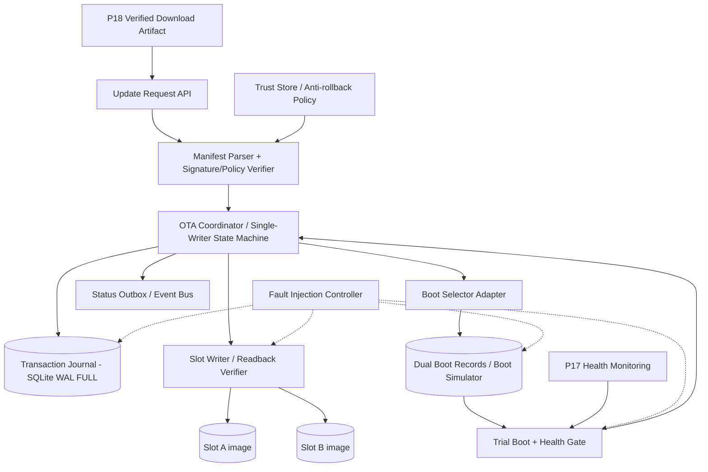
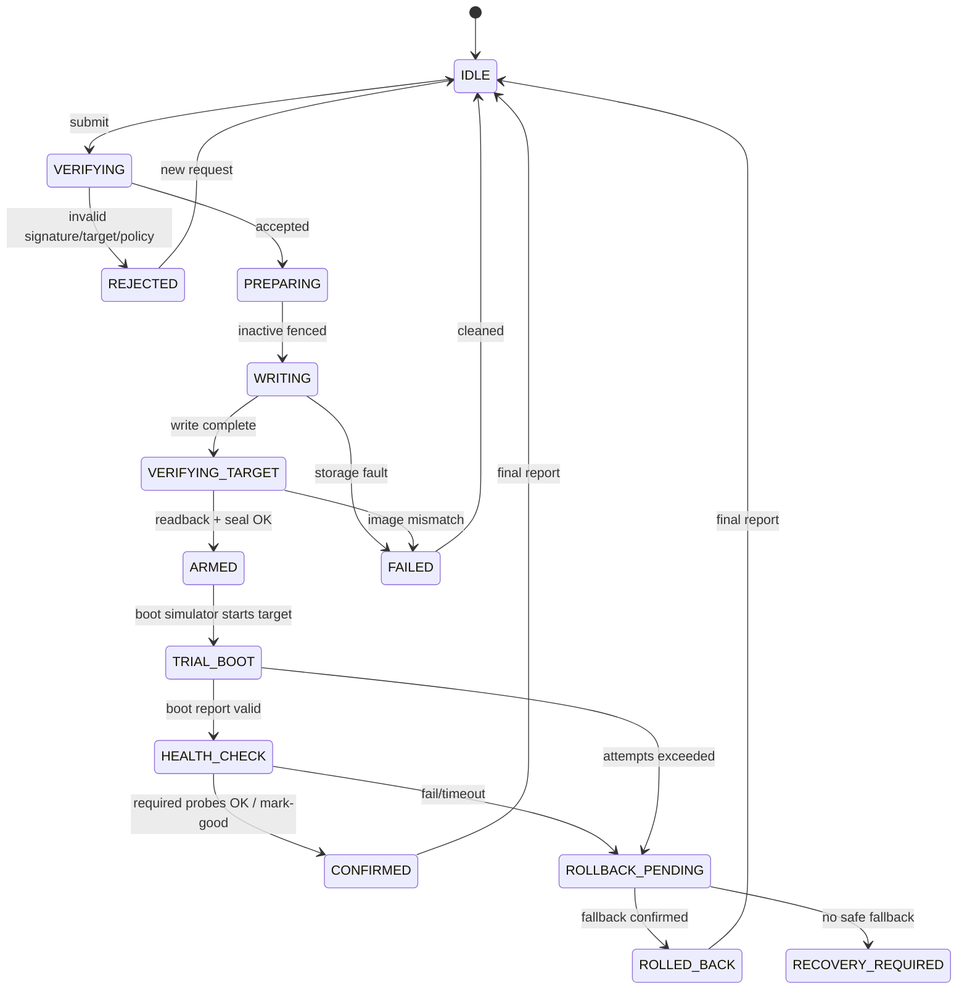
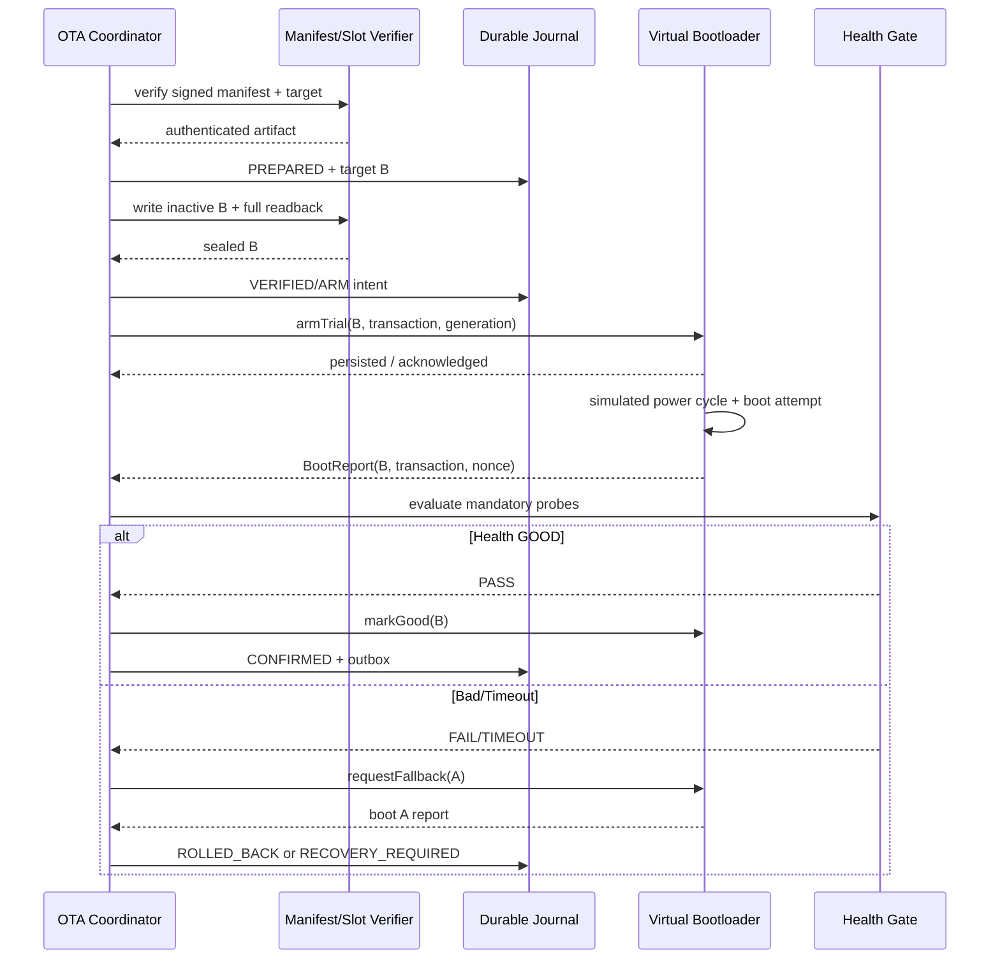

# Project 19 — OTA Verification & A/B Slot Simulator — System Design & Resilience Test Plan

> **Virtual TCU Lab · Project 19/30 · C++17 · Ubuntu Linux · Version 1.0 · 2026-10-30**  
> **Trạng thái:** tài liệu kiến trúc/kiểm thử, **chưa phải** implementation được chứng nhận.  
> **Liên kết:** P18 OTA Download Manager → P19 A/B Verification & Boot Simulation; dùng P01 Event Bus, P03 Timer, P04 Config/Logging, P10 Connectivity, P11 Fault Injection, P14 Durable Outbox, P17 Health Monitoring.

## 0. Executive summary, scope và giả định

Mục tiêu là mô phỏng **OTA image verification → ghi inactive slot → chọn boot thử → đánh giá health → confirm hoặc rollback**, chạy trong một process/lab Linux **không sửa bootloader, partition hoặc firmware thật**. Hai slot A/B là **file image** nằm trong thư mục sandbox, còn bootloader là một executable giả lập có trạng thái lưu bền vững. Mọi bản cập nhật đều phải được kiểm tra chữ ký, hash, hardware target, release counter, độ tương thích và chính sách cài đặt trước khi được arm để boot.

**Scope:** package từ P18; chữ ký Ed25519 qua OpenSSL EVP (không tự viết crypto); hash SHA-256 streaming; phân loại version/compatibility; A/B slot metadata; write + readback verification; boot decision/attempt counter; offline health gate; rollback; journal + recovery; deterministic test/chaos. **Ngoài scope:** boot ROM, secure boot chain, TPM/HSM, eMMC real power-loss ordering, verified kernel/rootfs, OEM certificate provisioning, functional safety validation và triển khai trên xe thật. Bootloader simulation không đồng nghĩa đảm bảo hệ thống boot được trên ECU thật.

**Các giả định đã chốt:** một ECU giả lập; đúng **2 slot A/B**; mỗi thời điểm tối đa **một transaction OTA**; initial A=`GOOD` v1, B=`EMPTY`; slot active không bao giờ bị ghi; image max 64 MiB ở profile lab (configurable); test mặc định có `steady_clock`/fake clock; event delivery at-least-once, event ids phải chống trùng; boot attempts tối đa 3 (cấu hình). Mọi policy số cụ thể là **giá trị lab đề xuất**, không phải tiêu chuẩn OEM.

**Nguyên tắc security đặc biệt:** rollback vì *trial boot thất bại* về một slot known-good là **recovery có kiểm soát**; rollback attack là *cố cài phần mềm cũ hoặc giả metadata*. Mô phỏng cho phép quay về known-good slot được ghi danh trước trial, nhưng không mở cổng cài mới một image version thấp hơn trust floor. Chỉ nâng anti-rollback floor khi trial đã confirm và kiểm tra có recovery path đáp ứng policy; nếu đã nâng floor và old slot thấp hơn floor, không được mặc định rằng old slot vẫn là fallback hợp lệ trong phần cứng thật. Để đúng trên thiết bị thật cần cơ chế anti-rollback và recovery đáng tin cậy từ OEM.

## 1. Goals, non-goals và Definition of Success

**Functional goals:**

- FR-01: nhận image+manifest có chữ ký từ P18; kiểm tra authenticity/integrity/target/expiry/release policy.
- FR-02: xác định booted slot bằng **bootloader state + boot report**, không suy đoán từ tên file.
- FR-03: ghi **duy nhất** inactive slot theo chunk; journal progress; readback kiểm tra lại image đã ghi.
- FR-04: không cho boot từ slot chưa có `VERIFIED & SEALED` evidence.
- FR-05: arm một trial boot; giới hạn số attempts; confirm good khi health gate đạt.
- FR-06: rollback đúng một lần (idempotent) về known-good slot theo recovery policy.
- FR-07: xử lý kill/restart trước, trong và sau mọi durable boundary; không báo `SUCCESS` giả.
- FR-08: phát status/event có correlation id, timestamp, reason code; support query/diagnostics.
- FR-09: cấu hình policy, disk quota, max image size, timeout, retry; validate trước khi áp dụng.
- FR-10: test fake bootloader, fake filesystem, fake clock, fault injection và fuzzers.

**Non-functional goals** (targets lab, phải đo): memory peak <= 128 MiB với image streaming 64 MiB, in-flight verification <= 8 MiB; bounded queues (256 control events), no busy-loop; startup reconciliation < 2 giây trên artifact 64 MiB *không tính readback full*; all terminal operations have exactly one persisted terminal outcome; audit records redacted; replay after crash does not skip security verification. Performance phụ thuộc disk, không hứa real-time tuyệt đối.

**Success:** 100% P0 tests được thực thi pass; mọi fault có injection evidence; zero active-slot writes; zero boot of unverified image; zero false `CONFIRMED`; leak/race sanitizer checks sạch trong phạm vi instrumented; duplicate request idempotent; fault campaigns được báo PASS/FAIL/INCONCLUSIVE. Các chỉ tiêu này là **acceptance targets**, không phải kết quả đã chạy.

## 2. Threat model và trust boundaries

| Boundary | Trusted inputs | Untrusted inputs | Bảo vệ |
|---|---|---|---|
| P18 → P19 | Trusted signer public key được provision trước | update bundle, manifest, URL, metadata | Ed25519 signature, SHA-256, size/compat/counter check |
| P19 → slot filesystem | verified manifest + staging policy | power cut, ENOSPC, EIO, torn write | staged writes, flush, readback, slot BAD on uncertainty |
| App → boot selector | validated slot seal + journal | torn boot flag, stale result, reboot | dual record generation + checksum, reconciliation |
| Bootloader → health gate | booted slot evidence + boot nonce | old callback, false heartbeat, offline cloud | provenance, generation, independent readiness probes |
| Health gate → confirmation | policy+actual measurements | early success, clock jump | monotonic deadline, require all mandatory gates |
| Anti-rollback store | provisioned hardware policy in product | compromised rootfs/OS in lab | mock trusted store; lab explicitly **not** HW trust |

Threat scenarios: tampered package/manifest, wrong ECU/hardware, rollback/freeze, swapped images between verification and use, symlink/path traversal, stale trial events, forged boot reports, corrupt journal, key revocation, concurrent install and forced shutdown. `SHA-256` alone **không xác thực nguồn**. `CRC` của boot selector record phát hiện hỏng ngẫu nhiên, **không** chống attacker sửa dữ liệu; production phải dùng vùng tin cậy/được xác thực và secure boot.

## 3. Architecture



**Thread/process ownership:** Coordinator event loop là *single writer* cho transaction state; worker verify/write riêng trả về immutable result chứa `transaction_id`, `slot_id`, `generation`, `work_id`. Callback qua bounded event queue; worker không trực tiếp sửa boot record. Boot simulator là process độc lập để test power cycle. SQLite journal và Boot Selector là hai failure domains: recovery không coi chúng atomic chung; phải reconcile. `IClock` đơn điệu cho timeout trong boot, wall-clock có provenance cho metadata expiry; clock không tin cậy thì fail closed hoặc dùng trusted timestamp theo policy.

### 3.1 Data flow & write ordering

1. `submit(request)` → validate schema/limit/signature/trust target; `txn_id` stable; nếu duplicate trả snapshot cũ.
2. Journal `PREPARED` và chọn inactive slot theo `booted_slot`, không dùng `active_slot` config tĩnh.
3. Mark target `NOT_BOOTABLE`; persisted selector fence phải xong trước khi ghi. Không thay đổi slot current.
4. Write chunks vào target file; every fault checkpoint; `fsync`/directory fsync theo filesystem profile; readback full image & SHA-256.
5. Persist target `VERIFIED`, image hash, manifest digest và seal; boot selector `PENDING_TRIAL` chỉ sau bước 4 thành công.
6. Request simulated reboot; boot simulator chọn target nếu record hợp lệ; increment attempt count **trước** boot attempt theo durable model.
7. Boot emits authenticated-in-lab `BootReport(slot, trial_id, boot_nonce, generation)`; do mandatory readiness checks.
8. Health GOOD → persist confirm intent → mark-good in simulated bootloader → persist confirmed outcome. Không dùng network cloud là health mandatory mặc định.
9. Health FAIL/timeout/attempt exceeded → record rollback intent → select prior known-good → simulated boot → verify fallback health → mark `ROLLED_BACK` hoặc `RECOVERY_REQUIRED`.
10. After any restart: read actual boot record + journal, validate consistency, resolve conservatively; if ambiguity affects trusted boot, **không boot slot mới**.

### 3.2 Recovery matrix at durable boundaries

| Crash point | Recovery decision | Prohibited outcome |
|---|---|---|
| Before durable PREPARED | No installed transaction; offer retry | `installed=true` |
| During target write | Target `BAD/INCOMPLETE`; keep current active | Boot target |
| After readback, before seal | Reverify and reseal or discard target | Trust old RAM state |
| After seal, before arm | Reconcile target metadata; safe to arm only if checks pass | Assume armed |
| After arm, before reboot | Pending trial remains; next boot follows selector | Mark confirmed |
| After boot selection, before BootReport | Count attempt; retry budget/rollback | Reset attempt counter silently |
| After health success, before mark-good | Re-evaluate durable health evidence and boot generation | Blindly infer good |
| After mark-good, before journal update | Trust bootloader actual state; journal reconcile idempotently | Switch slot again |
| During rollback | Read selector; complete safe rollback or recovery | Infinite alternating loop |
| Both boot records corrupt | `RECOVERY_REQUIRED` via recovery image/host intervention | Invent bootable slot |

## 4. State machine: transition & guards



**State vs slot flags:** OTA transaction state khác `SlotHealth={EMPTY, WRITING, VERIFIED, TRIAL, GOOD, BAD}` và `BootDecision={NORMAL, PENDING_TRIAL, FALLBACK, RECOVERY}`. Không gộp transaction/boot state vào một enum gây ambiguous.

| From | Event | Guard | Action | To |
|---|---|---|---|---|
| IDLE | Submit | valid request, no concurrent txn | create journal entry | VERIFYING |
| VERIFYING | Verified | signer trusted, hash target, counter, compat | choose inactive and fence | PREPARING |
| PREPARING | FencePersisted | target != booted; boot record durable | open target exclusively | WRITING |
| WRITING | WriteDone | complete bytes, no write error | readback entire target | VERIFYING_TARGET |
| VERIFYING_TARGET | SealReady | hash/signature still match pinned manifest | record verified+arm intent | ARMED |
| ARMED | BootReport | exact trial generation/boot nonce | start health deadline | HEALTH_CHECK |
| HEALTH_CHECK | HealthGood | all mandatory probes pass | confirm good + journal | CONFIRMED |
| HEALTH_CHECK | HealthBad/Timeout | fallback valid and allowed | roll back with bounded attempts | ROLLBACK_PENDING |
| Any | Fault/Restart | journal/selector reconcile | safe status, never guess | FAILED/RECOVERY_REQUIRED |

## 5. C++17 API (design-level, not full implementation)

```cpp
using TxnId = std::string;
enum class SlotId { A, B };
enum class SlotHealth { Empty, Writing, Verified, Trial, Good, Bad };
enum class TxnState { Idle, Verifying, Preparing, Writing, VerifyingTarget,
                      Armed, TrialBoot, HealthCheck, Confirmed, RollbackPending,
                      RolledBack, Rejected, Failed, RecoveryRequired };

enum class OtaError { None, InvalidManifest, InvalidSignature, WrongTarget,
    RollbackDenied, ExpiredMetadata, StorageError, VerifyMismatch,
    BootStateAmbiguous, HealthTimeout, ConcurrentUpdate, ResourceLimit };

struct UpdateRequest {
    TxnId id;
    std::string artifact_id;  // P18 content-addressed artifact id
    std::string manifest_path; // file pinned before verify
};
struct SignedManifest {
    std::string ecu_id, hw_id, version, signing_key_id;
    uint64_t release_counter, image_size;
    std::array<uint8_t,32> image_sha256;
    std::vector<uint8_t> signature;
};
struct BootReport { SlotId booted; TxnId trial_id; uint64_t generation;
                    std::string boot_nonce; uint32_t attempt; };
struct HealthResult { bool mandatory_checks_pass; std::vector<std::string> failures; };
struct OtaSnapshot { TxnId id; TxnState state; SlotId booted;
                     std::optional<SlotId> trial; OtaError error; uint64_t generation; };

class IManifestVerifier {
public:
    virtual ~IManifestVerifier() = default;
    virtual VerificationResult verify(const UpdateRequest&) = 0;
};
class ISlotStorage {
public:
    virtual ~ISlotStorage() = default;
    virtual WriteResult writeInactive(SlotId, const VerifiedArtifact&, StopToken&) = 0;
    virtual VerifyResult readbackAndSeal(SlotId, const SignedManifest&) = 0;
};
class IBootSelector {
public:
    virtual ~IBootSelector() = default;
    virtual BootSnapshot inspect() = 0;
    virtual Result armTrial(SlotId target, const TxnId&, uint64_t gen) = 0;
    virtual Result markGood(const BootReport&) = 0;
    virtual Result requestFallback(const BootReport&) = 0;
};
class IHealthGate { public: virtual ~IHealthGate() = default;
    virtual HealthResult evaluate(const BootReport&, Deadline) = 0; };
class IOtaCoordinator { public: virtual ~IOtaCoordinator() = default;
    virtual Result submit(const UpdateRequest&) = 0;
    virtual OtaSnapshot snapshot(const TxnId&) const = 0;
    virtual Result onBootReport(const BootReport&) = 0;
    virtual Result reconcileOnStartup() = 0;
    virtual Result requestShutdown(Deadline) = 0;
};
```

`StopToken`/`Deadline` là interface tự định nghĩa C++17 (không sử dụng `std::stop_token`, vì chỉ có từ C++20). `VerifiedArtifact` là sealed FD/content-id, không truyền path tùy ý để tránh TOCTOU. `VerificationResult`, `WriteResult`, `Result` là kiểu result/expected tự định nghĩa; API trên là hợp đồng kiến trúc, không phải header đã compile.

## 6. Metadata, key trust, anti-rollback và version compatibility

- Manifest signed canonical bytes: schema version, artifact ID, ECU target, hardware revision set, release counter, image length/hash, compatible boot chain, key id, expiry theo trusted-time policy. Reject duplicate JSON keys, unknown critical fields, noncanonical encoding nếu unsigned parser mơ hồ.
- Verify Ed25519 với OpenSSL EVP; public keys lấy từ read-only trust-store profile có pinned key ids; key revocation/rotation theo policy; private signing key **chỉ tồn tại trong test fixture producer**, không nằm trong TCU image.
- Stream SHA-256 trên artifact FD, sau ghi stream SHA-256 trên target FD. Giữ FD pinned; không xác minh path rồi mở lại path mutable.
- Antirollback release counter được so với trusted floor; phân biệt update reject với fallback từ **prior known-good**. Trong lab floor là mock store có fault injection. Nếu upgrade confirm mà thiết bị không còn eligible rollback target theo floor, policy yêu cầu rescue path hợp lệ hoặc block floor advancement.
- Metadata expiry yêu cầu trusted clock. NTP/cloud time không mặc định là trusted trong offline TCU. Nếu không biết thời gian, quyết định fail-closed hoặc secure time attestation tùy threat model.
- Không dùng shell command do manifest kiểm soát; deny absolute paths/`..`, symlinks, archive bombs, decompress ratio cao; mọi size có upper bound.

## 7. Slot storage, boot selector và persistent journal

**Demo filesystem tree** (chỉ thư mục sandbox):

```text
runtime/p19/
  artifacts/p18_verified/*.bundle
  slots/A/image.bin
  slots/A/slot.json
  slots/B/image.bin
  slots/B/slot.json
  boot/record_0.bin
  boot/record_1.bin
  journal/ota.sqlite
  logs/ota.jsonl
  evidence/<run_id>/
```

Boot record gồm `{magic, schema, generation, selected_slot, previous_good_slot, trial_id, attempts, max_attempts, per_slot_flags, crc32c}`; trên lab chọn record hợp lệ có generation lớn nhất, nếu hai record mâu thuẫn theo cùng generation thì `RECOVERY_REQUIRED`. CRC chỉ chống lỗi không chủ ý. **Durability protocol (mô phỏng Linux FS):** ghi temp ở cùng filesystem, `fsync(file)`, `rename()`, `fsync(parent_dir)`, kiểm tra return codes; các bước nhiều file không atomic toàn cục nên cần reconciliation state machine. Boot env thật có giao thức riêng; không copy nguyên xi sang U-Boot/eMMC mà không kiểm chứng.

**SQLite schema sketch:**

```sql
PRAGMA journal_mode=WAL;
PRAGMA synchronous=FULL;
CREATE TABLE IF NOT EXISTS update_txn (
  txn_id TEXT PRIMARY KEY,
  generation INTEGER NOT NULL CHECK(generation >= 0),
  artifact_id TEXT NOT NULL,
  state TEXT NOT NULL,
  target_slot TEXT CHECK(target_slot IN ('A','B')),
  manifest_digest TEXT NOT NULL,
  reason TEXT,
  updated_at TEXT NOT NULL
);
CREATE TABLE IF NOT EXISTS ota_transition (
  txn_id TEXT NOT NULL REFERENCES update_txn(txn_id),
  seq INTEGER NOT NULL,
  from_state TEXT, to_state TEXT NOT NULL,
  reason TEXT, boot_generation INTEGER,
  PRIMARY KEY(txn_id,seq)
);
CREATE TABLE IF NOT EXISTS status_outbox (
  event_id TEXT PRIMARY KEY, txn_id TEXT NOT NULL,
  payload TEXT NOT NULL, delivered INTEGER NOT NULL DEFAULT 0
);
```

**Crash invariant:** both journal and boot record may be individually durable but disagree. Boot evidence is read separately; no assumption of cross-store atomicity. A recovered boot report must have slot, generation and boot nonce matching trial intent. Mark-good is idempotent on same generation, not on arbitrary earlier generation.

## 8. Boot and health behavior



**Health gate mặc định:** boot report đúng generation, image/version identity đọc từ booted instance, critical service ready, IPC event loop tiến triển, storage writable/healthy, watchdog progress; cloud connectivity tùy chọn do xe có thể offline. `P17 Health Monitoring` chỉ là nguồn quan sát; không lấy thread heartbeat để chứng minh toàn service tiến triển. Hysteresis/debounce và deadline monotonic; crash, reset hoặc boot nonce đổi làm invalid tất cả probe result của trial cũ.

**Attempt budget:** boot simulator increment persisted attempts trước khi thực thi boot; khi exceed budget chọn last-good (nếu hợp lệ) hoặc recovery. Repeated manual reboot không reset budget. `mark-good` chỉ sau health checks; `rollback` không xóa nguyên nhân lỗi để debugging.

## 9. Operational behavior / Given-When-Then contracts

| Contract | Given / When | Then |
|---|---|---|
| BC-01 Happy path | A GOOD, signed B v2, health success | B GOOD, journal CONFIRMED, boot B |
| BC-02 Rejected signer | bundle signed unknown key | never touch A/B active or boot selector |
| BC-03 Wrong hardware | manifest hardware mismatch | REJECTED + audit; no staging |
| BC-04 Torn write | kill during B write | A remains GOOD/bootable; B BAD |
| BC-05 Readback mismatch | B differs from signed digest | do not arm B; mark BAD |
| BC-06 Lost boot ACK | boot selector persisted arm but app times out | reconcile from selector; don't arm twice |
| BC-07 Timeout at boot | trial B doesn't boot within policy | attempts bounded, fallback A |
| BC-08 Health false-positive | watchdog tick but main loop stuck | readiness fails; no confirm |
| BC-09 Trial event late | generation mismatch | ignore old result + metric |
| BC-10 Reboot during confirmation | boot B good, journal stale | reconcile exact boot report & mark-good |
| BC-11 Concurrent submit | A→B updating, second request arrives | return BUSY or idempotent same txn |
| BC-12 Duplicate command | same txn id resent | same snapshot, one update transaction |
| BC-13 Antirollback | signed older image requested | reject new install; exception only prior-known-good recovery path |
| BC-14 Both slots invalid | no verifiable eligible slot | RECOVERY_REQUIRED; never fabricated success |
| BC-15 Network offline | image already locally verified | proceed or defer per policy; health not auto failed |
| BC-16 Low battery | power gate unavailable or unsafe | defer before dangerous write/activation |
| BC-17 Crash in reconciliation | app repeatedly restarts | same stable decision; no oscillation |
| BC-18 Unknown clock | metadata expired can't be determined | trusted-time policy blocks decision; never ignore expiry silently |

## 10. Scheduling, concurrency, cancellation và safety

- Single-writer coordinator: all mutation events serialized by `transaction_id/generation`; workers return results but never mutate state themselves.
- Lock ordering: `coordinator_state` → immutable snapshot read; never hold mutex across filesystem writes, crypto, callbacks or boot selector IPC.
- Cancellation allowed in VERIFYING/WRITING before arm (target invalidated); after ARMED require explicit safe rollback flow. A cancelled future callback must not recreate ARMED.
- Timeouts are advisory until observed state reconciled; `timeout` không có nghĩa bootloader operation đã không diễn ra.
- `requestShutdown()` stops new submits, drains/cancels workers with deadline and persists last safe stage; no forced interruption between record mutating operations without recovery plan.
- Status outbox only emits `CONFIRMED` after bootloader good + persisted journal reconciliation; same `event_id` on retries to cloud.

## 11. Fault injection model, evidence, pass/fail criteria

**Fault hooks:** `before/after_manifest_verify`, `before/after_journal_commit`, `before/during/after_slot_write`, `before/after_fsync`, `before/after_dir_fsync`, `before/after_boot_record`, `before/after_arm`, `before/after_reboot`, `before/after_health_probe`, `before/after_mark_good`, `before/after_rollback`; deterministic barrier-based scheduler + crash-exit points.

**Mechanisms:** fake `ISlotStorage`, `ITrustedStore`, `IBootSelector`; syscall wrapper fault flags (`EIO`,`ENOSPC`,`EINTR`, short write, delayed flush); `SIGKILL` subprocess; corrupt byte and truncate file; fake clock jump; simulated watchdog/reboots; fault injection via netem/P11 on status upload only; compare reference state model with implementation; fuzzing of manifest/boot record.

**Evidence per test:** run_id, random seed, image_hash, trusted key id (not secrets), txn_id, state transitions (durable), injected_hook and observed hook result, boot record copies & generations, active/inactive slot digests, health probe traces, resulting status and liveness metrics. Results: `PASS` iff injection verified + all invariants hold + expected observable; `FAIL` if violated; `INCONCLUSIVE` if fault wasn't actually induced/evidence missing; `SKIPPED` if preconditions absent.

**Universal invariants:** I-01 never write booted active slot; I-02 never boot unsealed/failed target; I-03 only one trial active; I-04 booted slot & report must match generation; I-05 no false GOOD; I-06 trusted signatures and target policy mandatory; I-07 no antirollback downgrade install; I-08 bounded attempts/retries/queues; I-09 once-confirmed transaction immutable; I-10 rollback idempotent; I-11 no stale callback changes new generation; I-12 no secret logging; I-13 fallback only to eligible known-good; I-14 ambiguous durable state → safe recovery, not success.


## 12. Catalog 300 What-if scenarios — 30 nhóm

**Đọc bảng:** `Inject` = phép kích hoạt trong **sandbox giả lập**; `Expected` = hành vi phải có (chưa chứng minh); `Evidence` = bằng chứng bắt buộc để verdict được PASS. Mọi case đều phải chạy ít nhất 1 lần với fake adapter; P0 chạy thêm integration/crash test khi áp dụng được. Priority: P0 nếu có thể phá authenticity, active image, boot safety, durability hoặc lifecycle; P1 cho robustness/performance. Mã test dạng `P19-WIF-xxx` dùng trực tiếp làm ID tự động hóa.


### 01. Manifest framing & schema

| ID | What if? | Inject | Expected | Evidence | Priority |
|---|---|---|---|---|---|


| P19-WIF-001 | Manifest rỗng | submit empty manifest | reject before write | schema error and unchanged slots | P0 |
| P19-WIF-002 | Manifest thiếu ecu_id | remove required field | reject mandatory target absent | validation code | P0 |
| P19-WIF-003 | Manifest có duplicate JSON key | encode two release_counter keys | reject ambiguous metadata | parser rejection event | P0 |
| P19-WIF-004 | Manifest schema version lạ | set version=99 | reject unsupported critical schema | typed error | P0 |
| P19-WIF-005 | Manifest số âm cho size | set image_size=-1 | reject bounds | validator trace | P0 |
| P19-WIF-006 | Manifest size vượt uint64 | decimal overflow string | reject without conversion wrap | no allocation growth | P0 |
| P19-WIF-007 | Manifest string chứa NUL | inject NUL into target id | reject canonical encoding | byte parser result | P1 |
| P19-WIF-008 | Manifest nested depth cực sâu | generate 1000 nested nodes | bounded parse failure | CPU and memory trace | P0 |
| P19-WIF-009 | Manifest 1 GB nhưng image nhỏ | inflate metadata length | reject at read cap | bytes consumed <= cap | P1 |
| P19-WIF-010 | Manifest field lạ critical=true | add unknown critical field | reject fail-closed | critical field audit | P0 |


### 02. Signature & trust store

| ID | What if? | Inject | Expected | Evidence | Priority |
|---|---|---|---|---|---|


| P19-WIF-011 | Signature sai 1 bit | flip Ed25519 signature bit | reject without arm | verification error | P0 |
| P19-WIF-012 | Unknown signing key | key_id unprovisioned | reject signer | trusted-store lookup trace | P0 |
| P19-WIF-013 | Key đã revoke | revoke key before verify | reject according to policy | trust version evidence | P0 |
| P19-WIF-014 | Key đổi trong lúc verify | barrier rotate trust snapshot | pin one consistent trust generation | generation audit | P0 |
| P19-WIF-015 | Manifest thay sau verify | swap file path atomically | pinned FD/digest detects TOCTOU | inode and hash evidence | P0 |
| P19-WIF-016 | Chữ ký hợp lệ cho ECU khác | sign target mismatched ECU | reject target | target mismatch trace | P0 |
| P19-WIF-017 | Signature đúng nhưng image sai | change image payload byte | reject hash | SHA-256 mismatch | P1 |
| P19-WIF-018 | Image đúng nhưng manifest bị đổi | mutate signed field | reject signature | signature error | P0 |
| P19-WIF-019 | Signer algorithm bị downgrade | set alg=none/weak | reject unsupported algorithm | algorithm audit | P1 |
| P19-WIF-020 | Trusted key file bị mất | delete trust store before request | fail closed and no boot arm | trusted-store failure | P0 |


### 03. Compatibility & release policy

| ID | What if? | Inject | Expected | Evidence | Priority |
|---|---|---|---|---|---|


| P19-WIF-021 | Hardware ID khác | submit incompatible hw revision | reject | compatibility reason | P0 |
| P19-WIF-022 | ECU ID khác | replace ECU ID | reject without touching slot | slot digest | P0 |
| P19-WIF-023 | Bootloader version quá cũ | require newer boot chain | reject/defer | compat matrix result | P0 |
| P19-WIF-024 | Release counter thấp hơn floor | submit older signed image | reject new install | counter comparison | P0 |
| P19-WIF-025 | Release counter bằng floor nhưng different hash | same counter new image | reject absent explicit policy | policy trace | P0 |
| P19-WIF-026 | Release counter overflow | use 2^64 value | reject before parse cast | range error | P0 |
| P19-WIF-027 | Image phụ thuộc module thiếu | omit required dependency | reject activation | compat graph | P1 |
| P19-WIF-028 | Image mix-and-match | manifest pairs incompatible components | reject group constraints | dependency audit | P0 |
| P19-WIF-029 | Version string malformed | invalid semantic version | reject canonicalization | parser event | P1 |
| P19-WIF-030 | Old known-good rollback vs floor | force trial failure after valid upgrade | allow only authorized recovery fallback, no new downgrade install | fallback eligibility proof | P0 |


### 04. Trusted time, expiry & freshness

| ID | What if? | Inject | Expected | Evidence | Priority |
|---|---|---|---|---|---|


| P19-WIF-031 | RTC chưa được đồng bộ | start no trusted time | block expiry-sensitive install | clock trust status | P0 |
| P19-WIF-032 | RTC nhảy tới tương lai | fake wall jump forward 10 years | do not mutate monotonic deadlines | timer trace | P0 |
| P19-WIF-033 | RTC nhảy lùi | fake wall jump backwards | reject stale metadata by trusted policy | metadata freshness audit | P0 |
| P19-WIF-034 | Metadata hết hạn một giây trước | set expiry just expired | reject | trusted time proof | P0 |
| P19-WIF-035 | Metadata hết hạn trong lúc write | expire after verification | apply documented stage policy, recheck before arm | recheck trace | P0 |
| P19-WIF-036 | Timestamp có timezone sai | malformed offset | reject date parse | parser result | P0 |
| P19-WIF-037 | Server trả freeze metadata | replay signed older snapshot | reject rollback/freeze by version policy | version history | P1 |
| P19-WIF-038 | Secure timestamp unavailable offline | disable attestation | defer if required, not silently pass | deferred reason | P0 |
| P19-WIF-039 | Time source mâu thuẫn | provide two nonmatching trusted sources | conservative failure | clock conflict | P1 |
| P19-WIF-040 | Monotonic clock reset across reboot | reboot fake clock origin | rebase deadline using boot generation, never reuse old time_point | recovery evidence | P0 |


### 05. Artifact handoff from P18

| ID | What if? | Inject | Expected | Evidence | Priority |
|---|---|---|---|---|---|


| P19-WIF-041 | P18 chưa download xong | artifact incomplete flag | reject/defer until sealed | artifact status | P0 |
| P19-WIF-042 | P18 trả path ngoài sandbox | path traversal | reject before open | canonical path log | P0 |
| P19-WIF-043 | Symlink trỏ slot A | swap artifact to symlink | reject NOFOLLOW/FD validation | active slot unchanged | P0 |
| P19-WIF-044 | P18 ghi đè trong khi đọc | mutate live FD contents | hash mismatch or immutable handle | artifact hash evidence | P0 |
| P19-WIF-045 | Artifact bị xóa sau open | unlink before verification | pinned FD behavior deterministic | FD identity | P0 |
| P19-WIF-046 | Artifact bị truncate khi hashing | truncate midway | fail size check | read bytes | P0 |
| P19-WIF-047 | Download report hash sai | fake P18 manifest hash | verify independently | local digest | P1 |
| P19-WIF-048 | Artifact bị nén bomb | compression ratio > policy | reject bounded decompression | peak RAM and bytes | P0 |
| P19-WIF-049 | Hai artifact ID cùng content | submit alternate id | dedup by digest/transaction policy | single txn log | P1 |
| P19-WIF-050 | P18 phát completion trùng | duplicate ready event | idempotent intake | transaction count | P0 |


### 06. Target-slot selection

| ID | What if? | Inject | Expected | Evidence | Priority |
|---|---|---|---|---|---|


| P19-WIF-051 | Booted A, inactive B | clean baseline | B selected | slot selection log | P0 |
| P19-WIF-052 | Booted B, inactive A | reverse initial state | A selected | boot report | P0 |
| P19-WIF-053 | Config nói boot A nhưng thực boot B | inject stale config | use boot evidence, not config | selection record | P0 |
| P19-WIF-054 | Cả A/B báo active | corrupt selector flags | RECOVERY_REQUIRED | no target writes | P0 |
| P19-WIF-055 | Slot target vừa thành booted | barrier between inspect and fence | revalidate before opening for write | active digest | P0 |
| P19-WIF-056 | One slot GOOD one UNKNOWN | set inactive unknown | reject overwrite until policy decides | slot state audit | P0 |
| P19-WIF-057 | Hai request chọn B đồng thời | parallel submit | single-writer winner, other busy/idempotent | lock trace | P1 |
| P19-WIF-058 | Boot report không có nonce | omit nonce | do not trust selection | invalid boot report | P0 |
| P19-WIF-059 | Slot metadata schema không khớp | invalid slot.json | do not guess target | validation failure | P1 |
| P19-WIF-060 | Active image tampered before install | modify active before request | do not silently treat as good | health/security alert | P0 |


### 07. Slot writes & partial I/O

| ID | What if? | Inject | Expected | Evidence | Priority |
|---|---|---|---|---|---|


| P19-WIF-061 | Short write | return n < requested | retry remaining bytes or fail safely | byte count | P0 |
| P19-WIF-062 | write() EINTR | inject EINTR before any bytes | bounded retry and correct offset | syscall log | P0 |
| P19-WIF-063 | write() EIO | inject EIO mid-chunk | mark target BAD; preserve A | slot flags | P0 |
| P19-WIF-064 | write() ENOSPC | quota target disk | reject without arm | disk and state snapshot | P0 |
| P19-WIF-065 | write() returns 0 unexpectedly | simulate zero write | abort, avoid spin | CPU utilization | P0 |
| P19-WIF-066 | Offset arithmetic overflow | huge offset metadata | reject | bounds assertion | P0 |
| P19-WIF-067 | Byte order wrong during write | mutate chunk | readback mismatch | slot hash | P1 |
| P19-WIF-068 | Write stalls indefinitely | blocked fake writer | timeout/cancel without deadlock | thread dump | P0 |
| P19-WIF-069 | Two writer workers target B | duplicate work event | serialize or reject second | FD ownership | P1 |
| P19-WIF-070 | Write extends beyond image size | simulate extra chunk | truncate/reject and reseal only correct length | file size | P0 |


### 08. Flush, rename & storage durability

| ID | What if? | Inject | Expected | Evidence | Priority |
|---|---|---|---|---|---|


| P19-WIF-071 | fsync image EIO | inject EIO | cannot seal; target BAD | fsync return | P0 |
| P19-WIF-072 | fsync image ENOSPC | inject deferred writeback error | do not arm | slot status | P0 |
| P19-WIF-073 | Directory fsync fails | inject after rename | uncertain durability, reconcile | directory error | P0 |
| P19-WIF-074 | Power cut before rename | kill at temp created | ignore temp on restart | file list | P0 |
| P19-WIF-075 | Power cut after rename before dir fsync | kill hook | revalidate durable contents | post-reboot tree | P0 |
| P19-WIF-076 | Partial metadata file | truncate slot.json | mark unknown/not bootable | metadata parse trace | P0 |
| P19-WIF-077 | Filesystem read-only | remount simulated RO | reject write/recovery | error code | P1 |
| P19-WIF-078 | Quota almost exhausted | reserve below needed bytes | preflight fail; still handle runtime ENOSPC | free-space audit | P0 |
| P19-WIF-079 | Cross-device rename | EXDEV injection | reject non-atomic move path | no active mutation | P1 |
| P19-WIF-080 | Storage flush lies | fake fsync success then lose data | detect on simulated reboot; document HW limit | post-boot digest | P0 |


### 09. Readback integrity & seal

| ID | What if? | Inject | Expected | Evidence | Priority |
|---|---|---|---|---|---|


| P19-WIF-081 | Readback SHA mismatch | flip target byte | do not arm | expected/observed SHA | P0 |
| P19-WIF-082 | Readback short read | EOF before manifest size | mark BAD | byte counter | P0 |
| P19-WIF-083 | Readback EIO | error on image read | fail verify | read error | P0 |
| P19-WIF-084 | Readback file replaced | rename target before readback | pin identity or revalidate inode/digest | inode trace | P0 |
| P19-WIF-085 | Seal missing | remove seal after write | never activate | seal flag | P0 |
| P19-WIF-086 | Seal corrupted CRC | flip slot status byte | reject boot target | validator log | P0 |
| P19-WIF-087 | Seal points wrong transaction | swap txn id | reject | transaction mismatch | P1 |
| P19-WIF-088 | Seal says GOOD but hash differs | alter image after seal | boot check rejects at simulated boundary | hash check | P0 |
| P19-WIF-089 | Unverified chunk skipped | fault writer skip offset | readback fails | range coverage | P1 |
| P19-WIF-090 | Successful seal reprocessed | duplicate result event | remain one sealed state | transition count | P0 |


### 10. Boot record redundancy

| ID | What if? | Inject | Expected | Evidence | Priority |
|---|---|---|---|---|---|


| P19-WIF-091 | Both boot records valid old/new | crash between copy updates | highest consistent generation wins | record dumps | P0 |
| P19-WIF-092 | One record CRC corrupt | flip checksum | use other if unambiguous | recovery trace | P0 |
| P19-WIF-093 | Both records CRC corrupt | flip both | RECOVERY_REQUIRED | no boot candidate | P0 |
| P19-WIF-094 | Same generation conflicting slot | forge conflict | RECOVERY_REQUIRED | audit | P0 |
| P19-WIF-095 | Generation wraps | set near uint64 max | reject/update policy before overflow | counter trace | P0 |
| P19-WIF-096 | Record write short | truncate one copy | ignore invalid copy | selector decision | P0 |
| P19-WIF-097 | Boot record write ENOSPC | fill boot storage | do not claim armed | write error | P1 |
| P19-WIF-098 | Boot record write stale generation | replay old copy | reject regression | generation fence | P0 |
| P19-WIF-099 | Boot record file missing | delete one copy | recover from other, repair when safe | repair log | P1 |
| P19-WIF-100 | Both boot records missing | delete all | RECOVERY_REQUIRED, no default A | safe mode | P0 |


### 11. Trial boot & boot attempts

| ID | What if? | Inject | Expected | Evidence | Priority |
|---|---|---|---|---|---|


| P19-WIF-101 | Trial B first boot success | normal reboot | report B+nonce | boot report | P0 |
| P19-WIF-102 | Trial B kernel fails | simulate no boot report | increment count and bounded retries | attempt counter | P0 |
| P19-WIF-103 | Three attempts fail | fail each boot | fallback A after limit | fallback record | P0 |
| P19-WIF-104 | Power cycling loop | reboot 100 times | does not reset budget | boot counter trace | P0 |
| P19-WIF-105 | Boot report for wrong slot | emit A report while expecting B | reject success | mismatch event | P0 |
| P19-WIF-106 | Duplicate BootReport | send twice | idempotent processing | transition count | P0 |
| P19-WIF-107 | Boot report from old trial | replay old nonce/generation | ignore old event | stale counter | P1 |
| P19-WIF-108 | Boot report forged | invalid simulator auth token | reject | auth trace | P0 |
| P19-WIF-109 | Boot count durable update fails | inject fsync error | do not boot new trial unchecked | boot selection | P1 |
| P19-WIF-110 | Trial begins while OTA cancel event arrives | schedule same tick | no inconsistent state; documented cancellation cutoff | event order trace | P0 |


### 12. Health gate & mark-good

| ID | What if? | Inject | Expected | Evidence | Priority |
|---|---|---|---|---|---|


| P19-WIF-111 | All mandatory probes pass | inject healthy service state | confirm B | good record | P0 |
| P19-WIF-112 | Network offline, local core healthy | disable cloud | do not auto fail mandatory health | health policy | P0 |
| P19-WIF-113 | Heartbeat active but main loop deadlock | block event loop | reject health | progress detector | P0 |
| P19-WIF-114 | Health probe returns stale OK | older boot nonce | reject | probe generation | P0 |
| P19-WIF-115 | Health PASS and FAIL race | two callbacks same tick | one terminal decision per generation | event journal | P0 |
| P19-WIF-116 | Health timeout | advance fake clock | rollback B | timer trace | P0 |
| P19-WIF-117 | Health metric unavailable | remove mandatory probe source | UNKNOWN fails closed | health reason | P1 |
| P19-WIF-118 | Success before min observation window | emit early OK | wait full required window | clock trace | P0 |
| P19-WIF-119 | mark-good fails EIO | inject boot selector failure | not CONFIRMED | journal record | P1 |
| P19-WIF-120 | mark-good ACK lost after persisted | inject response loss | reconcile selector good state | idempotence proof | P0 |


### 13. Rollback & fallback eligibility

| ID | What if? | Inject | Expected | Evidence | Priority |
|---|---|---|---|---|---|


| P19-WIF-121 | B trial fails, A known-good | force health FAIL | fallback A | boot record | P0 |
| P19-WIF-122 | A corrupted before fallback | tamper A image | RECOVERY_REQUIRED not boot A | hash and flag | P0 |
| P19-WIF-123 | Fallback A below trust floor | set floor beyond A | do not bypass hardware policy; use rescue/recovery | policy reason | P0 |
| P19-WIF-124 | Rollback command repeated | send 100 duplicates | one fallback transaction | transition count | P0 |
| P19-WIF-125 | Rollback while reboot pending | interleave barrier | stable selector decision | record sequence | P0 |
| P19-WIF-126 | Rollback itself fails | inject selector error | RECOVERY_REQUIRED | error record | P0 |
| P19-WIF-127 | Fallback boot fails health | simulate A invalid | RECOVERY_REQUIRED | probe evidence | P1 |
| P19-WIF-128 | Old slot GOOD but mismatched HW | change identity | not eligible fallback | compat reason | P0 |
| P19-WIF-129 | Slot set BAD then reported GOOD late | stale status from previous boot | ignore | generation audit | P1 |
| P19-WIF-130 | Rollback attempt counter exceeds limit | trigger repeating failed fallback | stop oscillation | bounded reboot count | P0 |


### 14. Recovery & startup reconciliation

| ID | What if? | Inject | Expected | Evidence | Priority |
|---|---|---|---|---|---|


| P19-WIF-131 | Crash before journal commit | kill before PREPARED commit | no false update | journal contents | P0 |
| P19-WIF-132 | Crash after journal commit | kill after commit before write | resume safe state | state trace | P0 |
| P19-WIF-133 | Crash during slot write | kill at chunk barrier | A preserved, B BAD | image digests | P0 |
| P19-WIF-134 | Crash after seal before arm | kill hook | reverify/rearm safely | selector state | P0 |
| P19-WIF-135 | Crash after arm before reboot | kill hook | selector pending trial persists | boot record | P0 |
| P19-WIF-136 | Crash after reboot but before health | kill coordinator | trial proceeds bounded or falls back | boot attempts | P0 |
| P19-WIF-137 | Crash after mark-good before journal update | kill hook | reconcile good B | journal repair | P1 |
| P19-WIF-138 | Journal corruption with valid selector | truncate sqlite | safe RECOVERY_REQUIRED/reconciliation policy | integrity check | P0 |
| P19-WIF-139 | Old journal new boot record | inject generation mismatch | do not overwrite newer boot decision | generation trace | P1 |
| P19-WIF-140 | Restart 100 times mid-recovery | loop process restarts | converges or safe mode; never oscillates | state hash stability | P0 |


### 15. SQLite journal & outbox

| ID | What if? | Inject | Expected | Evidence | Priority |
|---|---|---|---|---|---|


| P19-WIF-141 | SQLite BUSY on transition | lock DB | retry bounded, do not advance state prematurely | SQLite result | P0 |
| P19-WIF-142 | SQLite COMMIT returns IOERR | fault SQLite VFS | unknown commit outcome reconciled | journal readback | P0 |
| P19-WIF-143 | WAL checkpoint interrupted | kill at checkpoint | transaction consistency | integrity_check | P0 |
| P19-WIF-144 | Database disk full | fill journal FS | not arm without durable intent | status | P0 |
| P19-WIF-145 | Schema migration half done | kill migration | restore/migrate atomically | schema version | P0 |
| P19-WIF-146 | Duplicate txn_id conflict | parallel inserts | one canonical transaction | unique constraint | P0 |
| P19-WIF-147 | Outbox publish ACK lost | fake cloud ACK loss | retry same event_id | outbox row | P1 |
| P19-WIF-148 | Outbox holds sensitive manifest secrets | inject canary secret | redaction prevents leak | log scan | P0 |
| P19-WIF-149 | DB file swapped under running service | rename DB during run | detect identity/ownership change | file identity | P1 |
| P19-WIF-150 | DB corruption beyond repair | flip critical page | fail safe and operator recovery | integrity_check | P0 |


### 16. Concurrency & race conditions

| ID | What if? | Inject | Expected | Evidence | Priority |
|---|---|---|---|---|---|


| P19-WIF-151 | Submit and shutdown same instant | race start/shutdown | no new txn after stop fence | trace | P0 |
| P19-WIF-152 | Cancel and write completion race | barrier callbacks | one legal transition | state audit | P0 |
| P19-WIF-153 | Health SUCCESS and timeout race | inject equal deadline | one terminal decision | transition uniqueness | P0 |
| P19-WIF-154 | Old worker completion after new txn | delay old callback | ignore generation mismatch | stale counter | P0 |
| P19-WIF-155 | BootReport arrives during arm transaction | force reorder | queue until reconcile/reject; no fake confirmed | trace | P0 |
| P19-WIF-156 | Thread destruction while callback executes | shutdown worker | no use-after-free | ASan | P0 |
| P19-WIF-157 | Mutex inversion during logging | inject synchronous log callback | no deadlock | thread sanitizer | P1 |
| P19-WIF-158 | Config reload during verify | swap policy snapshot | pin coherent config per txn | generation evidence | P0 |
| P19-WIF-159 | Simultaneous rollback and new submit | two requests race | reject new until safe terminal | busy result | P1 |
| P19-WIF-160 | Status observers query during mutation | concurrent snapshots | immutable consistent views | snapshot checks | P0 |


### 17. Resource & overload

| ID | What if? | Inject | Expected | Evidence | Priority |
|---|---|---|---|---|---|


| P19-WIF-161 | 10k duplicate submit/s | burst generator | bounded intake; rate limits | queue depth | P0 |
| P19-WIF-162 | 100 simultaneous image hashes | flood requests | single update and bounded workers | CPU profile | P0 |
| P19-WIF-163 | Huge signed metadata | 100 MB manifest | reject at cap | RSS | P0 |
| P19-WIF-164 | Disk fills via logs | generate log storm | journal/selector critical storage protected or safe fail | disk metrics | P0 |
| P19-WIF-165 | Low RAM during verify | set cgroup memory limit | streaming/bounded allocations | RSS/OOM | P0 |
| P19-WIF-166 | File descriptor exhaustion | ulimit -n tiny | explicit failure and cleanup | FD count | P0 |
| P19-WIF-167 | Thread spawn failure | fake EAGAIN | safe error not partially started | thread count | P1 |
| P19-WIF-168 | Prolonged slow disk | delay each write | watchdog progress and timeout policy | latency trace | P0 |
| P19-WIF-169 | Status outbox grows offline | disconnect network 7 days | bounded disk + retention policy | DB size | P1 |
| P19-WIF-170 | Too many recovery retries | force persistent failure | circuit breaker/recovery required | retry counter | P0 |


### 18. Boot selector IPC & transport

| ID | What if? | Inject | Expected | Evidence | Priority |
|---|---|---|---|---|---|


| P19-WIF-171 | IPC request lost before selector | drop arm message | no assumption arm succeeded | selector inspect | P0 |
| P19-WIF-172 | Selector committed then ACK lost | drop arm ACK | reconcile actual record | single generation | P0 |
| P19-WIF-173 | Selector sends duplicated ACK | duplicate delivery | idempotent transition | completion count | P0 |
| P19-WIF-174 | Selector response malformed | truncate response | reject response and inspect state | parser error | P0 |
| P19-WIF-175 | Selector hangs during mark-good | delay indefinitely | deadline + reconcile, no false confirmed | latency trace | P0 |
| P19-WIF-176 | Selector process crashes after arm | SIGKILL boot sim | restart and read record | record dump | P0 |
| P19-WIF-177 | Selector reports stale slot | replay cached response | generation check rejects | stale metric | P1 |
| P19-WIF-178 | Two selector instances compete | start duplicate process | single owner lock, no split brain | lock evidence | P0 |
| P19-WIF-179 | Selector restart loses in-memory state | kill/reexec | durable record authoritative | post-restart inspect | P1 |
| P19-WIF-180 | IPC disconnect during rollback | drop socket | fallback remains safe/reconcilable | decision state | P0 |


### 19. Power policy & vehicle state

| ID | What if? | Inject | Expected | Evidence | Priority |
|---|---|---|---|---|---|


| P19-WIF-181 | Battery below threshold | simulate low voltage | defer activation before write if policy | power gate reason | P0 |
| P19-WIF-182 | Ignition ON while update install requested | set ignition ON | defer per policy | policy event | P0 |
| P19-WIF-183 | Ignition changes during image write | toggle state | safe interruption checkpoint or complete local write then defer arm | state trace | P0 |
| P19-WIF-184 | Unexpected power loss writing B | kill after chunk | A remains bootable | digests | P0 |
| P19-WIF-185 | Brown-out during boot record update | tear record | recover redundant record | generation | P0 |
| P19-WIF-186 | Voltage sensor missing | quality MISSING | do not assume safe | power gate | P0 |
| P19-WIF-187 | Vehicle moving but CAN stale speed=0 | mark speed stale | block safety-sensitive activation | freshness audit | P1 |
| P19-WIF-188 | Battery recovers while shutdown | racing recovery event | no new activation after stop | event trace | P0 |
| P19-WIF-189 | OTA waits parked 24h | fake duration | bounded wait/report status; no busy CPU | scheduler metrics | P1 |
| P19-WIF-190 | Critical vehicle event during trial boot | inject critical alert | health/policy failure or defer confirmation | reason log | P0 |


### 20. Security: filesystem/path/metadata

| ID | What if? | Inject | Expected | Evidence | Priority |
|---|---|---|---|---|---|


| P19-WIF-191 | Manifest ../ traversal | inject path field | reject; sandbox unchanged | audit | P0 |
| P19-WIF-192 | Slot image symlink to host file | replace target symlink | O_NOFOLLOW/openat policy reject | host file digest | P0 |
| P19-WIF-193 | Hardlink target to active slot | set same inode | detect and reject write | inode comparison | P0 |
| P19-WIF-194 | Unexpected mount change | remount target path | verify fs identity | mount evidence | P0 |
| P19-WIF-195 | Archive zip bomb | high expansion ratio | cap unpack size | bytes allocated | P0 |
| P19-WIF-196 | Unknown executable postinstall hook | manifest includes hook | reject unsupported directive | schema audit | P0 |
| P19-WIF-197 | Command injection string in version | inject shell metacharacters | never execute shell | instrument exec count | P1 |
| P19-WIF-198 | Signature check code path skipped | fault flag bypass call | invariant enforcement denies arm | verify evidence | P0 |
| P19-WIF-199 | Unsigned status.json says verified | forge metadata | require signed content + actual hash | hash evidence | P1 |
| P19-WIF-200 | Boot record tampered by privileged process | direct modify env file | CRC may not prevent malice; security limitation documented | tamper test & threat note | P0 |


### 21. Key rotation & trust lifecycle

| ID | What if? | Inject | Expected | Evidence | Priority |
|---|---|---|---|---|---|


| P19-WIF-201 | New key signed by old valid key | submit trusted rotation chain | accept policy-approved update | trust generation | P0 |
| P19-WIF-202 | New key untrusted | self-signed rotation | reject | signer chain | P0 |
| P19-WIF-203 | Old key revoked after staging | revoke before arm | revalidate policy at arm | decision audit | P0 |
| P19-WIF-204 | Trust store update crash | kill during trust rotation | use previous valid trusted snapshot or safe mode | store recovery | P0 |
| P19-WIF-205 | Trust store read permission denied | chmod 000 | fail closed | error code | P0 |
| P19-WIF-206 | Two key IDs share one fingerprint | provide duplicate aliases | detect per policy | key map audit | P0 |
| P19-WIF-207 | Key expires during trial | advance trusted time | document accepted-phase policy; no retroactive arbitrary boot switch | phase log | P1 |
| P19-WIF-208 | Compromised signer scenario | add revoked key | fail all packages signed by revoked key | rejection summary | P0 |
| P19-WIF-209 | Key replacement under symlink | swap trust path | pin trusted FD/snapshot | inode trace | P1 |
| P19-WIF-210 | Trust store corrupt after confirmation | alter key file | raise security issue; preserve known boot via trusted recovery policy | integrity alarm | P0 |


### 22. Health integration P17

| ID | What if? | Inject | Expected | Evidence | Priority |
|---|---|---|---|---|---|


| P19-WIF-211 | P17 service down | stop health monitor | cannot mark-good without mandatory proof | health state | P0 |
| P19-WIF-212 | P17 reports wrong txn id | forge wrong id | reject probe result | txn mismatch | P0 |
| P19-WIF-213 | P17 reports valid state from previous boot | replay nonce | reject stale | nonce | P0 |
| P19-WIF-214 | P17 critical alert at trial | inject critical system health | trial failed/rollback based on policy | reason | P0 |
| P19-WIF-215 | P17 warning only | nonmandatory warning | confirm if required gates pass | policy output | P0 |
| P19-WIF-216 | P17 recovers near timeout | schedule boundary | deterministic deadline order, one decision | fake clock trace | P0 |
| P19-WIF-217 | P17 log delivery delayed | delay events | prefer direct current health snapshot or bounded wait | probe timestamp | P1 |
| P19-WIF-218 | P17 memory leak triggers OOM | constrain cgroup | watchdog detects health failure | process events | P0 |
| P19-WIF-219 | P17 false GOOD when disk RO | inject conflicting storage probe | independent check prevents false confirm | probe outputs | P1 |
| P19-WIF-220 | P17 sends 1M health events | event flood | bounded queue, preserve critical state evaluation | queue metrics | P0 |


### 23. Config changes & feature flags

| ID | What if? | Inject | Expected | Evidence | Priority |
|---|---|---|---|---|---|


| P19-WIF-221 | Max attempts changes during trial | reload config | pin transaction config, don't reset attempts | config generation | P0 |
| P19-WIF-222 | Slot IDs remapped during write | bad config switch | reject incompatible reload | validation event | P0 |
| P19-WIF-223 | Unknown critical policy field | inject field | reject reload, preserve previous | snapshot digest | P0 |
| P19-WIF-224 | Health mandatory probes removed at runtime | reload unsafe config | reject weakening active trial policy | policy audit | P0 |
| P19-WIF-225 | Antirollback floor config lowered | try config downgrade | reject trusted floor regression | counter | P0 |
| P19-WIF-226 | Storage quota reduced below current usage | reload quota | apply safe future limits; preserve recovery | quota report | P0 |
| P19-WIF-227 | Timeout set negative | invalid config | reject | error | P1 |
| P19-WIF-228 | Config reload and boot ACK race | barrier both | single pinned generation | trace | P0 |
| P19-WIF-229 | Feature flag disables verification | toggle flag | deny security bypass | invariant result | P1 |
| P19-WIF-230 | Config file disappears | unlink config | preserve last known-good config or safe fail per policy | snapshot digest | P0 |


### 24. Status reporting, audit & cloud

| ID | What if? | Inject | Expected | Evidence | Priority |
|---|---|---|---|---|---|


| P19-WIF-231 | Cloud offline when confirmed | disconnect MQTT | persist status outbox | outbox row | P0 |
| P19-WIF-232 | Broker PUBACK not backend committed | ack MQTT only | report delivery tier accurately | delivery state | P0 |
| P19-WIF-233 | Late cloud rejection | mock server reject after local success | keep local boot truth, retry status/report error | local vs cloud event | P0 |
| P19-WIF-234 | Duplicate status publish | inject re-delivery | stable event_id | server dedup | P0 |
| P19-WIF-235 | Event ordering reversed | deliver confirmed before armed | sequence counter allows reconciliation | server history | P0 |
| P19-WIF-236 | Sensitive signing key logged | insert secret canary | redact key material | log scanner | P0 |
| P19-WIF-237 | Audit log storage full | fill disk | report audit degradation, no false durable report | write error | P1 |
| P19-WIF-238 | Clock skew in status timestamp | jump UTC | include monotonic sequence and boot id | event fields | P0 |
| P19-WIF-239 | Cloud command cancels armed trial | send cancel late | apply authorized rollback not erase outcome | state log | P1 |
| P19-WIF-240 | Cloud reports success before local health | forge remote status | ignore remote assertion | local health evidence | P0 |


### 25. Multi-component update compatibility

| ID | What if? | Inject | Expected | Evidence | Priority |
|---|---|---|---|---|---|


| P19-WIF-241 | TCU app v2 requires Gateway v2 | only TCU updated | reject incompatible dependency | manifest graph | P0 |
| P19-WIF-242 | Two images staged across A/B | submit group update | stage coherent group or refuse partial commit | group id | P0 |
| P19-WIF-243 | ECU version changes mid-verify | simulate dependency update | re-evaluate compatibility before arm | inventory generation | P0 |
| P19-WIF-244 | Dependency reports stale health | old ECU inventory | fail conditional check | freshness | P0 |
| P19-WIF-245 | Schema incompatible with persisted data | upgrade app binary only | block/require migration plan | compat test | P0 |
| P19-WIF-246 | Migration fails after B boot | inject migration error | do not confirm, rollback if safe | migration journal | P0 |
| P19-WIF-247 | Rollback app but persistent DB schema upgraded | make schema backward-incompatible | enter recovery; no false rollback success | compat proof | P1 |
| P19-WIF-248 | Mixed-image manifests signature valid | combine two unrelated signed targets | reject component set mismatch | group metadata | P0 |
| P19-WIF-249 | One dependency offline | simulate missing ECU | defer according to policy | reason | P1 |
| P19-WIF-250 | Dependency recovered after timeout | delayed response | do not resurrect failed trial generation | stale response | P0 |


### 26. Cancellation, deadlines & lifecycle

| ID | What if? | Inject | Expected | Evidence | Priority |
|---|---|---|---|---|---|


| P19-WIF-251 | Cancel during manifest verify | request cancel | stop at safe boundary | terminal event | P0 |
| P19-WIF-252 | Cancel during image write | signal cancellation | target incomplete BAD, A preserved | slot digest | P0 |
| P19-WIF-253 | Cancel after arm | send cancel | perform explicit rollback policy, not silent abort | selector state | P0 |
| P19-WIF-254 | Shutdown during fsync | signal shutdown | wait safe critical section or recover conservatively | trace | P0 |
| P19-WIF-255 | Repeated shutdown calls | send 100 stop calls | idempotent | thread count | P0 |
| P19-WIF-256 | Worker throws exception | inject exception | coordinator catches, marks fail | error event | P0 |
| P19-WIF-257 | Worker callback after destroy | delay result until teardown | no UAF | ASan | P1 |
| P19-WIF-258 | Deadline expires at exact health success | fake clock same tick | document deterministic order | decision event | P0 |
| P19-WIF-259 | Stop requested while rollback active | terminate during rollback | record intent and resume safe reconciliation | journal | P1 |
| P19-WIF-260 | Start twice concurrently | two process starts | ownership lock prevents competing coordinators | process lock | P0 |


### 27. OS/process/FS platform faults

| ID | What if? | Inject | Expected | Evidence | Priority |
|---|---|---|---|---|---|


| P19-WIF-261 | SIGKILL at every durable checkpoint | iterate kill hooks | safe restart after each | checkpoint summary | P0 |
| P19-WIF-262 | SIGTERM graceful | send TERM | shutdown bounded without unsafe slot write | exit trace | P0 |
| P19-WIF-263 | OOM killer hits coordinator | trigger cgroup OOM | safe restart | cgroup events | P0 |
| P19-WIF-264 | EIO on directory read | inject readdir error | RECOVERY_REQUIRED where state uncertain | error event | P0 |
| P19-WIF-265 | Read-only root filesystem | make runtime read-only | no false progress | status | P0 |
| P19-WIF-266 | Clock monotonic monotonicity assumption fails in fake | inject nonmonotonic fake | validator rejects faulty clock | clock log | P0 |
| P19-WIF-267 | Process fork inherits OTA locks | fork helper | no duplicated workers/FD corruption | FD trace | P1 |
| P19-WIF-268 | Disk unplug simulation | unmount sandbox volume | detect EIO, preserve boot policy | mount trace | P0 |
| P19-WIF-269 | Permission changes mid-run | chmod boot record | abort selector update safely | permission error | P1 |
| P19-WIF-270 | Unexpected SIGPIPE IPC | close peer during write | handle errors, no process death | exit code | P0 |


### 28. Fuzzing & hostile inputs

| ID | What if? | Inject | Expected | Evidence | Priority |
|---|---|---|---|---|---|


| P19-WIF-271 | Fuzz signed-manifest parser | libFuzzer random bytes | no crash/OOB, bounded runtime | fuzz corpus | P0 |
| P19-WIF-272 | Fuzz boot record decoder | flip random bytes | no unvalidated slot selection | fuzz oracle | P0 |
| P19-WIF-273 | Fuzz slot status parser | random json blobs | invalid state rejected | sanitizer output | P0 |
| P19-WIF-274 | Fuzz version compare | random version/counter | no integer overflow | UBSan | P0 |
| P19-WIF-275 | Fuzz upload metadata through P18 | random content IDs | no path escape | sandbox audit | P0 |
| P19-WIF-276 | Fuzz IPC response decoder | random byte streams | no state transition without valid correlation | frame parser | P0 |
| P19-WIF-277 | Fuzz health probe JSON | malformed/stale fields | no false GOOD | state oracle | P1 |
| P19-WIF-278 | Fuzz filesystem filenames | unicode/NUL/.. | safe canonical handling | filesystem audit | P0 |
| P19-WIF-279 | Fuzz duplicate sequences | random event order | model-check no illegal transition | transition coverage | P1 |
| P19-WIF-280 | Fuzz power cuts at chunk boundary | random kill byte offsets | active digest stable | crash matrix | P0 |


### 29. Observability, invariants & test harness

| ID | What if? | Inject | Expected | Evidence | Priority |
|---|---|---|---|---|---|


| P19-WIF-281 | Fault injection hook not reached | configure hook impossible | INCONCLUSIVE not PASS | hook count zero | P0 |
| P19-WIF-282 | Metrics report zero writes but file changed | tamper metrics | compare actual active SHA | oracle discrepancy | P0 |
| P19-WIF-283 | Timestamp ordering distorted | random wall clock jump | use sequence+monotonic where valid | event ordering | P0 |
| P19-WIF-284 | Test runner killed mid-test | kill harness | cleanup only owned sandbox after restart | resource inventory | P0 |
| P19-WIF-285 | Test left process running | crash cleanup | detect orphan boot sim, kill safely | process list | P0 |
| P19-WIF-286 | Test incorrectly masks failure | force explicit invariant breach | harness must FAIL | self-test | P0 |
| P19-WIF-287 | Seed not recorded | run nondeterministic schedule | report INCONCLUSIVE/repro issue | metadata check | P1 |
| P19-WIF-288 | Health PASS asserted before boot | forge audit | oracle rejects impossible transition | state proof | P0 |
| P19-WIF-289 | No trace of injected EIO | simulate fault config only | INCONCLUSIVE | syscall counter | P1 |
| P19-WIF-290 | Active slot digest changes in suite | inject unauthorized write | stop suite, report critical regression | baseline digest | P0 |


### 30. Long-run, fleet simulation & chaos

| ID | What if? | Inject | Expected | Evidence | Priority |
|---|---|---|---|---|---|


| P19-WIF-291 | 10k successful simulated upgrades | loop A/B in sandbox | bounded disk and stable state | soak metrics | P0 |
| P19-WIF-292 | 1k failed trials | inject health FAIL cycles | no infinite reboot or stale metadata | attempt history | P0 |
| P19-WIF-293 | 48h churn install/restart | periodic SIGKILL | converge and no leaks | RSS/FD plot | P0 |
| P19-WIF-294 | Simulate 1000 TCU devices | separate sandbox namespaces | no cross-device state contamination | device id audit | P0 |
| P19-WIF-295 | Mixed key rotations over months | advance secure test time | no unauthorized downgrade | key version history | P0 |
| P19-WIF-296 | Power cut + disk full + health PASS | three fault barriers | never false confirmed | boot/journal evidence | P0 |
| P19-WIF-297 | Trust-store revocation + cached verified image + reboot | revoke at arm | fail closed per phase policy | trust snapshot | P1 |
| P19-WIF-298 | Boot record split-brain + journal healthy + cloud success | corrupt record copies | RECOVERY_REQUIRED | no fake success | P0 |
| P19-WIF-299 | Trial timeout + old ACK + user cancel | order interleavings | one terminal outcome | event journal | P1 |
| P19-WIF-300 | All critical services crash on new B | simulate mass failure | rollback or recovery, bounded attempts | health/boot trace | P0 |


## 13. Multi-fault campaigns — 50 kịch bản kết hợp

Mỗi chiến dịch phải chạy ít nhất với 3 thứ tự interleaving khi có race; dùng barrier/fake clock có thể lặp lại. Ghi lại seed, fault success và các invariant I-01… I-14. Với hardware powercut thực sự phải thay bằng HIL, không tuyên bố mô phỏng thay được.

| ID | Timeline / injection | Required invariants / expected outcome | Evidence |
|---|---|---|---|


| P19-MF-001 | T0 verify; T1 swap artifact; T2 key revoke | reject trust snapshot stale and refuse arm | artifact inode + trust version + boot flag |
| P19-MF-002 | T0 accept manifest; T1 metadata expires; T2 write completes | re-evaluate arm freshness policy; no improper GOOD | trusted clock and state log |
| P19-MF-003 | T0 release floor v2; T1 B trial fails; T2 fallback A v1 | fallback only if recovery authorization permits; otherwise recovery mode | floor + fallback policy evidence |
| P19-MF-004 | T0 disk almost full; T1 write B; T2 fsync ENOSPC | A unchanged, B never bootable | digests + fsync error + record |
| P19-MF-005 | T0 write B; T1 power cut mid-chunk; T2 B readback race | no arm on unverified contents | checkpoint + slot sha |
| P19-MF-006 | T0 readback complete; T1 power loss before seal; T2 restart | recheck contents and seal or discard | journal and seal |
| P19-MF-007 | T0 seal B; T1 boot record first copy; T2 kill before second | select unambiguous persisted generation | boot records |
| P19-MF-008 | T0 boot record update; T1 both copies corrupt; T2 journal says armed | RECOVERY_REQUIRED, never infer boot B | boot snapshots |
| P19-MF-009 | T0 arm B; T1 selector commits; T2 lost ACK; T3 retry arm | one trial generation only | record sequence |
| P19-MF-010 | T0 trial B boot; T1 watchdog reset; T2 boot report arrives late | attempt count durable, late report ignored | attempts + nonce |
| P19-MF-011 | T0 boot attempt three; T1 reset; T2 old READY callback | fallback and no mark-good | generation + state |
| P19-MF-012 | T0 health PASS; T1 timer expires; T2 conflicting FAIL | exactly one terminal state | transition idempotence |
| P19-MF-013 | T0 health progress stalls; T1 watchdog heartbeat still active; T2 cloud offline | no false GOOD from heartbeat/network | readiness probe |
| P19-MF-014 | T0 markGood commits; T1 ACK lost; T2 journal commit fails | reconcile selector good without duplicate switch | selector+DB view |
| P19-MF-015 | T0 health fails; T1 rollback selector commit; T2 process dies | reboot A or safe recovery, no oscillation | boot journal |
| P19-MF-016 | T0 fallback A invalid; T1 B BAD; T2 manual reboot | RECOVERY_REQUIRED, no invalid automatic boot | slot validation |
| P19-MF-017 | T0 write active A attempted; T1 symlink swap B to A; T2 storage fault | deny write and preserve baseline active digest | inode/hash |
| P19-MF-018 | T0 fsync image succeeds; T1 rename returns; T2 directory fsync fails | conservative durability uncertainty | dir hook evidence |
| P19-MF-019 | T0 P18 artifact complete; T1 truncate; T2 verification worker delayed | never accept hash of earlier content | FD and sha |
| P19-MF-020 | T0 new submission; T1 existing transaction ARMED; T2 duplicate P18 event | busy/dedup, no second target selection | transaction count |
| P19-MF-021 | T0 two coordinators startup; T1 shared selector; T2 both submit | single writer owns update | process lock traces |
| P19-MF-022 | T0 trust-store rotation; T1 manifest verification; T2 config hot reload | pin coherent trust and config snapshots | generation fields |
| P19-MF-023 | T0 low battery; T1 ignition ON; T2 install request | defer unsafe operation | policy decision |
| P19-MF-024 | T0 vehicle state stale; T1 low voltage; T2 cloud update cancel | no arm; cancel once | freshness + journal |
| P19-MF-025 | T0 boot B; T1 ECU dependency unavailable; T2 timeout | no confirm; bounded fallback | compat & health |
| P19-MF-026 | T0 B boot good; T1 database migration half fails; T2 crash | rollback only if schema backward compatible, else recovery | migration journal |
| P19-MF-027 | T0 after B GOOD; T1 trust floor elevation; T2 A now below floor | no promised fallback to ineligible A | floor/boot policy |
| P19-MF-028 | T0 floor counter write fails; T1 markGood proposed; T2 power loss | avoid inconsistent security state; reconcile or block confirmation | counter/selector status |
| P19-MF-029 | T0 DB WAL checkpoint; T1 outbox publish; T2 disk full | accurate delivery status; no fake COMMIT | DB+MQTT evidence |
| P19-MF-030 | T0 status confirmed local; T1 cloud ACK lost; T2 MQTT reconnect | stable idempotent status id, no reflash | outbox event ID |
| P19-MF-031 | T0 USB/volume disappears; T1 readback; T2 timeout | abort and preserve A | mount + recovery log |
| P19-MF-032 | T0 EIO journal; T1 selector arm ACK lost; T2 SIGKILL | reconcile conservatively, never false success | two-store diffs |
| P19-MF-033 | T0 clock skew backwards; T1 expiry check; T2 health timer | trusted wall time for expiry, monotonic for deadlines | clock trace |
| P19-MF-034 | T0 10k invalid requests; T1 memory pressure; T2 valid update | bounds and fairness; no auth bypass | RSS+queue |
| P19-MF-035 | T0 image decompression bomb; T1 disk full; T2 logger fails | bounded resources, no boot | allocation metrics |
| P19-MF-036 | T0 boot record write hangs; T1 shutdown; T2 callback returns after destroy | no deadlock/UAF and reconcile | TSan/log |
| P19-MF-037 | T0 verify worker finishes; T1 cancel request; T2 old completion delivered | never arm cancelled transaction | generation guard |
| P19-MF-038 | T0 rollback pending; T1 new update request; T2 client retry | no interleaved update until safe terminal | coordinator state |
| P19-MF-039 | T0 health timeout; T1 P17 restarted; T2 old GOOD event arrives | ignore stale boot nonce | probe trace |
| P19-MF-040 | T0 power cut after markGood; T1 journal out of sync; T2 cloud reports old state | recover local truth and emit correction | outbox history |
| P19-MF-041 | T0 slot A good; T1 slot B installed; T2 inactive B tampered before boot | boot-boundary integrity check fails | image hash |
| P19-MF-042 | T0 trial B; T1 storage read-only; T2 mark-good fails | not CONFIRMED; bounded recovery policy | selector rc |
| P19-MF-043 | T0 key revoked; T1 old update cached verified; T2 arm requested | revalidate phase policy, refuse revoked target | trust versions |
| P19-MF-044 | T0 installer path traversal attempt; T1 archive bomb; T2 filesystem error | no host write, bounded fail | sandbox diff |
| P19-MF-045 | T0 duplicate BootReport; T1 selector restart; T2 status callback old | one stable decision, no GOOD from old epoch | generation log |
| P19-MF-046 | T0 network loss; T1 update locally staged; T2 health clock expires | local health policy independent of cloud | health matrix |
| P19-MF-047 | T0 1000 parallel simulated devices; T1 global disk pressure; T2 random kill | isolation, bounded per-device state | device ids and file trees |
| P19-MF-048 | T0 fuzz boot record; T1 selector picks ambiguous slot; T2 cloud commands update | safety oracle rejects invalid slot | fuzzer+boot trace |
| P19-MF-049 | T0 persistent EIO; T1 repeated reboot; T2 recovery image unavailable | bounded retries and RECOVERY_REQUIRED | reboot count |
| P19-MF-050 | T0 long soak; T1 random power cut; T2 concurrent config reload | all universal invariants; reproducible seeds | soak artifacts |


## 14. Test strategy: unit, integration, property, crash, security, soak

### 14.1 Test pyramid

| Level | Focus | Tools | Pass criteria |
|---|---|---|---|
| Unit | parser, crypto adapter, release policy, state machine | Google Test/Mock, fake clock | deterministic invariants, 100% critical transition coverage |
| Property/model | legal transitions, generation, idempotence | property-based generator, reference model | no counterexample after seeded corpus; retain failing seeds |
| Integration | P18→P19, SQLite, dual boot record, virtual boot | child processes, temp dirs, OpenSSL | persistence and exact expected boot choice |
| Crash consistency | kill before/after every barrier | subprocess + SIGKILL + restart | active digest unchanged; safe convergence |
| Storage | EIO, ENOSPC, short writes, torn record | syscall wrappers/fake storage | no invalid activation |
| Security | mutation, rollback, path traversal, wrong key | fuzzers, signer fixture | all malformed/unauthorized inputs rejected |
| Concurrency | callback timing, shutdown, cross-txn races | TSan, barriers, repeated schedules | no UAF/races/deadlock; one terminal outcome |
| Soak | 48h simulated install/reboot/failure | metrics + random seeded campaigns | no leak/oscillation/resource blowup |

**Coverage targets:** 100% security guards and every state transition; representative boundary cases for image sizes `{0,1,chunk-1,chunk,chunk+1,max,max+1}`; retries `{0,1,max,max+1}`; callback ordering (response-before-timeout, timeout-before-response, concurrent); 300 WIF + 50 MF design IDs are **test plan entries**. Running and reporting actual coverage is separate work.

### 14.2 Safety oracle pseudocode

```cpp
void assertGlobalInvariants(const Model& m, const Trace& trace) {
    REQUIRE(m.active_slot_digest == m.baseline_digest ||
            m.active_slot_was_changed_by_confirmed_boot_transition);
    REQUIRE(!m.booted_unverified_image);
    REQUIRE(m.active_trial_count <= 1);
    REQUIRE(!m.false_confirmed);
    REQUIRE(m.reboot_attempts <= m.policy_attempt_bound);
    REQUIRE(!m.accepted_stale_generation);
    REQUIRE(!m.untrusted_signature_accepted);
    REQUIRE(!m.unauthorized_version_downgrade_installed);
    REQUIRE(!m.restarted_from_ambiguous_state_as_good);
}
```

Lưu ý assertion đầu tiên cần **phân biệt slot đang boot và slot được ghi trong quá khứ**. Oracle production tốt hơn là kiểm tra `never write to currently booted slot at time of write` trên trace của mọi `write/open/rename` chứ không so sánh digest trọn đời; sau confirm slot mới trở thành booted và có thể khác baseline hợp pháp.

### 14.3 Verdict JSON (example)

```json
{
  "test_id": "P19-WIF-117",
  "run_id": "lab-20261030-001",
  "seed": 42,
  "fault": {"hook": "before_mark_good", "attempted": true, "observed": true},
  "expected": "no false CONFIRMED",
  "observed_final_state": "ROLLED_BACK",
  "invariants": {"I-01": true, "I-02": true, "I-05": true},
  "verdict": "PASS",
  "evidence": ["trace.jsonl", "boot-records.json", "slots.sha256"]
}
```

## 15. Jira backlog — 36 tickets, 4 sprints


### Sprint 1 — Core model & trust

| Jira ID | Summary | Acceptance criteria | Depends on |
|---|---|---|---|


| P19-001 | Bootstrap CMake/C++17 repo | CMake presets, warnings, ASan/UBSan CI build; basic CLI help smoke | P18 + P01/P03 |
| P19-002 | Typed domain entities and error model | Slot/Txn enums and serializable snapshots; invalid states rejected | P18 + P01/P03 |
| P19-003 | Canonical manifest parser | Malformed/duplicate-key/oversized schema cases covered | P18 + P01/P03 |
| P19-004 | Ed25519 verifier adapter | Known-good signature pass; tampered/wrong key fail | P18 + P01/P03 |
| P19-005 | SHA-256 streaming verification | Bounded buffer, size and digest check; 1-byte mutation caught | P18 + P01/P03 |
| P19-006 | Hardware and compatibility policy | Wrong hw/ECU and missing dependency rejected | P18 + P01/P03 |
| P19-007 | Release counter + trusted time policy | Downgrade/expiry/freeze tests use explicit trust clock | P18 + P01/P03 |
| P19-008 | Immutable artifact handle and TOCTOU defense | Symlink/swap/truncate attacks blocked or detected | P18 + P01/P03 |
| P19-009 | Core state machine and deterministic clock | Legal transitions and invalid transitions tested | P18 + P01/P03 |


### Sprint 2 — Slot installer & boot selector

| Jira ID | Summary | Acceptance criteria | Depends on |
|---|---|---|---|


| P19-010 | Slot filesystem abstraction | Only inactive slot writable; faultable FD wrapper | Sprint 1 core |
| P19-011 | Durable journal SQLite | WAL FULL, unique txn, transaction/outbox rollback tests | Sprint 1 core |
| P19-012 | Chunk writer, cancellation and progress | Short writes/EINTR/EIO/ENOSPC handled | Sprint 1 core |
| P19-013 | Readback verifier and slot seal | Corruption before arm blocks activation | Sprint 1 core |
| P19-014 | Dual boot-record adapter | CRC/generation/fallback selection and fsync checkpoints | Sprint 1 core |
| P19-015 | Virtual bootloader process | Real process reboot simulation + persistent attempts | Sprint 1 core |
| P19-016 | Installer-to-selector reconciliation | No cross-store atomic assumption; mismatch safe | Sprint 1 core |
| P19-017 | Lifecycle/ownership enforcement | Single writer, duplicate request idempotence | Sprint 1 core |
| P19-018 | Baseline integration E2E | A GOOD v1→B v2 trial, artifact verified and staged | Sprint 1 core |


### Sprint 3 — Health, rollback & fault engine

| Jira ID | Summary | Acceptance criteria | Depends on |
|---|---|---|---|


| P19-019 | Health gate mandatory probes | No false GOOD on stale health or dead main loop | Sprint 2 core |
| P19-020 | Trial watchdog and max attempts | Counter durable and bounded across reboot | Sprint 2 core |
| P19-021 | Mark-good confirm transaction | Boot selector verified before final CONFIRMED | Sprint 2 core |
| P19-022 | Fallback and recovery-required flow | Bad trial→eligible GOOD; invalid fallback→safe mode | Sprint 2 core |
| P19-023 | P17 health adapter | Boot nonce/generation and offline/cloud policy tested | Sprint 2 core |
| P19-024 | Fault injection hooks for FS/boot/journal | EIO/ENOSPC/partial write/crash barriers deterministic | Sprint 2 core |
| P19-025 | Cancellation and shutdown guard | Races with write/arm/rollback safe, no UAF | Sprint 2 core |
| P19-026 | Metrics and structured audit | Secrets redacted, transition correlation, bounded event queue | Sprint 2 core |
| P19-027 | CI sanitizer and fuzz harness | TSan/ASan/UBSan profiles; manifest/record fuzz corpus | Sprint 2 core |


### Sprint 4 — Resilience campaigns & release

| Jira ID | Summary | Acceptance criteria | Depends on |
|---|---|---|---|


| P19-028 | 300 What-if automated harness mapping | Each WIF ID maps to reproducible test or explicitly SKIPPED rationale | Sprint 3 core |
| P19-029 | 50 multi-fault scenario runner | Timeline, barriers, observed hook and invariants recorded | Sprint 3 core |
| P19-030 | Kill-point matrix and recovery oracle | Crash each durable boundary; image/record consistency asserted | Sprint 3 core |
| P19-031 | Model-based concurrency tests | Generate ordering around timeout/health/mark-good | Sprint 3 core |
| P19-032 | Trusted key rotation & security negative suite | Revocation/rotation and antirollback test matrix | Sprint 3 core |
| P19-033 | P18/P14/P17 integration | Artifact/health/outbox event semantics verified | Sprint 3 core |
| P19-034 | Performance and 48h soak harness | Memory/FD/CPU profile; no uncontrolled growth | Sprint 3 core |
| P19-035 | Ubuntu lab scripts and docs | One-command setup/reset/demo only in sandbox path | Sprint 3 core |
| P19-036 | Release readiness gate and evidence pack | P0 passes, failures triaged, report and threat-model limitations documented | Sprint 3 core |


## 16. Code/repository organization

```text
virtual-tcu-lab/p19-ota-ab/
  CMakeLists.txt
  cmake/
  apps/
    ota_cli/main.cpp
    virtual_bootloader/main.cpp
    update_simulator/main.cpp
  include/tcu/ota/
    types.hpp, coordinator.hpp, verifier.hpp
    slot_storage.hpp, boot_selector.hpp, health_gate.hpp
    journal.hpp, fault_injection.hpp
  src/
    core/, crypto/, metadata/, storage/, boot/, recovery/, health/, journal/
  config/
    lab-policy.json
    trust-store-public.json
  fixtures/
    images/, manifests/, signer-test-keys/  # test only; NEVER ship keys
  tests/
    unit/, integration/, crash/, fuzz/, what_if/, multi_fault/
  scripts/
    setup_lab.sh, reset_lab.sh, run_wif.sh, run_campaign.sh
  docs/
    diagrams/, ADR/, threat-model.md, evidence-format.md
  runtime/  # ignored by git; sandbox-owned paths only
```

## 17. Ubuntu runbook — safe local simulation

Các lệnh dưới đây là **đề xuất** cho source code sẽ triển khai theo thiết kế, không tuyên bố có thể chạy ngay nếu chưa viết app/scripts. Không cần root, không ghi `/boot`, không đụng phân vùng thật.

### 17.1 Prerequisites

```bash
sudo apt update
sudo apt install -y build-essential cmake ninja-build clang   libssl-dev libsqlite3-dev libgtest-dev libgmock-dev   gdb valgrind jq python3
```

### 17.2 Build & setup (sau khi implement)

```bash
cmake -S . -B build -G Ninja -DCMAKE_BUILD_TYPE=Debug
cmake --build build --parallel
ctest --test-dir build --output-on-failure
./scripts/setup_lab.sh --runtime ./runtime/p19 --initial-slot A --version 1
```

### 17.3 Normal A→B example (CLI proposal)

```bash
./build/apps/update_simulator/update_simulator     --manifest ./fixtures/manifests/ecu-v2.json     --artifact ./fixtures/images/v2.bin     --runtime ./runtime/p19
./build/apps/virtual_bootloader/virtual_bootloader     --runtime ./runtime/p19 --power-cycle
./build/apps/ota_cli/ota_cli status --runtime ./runtime/p19
```

**Expected pseudo-log:**

```text
[T=001] PREPARED txn=u-1 booted=A target=B
[T=002] MANIFEST_VERIFIED key=test-root-v1 digest=...
[T=003] TARGET_B_WRITTEN sha256=...
[T=004] TARGET_B_SEALED bootable=false
[T=005] ARMED trial=B generation=2
[T=006] BOOT_REPORT booted=B trial=u-1 boot_nonce=...
[T=007] HEALTH_GATE PASS checks=5/5
[T=008] MARK_GOOD persisted B
[T=009] CONFIRMED txn=u-1 booted=B
```

### 17.4 Fault & restart demo (CLI proposal)

```bash
./scripts/reset_lab.sh --runtime ./runtime/p19
./scripts/run_wif.sh P19-WIF-071 --seed 42 --runtime ./runtime/p19
./scripts/run_campaign.sh P19-MF-014 --seed 17 --runtime ./runtime/p19
jq . runtime/p19/evidence/latest/verdict.json
```

Khi `reset_lab.sh` dọn trạng thái chỉ được xóa `runtime/p19` nằm trong workspace do script tạo và đã xác thực canonical path. **Không chạy `rm -rf` từ path do user nhập nếu chưa validate.**

## 18. Observability schema, dashboards, alerts

- Counters: `ota_verify_failed_total{reason}`, `ota_slot_write_failed_total`, `ota_slot_readback_mismatch_total`, `ota_boot_attempt_total`, `ota_rollback_total{reason}`, `ota_recovery_required_total`, `ota_stale_callback_total`, `ota_security_rejected_total`.
- Gauges: `ota_txn_state`, `ota_boot_record_generation`, `ota_active_trial`, `ota_pending_outbox`, `ota_health_gate_age_ms`, `ota_slot_bytes_written`.
- Latency: `ota_manifest_verify_ms`, `ota_target_readback_ms`, `ota_boot_to_health_ms`, `ota_reconciliation_ms`.
- Alerts: no safe boot slot; signature failure spike; unexpected floor regression; metadata/selector inconsistency; repeated failed trials; data corruption; missing independent progress.
- Correlation: `{device_id, txn_id, boot_id, boot_generation, slot, artifact_digest, policy_generation, event_id}`. Không log private keys, tokens, raw device secrets.

## 19. Acceptance / release gate / sign-off

- [ ] 36 tickets accepted with code review; design decisions captured as ADRs.
- [ ] At least all P0 What-if cases executed and evidence produced; no `INCONCLUSIVE` misreported PASS.
- [ ] All 50 multi-fault campaigns either PASS or explicitly tracked risk/skip with justification.
- [ ] Unverified package, rollback install attempt and wrong ECU ID always fail closed.
- [ ] Active slot is never written; readback is mandatory before arm.
- [ ] No false boot-good even on health check timeout, stale event or lost mark-good ACK.
- [ ] Redundant selector and journal reconcile after every kill-point to safe state.
- [ ] Failure to find valid fallback results in RECOVERY_REQUIRED, not an invented boot slot.
- [ ] ASan/UBSan/TSan profile reviewed; fuzz corpus retained; continuous soak metrics reviewed.
- [ ] All artifacts/test commands confined to sandbox; product constraints documented.
- [ ] Integration with actual bootloader, partition mapping, power-loss HIL and OEM signing PKI remains a separate certification/integration phase.

## 20. Decision log (ADR candidates)

| ADR | Decision | Trade-off |
|---|---|---|
| ADR-001 | C++17 single-writer coordinator | simple invariants but one serialized control path |
| ADR-002 | Simulated 2-slot image files | portable/no HW but lacks real boot chain |
| ADR-003 | Sign Ed25519 manifest + SHA-256 image | clear trust model; requires key lifecycle |
| ADR-004 | Readback before arm | more I/O, robust against corruption |
| ADR-005 | SQLite WAL FULL for journal | crash persistence with filesystem limits |
| ADR-006 | Dual selector record + generation/CRC | survives one torn record; not malicious tamper |
| ADR-007 | No atomic assumption across selector+journal | reconciliation complexity for realistic failures |
| ADR-008 | Health confirmation independent of cloud availability | offline viable, local mandatory probes essential |
| ADR-009 | Antirollback floor changes only on secure policy boundary | avoids unplanned fallback lockout |
| ADR-010 | Fault evidence mandatory | reduces false passes; test runner complexity |

## 21. Source references (consulted 2026-10-30)

1. RAUC, **Using RAUC — Marking a Boot as Successful or Failed**: https://rauc.readthedocs.io/en/latest/using.html
2. RAUC, **Basic Concepts — Boot Confirmation and Fallback**: https://github.com/rauc/rauc/blob/master/docs/basic.rst
3. Das U-Boot, **Boot Count Limit** (`bootcount`, `bootlimit`, `altbootcmd`): https://docs.u-boot-project.org/en/latest/api/bootcount.html
4. Uptane, **Standard for Design and Implementation** (signed metadata, anti-rollback/compatibility): https://github.com/uptane/uptane-standard/blob/master/uptane-standard.md
5. Linux `fsync(2)` manual (file and parent directory sync semantics): https://man7.org/linux/man-pages/man2/fsync.2.html
6. Linux kernel **dm-verity** background (future hardware integration only): https://www.kernel.org/doc/html/latest/admin-guide/device-mapper/verity.html

**Standards caveat:** This lab borrows A/B design concepts and security lessons; it is not an AUTOSAR, ISO 26262, Uptane- or RAUC-certified implementation. In particular, simulated two-copy boot records plus CRC do not substitute hardware root of trust, authenticated boot variables, verified boot or independent rollback index storage.

## 22. Project 20 handoff

P20 — UDS Diagnostic Server Simulator can subscribe to status/error events emitted by P19, such as `OTA_VERIFICATION_FAILED`, `OTA_TRIAL_BOOT`, `OTA_ROLLBACK`, `OTA_RECOVERY_REQUIRED`. Do **not** expose trusted key material or allow diagnostic commands to bypass OTA security checks. DTC mapping is an integration decision, not implicitly defined by this lab.
