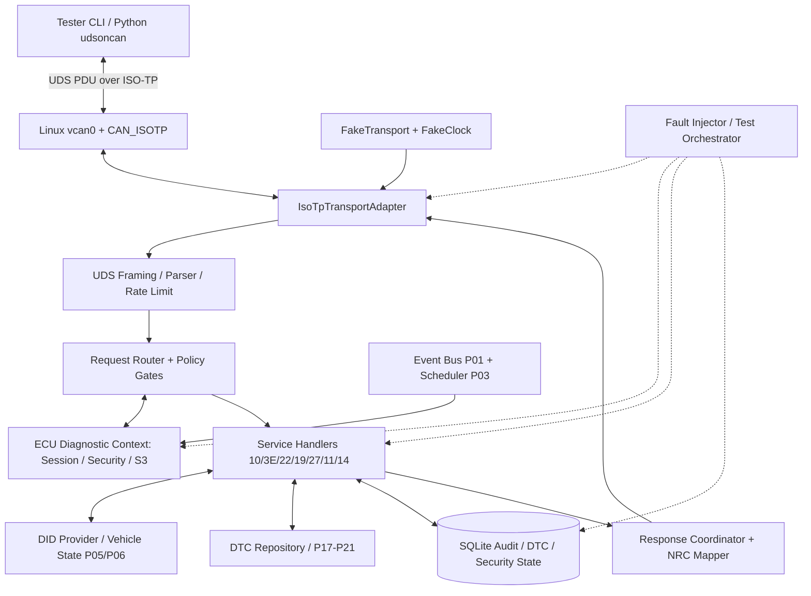
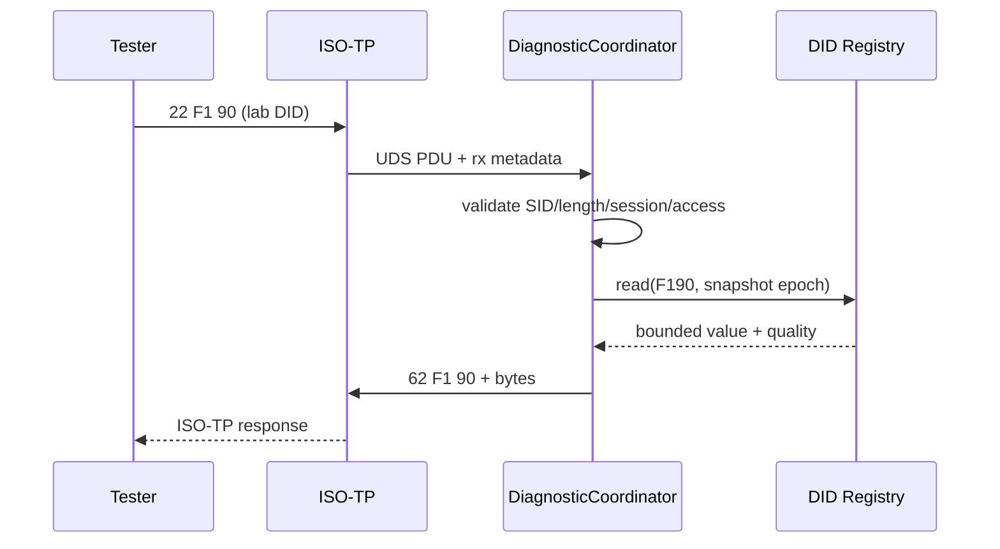
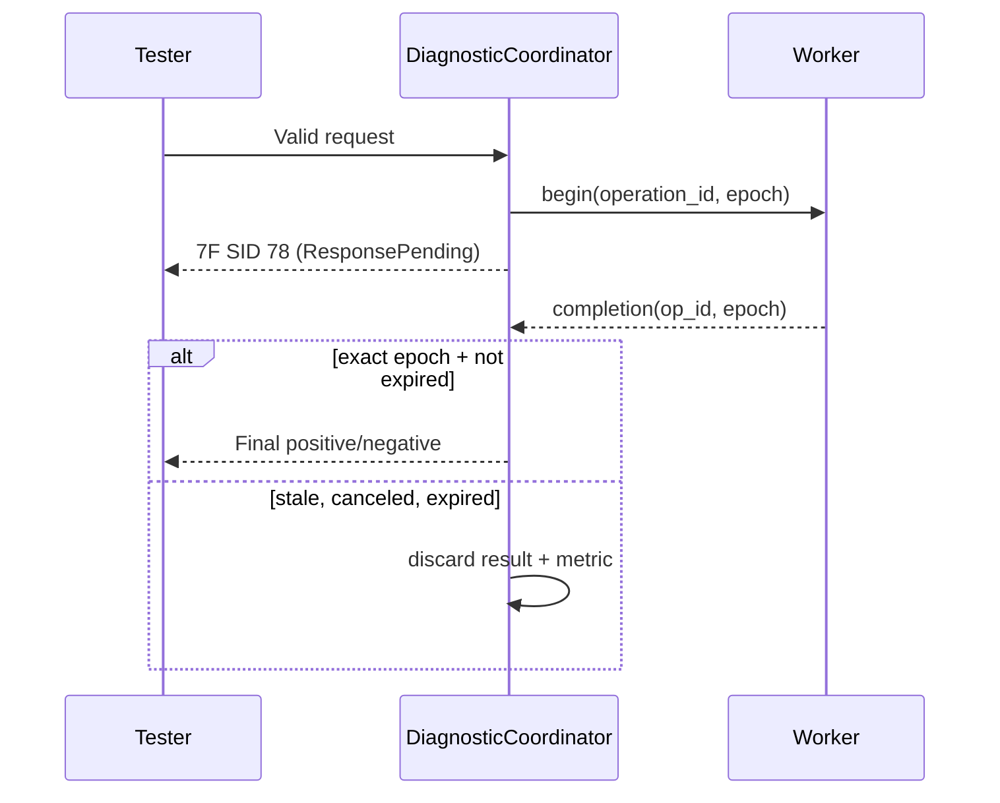
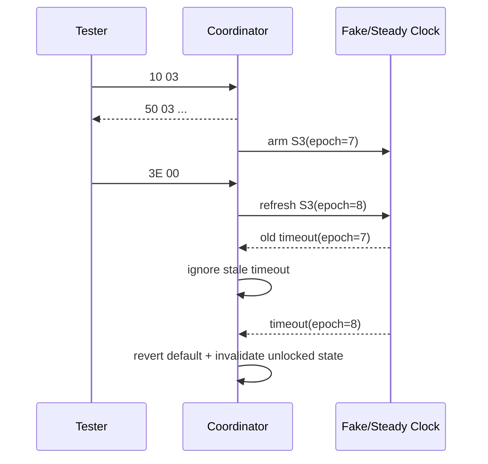
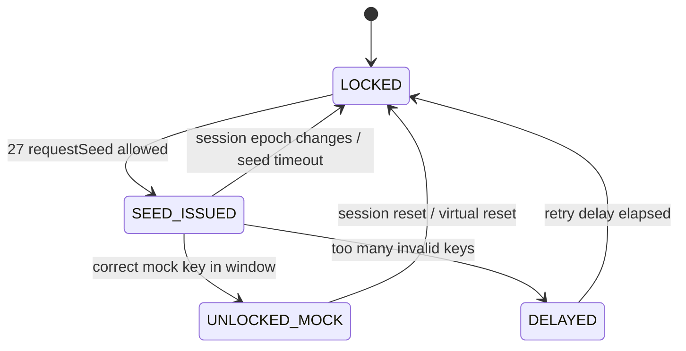
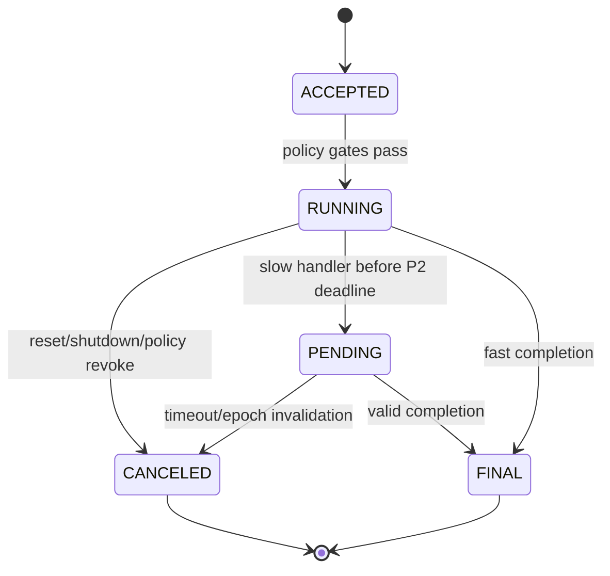

# Project 20 — UDS Diagnostic Server Simulator — System Design & Resilience Test Plan

> **Virtual TCU Lab · Project 20/30 · C++17 · Ubuntu / Linux SocketCAN ISO-TP · Version 1.0 · 2026-10-30**  
> **Status:** thiết kế, yêu cầu, backlog và kế hoạch kiểm thử; **chưa có implementation hoặc kết quả chạy 370 What-if tests**.  
> **Dependencies:** P01 Event Bus, P02 IPC, P03 Timer, P04 Logging/Config, P05 Virtual CAN, P06 DBC Decoder, P07 Gateway, P11 Network Fault Lab, P17 Health Monitoring; cung cấp DTC cho P21.

## 0. Executive summary và ranh giới

Xây một **UDS server của ECU giả lập** chạy trên Ubuntu, không dùng ECU thật. Tester CLI/Python gửi UDS diagnostic requests qua **ISO-TP trên `vcan0`**; server nhận PDU hoàn chỉnh, phân tích/validate, áp dụng Diagnostic Session, SecurityAccess, DID/DTC catalog rồi gửi Positive/Negative Response. Một `FakeIsoTpTransport` cung cấp unit tests deterministic, không phụ thuộc kernel CAN.

**Functional scope (MVP):** 0x10 DiagnosticSessionControl (default 0x01 / extended 0x03); 0x3E TesterPresent; 0x22 ReadDataByIdentifier; 0x19 ReadDTCInformation (subfunctions 0x01/0x02/0x06 được giới hạn và mô phỏng); 0x27 SecurityAccess **toy mock only**, không dùng key thuật toán thật; 0x11 ECUReset **restart virtual process only**; 0x14 ClearDiagnosticInformation chỉ trong simulator với ACL. Extended scope: 0x2E WriteDataByIdentifier với DID allowlist giả lập; 0x31 RoutineControl chỉ chạy mock routine; DoIP stub as optional adapter, không bắt buộc.

**Không thuộc phạm vi:** ECU thật, flash/reprogram thật, điều khiển cơ cấu chấp hành, bypass authorization xe, chẩn đoán an toàn/ASIL, kiểm định ISO 14229 chính thức, toàn bộ ISO 14229/ISO 15765-2, secure key provisioning trên HSM. Không cung cấp seed-key OEM, không kết nối xe vật lý. SID/NRC và điều kiện phản hồi chính xác phụ thuộc phiên bản tiêu chuẩn, kiểu addressing và OEM profile; **mọi chỗ mô phỏng khác chuẩn phải được khai báo rõ**.

**Lab assumptions:** một ECU `VCU_DIAG_01`; physical tester->ECU CAN ID `0x7E0`, ECU->tester `0x7E8` (11-bit, **chỉ ví dụ lab**); một active UDS diagnostic context thuộc ECU, không mặc định mỗi tester có quyền session độc lập; default session khi khởi động; S3=5 s, P2=50 ms, P2*=5 s (**giá trị cấu hình lab**, không đại diện mọi OEM); tối đa một destructive operation/inflight; max UDS application PDU=4095 bytes cho lab, phải đối chiếu ISO-TP kernel/config; timer dùng `steady_clock`; wall clock chỉ phục vụ audit.

**Threats:** untrusted tester, malformed/oversized PDU, fake session identity, brute-force mock security, replay, flood, stale callback, transport reconnection, DTC privacy leakage, crash giữa mutate DTC và response, config reload, journal corruption. Mức protection simulator không chứng minh sản phẩm thật an toàn.

## 1. Goals, invariants và measurable acceptance criteria

### 1.1 Functional requirements

| ID | Requirement |
|---|---|
| FR-01 | Giải mã chính xác UDS PDU nhận từ ISO-TP và validate length, SID, sub-function, DID/DTC. |
| FR-02 | Quản lý session 0x01/0x03, S3 timeout, TesterPresent, session-sensitive permissions. |
| FR-03 | Cung cấp 0x22 qua DID catalog typed & bounded; kiểm tra allowed session/security/data quality. |
| FR-04 | Cung cấp 0x19 qua DTC repository; status mask, DTC list và mock snapshot/extended data với policy rõ. |
| FR-05 | SecurityAccess mock với seed challenge, delay, bad-attempt lockout; không chứa OEM secrets. |
| FR-06 | Trả correct positive response / `0x7F <SID> <NRC>` theo service-specific precedence. |
| FR-07 | Hỗ trợ `0x78` cho long-running mock operations khi đủ điều kiện, một final outcome duy nhất. |
| FR-08 | Phân biệt physical/functional addressing; functional requests bị giới hạn theo policy. |
| FR-09 | Ghi audit có redaction và correlation ID; metrics và response latency. |
| FR-10 | Restart/reconnect, operation cancellation, bounded queue, deterministic tests và transport fault injection. |
| FR-11 | Simulated ECUReset không tác động host và không làm mất dữ liệu DTC persistent theo policy. |
| FR-12 | Integration P05/P06/P17/P21: DID từ vehicle snapshot, DTC có status/freshness. |

### 1.2 System invariants (không bao giờ vi phạm)

1. **INV-01:** Transport không cung cấp PDU hợp lệ → không tiến hành thay đổi state nghiệp vụ; transport errors không bị gán nhầm thành UDS NRC.
2. **INV-02:** Mọi state mutation phải qua validation + session/security/condition gates, theo policy trước hành động.
3. **INV-03:** Một operation/correlation generation chỉ có **một terminal outcome**, dù timeout và callback đồng thời.
4. **INV-04:** `0x78 ResponsePending` chỉ nghĩa đang xử lý, không coi là hoàn tất và không sử dụng để gia hạn vô hạn.
5. **INV-05:** Reset hoặc session timeout thu hồi quyền theo profile; callback/challenge cũ không thể unlock session mới.
6. **INV-06:** DTC/DID không rõ chất lượng không bao giờ được gắn nhãn fresh/valid; từ chối/trả giá trị trạng thái rõ tùy DID policy.
7. **INV-07:** Queue, pending requests, response buffer, log và journal đều có giới hạn; không busy loop hoặc deadlock.
8. **INV-08:** Security policy deny-by-default; không tiết lộ seed/key, DTC nhạy cảm hoặc thiết bị thực trong logs.
9. **INV-09:** Request có side effect khi kết quả không rõ ràng → không tự động replay; phải đối soát persistent state.
10. **INV-10:** File/transport/DB timeout, crash hoặc config reload không được làm service báo thành công giả.
11. **INV-11:** DTC clear chỉ tác động catalog giả lập với scope được phép, đảm bảo transaction/audit theo design.
12. **INV-12:** Tester identity phải lấy từ trusted transport/gateway context; CAN ID thô tự nó **không chứng minh identity/authentication**.

### 1.3 NFR / targets cho lab (đo thực tế, không cam kết trước)

| Chỉ tiêu | Target |
|---|---|
| CPU idle | < 2% một core trong môi trường lab; cần đo |
| RAM steady state | < 128 MiB; bounded queues và bounded payloads |
| P2 deadline | 50 ms configured; với mock fast handler >= 99% đáp ứng trên máy lab không tải |
| P2* | 5 s configured; `0x78` và final response theo configured strategy |
| State correctness | 0 false positive security/session/result; all P0 tests PASS |
| Lockout | Attempts/delay tồn tại qua simulated reset nếu security profile yêu cầu |
| Overload | No unbounded growth, rõ busy/reject/drop với evidence |
| Shutdown | Bounded stop + no use-after-free trong sanitizer runs |
| Monitoring | Request latency histograms, NRC counters, transport errors và late-result counts |

**Pass/fail definitions:** `PASS` chỉ khi chứng minh fault đã inject **và** tất cả invariants đúng; `FAIL` khi fault được inject thành công nhưng behavior sai; `INCONCLUSIVE` khi thiếu evidence/không tạo được fault; `SKIPPED` khi không hỗ trợ môi trường. Không được coi lack-of-response là PASS nếu testcase yêu cầu UDS NRC hoặc service xử lý.

## 2. Standards boundary, addressing và terminology

| Layer | Trách nhiệm | Phụ thuộc / giới hạn |
|---|---|---|
| CAN / vcan | Frame delivery 11-bit IDs trong lab | Không mô phỏng arbitration/bus-off vật lý |
| ISO-TP (ISO 15765-2) | Segmentation / reassembly, Flow Control, STmin, BS, network-layer errors | Linux `CAN_ISOTP` làm transport; không tự lắp lại CF trong UDS |
| UDS (ISO 14229-1) | SID/subfunction, NRC, session/security/diagnostic logic | Implementation chỉ là subset có allowlist |
| Project data model | DID catalog / DTC repository / vehicle state | Những DID/DTC mẫu **không phải OEM production definitions** |

**P2** = thời hạn server phản hồi ban đầu (positive/negative hoặc responsePending theo profile). **P2\*** = thời hạn bổ sung tương ứng sau `0x78`; **S3** = inactivity timer session. Quy tắc exact timing, suppressPositiveResponse, functional addressing NRC suppression phải tham chiếu đúng revision/OEM profile khi mở rộng sản phẩm; lab không tự nhận compliance.

### 2.1 Service matrix của emulator

| SID | Service | Scope | Positive RSID | Gating / chú ý |
|---|---|---|---|---|
| `0x10` | DiagnosticSessionControl | 0x01,0x03 | `0x50` | P2/P2* encoded trong response; session transition atomic |
| `0x3E` | TesterPresent | subfn 0x00 | `0x7E` | `0x80` bit suppress positive response chỉ khi valid |
| `0x22` | ReadDataByIdentifier | selected DIDs | `0x62` | 2 bytes per DID; length/allowlist/quality |
| `0x19` | ReadDTCInformation | selected report subfunctions | `0x59` | subfunction-specific layout, status mask |
| `0x27` | SecurityAccess | toy odd seed/even key pairs | `0x67` | session/attempts/delay; **not production security** |
| `0x11` | ECUReset | virtual process reset | `0x51` | reject when unsupported; never host reset |
| `0x14` | ClearDiagnosticInformation | mock DTC clear | `0x54` | extended session, mock auth, persistent intent |
| `0x2E` | WriteDataByIdentifier | optional mock DID | `0x6E` | no real ECU writes; strong gating |
| `0x31` | RoutineControl | optional simulated health routine | `0x71` | sandbox job id and timeout |

### 2.2 NRC examples (policy mapping, service support varies)

| Code | Meaning | Mô phỏng |
|---|---|---|
| `0x11` | ServiceNotSupported | unsupported SID |
| `0x12` | SubFunctionNotSupported | unknown subfunction for supported SID |
| `0x13` | IncorrectMessageLengthOrInvalidFormat | too short / malformed service body |
| `0x14` | ResponseTooLong | legitimate response exceeds supported size |
| `0x21` | BusyRepeatRequest | bounded concurrency/handler busy (nếu service permits) |
| `0x22` | ConditionsNotCorrect | vehicle precondition not satisfied |
| `0x24` | RequestSequenceError | seed/key or routine sequence out of order |
| `0x31` | RequestOutOfRange | unknown/disallowed DID parameter per service profile |
| `0x33` | SecurityAccessDenied | security gate denied |
| `0x35` | InvalidKey | wrong mock key |
| `0x36` | ExceedNumberOfAttempts | failed attempts limit |
| `0x37` | RequiredTimeDelayNotExpired | lockout timer active |
| `0x78` | RequestCorrectlyReceived-ResponsePending | valid request still processing; not completed |
| `0x7E` | SubFunctionNotSupportedInActiveSession | valid subfunction not enabled in session |
| `0x7F` | ServiceNotSupportedInActiveSession | valid SID unavailable in active session |

**Quan trọng:** byte `0x7F` ở **đầu negative response PDU** khác với **NRC `0x7F`** ở byte thứ ba. Ví dụ `7F 22 31` = negative response cho service `0x22` với NRC `0x31`. Chọn NRC chính xác là một phần của service-specific policy (không có một bảng ưu tiên chung áp dụng mù cho tất cả).

## 3. High-level architecture



**Trust/threads:** ISO-TP I/O thread không mutate diagnostic state; tất cả request events chuyển qua bounded queue vào **DiagnosticCoordinator single-writer**; long-running DID/DTC access qua worker pool giới hạn, callback chứa `operation_id + session_epoch + transport_epoch` và được kiểm tra trước khi accept. DTC repository có một write owner; snapshots bất biến/copy-on-read. Clear DTC dùng SQLite transaction; journal để reconcile khi restart.

### 3.1 Component contracts

| Component | Input / output | Trách nhiệm / không được làm |
|---|---|---|
| `IIsoTpTransport` | UDS PDUs + addressing context | Bind/read/write, transport error mapping; không xử lý NRC |
| `UdsParser` | immutable byte span | validate basic SID+service shape; không cast/truy cập out-of-bounds |
| `RequestRouter` | `RequestContext` | table service/subfn, reject deny-by-default, functional/physical gating |
| `SessionManager` | session transitions | S3 timer epoch, session scope, revoke auth and pending ops as needed |
| `SecurityManagerMock` | seed/key challenge | attempts, delay, lockout, stale seed; lab-only toy operation |
| `DidRegistry` | DID/value/metadata | quality/freshness/access, bounded buffer, multi-DID assembly |
| `DtcRepository` | DTC snapshot/status | mask filtering, mock snapshot, clear atomic, persistence |
| `ResponseCoordinator` | response future/final | P2/P2*, at most one terminal completion, bounded pending |
| `Audit/Telemetry` | events and metrics | sensitive-field redaction, no unbounded logs, evidence |

### 3.2 Key sequence diagrams

**ReadDataByIdentifier success:**



**Slow handler, final response và late callback:**



**Session S3 expiration:**



## 4. Data model, access control và state machines

### 4.1 Diagnostic context

```text
ECU-level DiagnosticContext:
  active_session        : DEFAULT / EXTENDED  (single ECU-wide context)
  session_epoch         : uint64
  session_owner         : trusted tester origin or NONE  [lab policy]
  security_level        : LOCKED / UNLOCKED_MOCK
  security_epoch        : uint64
  seed_challenge_id     : optional
  s3_deadline           : monotonic timestamp
  boot_epoch            : uint64
  transport_epoch       : uint64 per link
  active_operation      : optional
  config_generation     : uint64
```

**Chính sách multi-tester:** Standard/OEM variant cần được chốt trước; lab chọn *một ECU-wide session* và **one controller owner** trong extended operation, các tester khác được đọc DIDs public nhưng không tự kế thừa quyền của owner. Request owner-less read không extend S3 bằng mặc định nếu không được cho phép. CAN arbitration ID là locator, không phải danh tính xác thực; nếu mô phỏng authenticated tester, identity phải đến từ trusted gateway wrapper/testing token **ngoài CAN ID**.

### 4.2 State machines

```mermaid
stateDiagram-v2
    [*] --> DEFAULT
    DEFAULT --> EXTENDED: 10 03 accepted
    EXTENDED --> DEFAULT: S3 expired / 10 01 / virtual reset
    EXTENDED --> EXTENDED: valid TesterPresent refresh
```





### 4.3 DID & DTC catalog (LAB ONLY)

| DID | Source | Encoding | Access | Freshness |
|---|---|---|---|---|
| `0xF190` | `"SIMVIN00000000001"` (17 ASCII chars) | ASCII length 17 | default/extended read | immutable |
| `0xF187` | simulated ECU firmware version | ASCII, max 32 B | default/extended read | static |
| `0xF18C` | ECU serial synthetic | ASCII, max 24 B | extended read | static |
| `0x1234` | batteryVoltage_mV | 2 B unsigned big endian | extended read | <=2 s or explicit invalid policy |
| `0x1235` | vehicleSpeed_kph_x10 | 2 B unsigned big endian | default read | <=500 ms or reject |

DTC examples `0xA10001` battery undervoltage, `0xA10002` modem link lost, `0xA10003` GNSS degraded; statusMask and status availability mask are defined by configurable simulated DTC profile. DTC snapshots immutable at request start; concurrent `ClearDTC` cannot produce hybrid old/new results. **Response 0x19 format phải đúng từng subfunction được implement**, không dùng một encoder chung cho mọi report.

### 4.4 Access control example

| Operation | Default | Extended | Mock unlocked | Additional condition |
|---|---|---|---|---|
| 0x10 → extended | Allow | Allow | No | Owner policy when exclusive op exists |
| 0x3E keepalive | Profile | Allow | No | Trusted current context |
| 0x22 public DID | Allow | Allow | No | value fresh/valid |
| 0x22 private DID | Deny | Allow | Yes or no per DID | field redaction |
| 0x19 read DTC | Limited | Allow | No | allowed status mask |
| 0x14 clear DTC | Deny | Allow | Yes | stationary emulator condition + journal |
| 0x11 reset mock | Deny | Allow | Yes | no incompatible operation |
| 0x2E write mock DID | Deny | Allow | Yes | dedicated allowlist, no real vehicle actuation |

## 5. UDS request processing & response contracts

1. ISO-TP adapter receives an **already reassembled UDS PDU** with transport-origin metadata and receive timestamp. No UDS response to an incomplete ISO-TP PDU.
2. Bounded admission control; empty/oversized/unsupported addressing rejected or dropped according to transport profile. Verify request bytes before allocating dynamic buffers.
3. Parse service-specific fields using safe checked cursor (`readU8`, `readU16BE`, `readN`), handle subfunction bit7 only where applicable. Do not apply suppress-bit to 0x22/0x14 automatically.
4. Determine service support, length/format, session/authorization/conditions using **service-specific NRC precedence table** with tests. Functional request suppression rules configured and tested individually.
5. Read immutable DID/DTC snapshots, or create durable intent **before side-effect** for clear/reset mock operations.
6. Produce valid positive `SID + 0x40` and proper parameters, or `0x7F <request SID> <NRC>`; for slow handlers, send 0x78 only when allowed, bounded and timely.
7. Serialize response as UDS PDU; ISO-TP transport handles segmentation; transport send success ≠ tester received/processed response.
8. On reset/shutdown/session expiry, increment epoch, close work, reconcile durable journal before processing new state-mutating requests.

### 5.1 Representative byte examples (not complete ISO conformance vectors)

| Request PDU | Meaning | Expected PDU (illustrative) |
|---|---|---|
| `10 03` | Enter extended | `50 03 00 32 01 F4` (P2=50ms, P2*=5000ms) |
| `3E 00` | TesterPresent | `7E 00` |
| `3E 80` | TesterPresent, suppress bit | no positive response on success; invalid/negative handling follows profile |
| `22 F1 90` | Read mock VIN | `62 F1 90` + 17 ASCII bytes |
| `22 FF FF` | Unknown DID | `7F 22 31` |
| `22 F1` | Invalid length | `7F 22 13` |
| `27 02 <wrong-key>` | Mock key error if seed pending | `7F 27 35` |
| `19 02 FF` | Report DTC by status mask | `59 02 <statusAvailMask> [DTC(3B), status(1B)]...` |

`0x50` response time fields use P2 (ms) / P2* (10 ms units) for session response per documented UDS profile. `0x01F4` (=500) × 10 ms = 5000 ms. `0xF190` is a standard VIN DID identifier, but its value shown here is synthetic.

### 5.2 Exact event behavior / Given-When-Then

| ID | Given | When | Then |
|---|---|---|---|
| BC-01 | default session | valid `10 03` | state extended, generation increments, response `50 03...` |
| BC-02 | extended session | valid TesterPresent | refresh S3 deadline, not security expiry unless policy allows |
| BC-03 | extended session | S3 timer expires without refresh | default session, auth revoked, old handlers ignored |
| BC-04 | unknown DID | valid `22` request | negative `7F 22 31` under configured policy |
| BC-05 | public DID from valid cache | request under P2 | positive `62...`, correct big-endian encoding |
| BC-06 | DID stale | read request | negative/quality representation as documented, never fresh fabricated value |
| BC-07 | DTC repository immutable snapshot | concurrent 0x19 and 0x14 | consistent before/after snapshot; no partial clear |
| BC-08 | wrong mock key attempts limit | next key request | lockout with configured NRC/delay, audit |
| BC-09 | long-running routine valid | P2 almost exhausted | `0x78` and eventual one terminal response |
| BC-10 | reset operation committed, response lost | reconnect | reconcile state, no repeated side effect automatically |
| BC-11 | functional address receives unsupported request | policy suppression | exact suppression/negative-response rule, no unexpected functional reply |
| BC-12 | shutdown started | new request arrives | reject/drop within defined contract, no new state-changing work |
| BC-13 | client identity ambiguous | security gated operation | deny; no reliance on spoofable CAN arbitration ID |
| BC-14 | late old session callback | new session already active | discard callback, state unchanged |
| BC-15 | queue overload | more messages than capacity | bounded memory, busy/drop metrics, no false positive |

## 6. C++17 design-level API

```cpp
using Byte = std::uint8_t;
using ByteBuffer = std::vector<Byte>;
using OperationId = std::uint64_t;
using Epoch = std::uint64_t;

enum class Session { Default, Extended };
enum class Security { Locked, SeedIssued, UnlockedMock, DelayLocked };
enum class Addressing { Physical, Functional };
enum class Quality { Good, Stale, Invalid, Missing, Untrusted };
enum class Outcome { Positive, Negative, SuppressedPositive, NoTransportResponse };

struct RequestContext {
    ByteBuffer pdu;
    Addressing addressing;
    std::string trusted_origin; // from trusted gateway/lab injection, not raw CAN ID auth
    Epoch transport_epoch{};
    std::chrono::steady_clock::time_point received_at;
};
struct UdsResponse {
    Outcome outcome{};
    ByteBuffer pdu;          // empty for suppressed / no transport response
    OperationId operation{};
};
struct DiagnosticSnapshot {
    Session session{Session::Default};
    Security security{Security::Locked};
    Epoch session_epoch{};
    Epoch config_generation{};
};
struct DidValue { std::uint16_t did{}; ByteBuffer encoded; Quality quality{Quality::Missing}; };
struct DtcRecord { std::uint32_t code24{}; std::uint8_t status{}; ByteBuffer extended_data; };

class IClock {
public:
    virtual ~IClock() = default;
    virtual std::chrono::steady_clock::time_point now() const = 0;
};
class IIsoTpTransport {
public:
    virtual ~IIsoTpTransport() = default;
    virtual bool start(std::string_view interface_name,
                       std::uint32_t rx_id, std::uint32_t tx_id) = 0;
    virtual bool send(ByteBuffer pdu, Epoch epoch) = 0;
    virtual void stop() noexcept = 0;
};
class IDidProvider {
public:
    virtual ~IDidProvider() = default;
    virtual std::optional<DidValue> read(std::uint16_t did,
                                         const DiagnosticSnapshot&) = 0;
};
class IDtcRepository {
public:
    virtual ~IDtcRepository() = default;
    virtual std::vector<DtcRecord> query(std::uint8_t status_mask) = 0;
    virtual bool clearAuthorizedGroup(std::uint32_t group_id, OperationId) = 0;
};
class ISecurityAccessMock {
public:
    virtual ~ISecurityAccessMock() = default;
    virtual UdsResponse requestSeed(std::uint8_t subfunction, Epoch session_epoch) = 0;
    virtual UdsResponse submitKey(std::uint8_t subfunction, ByteBuffer key, Epoch) = 0;
};
class IUdsServer {
public:
    virtual ~IUdsServer() = default;
    virtual void start() = 0;
    virtual void onPdu(RequestContext request) = 0;
    virtual DiagnosticSnapshot snapshot() const = 0;
    virtual void shutdown(std::chrono::milliseconds timeout) = 0;
};
```

**Design note:** `onPdu` asynchronous, chỉ enqueue; actual response qua `ResponseCoordinator`/transport, không trả trực tiếp từ I/O callback. Buffer dùng move semantics/immutable ownership; handler không giữ raw pointer đến request sau khi release. For production nên xem xét `std::span` khi C++20 hoặc `gsl::span`/safe cursor trong C++17.

## 7. Concurrency, timing và backpressure

- **Single writer:** một diagnostic coordinator thread sở hữu session/security/pending-op; transport thread chỉ enqueue typed events.
- **Worker pool:** fixed 2 workers cho DID/DTC read slow; bounded ready queue 64; tối đa 1 destructive mock operation.
- **Deadline:** all timers steady/fake clock; S3 phải cancellable và fenced bằng `session_epoch`. S3 reset/refresh quy định cho profile, không mở rộng mọi incoming byte tùy tiện.
- **P2/P2\*:** timer có `request_id + operation_epoch`; callback muộn bị drop. `0x78` được gửi theo strategy bảo đảm tại thời điểm trước deadline, không lặp vô hạn; enforce overall processing deadline/retry budget.
- **Overload:** queue 256; khi full, ưu tiên diagnostic state consistency; feasible busy negative response `0x21` chỉ khi nhận đủ request hợp lệ, địa chỉ hợp lệ, có khả năng gửi và service profile cho phép; còn lại explicit transport drop/metrics.
- **Shutdown:** transition to STOPPING; reject new requests; signal workers; cancel timers; complete or abort pending per policy; close ISO-TP socket sau outstanding send policy; join with timeout plan. C++17 không có cancellation chuẩn tích hợp → dùng cooperative stop flag/token.
- **Response tracking:** `running`, `pending`, `terminal`, `canceled` CAS/single-writer; send completion không phải business completion; no duplicate final.
- **Lock ordering:** coordinator -> repository intent; never hold coordinator mutex while calling external transport/SQLite; callbacks return to event loop.

## 8. Persistence and crash-consistency

DTC repository và security-attempt policy dùng SQLite mock, với WAL + `synchronous=FULL` trong profile durability; failure injection around transaction boundaries. Độ bền còn phụ thuộc filesystem/storage; lab chỉ kiểm chứng process crash và một số sync injection, không chứng minh power-loss durability của NAND thực.

```sql
PRAGMA journal_mode = WAL;
PRAGMA synchronous = FULL;
CREATE TABLE IF NOT EXISTS dtc_records (
  dtc_code INTEGER PRIMARY KEY CHECK (dtc_code BETWEEN 0 AND 16777215),
  status INTEGER NOT NULL CHECK (status BETWEEN 0 AND 255),
  occurrence_count INTEGER NOT NULL DEFAULT 0 CHECK (occurrence_count >= 0),
  updated_at_ms INTEGER NOT NULL,
  row_version INTEGER NOT NULL DEFAULT 0
);
CREATE TABLE IF NOT EXISTS security_policy_state (
  id INTEGER PRIMARY KEY CHECK (id = 1),
  failed_attempts INTEGER NOT NULL DEFAULT 0 CHECK (failed_attempts >= 0),
  delay_until_utc_ms INTEGER,
  boot_epoch INTEGER NOT NULL DEFAULT 0,
  row_version INTEGER NOT NULL DEFAULT 0
);
CREATE TABLE IF NOT EXISTS diagnostic_operations (
  operation_id TEXT PRIMARY KEY,
  kind TEXT NOT NULL,
  status TEXT NOT NULL CHECK(status IN ('INTENT','COMMITTED','FAILED','UNKNOWN')),
  request_fingerprint TEXT NOT NULL,
  created_at_ms INTEGER NOT NULL,
  updated_at_ms INTEGER NOT NULL,
  response_blob BLOB
);
CREATE TABLE IF NOT EXISTS audit_events (
  seq INTEGER PRIMARY KEY AUTOINCREMENT,
  event_type TEXT NOT NULL,
  request_id TEXT,
  sid INTEGER,
  outcome TEXT,
  timestamp_ms INTEGER NOT NULL,
  redacted_detail TEXT
);
```

**Crash boundaries:** before validated intent → no side effect; committed intent before clear → `INTENT`, evaluate repository state carefully; clear committed before reply → response may be lost, repository state remains source of truth; stale request after reboot must not auto-clear new faults. `operation_id` is internal correlation; **UDS by itself lacks universal business idempotency key**; no blanket exactly-once claim for a tester retry.

**Security delay:** monotonic timers không tồn tại qua reboot. Delay persisting with RTC must treat RTC as untrusted, especially clock rollback. Lab policy may retain locked state until trusted time or conservative manual reset; không tự unlock do RTC không đáng tin.

## 9. Configuration and example JSON

```json
{
  "ecu_id": "VCU_DIAG_01",
  "transport": {"interface": "vcan0", "rx_can_id": "0x7E0", "tx_can_id": "0x7E8", "mtu": "CAN_CLASSIC", "max_pdu_bytes": 4095},
  "timing": {"p2_ms": 50, "p2_star_ms": 5000, "s3_ms": 5000, "max_total_operation_ms": 15000},
  "limits": {"request_queue": 256, "max_pending": 16, "worker_threads": 2, "max_did_bytes": 256, "max_dtc_records": 2048},
  "diagnostics": {"default_session": "DEFAULT", "allow_extended": true, "enable_mock_security": true, "allow_functional_clear": false},
  "security_lab": {"max_wrong_keys": 3, "delay_ms": 30000, "enable_real_vehicle_credentials": false},
  "storage": {"sqlite_path": "./var/uds_lab.db", "durability": "FULL"},
  "logging": {"redact_seed_key": true, "level": "INFO"}
}
```

**Config reload:** validate full schema, no SID/DID allowlist escalation without explicit administrative restart; immutable snapshot with generation; cancel/revalidate long-running operations when policy revoked. Enforce path under sandbox root; no symlink traversal, unchecked string->integer conversion or untrusted configuration as code.

## 10. Observability and evidence

| Metric | Why |
|---|---|
| `uds_requests_total{sid,subfn,addressing}` | request mix / unexpected patterns |
| `uds_nrc_total{sid,nrc}` | classify failures |
| `uds_response_latency_ms{sid}` | P2 / P2* distribution |
| `uds_pending_requests`, `uds_request_queue_depth` | saturation and leaks |
| `uds_session_transitions_total` | wrong session behaviors |
| `uds_security_failed_attempts`, `uds_lockouts` | lockout policy |
| `uds_late_callbacks_dropped_total` | generation fencing proof |
| `isotp_rx_errors_total{errno}`, `isotp_tx_errors_total{errno}` | do not confuse transport with UDS |
| `uds_did_invalid_total`, `uds_dtc_clear_total` | data integrity |
| `uds_recovery_unknown_total`, `uds_journal_errors_total` | crash recovery / persistence |

Log fields: `run_id`, `request_id`, `operation_id`, `session_epoch`, `transport_epoch`, `service_sid`, `nrc`, `start_mono_ms`, `duration_ms`, `result`. **Không log seed/key, VIN/serial thật hoặc diagnostic secrets**. Test evidence: input pdu hex, expected/actual output pdu hex, layer-specific error, session state, DB row before/after, thread sanitizer trace, metrics, fault injection proof, time sequence from fake clock.

## 11. Deterministic test harness and lab architecture

1. Pure `UdsParser` unit test với fuzz bytes, no SocketCAN; fake DID/DTC repositories, fake clock.
2. `FakeIsoTpTransport` sends complete PDU with injected transport-origin/addressing, send failures and callbacks at controlled timestamps.
3. Linux integration: `vcan0` + `CAN_ISOTP` sockets: verify segmentation, addressing, observed payloads. `vcan` không kiểm chứng CAN physical arbitration, real bus-off.
4. Fault injector controls `onReceivePdu`, parser faults, repository busy/ENOSPC/EIO, timer ordering, process kill, simulator restart, latency and event storm.
5. Multi-fault tester coordinates T0/T1/T2 with barriers; asserts invariants at each checkpoint and terminal state.
6. For malformed ISO-TP **frames** tests, use a separate raw-CAN test tool or fake ISO-TP stack; kernel ISO-TP may drop before UDS app sees bytes. Đừng giả lập UDS NRC cho frame chưa được tái lắp ghép.

## 12. Safety, security và giới hạn mô phỏng

- Không kết nối CAN interface `can0` của xe thật; start mặc định chỉ chấp nhận `vcan*`; muốn đổi phải sửa code/test gate và review riêng.
- `SecurityAccess` (0x27) ở đây là fake seed/key **chỉ dùng làm bài tập kiểm thử state/lockout**; không phải giải pháp authentication, và tuyệt đối không tái sử dụng key OEM. Thiết kế sản phẩm cần cryptographic access control riêng, rate limiting, credential handling, secure storage và review bảo mật.
- `ECUReset` chỉ restart `uds_sim` trong namespace/container; không reset máy host, không flash ECU.
- `ClearDTC` chỉ xóa bản ghi DTC của simulator; không làm mất dữ liệu chẩn đoán thật.
- `vcan`/kernel ISO-TP integration PASS không suy ra kết quả tại ECU/vehicle/hardware-in-the-loop.
- Health/vehicle state từ simulator không phải cơ sở đảm bảo safety operation trong xe thật.

## 13. What-if Test Catalog — 370 cases / 37 nhóm

**Cách đọc:** Mỗi hàng là một test case độc lập, không phải một failure mode đã được chứng minh. Test runner phải lưu `run_id`, request/response PDU hex, session/security snapshot trước/sau, transport state, DB evidence, injection timestamp, và assertion results. Dòng nào không thể inject đúng điểm hoặc không có evidence → `INCONCLUSIVE`, không được đánh dấu `PASS`. Các NRC minh họa là **lab profile**; khi thay phiên bản ISO/OEM phải tạo conformance matrix thay vì dùng cứng tất cả expected NRC.

**Priority:** `P0` khi liên quan sai quyền, crash, data integrity, timeouts, stale state, security hoặc false-success; `P1` cho compatibility/diagnostics hữu ích khác. Evidence bắt buộc thường gồm: frame/UDS byte logs, injection controller proof, state epoch, terminal outcome, DB snapshot, resource counters và assertions; mỗi case phải gắn ảnh/log thực tế vào báo cáo CI khi được thực thi.

### WF group 01 — Transport and interface lifecycle

| ID | What if? | Inject / reproduce | Expected behavior / invariant | Priority / evidence |
|---|---|---|---|---|
| `P20-WF-01-01` | Kernel lacks CAN_ISOTP | Disable/load absence of can-isotp module | Fail startup with reason; never silently switch to real CAN | P0; RX/TX hex + transport errno + epoch |
| `P20-WF-01-02` | vcan0 absent at startup | Remove vcan0 before start | NOT_READY with bounded retry, no crash | P1; RX/TX hex + transport errno + epoch |
| `P20-WF-01-03` | vcan0 down during recv | Set interface down mid-session | TransportUnavailable, current work fenced, no bogus UDS NRC | P0; RX/TX hex + transport errno + epoch |
| `P20-WF-01-04` | Interface disappears while sending | Delete vcan0 before response | Record send uncertainty and error, no duplicate handler side effect | P0; RX/TX hex + transport errno + epoch |
| `P20-WF-01-05` | Interface returns after down | Restore vcan0 with same name | Rebind once using new transport epoch | P0; RX/TX hex + transport errno + epoch |
| `P20-WF-01-06` | Wrong RX/TX IDs configured | Swap 0x7E0 and 0x7E8 | No request delivered; configuration validation or explicit no-traffic metric | P0; RX/TX hex + transport errno + epoch |
| `P20-WF-01-07` | Binding collision two server instances | Start two servers on same addressing profile | Detect collision/fail, no dual response to same tester | P0; RX/TX hex + transport errno + epoch |
| `P20-WF-01-08` | I/O socket returns EINTR | Inject signal during read | Retry safely without spinning | P0; RX/TX hex + transport errno + epoch |
| `P20-WF-01-09` | Socket fd reused after close | Close while old callback queued | Epoch check discards stale callback, no wrong response | P1; RX/TX hex + transport errno + epoch |
| `P20-WF-01-10` | Reader loop sees continuous EAGAIN | Force nonblocking EAGAIN loop | Backoff/event wait, CPU bounded | P0; RX/TX hex + transport errno + epoch |

### WF group 02 — ISO-TP frame segmentation and reassembly

| ID | What if? | Inject / reproduce | Expected behavior / invariant | Priority / evidence |
|---|---|---|---|---|
| `P20-WF-02-01` | Single frame delivers complete UDS payload | Send 3-byte valid UDS over isotp | Exactly one parsed PDU and one response | P0; RX/TX hex + transport errno + epoch |
| `P20-WF-02-02` | First Frame then all Consecutive Frames | Send multi-frame VIN response scenario | Exact reassembled bytes, no spurious transport error | P1; RX/TX hex + transport errno + epoch |
| `P20-WF-02-03` | Consecutive Frame sequence mismatch | Inject CF with wrong sequence number using raw CAN harness | ISO-TP error, no partial UDS request dispatched | P0; RX/TX hex + transport errno + epoch |
| `P20-WF-02-04` | Consecutive Frame missing | Drop one CF via harness | Reassembly times out, no UDS state mutation | P0; RX/TX hex + transport errno + epoch |
| `P20-WF-02-05` | First Frame claims excessive payload length | Inject FF length exceeding kernel/app budget | Transport rejects or bounded error, no buffer overrun | P0; RX/TX hex + transport errno + epoch |
| `P20-WF-02-06` | Consecutive Frame duplicated | Replay one CF during reassembly | No duplicated UDS request accepted | P0; RX/TX hex + transport errno + epoch |
| `P20-WF-02-07` | FC overflow received | Send FC(Overflow) in raw harness | Transport reports overflow; no success response | P0; RX/TX hex + transport errno + epoch |
| `P20-WF-02-08` | FC wait exceeded | Force endless wait FC frames / timeout | Terminate bounded by ISO-TP policy, no indefinitely blocked worker | P0; RX/TX hex + transport errno + epoch |
| `P20-WF-02-09` | STmin violated | Burst CF too quickly via fault harness | Behavior consistent with configured kernel transport, no invalid application PDU | P1; RX/TX hex + transport errno + epoch |
| `P20-WF-02-10` | Padding wrong | Enable padding checks and corrupt padding | Kernel transport error; never return fabricated UDS NRC | P0; RX/TX hex + transport errno + epoch |

### WF group 03 — Addressing and tester identity

| ID | What if? | Inject / reproduce | Expected behavior / invariant | Priority / evidence |
|---|---|---|---|---|
| `P20-WF-03-01` | Physical 0x7E0 request | Send matching physically addressed frame | Valid response only on configured TX 0x7E8 | P0; RX/TX hex + transport errno + epoch |
| `P20-WF-03-02` | Functional request to public DID | Inject functional addressed DID under allowlist | Response only if supported/allowed by profile | P1; RX/TX hex + transport errno + epoch |
| `P20-WF-03-03` | Functional ClearDTC | Send 0x14 via functional channel | No effect; response/suppression per configured functional rule | P0; RX/TX hex + transport errno + epoch |
| `P20-WF-03-04` | Physical vs functional response suppression differs | Repeat unsupported SID on both addressing types | Verify response matrix per profile, not universal behavior | P0; RX/TX hex + transport errno + epoch |
| `P20-WF-03-05` | Spoofed tester arbitration ID | Forge CAN ID matching trusted tester | No authorization from CAN ID alone | P0; RX/TX hex + transport errno + epoch |
| `P20-WF-03-06` | Two physical testers compete | Inject distinct trusted origins concurrently | Owner policy enforced, no inheritance of mock security level | P0; RX/TX hex + transport errno + epoch |
| `P20-WF-03-07` | Tester A enters extended, B sends TesterPresent | Use two origins with owner lock | B does not extend owner S3 unless profile explicitly permits | P0; RX/TX hex + transport errno + epoch |
| `P20-WF-03-08` | Tester B guesses pending seed key | Submit key from distinct origin | Reject and audit; challenge remains scoped to owner | P0; RX/TX hex + transport errno + epoch |
| `P20-WF-03-09` | Broadcast flood while physical request pending | Flood functional requests | Physical response bounded latency / admission priorities | P1; RX/TX hex + transport errno + epoch |
| `P20-WF-03-10` | Addressing config reload while PDU pending | Switch address map, then deliver old response | Old transport generation not sent to new address | P0; RX/TX hex + transport errno + epoch |

### WF group 04 — Basic PDU parser and byte bounds

| ID | What if? | Inject / reproduce | Expected behavior / invariant | Priority / evidence |
|---|---|---|---|---|
| `P20-WF-04-01` | Zero-length UDS payload | Inject empty PDU in FakeTransport | Drop/reject per parser contract without memory access | P0; timeline + state/epoch + metrics/assertions |
| `P20-WF-04-02` | Unknown SID 0x99 | Send 99 | 0x7F 0x99 0x11 if physical and permitted | P1; timeline + state/epoch + metrics/assertions |
| `P20-WF-04-03` | Only SID for 0x22 | Send 22 | 0x7F 0x22 0x13 | P0; timeline + state/epoch + metrics/assertions |
| `P20-WF-04-04` | Partial DID 0x22 F1 | Send 22 F1 | 0x7F 0x22 0x13 | P0; timeline + state/epoch + metrics/assertions |
| `P20-WF-04-05` | Too many DID pairs | Send >max configured DID count | Reject boundedly, no allocation spike | P0; timeline + state/epoch + metrics/assertions |
| `P20-WF-04-06` | Subfunction missing for 0x10 | Send 10 only | 0x7F 0x10 0x13 | P0; timeline + state/epoch + metrics/assertions |
| `P20-WF-04-07` | Suppress bit set on service with no subfunction | Send 22 80 00 | Parse as DID 0x8000, do not suppress response | P0; timeline + state/epoch + metrics/assertions |
| `P20-WF-04-08` | Response PDU exceeds maximum | Force oversized DID result | Error 0x14 where allowed, no truncated positive payload | P0; timeline + state/epoch + metrics/assertions |
| `P20-WF-04-09` | Payload exactly max size | Send max PDU using fake transport | Validate without out-of-bounds; correct profile behavior | P1; timeline + state/epoch + metrics/assertions |
| `P20-WF-04-10` | Random fuzz bytes | Generate random 1..4095-byte payloads | No crash, OOB, hung request or unauthorized mutation | P0; timeline + state/epoch + metrics/assertions |

### WF group 05 — DiagnosticSessionControl 0x10

| ID | What if? | Inject / reproduce | Expected behavior / invariant | Priority / evidence |
|---|---|---|---|---|
| `P20-WF-05-01` | Default -> Extended valid | Send 10 03 | 50 03 + timings; state extended only after acceptance | P0; timeline + state/epoch + metrics/assertions |
| `P20-WF-05-02` | Extended -> Default valid | Send 10 01 | Return default and revoke mock unlock | P1; timeline + state/epoch + metrics/assertions |
| `P20-WF-05-03` | Unknown session 0x7D | Send 10 7D | Correct 0x12 or 0x7E per service profile | P0; timeline + state/epoch + metrics/assertions |
| `P20-WF-05-04` | Suppress positive response valid session switch | Send 10 83 | State changes, positive suppressed, negative policy intact | P0; timeline + state/epoch + metrics/assertions |
| `P20-WF-05-05` | Invalid high bits in session parameter | Send 10 FF | Reject unsupported subfunction according to masking rules | P0; timeline + state/epoch + metrics/assertions |
| `P20-WF-05-06` | Repeated 10 03 same session | Send extended twice | Defined idempotent transition, no leaked timers | P0; timeline + state/epoch + metrics/assertions |
| `P20-WF-05-07` | Session change during long-running DID | Trigger 10 01 while DID in worker | Old callback discarded or result policy documented | P0; timeline + state/epoch + metrics/assertions |
| `P20-WF-05-08` | Two different session requests simultaneous | Synchronize two producers at barrier | Deterministic serialized winner; no hybrid state | P0; timeline + state/epoch + metrics/assertions |
| `P20-WF-05-09` | Extended requested during destructive op | 10 03 while clear busy | Busy/reject per policy without corrupting op | P1; timeline + state/epoch + metrics/assertions |
| `P20-WF-05-10` | Session changed while send fails | Inject ISO-TP TX failure after commit | State remains internally consistent; response loss exposed | P0; timeline + state/epoch + metrics/assertions |

### WF group 06 — S3 timeout and TesterPresent 0x3E

| ID | What if? | Inject / reproduce | Expected behavior / invariant | Priority / evidence |
|---|---|---|---|---|
| `P20-WF-06-01` | S3 expired in extended | Advance fake clock beyond 5s | Revert default, clear security and pending op policy | P0; timeline + state/epoch + metrics/assertions |
| `P20-WF-06-02` | TesterPresent arrives before expiry | Send 3E 00 at S3-1ms | Timer refreshes; old expiry ignored | P1; timeline + state/epoch + metrics/assertions |
| `P20-WF-06-03` | TesterPresent exactly at deadline | Barrier event + timeout | One deterministic ordering and no double transitions | P0; timeline + state/epoch + metrics/assertions |
| `P20-WF-06-04` | Suppress positive response | Send 3E 80 | Positive response omitted, S3 refreshed if valid | P0; timeline + state/epoch + metrics/assertions |
| `P20-WF-06-05` | Malformed TesterPresent | Send 3E 00 11 | 0x13; do not refresh S3 | P0; timeline + state/epoch + metrics/assertions |
| `P20-WF-06-06` | Unsupported TesterPresent subfunction | Send 3E 01 | 0x12 or session-specific NRC per profile | P0; timeline + state/epoch + metrics/assertions |
| `P20-WF-06-07` | TesterPresent from unauthorized origin | Inject other tester | Not allowed to extend owner session by default | P0; timeline + state/epoch + metrics/assertions |
| `P20-WF-06-08` | TesterPresent flood 100k | Publish repeated valid 3E | Bounded queue, no timer leak and finite CPU | P0; timeline + state/epoch + metrics/assertions |
| `P20-WF-06-09` | Clock jumps back in wall time | Shift RTC -2h, keep fake steady clock | No S3 extension due to wall clock | P1; timeline + state/epoch + metrics/assertions |
| `P20-WF-06-10` | After virtual reset old S3 fires | Keep old timer callback scheduled | Epoch check ignores old timeout | P0; timeline + state/epoch + metrics/assertions |

### WF group 07 — SecurityAccess 0x27 mock policy

| ID | What if? | Inject / reproduce | Expected behavior / invariant | Priority / evidence |
|---|---|---|---|---|
| `P20-WF-07-01` | Request seed valid session | Send 27 01 in extended | Mock seed issued with challenge generation, no real OEM secret | P0; DB before/after + state snapshot + audit |
| `P20-WF-07-02` | Correct matching mock key | Send 27 02 <valid mock key> | Unlock only for current owner/session epoch | P0; DB before/after + state snapshot + audit |
| `P20-WF-07-03` | Wrong key | Submit nonmatching mock key | 0x35, failed count increases | P0; DB before/after + state snapshot + audit |
| `P20-WF-07-04` | Exceed attempt threshold | Submit 3 wrong keys then another | Lockout, appropriate 0x36/0x37 by phase | P0; DB before/after + state snapshot + audit |
| `P20-WF-07-05` | Key without seed | Send 27 02 payload directly | 0x24 sequence error under lab profile | P0; DB before/after + state snapshot + audit |
| `P20-WF-07-06` | Old key replay after new seed | Generate seed A, seed B, replay key for A | Reject; no unlock | P0; DB before/after + state snapshot + audit |
| `P20-WF-07-07` | Seed leaks into log | Enable DEBUG, request seed | Redaction enforced in logs/evidence policy | P0; DB before/after + state snapshot + audit |
| `P20-WF-07-08` | Two testers reuse same seed | Seed issued for A, key B | Reject due to owner binding | P0; DB before/after + state snapshot + audit |
| `P20-WF-07-09` | Session expires during key verification | Advance S3 while key worker paused | Old result discarded, remains locked | P0; DB before/after + state snapshot + audit |
| `P20-WF-07-10` | Restart during lockout | Persist attempt state then restart | Delay persists or conservative locked behavior, no bypass | P0; DB before/after + state snapshot + audit |

### WF group 08 — Security time anomalies and lockout recovery

| ID | What if? | Inject / reproduce | Expected behavior / invariant | Priority / evidence |
|---|---|---|---|---|
| `P20-WF-08-01` | RTC jumps forward after failures | Set wall time +1 year | Must not blindly unlock before trusted-time rule | P0; timeline + state/epoch + metrics/assertions |
| `P20-WF-08-02` | RTC jumps backward after failures | Set wall time -1 year | No indefinite unsigned overflow; conservative policy | P1; timeline + state/epoch + metrics/assertions |
| `P20-WF-08-03` | Monotonic timer reset after process restart | Restart app while delay active | Reconstruct safe lockout from persistent policy | P0; timeline + state/epoch + metrics/assertions |
| `P20-WF-08-04` | Mock entropy source fails | Force seed generator error | No predictable fallback seed and no false unlock | P0; timeline + state/epoch + metrics/assertions |
| `P20-WF-08-05` | Challenge ID wraps | Force uint64 near max | Fail safely/reseed without reusing active challenge | P0; timeline + state/epoch + metrics/assertions |
| `P20-WF-08-06` | Two keys arrive at same time | Race valid and invalid key | One accepted transition, deterministic attempts handling | P0; timeline + state/epoch + metrics/assertions |
| `P20-WF-08-07` | Lockout database ENOSPC | Fail persistence before delay commit | Deny unlock/requests, no bypass | P0; timeline + state/epoch + metrics/assertions |
| `P20-WF-08-08` | Config lowers max wrong attempts mid-lockout | Hot reload thresholds | Apply conservative new profile, no privilege escalation | P0; timeline + state/epoch + metrics/assertions |
| `P20-WF-08-09` | Security owner revoked while unlocked | Remove trusted token/origin | Immediate deny on next gated action and epoch revoke | P1; timeline + state/epoch + metrics/assertions |
| `P20-WF-08-10` | Key request while reset pending | Queue key then reset | Reject stale request, no privileges in new boot epoch | P0; timeline + state/epoch + metrics/assertions |

### WF group 09 — ReadDataByIdentifier 0x22 validation

| ID | What if? | Inject / reproduce | Expected behavior / invariant | Priority / evidence |
|---|---|---|---|---|
| `P20-WF-09-01` | Read one public DID | Send 22 F1 90 | 62 F1 90 + 17 synthetic ASCII bytes | P0; timeline + state/epoch + metrics/assertions |
| `P20-WF-09-02` | Read two valid DIDs | Send 22 F1 90 F1 87 | Correct DID-value ordering and bounded encoding | P1; timeline + state/epoch + metrics/assertions |
| `P20-WF-09-03` | DID is unsupported | Send 22 DE AD | 0x31, no leaked data | P0; timeline + state/epoch + metrics/assertions |
| `P20-WF-09-04` | DID known but session restricted | Read F18C in default | Correct session-specific rejection, no content | P0; timeline + state/epoch + metrics/assertions |
| `P20-WF-09-05` | DID known but security restricted | Read private mock DID locked | No read of protected value | P0; timeline + state/epoch + metrics/assertions |
| `P20-WF-09-06` | Duplicate DID in one request | Send 22 F1 90 F1 90 | Explicit duplicate policy followed, no unbounded repeat | P0; timeline + state/epoch + metrics/assertions |
| `P20-WF-09-07` | Odd number of DID bytes | Send 22 F1 90 12 | 0x13, no partial positive response | P0; timeline + state/epoch + metrics/assertions |
| `P20-WF-09-08` | Read DID with zero-length provider data | Force empty value from provider | Error per contract, never out-of-spec positive payload | P0; timeline + state/epoch + metrics/assertions |
| `P20-WF-09-09` | Provider returns more than max DID bytes | Inject 1000-byte DID from fake provider | Reject/0x14 if applicable; no truncated response | P1; timeline + state/epoch + metrics/assertions |
| `P20-WF-09-10` | Multi-DID response too large | Request many large DIDs | No partial positive: error before serialization | P0; timeline + state/epoch + metrics/assertions |

### WF group 10 — DID data freshness, provenance and encoding

| ID | What if? | Inject / reproduce | Expected behavior / invariant | Priority / evidence |
|---|---|---|---|---|
| `P20-WF-10-01` | Vehicle speed signal stale | Stop P05 frames >500ms then request 1235 | Reject or flagged per DID policy, never present as live | P0; timeline + state/epoch + metrics/assertions |
| `P20-WF-10-02` | Battery sample invalid | Inject CAN decoder quality INVALID | Do not emit plausible voltage as GOOD | P1; timeline + state/epoch + metrics/assertions |
| `P20-WF-10-03` | DID value updated while encoding | Two versions racing snapshot | Response contains one coherent version | P0; timeline + state/epoch + metrics/assertions |
| `P20-WF-10-04` | Big-endian voltage value | Provide 0x1234 mV | Wire bytes 04 D2, not reversed | P0; timeline + state/epoch + metrics/assertions |
| `P20-WF-10-05` | Signed negative sample for unsigned DID | Inject -1 provider value | Reject range, no wrap to 0xFFFF | P0; timeline + state/epoch + metrics/assertions |
| `P20-WF-10-06` | NaN or infinite upstream measurement | Inject invalid float conversion | Reject before integer encoding | P0; timeline + state/epoch + metrics/assertions |
| `P20-WF-10-07` | Stale timestamp from before restart | Replay old source generation | Reject old result | P0; timeline + state/epoch + metrics/assertions |
| `P20-WF-10-08` | Value exactly at max bound | Inject policy boundary | Correct inclusive/exclusive encoding with test vector | P0; timeline + state/epoch + metrics/assertions |
| `P20-WF-10-09` | Clock skew UTC vs monotonic | Move RTC forward 6h | Freshness measured by monotonic source epoch | P1; timeline + state/epoch + metrics/assertions |
| `P20-WF-10-10` | Data source unavailable while request pending | Disconnect P06 source mid-read | Timeout/quality error, no fake data | P0; timeline + state/epoch + metrics/assertions |

### WF group 11 — ReadDTCInformation 0x19 service layouts

| ID | What if? | Inject / reproduce | Expected behavior / invariant | Priority / evidence |
|---|---|---|---|---|
| `P20-WF-11-01` | 0x19 report number by status mask | Send 19 01 FF | 59 01 plus correct availability/count fields | P0; DB before/after + state snapshot + audit |
| `P20-WF-11-02` | 0x19 report list by status mask | Send 19 02 FF | 59 02 + mask + 3-byte DTC/status groups | P1; DB before/after + state snapshot + audit |
| `P20-WF-11-03` | 0x19 report extended data supported | Send 19 06 with valid DTC/record | Service-specific positive format verified | P0; DB before/after + state snapshot + audit |
| `P20-WF-11-04` | Unsupported 0x19 subfunction | Send 19 7E | Correct 0x12/0x7E by profile | P0; DB before/after + state snapshot + audit |
| `P20-WF-11-05` | 0x19 length too short | Send 19 02 | 0x13, no repository query | P0; DB before/after + state snapshot + audit |
| `P20-WF-11-06` | 0x19 length too long | Send 19 02 FF 00 | Reject malformed format | P0; DB before/after + state snapshot + audit |
| `P20-WF-11-07` | 0x19 statusMask zero | Request mask=00 | Deterministic empty or spec-defined result per profile | P0; DB before/after + state snapshot + audit |
| `P20-WF-11-08` | Many DTC records exceed PDU budget | Populate >2048 records | ResponseTooLong or bounded pagination policy, no overflow | P0; DB before/after + state snapshot + audit |
| `P20-WF-11-09` | Unknown DTC for extended record | Request nonexistent DTC | Correct 0x31 or subfunction-specific outcome | P1; DB before/after + state snapshot + audit |
| `P20-WF-11-10` | Unsupported snapshot record | Request invalid record number | Reject without leaking unrelated snapshot | P0; DB before/after + state snapshot + audit |

### WF group 12 — DTC consistency and concurrent updates

| ID | What if? | Inject / reproduce | Expected behavior / invariant | Priority / evidence |
|---|---|---|---|---|
| `P20-WF-12-01` | DTC appears during list read | Insert DTC mid-query | Snapshot reflects before/after consistently, no torn list | P0; DB before/after + state snapshot + audit |
| `P20-WF-12-02` | DTC removed during read | Clear one DTC concurrently | Snapshot/read atomicity preserved | P0; DB before/after + state snapshot + audit |
| `P20-WF-12-03` | DTC status toggles while encoding | Repeat status updates rapidly | Each DTC record internally coherent | P0; DB before/after + state snapshot + audit |
| `P20-WF-12-04` | ClearDTC happens during 0x19 | Barrier read and clear | Read snapshot old/new, no partial mixture | P0; DB before/after + state snapshot + audit |
| `P20-WF-12-05` | DTC source event duplicated | Replay health fault event twice | No double occurrence count unless policy permits | P0; DB before/after + state snapshot + audit |
| `P20-WF-12-06` | DTC status unavailable bits | Set unsupported status flag bits | Mask according to defined status availability | P0; DB before/after + state snapshot + audit |
| `P20-WF-12-07` | DTC timestamp untrusted | Inject RTC rollback | Audit provenance flagged, no misleading freshness | P0; DB before/after + state snapshot + audit |
| `P20-WF-12-08` | DTC journal partially corrupt | Truncate DB/WAL at test boundary | Degraded/recovery, never claim clean catalog | P0; DB before/after + state snapshot + audit |
| `P20-WF-12-09` | Snapshot data exceeds quota | Inflate extended_data blob | Bound memory and response length | P0; DB before/after + state snapshot + audit |
| `P20-WF-12-10` | DTC read during restart | Kill process before response | Recovery consistent, tester sees timeout not false success | P0; DB before/after + state snapshot + audit |

### WF group 13 — ClearDiagnosticInformation 0x14 safety

| ID | What if? | Inject / reproduce | Expected behavior / invariant | Priority / evidence |
|---|---|---|---|---|
| `P20-WF-13-01` | ClearDTC from default session | Send 14 FF FF FF in default | Deny without modifying DTC rows | P0; DB before/after + state snapshot + audit |
| `P20-WF-13-02` | ClearDTC from extended but locked | Send 14 with mock security locked | Deny and audit | P0; DB before/after + state snapshot + audit |
| `P20-WF-13-03` | ClearDTC from extended unlocked | Send 14 for mock group | Transaction clears only authorized group, response 54 | P0; DB before/after + state snapshot + audit |
| `P20-WF-13-04` | Group ID unknown | Send 14 12 34 56 | Reject per profile, no broad clear | P0; DB before/after + state snapshot + audit |
| `P20-WF-13-05` | Functional ClearDTC forbidden | Send 14 on functional address | No mutation and profile-consistent response | P0; DB before/after + state snapshot + audit |
| `P20-WF-13-06` | Crash after intent before commit | Kill after writing operation intent | On restart reconcile safely, no false success | P0; DB before/after + state snapshot + audit |
| `P20-WF-13-07` | Crash after commit before response | Kill after clear transaction | Data remains cleared; do not auto-repeat side effect | P0; DB before/after + state snapshot + audit |
| `P20-WF-13-08` | New DTC appears after clear before retry | Re-send same ambiguous request after reboot | No blind replay that wipes new fault | P0; DB before/after + state snapshot + audit |
| `P20-WF-13-09` | SQLite busy during clear | Hold DB write lock | Bound wait and return error without partial clear | P0; DB before/after + state snapshot + audit |
| `P20-WF-13-10` | Concurrent 0x14 requests | Two testers clear at once | Serialize/dedupe according to policy, no interleaved partial data | P0; DB before/after + state snapshot + audit |

### WF group 14 — ECUReset 0x11 simulator semantics

| ID | What if? | Inject / reproduce | Expected behavior / invariant | Priority / evidence |
|---|---|---|---|---|
| `P20-WF-14-01` | Valid mock reset request | Send 11 01 in extended/unlocked | Only uds_sim restarts; host/vehicle untouched | P0; timeline + state/epoch + metrics/assertions |
| `P20-WF-14-02` | Reset requested from default | Send 11 01 in default | Deny per lab policy | P1; timeline + state/epoch + metrics/assertions |
| `P20-WF-14-03` | Reset while DTC transaction open | Trigger reset mid-clear | Defined commit/reconcile ordering; no torn durable data | P0; timeline + state/epoch + metrics/assertions |
| `P20-WF-14-04` | Positive response lost before reset | Drop ISO-TP TX | Do not infer tester saw ACK, no duplicate reset loop | P0; timeline + state/epoch + metrics/assertions |
| `P20-WF-14-05` | Reset response send stalls | Block socket write | Bounded reset phase and report uncertain response | P0; timeline + state/epoch + metrics/assertions |
| `P20-WF-14-06` | Two reset requests simultaneously | Barrier two testers | Exactly one reset action per admitted policy | P0; timeline + state/epoch + metrics/assertions |
| `P20-WF-14-07` | Old transport callback arrives after reboot | Replay queued send completion | Discard old boot epoch | P0; timeline + state/epoch + metrics/assertions |
| `P20-WF-14-08` | Reset during SecurityAccess delay | Restart mock server | Delay not bypassed | P0; timeline + state/epoch + metrics/assertions |
| `P20-WF-14-09` | Reset during ResponsePending | Launch slow DID then reset | Cancel or fence prior work, no final response from old epoch | P1; timeline + state/epoch + metrics/assertions |
| `P20-WF-14-10` | Process restart fails | Inject executable launch failure | Supervisor reports DEGRADED, no host reboot | P0; timeline + state/epoch + metrics/assertions |

### WF group 15 — Negative response code correctness

| ID | What if? | Inject / reproduce | Expected behavior / invariant | Priority / evidence |
|---|---|---|---|---|
| `P20-WF-15-01` | Unknown SID vs known unavailable session | Send 0x99 and 0x14 default | 0x11 for unknown, session NRC for known per profile | P0; timeline + state/epoch + metrics/assertions |
| `P20-WF-15-02` | Unknown subfunction vs missing byte | Send 10 7E versus 10 | Distinct 0x12 vs 0x13 where applicable | P0; timeline + state/epoch + metrics/assertions |
| `P20-WF-15-03` | Unknown DID with denied session | Send private/unknown DID from default | Service-specific tested NRC precedence | P0; timeline + state/epoch + metrics/assertions |
| `P20-WF-15-04` | Wrong key without seed | Send 27 02 wrong | 0x24 sequence NRC rather than merely wrong key | P0; timeline + state/epoch + metrics/assertions |
| `P20-WF-15-05` | ResponsePending issued for invalid request | Force slow invalid DID | No 0x78 before basic validation completes | P0; timeline + state/epoch + metrics/assertions |
| `P20-WF-15-06` | ResponsePending never resolved | Hang worker | Total deadline enforced; request terminated per timeout policy | P0; timeline + state/epoch + metrics/assertions |
| `P20-WF-15-07` | NRC 0x7F confused with negative marker | Send session-disallowed SID | Correct 3-byte `7F SID 7F`, not 2-byte payload | P0; timeline + state/epoch + metrics/assertions |
| `P20-WF-15-08` | Unsupported response suppression | Set bit7 for 0x22 parameter | Do not suppress NRC/positive erroneously | P0; timeline + state/epoch + metrics/assertions |
| `P20-WF-15-09` | NRC selection after config reload | Change policy during validation | Entire request uses pinned coherent snapshot | P0; timeline + state/epoch + metrics/assertions |
| `P20-WF-15-10` | Negative response construction OOM | Fail allocator during error reply | Bounded fallback/drop with metrics, no crash loop | P0; timeline + state/epoch + metrics/assertions |

### WF group 16 — ResponsePending and P2/P2star timers

| ID | What if? | Inject / reproduce | Expected behavior / invariant | Priority / evidence |
|---|---|---|---|---|
| `P20-WF-16-01` | Fast DID completes before P2 | Fake worker finishes at 30ms | Final positive only, no 0x78 needed | P0; timeline + state/epoch + metrics/assertions |
| `P20-WF-16-02` | Slow DID crosses P2 | Worker completes after 200ms | Timely 0x78 then one final response | P1; timeline + state/epoch + metrics/assertions |
| `P20-WF-16-03` | Worker completes at P2 boundary | Barrier completion and timer | Deterministic one sequence, no duplicate finals | P0; timeline + state/epoch + metrics/assertions |
| `P20-WF-16-04` | Second 0x78 needed by profile | Force 6s job with configured max | Bounded response-pending policy and eventual fail/complete | P0; timeline + state/epoch + metrics/assertions |
| `P20-WF-16-05` | ResponsePending TX fails | Block ISO-TP send of 0x78 | Mark delivery unknown, do not assume tester extended wait | P0; timeline + state/epoch + metrics/assertions |
| `P20-WF-16-06` | Final response sent but ACK unknown | Drop last transport observation | No duplicate side-effect or false receive guarantee | P0; timeline + state/epoch + metrics/assertions |
| `P20-WF-16-07` | Slow op outlives global max | Freeze worker >15s | Cancel/terminal policy, no infinite pending | P0; timeline + state/epoch + metrics/assertions |
| `P20-WF-16-08` | S3 expires during slow read | Advance clock while worker paused | Apply session policy, stale completion fenced | P0; timeline + state/epoch + metrics/assertions |
| `P20-WF-16-09` | Fake clock jumps backwards | Move wall clock only; steady remains | Deadline unaffected | P1; timeline + state/epoch + metrics/assertions |
| `P20-WF-16-10` | Timer storm while CPU congested | Release 1000 timeouts together | Bounded processing and no completion twice | P0; timeline + state/epoch + metrics/assertions |

### WF group 17 — Multi-tester ownership and concurrency

| ID | What if? | Inject / reproduce | Expected behavior / invariant | Priority / evidence |
|---|---|---|---|---|
| `P20-WF-17-01` | Tester A and B request session simultaneously | Barrier 10 03 from two origins | Single ECU-wide transition and explicit owner decision | P0; DB before/after + state snapshot + audit |
| `P20-WF-17-02` | Tester B reads public DID while A unlocked | Interleave commands | B can read allowed public DID, cannot inherit A mock privilege | P1; DB before/after + state snapshot + audit |
| `P20-WF-17-03` | Tester B attempts clear with A security | Send clear from B after A unlock | Deny; owner/access scoped as designed | P0; DB before/after + state snapshot + audit |
| `P20-WF-17-04` | A disconnects while extended owner | Simulate client link loss | Ownership timeout/release, no permanent takeover lock | P0; DB before/after + state snapshot + audit |
| `P20-WF-17-05` | A reconnects with new transport generation | Rebind after dropped link | Reauth/ownership rules applied, not blindly restore privileges | P0; DB before/after + state snapshot + audit |
| `P20-WF-17-06` | Concurrent 0x19 reads | Start 16 readers simultaneously | Bounded worker pool and independent correct snapshots | P0; DB before/after + state snapshot + audit |
| `P20-WF-17-07` | Read and reset concurrently | Inject reset and DID request at barrier | Clear ordering; old result fenced after reset | P0; DB before/after + state snapshot + audit |
| `P20-WF-17-08` | Duplicate 0x10 requests reordered | Deliver A then B with artificial delay | Deterministic coordinator ordering and audit | P0; DB before/after + state snapshot + audit |
| `P20-WF-17-09` | Slow tester blocks send queue | Force one tester unread | Other requests not starved beyond stated limits | P1; DB before/after + state snapshot + audit |
| `P20-WF-17-10` | Identity token expires during active operation | Revoke tester token mid-clear | Revalidate before commit or deny based on transaction point | P0; DB before/after + state snapshot + audit |

### WF group 18 — Queue overload, DoS and fairness

| ID | What if? | Inject / reproduce | Expected behavior / invariant | Priority / evidence |
|---|---|---|---|---|
| `P20-WF-18-01` | Flood 100k unknown SIDs | Generate 100k PDUs in 1 second | Bounded queue and error rate, no unbounded memory | P0; timeline + state/epoch + metrics/assertions |
| `P20-WF-18-02` | Flood 100k TesterPresent | Blast 3E 00 | Timer cleanup bounded, other service progress fair | P0; timeline + state/epoch + metrics/assertions |
| `P20-WF-18-03` | Flood many large DID requests | Send 4095B payloads at high rate | Max PDU/queue limits, no OOM | P0; timeline + state/epoch + metrics/assertions |
| `P20-WF-18-04` | One tester monopolizes worker pool | Send long slow reads from A | Fair scheduling or explicit starvation metrics | P0; timeline + state/epoch + metrics/assertions |
| `P20-WF-18-05` | Backpressure while 0x78 pending | Fill outbound queue | No infinite pending ACK assumptions or deadlock | P0; timeline + state/epoch + metrics/assertions |
| `P20-WF-18-06` | Log sink blocked during overload | Simulate slow disk logger | Diagnostic coordinator continues within bounded limit | P0; timeline + state/epoch + metrics/assertions |
| `P20-WF-18-07` | High-priority reset behind low-priority reads | Queue many DID reads then reset | Policy-defined priority and resource safety | P0; timeline + state/epoch + metrics/assertions |
| `P20-WF-18-08` | Repeated malformed PDU triggers expensive parse | Fuzz pathological inputs at 10k/s | Parser linear bounded complexity | P0; timeline + state/epoch + metrics/assertions |
| `P20-WF-18-09` | CPU quota throttles process | Limit CPU via cgroup | Timeouts accurate per observed wall latency, no false commit | P0; timeline + state/epoch + metrics/assertions |
| `P20-WF-18-10` | Ingress drops without metric | Disable queue consumer then inject | Drop/busy measurable, never silent success | P0; timeline + state/epoch + metrics/assertions |

### WF group 19 — Memory ownership, races and cancellation

| ID | What if? | Inject / reproduce | Expected behavior / invariant | Priority / evidence |
|---|---|---|---|---|
| `P20-WF-19-01` | Callback after IUdsServer destructed | Stop while worker paused, resume | No use-after-free with ASan | P0; DB before/after + state snapshot + audit |
| `P20-WF-19-02` | Double completion from timeout and worker | Race two threads at barrier | One terminal state by epoch/CAS single writer | P0; DB before/after + state snapshot + audit |
| `P20-WF-19-03` | Buffer moved before asynchronous send finishes | Inject delayed send owning PDU | Byte lifetime valid until send done/fail | P0; DB before/after + state snapshot + audit |
| `P20-WF-19-04` | Iterator invalidated during DID registry reload | Replace snapshot during request | No crash, old immutable snapshot used | P0; DB before/after + state snapshot + audit |
| `P20-WF-19-05` | Lock order inversion with SQLite callback | Pause txn while shutdown calls coordinator | No deadlock or holding mutex across blocking DB call | P0; DB before/after + state snapshot + audit |
| `P20-WF-19-06` | Worker throws exception | DID provider throws runtime_error | Isolate error and return bounded failure, thread survives | P0; DB before/after + state snapshot + audit |
| `P20-WF-19-07` | `std::bad_alloc` in response encode | Fail allocator at final payload | No silent success or corrupt output | P0; DB before/after + state snapshot + audit |
| `P20-WF-19-08` | Cancel after work finished before response queued | Schedule cancel at exact handoff | One terminal outcome | P0; DB before/after + state snapshot + audit |
| `P20-WF-19-09` | Transport disconnect before work cancel | Close socket as handler runs | Fencing drops stale output | P0; DB before/after + state snapshot + audit |
| `P20-WF-19-10` | Thread count leak after reconnect cycles | 10k start/stop cycles | Count returns baseline, no orphan workers | P0; DB before/after + state snapshot + audit |

### WF group 20 — Transport and session generation fencing

| ID | What if? | Inject / reproduce | Expected behavior / invariant | Priority / evidence |
|---|---|---|---|---|
| `P20-WF-20-01` | Old PDU arrives after rebind | Cache callback from old socket, rebind, deliver | Discard based on transport epoch | P0; RX/TX hex + transport errno + epoch |
| `P20-WF-20-02` | New PDU same bytes as old | Rebind and resend identical 22 DID | Treat as new request; no corruption via content dedupe | P1; RX/TX hex + transport errno + epoch |
| `P20-WF-20-03` | Old 0x78 timer fires in new session | Switch session then timer old fires | Ignore stale timer | P0; RX/TX hex + transport errno + epoch |
| `P20-WF-20-04` | Old mock seed verifies after reset | Delay crypto mock callback across reset | Reject old verification result | P0; RX/TX hex + transport errno + epoch |
| `P20-WF-20-05` | Old DTC clear callback after rollback | Force DB transaction failure and stale completion | No success from obsolete operation | P0; RX/TX hex + transport errno + epoch |
| `P20-WF-20-06` | Config reload while response pending | Change DID access policy | Pin snapshot or cancel; no mixed policy decisions | P0; RX/TX hex + transport errno + epoch |
| `P20-WF-20-07` | Process restart restores pending op from journal | Seed old INTENT then restart | Reconcile, not replay unconditionally | P0; RX/TX hex + transport errno + epoch |
| `P20-WF-20-08` | Duplicate send-complete callback | Trigger callback twice | No double response terminal or journal mutation | P0; RX/TX hex + transport errno + epoch |
| `P20-WF-20-09` | Epoch uint64 near wrap | Seed generation counter near UINT64_MAX | Safe reset/monotonic strategy, reject ambiguous collisions | P1; RX/TX hex + transport errno + epoch |
| `P20-WF-20-10` | Timer cancellation acknowledgment lost | Cancel timeout then run its callback anyway | Generation check prevents state change | P0; RX/TX hex + transport errno + epoch |

### WF group 21 — SQLite durability and power-loss simulation

| ID | What if? | Inject / reproduce | Expected behavior / invariant | Priority / evidence |
|---|---|---|---|---|
| `P20-WF-21-01` | DB busy at startup | Hold exclusive lock before launch | Bounded init/degraded with clear logs | P0; timeline + state/epoch + metrics/assertions |
| `P20-WF-21-02` | DB disk full on diagnostic op | Fault ENOSPC before COMMIT | No false committed status, no unintended DTC mutation | P1; timeline + state/epoch + metrics/assertions |
| `P20-WF-21-03` | Crash during DTC clear COMMIT | Kill at SQLite fault checkpoint | Recovery either pre/post atomic state, never partial | P0; timeline + state/epoch + metrics/assertions |
| `P20-WF-21-04` | WAL checkpoint fails | Inject IO error at checkpoint | Continue/degrade per persistence policy, no corruption claim | P0; timeline + state/epoch + metrics/assertions |
| `P20-WF-21-05` | DB schema migration interrupted | Kill process mid-migration | Rollback or recovery based on migration journal | P0; timeline + state/epoch + metrics/assertions |
| `P20-WF-21-06` | Corrupt a few DB pages | Damage copy in sandbox | SQLite integrity failure detected; no auto-wipe | P0; timeline + state/epoch + metrics/assertions |
| `P20-WF-21-07` | Deleted DB while process running | Unlink sandbox DB file | Detect persistence inconsistency/restart with safe policy | P0; timeline + state/epoch + metrics/assertions |
| `P20-WF-21-08` | Filesystem read-only | Remount sandbox image read-only | Reads if allowed; state mutation blocked | P0; timeline + state/epoch + metrics/assertions |
| `P20-WF-21-09` | SQLite commit succeeds but audit write fails | Split audit failure from operation txn | Enforce defined atomic audit or mark gap; never fabricate audit | P1; timeline + state/epoch + metrics/assertions |
| `P20-WF-21-10` | RTC invalid during security delay persistence | Inject untrusted wall time | Conservative lockout / explicit UNKNOWN until trusted clock | P0; timeline + state/epoch + metrics/assertions |

### WF group 22 — Configuration reload and policy changes

| ID | What if? | Inject / reproduce | Expected behavior / invariant | Priority / evidence |
|---|---|---|---|---|
| `P20-WF-22-01` | Valid DID catalog reload | Load new snapshot version | New requests use new snapshot, in-flight consistent | P0; timeline + state/epoch + metrics/assertions |
| `P20-WF-22-02` | Malformed config JSON | Load syntax error file | Keep last-known-good, emit error | P0; timeline + state/epoch + metrics/assertions |
| `P20-WF-22-03` | Config adds unrestricted clear | Hot reload an unsafe access rule | Reject escalation unless explicit approved restart | P0; timeline + state/epoch + metrics/assertions |
| `P20-WF-22-04` | P2 changed during active pending op | Switch timer thresholds mid-flight | Current request follows pinned timing snapshot | P0; timeline + state/epoch + metrics/assertions |
| `P20-WF-22-05` | DTC catalog shrinks while 0x19 reads | Reload filtered catalog | Response complete from one version | P0; timeline + state/epoch + metrics/assertions |
| `P20-WF-22-06` | Duplicate DID definitions | Load same DID twice | Validation fail, no ambiguous lookup | P0; timeline + state/epoch + metrics/assertions |
| `P20-WF-22-07` | Unsupported SID enabled by typo | Enable invalid service 0xZZ | Validation rejects config before publish | P0; timeline + state/epoch + metrics/assertions |
| `P20-WF-22-08` | Config references outside sandbox path | Add ../../../../etc/passwd path | Reject traversal/symlink escape | P0; timeline + state/epoch + metrics/assertions |
| `P20-WF-22-09` | Hot reload concurrently with reset | Race restart and reload | One stable generation on startup | P0; timeline + state/epoch + metrics/assertions |
| `P20-WF-22-10` | Session policy revoked during active unlocked state | Change allowed session rules | Revoke/cancel safely before next gated action | P0; timeline + state/epoch + metrics/assertions |

### WF group 23 — DID/DTC authorization and privacy

| ID | What if? | Inject / reproduce | Expected behavior / invariant | Priority / evidence |
|---|---|---|---|---|
| `P20-WF-23-01` | Public DID accidentally holds real VIN | Inject private VIN instead of synthetic | Redact or deny by data classification | P0; DB before/after + state snapshot + audit |
| `P20-WF-23-02` | Private DID requested while locked | Query sensitive DID | Reject; no data echoed in NRC or logs | P1; DB before/after + state snapshot + audit |
| `P20-WF-23-03` | Unauthorized tester requests DTC snapshots | Send protected 0x19 subfunction | No data leak and audit denial | P0; DB before/after + state snapshot + audit |
| `P20-WF-23-04` | Log emits raw security key | Force error logging of 0x27 payload | Secret redacted before sink | P0; DB before/after + state snapshot + audit |
| `P20-WF-23-05` | Error response includes raw request | Trigger parser exception | Return bounded NRC/drop without exposing payload | P0; DB before/after + state snapshot + audit |
| `P20-WF-23-06` | Tenant context mismatch | Simulate gateway mapping tester to wrong virtual ECU | Reject cross-tenant request | P0; DB before/after + state snapshot + audit |
| `P20-WF-23-07` | Sensitive metrics labels contain VIN | Inspect metric exporter | No high-cardinality private identifiers | P0; DB before/after + state snapshot + audit |
| `P20-WF-23-08` | Snapshot blob contains tokens | Inject secret into fake DTC extended_data | Apply field access/redaction policy | P0; DB before/after + state snapshot + audit |
| `P20-WF-23-09` | Export diagnostic trace to dashboard | Send raw 0x27 in trace | Trace redaction preserves non-sensitive debug evidence | P1; DB before/after + state snapshot + audit |
| `P20-WF-23-10` | Audit table queried by untrusted reader | Use low-privilege test process | DB file permissions and application API restrict exposure | P0; DB before/after + state snapshot + audit |

### WF group 24 — Semantic vehicle-state and preconditions

| ID | What if? | Inject / reproduce | Expected behavior / invariant | Priority / evidence |
|---|---|---|---|---|
| `P20-WF-24-01` | Vehicle speed > 0 during clear | Set speed=20 km/h | Reject mutation per lab safety policy | P0; timeline + state/epoch + metrics/assertions |
| `P20-WF-24-02` | Speed signal stale during clear | Stop speed CAN frames | Fail-closed for safety-gated command | P1; timeline + state/epoch + metrics/assertions |
| `P20-WF-24-03` | Ignition state unknown | Drop ignition frames | Do not assume ignition off | P0; timeline + state/epoch + metrics/assertions |
| `P20-WF-24-04` | Battery undervoltage | Inject voltage below threshold | Deny mock reset/clear when preconditions require | P0; timeline + state/epoch + metrics/assertions |
| `P20-WF-24-05` | Battery sample recovers at commit boundary | Set voltage OK exactly as clear about to commit | Revalidate at defined boundary | P0; timeline + state/epoch + metrics/assertions |
| `P20-WF-24-06` | Vehicle speed oscillates near threshold | Inject noisy 0-1 kph values | Debounce/hysteresis policy prevents inconsistent decisions | P0; timeline + state/epoch + metrics/assertions |
| `P20-WF-24-07` | CAN gateway late callback | Delay P07 speed response from old epoch | Reject stale state | P0; timeline + state/epoch + metrics/assertions |
| `P20-WF-24-08` | DTC source indicates critical diagnostic failure | Trigger P17 CRITICAL state | Safe gating per configured operation | P0; timeline + state/epoch + metrics/assertions |
| `P20-WF-24-09` | Health service unreachable | Kill P17 mock before clear | Fail closed or defined degraded policy | P1; timeline + state/epoch + metrics/assertions |
| `P20-WF-24-10` | Vehicle state changes after check before mutate | Barrier just before DB clear COMMIT | Recheck mandatory guard at commit point | P0; timeline + state/epoch + metrics/assertions |

### WF group 25 — Functional addressing and suppression semantics

| ID | What if? | Inject / reproduce | Expected behavior / invariant | Priority / evidence |
|---|---|---|---|---|
| `P20-WF-25-01` | Valid functional TesterPresent | Inject 3E via functional | Apply documented S3 and response policy, no duplicate broadcasts | P0; timeline + state/epoch + metrics/assertions |
| `P20-WF-25-02` | Unknown functional SID | Inject functional 0x99 | Configured silence/NRC suppression, no application mutation | P1; timeline + state/epoch + metrics/assertions |
| `P20-WF-25-03` | Malformed functional request | Send missing parameter | Defined no-response/negative behavior, no process crash | P0; timeline + state/epoch + metrics/assertions |
| `P20-WF-25-04` | Functional request with suppress bit | Send 10 83 functional | Correctly separate suppress-positive and NRC policy | P0; timeline + state/epoch + metrics/assertions |
| `P20-WF-25-05` | Functionally addressed 0x27 | Inject functional seed request | Deny/no-response per lab profile; no challenge issued | P0; timeline + state/epoch + metrics/assertions |
| `P20-WF-25-06` | Functionally addressed 0x14 | Send functional clear | No DTC change | P0; timeline + state/epoch + metrics/assertions |
| `P20-WF-25-07` | Functionally addressed 0x11 | Send functional reset | No reset unless explicit permitted profile (default deny) | P0; timeline + state/epoch + metrics/assertions |
| `P20-WF-25-08` | Two virtual ECU servers on same functional channel | Broadcast allowed 0x22 | Controlled response source IDs and no collision in harness | P0; timeline + state/epoch + metrics/assertions |
| `P20-WF-25-09` | Functional request routed to physical ID by mistake | Misconfigure gateway routing | Reject unexpected address context and log | P1; timeline + state/epoch + metrics/assertions |
| `P20-WF-25-10` | Functional flood + session timeout | Flood functional keepalives while S3 expires | No unauthorized keepalive prolongation | P0; timeline + state/epoch + metrics/assertions |

### WF group 26 — Encoding endianness and service payloads

| ID | What if? | Inject / reproduce | Expected behavior / invariant | Priority / evidence |
|---|---|---|---|---|
| `P20-WF-26-01` | DID little-endian bug | Inject 16-bit voltage 0x04D2 | Wire uses configured big-endian 04 D2 | P0; timeline + state/epoch + metrics/assertions |
| `P20-WF-26-02` | Multi-DID response ordering | Request F187 then F190 | Response exact requested ordering | P1; timeline + state/epoch + metrics/assertions |
| `P20-WF-26-03` | DTC 24-bit code byte order | Inject DTC A10001 | Encode A1 00 01 exactly | P0; timeline + state/epoch + metrics/assertions |
| `P20-WF-26-04` | VIN length wrong | Make synthetic VIN 16 chars | Reject invalid provider data rather than pad silently | P0; timeline + state/epoch + metrics/assertions |
| `P20-WF-26-05` | Non-ASCII VIN data | Inject UTF-8 multibyte | Reject/normalize via explicit DID profile, no untrusted byte echo | P0; timeline + state/epoch + metrics/assertions |
| `P20-WF-26-06` | 0x10 P2* encode unit mismatch | Configure 5000ms | Encode 0x01F4 (500 units of 10ms) | P0; timeline + state/epoch + metrics/assertions |
| `P20-WF-26-07` | Incorrect NRC triplet order | Force negative for DID | `7F 22 <NRC>`, not `22 7F <NRC>` | P0; timeline + state/epoch + metrics/assertions |
| `P20-WF-26-08` | 0x19 extendedData record length malformed | Inject incomplete record | Reject/flag provider fault, no malformed successful reply | P0; timeline + state/epoch + metrics/assertions |
| `P20-WF-26-09` | Status availability mask consistency | Populate statuses beyond supported bits | Ensure masks coherent across 0x19 responses | P1; timeline + state/epoch + metrics/assertions |
| `P20-WF-26-10` | Oversized signed integer value | Set >65535 mV for 2-byte DID | Detect and error, not truncate/wrap | P0; timeline + state/epoch + metrics/assertions |

### WF group 27 — Stress, long-running and soak

| ID | What if? | Inject / reproduce | Expected behavior / invariant | Priority / evidence |
|---|---|---|---|---|
| `P20-WF-27-01` | 24-hour clean soak | Run 24h mixed 0x22/0x19/3E | No memory/thread/file descriptor trend | P0; DB before/after + state snapshot + audit |
| `P20-WF-27-02` | 24-hour fault soak | Every minute link flap + db busy | Bounded errors and recovery, no false positives | P0; DB before/after + state snapshot + audit |
| `P20-WF-27-03` | One million small requests | Generate 1M 3E/0x22 | Memory bounded, service remains responsive | P0; DB before/after + state snapshot + audit |
| `P20-WF-27-04` | Large DTC catalog read repeatedly | 2000 DTCs 10k times | CPU, heap and output bounded | P0; DB before/after + state snapshot + audit |
| `P20-WF-27-05` | 10k session transitions | Alternate 10 01 and 10 03 | Timer count does not grow unbounded | P0; DB before/after + state snapshot + audit |
| `P20-WF-27-06` | 10k simulated resets | Restart uds_sim repeatedly | No journal corruption or fd accumulation | P0; DB before/after + state snapshot + audit |
| `P20-WF-27-07` | 10k lockout cycles | Force invalid keys and fake time advance | No attempt counter corruption | P0; DB before/after + state snapshot + audit |
| `P20-WF-27-08` | Slow disk with heavy diagnostic traffic | Inject 500ms DB latency | No coordinator deadlock, backpressure measurable | P0; DB before/after + state snapshot + audit |
| `P20-WF-27-09` | Out-of-order completion storm | Release 1000 worker completions together | Correct request generations, no duplicate finals | P0; DB before/after + state snapshot + audit |
| `P20-WF-27-10` | Diagnostic server starts with low memory | Apply cgroup 64MiB limit | Graceful failure, no unauthorized state mutation | P0; DB before/after + state snapshot + audit |

### WF group 28 — Fuzzing and protocol adversarial input

| ID | What if? | Inject / reproduce | Expected behavior / invariant | Priority / evidence |
|---|---|---|---|---|
| `P20-WF-28-01` | AFL++ fuzz 0x22 payload | Generate arbitrary PDU after SID 22 | No OOB, segfault or unintended mutation | P0; RX/TX hex + transport errno + epoch |
| `P20-WF-28-02` | libFuzzer fuzz 0x19 subfunctions | Generate masks/length combinations | No parser crash, state remains invariant | P1; RX/TX hex + transport errno + epoch |
| `P20-WF-28-03` | Fuzz `0x27` subfunction bit7 | Explore odd/even and suppress bits | Security state cannot be bypassed | P0; RX/TX hex + transport errno + epoch |
| `P20-WF-28-04` | Fuzz response serializer lengths | Corrupt provider encoded size | No integer overflow or buffer overrun | P0; RX/TX hex + transport errno + epoch |
| `P20-WF-28-05` | Fuzz nested mock DTC extended data | Oversized and ill-formed blob | Bounded parsing and rejection | P0; RX/TX hex + transport errno + epoch |
| `P20-WF-28-06` | Fuzz repeated zero bytes | 4095 bytes 00 | Bounded CPU, no infinite loop | P0; RX/TX hex + transport errno + epoch |
| `P20-WF-28-07` | Fuzz all 256 SIDs | Generate every leading byte | Unsupported SID matrix correct, no unintended handler | P0; RX/TX hex + transport errno + epoch |
| `P20-WF-28-08` | Fuzz first/last byte truncation | Remove bytes from otherwise valid PDU | Error response or drop per profile, no partial commit | P0; RX/TX hex + transport errno + epoch |
| `P20-WF-28-09` | Fuzz Unicode config fields | Inject invalid UTF-8 in JSON values | Config reject without crash | P1; RX/TX hex + transport errno + epoch |
| `P20-WF-28-10` | Fuzz transport-origin metadata | Invalid enum/oversized origin token | Normalize/reject before auth or logging | P0; RX/TX hex + transport errno + epoch |

### WF group 29 — Fault injection orchestration and evidence

| ID | What if? | Inject / reproduce | Expected behavior / invariant | Priority / evidence |
|---|---|---|---|---|
| `P20-WF-29-01` | Fault injector claims success but no kernel drop | Use wrong interface for induced loss | Test INCONCLUSIVE, not PASS | P0; timeline + state/epoch + metrics/assertions |
| `P20-WF-29-02` | Fault injected after target response finished | Trigger EIO too late | Test INCONCLUSIVE for targeted fault window | P0; timeline + state/epoch + metrics/assertions |
| `P20-WF-29-03` | Process crashes before trace flush | SIGKILL during test | Runner retains external evidence and marks crash | P0; timeline + state/epoch + metrics/assertions |
| `P20-WF-29-04` | Two test runs share same DB directory | Launch runs concurrently with same path | Isolation prevents cross-run contamination | P0; timeline + state/epoch + metrics/assertions |
| `P20-WF-29-05` | Fake clock advances without timers firing | Deliberately stall scheduler | Test FAIL, no false S3 handling assumption | P0; timeline + state/epoch + metrics/assertions |
| `P20-WF-29-06` | Fault plan says ENOSPC but OS returns EROFS | Change backing mount read-only | Evidence distinguishes actual errno | P0; timeline + state/epoch + metrics/assertions |
| `P20-WF-29-07` | NRC observed but no request correlation | Drop request ID from logs | Mark insufficient evidence, investigate | P0; timeline + state/epoch + metrics/assertions |
| `P20-WF-29-08` | Resilience test cleanup fails | Keep stale vcan namespace/process | Report cleanup failure and do not mark PASS | P0; timeline + state/epoch + metrics/assertions |
| `P20-WF-29-09` | Trace includes private test seed/key | Enable verbose evidence export | Redact secrets in report | P0; timeline + state/epoch + metrics/assertions |
| `P20-WF-29-10` | Fault runner killed mid-campaign | Kill orchestrator and restart | Cleanup only run-owned resources, no host networking damage | P0; timeline + state/epoch + metrics/assertions |

### WF group 30 — Integration P05/P06/P07/P17/P21

| ID | What if? | Inject / reproduce | Expected behavior / invariant | Priority / evidence |
|---|---|---|---|---|
| `P20-WF-30-01` | P05 speed frame stale | Stop vehicle simulator, request DID speed | Source quality propagated correctly | P0; timeline + state/epoch + metrics/assertions |
| `P20-WF-30-02` | P06 DBC layout reload | Change signal layout mid-read | DID uses coherent decoder snapshot | P1; timeline + state/epoch + metrics/assertions |
| `P20-WF-30-03` | P07 gateway route revoked | Remove diagnostic route while request in flight | No reply on unauthorized new path | P0; timeline + state/epoch + metrics/assertions |
| `P20-WF-30-04` | P17 health alert creates DTC | Emit critical fault, then 19 02 | DTC visible with correct supported status bits | P0; timeline + state/epoch + metrics/assertions |
| `P20-WF-30-05` | P21 clears DTC while 0x19 query | Request clear and read simultaneously | Atomic ordering across repository boundary | P0; timeline + state/epoch + metrics/assertions |
| `P20-WF-30-06` | P02 IPC disconnect from DID provider | Terminate provider process | Timeout/errors without false value | P0; timeline + state/epoch + metrics/assertions |
| `P20-WF-30-07` | P03 timer shutdown while diagnostic pending | Stop scheduler before server | Pending operations terminated, no stray callback | P0; timeline + state/epoch + metrics/assertions |
| `P20-WF-30-08` | P04 logging queue full | Flood log sink while serving UDS | No priority inversion into diagnostics | P0; timeline + state/epoch + metrics/assertions |
| `P20-WF-30-09` | P10 connectivity state change | Toggle Internet while CAN diagnostics active | CAN diagnostics continue independently | P1; timeline + state/epoch + metrics/assertions |
| `P20-WF-30-10` | P19 OTA trial boot active | Send diagnostic reset during trial | Gate reset per OTA safety policy, no conflicting reboot | P0; timeline + state/epoch + metrics/assertions |

### WF group 31 — Crash recovery and ambiguous outcomes

| ID | What if? | Inject / reproduce | Expected behavior / invariant | Priority / evidence |
|---|---|---|---|---|
| `P20-WF-31-01` | Crash before accepting mutation | SIGKILL before intent write | No side effect, request unprocessed | P0; timeline + state/epoch + metrics/assertions |
| `P20-WF-31-02` | Crash after DTC clear but before 0x54 | Kill after COMMIT before send | DTC cleared, tester uncertain, no success claim | P1; timeline + state/epoch + metrics/assertions |
| `P20-WF-31-03` | Crash during virtual reset handoff | Kill after reset intent | Supervisor reconciles boot epoch and restarts once | P0; timeline + state/epoch + metrics/assertions |
| `P20-WF-31-04` | Crash while seed issued | Kill after seed create | Challenge invalidated across reboot | P0; timeline + state/epoch + metrics/assertions |
| `P20-WF-31-05` | Crash after lockout persisted | Kill after attempts COMMIT | Lockout retained conservatively | P0; timeline + state/epoch + metrics/assertions |
| `P20-WF-31-06` | Crash after DTC update source event | Kill before snapshot publish | Repository rebuilt; no phantom complete snapshot | P0; timeline + state/epoch + metrics/assertions |
| `P20-WF-31-07` | Crash with pending `0x78` | Kill after pending reply | Tester eventually timeout; server does not later finalize old op | P0; timeline + state/epoch + metrics/assertions |
| `P20-WF-31-08` | Crash while file logger fsync | Inject kill during audit write | No unauthorized mutation due to log sink state | P0; timeline + state/epoch + metrics/assertions |
| `P20-WF-31-09` | Restart with journal row UNKNOWN | Seed UNKNOWN operation | No silent auto-retry for side effects | P1; timeline + state/epoch + metrics/assertions |
| `P20-WF-31-10` | Consecutive restart loop | Kill after each start 100 times | Supervisor backoff and diagnostic safe mode | P0; timeline + state/epoch + metrics/assertions |

### WF group 32 — Multi-ECU topology and gateway isolation

| ID | What if? | Inject / reproduce | Expected behavior / invariant | Priority / evidence |
|---|---|---|---|---|
| `P20-WF-32-01` | Two ECU simulators use same address pair | Boot two instances same IDs | Config checks collision or isolated bus namespace | P0; timeline + state/epoch + metrics/assertions |
| `P20-WF-32-02` | Different ECU with same DID | Query via separate ID pairs | Correct per-ECU data, not global leak | P1; timeline + state/epoch + metrics/assertions |
| `P20-WF-32-03` | Routing loop between vcan0/vcan1 | Inject cyclic gateway rule | Gateway rejects loop, server not flooded endlessly | P0; timeline + state/epoch + metrics/assertions |
| `P20-WF-32-04` | Gateway drops only response traffic | Filter outgoing 0x7E8 | Tester sees timeout; server does not equate send to delivery | P0; timeline + state/epoch + metrics/assertions |
| `P20-WF-32-05` | Gateway translates tester origin incorrectly | Swap identity metadata | Access denied / provenance alert | P0; timeline + state/epoch + metrics/assertions |
| `P20-WF-32-06` | Physical CAN ID reused in different namespace | Two vcan namespaces same IDs | Isolation; no cross-ECU response | P0; timeline + state/epoch + metrics/assertions |
| `P20-WF-32-07` | ECU A resets while ECU B active | Kill only A process | B unaffected | P0; timeline + state/epoch + metrics/assertions |
| `P20-WF-32-08` | Functional request fans out to two ECUs | Send allowed functional query | Controlled response source mapping and rate limits | P0; timeline + state/epoch + metrics/assertions |
| `P20-WF-32-09` | Gateway restarts mid-session | Restart P07 | Invalidates link context per policy, no privilege cloning | P1; timeline + state/epoch + metrics/assertions |
| `P20-WF-32-10` | Both ECU servers overload together | Flood simultaneous traffic | Each respects independent resource quotas | P0; timeline + state/epoch + metrics/assertions |

### WF group 33 — Timing correctness and wall-clock issues

| ID | What if? | Inject / reproduce | Expected behavior / invariant | Priority / evidence |
|---|---|---|---|---|
| `P20-WF-33-01` | S3 timeout at process suspend/resume | Freeze process 10s then resume | Monotonic time behavior checked, session expires as policy | P0; timeline + state/epoch + metrics/assertions |
| `P20-WF-33-02` | P2 deadline just before context switch | Pause thread 100ms | Deadline failure observable, not falsified response timestamp | P1; timeline + state/epoch + metrics/assertions |
| `P20-WF-33-03` | RTC leaps across daylight-saving | Change timezone while running | Steady timers unaffected | P0; timeline + state/epoch + metrics/assertions |
| `P20-WF-33-04` | Kernel receive timestamp delayed | Stall user thread after ISO-TP recv | Use documented receive/processing time origin consistently | P0; timeline + state/epoch + metrics/assertions |
| `P20-WF-33-05` | Fake clock overflow near max | Force duration near int64 max | Saturating arithmetic, no negative deadline | P0; timeline + state/epoch + metrics/assertions |
| `P20-WF-33-06` | Misconfigured P2* smaller than P2 | Load bad config | Validate reject or defined policy | P0; timeline + state/epoch + metrics/assertions |
| `P20-WF-33-07` | S3 configured zero | Load S3=0 | Reject config, no instant busy timeout loop | P0; timeline + state/epoch + metrics/assertions |
| `P20-WF-33-08` | Rate limiter uses wall clock | Shift UTC back | Switch to monotonic, no free tokens | P0; timeline + state/epoch + metrics/assertions |
| `P20-WF-33-09` | Delayed `0x78` after tester client timeout | Force pending send late | No server claim of tester persistence | P1; timeline + state/epoch + metrics/assertions |
| `P20-WF-33-10` | Timers and callbacks delivered out of order | Replay fake scheduler queue reverse order | Session/operation epoch checks maintain invariants | P0; timeline + state/epoch + metrics/assertions |

### WF group 34 — Resource exhaustion and OS syscall errors

| ID | What if? | Inject / reproduce | Expected behavior / invariant | Priority / evidence |
|---|---|---|---|---|
| `P20-WF-34-01` | EMFILE on socket creation | Lower RLIMIT_NOFILE | Startup fails cleanly and no partial service | P0; timeline + state/epoch + metrics/assertions |
| `P20-WF-34-02` | ENOBUFS on ISO-TP send | Force transport memory pressure | Mark failed/unknown transport, no double execute | P1; timeline + state/epoch + metrics/assertions |
| `P20-WF-34-03` | EINTR during SQLite step | Inject interruption | Retry only safe operations, preserve txn boundaries | P0; timeline + state/epoch + metrics/assertions |
| `P20-WF-34-04` | EIO during DTC query | Fault sqlite read | Return failure, no empty-success DTC list | P0; timeline + state/epoch + metrics/assertions |
| `P20-WF-34-05` | ENOMEM during request admission | Fault malloc | No service crash loop or invalid response buffer | P0; timeline + state/epoch + metrics/assertions |
| `P20-WF-34-06` | EPIPE during IPC provider call | Kill provider | Bounded error and reconnect, no stale result accepted | P0; timeline + state/epoch + metrics/assertions |
| `P20-WF-34-07` | Filesystem permission revoked during audit | chmod sandbox store | Degraded audit policy, no secret-bearing fallback logs | P0; timeline + state/epoch + metrics/assertions |
| `P20-WF-34-08` | Huge config file consumes RAM | Load 200MB JSON | Size cap before parse, last-known-good retained | P0; timeline + state/epoch + metrics/assertions |
| `P20-WF-34-09` | Disk fills from diagnostic logs | Generate flood and quota 10MB | Rotation/drop policy, diagnostic journal protected | P1; timeline + state/epoch + metrics/assertions |
| `P20-WF-34-10` | File descriptors leaked after repeated ISO-TP rebind | 10k rebind cycles | Open fd count returns baseline | P0; timeline + state/epoch + metrics/assertions |

### WF group 35 — Operational deployment and shutdown

| ID | What if? | Inject / reproduce | Expected behavior / invariant | Priority / evidence |
|---|---|---|---|---|
| `P20-WF-35-01` | SIGTERM during idle | Send SIGTERM | Clean shutdown with all threads joined | P0; timeline + state/epoch + metrics/assertions |
| `P20-WF-35-02` | SIGTERM during long DID read | Pause worker then signal | Cancel and join without use-after-free | P1; timeline + state/epoch + metrics/assertions |
| `P20-WF-35-03` | SIGKILL during DTC clear | Kill immediately before COMMIT | DB atomic recovery, no half-clear | P0; timeline + state/epoch + metrics/assertions |
| `P20-WF-35-04` | Double shutdown from signal and API | Invoke concurrently | Idempotent stop, no double-close | P0; timeline + state/epoch + metrics/assertions |
| `P20-WF-35-05` | Start called twice | Call start twice | Reject/idempotent documented behavior, no duplicate I/O threads | P0; timeline + state/epoch + metrics/assertions |
| `P20-WF-35-06` | Config missing at startup | Remove config file | Fail safe, do not bind real CAN default | P0; timeline + state/epoch + metrics/assertions |
| `P20-WF-35-07` | DB missing at startup | Delete sandbox DB then start | Initialize only under explicit lab policy | P0; timeline + state/epoch + metrics/assertions |
| `P20-WF-35-08` | Stale Unix socket / pidfile | Leave old runtime artifacts | Detect/clean safely, no unrelated process kill | P0; timeline + state/epoch + metrics/assertions |
| `P20-WF-35-09` | Working directory changed | Launch under different cwd | Sandbox paths resolved explicitly, no unintended host writes | P1; timeline + state/epoch + metrics/assertions |
| `P20-WF-35-10` | Graceful stop timeout expires | Hang worker beyond stop budget | Log pending uncertainty and use process supervisor plan; no unsafe detached thread | P0; timeline + state/epoch + metrics/assertions |

### WF group 36 — Security abuse, replay and trust boundaries

| ID | What if? | Inject / reproduce | Expected behavior / invariant | Priority / evidence |
|---|---|---|---|---|
| `P20-WF-36-01` | Request replay from different tester | Capture lab clear PDU, send as B | Authorization/context gate rejects unauthorized side effect | P0; timeline + state/epoch + metrics/assertions |
| `P20-WF-36-02` | CAN ID spoofing with same physical ID | Inject raw frame with matching ID | Do not treat CAN ID as cryptographic identity | P1; timeline + state/epoch + metrics/assertions |
| `P20-WF-36-03` | Malformed seed/key triggers information leak | Force exception with seed bytes | Error logs omit seed/key | P0; timeline + state/epoch + metrics/assertions |
| `P20-WF-36-04` | Brute-force key attempts across restarts | Repeated wrong keys and reboot | Persistent/conservative lockout, no reset bypass | P0; timeline + state/epoch + metrics/assertions |
| `P20-WF-36-05` | Private DID identifier enumeration | Scan 65536 DIDs quickly | Rate limit and access-controlled response, no sensitive data disclosure | P0; timeline + state/epoch + metrics/assertions |
| `P20-WF-36-06` | DTC extended data path traversal | Supply malicious synthetic file reference | No path resolution outside sandbox | P0; timeline + state/epoch + metrics/assertions |
| `P20-WF-36-07` | Oversized trusted-origin metadata | Inject 1MB origin string | Validate bounds before logs/DB | P0; timeline + state/epoch + metrics/assertions |
| `P20-WF-36-08` | Config maliciously enables real CAN interface | Set interface can0 | Startup refuses unless explicit compile-time isolated policy | P0; timeline + state/epoch + metrics/assertions |
| `P20-WF-36-09` | Fake transport marked authenticated without proof | Set unauthenticated flag and authorized origin string | Deny privileged access; provenance checked | P1; timeline + state/epoch + metrics/assertions |
| `P20-WF-36-10` | Timing side channel on mock key comparison | Run repeated wrong keys timing | Use safe compare methodology in mock; no claim of production cryptographic resistance | P0; timeline + state/epoch + metrics/assertions |

### WF group 37 — Service command extensibility and compatibility

| ID | What if? | Inject / reproduce | Expected behavior / invariant | Priority / evidence |
|---|---|---|---|---|
| `P20-WF-37-01` | 0x2E optional disabled | Send write-by-DID when feature off | 0x11 or session NRC per service registry, no mutation | P0; timeline + state/epoch + metrics/assertions |
| `P20-WF-37-02` | 0x2E enabled for mock DID only | Write synthetic config DID | Validated bounded update, no live vehicle state impact | P1; timeline + state/epoch + metrics/assertions |
| `P20-WF-37-03` | 0x31 routine unknown | Send unknown routine ID | Correct service-specific 0x31 NRC | P0; timeline + state/epoch + metrics/assertions |
| `P20-WF-37-04` | 0x31 long routine request | Delay mock routine past P2 | 0x78 and one final result | P0; timeline + state/epoch + metrics/assertions |
| `P20-WF-37-05` | 0x31 stop without start | Send stop routine | RequestSequenceError per routine profile | P0; timeline + state/epoch + metrics/assertions |
| `P20-WF-37-06` | 0x14 unsupported DTC group | Send out-of-range group | Reject, no broad clear | P0; timeline + state/epoch + metrics/assertions |
| `P20-WF-37-07` | Change service revision profile | Reload profile while request pending | Pinned handlers/encoding across request | P0; timeline + state/epoch + metrics/assertions |
| `P20-WF-37-08` | Unknown OEM-specific subfunction | Send vendor code not registered | Reject without pass-through to real ECU | P0; timeline + state/epoch + metrics/assertions |
| `P20-WF-37-09` | 0x11 reset type unsupported | Send 11 7F | SubfunctionNotSupported / session-specific NRC per profile | P1; timeline + state/epoch + metrics/assertions |
| `P20-WF-37-10` | Unsupported programming 0x34/0x36 | Send requestDownload / transferData | Deny by default, no flash/write side effect | P0; timeline + state/epoch + metrics/assertions |

## 14. Multi-fault campaigns — 50 chiến dịch có timeline

Các chiến dịch chỉ thực sự `PASS` khi **tất cả** fault injection steps được xác nhận, output PDU/session/repository đúng và system invariants không bị vi phạm. Dùng seed cố định cho randomized campaigns, lưu `barrier` logs và thời gian monotonic. Các timeline T0..T3 là mô tả *cách test*, không phải logs đã chạy.

| ID | Compound scenario | T0 / T1 / T2 / T3 | Expected invariants / evidence |
|---|---|---|---|
| `P20-MF-01` | ISO-TP CF mất + S3 sắp hết hạn + tester retry | T0 extended; T1 bỏ CF; T2 hết S3; T3 tester retry | Không dispatch partial request; default session; retry có authorization/session mới; evidence: event trace + DB snapshot + fault proof |
| `P20-MF-02` | Transport down + final DID response + rebind | T0 DID valid; T1 close vcan; T2 worker complete; T3 rebind | Callback old epoch discarded; no response on new link; evidence: event trace + DB snapshot + fault proof |
| `P20-MF-03` | Tester A unlock + B spoof CAN ID + ClearDTC | T0 A mock unlocked; T1 B impersonates ID; T2 B sends 0x14 | B unauthorized; DTC unchanged; audit provenance; evidence: event trace + DB snapshot + fault proof |
| `P20-MF-04` | S3 timeout + TesterPresent at boundary + old timer | T0 arm S3; T1 timer expired + 3E race; T2 old callback | Single deterministic session state; no timeout twice; evidence: event trace + DB snapshot + fault proof |
| `P20-MF-05` | ResponsePending + worker crash + late timeout | T0 long DID; T1 0x78; T2 worker crash; T3 timeout | Bounded termination/error; no indefinite pending or false success; evidence: event trace + DB snapshot + fault proof |
| `P20-MF-06` | DTC clear commit + response drop + restart | T0 clear intent; T1 commit; T2 drop 0x54; T3 process restart | DB single logical clear; ambiguous tester result, no auto-clear new DTC; evidence: event trace + DB snapshot + fault proof |
| `P20-MF-07` | DTC clear + new DTC event + tester retry | T0 clear committed; T1 new fault; T2 retry identical PDU | Do not silently clear new fault via uncertain replay; evidence: event trace + DB snapshot + fault proof |
| `P20-MF-08` | Failed keys + RTC rollback + process restart | T0 3 wrong keys; T1 shift RTC back; T2 restart | Lockout conserved, no bypass due to time anomaly; evidence: event trace + DB snapshot + fault proof |
| `P20-MF-09` | DB full + critical health DTC + diagnostic read | T0 fill DB; T1 health inserts DTC; T2 0x19 read | No fabricated complete DTC state; failures observable; evidence: event trace + DB snapshot + fault proof |
| `P20-MF-10` | vcan rebind + 0x78 stale + different request | T0 pending old; T1 rebind; T2 new 0x22; T3 old final | No old final sent to new tester context; evidence: event trace + DB snapshot + fault proof |
| `P20-MF-11` | Config reload revokes DID + worker in progress | T0 read private DID; T1 revoke; T2 worker finishes | Pinned/cancel policy enforced; no unintended new access; evidence: event trace + DB snapshot + fault proof |
| `P20-MF-12` | Functional flood + physical reset + rate limit | T0 100k functional; T1 physical 0x11 | No unauthorized reset; queue bounded; fairness budget; evidence: event trace + DB snapshot + fault proof |
| `P20-MF-13` | Mismatched security owner + valid key + session expiry | T0 A seed; T1 B key; T2 expire S3 | No unlock; epoch change; audit; evidence: event trace + DB snapshot + fault proof |
| `P20-MF-14` | DID provider disconnect + 0x78 + shutdown | T0 slow provider; T1 pending; T2 IPC down; T3 shutdown | No deadlock, no terminal twice, cooperative worker stop; evidence: event trace + DB snapshot + fault proof |
| `P20-MF-15` | CAN gateway route loop + tester flood | T0 configure attempted loop; T1 10k requests | Gateway rejects cyclic config; bounded UDS traffic; evidence: event trace + DB snapshot + fault proof |
| `P20-MF-16` | DTC read snapshot + concurrent clear + restart | T0 read snapshot; T1 clear begins; T2 kill | Atomic old/new snapshot and durable post-restart DTC state; evidence: event trace + DB snapshot + fault proof |
| `P20-MF-17` | Fuzz malformed 0x22 + memory pressure + logger blocked | T0 fuzz; T1 cgroup limit; T2 block log sink | No OOB, resource bound, no secret leaks; evidence: event trace + DB snapshot + fault proof |
| `P20-MF-18` | Invalid NRC config + session transition + hot reload | T0 invalid policy; T1 valid 10 03; T2 reload | Reject invalid config; stable prior behavior; evidence: event trace + DB snapshot + fault proof |
| `P20-MF-19` | Timer wheel paused + many pending DID requests | T0 16 slow requests; T1 pause timers; T2 advance clock | No false positive; bounded pending with measurable timeout misses; evidence: event trace + DB snapshot + fault proof |
| `P20-MF-20` | Simulator reset + SecurityAccess delay + old key | T0 lockout; T1 reset; T2 old key arrives | Persist lockout and discard stale key; evidence: event trace + DB snapshot + fault proof |
| `P20-MF-21` | Audit write error + DTC clear transaction | T0 DB audit fail; T1 attempt clear | Atomic policy for audit/clear; no successful unaudited mutation if required; evidence: event trace + DB snapshot + fault proof |
| `P20-MF-22` | Disk EIO + WAL checkpoint + process kill | T0 checkpoint; T1 EIO; T2 SIGKILL | No false DB integrity claim, safe recovery state; evidence: event trace + DB snapshot + fault proof |
| `P20-MF-23` | High load + P2 deadline + pending TX failure | T0 overload; T1 long request; T2 fail 0x78 TX | Transport uncertainty observed; no success inferred; evidence: event trace + DB snapshot + fault proof |
| `P20-MF-24` | Identity revocation + slow DID + response serialization | T0 request private DID; T1 revoke; T2 encode | Policy decision at documented checkpoint; no leak; evidence: event trace + DB snapshot + fault proof |
| `P20-MF-25` | Two simulated ECUs + functional broadcast + one reset | T0 broadcast public; T1 reset A; T2 query B | No cross-ECU state contamination; evidence: event trace + DB snapshot + fault proof |
| `P20-MF-26` | Transport wrong CAN IDs + fault runner false PASS | T0 misbind; T1 inject packet drop other iface; T2 test | INCONCLUSIVE; injection proof missing; evidence: event trace + DB snapshot + fault proof |
| `P20-MF-27` | Expired DID data + 0x22 + connectivity loss | T0 stale vehicle speed; T1 0x22; T2 Internet offline | DID refused/quality governed; cloud irrelevant; evidence: event trace + DB snapshot + fault proof |
| `P20-MF-28` | DTC unknown record + response length exhaustion | T0 giant mock snapshot; T1 unsupported record request | No truncate, safe NRC and bounds; evidence: event trace + DB snapshot + fault proof |
| `P20-MF-29` | Security seed generator failure + queued clear | T0 entropy fail; T1 client key; T2 clear | No unlock, clear denied; evidence: event trace + DB snapshot + fault proof |
| `P20-MF-30` | Session owner disconnect + rival takeover + old 3E | T0 A owner; T1 A disconnect; T2 B enters; T3 A 3E late | No privilege inheritance, stale keepalive discarded; evidence: event trace + DB snapshot + fault proof |
| `P20-MF-31` | DoIP stub enabled + CAN tester origin mismatch | T0 register two transports; T1 spoof origin route | Do not merge identities or sessions implicitly; evidence: event trace + DB snapshot + fault proof |
| `P20-MF-32` | Config reload + DTC status change + multi-DID | T0 DTC status changes; T1 reload; T2 read | Snapshot consistency per request, no corrupted encoding; evidence: event trace + DB snapshot + fault proof |
| `P20-MF-33` | Hot reload + invalid thresholds + delayed S3 callback | T0 S3 armed; T1 bad timer config; T2 old timeout | Last-known-good, correct epoch validation; evidence: event trace + DB snapshot + fault proof |
| `P20-MF-34` | Server SIGTERM + ISO-TP send blocked + double stop | T0 send blocks; T1 SIGTERM; T2 API stop | No deadlock/double close; bounded shutdown policy; evidence: event trace + DB snapshot + fault proof |
| `P20-MF-35` | SQLite busy + TesterPresent storm + S3 timeout | T0 DB lock; T1 flood 3E; T2 advance S3 | Timers not starved; session rules maintained; evidence: event trace + DB snapshot + fault proof |
| `P20-MF-36` | Security delay + config reduces attempt count + reboot | T0 2 failures; T1 threshold change; T2 reboot | No retroactive unlock; conservative persistent policy; evidence: event trace + DB snapshot + fault proof |
| `P20-MF-37` | Diagnostic reset + OTA trial boot + health CRITICAL | T0 OTA trial; T1 health critical; T2 reset request | Safety policy denies conflicting reset; evidence: event trace + DB snapshot + fault proof |
| `P20-MF-38` | Privilege gate + vehicle speed stale + clear attempt | T0 mock unlock; T1 stop speed data; T2 clear | Fail closed when safety input stale; evidence: event trace + DB snapshot + fault proof |
| `P20-MF-39` | Multi-frame response + interface removal + reconnect | T0 0x19 large response; T1 vcan down mid-send; T2 up | No partial success from UDS app, transport error metrics; evidence: event trace + DB snapshot + fault proof |
| `P20-MF-40` | Two ClearDTC requests + database deadlock simulation | T0 A+B clear; T1 DB busy; T2 cancellation | Serialized bounded transactions, no partial/duplicate side effects; evidence: event trace + DB snapshot + fault proof |
| `P20-MF-41` | Request parser fuzz + security brute force + log pressure | T0 fuzz 0x27; T1 key flood; T2 logger full | No auth bypass/crash, lockout and log bound; evidence: event trace + DB snapshot + fault proof |
| `P20-MF-42` | Suspend process + timeout + delayed valid callback | T0 long read; T1 SIGSTOP 10s; T2 resume | Deadlines evaluated by monotonic clock, late result fenced; evidence: event trace + DB snapshot + fault proof |
| `P20-MF-43` | Synthetic VIN wrong length + extended data leak | T0 corrupt DID; T1 inject private DTC blob; T2 read | No malformed successful response or private data leak; evidence: event trace + DB snapshot + fault proof |
| `P20-MF-44` | Config symlink escape + audit disk full + startup | T0 symlink config outside sandbox; T1 fill disk; T2 start | Reject config/traversal, no host writes; evidence: event trace + DB snapshot + fault proof |
| `P20-MF-45` | Crash after lockout commit + concurrent session switch | T0 wrong key; T1 lockout COMMIT; T2 10 01; T3 kill | Persisted lockout, safe default session after restart; evidence: event trace + DB snapshot + fault proof |
| `P20-MF-46` | Rebind 10k times + Event Bus callback flood | T0 cycle bind; T1 flood event bus; T2 stop | No fd/thread leak, no stale callback mutation; evidence: event trace + DB snapshot + fault proof |
| `P20-MF-47` | Backend DTC source down + journal corruption + query | T0 corrupt DB copy; T1 kill source; T2 read 0x19 | DEGRADED/UNKNOWN, not empty-success; evidence: event trace + DB snapshot + fault proof |
| `P20-MF-48` | Resource quota + large UDS PDU + transport retry | T0 low RAM; T1 4KB PDU; T2 ENOBUFS | Bounded error, no OOM or misleading positive reply; evidence: event trace + DB snapshot + fault proof |
| `P20-MF-49` | Fuzz unknown SIDs + virtual reset + stale tester | T0 fuzz all SID; T1 reset; T2 old request | No unauthorized mutation; boot epoch fencing; evidence: event trace + DB snapshot + fault proof |
| `P20-MF-50` | 24h soak + random faults + periodic integrity check | T0 start soak; T1 seeded chaos; T2 hourly DB checks | Measurable availability, zero critical invariant violations, full evidence; evidence: event trace + DB snapshot + fault proof |

## 15. Jira implementation backlog — 36 tickets / 4 sprints

**Definition of Ready:** acceptance criteria có thể đo, test owner, dependency và fault hooks rõ. **Definition of Done:** code review, unit tests, sanitizer checks cho affected module, failure-mode tests, metrics/log redaction, documentation update, evidence CI. Mỗi ticket bên dưới chỉ là đề xuất, không phải issue đã tạo trên Jira.

| Jira ID | Sprint | Story | Acceptance criteria | Depends on |
|---|---|---|---|---|
| `P20-01` | Sprint 1 — Foundation | Repository skeleton & CMake | C++17 target, warnings as errors, presets, CI build on Ubuntu; release debug/ASan profiles | P01/P03/P04/P05 |
| `P20-02` | Sprint 1 — Foundation | Transport interface & FakeTransport | Mock send/receive failures and deterministic callback scheduling; tests without CAN | P01/P03/P04/P05 |
| `P20-03` | Sprint 1 — Foundation | Linux CAN_ISOTP transport adapter | Bind on vcan0 with RX=0x7E0 TX=0x7E8; clean stop/rebind; errors surfaced | P01/P03/P04/P05 |
| `P20-04` | Sprint 1 — Foundation | UDS safe byte cursor/parser | No unchecked offset; reject malformed 10/22/19/27; fuzz target added | P01/P03/P04/P05 |
| `P20-05` | Sprint 1 — Foundation | DiagnosticCoordinator bounded queue | Single writer/epoch fencing, stop lifecycle and admission metrics | P01/P03/P04/P05 |
| `P20-06` | Sprint 1 — Foundation | UDS response encoder & NRC mapper | Positive/NRC PDU vectors, service-specific validation precedence tests | P01/P03/P04/P05 |
| `P20-07` | Sprint 1 — Foundation | Fake clock + S3/P2/P2* timers | Deterministic deadlines, cancel races and stale callback tests | P01/P03/P04/P05 |
| `P20-08` | Sprint 1 — Foundation | Config loader and invariant checks | JSON schema, last-known-good, forbid real CAN interface, reload generation | P01/P03/P04/P05 |
| `P20-09` | Sprint 1 — Foundation | Smoke tester CLI and integration harness | Linux vcan test for 10 03, 3E 00, unknown DID, 0x7F responses | P01/P03/P04/P05 |
| `P20-10` | Sprint 2 — UDS Services | DiagnosticSessionControl 0x10 | Default/extended transitions + timing encoded + suppress handling + epoch tests | P20-01..09 |
| `P20-11` | Sprint 2 — UDS Services | TesterPresent 0x3E + S3 lifecycle | Refresh per owner policy; exact S3 boundary test; no timer leak | P20-01..09 |
| `P20-12` | Sprint 2 — UDS Services | DID registry & data quality interface | F190/F187/F18C/1234/1235 with metadata and freshness; no raw sensor assumption | P20-01..09 |
| `P20-13` | Sprint 2 — UDS Services | ReadDataByIdentifier 0x22 handler | Single/multi DID, ordering, length, protected DID, responseTooLong | P20-01..09 |
| `P20-14` | Sprint 2 — UDS Services | Mock DTC repository with SQLite | 24-bit code/status availability, immutable read snapshots and migration | P20-01..09 |
| `P20-15` | Sprint 2 — UDS Services | ReadDTCInformation 0x19 handler | 0x01/0x02/0x06 service-specific encoder + validation vectors | P20-01..09 |
| `P20-16` | Sprint 2 — UDS Services | SecurityAccess 0x27 toy state machine | Seed/key ownership, attempts, delay, conservative restart, secrets redacted | P20-01..09 |
| `P20-17` | Sprint 2 — UDS Services | Explicit NRC policy table | Wrong length, unsupported SID/subfunction, session gate and functional rules tested | P20-01..09 |
| `P20-18` | Sprint 2 — UDS Services | Session/multi-tester ownership policy | Trusted origin context and exclusive ops; CAN ID not treated as auth | P20-01..09 |
| `P20-19` | Sprint 3 — Reliability | ClearDiagnosticInformation 0x14 mock | Authorized atomic DTC group clear and crash recovery; no physical ECU | P20-10..18 |
| `P20-20` | Sprint 3 — Reliability | Virtual ECUReset 0x11 | Restart simulator only, response loss semantics, persistent journal reconcile | P20-10..18 |
| `P20-21` | Sprint 3 — Reliability | Optional 0x2E/0x31 mock features | Explicit disabled-by-default, allowlisted synthetic DID/routine only | P20-10..18 |
| `P20-22` | Sprint 3 — Reliability | ResponsePending coordinator | 0x78 P2* bounded, cancellation, final uniqueness, race tests | P20-10..18 |
| `P20-23` | Sprint 3 — Reliability | Persistent operation journal | INTENT/COMMITTED/UNKNOWN, SQLite FULL profile, recovery matrix | P20-10..18 |
| `P20-24` | Sprint 3 — Reliability | Transport lifecycle and epoch fencing | Rebind, late callbacks, close race, no stale response | P20-10..18 |
| `P20-25` | Sprint 3 — Reliability | Admission control & per-tester fairness | Queue thresholds, busy behavior, resource quotas and telemetry | P20-10..18 |
| `P20-26` | Sprint 3 — Reliability | Observability / redaction | metrics, structured logs, correlation and no seed/key/private VIN leak | P20-10..18 |
| `P20-27` | Sprint 3 — Reliability | P05/P06/P07/P17 integration adapters | Live mock vehicle DID and DTC; stale status propagation; test with disabled dependency | P20-10..18 |
| `P20-28` | Sprint 4 — Verification | Parser and serializer fuzz suite | libFuzzer/AFL++ regression corpus; ASan/UBSan runs; minimized crashes | P20-01..27 |
| `P20-29` | Sprint 4 — Verification | ISO-TP segmentation integration tests | Multi-frame, FC, wrong seq via raw harness, boundaries and vcan evidence | P20-01..27 |
| `P20-30` | Sprint 4 — Verification | Full 370-case What-if mapping | Test ID registry maps each scenario to script or explicit INCONCLUSIVE/SKIPPED | P20-01..27 |
| `P20-31` | Sprint 4 — Verification | 50 multi-fault campaign runner | Fault barriers, seeded schedule, evidence collection and cleanup | P20-01..27 |
| `P20-32` | Sprint 4 — Verification | Crash/DB fault-injection engine | Kill points around DTC clear COMMIT, ENOSPC, busy, EIO, WAL recovery | P20-01..27 |
| `P20-33` | Sprint 4 — Verification | Security abuse and permission test suite | Owner mismatch, replay, bad attempts, functional suppression, privilege revoke | P20-01..27 |
| `P20-34` | Sprint 4 — Verification | Stress/soak and resource budgets | 1M requests, 24h soak, queue/heap/fd/thread trend, latency dashboards | P20-01..27 |
| `P20-35` | Sprint 4 — Verification | Docker / Linux runner scripts | Root-required steps isolated; skip gracefully without vcan/isotp kernel support | P20-01..27 |
| `P20-36` | Sprint 4 — Verification | Design review and go/no-go report | Produce coverage trace matrix, open risk register, P0 pass evidence and known limits | P20-01..27 |

## 16. Test strategy và verification matrix

| Layer | Tools | Bằng chứng yêu cầu |
|---|---|---|
| Pure parser/encoder | Google Test, property-based generators, libFuzzer | Exact byte vectors; no OOB, no exceptions escape |
| Session/security state | Fake clock, deterministic event order | Epoch + before/after snapshots, timer counts |
| DID/DTC | In-memory fake, SQLite temp DB | Correct encoding, atomic clear, status masks, data quality |
| ISO-TP integration | Linux vcan, can-utils `isotpsend`, `isotprecv`, raw CAN fault harness | RX/TX IDs, first/CF/FC traces, errno for transport faults |
| Process crash | SIGKILL at instrumented failpoints | DB integrity, audit, restart state, command uncertainty |
| Resource load | ASan/UBSan, TSan where feasible, Valgrind, cgroups, `/proc` | Peak RAM/CPU/fd/thread counts, sanitizer logs |
| Security/negative tests | Unauthorized tester origins, random PDU fuzz | No escalation, redaction, no real-device activity |
| Multi-fault | Barrier/fake clock orchestrator, seeded fault lists | Injection verified + 12 invariants + outcome classification |

**Coverage targets:** all 370 catalog cases mapped to runnable tests or explained unavailable infrastructure; all P0 cases actually executed and PASS before marking project stable; 100% known service handlers have malformed-length, session, security, timeout and transport-failure branches covered; 0 critical invariant failures; parse fuzz corpus time budget explicitly stated. A count in a document is not proof of coverage.

## 17. Ubuntu simulation runbook (sandbox only)

### 17.1 Install prerequisites

```bash
sudo apt update
sudo apt install -y build-essential cmake ninja-build git gdb valgrind \
  can-utils iproute2 libsqlite3-dev libgtest-dev libgmock-dev python3 python3-pip
# Requires kernel support for vcan and CAN_ISOTP (check per distro)
sudo modprobe vcan
sudo modprobe can-isotp || true
```

### 17.2 Create isolated virtual CAN

```bash
sudo ip link add dev vcan0 type vcan
sudo ip link set vcan0 up
ip -details link show vcan0
# Never replace vcan0 with can0 connected to an actual vehicle.
```

### 17.3 Repo and programs to implement

```text
virtual-tcu-lab/
  projects/p20-uds-server/
    CMakeLists.txt
    configs/uds_lab.json
    include/tcu/uds/{server,parser,response,session,security,did,dtc,transport}.hpp
    src/{server,parser,response,session,security,did,dtc,transport}.cpp
    apps/uds_server_main.cpp
    apps/uds_tester_cli.cpp
    tests/unit/{parser,session,security,did,dtc,response}_test.cpp
    tests/integration/isotp_vcan_test.cpp
    tests/fuzz/uds_parser_fuzz.cpp
    tests/fault_injection/{scenario_runner,failpoints}.py
    tests/campaigns/p20_multifault.yaml
    docs/test-results/README.md
```

### 17.4 Build and first smoke test (after implementing project code)

```bash
cmake -S projects/p20-uds-server -B build/p20 -G Ninja \
  -DCMAKE_BUILD_TYPE=Debug
cmake --build build/p20 -j
ctest --test-dir build/p20 --output-on-failure
./build/p20/uds_server --config projects/p20-uds-server/configs/uds_lab.json
# Another terminal, client/CLI is a project deliverable:
./build/p20/uds_tester_cli --if vcan0 --tx-id 0x7E0 --rx-id 0x7E8 --uds '10 03'
./build/p20/uds_tester_cli --if vcan0 --tx-id 0x7E0 --rx-id 0x7E8 --uds '22 F1 90'
./build/p20/uds_tester_cli --if vcan0 --tx-id 0x7E0 --rx-id 0x7E8 --uds '19 02 FF'
```

**Cảnh báo:** Các binary `uds_server` và `uds_tester_cli` ở trên là **deliverables cần viết**, chưa hiện diện. Lệnh mô tả runbook dự kiến, không tuyên bố chạy được ngay từ file thiết kế. Có thể dùng `isotpsend`/`isotprecv` của can-utils để smoke test raw ISO-TP khi có socket phù hợp; đọc `isotpsend -h` cho phiên bản cài đặt (flags/ID order khác CLI minh họa).

### 17.5 Fake-clock deterministic examples

```text
Test: S3TimeoutDoesNotAffectNewSession
  given: start DEFAULT at fake t=0
  when: send 10 03 at t=10ms; capture epoch=1
  and: send 3E 00 at t=4500ms; epoch=2 for S3 timer
  and: deliver old timeout(epoch=1) at t=5010ms
  then: still EXTENDED
  when: advance to new deadline and deliver timeout(epoch=2)
  then: DEFAULT, security LOCKED, no terminal callback from epoch=1

Test: ClearDtcCrashAfterCommit
  given: one simulated DTC A10001
  when: 0x14 accepted with mock auth and safety gates
  and: SQLite COMMIT has completed
  and: kill server before response send
  then: persisted DTC state reflects clear
  and: tester result UNKNOWN/transport timeout
  and: restart does not clear newly inserted post-crash DTC
```

### 17.6 Fault injection recipe examples

| Fault | Inject technique | Verify fault really occurred |
|---|---|---|
| Drop CF | Raw CAN fault harness or fake ISO-TP transport | Kernel errno/trace; no complete PDU |
| Link loss | `ip link set vcan0 down` during live test | netlink transition + adapter error |
| SQLite busy | Secondary process holds test DB write lock | `SQLITE_BUSY` and timing evidence |
| Disk full | Quota-backed test filesystem / injected ENOSPC | errno + no transaction success |
| Kill after COMMIT | Failpoint `after_clear_commit` + SIGKILL | DB records after reboot + no false ACK |
| Late handler callback | Fake clock/barrier delay | old epoch counter incremented |
| Revoke security | Access policy reload event | rejected privileged op + audit |
| Huge malformed PDU | Generated fake-transport bytes | sanitized parser outcome and memory bound |

**Clean up:** `sudo ip link del vcan0` only if created by this test run; avoid deleting existing interface accidentally. Root/network operations must run in disposable VM or isolated namespace when possible.

## 18. Technical decisions, alternatives and trade-offs

| Decision | Chosen | Alternative | Trade-off |
|---|---|---|---|
| ISO-TP transport | Linux kernel CAN_ISOTP | userspace custom stack | Leverages kernel behavior, less direct injection of CF in app |
| UDS service scope | subset + strict allowlist | broad UDS compliance | Learn correctness first, explicitly nonconformant beyond subset |
| ECU context | single state owner | per-tester sessions | Mirrors lab ECU-wide behavior; ownership complexity explicit |
| Time source | steady/fake clock | wall clock | Correct monotonic deadlines, fake testing straightforward |
| Storage | SQLite WAL FULL in lab | pure in-memory | Crash behavior reproducible, SSD/NAND physical guarantees not modeled |
| Concurrency | one coordinator + fixed workers | every request thread | Easier ordering and bounded resource proof |
| Security | dummy mock only | real OEM seed-key algorithms | Safer learning, no security-strength claim |
| Test goal | invariants + fault evidence | count tests only | Avoid false PASS and undocumented assumptions |

## 19. Risk register and open design questions

| Risk | Severity | Mitigation / decision required |
|---|---|---|
| NRC precedence differs across OEM/revision | High | Service-specific conformance matrix and reference tests |
| Functional addressing suppression details | High | Explicit table by SID/subfunction/NRC; align relevant ISO variant |
| Physical CAN ID confused with authenticated tester | Critical | Trusted gateway identity or no privilege in CAN-only lab |
| P2/P2*/S3 values incorrectly treated as universal | Medium | Label lab defaults, validate product profile |
| SecurityAccess mock mistaken for real protection | Critical | Separate mock interface, conspicuous warnings and no OEM secrets |
| 0x19 subfunction encoding incorrect | High | Golden vectors for each supported subfunction, third-party test tool |
| Crash after ClearDTC commit before reply | High | Durable journal, no blind retry, side-effect uncertainty |
| Kernel ISO-TP behavior varies by version/config | Medium | Record kernel version/feature check; fake adapter parity test |
| Large response resource exhaustion | High | MAX PDU + precompute output length + bounded queue |
| Real hardware fault semantics absent | Medium | HIL required before product reuse, no compliance claims |

**Questions for future reviewer:** Which ISO 14229 revision and OEM diagnostic profile? DCM/DoIP required? Which response addressing mode and ID map? Which DIDs & DTC status availability mask? Who owns Diagnostic Session across testers? What policy applies to `TesterPresent` after ownership loss? Which 0x19 subfunctions and NRC precedence are mandatory? Are persistent security attempt counters required and what is trusted time? How long are mock operations permitted pending with 0x78? What must survive ECU simulated reset? Which operations require power/ignition/speed guard and read-only mode during OTA?

## 20. Deliverables, completion criteria và next integration

- `libtcu_uds` C++17, `uds_server`, `uds_tester_cli`, `FakeIsoTpTransport`, `LinuxIsoTpTransport`.
- Unit/integration tests; DID/DTC catalog; mock security/session and persistence; metrics/logs.
- Test catalog P20-WF-01-01..P20-WF-37-10, 50 campaign definitions and failure report runner.
- Screenshots or logs for successful UDS PDU example, negative response, multi-frame ISO-TP, S3 timeout, DTC clear recovery and security lockout.
- Traceability: Functional requirement → module → ticket → test case → CI evidence → reviewer sign-off.
- Next: P21 DTC Collector & Uploader will reuse DTC repository and publish deduplicated, privacy-controlled DTC telemetry via P13/P14/P15; diagnostic UDS read/clear and cloud upload will share a transactional source of truth.

## 21. References and traceability

Các tài liệu dưới đây giúp kiểm tra protocol/API. **Tiêu chuẩn ISO chính thức có bản quyền và có thể yêu cầu mua**; các nguồn công khai chỉ dùng làm hướng dẫn kỹ thuật, không thay cho conformity review theo bản ISO/OEM áp dụng.

1. Linux Kernel — ISO-TP (ISO 15765-2): https://docs.kernel.org/networking/iso15765-2.html
2. Linux Kernel — SocketCAN and vcan: https://docs.kernel.org/networking/can.html
3. udsoncan services reference: https://udsoncan.readthedocs.io/en/latest/udsoncan/services.html
4. py-uds services / DiagnosticSessionControl: https://uds.readthedocs.io/en/stable/pages/knowledge_base/service.html
5. py-uds negative response codes: https://uds.readthedocs.io/en/latest/pages/knowledge_base/diagnostic_message.html
6. AUTOSAR diagnostics specification (public reference release): https://www.autosar.org/fileadmin/standards/R18-10_R4.4.0_R1.5.0/AP/AUTOSAR_SWS_Diagnostics.pdf
7. can-utils: https://github.com/linux-can/can-utils
8. GoogleTest: https://google.github.io/googletest/
9. SQLite WAL: https://www.sqlite.org/wal.html

---

**Document integrity / status:** This is a proposed system architecture with test recipes and explicit expected behaviors. No evidence here proves the implementation passes the test catalog, and 370 enumerated cases cannot represent all possible failure combinations. Distinguish confirmed behavior from hypotheses until test execution produces signed-off evidence.
