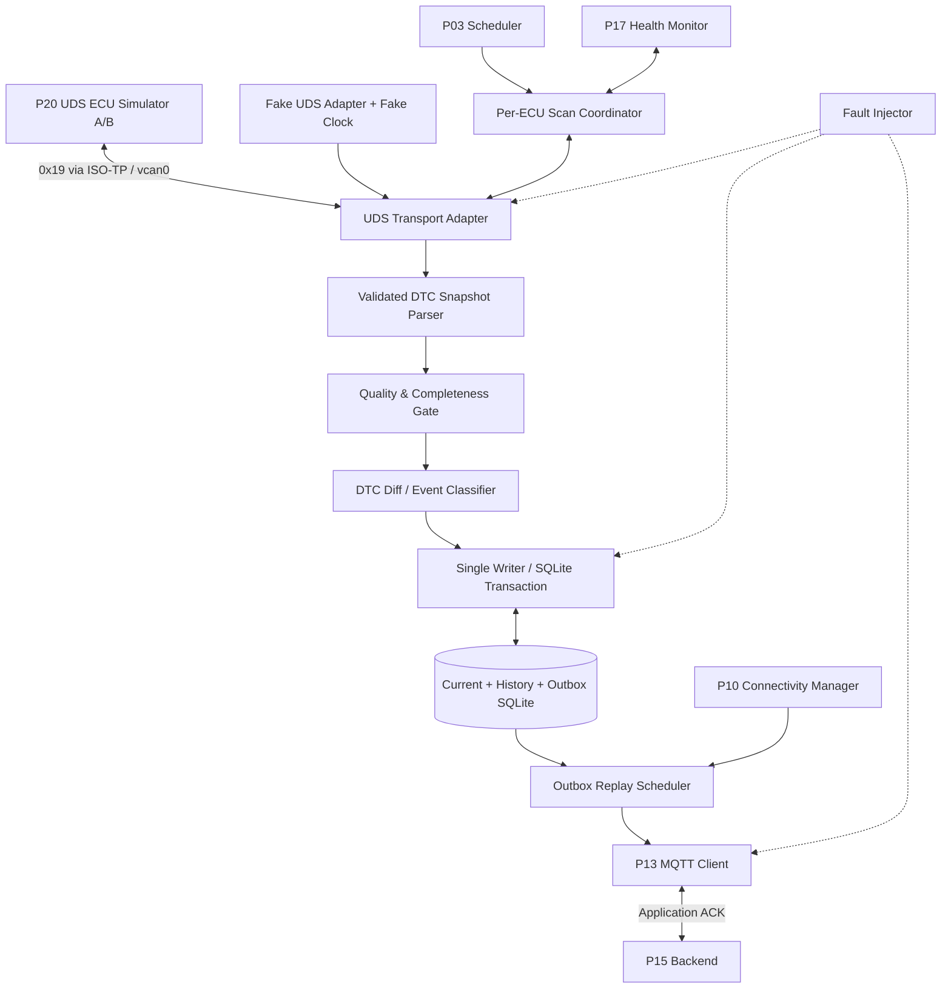
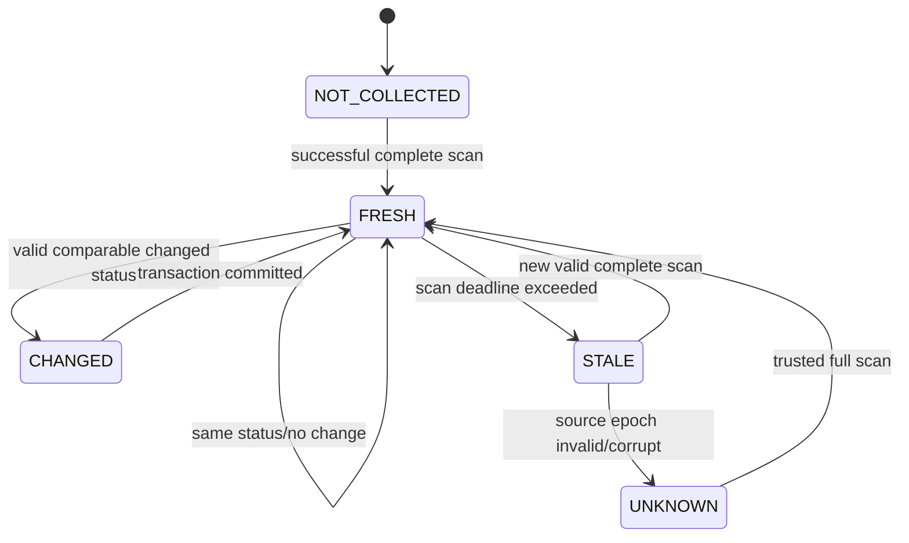
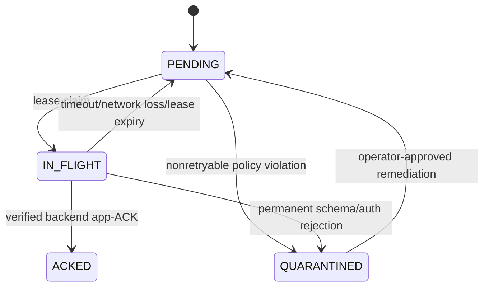
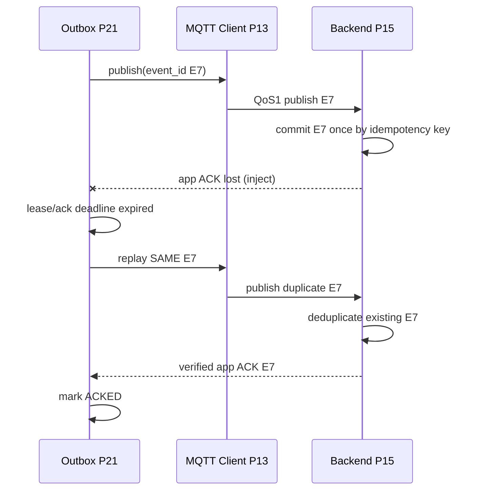

# Project 21 — DTC Collector & Uploader — System Design, Operational Behaviors & Resilience Test Plan

> **Virtual TCU Lab · Project 21/30 · C++17 · Ubuntu · Version 1.0 · 2026-10-30**  
> **Status:** System Design / Test Plan; **chưa triển khai phần mềm đầy đủ, chưa chạy các What-if test**.  
> **Chạy giả lập:** P20 UDS ECU Simulator + SocketCAN/ISO-TP `vcan0`, SQLite WAL, P13 MQTT Client, P15 Cloud Backend.  
> **Nguyên tắc:** DTC là *chẩn đoán ECU*, không đồng nghĩa mọi lỗi xe hay mọi cảnh báo; dữ liệu không chắc chắn phải được ghi nhận là `UNKNOWN/STALE`, không tự động suy ra đã sửa hoặc xóa lỗi.

## 0. Executive summary, scope và giả định

**Mục tiêu:** Tạo `dtc_collector_service` C++17 thu thập DTC từ một hoặc nhiều ECU mô phỏng qua UDS Service `0x19`, kiểm tra chất lượng dữ liệu, lưu `current state + append-only history + durable outbox` trong SQLite, gửi lịch sử thay đổi tới cloud qua MQTT và chỉ xóa outbox sau **application-level backend commit ACK hợp lệ**. Có thể giả lập toàn bộ trên Ubuntu; dùng fake transport/fake clock để kiểm thử quyết định bất biến.

**MVP:** 2 ECU giả (`ECU_POWERTRAIN_01`, `ECU_BODY_01`); scan định kỳ và scan-on-demand có rate limit; UDS `0x19/0x02 reportDTCByStatusMask` với availability mask; optional đọc thêm snapshot/extended data khi P20 hỗ trợ; current/history/metadata; anti-dup event; cloud ack; mất mạng/khôi phục; dashboard text; unit + integration + fault injection; SQLite volume persistent. **Không tự `0x14 ClearDTC`; không flash, không có lệnh điều khiển xe thực.**

**Non-goals:** ECU hardware, OEM DTC catalog thật, DTC decoding text đầy đủ như SAE J2012, AUTOSAR Dem chuẩn hóa chính thức, an toàn ASIL, DTC clear từ cloud, khám phá VIN thực, OBD inspection/diagnostic certification, guaranteed physical power-loss durability không có HIL. DTC, DID, ISO-TP addressing và timing trong tài liệu là **fixtures của lab**.

**Assumptions (configurable lab defaults, phải đo):** `scan_interval=10 s` cho 2 ECU, min backoff 1 s, max backoff 60 s; deadline mỗi scan 3 s; `max_dtc_per_ecu=512`; outbox cap 10,000 events hoặc 64 MiB; event payload cap 16 KiB; SQLite WAL + synchronous FULL (đổi profile khi phân tích durability); app ACK trong 30 s; `safe_clock` = monotonic cho deadlines, UTC dùng trong báo cáo có `time_quality`. Các số này **không phải yêu cầu OEM**.

## 1. Ngữ nghĩa DTC, nguồn dữ liệu và boundary

### 1.1 UDS ReadDTCInformation không phải bảng sự cố đơn giản

- UDS SID `0x19`, subfunction `0x02 reportDTCByStatusMask`, ví dụ lab request bytes: `19 02 FF` (yêu cầu các DTC khớp một hoặc nhiều bit có mặt trong mask và được ECU hỗ trợ). Response thành công bắt đầu `59 02 <statusAvailabilityMask>`, tiếp theo là các tuple **3 byte DTC + 1 byte status**. Chỉ parse khi PDU đã được ISO-TP reassemble hoàn chỉnh; validate độ dài tuple, giới hạn số bản ghi và response-size. `statusMask=0x00` cho tập khớp rỗng, không phải yêu cầu quét toàn bộ.
- Quy tắc lọc DTC status cho `0x19/0x02`: `(dtcStatus & requestedMask & statusAvailabilityMask) != 0`. Không được giả định bit không được hỗ trợ là 0 có nghĩa `PASSED`. Hành vi với custom subfunction/format do ECU profile quyết định.
- DTC UDS 24-bit là **ID chẩn đoán trong namespace của ECU và DTC format**, không gắn với `vehicle_id` một cách duy nhất. `0x123456` trên hai ECU có thể là hai lỗi khác nhau. Có thể có nhiều monitor/event kết hợp vào một DTC; P21 chỉ nhận status tổng hợp được ECU cung cấp.
- DTC status byte theo UDS có các bit: 0 `testFailed`, 1 `testFailedThisOperationCycle`, 2 `pendingDTC`, 3 `confirmedDTC`, 4 `testNotCompletedSinceLastClear`, 5 `testFailedSinceLastClear`, 6 `testNotCompletedThisOperationCycle`, 7 `warningIndicatorRequested`. **Không suy diễn ý nghĩa hiển thị 'active' từ một bit cố định mà không nói rõ policy**; trạng thái bit có thể được cấu hình lưu volatile hay persistent bởi ECU.
- Phân biệt **DTC code**, **UDS status byte**, **first/last observed time**, **event occurrence/transition**, **quality**, **server commit state**. `confirmedDTC` có thể vẫn set khi `testFailed` đã clear; không tự coi DTC đã giải quyết chỉ bởi bit 0 chuyển 1→0.
- Cả hai dịch vụ **ReadDTCInformation** và **ClearDiagnosticInformation** là UDS; P21 **read-only**, không phát ra SID `0x14`.

### 1.2 Data semantics: điều đã quan sát vs điều không thể kết luận

| Tình huống | Kết luận an toàn | Kết luận bị cấm |
|---|---|---|
| Lần scan toàn vẹn cho cùng mask có DTC X | Cập nhật X và lưu transition khi status thay đổi | Kết luận DTC đã được sửa từ status không liên quan |
| DTC X không có trong lần scan | Mark `NOT_OBSERVED_IN_SCAN`; đối chiếu mask, availability, completeness, policy | Tự chuyển `CLEARED`/`RESOLVED` |
| UDS timeout/partial/negative response | `SCAN_FAILED`, giữ last-known với freshness invalid/stale | Thay toàn bộ registry bằng rỗng |
| Availability mask thay đổi | Khởi tạo epoch/schema mới, so sánh chỉ các bit tương thích | Giả định ECU không hỗ trợ bit nghĩa là false |
| ECU reboot / diagnostic session reset | Revalidate source epoch, không trộn callback cũ | Dùng scan cũ làm mẫu cho ECU mới |
| Cloud PUBACK thành công | Broker accepted (nếu reason code OK) | Backend đã commit lịch sử DTC |
| Backend application ACK hợp lệ | Event `ACKED` theo `event_id`, `device_id`, `tenant_id`, payload fingerprint | ACK mọi sự kiện cùng DTC |

### 1.3 DTC example fixtures (không phải mã OEM thật)

| ECU giả | UDS DTC | Status ví dụ | Ý nghĩa trong lab |
|---|---|---|---|
| ECU_POWERTRAIN_01 | `0x123456` | `0x2F` | Synthetic sensor fault, có bit 0/1/2/3/5 |
| ECU_POWERTRAIN_01 | `0x234567` | `0x08` | Synthetic confirmed history |
| ECU_BODY_01 | `0x123456` | `0x01` | DTC code giống ECU A nhưng source khác |
| ECU_BODY_01 | `0x345678` | `0x04` | Synthetic pending DTC |

**Lưu ý:** ý nghĩa/maturity/healing của mỗi DTC do ECU simulator P20 cấu hình. DTC Collector **không tự tính debouncing, aging, operation-cycle logic của AUTOSAR Dem**, chỉ phản ánh nguồn tin và quan sát đã chuẩn hóa.

## 2. Requirements và invariants

### 2.1 Functional requirements

| ID | Requirement |
|---|---|
| FR-01 | Quét nhiều ECU với target physical addressing/cấu hình status mask riêng, không poll flood. |
| FR-02 | Parse UDS `0x19/0x02` đầy đủ; optional adapter cho snapshot/extended-data với giới hạn và allowlist. |
| FR-03 | Lưu quality, freshness, status availability, ECU/source generation, timestamp và correlation ID. |
| FR-04 | So sánh các bản quan sát cùng ECU + DTC namespace; tạo history khi có transition phù hợp policy. |
| FR-05 | Atomic transaction cho current/history/outbox; `event_id` giữ nguyên qua retry/restart. |
| FR-06 | MQTT upload khi cloud available, exponential backoff, limit in-flight, ACK + reconciliation. |
| FR-07 | Không xóa unacknowledged history; retention/privacy/schema migration có policy. |
| FR-08 | Ràng buộc stale/invalid/partial scans: không báo DTC đã clear/healthy khi thiếu evidence. |
| FR-09 | Diagnostics query API read-only qua IPC; metrics, logs có redaction, test hooks. |
| FR-10 | Recovery từ process crash, broker restart, SQLite busy, network loss và RTC jump. |
| FR-11 | Publish explicit scan-failure/source-quality events theo quota policy, không làm giả DTC status transition. |
| FR-12 | Tích hợp P20 ECU simulator, P14 outbox semantics, P15 backend idempotent store, P17 health. |

### 2.2 Invariants được kiểm tra bằng assertions/tests

1. **INV-01 — No false clearance:** absence/timeout/partial scan không tự tạo DTC clear/resolved.
2. **INV-02 — Isolation:** khóa định danh DTC phải gồm tenant/device/ECU/DTC-format/code; không lẫn hai ECU.
3. **INV-03 — Source truth:** giữ raw UDS status byte + availability mask, không sửa bằng giả định ở uploader.
4. **INV-04 — Single-writer state:** một durable history transition được commit nhiều nhất một lần theo deterministic transition key.
5. **INV-05 — Atomic durability:** current/history/outbox tương ứng được commit cùng transaction; không có history committed thiếu outbox bắt buộc (nếu policy publish).
6. **INV-06 — Delivery:** `PUBACK != backend commit`; chỉ application ACK từ trusted backend mới chuyển outbox `ACKED`.
7. **INV-07 — Ambiguity:** mất application ACK → giữ `event_id`, resend at-least-once, cloud chống duplicate; không quảng cáo exactly-once end-to-end.
8. **INV-08 — Fencing:** old response/timer/callback không được mutate state sau ECU session/config/process generation mới.
9. **INV-09 — Bounded resources:** queue, max DTC, payload, DB, worker, deadlines, logs và retry có giới hạn.
10. **INV-10 — Security:** deny-by-default subscriptions, redact private data, không chứa token/VIN thật trong test logs.
11. **INV-11 — Freshness:** không publish last-known là currently healthy/fault-free nếu source stale/UNKNOWN.
12. **INV-12 — Audit:** mỗi durable transition có source, scan ID, timestamp quality, firmware/config generation và event lineage.
13. **INV-13 — Fail-closed:** dữ liệu sai format/length, unauthenticated ACK, policy failure không được mutate authoritative state.
14. **INV-14 — Shutdown:** không deadlock, UAF, double terminal completion; stop new scans, drain/mark in-flight theo policy.
15. **INV-15 — P21 read-only:** không có path nào phát lệnh xóa lỗi 0x14 hoặc tác động ECU thật.
16. **INV-16 — No false PASS:** fault injection không xác minh được thì test `INCONCLUSIVE`.

### 2.3 Quality / NFR targets cho lab (không tuyên bố đã đo)

| Metric | Target / release gate |
|---|---|
| DTC state correctness | 0 false-clear, 0 cross-ECU contamination trong toàn bộ P0 tests |
| Memory | < 160 MiB RSS sau soak 24h trong cấu hình demo; bounded queues |
| Scan scheduling | Max 1 in-flight request per ECU; configurable max 2 ECU concurrent |
| Idle CPU | < 3% một core khi không có thay đổi DTC trong lab |
| End-to-end upload | 99% events đến trạng thái backend ACK < 30 s **khi mạng ổn định** trong test scenario đã định |
| Offline survival | 30 phút mất mạng mà không mất outbox events trong quota đã cấp |
| Recovery | Startup reconcile không xóa dữ liệu unacked, không tạo extra transition |
| Storage | Quota 64 MiB + reserve và fail-closed khi hết tài nguyên; WAL checkpoint có kiểm soát |
| Testing | 100% P0 scenario PASS có evidence; sanitizer clean; số liệu benchmark thực tế đính kèm |
| Privacy | Không thu thập VIN thật, GPS, identifier cá nhân ngoài fixture test |

**Status test runner:** `PASS`: chứng minh inject đúng + invariants đúng + evidence; `FAIL`: inject đúng và invariant sai; `INCONCLUSIVE`: injection/evidence không xác định; `SKIPPED`: môi trường không hỗ trợ và có lý do.

## 3. High-level architecture



**Trust boundaries:** Raw UDS PDU (untrusted simulator input) -> validated typed snapshot; database owner -> MQTT transport; cloud ACK (authenticated backend via trusted channel/ACL + signature where configured) -> outbox. CAN ID/UDS addressing **không chứng minh danh tính ECU ngoài giả lập**; môi trường thật cần trusted gateway/source verification.

### 3.1 Component responsibilities

| Component | Chức năng | Nguyên tắc |
|---|---|---|
| `ScanCoordinator` | Một scan per ECU, deadline, priority, cooldown, generation | Không re-enter cùng ECU khi chưa terminal |
| `IUdsDtcSource` | Async read 0x19/0x02, typed error, cancel | Không mutate SQLite trong I/O callback |
| `DtcPduParser` | Length/shape/availability/status/limits | No out-of-bounds; no heap unbounded |
| `SnapshotQualityGate` | `COMPLETE/PARTIAL/FAILED/UNTRUSTED`; freshness | Không đánh đồng count=0 với healthy |
| `DiffEngine` | Compare only comparable complete scans | No false clear; stable keys |
| `DtcRepository` | current, append-only history, scan_runs, outbox | Single-writer transaction, idempotent conflict handling |
| `OutboxReplay` | claim leases, MQTT publish, retry/reconcile | Preserve event IDs, no success on PUBACK alone |
| `ApplicationAckHandler` | verify ACK identity/correlation/result | Auth, scope and fingerprint check |
| `PolicyStore` | immutable config version; allowlisted ECU/mask | Atomic reload, epoch fence |
| `Metrics/Audit` | counters, histograms, evidence | Bounded, no private payload leak |

### 3.2 Integration with previous projects

| Project | Sử dụng | Contract |
|---|---|---|
| P01/P02/P03/P04 | event bus, IPC, scheduler, config/logging | non-blocking events, cancel/stop, immutable generations |
| P05/P06/P07 | vcan, signals, Gateway, fault injection | source quality + no CAN ID trust assumption |
| P10/P11 | connectivity status, network fault injector | cloud-ready signal chỉ điều tiết retry, không làm giả delivery |
| P13/P14/P15 | MQTT, durable outbox, backend app ACK | event idempotency, ACK verification, no double count |
| P17 | Health monitoring | Alert when DTC scan is stale/unavailable (không giả DTC repaired) |
| P20 | UDS diagnostic server | 0x19, DTC source, deterministic fixtures, no destructive call |

## 4. Data model and state machine

### 4.1 Typed fields

| Field | Type | Chú thích |
|---|---|---|
| `tenant_id`, `device_id`, `ecu_id` | bounded string | lab synthetic identity; separate failure domains |
| `dtc_format`, `dtc_number` | uint8 / uint24 packed in uint32 | preserve leading hex zeros when rendered |
| `status`, `status_availability_mask` | uint8 | original ECU truth + support mask |
| `scan_id`, `source_epoch`, `config_epoch` | uint64/UUID | stale callbacks blocked |
| `quality` | enum | COMPLETE / PARTIAL / FAILED / STALE / UNTRUSTED |
| `event_id` | UUID v4 or generated unique | created once when transition journaled |
| `transition_seq` | uint64 per device/ECU | monotonic local journal order |
| `observed_mono_ns` | uint64 since boot | freshness only within same process/boot epoch |
| `observed_utc`, `time_quality` | ISO8601 + enum | do not trust RTC jump |
| `payload_hash`, `schema_version` | bytes/uint | verify replay identity, migration |

### 4.2 Snapshot, transition, outbox



`DTC Current State` và `DTC History Event` **không sử dụng cùng một state machine**: current có `observed_quality`; history lưu transition bất biến; outbox có `PENDING -> IN_FLIGHT -> ACKED`, và từ `IN_FLIGHT` có thể trở lại `PENDING` khi timeout/lease expired; `DEAD_LETTER` cần operator review, không có implicit data deletion.



### 4.3 Operational sequencing

**Full scan + atomic event creation:**

```mermaid
sequenceDiagram
    participant S as Scan Coordinator
    participant U as UDS ECU P20
    participant D as DiffEngine
    participant DB as SQLite
    participant O as Outbox
    S->>U: 19 02 FF (per-ECU)
    U-->>S: 59 02 availability + DTC/status list
    S->>S: validate length, coverage, epoch and quality
    S->>D: immutable complete snapshot
    D->>DB: BEGIN IMMEDIATE
    DB->>DB: upsert current; append transitions
    DB->>DB: insert outbox(event_id per transition)
    DB-->>D: COMMIT
    D->>O: notify committed outbox
```

**Cloud ACK lost:**



**Partial scan:**

```mermaid
sequenceDiagram
    participant S as Scan Coordinator
    participant U as ECU
    participant DB as Repository
    S->>U: 19 02 FF
    U--xS: fragmented/incomplete response
    S->>DB: record SCAN_FAILED with quality evidence
    DB->>DB: keep DTC last-known; mark freshness STALE
    Note over DB: Do not generate CLEAR/RESOLVED event
```

### 4.4 SQLite schema (lab executable SQL)

```sql
PRAGMA foreign_keys=ON;
PRAGMA journal_mode=WAL;
PRAGMA synchronous=FULL;
PRAGMA busy_timeout=3000;

CREATE TABLE IF NOT EXISTS scan_runs (
  scan_id TEXT PRIMARY KEY,
  tenant_id TEXT NOT NULL, device_id TEXT NOT NULL, ecu_id TEXT NOT NULL,
  source_epoch INTEGER NOT NULL CHECK(source_epoch>=0),
  config_epoch INTEGER NOT NULL CHECK(config_epoch>=0),
  requested_mask INTEGER NOT NULL CHECK(requested_mask BETWEEN 0 AND 255),
  availability_mask INTEGER CHECK(availability_mask BETWEEN 0 AND 255),
  outcome TEXT NOT NULL CHECK(outcome IN ('COMPLETE','PARTIAL','FAILED','UNTRUSTED')),
  time_quality TEXT NOT NULL CHECK(time_quality IN ('TRUSTED','UNTRUSTED','UNKNOWN')),
  started_at_utc TEXT, completed_at_utc TEXT,
  error_code TEXT, record_count INTEGER NOT NULL DEFAULT 0 CHECK(record_count>=0)
);

CREATE TABLE IF NOT EXISTS dtc_current (
  tenant_id TEXT NOT NULL, device_id TEXT NOT NULL, ecu_id TEXT NOT NULL,
  dtc_format INTEGER NOT NULL CHECK(dtc_format BETWEEN 0 AND 255),
  dtc_number INTEGER NOT NULL CHECK(dtc_number BETWEEN 0 AND 16777215),
  status INTEGER NOT NULL CHECK(status BETWEEN 0 AND 255),
  availability_mask INTEGER NOT NULL CHECK(availability_mask BETWEEN 0 AND 255),
  quality TEXT NOT NULL CHECK(quality IN ('FRESH','STALE','UNKNOWN','UNTRUSTED')),
  first_seen_scan TEXT NOT NULL REFERENCES scan_runs(scan_id),
  last_seen_scan TEXT NOT NULL REFERENCES scan_runs(scan_id),
  source_epoch INTEGER NOT NULL, config_epoch INTEGER NOT NULL,
  observed_utc TEXT, time_quality TEXT NOT NULL,
  PRIMARY KEY(tenant_id,device_id,ecu_id,dtc_format,dtc_number)
);

CREATE TABLE IF NOT EXISTS dtc_history (
  event_id TEXT PRIMARY KEY,
  tenant_id TEXT NOT NULL, device_id TEXT NOT NULL, ecu_id TEXT NOT NULL,
  dtc_format INTEGER NOT NULL CHECK(dtc_format BETWEEN 0 AND 255),
  dtc_number INTEGER NOT NULL CHECK(dtc_number BETWEEN 0 AND 16777215),
  old_status INTEGER CHECK(old_status BETWEEN 0 AND 255),
  new_status INTEGER NOT NULL CHECK(new_status BETWEEN 0 AND 255),
  availability_mask INTEGER NOT NULL CHECK(availability_mask BETWEEN 0 AND 255),
  transition_kind TEXT NOT NULL CHECK(transition_kind IN ('FIRST_OBSERVED','STATUS_CHANGED','SOURCE_RESET','QUALITY_CHANGED')),
  transition_seq INTEGER NOT NULL CHECK(transition_seq>=1),
  scan_id TEXT NOT NULL REFERENCES scan_runs(scan_id),
  source_epoch INTEGER NOT NULL, observed_utc TEXT, time_quality TEXT NOT NULL,
  payload_hash TEXT NOT NULL,
  UNIQUE(tenant_id,device_id,ecu_id,transition_seq)
);

CREATE TABLE IF NOT EXISTS dtc_outbox (
  event_id TEXT PRIMARY KEY REFERENCES dtc_history(event_id) ON DELETE RESTRICT,
  state TEXT NOT NULL CHECK(state IN ('PENDING','IN_FLIGHT','ACKED','QUARANTINED')),
  attempt_count INTEGER NOT NULL DEFAULT 0 CHECK(attempt_count>=0),
  lease_owner TEXT, lease_generation INTEGER NOT NULL DEFAULT 0,
  lease_until_mono_ns INTEGER,
  next_attempt_utc TEXT, acked_at_utc TEXT,
  last_error TEXT, payload_hash TEXT NOT NULL
);

CREATE TABLE IF NOT EXISTS backend_ack_receipts (
  event_id TEXT PRIMARY KEY REFERENCES dtc_outbox(event_id),
  tenant_id TEXT NOT NULL, device_id TEXT NOT NULL,
  backend_commit_id TEXT NOT NULL,
  payload_hash TEXT NOT NULL, received_at_utc TEXT
);

CREATE INDEX IF NOT EXISTS ix_outbox_ready ON dtc_outbox(state,attempt_count,next_attempt_utc);
CREATE INDEX IF NOT EXISTS ix_hist_dtc ON dtc_history(tenant_id,device_id,ecu_id,dtc_number,transition_seq);
CREATE INDEX IF NOT EXISTS ix_scan_ecu ON scan_runs(tenant_id,device_id,ecu_id,started_at_utc);
```

**Durability notes:** Với WAL + `synchronous=FULL`, SQLite thêm sync tại transaction commit để hỗ trợ durability trên filesystem/storage tôn trọng sync. Không giả định SSD/VM/host thật giữ được khi mất điện nếu backing store không tuân thủ. Các test kill-process không thay thế power-cut/HIL. WAL readers dài có thể làm checkpoint không hoàn tất và WAL phình; phải thu metrics/kịch bản riêng.

**Crash-atomic update:** viết một transaction `BEGIN IMMEDIATE`; insert `scan_runs`, read/compare current, insert `dtc_history` và `dtc_outbox` với **cùng deterministic event lineage**, upsert `dtc_current`, `COMMIT`. Chỉ báo success sau COMMIT; SQLITE_BUSY retry có budget; disk full/quota => `DEGRADED`, không báo persisted. SQLite unique constraint chống ghi transition trùng khi retry. `lease_until_mono_ns` chỉ có nghĩa trong **cùng boot/process generation**; sau restart phải reclaim leases bằng recovery epoch thay vì so sánh timestamp monotonic giữa hai boot.

## 5. API C++17 design

```cpp
#pragma once
#include <cstdint>
#include <chrono>
#include <future>
#include <optional>
#include <string>
#include <vector>

using DtcCode = std::uint32_t; // only low 24 bits are valid

enum class Quality { Complete, Partial, Failed, Untrusted, Stale };
enum class Error { Timeout, Transport, Malformed, Busy, Unauthorized, Storage, Stopped };

struct DtcEntry {
    DtcCode code;
    std::uint8_t status;
};
struct DtcSnapshot {
    std::string ecu_id;
    std::uint8_t requested_mask;
    std::uint8_t availability_mask;
    std::uint64_t source_epoch;
    std::uint64_t config_epoch;
    Quality quality;
    std::vector<DtcEntry> entries;
};
struct ScanRequest {
    std::string ecu_id;
    std::uint8_t status_mask{0xFF};
    std::chrono::milliseconds deadline{3000};
};
struct ScanOutcome {
    std::string scan_id;
    Quality quality;
    std::size_t dtc_count{};
    std::optional<Error> error;
};

class IUdsDtcSource {
public:
    virtual ~IUdsDtcSource() = default;
    // Async source completion always carries ECU/source/config generation.
    virtual std::future<DtcSnapshot> readAsync(const ScanRequest&) = 0;
};
class IDtcRepository {
public:
    virtual ~IDtcRepository() = default;
    virtual bool commitSnapshot(const DtcSnapshot& snapshot,
                                const std::string& scan_id) = 0;
};
class ICloudPublisher {
public:
    virtual ~ICloudPublisher() = default;
    virtual bool publish(const std::string& event_id,
                         const std::string& serialized_payload) = 0;
};
class IDtcCollectorService {
public:
    virtual ~IDtcCollectorService() = default;
    virtual std::future<ScanOutcome> scan(const ScanRequest&) = 0;
    virtual void start() = 0;
    virtual void stop() = 0;
};
```

**Production refinement:** transport returns typed `Result<Snapshot,SourceError>` (C++17 custom/`std::variant`), no blind `future.get()` in I/O thread, typed `SourceIdentity`, `DtcKey`, `Chrono` injection, cancellable operation handles, `SnapshotCompleteness` evidence and immutable configuration. Never hold DB mutex across network publish.

### 5.1 Concurrency & resource controls

- `ScanCoordinator` event loop is single-writer for per-ECU scanning state; transport I/O completion posts `(scan_id,ecu_id,source_epoch,config_epoch)` back to bounded event queue.
- `DtcRepository` has one SQLite writer thread/connection; readers use separate read-only connections with short transactions. Avoid shared `sqlite3*` across callback threads without strict connection policy.
- Outbox claim is transactional; there is one owner per event lease generation; reclaim on restart; late ACK may still be valid if event ID + identity/hash match, but late publish callbacks must not undo newer terminal state.
- Busy/overload => coalesce repeated scan requests, never unbounded spawn; critical DTC transitions preserved under storage quota policy as far as possible; if not possible report explicit data loss/risk, no pretend ACK.
- Config hot reload: validate complete snapshot; atomic swap config epoch; active scan old epoch may finish for audit but cannot update current with incorrect mapping; baseline new epoch required for incompatible catalog changes.
- Shutdown: `RUNNING -> QUIESCING -> FLUSHING -> STOPPED`; stop new scans, cancel transport safely, drain writer within timeout, do not claim app ACK on network disconnect; metrics describe unfinished outbox.

### 5.2 Key flow pseudocode

```text
on_scan_completed(response, epoch):
  if epoch != current_scan_epoch or config_generation mismatched:
      record_stale_callback(); return
  snapshot = validate_UDS_19_response(response)
  if !snapshot.complete: record_failed_scan_keep_last_known(); return
  begin_immediate_txn()
  write_scan_run()
  for each DTC entry:
      key = (tenant,device,ecu,dtc_format,code)
      if first_seen OR comparable_status_transition:
          event_id = stable_id_for_scan_transition(scan_id,key,status,kind)
          upsert_history_and_outbox(event_id)
      update_current_fresh_status_and_provenance()
  for previously_seen_DTC_missing_in_new_scan:
      set_observation_quality_without_emitting_clear_event()
  COMMIT()

on_mqtt_puback(event_id):
  record_transport_ack_only(); // never mark outbox ACKED
on_authenticated_backend_ack(event_id, tenant, device, hash, commit_id):
  verify_scope_and_hash()
  BEGIN_IMMEDIATE()
  insert_or_verify_ack_receipt(); mark_outbox_ACKED_if_matching()
  COMMIT()
```

## 6. Behavioral contracts (Given / When / Then)

| Contract | Given | When | Then |
|---|---|---|---|
| BC-01 | ECU responds complete with DTC new | scan arrives | new current + first history + outbox atomic |
| BC-02 | Same status in two comparable scans | second scan arrives | update last seen, do **not** create duplicate transition |
| BC-03 | Status `0x01` becomes `0x08` | complete scans compare | append explicit status transition; no misleading `CLEARED` |
| BC-04 | Last scan had X; current scan failed | timeout | retain last-known X, mark `STALE`, no resolved event |
| BC-05 | DTC X disappears from status-mask response | complete scan | mark not observed under mask only, no clear assumption |
| BC-06 | PDU has 5 bytes after header | parser invoked | reject misaligned entry; no mutation |
| BC-07 | ECU A and B share same DTC code | both scan | distinct states and history rows |
| BC-08 | Incoming scan generation is old | new source epoch active | discard old result for state; audit as stale |
| BC-09 | DB commit failed | in-memory diff produced | do not report durable success or publish event not committed |
| BC-10 | MQTT PUBACK received | backend still processing | outbox remains unacked |
| BC-11 | Backend committed, app ACK lost | retry triggered | same event_id, duplicate tolerated by cloud |
| BC-12 | APP ACK claims wrong vehicle/hash | handler invoked | reject, record security metric |
| BC-13 | Shutdown overlaps scanner completion | stop called | one terminal scan result, no UAF/deadlock |
| BC-14 | 100k identical source snapshots | storm | dedup bounded, O(1) current state per DTC |
| BC-15 | RTC jumps backward | stale computation | monotonic/fenced timers, `time_quality` downgraded |
| BC-16 | Disk quota exhausted | required transition arrives | explicit degraded/error; never silently claim stored |
| BC-17 | Source returns zero records + mask unsupported | scan closes | not `HEALTHY`; quality/coverage preserved |
| BC-18 | Scanner resumes after crash | journal read | no fabricated transitions; reclaim old leases safely |
| BC-19 | Source DTC status availability changes | next scan | compare supported bits, record coverage change |
| BC-20 | Cloud sends ClearDTC demand | P21 receives | reject; write operation not implemented here |

## 7. Security, privacy and threat model

- **Identity:** MQTT authenticated identity comes from trusted broker/backend configuration, not `device_id` string inside payload alone. Signed ACKs optional if end-to-end domain demands; authorization checks tenant/device/event lineage.
- **Input:** UDS response PDU may be truncated/oversized/malformed; parser bounds every offset/count, rejects duplicate/conflicting tuples according to explicit lab policy.
- **Private data:** DTC snapshots and extended diagnostic records could contain driving/user information; test fixtures only; redact VIN/GPS/identifiers, configure retention, encrypt storage if product requirement.
- **No active control:** P21 does not expose dangerous UDS services; no ClearDTC, unlock, reset, firmware flash, or unsafe gateway control.
- **Network:** TLS verification strict; certificate expiry/revocation => disconnect/degrade; no insecure fallback. Topic ACL must bind tenant/device.
- **Resource attacks:** source event flood, queued UDS scans, large MQTT payload, malformed ACK, SQLite lock exhaustion, gzip/decompression bombs if added later; rate limits and size bounds.
- **Policy:** allowlisted ECU IDs/UDS masks; dynamic config signed/validated as needed; generation invalidates old subscriptions/callbacks.

## 8. Observability and fault-injection strategy

| Metric | Đơn vị / expected check |
|---|---|
| `dtc_scan_started_total`, `dtc_scan_complete_total` | count by ecu, status mask, config generation |
| `dtc_scan_failed_total{reason}` | timeout, transport, NRC, malformed, over-limit |
| `dtc_state_stale_total`, `dtc_false_clear_guard_total` | no false healthy state |
| `dtc_transition_committed_total` | count; equals durable history growth |
| `dtc_outbox_pending`, `dtc_outbox_oldest_age_seconds` | cap, retry and backlog |
| `dtc_ack_rejected_total{reason}` | auth, wrong scope, unknown event, payload mismatch |
| `dtc_publish_attempt_total`, `dtc_puback_total`, `dtc_backend_ack_total` | count distinct stages, never merge |
| `dtc_late_callback_dropped_total`, `dtc_scan_queue_depth` | fencing and load |
| `dtc_db_busy_seconds`, `dtc_db_wal_bytes`, `dtc_db_write_fail_total` | storage stress |
| `dtc_data_loss_risk_total`, `dtc_degraded_mode` | explicitly surface unsupported retention |

**Test evidence:** seed/config, source ECU transcript, captured UDS PDU, `scan_id`, event/transition ID, SQLite transaction result, broker capture, backend commit+ack receipts, metrics counters, timeline via fake clock, sanitizer output, CPU/memory/FD delta, cleanup logs. Use anonymized fixture only.

**Fault-injection points:** fake ECU response/negative response/delay/duplicate/reordered, `vcan0` interface up/down, ISO-TP timeout, mock clock/RTC leap, SQLite step/begin/commit/busy/full/corruption, kill -9 between DB steps, MQTT ack drop, backend ACK wrong scope, reconnect callbacks, shutdown, quota, config generation swap, process signal.

## 9. Test execution and prioritization

- **P0:** correctness/false-clear, data loss, idempotency, auth, critical race, resource bounds, crash recovery; gate release.
- **P1:** degraded UX, metrics, retries, configuration edge cases, performance and soak.
- **P2:** optional extended data/cross-version/multi-ECU exotic patterns.
- Run order: deterministic unit tests -> SQLite transaction crash tests -> fake UDS protocol tests -> SocketCAN ISO-TP integration -> MQTT/backend E2E -> multi-fault -> soak/fuzz/sanitizers.
- Model/property-based tests: assert `INV-01..16` after random sequences of `ScanSuccess`, `ScanFailed`, `ECUReset`, `DBFailure`, `NetworkLost`, `AckLost`, `AckArrives`, `ConfigReload`, `Shutdown`.
- **Không có số lượng testcase hữu hạn nào chứng minh bao phủ “mọi” lỗi**: dùng hazard analysis, mutation testing và telemetry thực tế để tiếp tục mở rộng.

## 10. What-if catalog — 300 test cases / 30 failure domains

**Định dạng mỗi case:** `ID | What if | Cách inject | Expected behavior | Bằng chứng | Priority`. Mỗi case được cụ thể hóa để có thể tạo thành automated test; bảng là test plan, **chưa phải execution report**. Mặc định luôn kiểm tra thêm `INV-01..INV-16`, leak/deadlock, cleanup và audit lineage.

### 10.1 01 — UDS parser, layout và DTC identity

| ID | What if? | Inject / steps | Expected behavior | Evidence / oracle | Priority |
|---|---|---|---|---|---|
| DTC-WI-01-01 | Response rỗng | Inject PDU empty | Reject malformed, không cập nhật DB | parser error + unchanged rowcount | P0 |
| DTC-WI-01-02 | SID sai 0x58 | Fake ECU sends 58 02 FF | Reject wrong service reply | captured bytes + reject metric | P0 |
| DTC-WI-01-03 | Subfunction sai 0x03 | Fake 59 03 payload | Reject response for wrong outstanding request | request correlation log | P0 |
| DTC-WI-01-04 | Thiếu availability mask | Fake 59 02 | Reject truncated header | bounds test + no mutation | P0 |
| DTC-WI-01-05 | DTC tuple 3 byte thiếu status | Fake 59 02 FF 12 34 56 | Reject misaligned tail, no partial commit | parser failure + DB snapshot | P0 |
| DTC-WI-01-06 | Response chứa 512 DTCs đúng giới hạn | Inject 512 unique entries | Accept exactly max, bounded alloc | parsed count + RSS profile | P1 |
| DTC-WI-01-07 | Response chứa 513 DTCs | Exceed configured max | Reject rather than truncate silently | reject metric + no partial commit | P0 |
| DTC-WI-01-08 | DTC trùng code khác status trong cùng PDU | Send 2 tuples with same code differing status | Reject inconsistent snapshot by policy | duplicate conflict log | P0 |
| DTC-WI-01-09 | DTC code 0x000001 và 0x010001 | Send similar bytes | Preserve full 24-bit key, no collision | DB keys + tests | P0 |
| DTC-WI-01-10 | ECU A/B cùng 0x123456 | Send two ECU responses | Isolate DTC by ecu_id, no merge | two current rows | P0 |

### 10.2 02 — Status byte & availability mask

| ID | What if? | Inject / steps | Expected behavior | Evidence / oracle | Priority |
|---|---|---|---|---|---|
| DTC-WI-02-01 | Status bit0 đổi 1 sang 0, bit3 giữ 1 | Inject status 0x09 -> 0x08 | Record status change, not universal resolved | history rows + UI semantics | P0 |
| DTC-WI-02-02 | Status 0x00 trong entry hợp lệ | ECU returns entry with zero status | Preserve raw status; policy decides event type | raw vs stored byte | P0 |
| DTC-WI-02-03 | Mask 0x00 yêu cầu trả rỗng | Scan request mask 00 | Do not conclude ECU fault-free | coverage marker + no clear | P0 |
| DTC-WI-02-04 | Mask FF và availability 0F | ECU reports support 0x0F | Only compare supported bits | stored masks + diff trace | P0 |
| DTC-WI-02-05 | Availability đổi 0F sang FF | New ECU firmware profile | Trigger compatibility rebaseline, no false transitions | epoch + baseline flag | P0 |
| DTC-WI-02-06 | Availability đổi FF sang 00 | Adapter returns no supported bits | Mark coverage insufficient | no clear event + quality | P0 |
| DTC-WI-02-07 | Status có bit không được hỗ trợ | Inject 0x80 with avail 0x0F | Reject or quarantine per explicit validation policy | flagged mismatch + no trusted transition | P0 |
| DTC-WI-02-08 | DTC pending và confirmed cùng bật | status 0x0C | Keep bitset, do not force one label | exact byte persisted | P1 |
| DTC-WI-02-09 | Read snapshot khi testNotCompleted bit bật | status 0x40 | Do not mislabel as PASS | display/read API assertion | P0 |
| DTC-WI-02-10 | Bit 7 warning requested chỉ nhấp nháy | Change 0x80 -> 0x00 on repeated scan | Record actual transition; no guessed MIL behavior | status events + fixture | P1 |

### 10.3 03 — ECU identity / multi-source

| ID | What if? | Inject / steps | Expected behavior | Evidence / oracle | Priority |
|---|---|---|---|---|---|
| DTC-WI-03-01 | ECU ID rỗng | Inject missing source identity | Reject snapshot before persistence | rejection counter | P0 |
| DTC-WI-03-02 | ECU ID chưa allowlist | Fake source unknown ecu | Do not create registry row | DB no new ECU | P0 |
| DTC-WI-03-03 | Mất liên kết ECU-target khi gateway đổi route | Change gateway mapping mid-scan | Fence source epoch and quarantine reply | route epoch evidence | P0 |
| DTC-WI-03-04 | Hai ECU trả lời cùng diagnostic address do config | Configure duplicate target mapping | Reject conflicting config atomically | config error + no scans | P0 |
| DTC-WI-03-05 | ECU A reboot, B bình thường | Restart only one mock ECU | Invalidate A epoch, B unaffected | per-ECU state trace | P0 |
| DTC-WI-03-06 | Duplicate response from prior ECU instance | Replay captured old response | Reject via request correlation/epoch | late drop metric | P0 |
| DTC-WI-03-07 | ECU đổi DTC format | Switch format ID in config generation | Rebaseline, don't coalesce different formats | current composite keys | P0 |
| DTC-WI-03-08 | Device đổi tenant bằng config reload | Swap ownership while scans in-flight | Old tenant results never enter new tenant | tenant isolation audit | P0 |
| DTC-WI-03-09 | CAN ID giả mạo trong lab | Inject frame same CAN ID from second process | Do not claim authenticated source; flag uncertain trust profile | trust quality + logs | P1 |
| DTC-WI-03-10 | ECU connector unavailable | Remove ECU from allowlist | Stop scans safely, preserve history under retention | no further requests + history exists | P0 |

### 10.4 04 — Scan scheduler & polling

| ID | What if? | Inject / steps | Expected behavior | Evidence / oracle | Priority |
|---|---|---|---|---|---|
| DTC-WI-04-01 | Periodic scan đúng deadline | Advance fake clock 10s | One scan scheduled per eligible ECU | schedule timestamps | P1 |
| DTC-WI-04-02 | Manual scan và periodic trùng | Queue manual trigger at timer expiry | Coalesce or serialize, never parallel same ECU | in-flight counter <=1 | P0 |
| DTC-WI-04-03 | 1000 manual scan requests/s | Flood CLI | Bound queue, rate-limit and return Busy | queue depth + rejection | P0 |
| DTC-WI-04-04 | ECU scan mất >3s | Delay fake response past deadline | Timeout terminal once, no blind retry storm | scan outcome + retry timer | P0 |
| DTC-WI-04-05 | Scan complete đúng tick timeout | Interleave callback and expiry | Exactly one terminal outcome | invariant assertion | P0 |
| DTC-WI-04-06 | One ECU luôn slow | Delay ECU A, B normal | B continues per concurrency policy | separate per-ECU latency | P1 |
| DTC-WI-04-07 | Ignition OFF low-power profile | Publish P22 sleep intent | Pause scans without busy poll | CPU metrics + scheduling | P0 |
| DTC-WI-04-08 | Resume after 30min sleep | Wake TCU | Rebaseline freshness, bounded catch-up | no scan burst | P1 |
| DTC-WI-04-09 | Backoff after consecutive UDS failures | Return 0x21/timeout repeatedly | Exponential backoff with bounded jitter | fake clock intervals | P0 |
| DTC-WI-04-10 | Clock wall-time jump backward | Change system UTC in fake clock | Deadlines steady_clock, no negative wait | interval traces | P0 |

### 10.5 05 — UDS negative responses & session

| ID | What if? | Inject / steps | Expected behavior | Evidence / oracle | Priority |
|---|---|---|---|---|---|
| DTC-WI-05-01 | NRC 0x78 response pending | ECU sends valid pending then final | Wait within bounded P2* policy; no premature commit | pending and final trace | P0 |
| DTC-WI-05-02 | NRC 0x78 forever | Continue pending without final | Enforce maximum total deadline, mark FAILED | timeout metric | P0 |
| DTC-WI-05-03 | NRC 0x21 busy | Return busy-repeat-request | Bounded retry with backoff, no spin | retry histogram | P0 |
| DTC-WI-05-04 | NRC 0x31 request out of range | ECU rejects status mask | Mark scan config invalid, no fabricated list | error code + no update | P0 |
| DTC-WI-05-05 | NRC 0x33 security access denied | Return security NRC | Do not brute-force unlock; degrade read capability | no 0x27 attacks | P0 |
| DTC-WI-05-06 | NRC 0x7E session restriction | Use wrong diagnostic session | Report policy mismatch; optional safe session handshake | session logs | P1 |
| DTC-WI-05-07 | S3 expires mid-request | Invalidate ECU session | Re-establish only per allowed policy; ignore stale result | session epoch evidence | P0 |
| DTC-WI-05-08 | NRC 0x13 malformed response path | Fake ECU negative for wrong request length | Correctly classify application rejection | error enum | P1 |
| DTC-WI-05-09 | Positive response after negative terminal | Inject two terminal responses | First valid terminal only; later quarantined | callback completion counter | P0 |
| DTC-WI-05-10 | TesterPresent races scan | Inject 0x3E via shared transport | Serialize per ECU diagnostic context | no interleaved outstanding request | P0 |

### 10.6 06 — ISO-TP, CAN network & transport

| ID | What if? | Inject / steps | Expected behavior | Evidence / oracle | Priority |
|---|---|---|---|---|---|
| DTC-WI-06-01 | ISO-TP FirstFrame mất | Drop first frame | Transport timeout; no partial snapshot | socket error + DB unchanged | P0 |
| DTC-WI-06-02 | Consecutive frame mất giữa DTC list | Drop CF 2 | No partial DTC commit | rx trace + scan failure | P0 |
| DTC-WI-06-03 | CF order sai | Reorder transport frames in simulator | Reject incomplete assembly | transport failure metric | P0 |
| DTC-WI-06-04 | Flow Control không đến | Suppress FC | Bounded timeout, no infinite wait | latency cap | P0 |
| DTC-WI-06-05 | vcan0 interface DOWN | ip link set vcan0 down | Mark source unavailable, retain history | interface + scan state | P0 |
| DTC-WI-06-06 | vcan0 UP trong lúc retry | Bring interface back mid-backoff | Resume according to bounded schedule | accepted scan + rate metrics | P0 |
| DTC-WI-06-07 | ISO-TP socket bị đóng giữa receive | Close socket from fixture | Cancel request, recover adapter safely | no UAF sanitizer | P0 |
| DTC-WI-06-08 | ECU PDU > configured max | Send oversized reassembled payload | Reject before allocation above quota | alloc budget + reject | P0 |
| DTC-WI-06-09 | UDS response đến từ wrong address | Swap source/response mapping in fake transport | Reject mismatch | addr logs and no commit | P0 |
| DTC-WI-06-10 | Gateway restart trong lúc poll | Kill/restart P07 process | Ignore old partial PDU, new scan after reconnect | transport generation trace | P0 |

### 10.7 07 — Snapshot completeness & absence

| ID | What if? | Inject / steps | Expected behavior | Evidence / oracle | Priority |
|---|---|---|---|---|---|
| DTC-WI-07-01 | Scan trả 0 DTC trên mask 0xFF | Return full valid empty with supported bits | Record zero matching results only; no automatic clear | no resolved event | P0 |
| DTC-WI-07-02 | Scan trả 0 DTC trên mask 0x01 | Filter out confirmed-only DTC | Do not declare all DTCs gone | current rows preserved | P0 |
| DTC-WI-07-03 | ECU trả 3 entries rồi timeout | Deliver truncated PDU | No partial apply, quality FAILED | current checksum unchanged | P0 |
| DTC-WI-07-04 | ECU response đầy đủ nhưng metadata thiếu | Omit ECU source mapping | Reject or mark UNTRUSTED | scan status | P0 |
| DTC-WI-07-05 | DTC biến mất rồi xuất hiện lại | Alternate complete snapshots | Record observation gap per policy, no inferred repair | history timeline | P0 |
| DTC-WI-07-06 | Scan hai mask khác nhau so sánh | Switch 0xFF to 0x08 | Compare only consistent covered bits | coverage decision log | P0 |
| DTC-WI-07-07 | ECU reset làm cache sạch | Restart P20 with empty repository | Record epoch reset, no false cleared event | source epoch + history | P0 |
| DTC-WI-07-08 | DTC đã aging trong ECU | Change P20 monitor state to remove code | Distinguish ECU-reported absence from explicit clear | absence marker | P0 |
| DTC-WI-07-09 | ECU trả count 0x19/0x01 lệch list 0x02 | Inject count/list mismatch | Warn inconsistent scan/optional cross-check; no bogus clearance | count mismatch metric | P1 |
| DTC-WI-07-10 | Hot reload filter mask trong scan | Swap mask while response in flight | Fence old result and new baseline | no mixed-mask history | P0 |

### 10.8 08 — Status transitions / deduplication

| ID | What if? | Inject / steps | Expected behavior | Evidence / oracle | Priority |
|---|---|---|---|---|---|
| DTC-WI-08-01 | Hai scan status y hệt | Replay identical complete snapshot | Do not create second transition | count history stable | P0 |
| DTC-WI-08-02 | Status liên tục 01 00 01 | Send 3 sequential full snapshots | Preserve ordered transitions, don't coalesce true changes | transition sequence | P0 |
| DTC-WI-08-03 | Cùng scan_id xử lý lại sau retry | Replay DB handler call | Idempotent insert, 1 history/outbox | UNIQUE result | P0 |
| DTC-WI-08-04 | DTC status đổi trong lúc DB transaction | Deliver new scan before prior commit | Serialize and preserve source order | per-ECU seq monotonic | P0 |
| DTC-WI-08-05 | Cross-ECU identical event IDs từ mock | Inject collision | Generate globally unique or scoped deterministic IDs | uniqueness and no data loss | P0 |
| DTC-WI-08-06 | DTC format field omitted | Unknown format snapshot | Reject until format resolved | no merged events | P0 |
| DTC-WI-08-07 | Status changes under incompatible mask | Old FF new 0F with bit 7 only | No false transition for unsupported bit | comparison trace | P0 |
| DTC-WI-08-08 | Duplicate tuples identical trong response | Same DTC/status repeated | Dedup per documented policy or reject; never double event | one event, explicit metric | P1 |
| DTC-WI-08-09 | Scan complete source epoch equal but config changed | P04 reload unrelated log level | No unintended DTC reset for compatible config | config compatibility trace | P1 |
| DTC-WI-08-10 | Source status not fresh but same status | Delay timestamp beyond freshness budget | Mark freshness stale, no false recent observation | time_quality + age | P0 |

### 10.9 09 — SQLite transaction & durability

| ID | What if? | Inject / steps | Expected behavior | Evidence / oracle | Priority |
|---|---|---|---|---|---|
| DTC-WI-09-01 | Crash trước BEGIN | Kill process before transaction | No reported durable event | DB unchanged | P0 |
| DTC-WI-09-02 | Crash sau history insert trước outbox insert | SIGKILL at injection point | Entire transaction rolls back | current/history/outbox counts | P0 |
| DTC-WI-09-03 | Crash sau outbox insert trước COMMIT | Kill writer process | Atomic rollback and reconcile | integrity_check + rows | P0 |
| DTC-WI-09-04 | Crash ngay sau successful COMMIT | Kill before API success reply | Restart reads event once | unique history + outbox | P0 |
| DTC-WI-09-05 | SQLITE_BUSY lặp lại | Hold writer lock > timeout | Bounded retries, degraded state | busy retries + no lost ACK claim | P0 |
| DTC-WI-09-06 | SQLITE_FULL giữa transaction | Restricted disk quota | No partial commit; report inability to persist | error log + table checksum | P0 |
| DTC-WI-09-07 | WAL checkpoint bị ngắt | Kill while checkpoint runs | Recover to consistent DB or quarantine corruption | integrity check | P0 |
| DTC-WI-09-08 | Read transaction giữ lock lâu | Keep reader open during checkpoints | Observe WAL growth, bound operations | WAL bytes + limit alert | P1 |
| DTC-WI-09-09 | SQLite schema version cũ | Open version N-1 db | Safe migration or refuse start, never rewrite blindly | schema version + backup | P0 |
| DTC-WI-09-10 | SQLite corrupt bytes | Flip database page in disposable copy | Quarantine with fail-closed behavior, no silent reset | error + preserved evidence | P0 |

### 10.10 10 — Storage quota, retention & history

| ID | What if? | Inject / steps | Expected behavior | Evidence / oracle | Priority |
|---|---|---|---|---|---|
| DTC-WI-10-01 | Outbox đạt 10k pending | Fill quota fixture | Reject or throttle new scans; explicit loss risk | queue limit metric | P0 |
| DTC-WI-10-02 | History retention while unacked | Run cleanup under backlog | Never purge required unacked events | before/after event IDs | P0 |
| DTC-WI-10-03 | Quota alert at 90 percent | Pre-fill volume | Enter pressure mode before hard full | storage metric/alert | P1 |
| DTC-WI-10-04 | Huge extended DTC data record | Return 10 MiB optional record | Reject oversized content; no OOM | max payload guard | P0 |
| DTC-WI-10-05 | History 1M rows | Seed DB in test volume | Queries/indexes bounded by selected pagination | latency memory profile | P1 |
| DTC-WI-10-06 | Simulated db read-only filesystem | chmod fixture volume | Fail persistence; no false commit | OS errno metric | P0 |
| DTC-WI-10-07 | Stale temp files consume volume | Seed staging temp data | Controlled cleanup, no deletion of journal | filesystem manifest | P1 |
| DTC-WI-10-08 | Retention clock jumps forward | Fake UTC leap 10 years | Do not delete unacked/policy-protected history | retention audit | P0 |
| DTC-WI-10-09 | Privacy deletion request during upload | Mark synthetic device for deletion | Apply retention/privacy policy and prevent replay of deleted data where required | deletion audit + outbox state | P0 |
| DTC-WI-10-10 | Change quota while writer busy | Hot reload shrink quota | Enforce after valid swap, no use-after-free | config epoch + resources | P1 |

### 10.11 11 — MQTT publishing & reconnect

| ID | What if? | Inject / steps | Expected behavior | Evidence / oracle | Priority |
|---|---|---|---|---|---|
| DTC-WI-11-01 | Broker offline before first send | Stop Mosquitto | Keep event PENDING; retry later | DB state + attempts | P0 |
| DTC-WI-11-02 | TCP reset after write | Drop transport after PUBLISH | Treat outcome unknown, retry same ID | same event_id packets | P0 |
| DTC-WI-11-03 | PUBACK received no backend ACK | Ack QoS1 only | Do not mark outbox ACKED | outbox state | P0 |
| DTC-WI-11-04 | PUBACK reason negative | Inject MQTT5 failure reason | Do not count transport success, retry or quarantine | reason metric | P0 |
| DTC-WI-11-05 | Broker restart during replay | Restart broker mid-flight | Recover, preserve identity and order policy | no lost events | P0 |
| DTC-WI-11-06 | MQTT session takeover | Connect second client same ID | Fencing old connection callback | generation trace | P0 |
| DTC-WI-11-07 | QoS1 duplicate deliveries | Broker duplicates publish | Cloud single canonical event by dedup | backend rows count | P0 |
| DTC-WI-11-08 | Reconnect storm 100/s | Toggle link frequently | Retry budget, jitter and bounded CPU | attempts/time profile | P0 |
| DTC-WI-11-09 | MQTT max packet size lower than event | Configure broker limit | Quarantine/reject oversized event with reason | negative ack + no infinite retry | P0 |
| DTC-WI-11-10 | Cloud ready signal false-positive | Fake P10 ready while broker unavailable | Transport failure handled independently | retry state | P0 |

### 10.12 12 — Backend application ACK semantics

| ID | What if? | Inject / steps | Expected behavior | Evidence / oracle | Priority |
|---|---|---|---|---|---|
| DTC-WI-12-01 | Backend commit succeeded and ACK lost | Drop cloud app-ACK | Resend same event ID; no double history | backend unique key | P0 |
| DTC-WI-12-02 | ACK arrives before PUBACK | Reorder mock callbacks | Accept verified app ACK regardless transport callback order | terminal state correct | P0 |
| DTC-WI-12-03 | Duplicate app ACK | Deliver same ACK 20 times | Idempotent ack receipt; one terminal state | ack rowcount | P0 |
| DTC-WI-12-04 | ACK contains wrong event ID | Change ack.event_id | No unrelated outbox updated | reject metric | P0 |
| DTC-WI-12-05 | ACK contains right event but wrong tenant | Alter tenant field | Reject cross-tenant ACK | DB row still pending | P0 |
| DTC-WI-12-06 | ACK contains wrong payload hash | Tamper fingerprint | Reject mismatched payload | audit event | P0 |
| DTC-WI-12-07 | ACK from untrusted broker topic | Publish from non-ACL identity | Reject, no ACKED | authenticated principal logs | P0 |
| DTC-WI-12-08 | ACK after lease expires | Hold ACK for 2 retries | Accept if verified and event still applicable; no double state | ack receipt + events | P0 |
| DTC-WI-12-09 | Backend returns non-committed error | Simulate app reject transient | Stay pending with reason and budget | state trace | P0 |
| DTC-WI-12-10 | Backend permanent schema rejection | Return explicit app schema error | Quarantine and surface operator task | quarantine row + alert | P0 |

### 10.13 13 — Event ordering & replay

| ID | What if? | Inject / steps | Expected behavior | Evidence / oracle | Priority |
|---|---|---|---|---|---|
| DTC-WI-13-01 | Network comes back after 10k events | Disconnect/reconnect | Drain bounded batches without starving new scan | replay age + throughput | P0 |
| DTC-WI-13-02 | ACK event2 before event1 | Reorder backend responses | Mark independent ACKs correctly | per-event states | P0 |
| DTC-WI-13-03 | New status transition while prior pending | Status changes 01->08->01 during outage | Preserve chronological transition_seq | backend ordered history | P0 |
| DTC-WI-13-04 | Duplicate claimed lease by two workers | Race DB lease claim | Only one successful generation at a time | SQL affected rows | P0 |
| DTC-WI-13-05 | Lease expires while publish callback pending | Fake clock advances before PUBACK | Retry same event; stale callback cannot undo ACK | fencing metrics | P0 |
| DTC-WI-13-06 | Old event out-of-order cloud ingest | Delay event1 until event3 | Backend uses seq metadata not arrival-time for current view | history ordering | P0 |
| DTC-WI-13-07 | Replay after process restart | Kill during in-flight | Reclaim without losing history and without new event ID | same IDs | P0 |
| DTC-WI-13-08 | Outbox oldest event stuck invalid | Inject permanent malformed item | Quarantine item without blocking other unrelated events | progress metric | P0 |
| DTC-WI-13-09 | Duplicate event_id with different payload | Corrupt one replay payload | Reject hash collision, alert data integrity | payload mismatch alarm | P0 |
| DTC-WI-13-10 | Batch transaction partly fails | Return 2 of 5 app ACKs | Only acknowledge verified subset | per-ID state | P0 |

### 10.14 14 — Time, timestamps & freshness

| ID | What if? | Inject / steps | Expected behavior | Evidence / oracle | Priority |
|---|---|---|---|---|---|
| DTC-WI-14-01 | UTC jumps backward 1 day | Change fake wall clock | no stale deadline regression; mark time_quality | time trace | P0 |
| DTC-WI-14-02 | UTC jumps forward 1 year | Change fake wall clock | retention guarded, not mass-delete | history preserved | P0 |
| DTC-WI-14-03 | No RTC at cold boot | Start at epoch 1970 | tag UNTRUSTED, use monotonic scan age | timestamp quality | P0 |
| DTC-WI-14-04 | NTP correction mid-scan | Offset wall time | single scan correlation unaffected | scan_id + timing | P1 |
| DTC-WI-14-05 | Monotonic clock process restart | restart source process | do not compare old process monotonic origin | boot epoch | P0 |
| DTC-WI-14-06 | DTC from ECU with no timestamp | No source time field | record observer time with provenance, do not forge ECU event time | schema fields | P0 |
| DTC-WI-14-07 | Telemetry backlog 30 minutes | Offline outbox | Preserve original observation and upload times separately | payload schema | P0 |
| DTC-WI-14-08 | ACK timestamp older than event | Fake cloud clock drift | Accept only by identity/auth not wall-time ordering | verified ACK action | P0 |
| DTC-WI-14-09 | Leap-second-like UTC discontinuity | Fake clock double stamp | Keep per-ECU seq and event IDs unique | monotonic seq | P1 |
| DTC-WI-14-10 | Source stale while collector online | Delay P20 responses for 20 min | last-known DTC not labeled fresh | quality output | P0 |

### 10.15 15 — Concurrency, races & lifetime

| ID | What if? | Inject / steps | Expected behavior | Evidence / oracle | Priority |
|---|---|---|---|---|---|
| DTC-WI-15-01 | Timeout and valid UDS response same tick | Barrier-trigger both callbacks | single terminal scan decision | completion counter | P0 |
| DTC-WI-15-02 | Shutdown and DB commit overlap | Stop during commit | transaction consistent, no UAF | TSAN + row checks | P0 |
| DTC-WI-15-03 | Config reload and scan complete same tick | Fake barrier | stale config result ignored or audited, not current | config generation | P0 |
| DTC-WI-15-04 | ACK and lease expiry concurrent | Two thread barrier | terminal state monotonic, no double completion | DB transition history | P0 |
| DTC-WI-15-05 | Two scan workers same ECU | Force simultaneous start | one in-flight enforced | max in-flight gauge | P0 |
| DTC-WI-15-06 | Multithreaded readers and writer | 100 readers + writer loop | consistent immutable snapshots/no SQLITE_MISUSE | integrity + sanitizer | P0 |
| DTC-WI-15-07 | Callback captures destroyed service | Destroy while async future waiting | weak lifetime token rejects callback | ASAN clean | P0 |
| DTC-WI-15-08 | Cancellation races completion | issue cancel as response arrives | one terminal outcome, correct future completion | callback count | P0 |
| DTC-WI-15-09 | Error logger recursively invokes DB writer | Inject logging sink error | no cyclic deadlock or reentrant transaction | stack traces | P0 |
| DTC-WI-15-10 | Reentrant health event triggers scan | P17 emits event while handling scan result | coalesce scheduling, no recursive stack blowup | event depth metric | P1 |

### 10.16 16 — Config, schema & hot reload

| ID | What if? | Inject / steps | Expected behavior | Evidence / oracle | Priority |
|---|---|---|---|---|---|
| DTC-WI-16-01 | Config JSON malformed at startup | Write invalid config | Fail startup safe, no default broad scan | error exit | P0 |
| DTC-WI-16-02 | Change ECU mask FF to 08 at runtime | Reload valid config | baseline new coverage before comparing | no false clear | P0 |
| DTC-WI-16-03 | Change tenant ID while app ACK in-flight | Reload binding | stale ACK cannot update new tenant data | tenant fencing | P0 |
| DTC-WI-16-04 | Remove ECU while scan active | Hot reload ECU allowlist | cancel/fence current request and preserve history | no scan after disable | P0 |
| DTC-WI-16-05 | Add ECU with same address | Config duplicate mapping | reject reload atomically | old snapshot intact | P0 |
| DTC-WI-16-06 | Change DB schema version mid-process | Simulate incompatible migration call | prevent unsafe live migration | startup protection | P0 |
| DTC-WI-16-07 | Set negative retry interval | Validate invalid numeric | reject config, keep last good | config version stable | P0 |
| DTC-WI-16-08 | Config contains huge ECU list | Generate 100k names | enforce configured count and startup cap | peak RAM | P0 |
| DTC-WI-16-09 | Config update introduces insecure MQTT topic | Invalid ACL pattern | reject deny-by-default | no publish on wildcard | P0 |
| DTC-WI-16-10 | Change time-zone settings | Reload timezone | UTC canonical persisted, no duplicate transitions | history IDs stable | P1 |

### 10.17 17 — Lifecycle, restart & recovery

| ID | What if? | Inject / steps | Expected behavior | Evidence / oracle | Priority |
|---|---|---|---|---|---|
| DTC-WI-17-01 | SIGTERM during scan | Send SIGTERM | stop intake, cancel or finalize, journal consistent | clean shutdown | P0 |
| DTC-WI-17-02 | SIGKILL during DB writer transaction | Kill at SQL step | rollback or committed atomically | DB integrity+row counts | P0 |
| DTC-WI-17-03 | SIGKILL after MQTT publish | Kill before ACK persist | replay same event id after restart | broker captures | P0 |
| DTC-WI-17-04 | Restart with 500 in-flight leases | Seed old leases | reclaim by new generation, bounded drain | pending and ACK counts | P0 |
| DTC-WI-17-05 | Restart with incomplete scan_runs | Seed started scan lacking end | mark ABORTED/FAILED through recovery policy, no false DTC | scan audit | P0 |
| DTC-WI-17-06 | ECU restarts during collector restart | Simultaneous service kill/start | clear trust epochs, rebaseline | no mixed source state | P0 |
| DTC-WI-17-07 | Crash loop on corrupt event | Poison outbox payload | quarantine + rate limit restart; preserve DB | watchdog metrics | P0 |
| DTC-WI-17-08 | Power manager enters sleep mid-upload | P22 sleep command | checkpoint in-flight, keep durable outbox | sleep/wakeup trace | P0 |
| DTC-WI-17-09 | Restart during schema migration | Kill after migration step | transactional migrate or enter recovery mode | PRAGMA user_version | P0 |
| DTC-WI-17-10 | Restore from stale DB backup | Replace DB with prior snapshot | detect generation mismatch, reconcile cloud without inventing success | restore audit | P0 |

### 10.18 18 — Security, ACL & privacy

| ID | What if? | Inject / steps | Expected behavior | Evidence / oracle | Priority |
|---|---|---|---|---|---|
| DTC-WI-18-01 | Unsigned source data in test transport | Inject fake ECU identity | Never claim authentic hardware provenance | trust level field | P0 |
| DTC-WI-18-02 | Unexpected cloud command to clear DTC | Publish ClearDTC via MQTT | deny, no SID 14 transmitted | bus trace | P0 |
| DTC-WI-18-03 | Malicious ECU string with SQL quote | Set ecu_id to apostrophe payload | parameterized SQL, no injection | table intact | P0 |
| DTC-WI-18-04 | Malformed JSON ACK with nesting bomb | Send excessive nesting | parser depth/size limit | reject + RSS | P0 |
| DTC-WI-18-05 | Cross-tenant backend ACK | Use tenant B for tenant A event | reject, no wrong state change | audit counter | P0 |
| DTC-WI-18-06 | Leaked credentials in debug mode | Simulate secret-containing error | redact sensitive fields | scanned log file | P0 |
| DTC-WI-18-07 | TLS certificate expires mid-session | Rotate test cert validity | drop trust, no insecure fallback | TLS error trace | P0 |
| DTC-WI-18-08 | Old revocation policy cached | Revoke device in backend | stop publishing if no authorization, no forced delete | principal generation | P0 |
| DTC-WI-18-09 | Privacy policy blocks extended snapshot | Enable sensitive field in ECU mock | omit/redact, preserve status-only record | payload field audit | P0 |
| DTC-WI-18-10 | Unknown ECU injection under wildcard config | Send unexpected source address | deny because allowlist required | no DB record | P0 |

### 10.19 19 — Multi-ECU scale & fairness

| ID | What if? | Inject / steps | Expected behavior | Evidence / oracle | Priority |
|---|---|---|---|---|---|
| DTC-WI-19-01 | 100 ECUs configured | Seed 100 mocks, limited concurrency | bounded work and rate fairness | per-ECU scan latency | P1 |
| DTC-WI-19-02 | ECU A permanent timeout, B healthy | A never replies, B immediate | B not starved by A | B successful scan count | P0 |
| DTC-WI-19-03 | Single ECU floods DTC transitions | Change 1000/s on A | rate limit and preserve B fairness | queue + counters | P0 |
| DTC-WI-19-04 | Source A and B reboot concurrently | Kill two mocks | independent recovery epochs | separated traces | P0 |
| DTC-WI-19-05 | ECU removed mid-round-robin | Reload allowlist | scheduler no dangling iterator | ASAN clean | P0 |
| DTC-WI-19-06 | 10k devices share broker lab | Simulate many device IDs | ACK scope per device with bounded memory | identity matching | P1 |
| DTC-WI-19-07 | ECU with no DTCs, another with 500 | Inject extremes | no global false-clear or cross-ECU memory misuse | DB per ECU | P0 |
| DTC-WI-19-08 | Slow snapshot extension from A | Delay extended data | Core DTC status for B proceeds | latency distribution | P1 |
| DTC-WI-19-09 | Rebalance worker pool after overload | Dynamically shrink pool | in-flight operations finish/cancel safely | worker gauge | P1 |
| DTC-WI-19-10 | Identical scan_id from two ECU mocks | Force collision fixture | globally scoped unique scan IDs, no DB overwrite | uniqueness constraint | P0 |

### 10.20 20 — Monitoring, alerts & health integration

| ID | What if? | Inject / steps | Expected behavior | Evidence / oracle | Priority |
|---|---|---|---|---|---|
| DTC-WI-20-01 | Scan fails once transiently | Inject single timeout | error metric; no overzealous critical alert | alert journal | P1 |
| DTC-WI-20-02 | Scan fails 10 times | Repeated timeout | health DEGRADED/UNKNOWN per debounce | alert lifecycle | P0 |
| DTC-WI-20-03 | DTC confirmed but scanner stale | Stop source after confirmed scan | keep historical alarm, freshness stale | distinct quality/state | P0 |
| DTC-WI-20-04 | All ECUs suddenly report zero DTC | Switch all responses to empty | no mass CLEAR without policy evidence | absence guard counter | P0 |
| DTC-WI-20-05 | Health service crashed | Stop P17 | DTC collector continues/metrics if isolated | process state | P1 |
| DTC-WI-20-06 | Alert DB full | Fill P17 alert store | P21 DB outcome unaffected unless shared dependency | isolation evidence | P1 |
| DTC-WI-20-07 | Monitor heartbeat alive but scan evaluator deadlock | Stall internal evaluator | independent progress watchdog detects | progress counter | P0 |
| DTC-WI-20-08 | Alert delivery ACK lost | Drop downstream notification | repeat same alert ID under policy | alert dedup | P0 |
| DTC-WI-20-09 | Excess log volume from DTC flood | Generate repeated malformed PDU | log sampling + bounded queue | disk/log cap | P0 |
| DTC-WI-20-10 | Diagnostic severity map unknown code | Inject unknown DTC | report unmapped, not guess safety criticality | label evidence | P0 |

### 10.21 21 — Optional snapshot / extended data

| ID | What if? | Inject / steps | Expected behavior | Evidence / oracle | Priority |
|---|---|---|---|---|---|
| DTC-WI-21-01 | Snapshot service unsupported | Return NRC for 0x19/0x04 | Continue status-only collection, mark optional unavailable | status still persisted | P1 |
| DTC-WI-21-02 | Snapshot record malformed | Wrong record length fixture | Reject optional data, not core status | quality split | P0 |
| DTC-WI-21-03 | Snapshot contains sensitive field | Include synthetic VIN location | redact per policy | uploaded payload audit | P0 |
| DTC-WI-21-04 | Extended data changes while status stable | Modify optional record between scans | Version separately; avoid false status transition | event types | P1 |
| DTC-WI-21-05 | Snapshot larger than budget | Inject 1 MB record | Reject with resource guard | peak memory | P0 |
| DTC-WI-21-06 | Optional DID absent | Fake ECU omits DID | Do not make DTC status scan fail by default | core scan complete | P1 |
| DTC-WI-21-07 | Multiple snapshot records out of order | Swap record number order | Match by record ID or reject | parsed snapshot map | P1 |
| DTC-WI-21-08 | Snapshot read returns stale after ECU reset | Replay old buffer | fence source epoch | no cross-epoch attach | P0 |
| DTC-WI-21-09 | Two DTCs share optional record number | Fake different DTC contexts | Bind snapshot by ECU+DTC+record key | no contamination | P0 |
| DTC-WI-21-10 | Optional snapshot poll causes session timeout | Delay optional read beyond S3 | Safely skip, preserve core result and audit | session trace | P1 |

### 10.22 22 — DTC clear interactions (read-only monitor)

| ID | What if? | Inject / steps | Expected behavior | Evidence / oracle | Priority |
|---|---|---|---|---|---|
| DTC-WI-22-01 | Operator clears DTC through P20 authorized tester | Send 0x14 outside P21 | Observe subsequent statuses; record explicit reset epoch if exposed | source audit | P0 |
| DTC-WI-22-02 | Clear DTC command sent to P21 | Publish command | Refuse, no bus side effect | zero 0x14 frames | P0 |
| DTC-WI-22-03 | DTC disappears after external clear | Fake P20 clear and scan | Do not fabricate per-DTC ClearDTC execution identity | history observation | P0 |
| DTC-WI-22-04 | Clear operation while collector scanning | Begin 0x14 on P20 test client | Mark scan inconsistent/rebaseline after external state change | scan quality | P0 |
| DTC-WI-22-05 | Clear response lost but state changed | Drop 0x54 from P20 tester | Collector sees new baseline; no assumption on cause | source epoch correlation | P0 |
| DTC-WI-22-06 | Partial clear one DTC group | P20 clears subset | Preserve untouched DTCs and source provenance | current rows | P0 |
| DTC-WI-22-07 | Clear denied by ECU | Tester receives NRC | Collector data unmodified; no remote erase | DB state | P0 |
| DTC-WI-22-08 | ECU reports readiness bits 0x50 after clear | Configure simulator reset profile | Preserve 0x50 raw and not label all healthy | raw response | P0 |
| DTC-WI-22-09 | Clear timestamp unknown | Perform external clear while TCU RTC broken | No invented precise clear time | time_quality | P0 |
| DTC-WI-22-10 | Clear and ECU reboot simultaneous | Race external 0x14 with reset | Mark baseline uncertain, recover with fresh scan | generation audit | P0 |

### 10.23 23 — Corruption, integrity & schema evolution

| ID | What if? | Inject / steps | Expected behavior | Evidence / oracle | Priority |
|---|---|---|---|---|---|
| DTC-WI-23-01 | History checksum mismatch on boot | Flip payload_hash for one event | Quarantine mismatch; no publish altered bytes | integrity alert | P0 |
| DTC-WI-23-02 | Outbox references nonexistent history | Disable FK test insert corruption | Detect orphan, refuse publish | PRAGMA integrity_check/foreign_key_check | P0 |
| DTC-WI-23-03 | Duplicate history IDs after migration | Seed migrated duplicates | Reject or resolve deterministically before enable | unique constraints | P0 |
| DTC-WI-23-04 | DB WAL missing while main db stale | Remove WAL on disposable fixture | Do not claim arbitrary missing commits durable | recover audit | P0 |
| DTC-WI-23-05 | Corrupted SQLite index | Fault flip page | Quarantine corruption and require repair policy | integrity_check | P0 |
| DTC-WI-23-06 | Schema field status out of 0-255 | Inject invalid SQL | CHECK constraint rejects | constraint outcome | P0 |
| DTC-WI-23-07 | Unsupported newer schema | Open db user_version too high | Refuse downgrade silently | version log | P0 |
| DTC-WI-23-08 | Payload encoding changes v1->v2 | Cloud requires new schema | Upcaster preserves original event_id and semantics | byte/hash lineage | P0 |
| DTC-WI-23-09 | Cloud ACK hashes old schema payload | Re-encode event after retry | Keep canonical payload fingerprint per version | matching ACK | P0 |
| DTC-WI-23-10 | Partial database copy while WAL active | Copy only .db during writer | Backup tool policy (sqlite backup), not trust inconsistent copy | backup restore check | P0 |

### 10.24 24 — Fault injection validation & observability

| ID | What if? | Inject / steps | Expected behavior | Evidence / oracle | Priority |
|---|---|---|---|---|---|
| DTC-WI-24-01 | Test tries drop ACK on wrong topic | Inject wrong MQTT topic | Mark INCONCLUSIVE, not PASS | injection probe shows no effect | P0 |
| DTC-WI-24-02 | Test expects packet loss but link healthy | netem applied wrong device | Fail setup/inconclusive based evidence | tc stats + pcap | P0 |
| DTC-WI-24-03 | Fake ECU wasn't active | Run scan missing simulator | Classify setup failure, not UDS resilience pass | readiness preflight | P0 |
| DTC-WI-24-04 | PDU corruption occurs after parser already validated | Mutate late buffer | Test injection location explicitly logged | stage markers | P1 |
| DTC-WI-24-05 | Test time source not controlled | Use real sleep in fake clock case | Flag nondeterministic test | fake clock step logs | P1 |
| DTC-WI-24-06 | Metrics counter overflow | Set counter near MAX | Saturating-safe increments or defined rollover | counter test | P1 |
| DTC-WI-24-07 | Missing scan correlation in logs | Turn trace off | Fail observability acceptance for P0 incident | log query | P0 |
| DTC-WI-24-08 | Error log exposes DTC private blob | Inject sensitive payload | Redaction enforcement | grep sanitized log | P0 |
| DTC-WI-24-09 | Benchmark without resource limit | Disable cap by config | Test preflight rejects invalid setup | config validation | P0 |
| DTC-WI-24-10 | Failing test runner cleanup | Kill runner during netem fault | External cleanup restores lab network | namespace manifest | P0 |

### 10.25 25 — Resource exhaustion & soak

| ID | What if? | Inject / steps | Expected behavior | Evidence / oracle | Priority |
|---|---|---|---|---|---|
| DTC-WI-25-01 | 100k identical scans | Replay 100k identical complete snapshots | No history blowup, bounded CPU/RAM | counts + profiler | P0 |
| DTC-WI-25-02 | 100k DTC transitions on single ECU | Toggle status rapidly | Backpressure explicit; preserve quota policy | dropped/committed metrics | P0 |
| DTC-WI-25-03 | 10k concurrent ACK callbacks | Invoke fake callbacks | Bounded dispatch and idempotent state | ASAN/TSAN + db count | P0 |
| DTC-WI-25-04 | File descriptor exhaustion | Lower RLIMIT_NOFILE | Recover/degrade rather than crash loop | FD gauge | P0 |
| DTC-WI-25-05 | Memory allocation failure | Fault injector throws bad_alloc | No half-mutated state, fail closed | heap failure test | P0 |
| DTC-WI-25-06 | CPU starvation | cgroup throttle 10% CPU | Deadlines may fail but no false status | CPU + timeout trace | P0 |
| DTC-WI-25-07 | Disk IO stalls 60s | Delay mock VFS writes | bounded scan intake, no reader deadlock | queues + wait metrics | P0 |
| DTC-WI-25-08 | 24h network flapping soak | tc netem profile | no RSS/FD monotonic leak | time series | P1 |
| DTC-WI-25-09 | 256 KB log per error repeated 10k | Log flood fixture | enforce size/redaction/rate limits | log disk usage | P0 |
| DTC-WI-25-10 | Long running 1000 device profiles | Load scaled fake ECU registry | stable max threads, latency gate | thread/FD counts | P1 |

### 10.26 26 — Backend reconciliation and cloud views

| ID | What if? | Inject / steps | Expected behavior | Evidence / oracle | Priority |
|---|---|---|---|---|---|
| DTC-WI-26-01 | Cloud has event but local outbox pending | Drop ACK then query reconciliation | Mark ACKED only after trusted cloud proof | receipt identity | P0 |
| DTC-WI-26-02 | Cloud current state newer than replay old | Replay event1 after event4 | Cloud uses seq, does not overwrite latest | current view version | P0 |
| DTC-WI-26-03 | Cloud app ACK says success before DB commit | Misconfigure backend mock | Test detects wrong ACK semantics | DB row absence = FAIL | P0 |
| DTC-WI-26-04 | Backend storage has partial batch | Simulate fail after part of batch | ACK per event committed only | backend SQL + ACK list | P0 |
| DTC-WI-26-05 | Event arrives for revoked device | Revoke authorization at cloud | Reject/Quarantine appropriately, no false ACK | tenant audit | P0 |
| DTC-WI-26-06 | Cloud dedup uses event_id only, ignores tenant | Inject same ID across tenants | Test exposes collision; enforce compound key | cross-tenant assertion | P0 |
| DTC-WI-26-07 | Backend sends ACK for unknown event | Inject random ID | Store audit/reject, do not mark other event | ack metrics | P0 |
| DTC-WI-26-08 | Cloud processing reordered transitions | Delay older event | Maintain history and current view based on seq | cloud view | P0 |
| DTC-WI-26-09 | Backend restarts during COMMIT | Kill cloud process | backend either commits or not; sender reconciles | SQL + event IDs | P0 |
| DTC-WI-26-10 | Outbox deletes immediately after PUBACK | Mutation test to enable bug | Test MUST FAIL (negative control) | broken invariant detected | P0 |

### 10.27 27 — Low power, thermal and power loss

| ID | What if? | Inject / steps | Expected behavior | Evidence / oracle | Priority |
|---|---|---|---|---|---|
| DTC-WI-27-01 | Ignition OFF triggers low-power policy | P22 sends sleep soon | Respect scan policy without losing journal | scan schedule | P0 |
| DTC-WI-27-02 | Low battery while SQLite txn open | P22 event during DB write | Finish or rollback transaction per stop policy | row integrity | P0 |
| DTC-WI-27-03 | Power cut during WAL commit simulation | Kill VM or fault VFS | Durable behavior scoped to sync model; no false ACK | replay + integrity | P0 |
| DTC-WI-27-04 | Voltage recovers during retry cooldown | P22 wakes during wait | Resume bounded, no storm | timer intervals | P0 |
| DTC-WI-27-05 | Thermal throttle slows ECU polling | CPU cgroup throttle | Expiry reliable, no mistaken clear | scan timeout | P0 |
| DTC-WI-27-06 | Resume after weeks offline in simulation | Advance fake time | Retention respects trusted time and policy | no purge of pending | P0 |
| DTC-WI-27-07 | Suspend while sending MQTT message | Freeze process before callback | Pending remains until app ACK/recovery | outbox record | P0 |
| DTC-WI-27-08 | Abrupt shutdown at health alert | Kill monitor and collector | Durable transitions survive per storage contract | DB reopen | P0 |
| DTC-WI-27-09 | Low power + manual scan urgent | Trigger both | Priority/rate policy explicit, no bypass safety | decision log | P1 |
| DTC-WI-27-10 | Disk flush error under power pressure | Inject fsync EIO | Do not label durable, quarantine storage | VFS error + app status | P0 |

### 10.28 28 — Operator API and query UX

| ID | What if? | Inject / steps | Expected behavior | Evidence / oracle | Priority |
|---|---|---|---|---|---|
| DTC-WI-28-01 | Query while scan incomplete | Invoke IPC list | Return consistent last committed snapshot + quality | response version | P0 |
| DTC-WI-28-02 | Query huge history without page limit | Send unlimited request | Enforce pagination and max page size | latency + response bytes | P0 |
| DTC-WI-28-03 | Query nonexistent ECU | Unknown ID | NotFound without leaking others | response + ACL | P0 |
| DTC-WI-28-04 | Query unauthorized tenant | Use wrong auth token | Deny even if DTC exists | denial logs | P0 |
| DTC-WI-28-05 | Current fault-free display while source STALE | Stop scans | UI shows unknown/not recent; never green healthy | API quality | P0 |
| DTC-WI-28-06 | Dashboard service offline | Kill UI process | Core collector unaffected | scanner alive | P1 |
| DTC-WI-28-07 | Query during config reload | Trigger scan+read+reload | consistent snapshot or version-tagged result | version consistency | P0 |
| DTC-WI-28-08 | Export CSV with DTC strings | Inject formula prefix into metadata | Escape spreadsheet injection in export | sanitized CSV | P1 |
| DTC-WI-28-09 | Raw UDS status shown as text | Unknown combined bits | Display bitfield and provenance, not unsupported fault name | UI fixture | P1 |
| DTC-WI-28-10 | Operator triggers scan repeatedly | Click 100x | dedup/busy rather than 100 diagnostics sessions | scan start count | P0 |

### 10.29 29 — Compatibility and versioning

| ID | What if? | Inject / steps | Expected behavior | Evidence / oracle | Priority |
|---|---|---|---|---|---|
| DTC-WI-29-01 | Server firmware supports no 0x19/0x02 | Return NRC unsupported | Degrade capability, no fake DTCs | support profile | P0 |
| DTC-WI-29-02 | ECU supports alternative subfunctions only | Expose 0x19/0x0A | Require explicit adapter, do not misparse | feature negotiation | P1 |
| DTC-WI-29-03 | MQTT 3.1.1 broker with MQTT5 client | Configure version mismatch | Handshake failure or compatible fallback per allowlist | negotiation logs | P1 |
| DTC-WI-29-04 | Old cloud payload schema | Replay schema v1 to backend v2 | Upcast/accept by contract or quarantine | backend validator result | P0 |
| DTC-WI-29-05 | New DTC text catalog mapping | Hot reload labels only | Existing status semantics unchanged | event hash unchanged | P1 |
| DTC-WI-29-06 | Vehicle migrated to new TCU | Change device identity with same ECU | Separate journal or explicit authorized migration | no cross-device merge | P0 |
| DTC-WI-29-07 | ECU firmware update changes DTC meaning | P19 upgrades simulator catalog | New mapping epoch, preserve old history semantics | epoch trace | P0 |
| DTC-WI-29-08 | New ISO-TP addressing mode | Switch to extended addressing | Require adapter config; reject wrong frame parsing | transport profile logs | P0 |
| DTC-WI-29-09 | Endianness bug in DTC ID | Swap 3-byte order in parser mutation | Golden vector test catches wrong ID | parser fixture | P0 |
| DTC-WI-29-10 | Mixed source versions within scan | Restart ECU halfway | Mark scan invalid and require rebaseline | source epoch proof | P0 |

### 10.30 30 — Negative tests & unsafe assumptions

| ID | What if? | Inject / steps | Expected behavior | Evidence / oracle | Priority |
|---|---|---|---|---|---|
| DTC-WI-30-01 | Assume DTC absence means cleared | Enable bad diff rule mutation | Invariant test must fail | false-clear alarm | P0 |
| DTC-WI-30-02 | Assume PUBACK equals backend ACK | Enable bad transport policy | App-ACK gate test must fail | ACK timeline | P0 |
| DTC-WI-30-03 | Assume status testFailed 0 means all tests passed | Set status 0x48 | Quality gate rejects healthy inference | bitfield assertions | P0 |
| DTC-WI-30-04 | Assume monotonic timestamp persists reboot | Simulate reboot | Epoch fencing catches stale deadlines | recovered lease state | P0 |
| DTC-WI-30-05 | Assume DTC code unique worldwide | Same code 2 ECU | Composite key test catches cross-source overwrite | current rows | P0 |
| DTC-WI-30-06 | Assume all negative responses are retryable | Repeat NRC 0x31 | Retry classification stops infinite loop | retries bound | P0 |
| DTC-WI-30-07 | Assume SQLite COMMIT means remote stored | Disable app ack and observe | Outbox remains unacked | DB vs backend states | P0 |
| DTC-WI-30-08 | Assume retry should allocate new event_id | Mutate retry sender | Backend dedup test fails | duplicate canonical rows | P0 |
| DTC-WI-30-09 | Assume malformed PDU can be partially accepted | Inject correct prefix malformed tail | DB unchanged; test detects partial commit | snapshot before/after | P0 |
| DTC-WI-30-10 | Assume simulated power-cut = physical power-loss proof | Kill process only | Report scope limitation and no false hardware claim | test metadata | P0 |

## 11. Multi-fault campaigns — 50 kịch bản lỗi đồng thời

**Timeline:** T0 thiết lập ban đầu, T1/T2/T3 là các sự kiện phải điều khiển bằng barrier/fake clock, không chờ sleep may rủi. Expected luôn kiểm tra `INV-01..16`; bảng dưới ghi risk nổi bật nhất và bằng chứng bắt buộc.

| ID | Campaign | T0 / Setup | T1 | T2 | Expected invariant | Evidence |
|---|---|---|---|---|---|---|

| DTC-MF-01 | UDS timeout + ECU reset + late positive response | Start scan A | Timeout and reset ECU | Inject old successful response | Old result fenced; new scan rebaseline | scan/source epoch + 0 false clear |
| DTC-MF-02 | DTC disappears + status mask reload + reconnect | Seed DTC X under FF | Reload mask 08 mid-request | Reconnect and return empty | X not marked resolved; coverage tracked | current/history diff and config generation |
| DTC-MF-03 | SQLite commit success + TCU crash + replay | Commit event E | SIGKILL before notify | Restart MQTT sender | Exactly E persists, same event_id replay | DB/outbox + backend IDs |
| DTC-MF-04 | SQLite commit failure + network reconnect + fake ACK | Inject SQLITE_FULL | Restore MQTT connection | Send forged E ACK | No phantom persisted event | DB scan + auth rejection |
| DTC-MF-05 | Backend commit + ACK loss + status flips | Publish E1 | Commit E1, drop ACK | Observe E2, replay E1 | Both transitions, E1 dedup | cloud history and local states |
| DTC-MF-06 | ECU A timeout + ECU B flood + DB busy | Stall A | Flood B scans | Hold SQLite writer | Bound queues, no starvation/false clear | queue/CPU + per ECU results |
| DTC-MF-07 | Old source callback + new config + shutdown | Start scan gen1 | Reload gen2 | Shutdown before old callback | No use-after-free or old commit | TSAN+generation+DB |
| DTC-MF-08 | WAL checkpoint + disk quota + scan flood | Long reader | Fill disk near cap | Inject 1000 scan callbacks | Explicit degraded, no partial history | integrity+WAL bytes |
| DTC-MF-09 | Backend tenant revoke + delayed ACK + replay | Publish E | Revoke tenant | Receive late ACK after retry | Correct authorization scoped; no wrong ACKED | auth logs and rowstate |
| DTC-MF-10 | Malformed UDS PDU + responsePending + timeout | Start request | Send 78 then truncated final | Advance fake P2* | Scan FAILED, no partial commit | PDU capture + DB |
| DTC-MF-11 | Network down + clock jump + retention | Offline backlog | UTC +10years | Run cleanup | Unacked preserved, time untrusted | retained IDs + time quality |
| DTC-MF-12 | Power loss + SQLite FULL + restart | Fill volume | Kill writer mid-commit | Restart service | No invalid durable success, DB quarantine if corrupt | SQL integrity + journal |
| DTC-MF-13 | ECU firmware upgrade + catalog change + duplicate DTC | Send old DTC status | Upgrade ECU simulator | Replay old response | Rebaseline on epoch; no status misclassification | firmware/config epochs |
| DTC-MF-14 | DTC confirmed + source stale + UI query | Seed confirmed DTC | Disable vcan | Query UI | Show last-known/stale, not healthy | API fields + scan failure |
| DTC-MF-15 | Two ECU same code + concurrent ack + cleanup | Seed A/B DTC 123456 | ACK only A | Trigger retention | B untouched, A proper state | scoped DB queries |
| DTC-MF-16 | MQTT session takeover + TCP reset + PUBACK late | Publish E | Take over connection | Deliver old PUBACK | No app ACKED; bounded replay same E | session epoch+outbox |
| DTC-MF-17 | UDS NRC busy + retry storm + low power | Repeated 0x21 | Schedule backoff | Trigger P22 sleep | Retry stops/throttles, no busy loop | scheduler trace + CPU |
| DTC-MF-18 | Mass empty scans + database lag + cloud offline | Seed many DTCs | Return empty under narrow mask | Delay DB + disconnect | No mass resolved; outbox bounded | history delta+quota |
| DTC-MF-19 | DB corruption + restart + spurious success | Corrupt disposable DB | Restart collector | Inject fake scan success | Quarantine DB, no success | DB checks and state |
| DTC-MF-20 | App ACK wrong hash + duplicate ACK + process shutdown | Publish E | Wrong hash ACK then correct | Stop process | Only correctly verified ACK applied once | ack receipts |
| DTC-MF-21 | Source time jump + cloud time drift + delayed scan | Set RTC invalid | Start scan slow | Cloud ACK with old time | No deadlines based on UTC, event identity stable | time_quality and monotonic trace |
| DTC-MF-22 | Optional snapshot oversized + DTC status change + OOM | Seed DTC | Return 10MB extension | Inject alloc failure | Core status unchanged unless atomic policy; no crash | memory + DB state |
| DTC-MF-23 | CAN interface down + gateway restart + service reconnect | Bring vcan down | Restart P07 | Bring vcan back | No false clear; source resync | CAN state, epochs |
| DTC-MF-24 | Tester ClearDTC + concurrent scan + ACK loss | Authorized external P20 tester clear | Begin status scan | Drop scan response | No invented clear execution or successful scan | bus trace + history |
| DTC-MF-25 | Retention shrink + pending backlog + DB busy | Queue 10k | Reload smaller quota | Lock DB writer | Do not delete unacked, expose degraded | retention audit |
| DTC-MF-26 | 100k duplicates + backend DB restart + reordering | Flood E1 duplicates | Restart cloud during commits | Deliver E2 before E1 | One canonical event per ID, ordering metadata retained | backend SQL+seq |
| DTC-MF-27 | Health alert + DB full + cloud offline | Trigger critical health | Fill P21 disk | Take MQTT offline | DTC events explicit risk, no false healthy | alert+outbox+quota |
| DTC-MF-28 | ConsecutiveFrame loss + stale callback + scan retry | Drop CF in ISO-TP | Retry on deadline | Inject old PDU | Old ignored, only fresh complete snapshot trusted | source epoch+parser |
| DTC-MF-29 | TLS certificate invalid + network ready + operator query | Fake P10 CloudReady | Expire cert | Query status | No upload, UI reports local backlog not backend success | TLS error+outbox |
| DTC-MF-30 | Malformed ACK JSON + CPU throttle + callback flood | 10k malformed ACKs | throttle CPU | issue stop | bounded parser+shutdown | sanitizer/CPU |
| DTC-MF-31 | SQLite migration + WAL reader + SIGKILL | Launch migration | Hold long read txn | Kill mid migration | rollback or recover, refuse mixed schema | PRAGMA user_version |
| DTC-MF-32 | ECU A data with new tenant + old MQTT topic | Transfer device ownership | Replay old queued E | Reconnect old session | No cross-tenant publish/ACK | ACL+topic capture |
| DTC-MF-33 | P20 unsupported 0x19 + repeated retry + disk pressure | return NRC unsupported | Increase scan rate | Fill log volume | Stop unsupported scans, bounded errors | retries+disk |
| DTC-MF-34 | DTC oscillation + queue overload + low voltage | Toggle status 1000/s | reach cap | enter low power | explicit drop/risk and safe stop | event counts+alerts |
| DTC-MF-35 | Payload schema upgrade + old ACK + backend retry | Persist v1 E | Upgrade cloud to v2 | Deliver old ACK | Canonical E/hash honored or safely quarantined | hash+version |
| DTC-MF-36 | Auth revocation + cached cloud principal + replay | Revoke identity | Replay E | Forge stale ACK | reject unauthorized state transitions | auth generation |
| DTC-MF-37 | P20 reset + stale status bit + alert recovery | Present status 0x01 | reset ECU with new initial status | P17 alert resolves early | no false clear; source quality pending | status timeline |
| DTC-MF-38 | Reader starvation + WAL growth + scans | Hold 24h reader | continuous updates | checkpoint at threshold | protect DB space, controlled degrade | WAL bytes+checkpoint logs |
| DTC-MF-39 | CAN flood + MQTT reconnect + watchdog | Flood vcan | flap network | stall scan evaluator | progress watchdog detects stall independent of heartbeat | watchdog audit |
| DTC-MF-40 | Event ID collision + wrong payload hash + DB restore | Restore older DB | Force event ID reuse | Cloud sees differing hash | reject conflict, no overwrite canonical event | identity and hash errors |
| DTC-MF-41 | Outbox lease expiry + duplicated publish + late backend ACK | Claim E | Let lease expire and resend | Deliver ACK to old attempt | one ACKED, no corrupt newer state | lease gen+receipt |
| DTC-MF-42 | Source snapshot complete + db write fails + metrics lost | Valid scan | Inject EIO on COMMIT | Disable logs | no durable success; independent failure signal | DB+stderr watchdog |
| DTC-MF-43 | RTC unavailable + privacy retention + cloud outage | Boot 1970 | offline queue | request retention cleanup | protected events kept until trusted policy | UTC quality+cleanup log |
| DTC-MF-44 | Backpressure + multiple ECUs + config change | Fill scan queue | add ECU B | reload scan priority | fairness and bounded memory | queue per ECU+memory |
| DTC-MF-45 | Crash after backend ACK receipt + before ACKED update | Send valid ACK | Kill between SQL steps | Restart handler | receipt and state atomic, reconcile | DB transaction consistency |
| DTC-MF-46 | Snapshot extension contains secret + log flood + debug enable | Include synthetic secret | enable debug | flood malformed records | no secret leakage, log quota bound | grep logs+usage |
| DTC-MF-47 | Operator queries wrong tenant + database migration | Start migration | send cross tenant API query | restart API | fail-closed ACL + consistent schema | query result+audit |
| DTC-MF-48 | Cloud duplicate ID across tenants + ACK mix-up | Send same event_id in A/B | reorder ACKs | retry A | independent tenant keys and no wrong ACK | backend and outbox rows |
| DTC-MF-49 | Fuzz parser + memory pressure + shutdown | Fuzz malformed PDUs | inject allocation failure | stop | no UB/UAF/invalid DB commit | fuzz corpus+sanitizers |
| DTC-MF-50 | Long soak + flaky disk + periodic reboot | Run 24h | simulate EIO spikes | restart hourly | no unbounded leak and no false durable success | resource graph+integrity |

## 12. Jira implementation backlog — 36 tickets / 4 sprint giả định

Ticket ID `DTC-xx` ở đây là backlog minh họa (không phải Jira thật). Acceptance test và Definition of Done phải đi kèm code review, deterministic unit test, error metrics và reproducible lab script.

| Ticket | Sprint | Work item | Dependencies | Acceptance criteria |
|---|---|---|---|---|

| DTC-01 | S1 | Define UDS DTC status and coverage profile | P20 | UDS fixture + mask semantics; golden vectors and source-quality policy reviewed |
| DTC-02 | S1 | Design typed DTC keys and snapshots | DTC-01 | Typed DTC, ECU/source/config generations; compile-time/API tests |
| DTC-03 | S1 | Implement 0x19/0x02 PDU parser | DTC-01 | Valid PDU golden vectors; malformed lengths fail; max limits enforced |
| DTC-04 | S1 | Implement fake UDS DTC source | DTC-02 | FakeClock, epoch, NRC, delayed/duplicate response hooks deterministic |
| DTC-05 | S1 | Integrate Linux ISO-TP adapter with P20 | DTC-03 | Two ECU instances via vcan0, no destructive UDS command |
| DTC-06 | S1 | Build scan scheduler per ECU | P03;DTC-04 | Only one in-flight per ECU, bounded queue, graceful cancellation |
| DTC-07 | S1 | Implement snapshot quality and freshness gate | DTC-03 | Failed/partial result never generates clear/resolved |
| DTC-08 | S1 | Implement coverage and source generation fencing | DTC-06 | Changed masks/ECU resets cannot accept old callbacks |
| DTC-09 | S1 | Add parser and source unit tests | DTC-03..08 | P0 UDS/ISO-TP/source tests green under ASAN |
| DTC-10 | S2 | Design SQLite schema and WAL durability profile | DTC-01 | Schema executes and integrity_check passes; rationale documented |
| DTC-11 | S2 | Implement single-writer transaction repository | DTC-10 | Atomic current/history/outbox; crash injection points |
| DTC-12 | S2 | Implement comparable-status diff engine | DTC-07;DTC-11 | Preserves bitset/availability; no false clearance |
| DTC-13 | S2 | Implement source isolation composite keys | DTC-11 | Same code across two ECUs does not merge |
| DTC-14 | S2 | Implement deterministic transition lineage | DTC-12 | Duplicate scan_id reprocessing creates one event |
| DTC-15 | S2 | Implement bounded storage and backpressure | DTC-11 | Quota hit degrades and never lies about persisted records |
| DTC-16 | S2 | Implement recovery startup reconcile | DTC-11 | Crash mid-transaction, orphan lease, restart pass |
| DTC-17 | S2 | Implement retention and privacy policy | DTC-15 | Never purge unacked events; anonymized fixtures |
| DTC-18 | S2 | Add storage, migration, crash tests | DTC-10..17 | SQL DDL, WAL, busy, full, corruption/upgrade tests |
| DTC-19 | S3 | Define telemetry envelope and versioned schema | P13;P15 | Event identity/hash/seq defined; no private fields by default |
| DTC-20 | S3 | Implement MQTT outbox replay worker | DTC-11;DTC-19 | Same event ID on reconnect; bounded in-flight leases |
| DTC-21 | S3 | Implement verified backend app ACK handler | P15;DTC-20 | Scope/hash/auth matched; PUBACK alone not ACKED |
| DTC-22 | S3 | Implement idempotent cloud ingestor fixture | P15;DTC-19 | One canonical backend event across retries |
| DTC-23 | S3 | Implement backoff, retry budgets and quarantine | DTC-20 | Transient vs permanent errors handled without spin |
| DTC-24 | S3 | Implement connection and power policy integration | P10;P22 stub | Offline queue unchanged; low-power pause is clean |
| DTC-25 | S3 | Implement read-only IPC status API | P02;DTC-11 | Pagination, ACL and freshness visible to callers |
| DTC-26 | S3 | Add logging, metrics and trace correlation | P04;DTC-19 | scan_id/event_id evidence and redaction |
| DTC-27 | S3 | Add MQTT ACK loss and cross-tenant tests | DTC-20..26 | No double commit; forged ACK rejected |
| DTC-28 | S4 | Build fault scenario DSL/run harness | P11;DTC-04 | Inject step/evidence oracle and cleanup captured |
| DTC-29 | S4 | Automate all 300 single-fault cases | DTC-28 | Test runner emits PASS/FAIL/INCONCLUSIVE/SKIPPED, no false PASS |
| DTC-30 | S4 | Automate 50 multi-fault campaigns | DTC-28 | Barrier/fake-clock deterministic reproducibility |
| DTC-31 | S4 | Add property-based state-machine tests | DTC-29 | Randomized sequences assert INV-01..16 |
| DTC-32 | S4 | Run ASAN/UBSAN/TSAN CI profiles | DTC-30 | Sanitizer issues zero on supported deterministic runs |
| DTC-33 | S4 | Run 24-hour soak and resource benchmarks | DTC-31 | RSS/FD/WAL/latency charts and threshold results attached |
| DTC-34 | S4 | Build demo Docker Compose and scripts | DTC-20;DTC-28 | Single command starts ECU mocks, DB, broker and service |
| DTC-35 | S4 | Threat model and privacy review | DTC-27 | Auth, PII, storage, no ClearDTC, fail-closed cases validated |
| DTC-36 | S4 | Release gate, docs and handover to P22 | DTC-29..35 | All P0 PASS with evidence; unresolved risks documented |

## 13. Ubuntu / Docker simulation runbook

### 13.1 Dependencies

```bash
sudo apt update
sudo apt install -y build-essential cmake ninja-build gdb valgrind \
  libgtest-dev libgmock-dev libsqlite3-dev sqlite3 \
  can-utils iproute2 mosquitto mosquitto-clients \
  libssl-dev pkg-config
sudo modprobe vcan
sudo modprobe can_isotp
sudo ip link add dev vcan0 type vcan 2>/dev/null || true
sudo ip link set vcan0 up
ip -details link show vcan0
```

**Điều kiện:** Ubuntu native hoặc VM/WSL có kernel hỗ trợ `vcan` + `CAN_ISOTP`; nếu `modprobe` không hỗ trợ, dùng `FakeUdsDtcSource` để chạy đầy đủ unit tests. Không chạy các lệnh network namespace/fault injection trên mạng production. Lệnh `ip link` chỉ tác động thiết bị `vcan0` của lab.

### 13.2 Runbook E2E dự kiến khi code được implement

```bash
# Terminal 1: broker trong localhost, không dùng credentials production
mosquitto -p 1883 -v

# Terminal 2: theo dõi telemetry (không có SSL trên local dev; production phải có TLS)
mosquitto_sub -h 127.0.0.1 -t 'lab/tcu/+/dtc/events' -v

# Terminal 3: chạy các program sau SAU KHI implement
# ./build/bin/uds_ecu_simulator --ecu ECU_POWERTRAIN_01 --if vcan0
# ./build/bin/uds_ecu_simulator --ecu ECU_BODY_01 --if vcan0
# ./build/bin/dtc_collector_service --config configs/dtc_lab.json
# ./build/bin/dtc_cli scan --ecu ECU_POWERTRAIN_01
# ./build/bin/dtc_cli status --ecu ECU_BODY_01
```

**Chưa có binaries:** Các dòng `./build/...` là **giao diện CLI đề xuất**, không phải chương trình đã tạo. Khi triển khai, phải dùng mapping CAN/ISO-TP địa chỉ riêng cho từng ECU. Có thể tách hai ECU thành hai vcan interfaces hoặc hai cặp request/response IDs trên một bus.

### 13.3 Example synthetic MQTT payload (lab only)

```json
{
  "schema_version": 1,
  "tenant_id": "TENANT_LAB",
  "device_id": "TCU_SIM_001",
  "ecu_id": "ECU_POWERTRAIN_01",
  "dtc_format": 1,
  "dtc": "123456",
  "old_status": 1,
  "new_status": 8,
  "availability_mask": 255,
  "transition_kind": "STATUS_CHANGED",
  "transition_seq": 42,
  "event_id": "e1d7f2d1-0000-4000-8000-000000000042",
  "scan_id": "scan-0042",
  "source_epoch": 3,
  "observed_at_utc": "2026-10-30T04:00:00Z",
  "time_quality": "TRUSTED"
}
```

`payload_hash` được tính từ canonical serialized event (không phải raw JSON tùy ý có order keys khác nhau). Backend ACK cần `tenant_id`, `device_id`, `event_id`, `payload_hash`, `backend_commit_id`, verified backend principal. Event trên dùng UUID mẫu, không cam kết UUID validity/storage implementation.

### 13.4 Integration test matrix and expected observation

| Demo | Thao tác | Expected observation |
|---|---|---|
| Healthy scan | ECU A phát DTC `123456`/status 0x01 | 1 current + 1 FIRST_OBSERVED history + 1 outbox |
| Same repeat | Quét lại y hệt | 1 current cập nhật freshness; 0 new transitions |
| Changed status | ECU A đổi status 0x08 | 1 new STATUS_CHANGED; old event retained |
| ECU B same code | ECU B phát 123456 | unique current/source và event IDs |
| Offline | Stop broker | outbox stays PENDING / IN_FLIGHT, no ACKED |
| Backend commit ACK | Restore broker/cloud ACK | only matching event ACKED |
| Source fails | Stop ECU A | `STALE` quality, no fake cleared DTC |
| Crash | SIGKILL while commit simulated | DB atomic recovery, no orphan outbox |

### 13.5 SQL integrity and oracle queries

```sql
PRAGMA integrity_check;
PRAGMA foreign_key_check;
SELECT state, count(*) FROM dtc_outbox GROUP BY state;
SELECT tenant_id,device_id,ecu_id,dtc_number,status,quality FROM dtc_current;
SELECT event_id,scan_id,transition_seq,old_status,new_status FROM dtc_history ORDER BY transition_seq;
SELECT count(*) FROM dtc_history h LEFT JOIN dtc_outbox o ON o.event_id=h.event_id WHERE o.event_id IS NULL;
SELECT count(*) FROM dtc_outbox o LEFT JOIN dtc_history h ON h.event_id=o.event_id WHERE h.event_id IS NULL;
```

**Release gate:** orphan counts = 0; constraints valid; `integrity_check=ok`; all P0 assertions PASS with injection evidence. `PRAGMA quick_check=ok` is smoke check only; not equivalent to full crash consistency proof.

## 14. Repository structure suggestion

```text
virtual-tcu-lab/
  projects/p21-dtc-collector/
    CMakeLists.txt
    README.md
    configs/dtc_lab.json
    docs/system-design.md
    include/dtc/SourceAdapter.hpp
    include/dtc/DtcTypes.hpp
    include/dtc/ScanCoordinator.hpp
    include/dtc/Repository.hpp
    include/dtc/Outbox.hpp
    src/uds/DtcPduParser.cpp
    src/uds/IsoTpDtcAdapter.cpp
    src/core/ScanCoordinator.cpp
    src/core/SnapshotQualityGate.cpp
    src/core/DtcDiffEngine.cpp
    src/store/SqliteDtcRepository.cpp
    src/cloud/OutboxReplay.cpp
    src/cloud/BackendAckHandler.cpp
    apps/uds_ecu_simulator/main.cpp
    apps/dtc_collector_service/main.cpp
    apps/dtc_cli/main.cpp
    tests/unit/
    tests/integration/
    tests/fault_injection/
    tests/model_based/
    testdata/golden_uds_19/
    scripts/bringup_vcan.sh
    scripts/run_scenarios.py
    scripts/check_sqlite_integrity.py
```

## 15. Definition of Done, risks, open decisions

**DoD cho Middle Developer:** Architecture/API reviewed, ownership/lifetime explicit; 300 scenario IDs có test implementation hoặc tracked coverage gaps; 50 campaigns scripted, P0 pass + evidence; zero false-clear on mutation tests; SQLite crash recovery demonstrated; ACK semantics validated with P15; source safety/privacy review; benchmark targets đo và ghi kết quả; no memory leaks/UAF in selected sanitizer runs; reproducible clean checkout build. **Thiết kế không được nhận là system đã chịu đựng test khi chưa chạy.**

**Open decisions cần Tech Lead/OEM profile chốt:**

1. Định nghĩa `active`, `resolved`, `aging`, `confirmed` cho UI/cloud theo specific DTC mask profile? Có được phép publish explicit disappearance/clear event không, với bằng chứng nào?
2. Source of truth cho ECU reset/operation cycle, reliability của service P20, `statusAvailabilityMask` theo ECU?
3. Policy xử lý DTC missing giữa masks khác nhau, reset/flash/clear do tester khác gây ra?
4. Cần lưu snapshot/extended data không, giới hạn size và privacy/retention thế nào?
5. Deliver at-least-once ở application-level có backend ACK schema và idempotency policy đầy đủ chưa?
6. Chính sách quota/critical DTC under disk full: stop ingest hay drop có audit? Có emergency storage reserve?
7. Database `synchronous=FULL` và filesystem sync guarantee của hardware thật có phù hợp power budget?
8. Security boundaries giữa CAN Gateway, ECU identity, MQTT broker, backend tenant có được xác thực thật không?
9. Cần hỗ trợ event-driven diagnostics ngoài polling hoặc ECU count >2 không?
10. Làm sao đo false positive/false negative của health/alert UX khi DTC lifecycle do OEM quyết định?

## 16. Reference & standards boundary

- **ISO 14229-1 UDS**: ReadDTCInformation SID `0x19`, service-specific formats và DTC status semantics. Bản quyền tiêu chuẩn thuộc tổ chức phát hành; tài liệu này chỉ triển khai **subset giả lập**, không tuyên bố compliance. Tổng quan và format công khai: https://uds.readthedocs.io/en/stable/pages/knowledge_base/service.html
- **AUTOSAR Diagnostic Event Manager (Dem)**: thao tác operation-cycle, status byte, event/DTC aggregation và persistence tùy configuration; P21 không tái triển khai Dem. https://www.autosar.org/standards/classic-platform/
- **Linux ISO-TP**: giao thức transport layer chạy trên SocketCAN: https://docs.kernel.org/networking/iso15765-2.html
- **Linux SocketCAN**: virtual CAN, CAN interfaces: https://docs.kernel.org/networking/can.html
- **OASIS MQTT 5.0**: QoS, PUBACK và session semantics: https://docs.oasis-open.org/mqtt/mqtt/v5.0/mqtt-v5.0.html
- **SQLite WAL**: concurrency, checkpoint và durability: https://www.sqlite.org/wal.html
- **SQLite PRAGMA synchronous**: https://www.sqlite.org/pragma.html#pragma_synchronous

## 17. Limitations / interpretation

File này là **blueprint học tập production-style**, không phải yêu cầu của OEM cụ thể, không phải system đã triển khai hoặc đạt chuẩn an toàn. Kể cả có 300 single-fault + 50 multi-fault scenarios, số tổ hợp lỗi là vô hạn. Kết quả giả lập chỉ chứng minh các contracts được kiểm tra trong môi trường đã định, không chứng minh hardware fault tolerance, firmware authenticity hoặc safety trên xe thật. Không chạy diagnostic destructive operations trên ECU/xe thực.

