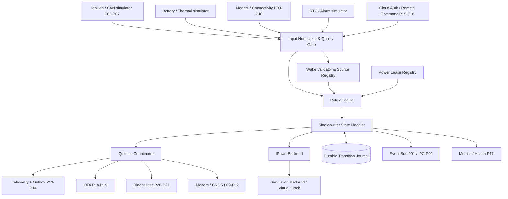
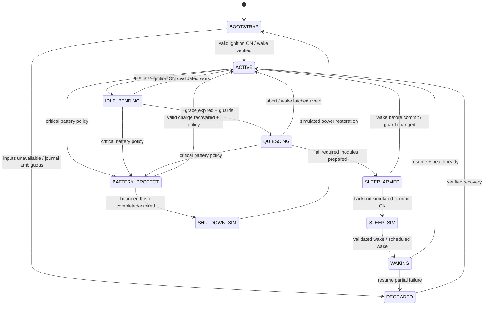
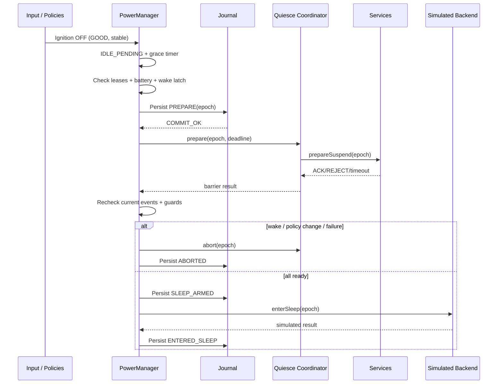
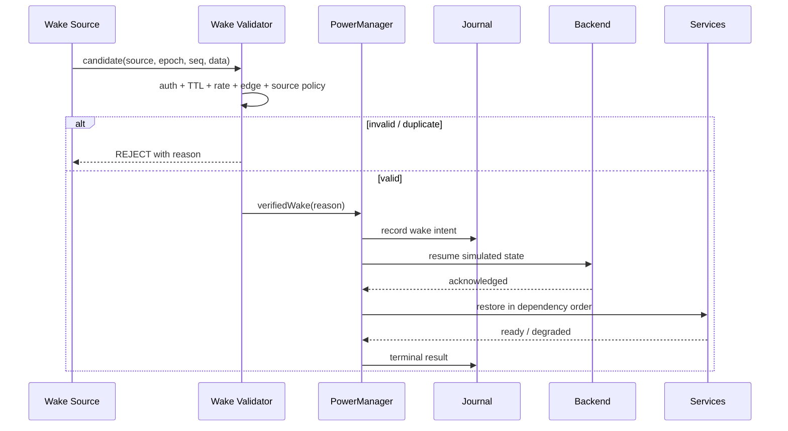

# Project 22 — TCU Power & Wakeup Manager

**Virtual TCU Lab · System Design & Resilience Test Plan · Version 1.0 · 2026-10-30**  
**Target:** Middle C++ Developer · C++17 · Ubuntu Linux (simulation-first)  
**Document status:** Design proposal / executable-test specification; **not** evidence that the implementation passed any test.

> **Safety boundary:** The default backend is `SimulatedPowerBackend`. All samples and commands are for a virtual TCU only. Never enable real suspension, cut vehicle power, change OEM wakeup lines, or drive safety-related ECUs based solely on this document. Real current draw, wake pin behavior, PMIC, modem standby and suspend/hibernate availability require target-specific hardware testing and OEM requirements.

## 0. Quick navigation

1. Mission, scope and assumptions
2. Requirements and performance budgets
3. Concepts and source-of-truth rules
4. Context and component architecture
5. State machine and transition table
6. Policy, event ordering and invariants
7. Sleep preparation and wakeup protocols
8. C++17 API contracts and data models
9. Persistence, crash consistency and clock semantics
10. Concurrency, generations and lifecycle
11. Security and privacy considerations
12. Configuration and observability
13. End-to-end operational behavior
14. Behavioral acceptance contracts
15. Deterministic simulation and test fixtures
16. What-if catalog: 300 single-fault scenarios / 30 families
17. Multi-fault campaigns: 50 timelines
18. Property, fuzz, stress and soak testing
19. Implementation backlog: 36 Jira tickets
20. Runbook (Ubuntu, simulation only)
21. Traceability, exit criteria and limitations
22. Open decisions and references

---

## 1. Mission, scope and assumptions

### 1.1 Business objective

Build a **policy-driven power coordinator** for a Telematics Control Unit (TCU). When ignition is off and no valid work requires activity, it safely coordinates service quiescing and enters a *simulated* low-power mode. It validates ignition / CAN / modem / RTC / remote wake signals, restores services on wake and protects the vehicle's 12 V battery while preserving critical data and avoiding false wakeups.

### 1.2 In scope

- Power-domain state machine: `BOOTSTRAP`, `ACTIVE`, `IDLE_PENDING`, `QUIESCING`, `SLEEP_ARMED`, `SLEEP_SIM`, `WAKING`, `DEGRADED`, `BATTERY_PROTECT`, `SHUTDOWN_SIM`.
- Signal quality (good / stale / invalid / unknown), hysteresis, debounce and a trusted monotonic event sequence.
- Pluggable wake sources: ignition, CAN wake, modem/network URC, authenticated remote intent, RTC alarm, watchdog/restart (each independently validated).
- Short-lived **power leases / inhibitors** for OTA, telemetry commit, diagnostics, remote command execution and database checkpoints.
- Quiesce barrier and prepare/commit/abort handshake for dependent services.
- Durable transition intent / wake reason journal; crash recovery and fencing of late callbacks.
- Battery and thermal protection as policy, not calibration for actual vehicle operation.
- Observability, command-line simulator, unit/integration/stress/fault-injection test harness.

### 1.3 Out of scope for initial release

- Hardware PMIC control, MCU standby pin, actual automotive quiescent-current measurement, LIN transceivers, real RTC wake alarm, eCall compliance, ASIL certification, real ignition/terminal 15 electrical calibration, CAN controller transceiver sleep, actual kernel `systemctl suspend` on the developer workstation, cryptographic protocol design from scratch.
- No claim of AUTOSAR EcuM conformance; this design borrows concepts such as wakeup-source validation only.

### 1.4 Assumptions and test defaults (not OEM values)

| Parameter | Lab default | Rationale / must be configurable |
|---|---:|---|
| Ignition-off debounce | 2 s | Reject brief glitches |
| Idle grace period | 30 s | Permit batching before sleeping |
| Wake-source validation deadline | 2 s | Timebox uncertain sources |
| Quiesce deadline | 5 s | Bounded transition; strict modules can abort |
| Simulated sleep minimum dwell | 10 s | Prevent chattering |
| Battery low / critical thresholds | 12.0 V / 11.5 V | **Synthetic test constants only**, not a real protection strategy |
| Battery hysteresis | 0.3 V | Avoid threshold oscillation |
| Voltage freshness | 2 s | Stale sensor must not imply healthy battery |
| Event queue | 4096 entries | Bounded memory |
| Max active leases | 128 | Resource budget |
| Lease TTL ceiling | 2 min | No endless sleep prevention; critical exceptions policy-reviewed |
| Wake rate limiting | 8 / 60 s per untrusted source | Limit battery-drain attacks |
| Transition journal mode | SQLite WAL, synchronous=FULL | Defined durability profile; still bounded by storage guarantees |
| Test run time | 24 h minimum soak | Example engineering gate, not certification |

## 2. Requirements and performance budgets

### 2.1 Functional requirements

| ID | Requirement | Verification |
|---|---|---|
| FR-01 | Accept timestamped power inputs, report validity/freshness and source generation | Contract/unit |
| FR-02 | Reach ACTIVE after valid ignition-ON and startup health checks | Scenario |
| FR-03 | Debounce ignition-OFF before IDLE_PENDING | Fake-clock |
| FR-04 | Prevent SLEEP when critical lease is held and valid | Lease state |
| FR-05 | Bound all prepare acknowledgements and abort cleanly | Quiesce timeout |
| FR-06 | Latch wake request arriving during QUIESCING / SLEEP_ARMED | Race test |
| FR-07 | Never claim actual physical sleep in simulation mode | API/metrics test |
| FR-08 | Invalidate stale, revoked or cross-session wake events | Security/generation test |
| FR-09 | Resume modules in dependency order after wake; publish readiness only when ready | Integration |
| FR-10 | Battery-protection policy overrides noncritical activity, with bounded flush | Policy test |
| FR-11 | Persist transition intent and reconstruct trustworthy state after crash | Kill/restart |
| FR-12 | Recover from failed quiesce/backend command without false SLEEP state | Fault injection |
| FR-13 | Support OTA/diagnostics/remote commands using leases and safe cancellation rules | Integration |
| FR-14 | Log evidence of every decision and rejected wake source without secrets | Audit test |
| FR-15 | Permit runtime configuration reload with validation and generation fencing | Hot reload |
| FR-16 | Expose deterministic fake clock/fake power backend for repeatable tests | Test harness |
| FR-17 | Bound wake storms, retries, queue depth and power-lease lifetimes | Stress test |
| FR-18 | Separate application `SLEEP_SIM` from kernel suspend and actual standby | Interface |

### 2.2 Nonfunctional budgets (targets for lab acceptance)

| ID | Target | Measurement / caveat |
|---|---|---|
| NFR-01 | No invalid transition, double completion or stale callback acting on new epoch | Property-based/interleaving |
| NFR-02 | Event decision p99 < 100 ms at 500 events/s on a designated CI runner | Histogram, not a hard real-time bound |
| NFR-03 | 10,000 simulated sleep/wake cycles without descriptor/thread leak | Soak + procfs |
| NFR-04 | Bounded queue, leases, timers and journal growth | Memory/storage metrics |
| NFR-05 | No remote unauthenticated signal can force permanent awake state | Security abuse tests |
| NFR-06 | A single service crash cannot silently mark the system QUIESCED | Quiesce health test |
| NFR-07 | Repeated identical test seeds produce same state trace in pure simulation | Determinism |
| NFR-08 | No `ACTIVE` / `SLEEP_SIM` claimed until commit condition is established | Event trace assertion |
| NFR-09 | Unexpected failures must surface DEGRADED / UNKNOWN with explanation | Dashboard / log inspection |
| NFR-10 | All safety-relevant thresholds calibrated on target before any hardware use | Review gate |

## 3. Concepts and source-of-truth rules

### 3.1 Three distinct notions of power state

1. **Vehicle request:** ignition signal, central gateway wake permission, battery policy.
2. **TCU application state:** what Power Manager has coordinated (`ACTIVE`, `QUIESCING`, `SLEEP_SIM`, ...).
3. **OS / hardware state:** device runtime PM, system suspend-to-idle, platform standby, powered off; depends on kernel/board/PMIC support.

`SLEEP_SIM` means application processes **pretend** to be asleep with simulated service pause. It neither reduces physical current in a guaranteed way nor invokes kernel suspend. Linux system-wide suspend freezes userspace; application timers and drivers behave differently from a simulated pause. Linux runtime PM may suspend individual devices independently of system suspend. Refer to [Linux sleep states](https://cdn.kernel.org/doc/html/latest/admin-guide/pm/sleep-states.html) and [runtime PM](https://docs.kernel.org/power/runtime_pm.html).

### 3.2 Signal trust model

Each sample has `{source, source_epoch, sequence, observed_monotonic, value, quality, authenticated}`. Values older than their TTL, unknown source epochs, invalid CRC/format, or untrusted remote requests **must not** be promoted to reliable wake/ignition facts. A CAN wake signal is an *input to validation*, not automatic authorization for high-risk vehicle actions.

### 3.3 Monotonic vs elapsed time

- Use a fakeable logical clock for deterministic unit tests.
- `CLOCK_MONOTONIC` excludes time spent in Linux suspend; `CLOCK_BOOTTIME` includes it. If system-wide suspend is later enabled, deadlines that must expire across suspend use a boottime-compatible clock adapter. Do not equate `std::chrono::steady_clock` with Linux `CLOCK_BOOTTIME` without checking implementation/platform.
- Wall clock / RTC is for audit timestamps and external schedules **only after trust validation**. It must not be the sole driver of inactivity/TTL.
- On cold reboot, monotonic epochs reset; persist boot identifier and wall-time confidence separately. Never compare monotonic timestamps across boots.

## 4. Context and component architecture



### 4.1 Module responsibilities

| Module | Responsibility | Does **not** do |
|---|---|---|
| Input adapters | Convert CAN, modem URC, voltage, remote signals to typed events | Make final sleep decision |
| Quality Gate | Validate freshness, range, source epoch, ordering | Trust unverified wall clock |
| Wake Validator | Validate source-specific wake policies and rate limits | Execute remote command |
| Lease Registry | Track owner, reason, deadline, criticality and revoke | Hold permanent inhibitors |
| Policy Engine | Decide sleep eligibility under battery/thermal/security constraints | Execute blocking I/O in state lock |
| State Machine | Sole owner of transition decisions and state epoch | Trust old callbacks |
| Quiesce Coordinator | Prepare/ack/veto/abort in dependency order | Mark crash as ack |
| Simulated Backend | Report simulated enter/exit success or injected failure | Call real suspend |
| Journal | Persist intent, transitions, reason and correlation IDs | Pretend fsync can prevent all storage failure |
| Observer | Structured audit, metrics, debug trace | Change policy |

## 5. State machine and transitions



**Invariant:** `SLEEP_SIM` is reachable only through a successful `SLEEP_ARMED` commit for the current generation, after final wake/input recheck. `ACTIVE` is published after wake only when critical dependent services report ready; partial restore results in `DEGRADED`.

### 5.1 Transition contract

| From → To | Guard | Action | Failure disposition |
|---|---|---|---|
| BOOTSTRAP → ACTIVE | trusted ignition ON or validated wake with minimum readiness | register adapters, initialize dependencies | DEGRADED |
| ACTIVE → IDLE_PENDING | ignition OFF debounced and battery noncritical | schedule grace timer | remain ACTIVE |
| IDLE_PENDING → QUIESCING | no critical lease, wake latch empty, idle timer expired, source quality trusted | atomically allocate transition epoch, record intent | ACTIVE/DEGRADED |
| QUIESCING → SLEEP_ARMED | all mandatory quiesce ACK for same epoch; check lease and wake latch | persist prepared barrier | abort to ACTIVE |
| SLEEP_ARMED → SLEEP_SIM | final guard recheck, simulated backend success, current epoch | commit sleep and metrics | ACTIVE/DEGRADED |
| SLEEP_SIM → WAKING | source-specific validated wake or authorized scheduled event | invalidate old epochs, resume modules | DEGRADED |
| WAKING → ACTIVE | critical adapters ready, policy still allows activity | publish ready | DEGRADED |
| any eligible → BATTERY_PROTECT | trusted critical battery or fail-safe fallback as defined | cancel noncritical work, bounded flush | safe limited mode |
| BATTERY_PROTECT → SHUTDOWN_SIM | flush deadline reached + simulated backend | journal rationale + stop | DEGRADED if backend fails |

## 6. Decision order and invariants

### 6.1 Priority (highest first; reviewed per platform)

1. Critical battery / thermal protection and immediate safety constraints.
2. Verified wake or ignition-ON, including wake latched during sleep preparation.
3. Security restrictions, trusted sensor quality and authorized wake-source policy.
4. Noninterruptible *bounded* critical operation leases (e.g., crash-safe commit).
5. Idle timeout, routine telemetry and optional work.

**Important conflict rule:** A battery-critical event can require an orderly *bounded* shutdown even if an OTA/noncritical lease is active. In-progress firmware installation is coordinated with P19's recovery-safe point; never assume arbitrary interruption is safe, and never let an unlimited lease drain the battery. Exact hardware-safe sequencing must be OEM specified.

### 6.2 Safety / correctness invariants

- `INV-01`: no SLEEP_SIM with `ignition==ON` and quality GOOD for current source generation.
- `INV-02`: no SLEEP_SIM while a validated wake is latched for current transition.
- `INV-03`: quiesce ACK only counts for exact transition epoch/module identity; crashed module ≠ ACK.
- `INV-04`: every power transition has a single terminal outcome (`COMMITTED`, `ABORTED`, `UNKNOWN` until reconciled).
- `INV-05`: no duplicate wake/resume side effects for the same transition ID.
- `INV-06`: no stale/unauthorized remote request silently extends awake duration.
- `INV-07`: unknown battery level is not treated as safe battery; invoke policy-defined conservative degraded handling.
- `INV-08`: lease count, queue depth, retries, timers, and logs bounded.
- `INV-09`: journal says `ENTERED_SLEEP` only after backend simulated commit acknowledges; if disk commit fails, do not advertise durable success.
- `INV-10`: after restart, never infer physical sleep solely from journal record; reconcile backend and inputs.
- `INV-11`: `SLEEP_SIM` is not exposed as `SYSTEM_SUSPENDED` or actual current reduction.
- `INV-12`: signed/authorized wake still passes rate, freshness and replay checks.
- `INV-13`: one reason code and evidence chain for every abort/deny/fallback.
- `INV-14`: shutdown does not indefinitely wait for callbacks/threads.
- `INV-15`: low-priority telemetry does not starve ignition or battery events.

## 7. Sleep/wakeup protocols

### 7.1 Coordinated sleep sequence



- Required services must ACK the same epoch. Optional service timeout is reported as DEGRADED according to policy; mandatory service veto aborts transition.
- Every step has a deadline, owner, result status, transaction ID and log correlation.
- A wake event arriving between final policy check and backend commit must be handled by an atomic sleep-commit gate or a wake latch checked and consumed in a deterministic event loop. If the backend transition wins, the wake must trigger immediate `WAKING`, not get lost.
- Keep persistent state logically distinct from actual backend status: journal commit failures become `UNKNOWN`/reconcile, not invented success.

### 7.2 Wake validation and resume



**Wake source policy examples:** ignition ON requires debounce and a trusted bus signal; RTC alarm requires matching scheduled token and time window; modem URC requires known modem session and allowed source; cloud remote intent must be authenticated and authorized, and must not bypass separate Remote Vehicle Control safety policy. Unsupported hardware wake channels must be marked `UNSUPPORTED`, never simulated as real electrical capability.

### 7.3 Inhibitor / lease behavior

- Request includes `owner_id`, `reason`, `priority`, `ttl`, `scope`, `criticality`, `request_id` and authentication context.
- Registry returns unique **RAII LeaseToken**; release is idempotent; renewal is conditional on current owner epoch and upper TTL budget.
- Leases are *not* persisted as permanently active across restarts. Recovered services must re-register legitimate work after a new boot generation.
- A revoked/expired lease cannot block sleep; audit records expiry, release, revocation.
- Quiesce can reject lease creation for new optional work to prevent livelock, but critical authorized work is evaluated by priority.
- `systemd` inhibitor locks (optional production integration) are OS-level coordination aids, not a substitute for battery and safety policy; they are released when the holding FD closes, and can be overridden through privileged paths. Source: [systemd inhibitor locks](https://github.com/systemd/systemd/blob/main/docs/INHIBITOR_LOCKS.md).

## 8. C++17 API and data contracts

```cpp
using TransitionId = std::uint64_t;
using BootEpoch = std::uint64_t;

enum class PowerState {
    Bootstrap, Active, IdlePending, Quiescing, SleepArmed,
    SleepSim, Waking, Degraded, BatteryProtect, ShutdownSim
};
enum class Quality { Good, Stale, Invalid, Unknown, Untrusted, Unsupported };
enum class WakeSource { Ignition, Can, Modem, Remote, Rtc, Watchdog };
enum class Decision { Accepted, Rejected, Deferred, Unknown };

struct SignalSample {
    std::string source_id;
    std::uint64_t source_epoch{};
    std::uint64_t sequence{};
    std::chrono::steady_clock::time_point observed_at;
    Quality quality{Quality::Unknown};
    std::variant<bool, double, std::string> value;
};
struct WakeIntent {
    WakeSource source;
    std::string request_id;
    BootEpoch boot_epoch{};
    std::uint64_t source_epoch{};
    std::uint64_t sequence{};
    std::chrono::steady_clock::time_point observed_at;
    std::string auth_context_ref; // identifier only; not credential
};
struct PowerSnapshot {
    PowerState state;
    BootEpoch boot_epoch{};
    TransitionId transition_id{};
    std::string reason;
    bool backend_sleep_observed{};
    bool policy_inputs_trusted{};
};
struct PowerLeaseRequest {
    std::string owner;
    std::string reason;
    std::chrono::milliseconds ttl;
    bool critical{};
};

class IClock {
public:
    virtual ~IClock() = default;
    virtual std::chrono::steady_clock::time_point now() const = 0;
};
class IPowerBackend {
public:
    virtual ~IPowerBackend() = default;
    virtual std::future<bool> enterSimulatedSleep(TransitionId) = 0;
    virtual std::future<bool> resumeSimulatedSleep(TransitionId) = 0;
    virtual bool isSimulatedAsleep() const = 0;
};
class IQuiesceParticipant {
public:
    virtual ~IQuiesceParticipant() = default;
    virtual std::future<bool> prepare(TransitionId,
        std::chrono::steady_clock::time_point deadline) = 0;
    virtual void abort(TransitionId) = 0;
    virtual std::future<bool> resume(TransitionId) = 0;
};
class IPowerManager {
public:
    virtual ~IPowerManager() = default;
    virtual Decision submitSignal(const SignalSample&) = 0;
    virtual Decision submitWake(const WakeIntent&) = 0;
    virtual PowerSnapshot snapshot() const = 0;
    virtual void start() = 0;
    virtual void stop() = 0;
};
```

**API rules:** calls to `submitSignal/submitWake` enqueue validated envelopes and return admission only; they do **not** guarantee physical transition. A dedicated state-machine strand owns mutable state. Long I/O occurs outside the state-machine lock. Service callbacks are asynchronous and their results are correlated with transition epoch. `std::future` above is a conceptual boundary; production can adopt callbacks/coroutines/custom executors consistently.

### 8.1 Proposed module layout

```text
virtual-tcu-lab/modules/power/
├── include/tcu/power/{power_manager.hpp,power_types.hpp,clock.hpp}
├── src/{power_engine.cpp,policy_engine.cpp,input_quality.cpp}
├── src/{wake_validator.cpp,lease_registry.cpp,quiesce_coordinator.cpp}
├── src/{sim_power_backend.cpp,transition_journal.cpp,metrics.cpp}
├── simulator/{power_cli.cpp,ignition_sim.cpp,battery_sim.cpp,wake_sim.cpp}
├── tests/{unit,integration,fault,property,soak}/
├── scenarios/{single,multi}/
├── configs/power_lab.yaml
└── docs/README.md
```

## 9. Persistence, recovery and clocks

### 9.1 Durable journal sketch

```sql
PRAGMA journal_mode=WAL;
PRAGMA synchronous=FULL;
PRAGMA foreign_keys=ON;
CREATE TABLE IF NOT EXISTS transitions (
  transition_id INTEGER PRIMARY KEY,
  boot_epoch INTEGER NOT NULL,
  from_state TEXT NOT NULL,
  target_state TEXT NOT NULL,
  outcome TEXT NOT NULL CHECK (outcome IN
     ('PREPARE','ARMED','COMMITTED','ABORTED','UNKNOWN')),
  reason TEXT NOT NULL,
  config_generation INTEGER NOT NULL,
  created_utc TEXT NOT NULL
);
CREATE TABLE IF NOT EXISTS transition_events (
  id INTEGER PRIMARY KEY AUTOINCREMENT,
  transition_id INTEGER NOT NULL,
  event_type TEXT NOT NULL,
  event_seq INTEGER NOT NULL,
  details TEXT NOT NULL,
  FOREIGN KEY(transition_id) REFERENCES transitions(transition_id)
);
CREATE UNIQUE INDEX IF NOT EXISTS ux_transition_events
ON transition_events(transition_id,event_seq);
CREATE TABLE IF NOT EXISTS wake_audit (
  wake_id TEXT PRIMARY KEY,
  boot_epoch INTEGER NOT NULL,
  source TEXT NOT NULL,
  decision TEXT NOT NULL,
  reason TEXT NOT NULL,
  seen_utc TEXT NOT NULL
);
```

**Data rule:** a single transition has one canonical row, while `transition_events` append detailed audit; the row records current outcome. New transition IDs are assigned by the single writer, not by concurrent adapters. Disk failure before durable intent prevents new sleep commits; journal failure after backend action leads to reconciliation with observable simulated backend state. On a new process/boot epoch, do not trust stored monotonic time or revive old leases.

### 9.2 Crash consistency table

| Crash point | Recovery result |
|---|---|
| Before PREPARE commit | Start in BOOTSTRAP; reevaluate sensors |
| After PREPARE, before all ACK | Mark old attempt aborted/unknown after reconciliation; reinitialize services |
| After ARMED, before backend call | Reconcile backend; never infer asleep from ARMED |
| Backend reports sleep but journal commit lost | Query backend; record recovered state with evidence; avoid success claim until persisted |
| During WAKING resume | Continue idempotent resume on fresh epoch; DEGRADED until readiness |
| Battery protect during fsync | Respect bounded flush deadline; report unsafe-to-confirm if storage outcome unknown |

## 10. Concurrency, epochs and lifecycle

- Ingress queues split into **priority control** (ignition, battery, wake) and bounded best-effort observations (diagnostics/metrics); no low-priority storm can delay safety-control forever.
- Single-writer reducer serializes `(state,event) -> (new state, effects)`; effects carry `boot_epoch`, `transition_id`, `config_generation` and `participant_generation`.
- Linearization point: final state transition occurs only after reducer verifies current epoch and backend/participant result; all late results counted and dropped.
- Mutexes protect per-adapter buffers; **never** call participant callbacks while a registry/global lock is held.
- Shutdown: stop admission → mark STOPPING → cancel timers → abort outstanding quiesce → stop worker pool → join threads → flush bounded journal; no indefinite blocking.
- `PowerManager` cannot rely on its own event loop heartbeat to prove progress; P17 Health Monitoring must observe evaluator advancement independently.

## 11. Security and privacy threat model

| Threat | Mitigation |
|---|---|
| Forged cloud wake / replay | Strong authenticated identity at ingress, nonce/ID, freshness, dedup and privilege policy |
| Modem URC storm | Session-bound parser, rate limiting, source quarantine |
| Forged CAN ignition/wake | Source-quality and gateway policy; CAN alone not cryptographic trust |
| Battery-drain DoS via continual wake | per-source budgets, minimum dwell, abuse alarms |
| Lease abuse by compromised client | authenticated owner, TTL cap, quotas, critical privilege review |
| Downgraded config disabling critical checks | signature/authorization for prod config; fail closed on invalid safety config |
| Remote access to power CLI | Unix credentials/ACL; dry-run default; no unrestricted backend commands |
| Sensitive location/token leaks | structured logs with redaction; no secrets in wake audit |

This simulator cannot establish OEM cybersecurity compliance; integration with P23 Secure Command Validation is required for production-grade authentication/authorization.

## 12. Configuration and observability

```yaml
mode: simulation_only
power:
  idle_grace_ms: 30000
  ignition_off_debounce_ms: 2000
  min_sleep_dwell_ms: 10000
  quiesce_deadline_ms: 5000
  source_quality_ttl_ms: 2000
  battery_low_v: 12.0       # lab placeholder; NOT vehicle calibration
  battery_critical_v: 11.5  # lab placeholder; NOT vehicle calibration
  battery_hysteresis_v: 0.3
  max_leases: 128
  lease_max_ttl_ms: 120000
  priority_queue_capacity: 256
  observation_queue_capacity: 4096
  wake_rate_limit_per_minute: 8
  journal_sync: FULL
```

**Metrics** (label cardinality bounded): `power_state`, `power_transition_total{from,to,result}`, `sleep_abort_total{reason}`, `wake_candidate_total{source,decision}`, `lease_active`, `lease_expired_total`, `quiesce_latency_ms`, `source_stale_total`, `battery_protect_enter_total`, `journal_error_total`, `late_callback_dropped_total`, `queue_depth`, `event_decision_latency_ms`, `evaluator_progress_age_ms`.

**Audit log record:** `{boot_epoch, transition_id, event_id, source, source_generation, config_generation, old_state, new_state, decision, reason_code, elapsed_ms}`. Never rely on logging success as proof of state persistence.

## 13. Operational behavior walkthrough

**A. Normal ignition OFF → sleep:** accept GOOD OFF → debounce → grace → refuse new optional work → check battery and leases → prepare participants → journal ARMED → final wake recheck → simulation backend commits → report SLEEP_SIM.

**B. Ignition ON during QUIESCING:** latch validated wake → increment epoch / abort preparation → rollback/restore prepared participants idempotently → enter ACTIVE once ready. A delayed ACK from the canceled epoch is ignored.

**C. RTC scheduled wake:** verify an outstanding scheduled alarm token in current boot generation, valid window and wake budget → begin WAKING → restore critical modules → process due job → idle grace → sleep again. An untrusted wall-clock jump does not authorize wake.

**D. Low battery during OTA:** notify OTA manager, request its recovery-safe checkpoint → reject new downloads → enforce bounded power-protection timeout → simulated shutdown or DEGRADED, with explicit unresolved state; never silently claim firmware success.

**E. Recovery after process crash:** load journal, increment boot epoch, query backend actual simulated state, reconstruct signal quality as UNKNOWN, clear old leases and outstanding callbacks, start with BOOTSTRAP/DEGRADED until inputs revalidate. Do not blindly resume old work.

## 14. Behavioral acceptance contracts (Given / When / Then)

| Contract | Given | When | Then |
|---|---|---|---|
| BC-01 | ACTIVE, ignition GOOD ON | OFF for less than debounce | Remain ACTIVE |
| BC-02 | ACTIVE, stable ignition OFF | grace expires, no leases | Prepare transition |
| BC-03 | QUIESCING | valid ignition ON | Abort, never commit sleep |
| BC-04 | QUIESCING | mandatory module veto | Abort; explain veto |
| BC-05 | SLEEP_ARMED | verified wake arrives | Latch and avoid lost wake |
| BC-06 | SLEEP_SIM | RTC schedule verified | WAKING then ACTIVE/DEGRADED |
| BC-07 | SLEEP_SIM | remote unauthenticated wake | Reject with audit |
| BC-08 | ACTIVE | critical battery and noncritical lease | Battery protection supersedes lease |
| BC-09 | ACTIVE | battery value stale | Apply conservative policy, no healthy claim |
| BC-10 | QUIESCING | callback from old epoch | Drop; count stale callback |
| BC-11 | QUIESCING | service crash in prepare | Not a successful ACK |
| BC-12 | WAKING | one mandatory service fails resume | DEGRADED, not ACTIVE |
| BC-13 | any | config reload invalid | Keep last valid generation |
| BC-14 | any | event storm | Bounded queues; priority preserved |
| BC-15 | sleep commit | journal write fails | UNKNOWN/abort/reconcile, not durable success |
| BC-16 | restart | journal indicates armed | Reconcile backend and inputs |
| BC-17 | ACTIVE | lease expires | Sleep may proceed on next evaluation |
| BC-18 | SLEEP_SIM | repeated duplicate wake event | One wake decision per event ID |
| BC-19 | stopping | late timer fires | No new transition or use-after-free |
| BC-20 | source unknown | ignition sample has old generation | Do not treat as authoritative ON/OFF |
| BC-21 | WAKING | readiness arrives after timeout | No false ACTIVE success |
| BC-22 | BATTERY_PROTECT | RTC wall clock jumps | No postponement of battery guard deadline |
| BC-23 | QUIESCING | lease acquired by authorized critical module | Reevaluate/abort according to policy |
| BC-24 | SLEEP_SIM (sim) | query kernel state | API reports no real system suspend |

## 15. Deterministic test infrastructure

1. `FakeClock` with explicit `advance()` and boot clock reset; separate wall clock and boottime emulation.
2. `FakeIgnition`, `FakeBattery`, `FakeModemWake`, `FakeRtcAlarm`, `FakeVehicleGateway` adapters; configurable generations and reorder.
3. `FakeQuiesceParticipant` that supports ACK, veto, stall, crash, delayed ACK, resume failure, callback reentrancy.
4. `SimulatedPowerBackend`: enter/exit with injected delay, rejection, unknown outcome, state query; **never suspends host**.
5. `FaultyJournal`: throw before/after transaction, SQLite busy/full/corruption, simulated process kill barriers.
6. `ScheduleExplorer`: deterministic interleavings of events, deadlines, callbacks; property assertions on invariants.
7. `TraceRecorder`: persist seed, source events, state transitions, faults, observed evidence and test verdict.
8. CI runner classifies `PASS`, `FAIL`, `INCONCLUSIVE` (fault not actually observed / no evidence), `SKIPPED` (unsupported backend).

**Per-test minimum evidence:** test ID, random seed, config hash, boot/transition IDs, injected fault and confirmation, event trace, state trace, invariant results, storage/OS observation, exit code, sanitizer output. No injected fault = never mark PASS solely because state machine did not crash.


## 16. What-if catalog — 300 single-fault scenarios / 30 groups

**Execution contract:** Each row is a distinct proposed test, not a passed result. `Inject` is executed in a controlled simulator/fake, and `Expected` is an observable assertion. For every case attach the group-specific evidence in the final column **plus** `(seed, config hash, boot_epoch, transition_id, precise fault-injection confirmation, state trace, result)`. Classify as `INCONCLUSIVE` when the fault cannot be confirmed. P0 = safety/invariant/durability risk; P1 = functional/reliability; P2 = platform/extended soak.

### WF-01: Ignition, debounce & vehicle power inputs (10 cases)

| ID | What if? | Fault injection / setup | Expected behavior | Evidence | Priority |
|---|---|---|---|---|---|---|
| P22-WF-01-01 | Ignition OFF bounces for 100 ms | Flip ON/OFF 20 times before debounce expires | Stay ACTIVE, cancel stale OFF timer | ignition sample trace + debounce deadline | P0 |
| P22-WF-01-02 | Ignition OFF remains stable | Send GOOD OFF then advance fake clock past debounce and grace | Enter QUIESCING only if all guards pass | ignition sample trace + debounce deadline | P0 |
| P22-WF-01-03 | Ignition ON arrives at grace deadline | Interleave ON with idle timer via schedule explorer | ON wins or aborts pending sleep; never SLEEP_SIM with GOOD ON | ignition sample trace + debounce deadline | P0 |
| P22-WF-01-04 | Old ignition ON arrives after new OFF | Deliver source sequence n-1 after n | Ignore out-of-order event with reason | ignition sample trace + debounce deadline | P0 |
| P22-WF-01-05 | Ignition sample is stale on startup | Bootstrap with last sample aged beyond TTL | Do not infer OFF and sleep on stale sample | ignition sample trace + debounce deadline | P0 |
| P22-WF-01-06 | Ignition from new gateway epoch resets sequence | Restart gateway with seq=0 and higher source_epoch | Accept new epoch only after source revalidation | ignition sample trace + debounce deadline | P0 |
| P22-WF-01-07 | Duplicate ignition OFF floods queue | Replay same id 100k times | Deduplicate/coalesce without extending idle unexpectedly | ignition sample trace + debounce deadline | P0 |
| P22-WF-01-08 | Conflicting ignition status from two inputs | CAN says OFF while dedicated mock says ON | Enter policy-defined DEGRADED; do not sleep from disagreement | ignition sample trace + debounce deadline | P1 |
| P22-WF-01-09 | Ignition OFF changes during quiesce | Switch OFF→ON after first participant ACK | Abort and restore prepared modules | ignition sample trace + debounce deadline | P1 |
| P22-WF-01-10 | Ignition input disappears after OFF | Stop simulator immediately after OFF | Mark UNKNOWN after TTL; abort further sleep commit | ignition sample trace + debounce deadline | P1 |

### WF-02: Battery voltage, quality and low-voltage protection (10 cases)

| ID | What if? | Fault injection / setup | Expected behavior | Evidence | Priority |
|---|---|---|---|---|---|---|
| P22-WF-02-01 | Voltage dips 100 ms below critical | Inject brief 11.3V reading then normal | Apply filter/debounce; no oscillating protect state | voltage quality + battery policy trace | P0 |
| P22-WF-02-02 | Voltage stays below critical threshold | Feed trusted 11.2V beyond policy interval | Enter BATTERY_PROTECT with bounded flush | voltage quality + battery policy trace | P0 |
| P22-WF-02-03 | Voltage oscillates around low threshold | Alternate 11.9/12.1 V repeatedly | Hysteresis prevents mode thrashing | voltage quality + battery policy trace | P0 |
| P22-WF-02-04 | Voltage sample stale while ignition OFF | Freeze battery stream past TTL | Do not assume safe battery to sleep | voltage quality + battery policy trace | P0 |
| P22-WF-02-05 | Voltage sensor returns NaN | Inject IEEE NaN payload | Reject invalid value and raise sensor-quality fault | voltage quality + battery policy trace | P0 |
| P22-WF-02-06 | Voltage sensor reports negative value | Inject -2V with GOOD claimed | Reclassify INVALID, no arithmetic overflow | voltage quality + battery policy trace | P0 |
| P22-WF-02-07 | Battery sample arrives from stale source epoch | Send older gateway generation after reboot | Ignore for decision | voltage quality + battery policy trace | P0 |
| P22-WF-02-08 | Critical battery occurs while long lease held | Inject critical voltage during OTA lease | Prioritize bounded protective sequence; record unresolved OTA | voltage quality + battery policy trace | P0 |
| P22-WF-02-09 | Battery recovers briefly then drops | Raise voltage above recovery threshold for 100 ms | Stay in protection until stable authenticated recovery | voltage quality + battery policy trace | P0 |
| P22-WF-02-10 | Power loss occurs before battery alert journal | Kill process at warning transaction barrier | Reboot audits unknown prior alert; no fabricated durable alert | voltage quality + battery policy trace | P0 |

### WF-03: Thermal / power supply and sensor credibility (10 cases)

| ID | What if? | Fault injection / setup | Expected behavior | Evidence | Priority |
|---|---|---|---|---|---|---|
| P22-WF-03-01 | Thermal sensor exceeds max safe range | Inject GOOD high-temperature sample | Defer noncritical wake/work; trigger thermal policy | thermal readings + protection decision | P0 |
| P22-WF-03-02 | Temperature sensor disappears | Stop readings while normal cached | Mark UNKNOWN; do not treat last temperature as healthy | thermal readings + protection decision | P0 |
| P22-WF-03-03 | Temperature is impossible | Inject +500 Celsius with valid format | Reclassify INVALID; notify health monitoring | thermal readings + protection decision | P0 |
| P22-WF-03-04 | Thermal threshold chatters | Alternate around limit at 50 Hz | Apply hysteresis and debounce to limit transitions | thermal readings + protection decision | P0 |
| P22-WF-03-05 | Voltage drops while thermal sensor high | Inject both critical inputs at same logical tick | Single coherent BATTERY_PROTECT decision with both reasons | thermal readings + protection decision | P0 |
| P22-WF-03-06 | PMIC reports power-good falsely | Emit contradictory simulated power-good and undervoltage | Fail conservative policy, flag source disagreement | thermal readings + protection decision | P0 |
| P22-WF-03-07 | Current sensor rate changes abruptly | Inject rate outlier and then normal | Detect outlier; avoid unbounded false wake | thermal readings + protection decision | P0 |
| P22-WF-03-08 | ADC reader stalls during quiesce | Hold participant request pending past deadline | Abort sleep if mandatory input unavailable | thermal readings + protection decision | P1 |
| P22-WF-03-09 | Sensor returns Infinity | Inject +Inf and -Inf | Reject without undefined arithmetic or exception escape | thermal readings + protection decision | P1 |
| P22-WF-03-10 | Hardware source marked UNSUPPORTED | Disable simulated thermal channel | Report unsupported, not healthy or stale fabricated value | thermal readings + protection decision | P1 |

### WF-04: CAN / Gateway-originated wakeups (10 cases)

| ID | What if? | Fault injection / setup | Expected behavior | Evidence | Priority |
|---|---|---|---|---|---|---|
| P22-WF-04-01 | Unrecognized CAN ID requests wake | Send frame from unlisted identifier | Deny wake and audit unknown source | CAN frame origin + gateway generation + wake decisions | P0 |
| P22-WF-04-02 | Known CAN ID carries malformed payload | Send truncated payload vs configured schema | Reject wake, parser remains available | CAN frame origin + gateway generation + wake decisions | P0 |
| P22-WF-04-03 | CAN wake repeats every millisecond | Replay same permitted frame for 60 s | Wake once; rate-limit recurrent sources | CAN frame origin + gateway generation + wake decisions | P0 |
| P22-WF-04-04 | CAN interface down during SLEEP_ARMED | Inject vcan0 down event | Abort or degrade by guard policy; do not invent reliable wake armed | CAN frame origin + gateway generation + wake decisions | P0 |
| P22-WF-04-05 | Gateway restarts with old callback pending | Restart source while delivering old-generation wake | Drop old callback; new generation validated | CAN frame origin + gateway generation + wake decisions | P0 |
| P22-WF-04-06 | CAN wake edge lost in debounce | Pulse around transition boundary | Latch valid edge before sleep commit or explicitly reject by documented policy | CAN frame origin + gateway generation + wake decisions | P0 |
| P22-WF-04-07 | Two buses report opposite wake permission | Send contradictory current-generation signals | Block unsafe sleep; report conflict | CAN frame origin + gateway generation + wake decisions | P0 |
| P22-WF-04-08 | CAN ID is routed twice via gateway loop | Duplicate identical wake via two interfaces | Dedup correlation and contain rate; no repeated resume | CAN frame origin + gateway generation + wake decisions | P1 |
| P22-WF-04-09 | Gateway frame carries stale timestamp | Delay delivery beyond freshness | Reject as stale, not new wake | CAN frame origin + gateway generation + wake decisions | P1 |
| P22-WF-04-10 | CAN bus recovers after sleep | Reopen vcan interface and send fresh wake | Resume once; update adapter readiness | CAN frame origin + gateway generation + wake decisions | P1 |

### WF-05: Modem wake, URC and connectivity (10 cases)

| ID | What if? | Fault injection / setup | Expected behavior | Evidence | Priority |
|---|---|---|---|---|---|---|
| P22-WF-05-01 | URC arrives while modem is resetting | Inject URC from previous session after new boot | Reject old session URC | modem session + URC parser + decision log | P0 |
| P22-WF-05-02 | Network attached but no data link | Simulate registration OK and IP missing | Do not equate network attach to valid cloud wake | modem session + URC parser + decision log | P0 |
| P22-WF-05-03 | Incoming call indication storm | Emit 50k RING URCs | Bound queue and rate-limit; no endless awake state | modem session + URC parser + decision log | P0 |
| P22-WF-05-04 | Modem provides fragmented URC | Split URC bytes across PTY reads | Parse only once complete; no false wake | modem session + URC parser + decision log | P0 |
| P22-WF-05-05 | Malformed URC resembles wake string | Inject unexpected bytes around +CMTI | Reject malformed event rather than substring match | modem session + URC parser + decision log | P0 |
| P22-WF-05-06 | Modem service crashes during sleep prep | Kill modem manager during quiesce | Mandatory prepare cannot be counted as ACK | modem session + URC parser + decision log | P0 |
| P22-WF-05-07 | Modem reconnects while WAKING | Restore cellular with stale connection callback | Accept only current connection epoch | modem session + URC parser + decision log | P0 |
| P22-WF-05-08 | Incoming SMS wake from unknown sender | Inject unauthenticated SMS trigger | Reject remote intent; retain audit without PII | modem session + URC parser + decision log | P1 |
| P22-WF-05-09 | URC duplicated after reconnect | Replay URC with same event ID | One wake decision; no second effect | modem session + URC parser + decision log | P1 |
| P22-WF-05-10 | Modem cannot support standby wake | Mark wake capability unsupported in profile | Never claim modem can wake sleeping hardware | modem session + URC parser + decision log | P1 |

### WF-06: RTC, scheduled wake and time trust (10 cases)

| ID | What if? | Fault injection / setup | Expected behavior | Evidence | Priority |
|---|---|---|---|---|---|---|
| P22-WF-06-01 | RTC alarm exactly on schedule | Create signed/local scheduled token then fire on time | Wake once with matching schedule ID | alarm token + wall-clock confidence + fake clock | P0 |
| P22-WF-06-02 | RTC fires before valid window | Inject alarm 2h early | Reject or defer per policy; no premature wake | alarm token + wall-clock confidence + fake clock | P0 |
| P22-WF-06-03 | RTC fires long after expiry | Advance fake wall clock beyond expiry | Reject stale scheduled token | alarm token + wall-clock confidence + fake clock | P0 |
| P22-WF-06-04 | RTC jumps backward during sleep | Move wall time -1 day while monotonic advances | Do not extend lease/grace by wall-clock jump | alarm token + wall-clock confidence + fake clock | P0 |
| P22-WF-06-05 | RTC jumps forward one year | Move wall time +1y | Do not fire every stored alarm or bypass battery policy | alarm token + wall-clock confidence + fake clock | P0 |
| P22-WF-06-06 | RTC alarm repeated after restart | Replay same schedule identifier from prior boot | Dedup by durable schedule token and validity | alarm token + wall-clock confidence + fake clock | P0 |
| P22-WF-06-07 | RTC unavailable on boot | Fail RTC initialization | Mark scheduled wake UNSUPPORTED/DEGRADED, not successful | alarm token + wall-clock confidence + fake clock | P0 |
| P22-WF-06-08 | Two legitimate alarms coincide | Trigger telemetry and health at same logical instant | Coalesce wake, execute authorized jobs once each | alarm token + wall-clock confidence + fake clock | P1 |
| P22-WF-06-09 | Alarm canceled immediately before firing | Cancel token and fire late callback | Ignore canceled alarm, count late event | alarm token + wall-clock confidence + fake clock | P1 |
| P22-WF-06-10 | Alarm valid but voltage critical | Fire RTC event in BATTERY_PROTECT | Battery policy limits job; no unsafe sustained awake | alarm token + wall-clock confidence + fake clock | P1 |

### WF-07: Remote/cloud wake intent authentication (10 cases)

| ID | What if? | Fault injection / setup | Expected behavior | Evidence | Priority |
|---|---|---|---|---|---|---|
| P22-WF-07-01 | Unsigned remote wake | Send command without authentication | Reject without changing power state | command auth result + anti-replay + wake rate | P0 |
| P22-WF-07-02 | Expired remote wake | Send valid signature with expired deadline | Reject stale intent | command auth result + anti-replay + wake rate | P0 |
| P22-WF-07-03 | Remote command replayed | Reuse authenticated request_id | Dedup; no lease extension | command auth result + anti-replay + wake rate | P0 |
| P22-WF-07-04 | Identity revoked just before dispatch | Revoke principal during authorization window | Revalidate before effect; deny if revoked | command auth result + anti-replay + wake rate | P0 |
| P22-WF-07-05 | Cross-device request | Send token for device B to device A | Reject wrong audience/device binding | command auth result + anti-replay + wake rate | P0 |
| P22-WF-07-06 | Cloud offline while remote wake claimed | Inject unauthenticated cached payload without trusted proof | Do not act on unauthenticated cached payload | command auth result + anti-replay + wake rate | P0 |
| P22-WF-07-07 | Remote wake and ignition OFF coincide | Deliver both events same tick | Apply priority and rate/authorization policy without illegal state | command auth result + anti-replay + wake rate | P0 |
| P22-WF-07-08 | Credential expires while queued | Queue then advance trusted time past expiry | Reject at execution gate | command auth result + anti-replay + wake rate | P1 |
| P22-WF-07-09 | Remote wake floods from one account | Send 10k valid but rate-exceeding requests | Apply budgets; bound battery wakeups | command auth result + anti-replay + wake rate | P1 |
| P22-WF-07-10 | Remote wake requests physical door unlock | Attach unlock payload to wake request | Wake intent alone never authorizes BCM action | command auth result + anti-replay + wake rate | P1 |

### WF-08: State-machine graph and illegal transitions (10 cases)

| ID | What if? | Fault injection / setup | Expected behavior | Evidence | Priority |
|---|---|---|---|---|---|---|
| P22-WF-08-01 | Direct ACTIVE to SLEEP_SIM requested | Bypass expected transitions via malformed internal event | Reject illegal transition | transition trace + graph invariant checks | P0 |
| P22-WF-08-02 | SLEEP_SIM receives second enter-sleep | Replay backend success callback | Ignore duplicate enter; no double commit | transition trace + graph invariant checks | P0 |
| P22-WF-08-03 | SLEEP_ARMED occurs without quiesce ACK | Forge barrier result missing mandatory module | Refuse transition and record missing ACK | transition trace + graph invariant checks | P0 |
| P22-WF-08-04 | WAKING receives sleep commit callback | Delay old commit until resume starts | Drop stale success; never move backward to SLEEP_SIM | transition trace + graph invariant checks | P0 |
| P22-WF-08-05 | DEGRADED receives unvalidated wake | Inject raw untrusted wake | Do not upgrade to ACTIVE | transition trace + graph invariant checks | P0 |
| P22-WF-08-06 | BATTERY_PROTECT receives idle timer | Fire stale grace callback | Do not enter QUIESCING | transition trace + graph invariant checks | P0 |
| P22-WF-08-07 | Transition ID wraps in synthetic test | Initialize counter at UINT64_MAX | Fail allocation cleanly; never reuse ID | transition trace + graph invariant checks | P0 |
| P22-WF-08-08 | State engine receives unknown event enum | Fuzz invalid enum payload at decoder boundary | Reject and log; no undefined state | transition trace + graph invariant checks | P0 |
| P22-WF-08-09 | Same terminal event arrives twice | Duplicate committed/aborted result | Only one terminal outcome | transition trace + graph invariant checks | P0 |
| P22-WF-08-10 | Unknown backend status after crash | Make backend query fail during recovery | Remain DEGRADED/UNKNOWN until reconciled | transition trace + graph invariant checks | P0 |

### WF-09: Power leases, blockers and ownership (10 cases)

| ID | What if? | Fault injection / setup | Expected behavior | Evidence | Priority |
|---|---|---|---|---|---|---|
| P22-WF-09-01 | OTA lease blocks sleep | Issue legitimate critical lease before idle timer | Defer sleep until release/bounded policy override | lease registry + owner epoch + expiry timeline | P0 |
| P22-WF-09-02 | Lease expires while owner is stuck | Advance beyond TTL with no renewal | Expire lease, audit and permit reevaluation | lease registry + owner epoch + expiry timeline | P0 |
| P22-WF-09-03 | Client releases lease twice | Call RAII release twice | Idempotent cleanup; nonnegative counter | lease registry + owner epoch + expiry timeline | P0 |
| P22-WF-09-04 | Lease acquired from nonauthorized process | Forge owner identity over IPC | Reject privilege escalation | lease registry + owner epoch + expiry timeline | P0 |
| P22-WF-09-05 | Lease renewed after owner restart | Renew using old owner generation | Reject stale renewal | lease registry + owner epoch + expiry timeline | P0 |
| P22-WF-09-06 | 1,000 leases requested with max 128 | Flood registry with unique owners | Bound allocation and return resource_exhausted | lease registry + owner epoch + expiry timeline | P0 |
| P22-WF-09-07 | Lease TTL is negative or huge | Submit -1ms or 100y | Validate range without overflow | lease registry + owner epoch + expiry timeline | P0 |
| P22-WF-09-08 | Lease release races with sleep prepare | Race release and guard evaluation | Deterministic result; no lost work gate | lease registry + owner epoch + expiry timeline | P1 |
| P22-WF-09-09 | Critical battery with indefinite lease attempt | Hold lease and continually renew | Upper budget/protection overrides indefinitely blocking lease | lease registry + owner epoch + expiry timeline | P1 |
| P22-WF-09-10 | Lease owner process crashes | Kill client holding lease without cleanup | Detect dead owner / expiry; no permanently stuck lease | lease registry + owner epoch + expiry timeline | P1 |

### WF-10: Quiesce participant barrier and veto (10 cases)

| ID | What if? | Fault injection / setup | Expected behavior | Evidence | Priority |
|---|---|---|---|---|---|---|
| P22-WF-10-01 | Telemetry service ACKs fast | Prepare healthy participant | Count exactly once for current epoch | participant ACK count + barrier timeout + epoch | P0 |
| P22-WF-10-02 | OTA service vetoes quiesce | Return explicit VETO | Abort sleep, preserve OTA-safe state | participant ACK count + barrier timeout + epoch | P0 |
| P22-WF-10-03 | Mandatory service never responds | Stall its future past deadline | Time out and abort, not silent ACK | participant ACK count + barrier timeout + epoch | P0 |
| P22-WF-10-04 | Duplicate ACK from participant | Send two ACK callbacks | Count once only | participant ACK count + barrier timeout + epoch | P0 |
| P22-WF-10-05 | ACK arrives after transition abort | Deliver late success from previous epoch | Ignore and record late callback | participant ACK count + barrier timeout + epoch | P0 |
| P22-WF-10-06 | Participant crashes between prepare and ACK | Kill process before callback | Mark failure; not prepared | participant ACK count + barrier timeout + epoch | P0 |
| P22-WF-10-07 | One participant resumes during another prepare | Reenter coordinator from callback | No deadlock, define cancellation/retry | participant ACK count + barrier timeout + epoch | P0 |
| P22-WF-10-08 | Optional participant fails prepare | Inject failure for optional diagnostics logger | Follow optional policy; report degraded evidence | participant ACK count + barrier timeout + epoch | P0 |
| P22-WF-10-09 | Participant sends ACK for another module | Forge mismatched participant ID | Reject mismatched identity | participant ACK count + barrier timeout + epoch | P0 |
| P22-WF-10-10 | Participant hangs while shutdown requested | Trigger stop during stalled prepare | Bounded cancellation and shutdown without hanging | participant ACK count + barrier timeout + epoch | P0 |

### WF-11: OTA and firmware-update coordination (10 cases)

| ID | What if? | Fault injection / setup | Expected behavior | Evidence | Priority |
|---|---|---|---|---|---|---|
| P22-WF-11-01 | OTA download in progress before idle | Hold bounded download lease | No sleep until checkpoint or policy decision | OTA phase + lease + boot trial policy | P0 |
| P22-WF-11-02 | OTA verification starts during QUIESCING | Submit authorized critical work after barrier started | Abort or defer deterministically, never partially pause verifier | OTA phase + lease + boot trial policy | P0 |
| P22-WF-11-03 | OTA install writes inactive slot | Simulate P19 critical installation phase | Only sleep at documented recovery-safe boundary | OTA phase + lease + boot trial policy | P0 |
| P22-WF-11-04 | Battery becomes critical while installing | Inject undervoltage during slot write | Request safe checkpoint, bounded protection and report uncertain result | OTA phase + lease + boot trial policy | P0 |
| P22-WF-11-05 | OTA lease leaks after abort | Fail OTA callback without RAII release | Lease expires/reclaimed; no permanent wake | OTA phase + lease + boot trial policy | P0 |
| P22-WF-11-06 | Trial boot health confirmation pending | Set P19 trial-boot pending flag | Do not mark system healthy/safe to sleep prematurely | OTA phase + lease + boot trial policy | P0 |
| P22-WF-11-07 | OTA network retry storm while ignition OFF | Trigger 10k retries without useful progress | No unlimited wake lease; throttle/cancel downloads | OTA phase + lease + boot trial policy | P0 |
| P22-WF-11-08 | OTA callback from previous boot | Deliver install-complete event carrying old boot_epoch | Ignore stale completion | OTA phase + lease + boot trial policy | P1 |
| P22-WF-11-09 | System sleep requested while signing manifest | Hold signature validation task in progress | Checkpoint or veto according to bounded policy | OTA phase + lease + boot trial policy | P1 |
| P22-WF-11-10 | OTA rollback occurs during WAKING | Inject rollback workflow and resume | Serialize dependencies and report DEGRADED until stable | OTA phase + lease + boot trial policy | P1 |

### WF-12: Telemetry, SQLite and outbox coordination (10 cases)

| ID | What if? | Fault injection / setup | Expected behavior | Evidence | Priority |
|---|---|---|---|---|---|---|
| P22-WF-12-01 | Telemetry writes while idle grace expires | Insert DB transaction at exact timeout | Quiesce waits for bounded durable commit or aborts | outbox transaction ID + flush status + replay | P0 |
| P22-WF-12-02 | Outbox queue nonempty but idle permitted | Leave telemetry backlog with offline link | Persist backlog; policy may sleep without loss | outbox transaction ID + flush status + replay | P0 |
| P22-WF-12-03 | SQLite COMMIT returns error in prepare | Inject SQLITE_IOERR at flush | Do not ACK durability; abort/degrade | outbox transaction ID + flush status + replay | P0 |
| P22-WF-12-04 | MQTT PUBACK lost before sleep | Broker accepts publish but drop ACK | Do not claim backend committed; durable outbox remains | outbox transaction ID + flush status + replay | P0 |
| P22-WF-12-05 | Backend application ACK delayed after SLEEP_ARMED | Deliver ACK late with old epoch | Store/reconcile independently; no spontaneous illegal transition | outbox transaction ID + flush status + replay | P0 |
| P22-WF-12-06 | Outbox disk full during battery protection | Fill simulated disk at flush step | Stop boundedly; report loss risk and outcome unknown | outbox transaction ID + flush status + replay | P0 |
| P22-WF-12-07 | Telemetry receives GNSS stale | Emit stale location just before sleep | Do not encode old position as fresh | outbox transaction ID + flush status + replay | P0 |
| P22-WF-12-08 | Process killed between DB commit and ACK | Crash at barrier then restart | Recover same event ID; avoid false new event | outbox transaction ID + flush status + replay | P1 |
| P22-WF-12-09 | Outbox checkpoint holds lock indefinitely | Force SQLITE_BUSY beyond deadline | Avoid deadlock; abort sleep or proceed only under explicit policy | outbox transaction ID + flush status + replay | P1 |
| P22-WF-12-10 | Telemetry publish arrives after client paused | Deliver callback after prepare ACK | Reject/schedule for next wake; no invisible new work | outbox transaction ID + flush status + replay | P1 |

### WF-13: UDS diagnostics, DTC and service sessions (10 cases)

| ID | What if? | Fault injection / setup | Expected behavior | Evidence | Priority |
|---|---|---|---|---|---|---|
| P22-WF-13-01 | UDS session active during idle | Start diagnostic session with legitimate short lease | Defer sleep until safe session closure or deadline policy | UDS session + DTC status + lease decision | P0 |
| P22-WF-13-02 | TesterPresent repeatedly renews session | Flood tester-present without authorized long lease | Cap wake budget; no infinite lease by default | UDS session + DTC status + lease decision | P0 |
| P22-WF-13-03 | DTC scan half complete at quiesce | Pause during ISO-TP multi-frame response | Cancel/checkpoint scan; do not publish partial DTC snapshot | UDS session + DTC status + lease decision | P0 |
| P22-WF-13-04 | ECU reset during quiesce | Restart simulated ECU immediately before ACK | Invalidate scan and re-evaluate dependency readiness | UDS session + DTC status + lease decision | P0 |
| P22-WF-13-05 | Diagnostic lockout timer spans sleep | Activate mock security lockout then sleep/wake | Preserve correct elapsed semantics; no early unlock | UDS session + DTC status + lease decision | P0 |
| P22-WF-13-06 | UDS client times out as wake arrives | Interleave timeout and wake | Exactly one terminal request outcome | UDS session + DTC status + lease decision | P0 |
| P22-WF-13-07 | Critical DTC event arrives while sleeping | Inject authorized wake-capable DTC alarm | Validate source/policy; wake only if configured | UDS session + DTC status + lease decision | P0 |
| P22-WF-13-08 | Unexpected ReadDID flood during low battery | Send 50k nonessential diagnostics | Throttle/reject to protect battery budget | UDS session + DTC status + lease decision | P1 |
| P22-WF-13-09 | DTC repo writes while power cut | Kill process mid SQLite transaction | Recover coherent DTC snapshot/journal | UDS session + DTC status + lease decision | P1 |
| P22-WF-13-10 | Diagnostic service restart during WAKING | Crash then restart required participant | Stay DEGRADED until readiness verified | UDS session + DTC status + lease decision | P1 |

### WF-14: Connectivity manager and network handoffs (10 cases)

| ID | What if? | Fault injection / setup | Expected behavior | Evidence | Priority |
|---|---|---|---|---|---|---|
| P22-WF-14-01 | Cellular reconnect begins during idle | Schedule reconnect just before idle timeout | Optional retry is deferred; no unbounded sleep veto | connectivity epoch + network policy + sleep decisions | P0 |
| P22-WF-14-02 | Cloud is down while vehicle idle | Disconnect broker for 1h | Sleep may still occur with durable offline queue | connectivity epoch + network policy + sleep decisions | P0 |
| P22-WF-14-03 | Network READY flag is stale | Reuse old connectivity snapshot after modem restart | Ignore stale READY for policy | connectivity epoch + network policy + sleep decisions | P0 |
| P22-WF-14-04 | Wi-Fi switches to Cellular during prepare | Trigger bearer handoff while pausing service | Do not lose control event or double resume | connectivity epoch + network policy + sleep decisions | P0 |
| P22-WF-14-05 | Connectivity callback after wake cancellation | Send connection-ready old epoch | Ignore stale callback | connectivity epoch + network policy + sleep decisions | P0 |
| P22-WF-14-06 | DNS hangs during quiesce | Force DNS lookup to never respond | Bound wait and abort/skip as policy specifies | connectivity epoch + network policy + sleep decisions | P0 |
| P22-WF-14-07 | TLS handshake at sleep deadline | Pause mid-handshake | Close/cancel safely, no apparent cloud session persistence | connectivity epoch + network policy + sleep decisions | P0 |
| P22-WF-14-08 | Modem registration but no internet | Report registered with failed IP route | No falsely READY-dependent wake promise | connectivity epoch + network policy + sleep decisions | P1 |
| P22-WF-14-09 | Network flapping accelerates CPU | Alternate link 100Hz for 60s | Backoff and suppress busy loops/wake thrashing | connectivity epoch + network policy + sleep decisions | P1 |
| P22-WF-14-10 | Link becomes active after sleep commit | Deliver valid wake-capable modem event | Transition once through WAKING, not silent ACTIVE | connectivity epoch + network policy + sleep decisions | P1 |

### WF-15: GNSS and periodic location policy (10 cases)

| ID | What if? | Fault injection / setup | Expected behavior | Evidence | Priority |
|---|---|---|---|---|---|---|
| P22-WF-15-01 | GNSS loses fix before sleep | Emit NO_FIX and stop GPS stream | No assumption that last position is current | GNSS fix epoch + timer + power budget | P0 |
| P22-WF-15-02 | GNSS update arrives after receiver paused | Delay PTY bytes into post-quiesce | Do not mutate paused module without explicit wake | GNSS fix epoch + timer + power budget | P0 |
| P22-WF-15-03 | Scheduled location report coincides with sleep | Trigger RTC location task at commit boundary | Latch authorized work and avoid lost wake | GNSS fix epoch + timer + power budget | P0 |
| P22-WF-15-04 | GNSS device reset during WAKING | Recreate PTY with new source epoch | Reject old fixes; resume DEGRADED until valid | GNSS fix epoch + timer + power budget | P0 |
| P22-WF-15-05 | GNSS fix timestamps jump backward | Send earlier UTC with valid checksum | Do not extend activity using clock reversal | GNSS fix epoch + timer + power budget | P0 |
| P22-WF-15-06 | Continuous GNSS sentences cause wake storm | Deliver 100k fix events | Batch/coalesce observations; avoid forced ACTIVE indefinitely | GNSS fix epoch + timer + power budget | P0 |
| P22-WF-15-07 | GNSS module votes quiesce complete but thread alive | Keep worker publishing after ACK | Contract violation detected and pause enforced | GNSS fix epoch + timer + power budget | P0 |
| P22-WF-15-08 | GNSS fix improves while battery critical | Publish high-quality fix under protection | Reject noncritical prolonged active time | GNSS fix epoch + timer + power budget | P1 |
| P22-WF-15-09 | RTC alarm requests GNSS unsupported in sleep | Disable hardware-wake capability | Report unavailable, don't claim actual tracking | GNSS fix epoch + timer + power budget | P1 |
| P22-WF-15-10 | Cold boot with stale cached position | Restore saved last location into cache | Mark STALE/UNKNOWN until fresh fix | GNSS fix epoch + timer + power budget | P1 |

### WF-16: Timers, clock rollover and suspend time (10 cases)

| ID | What if? | Fault injection / setup | Expected behavior | Evidence | Priority |
|---|---|---|---|---|---|---|
| P22-WF-16-01 | Idle timer fires twice | Duplicate timer callback | Only one transition attempt per token | timer schedule trace + monotonic/boottime/wall offsets | P0 |
| P22-WF-16-02 | Timer expires at exact wake arrival | Schedule wake and idle expiry same tick | Deterministic priority, no SLEEP_SIM after verified wake | timer schedule trace + monotonic/boottime/wall offsets | P0 |
| P22-WF-16-03 | Monotonic clock resets on boot | Reboot and replay persisted monotonic deadline | Recreate timers from policy, never reuse boot-old tick | timer schedule trace + monotonic/boottime/wall offsets | P0 |
| P22-WF-16-04 | Wall clock jumps 5h forward | Set realtime clock +5h during grace | Inactivity period unaffected | timer schedule trace + monotonic/boottime/wall offsets | P0 |
| P22-WF-16-05 | Wall clock jumps 5h backward | Set realtime clock -5h during lease | Lease TTL unaffected | timer schedule trace + monotonic/boottime/wall offsets | P0 |
| P22-WF-16-06 | Fake clock crosses 64-bit duration bound | Advance near max timestamp | Saturating duration or validation, no overflow | timer schedule trace + monotonic/boottime/wall offsets | P0 |
| P22-WF-16-07 | One-shot callback canceled then delivered | Cancel event timer and inject late callback | Ignore canceled generation | timer schedule trace + monotonic/boottime/wall offsets | P0 |
| P22-WF-16-08 | Boottime includes simulated suspend interval | Advance virtual suspend duration for periodic deadline | Elapsed-suspend policy honored where required | timer schedule trace + monotonic/boottime/wall offsets | P0 |
| P22-WF-16-09 | Timer scheduler service crashes | Kill P03 and restart while idle | Reconstruct timers; no silent sleep | timer schedule trace + monotonic/boottime/wall offsets | P0 |
| P22-WF-16-10 | System clocks disagree about age | Inject incoherent monotonic/realtime samples | Downgrade wall trust, do not grant wake on untrusted RTC | timer schedule trace + monotonic/boottime/wall offsets | P0 |

### WF-17: Crash, process restart and boot-epoch fencing (10 cases)

| ID | What if? | Fault injection / setup | Expected behavior | Evidence | Priority |
|---|---|---|---|---|---|---|
| P22-WF-17-01 | PowerManager killed in IDLE_PENDING | SIGKILL before grace expiry | New process boots unknown then revalidates | boot ID + restart journal + old callbacks | P0 |
| P22-WF-17-02 | PowerManager killed in QUIESCING | SIGKILL after first quiesce ACK | Reconcile and restore; no assumption fully asleep | boot ID + restart journal + old callbacks | P0 |
| P22-WF-17-03 | PowerManager killed after ARMED | SIGKILL before backend request | Query backend; no false SLEEP state | boot ID + restart journal + old callbacks | P0 |
| P22-WF-17-04 | PowerManager killed during enter backend | Crash before async response callback | State UNKNOWN until backend query | boot ID + restart journal + old callbacks | P0 |
| P22-WF-17-05 | PowerManager killed in WAKING | SIGKILL mid resume sequence | Idempotent resume with fresh epoch | boot ID + restart journal + old callbacks | P0 |
| P22-WF-17-06 | Simulator backend itself crashes | Kill fake backend with outstanding request | Detect lost backend, DEGRADED | boot ID + restart journal + old callbacks | P0 |
| P22-WF-17-07 | Event Bus restarts during transition | Restart P01 and deliver retained callback | Re-subscribe and fence epochs | boot ID + restart journal + old callbacks | P0 |
| P22-WF-17-08 | Watchdog restarts process repeatedly | Force 10 crash loops / min | Backoff/quarantine, not infinite fast restart | boot ID + restart journal + old callbacks | P0 |
| P22-WF-17-09 | Stale lease survives in memory snapshot | Restore old registry accidentally in test | Reject prior boot lease records | boot ID + restart journal + old callbacks | P0 |
| P22-WF-17-10 | Journal contains unclosed transition from previous boot | Insert PREPARE then restart | Record reconciliation result and new ID | boot ID + restart journal + old callbacks | P0 |

### WF-18: SQLite journal, disk and durability (10 cases)

| ID | What if? | Fault injection / setup | Expected behavior | Evidence | Priority |
|---|---|---|---|---|---|---|
| P22-WF-18-01 | SQLite busy during PREPARE commit | Hold writer transaction until timeout | Abort/defer sleep; no false persisted intent | journal transaction result + PRAGMA integrity_check | P0 |
| P22-WF-18-02 | Disk full before ARMED | Inject SQLITE_FULL at second transaction | No transition to committed sleep | journal transaction result + PRAGMA integrity_check | P0 |
| P22-WF-18-03 | Disk full after backend simulated entry | Fail journal COMMITTED write | Mark outcome uncertain, reconcile backend | journal transaction result + PRAGMA integrity_check | P0 |
| P22-WF-18-04 | WAL checkpoint fails | Inject SQLITE_IOERR during checkpoint | Retain valid state, surface fault and bound retries | journal transaction result + PRAGMA integrity_check | P0 |
| P22-WF-18-05 | SQLite database page corrupted | Flip page bytes in test copy | Detect corruption; DEGRADED/manual recovery, do not wipe blindly | journal transaction result + PRAGMA integrity_check | P0 |
| P22-WF-18-06 | Journal write succeeds but fsync mocked false | Fail durability confirmation | Do not claim durable terminal outcome | journal transaction result + PRAGMA integrity_check | P0 |
| P22-WF-18-07 | Two writers attempt same transition row | Inject concurrent duplicate insert | UNIQUE/transaction rule enforces one canonical transition | journal transaction result + PRAGMA integrity_check | P0 |
| P22-WF-18-08 | Disk becomes read-only while waking | Remount simulated DB path RO | Continue safe recovery with explicit journal uncertainty | journal transaction result + PRAGMA integrity_check | P0 |
| P22-WF-18-09 | Unknown WAL sidecar on restart | Restore DB with mismatched WAL files | Detect with integrity/recovery checks, never guess outcome | journal transaction result + PRAGMA integrity_check | P0 |
| P22-WF-18-10 | Audit grows without limit | Generate 1M wake rejects and constrain disk | Bound logging/retention without corrupting canonical journal | journal transaction result + PRAGMA integrity_check | P0 |

### WF-19: OS suspend backend and platform capabilities (10 cases)

| ID | What if? | Fault injection / setup | Expected behavior | Evidence | Priority |
|---|---|---|---|---|---|---|
| P22-WF-19-01 | Developer laptop doesn't support suspend | Fake backend reports unsupported | Continue dry-run and mark OS suspend unsupported | backend capability + actual/simulated state distinction | P0 |
| P22-WF-19-02 | Host attempts actual systemctl suspend by accident | Mock OS command adapter in CI | Reject command unless privileged explicit dedicated-target mode | backend capability + actual/simulated state distinction | P0 |
| P22-WF-19-03 | Kernel reports suspend-to-idle only | Simulate capability enumeration | Never claim suspend-to-RAM available | backend capability + actual/simulated state distinction | P0 |
| P22-WF-19-04 | Runtime PM suspends modem but CPU stays awake | Feed per-device state and system-awake status | Report distinct device/system state | backend capability + actual/simulated state distinction | P0 |
| P22-WF-19-05 | System-wide suspend freezes userspace | Simulate no callbacks during suspend interval | On resume reconcile overdue timers before ACTIVE | backend capability + actual/simulated state distinction | P0 |
| P22-WF-19-06 | Backend enter sleep returns EBUSY | Inject backend busy error | Abort/DEGRADED with retry budget | backend capability + actual/simulated state distinction | P0 |
| P22-WF-19-07 | Backend returns success but observed state awake | Report inconsistent fake backend query | Do not advertise actual system suspend | backend capability + actual/simulated state distinction | P0 |
| P22-WF-19-08 | Backend reports asleep while journal says aborted | Inject contradictory backend truth | Reconcile authoritative backend+audit, mark uncertainty | backend capability + actual/simulated state distinction | P1 |
| P22-WF-19-09 | Resume backend hangs | Block resume future past deadline | DEGRADED, no false ACTIVE | backend capability + actual/simulated state distinction | P1 |
| P22-WF-19-10 | OS inhibitor denied by policy | Mock logind Inhibit permission error | Apply local policy, record failed inhibitor; do not assume protection | backend capability + actual/simulated state distinction | P1 |

### WF-20: Concurrency, callbacks and linearization (10 cases)

| ID | What if? | Fault injection / setup | Expected behavior | Evidence | Priority |
|---|---|---|---|---|---|---|
| P22-WF-20-01 | Ignition ON races with sleep commit | Interleave final policy gate and backend completion | No lost wake; correct atomic winner | event schedule seed + TSAN/state epoch logs | P0 |
| P22-WF-20-02 | Battery critical races with quiesce ACK | Deliver both same tick | Battery guard wins and safe path selected | event schedule seed + TSAN/state epoch logs | P0 |
| P22-WF-20-03 | Stop races with timed callback | Call stop while timer fires | No use-after-free and no new transition after stopping | event schedule seed + TSAN/state epoch logs | P0 |
| P22-WF-20-04 | Callback reenters PowerManager | Participant calls snapshot/submitWake inside prepare | No lock inversion/deadlock | event schedule seed + TSAN/state epoch logs | P0 |
| P22-WF-20-05 | Lease release races with expiration | Trigger both in parallel | Exactly one terminal release and nonnegative registry | event schedule seed + TSAN/state epoch logs | P0 |
| P22-WF-20-06 | Config reload races with evaluation | Swap config as reducer checks thresholds | One coherent policy generation per decision | event schedule seed + TSAN/state epoch logs | P0 |
| P22-WF-20-07 | Backend response arrives after cancel | Deliver old completion in next transition | Drop stale response | event schedule seed + TSAN/state epoch logs | P0 |
| P22-WF-20-08 | Two valid wake sources race | Ignite + RTC simultaneously | One WAKING transition, two reason observations if needed | event schedule seed + TSAN/state epoch logs | P0 |
| P22-WF-20-09 | Observer destructor races with callback | Unsubscribe while dispatch active | Safe object lifetime and callback fencing | event schedule seed + TSAN/state epoch logs | P0 |
| P22-WF-20-10 | Journal callback races with shutdown flush | Complete async commit after service stopped | No writes via destroyed handle or false completion | event schedule seed + TSAN/state epoch logs | P0 |

### WF-21: Queue overload, event storms and starvation (10 cases)

| ID | What if? | Fault injection / setup | Expected behavior | Evidence | Priority |
|---|---|---|---|---|---|---|
| P22-WF-21-01 | One million battery samples arrive | Flood quality gate at 100k/s | Coalesce samples, bounded memory, last valid seq retained | queue depth + drops + high-priority latency | P0 |
| P22-WF-21-02 | Wake storm fills observation queue | Flood modem URCs and valid ignition ON | Priority ignition processed within budget | queue depth + drops + high-priority latency | P0 |
| P22-WF-21-03 | Fault injection fills high-priority queue | Flood critical events beyond cap | Safe overflow policy, alarm, no hidden loss of last authoritative state | queue depth + drops + high-priority latency | P0 |
| P22-WF-21-04 | Untrusted remote wake retry storm | Send requests 1000/s | Rate limit and quarantine, bounded CPU | queue depth + drops + high-priority latency | P0 |
| P22-WF-21-05 | Log exporter blocks on network | Stall logging transport | Power reducer not blocked, dropped-log metric increases | queue depth + drops + high-priority latency | P0 |
| P22-WF-21-06 | Metrics labels explode | Send random source IDs as metric labels | Bound label cardinality and resource use | queue depth + drops + high-priority latency | P0 |
| P22-WF-21-07 | One consumer is very slow | Pause health dashboard subscriber | No backpressure that freezes control decisions | queue depth + drops + high-priority latency | P0 |
| P22-WF-21-08 | Input adapter spins on EOF | Close PTY repeatedly | No 100% CPU busy loop | queue depth + drops + high-priority latency | P1 |
| P22-WF-21-09 | Repeated state changes create unbounded timers | Toggle ignition many times | Cancel old timers and bound scheduled count | queue depth + drops + high-priority latency | P1 |
| P22-WF-21-10 | Backpressure drops authoritative last OFF/ON | Saturate queue with old observations | Preserve most recent valid source state or enter UNKNOWN | queue depth + drops + high-priority latency | P1 |

### WF-22: Configuration, policy hot reload and feature flags (10 cases)

| ID | What if? | Fault injection / setup | Expected behavior | Evidence | Priority |
|---|---|---|---|---|---|---|
| P22-WF-22-01 | Reload config with negative timeout | Supply -100ms grace value | Reject entire config, retain last good snapshot | config generation + validation report + state trace | P0 |
| P22-WF-22-02 | Reload threshold low above critical | Set inconsistent voltage boundaries | Reject invalid policy dependency | config generation + validation report + state trace | P0 |
| P22-WF-22-03 | Reload during SLEEP_ARMED | Apply valid config changing wake sources | Fence generation, abort/recheck before commit | config generation + validation report + state trace | P0 |
| P22-WF-22-04 | Disable required wake source at runtime | Set ignition wake disabled in production-like config | Fail policy validation for safety-required source | config generation + validation report + state trace | P0 |
| P22-WF-22-05 | Reload after source epoch changes | Apply changed source map during gateway restart | Do not mix generations in decision | config generation + validation report + state trace | P0 |
| P22-WF-22-06 | Config file is truncated mid-write | Replace JSON/YAML with partial bytes | Retain previous snapshot; log parse error | config generation + validation report + state trace | P0 |
| P22-WF-22-07 | Two reload requests race | Submit valid v2 and v3 near-simultaneously | Monotonic config generation, no partial application | config generation + validation report + state trace | P0 |
| P22-WF-22-08 | Unknown configuration key | Inject misspelled safety flag | Reject critical unknown key, avoid permissive default | config generation + validation report + state trace | P1 |
| P22-WF-22-09 | Change idle grace from 30s to 1s | Reload during IDLE_PENDING | Explicit timer recomputation rule, no immediate silent sleep | config generation + validation report + state trace | P1 |
| P22-WF-22-10 | Config accepts unsupported hardware wake | Enable modem wake while backend UNSUPPORTED | Validate against capabilities, reject/mark unavailable | config generation + validation report + state trace | P1 |

### WF-23: Security, battery-drain and tamper tests (10 cases)

| ID | What if? | Fault injection / setup | Expected behavior | Evidence | Priority |
|---|---|---|---|---|---|---|
| P22-WF-23-01 | Attack floods valid wake requests | Replay many unique authenticated remote IDs | Per-source energy budget bounds wake dwell | security decision + wake budget + origin proof | P0 |
| P22-WF-23-02 | Attacker forges ignition CAN frame | Inject frame lacking trusted gateway proof | Do not grant privileged physical wake assumption | security decision + wake budget + origin proof | P0 |
| P22-WF-23-03 | Replay captured RTC wake token | Inject old alarm token from earlier boot | Reject replayed token | security decision + wake budget + origin proof | P0 |
| P22-WF-23-04 | Lease owner impersonation | Spoof privileged OTA process name | Authenticate IPC peer, deny critical lease | security decision + wake budget + origin proof | P0 |
| P22-WF-23-05 | Credential changes during quiesce | Revoke auth key after wake intent accepted | Revalidate if effect not yet committed | security decision + wake budget + origin proof | P0 |
| P22-WF-23-06 | Wake audit contains secrets | Send token/password in malformed input | Logs redact payload, store only non-sensitive reference | security decision + wake budget + origin proof | P0 |
| P22-WF-23-07 | Power CLI is reachable over network | Attempt unauthorized state mutation | Deny state-changing API by default | security decision + wake budget + origin proof | P0 |
| P22-WF-23-08 | Malformed input exploits parser length | Fuzz huge / negative lengths | Reject at boundary, no heap corruption | security decision + wake budget + origin proof | P0 |
| P22-WF-23-09 | Rate-limit bypass via many source IDs | Rotate source names across same principal | Apply principal/device global rate caps | security decision + wake budget + origin proof | P0 |
| P22-WF-23-10 | Tampered journal outcome marked COMMITTED | Edit SQLite row outside process | Detect when feasible, never treat unauthenticated journal as hardware truth | security decision + wake budget + origin proof | P0 |

### WF-24: CPU / RAM / disk and filesystem exhaustion (10 cases)

| ID | What if? | Fault injection / setup | Expected behavior | Evidence | Priority |
|---|---|---|---|---|---|---|
| P22-WF-24-01 | Memory allocation fails while entering sleep | Inject std::bad_alloc at transition allocation | Fail safe, no partial state committed | resource sampler + queue metrics + health status | P0 |
| P22-WF-24-02 | CPU pinned at 100% | Run simulated busy worker next to reducer | Deadline misses visible; safe/degraded recovery | resource sampler + queue metrics + health status | P0 |
| P22-WF-24-03 | FD limit reached | Lower ulimit and exhaust handles | Quiesce/adapter error bounded; no crash loop | resource sampler + queue metrics + health status | P0 |
| P22-WF-24-04 | Disk filesystem becomes read-only | Flip test journal directory to RO | Deny durability claims, preserve safe operational state | resource sampler + queue metrics + health status | P0 |
| P22-WF-24-05 | Disk space falls to 0 bytes | Fill temp volume during logging | Rate limit logs and prioritize journal with explicit failure | resource sampler + queue metrics + health status | P0 |
| P22-WF-24-06 | Thread pool cannot spawn new worker | Inject spawn failure | Degrade, retain state-machine ownership | resource sampler + queue metrics + health status | P0 |
| P22-WF-24-07 | OOM killer terminates modem service | Kill child process | Abort related quiesce and trigger recovery | resource sampler + queue metrics + health status | P0 |
| P22-WF-24-08 | File descriptor leaked per wake cycle | Simulate 10k cycles and count /proc/self/fd | Leak test fails if monotonic growth beyond budget | resource sampler + queue metrics + health status | P1 |
| P22-WF-24-09 | Battery telemetry parser allocates huge payload | Send 64MB malformed message | Reject before allocation to bound heap | resource sampler + queue metrics + health status | P1 |
| P22-WF-24-10 | SQLite locks cause health thread starvation | Hold DB lock while alerts generated | Health evaluator progress independent, no deadlock | resource sampler + queue metrics + health status | P1 |

### WF-25: Startup, bootstrap, readiness and source disagreement (10 cases)

| ID | What if? | Fault injection / setup | Expected behavior | Evidence | Priority |
|---|---|---|---|---|---|---|
| P22-WF-25-01 | Start with no ignition status | Launch manager with all inputs UNKNOWN | Remain BOOTSTRAP/DEGRADED, not SLEEP_SIM | bootstrap readiness + degraded reason codes | P0 |
| P22-WF-25-02 | Start with valid ignition ON | Publish current GOOD ON on first sample | Reach ACTIVE once mandatory services ready | bootstrap readiness + degraded reason codes | P0 |
| P22-WF-25-03 | Start with valid OFF but battery unknown | Provide OFF only | Conservative degraded policy, no unsafe sleep | bootstrap readiness + degraded reason codes | P0 |
| P22-WF-25-04 | Initialize database after reducer starts | Delay journal availability | No transition before durable backend ready | bootstrap readiness + degraded reason codes | P0 |
| P22-WF-25-05 | Module starts twice concurrently | Start same service from two executors | Single active owner / lock; no split-brain state writer | bootstrap readiness + degraded reason codes | P0 |
| P22-WF-25-06 | Time synchronization unavailable on boot | Mark RTC untrusted | Continue local logic with monotonic clock and no trusted RTC wake | bootstrap readiness + degraded reason codes | P0 |
| P22-WF-25-07 | System reports old wake reason after reboot | Rehydrate old boot reason without validation | Report historical reason only; no new wake action | bootstrap readiness + degraded reason codes | P0 |
| P22-WF-25-08 | Network module ready before CAN gateway | Reverse dependency startup | Remain DEGRADED until required gateway readiness | bootstrap readiness + degraded reason codes | P1 |
| P22-WF-25-09 | Startup interrupted by SIGTERM | Stop while initializing adapters | Bounded cleanup, no half-owned resource | bootstrap readiness + degraded reason codes | P1 |
| P22-WF-25-10 | Critical source missing for prolonged period | Drop ignition source for 30min | Persist degraded reason, no optimistic sleep | bootstrap readiness + degraded reason codes | P1 |

### WF-26: Wake resume dependency ordering and service health (10 cases)

| ID | What if? | Fault injection / setup | Expected behavior | Evidence | Priority |
|---|---|---|---|---|---|---|
| P22-WF-26-01 | Wake ignition arrives in SLEEP_SIM | Inject valid ignition ON | WAKING then ACTIVE after required readiness | resume DAG + readiness gates + participant epochs | P0 |
| P22-WF-26-02 | Database resume fails | Make storage participant fail resume | DEGRADED; no telemetry-ready claim | resume DAG + readiness gates + participant epochs | P0 |
| P22-WF-26-03 | CAN Gateway resumes after dependent diagnostics | Reverse callback ordering | Dependency DAG enforces correct readiness | resume DAG + readiness gates + participant epochs | P0 |
| P22-WF-26-04 | Modem requires SIM reinitialization | Inject modem reset on resume | Wait for actual modem ready before declaring connectivity | resume DAG + readiness gates + participant epochs | P0 |
| P22-WF-26-05 | Multiple resume callbacks repeat | Replay same ACK twice | Idempotent, no double network/session creation | resume DAG + readiness gates + participant epochs | P0 |
| P22-WF-26-06 | Resume participant times out | Hang GNSS/OTA optional participant | DEGRADED/partial readiness per dependency policy | resume DAG + readiness gates + participant epochs | P0 |
| P22-WF-26-07 | Ignition OFF occurs during WAKING | Send new OFF before resume completes | Finish safe reinit then reevaluate idle; no loop | resume DAG + readiness gates + participant epochs | P0 |
| P22-WF-26-08 | Battery critical during WAKING | Drop voltage mid-restore | Prioritize BATTERY_PROTECT, limit nonessential resumes | resume DAG + readiness gates + participant epochs | P0 |
| P22-WF-26-09 | Resume complete callback from old epoch | Deliver old READY after new wake cycle | Drop stale generation | resume DAG + readiness gates + participant epochs | P0 |
| P22-WF-26-10 | Health service reports ready but evaluator stuck | Mock progress age > threshold | Do not count as fully healthy readiness | resume DAG + readiness gates + participant epochs | P0 |

### WF-27: Observability, audit, watchdog and verdict truth (10 cases)

| ID | What if? | Fault injection / setup | Expected behavior | Evidence | Priority |
|---|---|---|---|---|---|---|
| P22-WF-27-01 | Sleep abort lacks reason code | Force mandatory veto without text | Supply structured reason and correlation ID | audit trace + state change + independent watchdog | P0 |
| P22-WF-27-02 | Log upload unavailable | Disconnect metrics sink | Continue control, buffer/drop observability within budget | audit trace + state change + independent watchdog | P0 |
| P22-WF-27-03 | Crash prevents final log flush | SIGKILL before logging fsync | On restart use journal for authoritative outcome | audit trace + state change + independent watchdog | P0 |
| P22-WF-27-04 | Metrics count mismatches transitions | Inject duplicate result publication | Assert metrics correlate with one canonical transition | audit trace + state change + independent watchdog | P0 |
| P22-WF-27-05 | Evaluator thread freezes but heartbeat ticks | Block reducer while watchdog thread runs | External progress-age monitor detects stall | audit trace + state change + independent watchdog | P0 |
| P22-WF-27-06 | Watchdog itself crashes | Kill watchdog process | Health shows monitoring coverage UNKNOWN, no false healthy | audit trace + state change + independent watchdog | P0 |
| P22-WF-27-07 | Audit event includes device token | Inject token in auth field | Structured redaction removes credentials | audit trace + state change + independent watchdog | P0 |
| P22-WF-27-08 | Test inject fault fails silently | Disable injection backend but run test | Verdict INCONCLUSIVE, not PASS | audit trace + state change + independent watchdog | P1 |
| P22-WF-27-09 | Test harness cannot query backend state | Make backend observation unavailable | Report unknown evidence/INCONCLUSIVE | audit trace + state change + independent watchdog | P1 |
| P22-WF-27-10 | Clock changes make latency negative | Shift wall clock around events | Durations from monotonic; no negative latency metric | audit trace + state change + independent watchdog | P1 |

### WF-28: Hardware assumptions, capability mismatch and simulator limits (10 cases)

| ID | What if? | Fault injection / setup | Expected behavior | Evidence | Priority |
|---|---|---|---|---|---|---|
| P22-WF-28-01 | Sleep wake GPIO not present | Mark GPIO capability absent | UNSUPPORTED; no false physical wake guarantee | capability matrix + simulated backend reports | P0 |
| P22-WF-28-02 | Modem wake pin polarity is opposite | Simulate incorrect board configuration | Validation fails against capability map | capability matrix + simulated backend reports | P0 |
| P22-WF-28-03 | CAN transceiver cannot wake from power cut | Simulate transceiver unpowered | Reject impossible wake scenario or mark unsupported | capability matrix + simulated backend reports | P0 |
| P22-WF-28-04 | Sleep current remains high in simulation | User expects actual mA reduction | Test explicitly reports NOT_MEASURED, no pass claim | capability matrix + simulated backend reports | P0 |
| P22-WF-28-05 | Real RTC alarm unavailable on workstation | Disable RTC hardware capability | Scheduled wake tested only in fake backend | capability matrix + simulated backend reports | P0 |
| P22-WF-28-06 | Platform reports deep suspend when only s2idle | Feed mismatched capability string | Reject / report capability distinction | capability matrix + simulated backend reports | P0 |
| P22-WF-28-07 | Power rail off resets volatile state | Simulate RAM loss on power-off | Cold boot epoch, no state reuse | capability matrix + simulated backend reports | P0 |
| P22-WF-28-08 | Wake pin held asserted forever | Keep line HIGH across sleep cycles | Debounce edge/latch logic, rate cap prevents endless wake | capability matrix + simulated backend reports | P2 |
| P22-WF-28-09 | PMIC power-good arrives late | Delay power-rail-ready after wake | Wait for validated readiness; no early ACTIVE | capability matrix + simulated backend reports | P2 |
| P22-WF-28-10 | Voltage reading calibrated for different battery | Use mismatched voltage scale profile | Reject config or warn before applying policy | capability matrix + simulated backend reports | P2 |

### WF-29: Long-run soak, aging and invariant regression (10 cases)

| ID | What if? | Fault injection / setup | Expected behavior | Evidence | Priority |
|---|---|---|---|---|---|---|
| P22-WF-29-01 | Ten thousand sleep/wake cycles | Drive 10k deterministic cycles | No thread/FD leak or illegal state | soak profile + heap/FD counters + invariant logs | P0 |
| P22-WF-29-02 | Run continuously for 24h with network flapping | Alternate connectivity every few seconds | Stable bounded memory and no retry storm | soak profile + heap/FD counters + invariant logs | P0 |
| P22-WF-29-03 | Run 72h on limited disk | Restrict log+journal volume and generate events | Retention bounded; journal not silently lost | soak profile + heap/FD counters + invariant logs | P0 |
| P22-WF-29-04 | One-month simulated clock advance | Jump fake clock through month of timers | No overflow, orphaned timers or mass unauthorized wake | soak profile + heap/FD counters + invariant logs | P0 |
| P22-WF-29-05 | Repeated config reload for hours | Reload valid/invalid 100k times | No snapshot/observer memory leak | soak profile + heap/FD counters + invariant logs | P0 |
| P22-WF-29-06 | Repeated crash/restart | Kill process every 5min for 100 rounds | Recover without stuck leases/unknown permanent states | soak profile + heap/FD counters + invariant logs | P0 |
| P22-WF-29-07 | High-rate sensor noise for 24h | Inject deterministic jitter and outliers | Bounded state transitions and alerts | soak profile + heap/FD counters + invariant logs | P0 |
| P22-WF-29-08 | Repeat test with same seed | Run identical fault schedule twice | Identical reducer trace in pure simulation | soak profile + heap/FD counters + invariant logs | P2 |
| P22-WF-29-09 | Run sanitizer + fuzz overnight | Fuzz event decoder with ASan/UBSan/TSan runs | No new sanitizer defects, captured reproducible seeds | soak profile + heap/FD counters + invariant logs | P2 |
| P22-WF-29-10 | Battery protection cycles at thresholds | Alternate below/above with hysteresis | Avoid rapid shutdown/active oscillation | soak profile + heap/FD counters + invariant logs | P2 |

### WF-30: Cross-project integration and compound invariants (10 cases)

| ID | What if? | Fault injection / setup | Expected behavior | Evidence | Priority |
|---|---|---|---|---|---|---|
| P22-WF-30-01 | Remote command enters while IGN OFF | Inject authorized P16 command during idle | Lease/wake policy and command safety evaluated separately | cross-module trace + outbox/command/OTA states | P0 |
| P22-WF-30-02 | Outbox replay and OTA download compete | Start P14 replay and P18 download before grace | Enforce resource/lease policy; bounded sleep delay | cross-module trace + outbox/command/OTA states | P0 |
| P22-WF-30-03 | GNSS stale + cloud online | Send stale GNSS with MQTT ready | No fresh location claim, power state independent | cross-module trace + outbox/command/OTA states | P0 |
| P22-WF-30-04 | CAN timeout + diagnostic request | Drop P05 frames while P20 polling | Degrade source; do not force unsafe wake/sleep | cross-module trace + outbox/command/OTA states | P0 |
| P22-WF-30-05 | Gateway restart + modem reconnect | Restart P07 while P10 network recovers | Independent epochs and correct readiness | cross-module trace + outbox/command/OTA states | P0 |
| P22-WF-30-06 | OTA artifact ready + power low | Complete P18 download at critical voltage event | P19 handoff delayed or refused by power policy | cross-module trace + outbox/command/OTA states | P0 |
| P22-WF-30-07 | DTC critical alert + cloud offline | Emit P21 critical DTC with broker down | Persist alert/outbox; wake decision per policy | cross-module trace + outbox/command/OTA states | P0 |
| P22-WF-30-08 | Cloud duplicates remote command after wake | Replay P15/P16 command with same id | No second BCM execution or indefinite activity | cross-module trace + outbox/command/OTA states | P0 |
| P22-WF-30-09 | Shutdown arrives with queued MQTT ACK + ignition ON | Inject stop, ACK and valid ON same tick | Deterministic terminal transition, no lost critical event | cross-module trace + outbox/command/OTA states | P0 |
| P22-WF-30-10 | All modules reboot with ambiguous journal | Kill P01/P02/P14/P22 together then restore | Start conservative, reconcile each durable subsystem before ACTIVE | cross-module trace + outbox/command/OTA states | P0 |

## 17. Multi-fault campaigns — 50 deterministic timelines

**Purpose:** Individual tests cannot prove correct interaction between concurrent faults. Every campaign requires *confirmed injection*, ordered event records, explicit invariant checks, independent back-end observation, and a recovery verdict. The `T0→T1→T2→T3` order below describes the event schedule; the test harness shall also explore permutations around each barrier.

| ID | Timeline of overlapping faults | Must remain true / expected recovery | Key evidence |
|---|---|---|---|
| P22-MF-01 | T0 ignition OFF → T1 quiesce starts → T2 ignition ON → T3 old quiesce ACK | No commit to SLEEP_SIM with current GOOD ignition ON | Wake latch, epoch, backend enter count |
| P22-MF-02 | T0 OTA lease → T1 low battery → T2 OTA callback stalls → T3 protective deadline | Bounded battery protection; no indefinite lease, OTA uncertainty explicit | Protection timer, OTA checkpoint, final reason |
| P22-MF-03 | T0 SLEEP_ARMED → T1 valid CAN wake → T2 backend ACK sleep → T3 late wake callback | Wake not lost; exactly one wake/resume path | Commit gate trace, wake IDs |
| P22-MF-04 | T0 modem reset → T1 stale URC → T2 new URC → T3 WAN reconnect | Old session rejected; new wake only if authorized | Modem epoch, URC acceptance, rate budget |
| P22-MF-05 | T0 RTC alarm queued → T1 wall clock +1y → T2 battery critical → T3 alarm fires | No mass wake, battery policy enforced | RTC token, clock-confidence, battery state |
| P22-MF-06 | T0 journal ARMED → T1 backend enter succeeds → T2 SQLITE_FULL → T3 SIGKILL | Backend/journal discrepancy reconciled; no durable false success | DB row, backend snapshot, reboot trace |
| P22-MF-07 | T0 LTE attach → T1 cloud fails → T2 ignition OFF → T3 offline outbox nonempty | Sleep can occur without cloud readiness; data stays durable | P10 state, P14 DB, power trace |
| P22-MF-08 | T0 outbox COMMIT → T1 MQTT PUBACK lost → T2 sleep starts → T3 backend ACK arrives | No false backend commit and no duplicate new event ID | Outbox event_id + ACK reconciliation |
| P22-MF-09 | T0 CAN interface down → T1 old ignition OFF → T2 config reload → T3 idle timer | Invalid/stale ignition cannot authorize SLEEP | Source quality, config generation |
| P22-MF-10 | T0 good voltage → T1 sensor failure → T2 low-battery event from older epoch → T3 wake | Unknown/fail-safe status; never use old epoch as trusted | Voltage source epochs, policy reason |
| P22-MF-11 | T0 quiesce A ACK → T1 B crashes → T2 A ACK duplicated → T3 deadline | Barrier rejects B; duplicates never inflate completion | ACK sets, participant IDs, abort count |
| P22-MF-12 | T0 lease granted → T1 owner crashes → T2 renewal from old owner → T3 grace expires | No persistent stale lease; allow policy reevaluation | Owner generation and lease registry |
| P22-MF-13 | T0 shutdown requested → T1 battery critical → T2 late backend resume → T3 stop deadline | Exactly one lifecycle outcome, no use-after-free | TSAN, final state, thread join |
| P22-MF-14 | T0 resume begins → T1 database fails → T2 modem READY → T3 old health success | DEGRADED, not falsely ACTIVE | Required readiness vector, epochs |
| P22-MF-15 | T0 false CAN wake flood → T1 real ignition ON → T2 priority queue saturated → T3 low battery | Genuine critical event not starved; bounded queue | Priority lag, drop counters, response |
| P22-MF-16 | T0 100k modem URCs → T1 logger blocks → T2 disk fills → T3 valid wake | Control loop progresses with bounded memory; audit failure visible | Queue+heap+log-drop metrics |
| P22-MF-17 | T0 remote wake authenticated → T1 credential revoked → T2 queued wake callback → T3 sleep guard | Revoked wake does not override final auth check | Auth generation and reject audit |
| P22-MF-18 | T0 source epoch restart → T1 old ignition callback → T2 new OFF → T3 config v2 | Coherent source/config generations, no stale mix | Reducer trace with epochs |
| P22-MF-19 | T0 quiesce preparing OTA → T1 OTA enters unsafe phase → T2 battery protection → T3 timeout | Protect battery without fabricating safe OTA install success | OTA phase, lease policy, protection log |
| P22-MF-20 | T0 unexpected OS suspend request → T1 delay inhibitor denied → T2 service preparing → T3 simulated wake | No automatic host suspend via lab; local behavior explicit | OS adapter calls, denial result |
| P22-MF-21 | T0 process kill in QUIESCING → T1 journal unclosed → T2 restart → T3 old callback | New boot reconciles, ignores old callback | Boot IDs, journal state, reducer trace |
| P22-MF-22 | T0 new wake queued → T1 clock moves backward → T2 alarm canceled → T3 timer callback | No negative TTL, canceled alarm not accepted | Fake clock trace, token states |
| P22-MF-23 | T0 two valid wake sources → T1 backend reports success → T2 one source revoked → T3 resume | One wake transition; source-specific audit correctness | Wake IDs, effect counts, policy |
| P22-MF-24 | T0 quiesce barrier complete → T1 stale voltage sensor → T2 policy reload → T3 backend enter | Final guard recheck prevents unsafe commit | Final guard snapshot and config hash |
| P22-MF-25 | T0 P20 DTC scan → T1 ISO-TP timeout → T2 ignition OFF → T3 readiness vote | Diagnostic participant cannot acknowledge unfinished critical work | Scan status, quiesce ACK |
| P22-MF-26 | T0 GNSS service preparing → T1 PTY disconnect → T2 delayed NMEA → T3 WAKING | Invalid old fix cannot create readiness/awake vote | GNSS epoch and source freshness |
| P22-MF-27 | T0 invalid config write → T1 valid wake → T2 reload retry → T3 sleep timer | Last valid snapshot retained, valid wake wins | Config generation, rejection reason |
| P22-MF-28 | T0 repeated sensor noise → T1 high CPU → T2 RTC wake → T3 ignition ON | Debounce and priority; no spurious suspend | Scheduler p99 and state trace |
| P22-MF-29 | T0 backend busy → T1 retry scheduled → T2 stop requested → T3 old retry fires | Stop cancels retry; no transition after STOPPING | Retry token, backend call count |
| P22-MF-30 | T0 SQLite writer lock → T1 battery critical → T2 logger blocks → T3 deadline | Bounded protection independent from logging | Flush deadline and journal unknown state |
| P22-MF-31 | T0 wake source capability disabled → T1 modem URC → T2 cloud command → T3 RTC fires | Unsupported channel denied; other authorized source evaluated | Capability matrix, source outcomes |
| P22-MF-32 | T0 ignition OFF → T1 network flapping → T2 P14 backlog replay → T3 idle timer | Optional network work cannot hold perpetual lease | Lease counts, sleep decision |
| P22-MF-33 | T0 launch two manager processes → T1 both recover same journal → T2 wake → T3 sleep | Single-writer lock prevents split-brain state | Exclusive lock owner, journal IDs |
| P22-MF-34 | T0 RTC untrusted → T1 future remote token → T2 NTP correction → T3 wake request | No grant based on untrusted timestamp; revalidate | Time trust and auth trace |
| P22-MF-35 | T0 cold boot → T1 cached ignition OFF → T2 gateway missing → T3 idle timeout | No sleep solely from persisted OFF | Quality freshness and boot readiness |
| P22-MF-36 | T0 battery low → T1 charger appears → T2 voltage transient → T3 OTA lease renewal | Hysteresis/recovery stability; no premature normal state | Voltage timeline, renewal decision |
| P22-MF-37 | T0 service resumes → T1 watcher heartbeat alive → T2 evaluator deadlock → T3 health report | Independent progress watchdog detects stuck evaluator | Progress age and watchdog alarm |
| P22-MF-38 | T0 queue near limit → T1 malformed wake flood → T2 real battery critical → T3 crash | Priority event processed or explicitly safed; no silent false success | Queue admission, recovery, resource use |
| P22-MF-39 | T0 P19 trial boot → T1 health check not ready → T2 idle timer → T3 modem disconnect | Do not mark trial GOOD or power healthy; policy-driven delay | P19 health gate and power guard |
| P22-MF-40 | T0 SLEEP_SIM → T1 clock simulates 3h suspension → T2 periodic RTC due → T3 wake | Use suspend-aware elapsed clock for due work; one authorized execution | Boottime elapsed, job count |
| P22-MF-41 | T0 power backend state unknown → T1 journal says COMMITTED → T2 wake command → T3 backend recovers | No real/virtual state claim until reconciliation | Backend actual state + journal |
| P22-MF-42 | T0 CAN wake loop → T1 remote wake replay → T2 modem URC flood → T3 ignition ON | Global & per-source budgets without starving real ignition | Source budgets, latency and state |
| P22-MF-43 | T0 service registry hot reload → T1 participant removal → T2 old ACK → T3 barrier completes | Barrier membership fixed per transition; old ACK excluded | Barrier roster generation |
| P22-MF-44 | T0 low battery → T1 disk full → T2 log full → T3 shutdown sim | Report uncertain durability and bounded protective result | Battery, DB error, final state |
| P22-MF-45 | T0 P16 command dispatched → T1 TCU quiesces → T2 BCM ACK lost → T3 command replay | Avoid claiming success or blindly reexecuting dangerous command | Command journal, BCM op ID |
| P22-MF-46 | T0 WAKING → T1 participant resume duplicate → T2 config change → T3 new ignition OFF | One coherent resume result; then reevaluate idle under new generation | Resume counts, config, state |
| P22-MF-47 | T0 test fault not applied → T1 system stays ACTIVE → T2 runner sees no crash → T3 verdict | INCONCLUSIVE, **never PASS** on missing injection | Injector proof + verdict reason |
| P22-MF-48 | T0 fake backend enter succeeds → T1 observed state says awake → T2 wake candidate → T3 journal retry | Report contradictory/UNKNOWN state, not physical sleep | Backend state query, journal |
| P22-MF-49 | T0 10k sleep/wake cycles → T1 periodic crash → T2 random disk latency → T3 soak stop | Bounded FD/RAM/timers; recovery invariant holds | `/proc/self/fd`, RSS, invariant failures |
| P22-MF-50 | T0 P01/P02/P10/P14/P22 healthy → T1 simultaneous process crash → T2 offline cloud + battery low → T3 restart | Conservative boot, each subsystem reconciles before declaring ACTIVE | Integrated event IDs, journal, health |

### 17.1 Example campaign executable recipe (MF-01)

```yaml
id: P22-MF-01
seed: 220001
backend: simulated
initial:
  power_state: ACTIVE
  ignition: {value: true, quality: GOOD, source_epoch: 1}
steps:
  - {at_ms: 0, action: ignition_off}
  - {at_ms: 2000, action: advance_clock}
  - {at_ms: 32000, action: require_state, state: QUIESCING}
  - {at_ms: 32001, action: participant_ack, participant: telemetry}
  - {at_ms: 32002, action: ignition_on}
  - {at_ms: 32003, action: participant_ack, participant: modem, old_transition: true}
assert:
  - never: "SLEEP_SIM && ignition.current_good_on"
  - equal: {metric: backend_enter_sleep_calls_after_wake, value: 0}
  - eventually: {state: ACTIVE, within_virtual_ms: 5000}
  - greater_or_equal: {metric: stale_callbacks_ignored, value: 1}
verdict_on_unconfirmed_injection: INCONCLUSIVE
```

**Check:** `advance_clock` actions in a concrete runner should specify *delta* or *absolute* time unambiguously, and state/ACK barriers should be synchronization points, not guesses based on wall-clock sleeps. The sample above is a descriptive scenario schema, not a ready-to-execute runner implementation.

## 18. Property, fuzz, stress, model checking and soak strategy

### 18.1 Layered verification

| Test layer | Mechanism | Gate |
|---|---|---|
| Unit | Google Test/Mock; fake clock; validators, reducer, lease registry | All P0 behavioral contracts pass |
| Property/stateful | Generate valid/invalid events, verify `INV-01..15` over random traces | No invariant failure on recorded seeds |
| Interleaving | Schedule explorer controls timer / ACK / config / wake ordering | No double completion or lost wake in enumerated bounded schedules |
| Persistence | SQLite fault injection, crash barriers, replay of journal | Never durable false success |
| Integration | P01 Event Bus, P02 IPC, P03 Scheduler, P09 Modem, P14 Outbox, P17 Health, P18/P19 OTA | Cross-component state agrees |
| Fuzz | libFuzzer/AFL++ optional: input decoder, config, wake payloads | No memory safety defect; corpus retained |
| Sanitizers | ASan, UBSan and TSan in separate builds (TSan may have platform limitations) | No unresolved sanitizer findings |
| Stress | 100k events/s burst, 10k sleep/wake cycles, 1M wake rejects | Bounded memory and latency visible |
| Soak | ≥24h network/sensor fault schedule in CI lab | No trend indicating leak or stuck transition |
| Hardware-in-loop | Only once board + OEM permission + measurements | Current draw, wake pin and actual suspend need physical evidence |

### 18.2 Properties to assert after each reducer step

```text
P1: state == SLEEP_SIM => simulated_backend_observed_asleep
P2: validated_current_ignition_ON => not committed_to_new_SleepSim
P3: quiesce_ack_count <= unique_required_participants
P4: each transition_id has at most one terminal event
P5: callback.boot_epoch < current_boot_epoch => no effect on state
P6: no queue/lease/timer grows beyond policy bound
P7: stale/invalid battery != healthy_battery
P8: unauthorized wake never increments successful_wake_count
P9: active lease with expired owner/ttl never vetoes forever
P10: resume_ready requires every mandatory participant ready
P11: journal PREPARE/ARMED alone never implies physical sleep
P12: any verdict PASS requires positive confirmation of fault injection
```

For liveness, specify *fairness assumptions* (scheduler runs, clock progresses, healthy participants respond) and deadlines. Unbounded eventual progress cannot be guaranteed when a real battery fails or the OS cannot resume.

### 18.3 Fault verdict policy

- **PASS:** injected fault confirmed; target behavior and all required invariants observed.
- **FAIL:** required invariant violated, test crashed unexpectedly, or measured target missed without accepted exception.
- **INCONCLUSIVE:** fault injection did not occur, backend observability absent, proof missing, or runner itself failed.
- **SKIPPED:** test explicitly requires unsupported hardware / unavailable capability and was not attempted.

### 18.4 Risk-driven prioritization

P0: ignition/wake correctness, low-battery policy, sleep/commit atomicity, crash consistency, stale callback, security wake, critical service readiness.  
P1: routine service behavior, moderate fault recovery, performance beyond baseline.  
P2: unsupported physical capabilities, prolonged aging, optional advanced OS integration.

## 19. Jira implementation backlog — 36 tickets

| Ticket | Sprint | Task | Acceptance criteria | Dependencies |
|---|---|---|---|---|
| P22-001 | 1 | Initialize C++17 library, CMake, CI, clang-format | Clean build + Google Test target | — |
| P22-002 | 1 | Define typed events, signal quality and generations | Static API tests + invalid input rejected | 001 |
| P22-003 | 1 | Implement fake clock and deterministic timer harness | Reproducible clock steps and deadlines | 001 |
| P22-004 | 1 | Implement single-writer state reducer | Transition graph enforced; illegal edges rejected | 002,003 |
| P22-005 | 1 | Implement ignition debounce and freshness | BC-01/02/09/20 pass | 004 |
| P22-006 | 1 | Implement battery policy and hysteresis | Sensor invalid/stale and critical policy test | 004 |
| P22-007 | 1 | Implement wake source registry and validation | Auth/freshness/epoch/rate tests | 002,004 |
| P22-008 | 1 | Add invariants and state trace recorder | INV-01..15 checkable with trace | 004 |
| P22-009 | 1 | Create CLI simulator with ignition, battery, wake | Normal sleep/wake flow deterministic | 003–008 |
| P22-010 | 2 | Implement power lease registry (RAII) | TTL, owner, revoke, quota tests | 004 |
| P22-011 | 2 | Implement quiesce interface + participant registry | Dynamic roster/mandatory/optional policy | 004 |
| P22-012 | 2 | Implement bounded quiesce coordinator | ACK, veto, timeout and cancel tests | 011 |
| P22-013 | 2 | Implement wake latch and commit gate | MF-01/MF-03 property tests | 004,007,012 |
| P22-014 | 2 | Implement simulated backend | Enter/resume/failure/unknown state queries | 003,004 |
| P22-015 | 2 | Add SQLite transition journal and schema migrations | Transaction/unique index tests; quick_check | 004 |
| P22-016 | 2 | Implement crash reconciliation and boot epochs | Kill/restart phases produce no false sleep | 014,015 |
| P22-017 | 2 | Integrate P01 Event Bus and P02 IPC | Backpressure, ordering, lifecycle tests | 009,013 |
| P22-018 | 2 | Implement observability and structured reason codes | Every terminal transition has correlation/evidence | 008,015 |
| P22-019 | 3 | Connect CAN ignition/wake simulator P05/P07 | Source epochs and conflicting inputs tested | 005,007,017 |
| P22-020 | 3 | Connect P09 modem URC and P10 connectivity adapter | Modem reset / URC storm tests | 007,017 |
| P22-021 | 3 | Connect P12 GNSS and RTC scheduler adapter | Scheduled wake time-trust tests | 003,007 |
| P22-022 | 3 | Connect P13/P14 telemetry outbox quiesce | Durable pending work behavior verified | 012,017 |
| P22-023 | 3 | Connect P18/P19 OTA power lease and checkpoints | Battery+OTA multi-fault tests | 006,010,012 |
| P22-024 | 3 | Connect P20/P21 diagnostic and DTC service | Scan cancel/partial snapshot tests | 012,017 |
| P22-025 | 3 | Integrate P17 independent health monitor | Detect reducer stuck despite heartbeat | 018 |
| P22-026 | 3 | Implement signed/trusted remote wake adapter | Auth, replay and command separation tests | 007,017 |
| P22-027 | 3 | Add config schema, hot reload and generation fencing | No mixed config in single decision | 004,008 |
| P22-028 | 4 | Build fault-injection test runner + verdict model | Evidence required for PASS, INCONCLUSIVE enforced | 003,008,015 |
| P22-029 | 4 | Automate WF-01..WF-10 suites | 100 cases runnable with distinct IDs | 028 |
| P22-030 | 4 | Automate WF-11..WF-20 suites | Next 100 cases runnable with distinct IDs | 028 |
| P22-031 | 4 | Automate WF-21..WF-30 suites | Final 100 cases runnable with distinct IDs | 028 |
| P22-032 | 4 | Automate 50 multi-fault campaigns | Timeline + seed + replay trace persisted | 029–031 |
| P22-033 | 4 | Fuzz decoder and explore scheduler interleavings | Regression corpus, invariants and crashes stored | 028 |
| P22-034 | 4 | Add ASan/UBSan/TSan and leak/stress/soak profiles | Reports with bounded queues, CPU/RAM/FDs | 032,033 |
| P22-035 | 4 | Write safe Ubuntu runbook + integration demo | Simulation mode default, no real suspend | 009,019–027 |
| P22-036 | 4 | Final architecture review and release gate | Traceability, all P0 outcomes, known limitations signed off | 028–035 |

### 19.1 Definition of Done (each ticket)

- C++17 implementation, API docs, self-contained test with failure mode, static analysis and unit test.
- Defined cancellation, timeout, owner lifetime, bounded resource usage and one explicit error path.
- Reproducible test seed, expected result and trace; no silent `PASS` on missing injection.
- Review includes ownership/thread safety, recoverability, signal quality and any battery/vehicle safety implication.

## 20. Ubuntu simulation runbook

### 20.1 Tools

```bash
sudo apt update
sudo apt install -y build-essential cmake ninja-build gdb clang \
  libgtest-dev libgmock-dev libsqlite3-dev sqlite3 python3
# Optional for integration: sudo apt install -y can-utils iproute2
```

### 20.2 Build and run — once implementation exists

```bash
cmake -S . -B build -G Ninja -DCMAKE_BUILD_TYPE=Debug \
  -DTCU_POWER_BACKEND=SIMULATED
cmake --build build
ctest --test-dir build --output-on-failure

# Proposed CLI contract; executable is an implementation target, not already supplied:
./build/power_sim --config configs/power_lab.yaml --scenario scenarios/normal_sleep.yaml
./build/power_tests --filter='P22-WF-*' --seed=220001 --export=evidence/
./build/power_tests --filter='P22-MF-*' --seed=220001 --export=evidence/
```

**Do not run** `systemctl suspend`, write to `/sys/power/state`, or invoke real power GPIO from the default lab. The above proposed flags/commands are an interface contract to implement, not commands verified on a built application.

### 20.3 Minimal manual interactive scenario

```text
power_sim> status
BOOTSTRAP / inputs UNKNOWN
power_sim> battery 12.5 good
power_sim> ignition on good
power_sim> status
ACTIVE / ignition ON
power_sim> ignition off good
power_sim> advance 2000ms
power_sim> advance 30000ms
power_sim> status
SLEEP_SIM  (if no leases, no pending wake, all participants ACK)
power_sim> wake ignition_on
power_sim> status
ACTIVE  (after required participants resume)
```

A deterministic test must assert transitions at barriers and not require arbitrary `sleep(1)` timing in wall clock.

### 20.4 Suggested evidence directory

```text
evidence/
  P22-WF-01-01/seed_220001/{input.json,state.json,injector.json,metrics.json,verdict.json}
  P22-MF-01/seed_220001/{timeline.json,journal.sqlite,backend.json,verdict.json}
  soak/{rss.csv,fd_count.csv,queue_depth.csv,transitions.csv,summary.json}
```

## 21. Traceability, release gates and limitations

### 21.1 Traceability examples

| Risk | Requirements | Invariant | Tests |
|---|---|---|---|
| Lost wake while entering sleep | FR-03/06/08 | INV-01/02/04 | WF-01-03, WF-08-04, MF-01/03 |
| Battery drained by stuck lease | FR-04/10/17 | INV-07/08/14 | WF-02-08, WF-09-09, MF-02 |
| False state after journal/backend mismatch | FR-11/12 | INV-04/09/10 | WF-17-04, WF-18-03, MF-06/41 |
| Unauthorized remote wake | FR-08/14/17 | INV-06/12 | WF-07-01, WF-23-01, MF-17/42 |
| Readiness incorrectly marked ACTIVE | FR-09/12 | INV-03/05 | WF-26-02/09, MF-14/37 |
| Fault test false PASS | FR-16/17 | INV-13/15 | WF-27-08/09, MF-47 |

### 21.2 Release gate

1. All FR and NFR have owner, test and current status; every P0 test is **run**, not merely listed.
2. No unresolved invariant failures, sanitizer memory/race issues or unbounded resource regression.
3. Crash/recovery evidence includes injected fault confirmation and backend/journal reconciliation.
4. 24-hour soak and 10k virtual sleep/wake cycles (or documented exclusion) pass on the specified CI runner.
5. Security, signal-trust and battery policy reviewed before hardware integration.
6. Evidence packages link scenario ID ↔ requirement ↔ source commit ↔ build hash ↔ test verdict.

### 21.3 Limits and honest interpretation

- The 300 scenarios and 50 multi-fault campaigns are a **risk-driven catalog**, not a mathematically exhaustive set of all possible failures.
- Passing simulated sleep does **not** prove low actual current draw, correct suspend-to-RAM, wake pin polarity, real battery protection, electromagnetic robustness, or functional-safety compliance.
- Linux `s2idle` / `deep` / runtime PM are not interchangeable. A TCU board may rely on PMIC/MCU outside Linux; the board and OEM determine actual states.
- A callback after simulated resume may not reproduce actual kernel freezing or driver ordering; hardware HIL is still required.
- Synthetic voltage thresholds are illustrative only: real thresholds depend on chemistry, temperature, load and OEM specification.

## 22. Open design decisions and authoritative references

### 22.1 Open questions for an actual TCU team

1. Is the platform Embedded Linux, QNX, RTOS or split MCU/Linux architecture?
2. Which source is authoritative for ignition and terminal-15/terminal-30 events?
3. Which wake sources are electrically supported while the SoC is suspended/powered off?
4. Are there regulated/eCall functions that must remain awake independently of this manager?
5. Which modules must flush or checkpoint before suspend, and what is the maximum delay?
6. What battery thresholds, current budget and ambient temperature ranges are approved by OEM?
7. Is system suspend governed by kernel/systemd, or by a board-specific power controller?
8. What constitutes acceptable wake latency and annual battery-drain budget?
9. What persistence grade is required for wake reason and transition journal?
10. Can remote wake requests arrive when modem is in PSM/eDRX, or only in specific radio modes?

### 22.2 References

- Linux kernel, **System Sleep States**: https://cdn.kernel.org/doc/html/latest/admin-guide/pm/sleep-states.html
- Linux kernel, **Runtime Power Management**: https://docs.kernel.org/power/runtime_pm.html
- Linux kernel, **Debugging hibernation and suspend**: https://docs.kernel.org/power/basic-pm-debugging.html
- systemd, **Inhibitor Locks**: https://github.com/systemd/systemd/blob/main/docs/INHIBITOR_LOCKS.md
- systemd, **systemd-inhibit**: https://www.freedesktop.org/software/systemd/man/261/systemd-inhibit.html
- AUTOSAR Classic, **Specification of ECU State Manager (EcuM)**: https://www.autosar.org/fileadmin/standards/R21-11/CP/AUTOSAR_SWS_ECUStateManager.pdf
- SQLite, **WAL mode**: https://www.sqlite.org/wal.html
- SQLite, **PRAGMA synchronous**: https://www.sqlite.org/pragma.html#pragma_synchronous

> **Final statement:** This file is a detailed design and test plan for implementing a **simulated** TCU Power & Wakeup Manager in C++17. The API and scenario-runner commands are proposals; tests, source code, hardware behavior and performance numbers must be measured after implementation.
