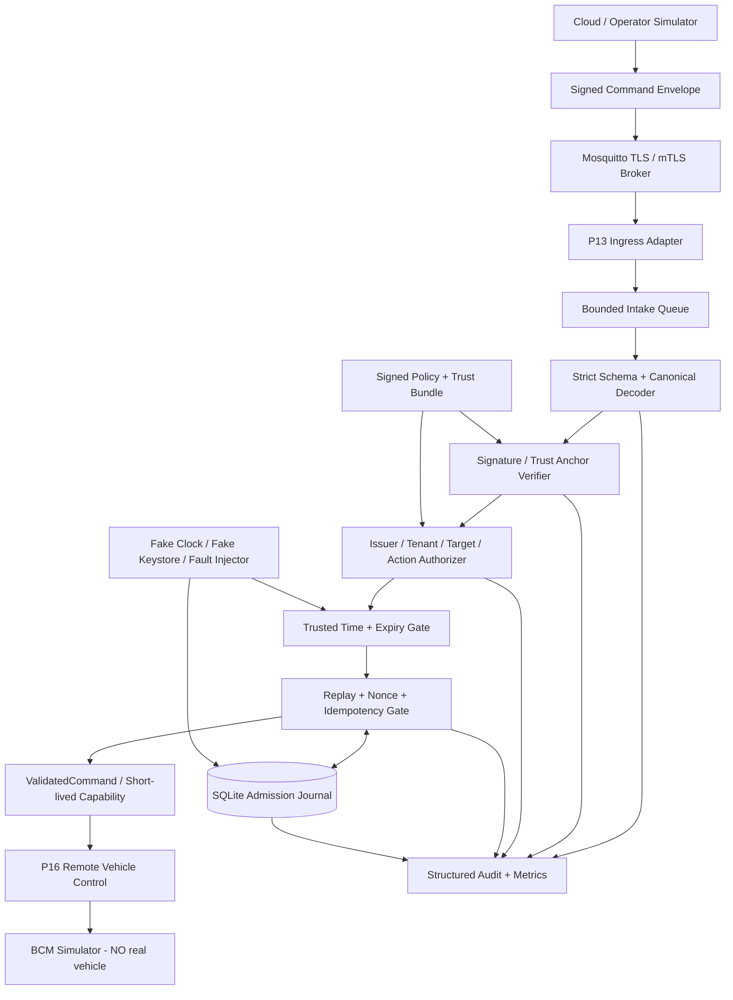
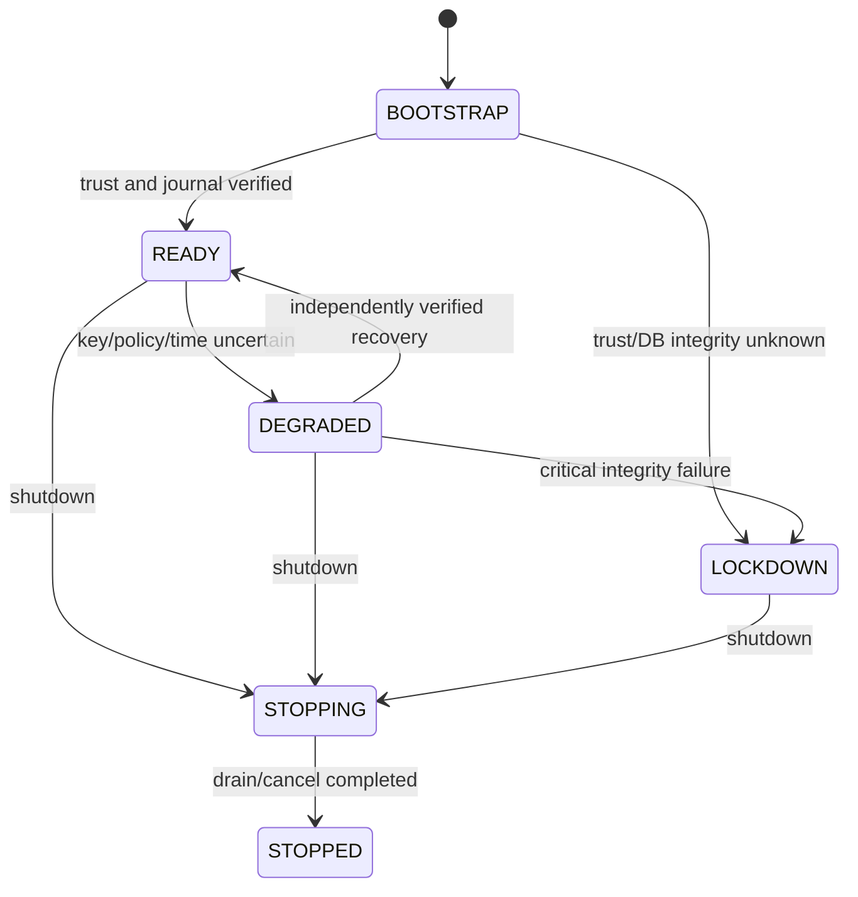
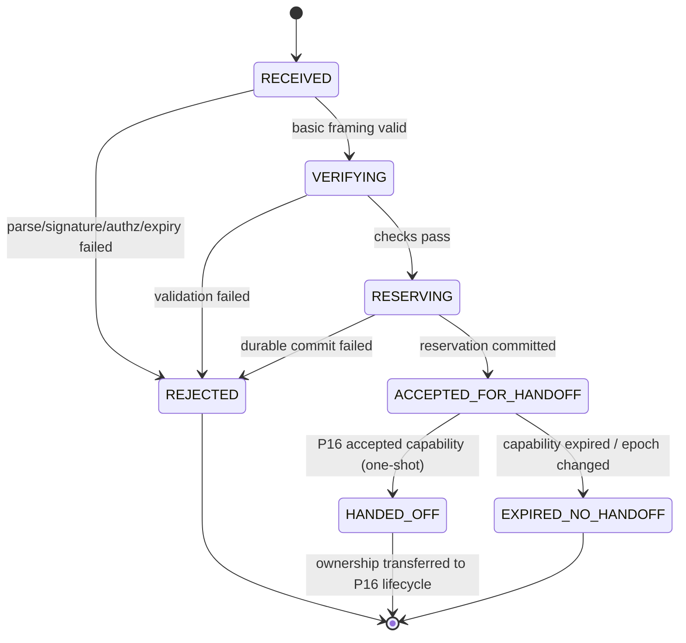
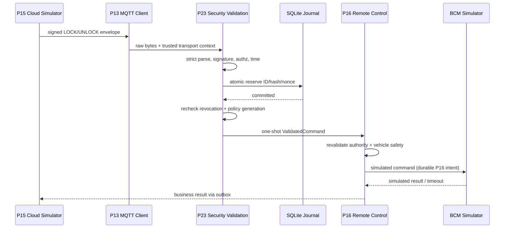

# Project 23 — Secure Command Validation

**Virtual TCU Lab · System Design, Behavioral Contracts & Security Resilience Test Plan · Version 1.0 · 2026-10-30**  
**Target:** Middle C++ Developer · C++17 · Ubuntu Linux · simulation-first · 23/30  
**Trạng thái:** Đặc tả thiết kế và kế hoạch kiểm thử; **không** phải kết quả xác nhận phần mềm đã vượt qua thử nghiệm.

> **An toàn & pháp lý:** Mọi ví dụ dùng danh tính, khóa thử nghiệm, MQTT broker và BCM **giả lập**. Không sử dụng key/certificate của OEM; không nối công cụ với xe thật; không tạo lệnh điều khiển thiết bị vật lý. Không tuyên bố đạt ISO/SAE 21434, UNECE R155, AUTOSAR SecOC hay bất kỳ chứng nhận an toàn nào. Việc khai thác điểm yếu chỉ được mô phỏng trong môi trường cô lập được sở hữu và cho phép.

## 0. Executive summary và mục lục

**Mục tiêu:** Xây thư viện `libtcu_secure_command` nhận remote-command envelope từ P13/P15, chứng thực nguồn gốc và payload, kiểm tra quyền đúng đối tượng/thiết bị, ngăn replay, kiểm tra hạn sử dụng và thời gian tin cậy, bảo vệ danh tính/khóa, ghi quyết định có khả năng phục hồi, sau đó cấp **ValidatedCommand** chỉ dành cho P16 Remote Vehicle Control. P16 vẫn chịu trách nhiệm safety policy, intent journal và side-effect đến BCM Simulator.

**Quan điểm cốt lõi:** (1) TLS transport authentication khác end-to-end command authentication. (2) `MQTT PUBACK` khác business ACK khác actuator execution. (3) Retry không được biến command cũ thành hành động mới. (4) Lỗi không rõ ràng → `DENY` trước dispatch; nếu dispatch đã xảy ra → `OUTCOME_UNKNOWN` tại P16. (5) Fail closed chỉ có ý nghĩa khi kiểm chứng được không phát side effect. (6) Lab định hướng bảo vệ chống replay và kiểm thử nội bộ, không tái hiện giao thức OEM độc quyền.

**Mục lục:** 1. Scope & boundary · 2. Requirements/SLO · 3. Threat model · 4. Architecture · 5. Trust & protocol · 6. Command envelope · 7. Validation pipeline · 8. State machines · 9. C++17 API · 10. Storage/crash · 11. Concurrency · 12. TLS/PKI · 13. Key rotation · 14. Integration · 15. Operational behaviors · 16. Acceptance · 17. What-if 300 · 18. Multi-fault 50 · 19. Test strategy · 20. Jira backlog 36 · 21. Runbook · 22. Traceability/release gates · 23. Limitations/open decisions · 24. References.

---

## 1. Mission, scope, assumptions, trust boundaries

### 1.1 In scope

- Xác thực transport channel bằng TLS/mTLS (thí nghiệm với OpenSSL và broker localhost); kiểm tra certificate chain, hostname, thời gian hợp lệ và trust anchor theo profile cấu hình.
- **Application-level authenticated command envelope**: Ed25519 trên canonical deterministic byte encoding được thiết kế/khóa phiên bản. TLS authentication không thay thế chữ ký e2e nếu broker có quyền nhìn/sửa command.
- Principal binding `issuer → tenant → device → action` và quyền theo deny-by-default; áp dụng policy version, key epoch, revocation generation.
- Anti-replay bền vững với `command_id`, `payload_hash`, `nonce`, namespace issuer và target; TTL/clock-confidence; xử lý duplicate đúng vs conflicting duplicate.
- Bounded input, strict parsing, crypto adapter, permission checks, audit, metrics; hot reload trust bundle có xác thực và anti-rollback.
- Durable admission journal trong SQLite và handoff interface tới P16; crash recovery, cancel, stop, key rotation, revocation và race testing.
- Mock cloud/BCM, simulated MQTT/IPC; testing thư viện không cần hardware.

### 1.2 Out of scope

- Không thiết kế thuật toán mật mã mới, không tự viết trình xác minh X.509, không tự cài HSM/TPM phần cứng, không mã hóa SQLite bằng cách giả định WAL tự mã hóa, không xây PKI production/OEM.
- Không cho phép actuator commands thật; không implement bypass UDS SecurityAccess, ECU immobilizer, remote-start, firmware signing production hoặc remote OTA install.
- Không coi chứng thực command là chứng nhận xe an toàn: speed/gear/door state và chặn thao tác vật lý do P16/BCM Simulator kiểm soát, dựa trên chính sách giả lập.

### 1.3 Phụ thuộc dự án

| Dự án | Dùng để | Ranh giới |
|---|---|---|
| P01 Event Bus, P02 IPC, P03 Scheduler, P04 Config/Logging | Event dispatch, IPC, deadlines, secure config | API bị giả lập khi unit test |
| P10 Connectivity, P11 Network Fault Lab | Network states / faults | Mất Internet không hạ thấp auth policy |
| P13 MQTT Client | Kênh nhận command | MQTT topic/payload chỉ là claim; xác minh source thực tế |
| P14 Durable Outbox, P15 Cloud Backend | Command/result persistence | PUBACK không là business/result ACK |
| P16 Remote Vehicle Control | Safety gate, BCM dispatch, reconciliation | Chỉ P16 có capability làm side-effect |
| P17 Health Monitor, P22 Power Manager | Alert, power/clock conditions | Policy điện năng không cho phép bỏ qua xác thực |

### 1.4 Các hằng số lab mặc định — không phải giá trị OEM

| Setting | Giá trị giả lập | Ghi chú |
|---|---:|---|
| Envelope max | 16 KiB | Hard fail khi vượt |
| Max command age | 90 s | Cần clock đáng tin |
| Allowed issued-at future skew | 5 s | Configurable; không biến thời gian chưa đồng bộ thành tin cậy |
| Max in-flight verifications | 64 | Bounded worker/queue |
| Intake queue | 1024 | Full → reject/backpressure, không âm thầm bỏ |
| Max nonce ledger retention | 48 h | Có storage limit; retention phải >= thời gian replay window theo policy |
| Token-to-dispatch TTL | 3 s | Internal capability; P16 recheck trước boundary side-effect |
| Verify timeout | 2 s | Không dùng wall clock chưa trust để timeout |
| SQLite | WAL + synchronous=FULL | Độ bền vẫn phụ thuộc storage/fsync semantics |
| Audit queue | 4096 | Không ghi plaintext token/keys/PII |
| Soak test | >=24 h | Mục tiêu kiểm thử, không phải chứng nhận |

## 2. Requirements và chất lượng dịch vụ mục tiêu

### 2.1 Functional requirements

| ID | Yêu cầu | Verification |
|---|---|---|
| FR-01 | Chỉ nhận command từ verified source theo policy đã kích hoạt | Identity mismatch test |
| FR-02 | Kiểm tra certificate chain, host/device identity, validity và pin/trust anchors | TLS matrix |
| FR-03 | Verify signature trên **đúng canonical bytes** với purpose/domain binding | Signature vectors |
| FR-04 | Parser xác thực schema và giới hạn kích thước trước khi cấp quyền | Fuzz/negative |
| FR-05 | Kiểm tra issuer/tenant/target/action, scope và trạng thái revocation | Authz matrix |
| FR-06 | Idempotency `(issuer, tenant, target, command_id)` + payload hash durable | Crash replay |
| FR-07 | Nonce freshness: reject reuse trái policy, persist trước handoff | Nonce collision |
| FR-08 | Kiểm tra thời hạn, trusted wall-time confidence và future skew | Fake clock |
| FR-09 | Phân biệt `DENY`, `ACCEPT`, `DUPLICATE_SAME`, `CONFLICT`, `UNKNOWN` | Contract |
| FR-10 | Reject khi audit/journal mandatory durable commit fail | SQLite injection |
| FR-11 | Cho phép trust bundle / policy hot reload theo generation có rollback protection | Reload atomicity |
| FR-12 | Không dispatch bởi callback thuộc connection/config generation cũ | Race test |
| FR-13 | Bounded concurrency, queues, parsing, crypto retries và resource usage | Stress |
| FR-14 | Redact secrets và chống log injection | Log inspection |
| FR-15 | Tách validation khỏi thực thi BCM; P16 revalidate trước side-effect | Adapter mock |
| FR-16 | Khôi phục journal sau restart mà không tái cấp quyền cho command cũ | Killpoints |
| FR-17 | Telemetry về nguyên nhân reject không tiết lộ khóa/claims nhạy cảm | Privacy review |
| FR-18 | Đo được các invariants, fault injection và PASS/FAIL/INCONCLUSIVE | Harness |

### 2.2 Non-functional acceptance targets — ví dụ lab

| ID | Lab target (cần đo trên CI runner công bố) | Kiểm chứng |
|---|---|---|
| NFR-01 | 0 unauthenticated/unauthorized command đi tới P16 dispatch mock | Negative tests + P16 side-effect counter |
| NFR-02 | 0 same-ID conflicting-payload accepted | Unique key/DB assertions |
| NFR-03 | 0 duplicate dispatch khi chạy lại hợp lệ cùng ID trong simulator | Durable nonce/idempotency replay |
| NFR-04 | p99 <=100 ms validation với 100 commands/s khi CPU không bị fault | Histogram, không hứa real-time |
| NFR-05 | RSS/FD/threads và queue có trần dưới 10k msg/s overload | Resource sampler |
| NFR-06 | No UAF/deadlock/data race trong coverage ASan/UBSan/TSan | CI isolated builds |
| NFR-07 | 100% các test bắt buộc xác nhận fault đã inject; thiếu bằng chứng → INCONCLUSIVE | Harness oracle |
| NFR-08 | Clock untrusted, trust-store corrupt hoặc revocation unknown → 0 authorization | Fail-closed |
| NFR-09 | Restart tại từng persistence checkpoint không false ACCEPT/EXECUTED | Killpoint matrix |
| NFR-10 | Không plaintext private key/token xuất hiện trong trace, audit, core fixtures | Secret scanner |

## 3. Threat model: attacker, assets và STRIDE

**Assets:** private keys; trust anchors; principal/device bindings; command intent; anti-replay journal; signed policy; audit integrity; test simulator vehicle-state. **Adversaries giả lập:** người gửi MQTT topic không có quyền; operator sai tenant; broker không đáng tin ở application layer; MITM từ test proxy; replay/corrupt packet nguồn lab; đồng thời lỗi phần mềm, disk failure, clock failure.

| STRIDE | Threat scenario | Kiểm soát bắt buộc |
|---|---|---|
| Spoofing | Fake issuer trong JSON, spoof topic/source | Verified transport principal + envelope issuer binding |
| Tampering | Thay action/target/expiry sau signing | Canonicalized signature + strict schema |
| Repudiation | Mất/đảo audit record, mất ACK | Durable decision journal + correlation ID, không suy diễn execution |
| Information disclosure | Log token, PEM private key, raw GPS | Redaction, scoped access, minimize retention |
| Denial of service | Flood parser, crypto verify và SQLite | Length caps, bounded workers/queues, rate limits, backpressure |
| Elevation of privilege | A tenant token gửi lệnh sang tenant B | Target/object/action authorization theo verified binding |

**Ranh giới trust:** Cloud signing service → MQTT broker (không nhất thiết trusted để quyết định command) → TLS channel/TCU intake → strict decoder → E2E verifier → identity/authorization → durable replay ledger → internal `ValidatedCommand` → P16 (kiểm tra safety và journal) → BCM Simulator. `device_id` trong payload **không phải** danh tính đã xác thực. Không tin bất kỳ chính sách nào do remote command tự khai báo.

## 4. System architecture



### 4.1 Separation of responsibilities

| Component | Owns | Must NOT |
|---|---|---|
| TLS transport adapter | Channel handshake, verified peer certificate metadata | Grant actuator rights based on MQTT topic |
| Envelope parser | Length bounds, version, field types, canonical decode | Treat unsigned claims as trusted identity |
| Crypto verifier | Purpose-bound Ed25519 signature verify using trusted public keys | Implement custom signing primitive |
| Principal resolver | Transport/e2e issuer binding, immutable principal | Trust caller-supplied `principal_id` |
| Authz engine | Device/tenant/action scopes, revocation and policy generation | Assume wildcard tenant access |
| Freshness gate | Trusted UTC evidence, expiry, nonce/idempotency | Accept unauthenticated clock sync |
| Journal | Atomic reserve/decision and replay history | Claim fsync guarantees beyond actual storage |
| Command handoff | Short-lived internal validated capability | Execute BCM command |
| P16 | Final safety preconditions, command state and BCM simulation | Reuse admission success blindly after revocation |

## 5. Security protocol / identity model

### 5.1 Channel vs message authentication

1. TLS server verification protects TCU ↔ broker/endpoint. If mTLS is configured, the broker can verify TCU credentials; that does **not** prove a cloud command payload was signed by an authorized operator.
2. A broker can accept publications from multiple principals. The TCU must not infer original publisher identity from topic strings or untrusted JSON.
3. Application envelope uses `Ed25519(signature, domain_separator || canonical_payload)` with a test trust bundle mapping `key_id → issuer` and allowed actions. A compromised trusted signer still requires revocation/authorization policy.
4. Distinguish principals: authenticated **device**, authenticated **cloud issuer**, operator **tenant**, requested target. Each has independent ownership/scope checks.
5. Lab accepts only TLS 1.3 for secured broker profile, with `0-RTT` **disabled for commands**: TLS 1.3 early data lacks application replay guarantees. Simulator can provide insecure plaintext profile **only to verify rejection**, never to authorize sensitive command.

### 5.2 Why anti-replay needs both transport and application state

TLS protects against network tampering in an established session, not legitimate redelivery of application messages after MQTT reconnect or backend retry. `(issuer_namespace, tenant_id, target_id, command_id)` + immutable payload hash deduplicates retry; `(issuer_namespace, key_id, nonce)` blocks nonce reuse; trusted expiry prevents very old but unseen commands. **These are separate checks**. If actual actuation occurred, P16/BCM journal is still needed for execution idempotency.

### 5.3 Threat control matrix

| Attack-like lab event | Required behavior |
|---|---|
| TLS verification disabled by config or callback | Hard fail at startup / security profile validation |
| TLS session valid but signature bad | `DENY_SIGNATURE`; no P16 handoff |
| Signature valid but issuer revoked | `DENY_REVOKED`; no P16 handoff |
| Issuer valid, target owned by another tenant | `DENY_AUTHZ`; no P16 handoff |
| Valid command but time unknown | `DENY_TIME_UNTRUSTED`; no P16 handoff |
| Valid duplicate same ID & hash | Return stored admission outcome, **no second handoff** |
| Same ID but altered payload | `DENY_CONFLICT`, security event; never replace existing journal |

## 6. Command envelope / canonical wire specification

### 6.1 Protocol decision

Use a **versioned canonical CBOR profile** in production-oriented design, or a minimal deterministic binary encoder in the first lab iteration; avoid signing arbitrary noncanonical JSON. For interoperability, both signer and verifier must agree on exact byte profile, key ordering, numeric normalization, UTF-8/NFC policy, field presence rules, and encoded-length caps. Reject multiple encodings of the same conceptual command; no silent conversion from floats to integers. Test vectors are mandatory.

```text
Domain: "VirtualTCU:RemoteCommand:v1\0" (literal bytes, include NUL)
Envelope { version:1,
  command_id: bytes[16], tenant_id: ascii-id, target_device_id: ascii-id,
  issuer_id: ascii-id, key_id: ascii-id, nonce: bytes[16],
  action: enum{LOCK,UNLOCK}, issued_at_utc_ms: int64,
  expires_at_utc_ms: int64, requested_policy_context: map{...},
  signature: bytes[64]  // excluded from canonical signed payload
}
SigMessage := domain_bytes || encode_canonical_v1(all signed fields)
```

**Lưu ý:** `requested_policy_context` chỉ là input đã được ký, **không** có quyền tự hạ giới hạn safety policy. Lab `action` hạn chế LOCK/UNLOCK tới BCM Simulator. Không nhúng signed private keys/production certs trong repo. CBOR canonical conformance chỉ được tuyên bố nếu codec thật được triển khai và chạy vectors tương ứng.

### 6.2 Validation order and failure semantics

1. Verify transport security profile, bound the raw envelope length, parse strict schema/version.
2. Verify signature and purpose binding; resolve issuer from authenticated key registry; check key status/revocation/trust epoch.
3. Resolve tenant/device and enforce action-specific permissions; check policy and revocation generation.
4. Verify trusted UTC evidence; issued-at, expiry, max age, allowed skew; do not compare `std::chrono::steady_clock` ticks across reboot.
5. Begin atomic SQLite reservation for immutable ID+payload hash+nonce; check conflict/duplicate; commit with required durability profile.
6. Emit `ValidatedCommand` via internal authenticated IPC with capability generation and bounded TTL; P16 re-checks authority, policy and safety immediately before dispatch.
7. On error before step 6 → no handoff. Once P16 may have dispatched, **only P16** may decide outcome; validator cannot announce `EXECUTED`.

### 6.3 Decision status model

| Code | Meaning | Retried? |
|---|---|---|
| `ACCEPTED_FOR_HANDOFF` | Verification + mandatory reservation completed | No blind redispatch |
| `DUPLICATE_SAME` | Same immutable envelope previously admitted | Return original admission result; no new handoff |
| `DENY_BAD_SIGNATURE`, `DENY_SCHEMA`, `DENY_AUTHZ` | Invalid/untrusted | Caller may submit **new valid command**, not bypass |
| `DENY_REPLAY`, `DENY_CONFLICT` | Reuse/collision inconsistent | Security event, not a transient retry |
| `DENY_EXPIRED`, `DENY_TIME_UNTRUSTED` | Freshness invalid/unverifiable | Never auto-increase expiry |
| `DENY_REVOKED`, `DENY_KEY_UNAVAILABLE` | Key not allowed / verification unavailable | Fail closed |
| `DENY_STORAGE_UNAVAILABLE` | Could not durably reserve | No handoff; retry safely with same command after recovery |
| `DEGRADED` | Security service unavailable/health unknown | No authorization until recovered |

## 7. Operational state machines





**Invariant:** ACCEPTED is never interpreted as vehicle execution, and `HANDED_OFF` may not imply P16 dispatched. Revocation right before handoff requires a fresh policy check; revocation after confirmed side effect cannot undo a physical action and must be reflected as audit/reconciliation, not fabricated `DENY` of already executed command.

## 8. C++17 interface design

```cpp
#pragma once
#include <array>
#include <chrono>
#include <cstdint>
#include <memory>
#include <optional>
#include <string>
#include <vector>

namespace tcu::security {
using CommandId = std::array<std::uint8_t, 16>;
using Nonce = std::array<std::uint8_t, 16>;
using Digest = std::array<std::uint8_t, 32>;

enum class Action : std::uint8_t { Lock, Unlock };
enum class DecisionCode : std::uint8_t {
  AcceptedForHandoff, DuplicateSame, DenySchema, DenySignature,
  DenyAuthz, DenyRevoked, DenyReplay, DenyConflict,
  DenyExpired, DenyTimeUntrusted, DenyStorageUnavailable,
  DenyKeyUnavailable, Degraded
};

struct TransportContext { // produced only by trusted transport adapter
  std::string authenticated_peer;
  std::uint64_t connection_epoch = 0;
  bool tls_peer_verified = false;
};

struct CommandEnvelope {
  std::uint32_t version = 1;
  CommandId command_id{};
  Nonce nonce{};
  std::string issuer_id, tenant_id, target_device_id, key_id;
  Action action = Action::Lock;
  std::int64_t issued_at_utc_ms = 0, expires_at_utc_ms = 0;
  std::vector<std::uint8_t> canonical_signed_bytes;
  std::array<std::uint8_t, 64> signature{};
};
struct VerifiedPrincipal { // only trusted verifier may construct in implementation
  std::string issuer_id, tenant_id;
  std::uint64_t trust_epoch = 0;
};
struct Decision {
  DecisionCode code;
  CommandId command_id;
  std::string audit_correlation;
  std::uint64_t policy_generation = 0;
};
class ITrustedClock {
public:
  virtual ~ITrustedClock() = default;
  virtual std::optional<std::int64_t> trustedUtcMillis() const = 0;
};
class ISignatureVerifier {
public:
  virtual ~ISignatureVerifier() = default;
  virtual std::optional<VerifiedPrincipal> verify(
      const CommandEnvelope& command) = 0;
};
class IAdmissionJournal {
public:
  virtual ~IAdmissionJournal() = default;
  virtual Decision reserveAtomically(const CommandEnvelope& command,
                                      const VerifiedPrincipal& principal,
                                      const Digest& payload_hash,
                                      std::uint64_t policy_generation) = 0;
};
class ISecureCommandService {
public:
  virtual ~ISecureCommandService() = default;
  virtual Decision validate(const std::vector<std::uint8_t>& envelope,
                            const TransportContext& trusted_context) = 0;
  virtual void stop() noexcept = 0;
};
} // namespace tcu::security
```

**Implementation constraints:** `TransportContext` phải do trusted adapter sản sinh, không expose setter cho untrusted callers; `VerifiedPrincipal` chỉ trả về sau verify. API trên là skeleton để review, chưa phải implementation compile-complete; nên dùng `StatusOr`/explicit error type nội bộ, secret zeroization và `std::shared_ptr`/weak callbacks có kiểm soát. `ValidatedCommand` nên là opaque move-only type có constructor restricted, không thể được tự sinh bằng IPC JSON.

### 8.1 Core algorithm (pseudocode)

```text
handle(raw, transport_ctx):
  if !transport_ctx.verified or length(raw)>MAX: DENY
  cmd = strict_decode_and_canonical_check(raw) else DENY
  principal = signature_verify_and_resolve(cmd) else DENY
  policy = atomic_verified_policy_snapshot()
  if revoked(principal,key,policy) or !authorized(principal,cmd.target,cmd.action): DENY
  now = trusted_utc() else DENY_TIME_UNTRUSTED
  if cmd.expires_at<=now or cmd.issued_at>now+SKEW or age>MAX_AGE: DENY
  result = journal.transactional_reserve(cmd-id, payload-hash, nonce,
                                         principal, policy-generation)
  if result==DUPLICATE: return previous decision WITHOUT new dispatch
  if result==CONFLICT or db_failed: DENY
  recheck policy revocation/generation before handoff
  deliver move-only, time-limited capability to P16 with one-shot nonce
  return ACCEPTED_FOR_HANDOFF  // not EXECUTED
```

## 9. Durable journal and crash-consistency contract

```sql
PRAGMA foreign_keys=ON;
PRAGMA journal_mode=WAL;
PRAGMA synchronous=FULL;
CREATE TABLE IF NOT EXISTS command_admission (
  issuer_namespace TEXT NOT NULL,
  tenant_id TEXT NOT NULL,
  target_device_id TEXT NOT NULL,
  command_id BLOB NOT NULL CHECK(length(command_id)=16),
  payload_hash BLOB NOT NULL CHECK(length(payload_hash)=32),
  key_id TEXT NOT NULL,
  nonce BLOB NOT NULL CHECK(length(nonce)=16),
  decision TEXT NOT NULL CHECK(decision IN
      ('ACCEPTED_FOR_HANDOFF','HANDED_OFF','EXPIRED_NO_HANDOFF')),
  policy_generation INTEGER NOT NULL,
  trust_epoch INTEGER NOT NULL,
  recorded_at_utc_ms INTEGER NOT NULL,
  handoff_generation INTEGER NOT NULL DEFAULT 0,
  PRIMARY KEY(issuer_namespace,tenant_id,command_id),
  UNIQUE(issuer_namespace,nonce)
);
CREATE TABLE IF NOT EXISTS security_events (
  event_id TEXT PRIMARY KEY,
  command_id BLOB,
  reason_code TEXT NOT NULL,
  audit_correlation TEXT NOT NULL,
  recorded_at_utc_ms INTEGER,
  policy_generation INTEGER NOT NULL
);
CREATE TABLE IF NOT EXISTS policy_activation (
  id INTEGER PRIMARY KEY CHECK(id=1),
  active_policy_generation INTEGER NOT NULL,
  min_accepted_bundle_generation INTEGER NOT NULL,
  active_bundle_digest BLOB NOT NULL CHECK(length(active_bundle_digest)=32)
);
CREATE INDEX IF NOT EXISTS idx_admission_time
ON command_admission(recorded_at_utc_ms);
```

- **Atomic reserve:** transaction `BEGIN IMMEDIATE` → insert if no collision → `COMMIT`. Unique keys serialize concurrent duplicate admission. Detect same-ID/different-hash as `CONFLICT`, not silently accept. Nonce reuse across command IDs is replay regardless of hash.
- **Crash after durable reserve but before handoff:** record is `ACCEPTED_FOR_HANDOFF` and may be unresolved; never redispatch automatically. Reconciliation with P16 determines if handoff occurred; if outcome ambiguous, mark `EXPIRED_NO_HANDOFF` only when P16 proves no dispatch. Else retain `UNKNOWN` in cross-service reconciliation rather than fabricate a terminal fact.
- **Crash after handoff:** P16 owns side effect and outcome; P23 never reports `EXECUTED` based on local record. A distributed atomic transaction across P23/P16 is not assumed. Use an idempotent handoff protocol and monotonic command ownership transfer.
- **Deny before DB transaction:** deny can be emitted without storing a replay nonce; an attacker may retry rejected commands, subject to rate limits and audit. Any accepted action requires journal durability.
- **DB corruption / disk full / locks:** fail closed, surface `DENY_STORAGE_UNAVAILABLE`; no fallback to memory-only acceptance.
- **Persistence policy:** audit privacy retention configurable; counter anti-rollback/trust bundle activation must not regress on restore; SQLite is **not encrypted by default**.

## 10. Concurrency and lifecycle

| Race | Contract |
|---|---|
| Two workers reserve same command simultaneously | Database uniqueness → one new acceptance, other `DUPLICATE_SAME`; one handoff maximum |
| Timeout competes with signature verification | Only one terminal admission decision; cancelled task cannot create capability |
| Policy reload while verify in progress | Snapshot version, then recheck active generation before handoff; no mixed-policy authorization |
| Certificate revoked while TLS session alive | Re-evaluate command signer and principal status at each admission; revoke live session per transport policy |
| Shutdown while callback executes | Reject new admission, cancel queued tasks, wait boundedly, no callback into freed object |
| TCU restart with old IPC result | `service_incarnation`/`handoff_generation` rejects stale result |
| Slow crypto API / blocked DB | Bounded worker pool + deadlines + `DEGRADED`/reject; never silently skip a security gate |

**Thread model:** 1 intake event loop → bounded queue → N verify workers → single serialized journal lane (or short SQLite transactions with controlled connections) → handoff executor. Avoid holding locks while doing disk I/O or foreign callbacks. `std::chrono::steady_clock` for in-process deadlines; UTC for signed validity only with authenticated time confidence. Use cancellation tokens and epoch fencing for timers/callbacks.

## 11. TLS, mTLS và certificate validation

- TLS library owns chain validation, hostname verification and cryptographic checks. Configure OpenSSL verification strictly; reject `verify_none`, expired/unknown CA, wrong EKU/hostname, rejected signature, weak crypto and downgrade attempts. Test CA chain and certificates are local lab fixtures.
- Verify separate `serverAuth` for outbound connections; `clientAuth` for device cert if mTLS profile uses it. Mutual TLS device identity does **not** make a received publisher command authorized.
- Distinguish certificates expiring from cert revocation: lab can use pinned signed revocation snapshots and simulated OCSP/CRL profile; offline revocation policy must be explicit (strict deny for high-risk commands in this lab).
- TLS session resumption/0-RTT must not cause double command admission. Disable 0-RTT for mutating commands; still enforce app idempotency for MQTT redelivery.
- Clock unknown at boot can invalidate certificate time-check; **do not** allow unrestricted command acceptance as workaround. Bootstrap time trust through a separately specified trusted source or stay locked down.

## 12. Key management and policy lifecycle

1. Key-generation uses tested crypto library; keys stored outside repository; local test private key permissions `0600`, never output in logs.
2. Trust bundle contains signed `{bundle_generation, keys, issuers, scopes, revocations, valid_from, valid_to, digest}`. Verify signature with pinned offline trust root; reject downgrade to older generation.
3. Rotation: publish new signed bundle → stage/verify → atomically activate → old keys allowed only in explicit overlap window if not revoked → eventually disable old key. Renewal and revocation are different operations.
4. Compromised key: immediate revocation generation and invalidation of authorizations not yet handed off; audit all affected commands. Already executed BCM state must be reconciled, not undone by pretending it never happened.
5. Test key loss, wrong permissions, corrupt file, partial write and trust-root rotation. Production key provisioning/HSM and root rollover are OEM-specific separate projects.
6. Crypto agility: application protocol version and key algorithm suite should be reviewable. Unknown algorithms/critical fields rejected rather than guessed.

## 13. Integration with P13/P15/P16/P22



**Cross-service handoff:** Prefer Unix socket authenticated peer credentials / process-scoped capability in lab. Capability MUST bind issuer, target, command ID, payload digest, decision journal revision, policy generation, trust epoch, service generation, expiry; should be delivered once and consumed once. Plain user-provided JSON claiming `validated:true` is rejected. Different principals, binaries, or container instances cannot forge an internal capability by trusting a string field.

### 13.1 Safety gate vs security gate

- P23 checks whether the **command is authorized and fresh**.
- P16 checks whether the **vehicle/BCM simulator should execute it in this moment**.
- A valid signature does not prove vehicle is parked; CAN `speed == 0` alone doesn't prove parked. If vehicle-state quality insufficient, P16 rejects; P23 must not override.
- When a command has reached side-effect boundary and ACK is lost, `OUTCOME_UNKNOWN` and reconciliation are legitimate, not a security validation bug.

## 14. Operational behavior walkthrough

| Scenario | Expected progression |
|---|---|
| Clean boot | Verify signed trust bundle → open/check SQLite → establish trusted time → READY → accept intake |
| Valid signed command | Verified TLS context → strict decode → verify signature → authorize tenant/target/action → expiry → durable reserve → one-shot P16 handoff |
| Duplicate same payload | Unique journal key matches immutable hash → `DUPLICATE_SAME` → no second P16 handoff |
| Same ID altered payload | Detect payload digest conflict → `DENY_CONFLICT` + audit; retain old record |
| Revocation update | Verify signed new policy generation → activate → reject old signers → invalidate queued old decisions |
| Time becomes untrusted | New commands denied; pending handoffs invalidated if freshness unprovable |
| SQLite disk full | Reject all new admissions, emit health degradation; never use ephemeral acceptance fallback |
| Network reconnect | Fresh transport epoch, redo TLS verification; no retry bypass of signature/authz/nonce |
| Shutdown | Stop intake, terminate pending tasks, wait boundedly, zeroize transient secrets, close DB, emit stop evidence |

## 15. Behavioral contracts (Given / When / Then)

| Contract | Given | When | Then |
|---|---|---|---|
| BC-01 | Valid CA/issuer/scopes/time | Signed authorized LOCK arrives | Reserve + one P16 handoff |
| BC-02 | Valid TLS, bad signature | Command arrives | DENY_SIGNATURE, no handoff |
| BC-03 | Valid signature, other tenant target | Command arrives | DENY_AUTHZ, no handoff |
| BC-04 | Same ID and hash already accepted | Retry arrives | DUPLICATE_SAME, zero new dispatch |
| BC-05 | Same ID different hash | Retry arrives | DENY_CONFLICT, security event |
| BC-06 | Nonce used for other ID | Command arrives | DENY_REPLAY, no handoff |
| BC-07 | Clock trust invalid | New command arrives | DENY_TIME_UNTRUSTED |
| BC-08 | Signature verified | Certificate revoked before handoff | DENY_REVOKED, no capability |
| BC-09 | Valid command | Disk becomes full during reserve | DENY_STORAGE_UNAVAILABLE, no dispatch |
| BC-10 | Accepted command | Process killed before handoff | No implicit resend; reconcile ownership |
| BC-11 | Policy reload racing with acceptance | Active generation changes | Revalidate before handoff |
| BC-12 | Invalid trust bundle | Reload requested | Active good bundle remains or LOCKDOWN, never mixed partial |
| BC-13 | Broker reconnect | Old callback fires | Epoch fence drops stale callback |
| BC-14 | TLS 0-RTT data | Mutating command arrives | 0-RTT rejected; no command accepted |
| BC-15 | Attack flood | Input queue saturated | Bounded memory and observable reject |
| BC-16 | Logger or metrics failure | Authorized command arrives | Mandatory audit requirement enforced, no secret leak |
| BC-17 | P16 safety state stale | Signature valid | P16 rejects; P23 cannot force BCM execution |
| BC-18 | Old command already dispatched | Revocation arrives | Do not claim undo/deny after side effect; reconcile |
| BC-19 | Service crash/restart | Old pending IPC reply | No command executed due to stale generation |
| BC-20 | Two devices use same opaque ID | Valid issuer scopes differ | Namespace disambiguation, isolated journals |

## 16. Deterministic test environment and evidence schema

**Harness:** `FakeClock` with independent monotonic/UTC trust flags; `FakeTransport` for verified peer metadata; `FakeSignatureVerifier` for exhaustive state tests; separate real OpenSSL test-vectors for cryptographic verification; `FakePolicyStore` with signed test bundle; faultable SQLite connection; `SpyP16Handoff` with dispatch counters; local Mosquitto TLS profile; P11 network namespaces. Unit tests must not depend on real UTC, internet or production secrets.

**Result:** `PASS` iff (a) fault injection verified, (b) expected decision/state observed, (c) no unauthorized P16 handoff, (d) invariants, metrics & durable DB assertions pass. `FAIL` if any violated. `INCONCLUSIVE` if injection/evidence incomplete. `SKIPPED` only with recorded unavailable environment dependency. Store evidence `{test_id, seed, fake_time, source_generation, policy_generation, signer_fingerprint, decision_code, db_diff, handoff_count, trace_hash, injection_receipt, sanitizer_status}`. No raw private keys or full command secrets.

**Witness names used below:** `D=Decision log`, `J=SQLite journal diff`, `H=P16 mock handoff count`, `K=key/trust-generation`, `T=fake-clock/TTL trace`, `R=resource metrics`, `C=crypto/TLS verify trace`, `S=system lifecycle/epoch`, `A=redacted security audit`. Every case requires injection receipt plus family-specific witnesses.

## 17. What-if catalog — 300 single-fault security and resilience scenarios

**Cách đọc:** Mỗi dòng là một testcase riêng với ID `P23-WI-###`, hành động injection có thể lặp lại được, kết quả bắt buộc và bằng chứng cần thu. Các trường hợp có TLS/PKI/cryptography dùng **test certificates/test keys**, các trường hợp BCM chỉ dùng **BCM Simulator**. Mỗi test có `SpyP16Handoff` đếm số lệnh được chuyển đi. `DENY` nghĩa là **zero new handoff**, trừ khi test chỉ ra kết quả của lệnh đã dispatch trong quá khứ.

**Priority:** `P0` nếu vi phạm có thể dẫn đến lệnh trái quyền, replay/false execution, mất tính toàn vẹn, key/bundle downgrade hoặc crash/race critical; `P1` cho robustness/observability/compatibility. **Verification evidence** cột cuối bao gồm `injection receipt`, log/assert group và `H=0` khi lỗi phải chặn dispatch. Mục đích là bao phủ có hệ thống, **không thể liệt kê tất cả sự cố hay chứng minh an toàn tuyệt đối chỉ từ danh sách**.

### 17.01 Trust boundary & source identity (001–010)

| ID | What if? | Injection reproducible | Expected behavior (oracle) | Priority | Evidence |
|---|---|---|---|---|---|
| P23-WI-001 | Untrusted MQTT topic impersonates privileged sender | Publish to privileged-looking topic using test anonymous principal | Reject based on verified identity; no handoff | P0 | Inject receipt + `C,D,H,A` + decision/state trace |
| P23-WI-002 | JSON issuer differs from signing key issuer | Sign under issuer-A but encode issuer-B | DENY_AUTHZ; key-to-issuer binding prevails | P0 | Inject receipt + `C,D,H,A` + decision/state trace |
| P23-WI-003 | Topic device differs from payload target | Publish topic device-A with signed target-B | Reject mismatched routing/target binding | P0 | Inject receipt + `C,D,H,A` + decision/state trace |
| P23-WI-004 | Unauthenticated IPC caller supplies validated flag | Send forged validated=true over untrusted socket | Reject input; only typed internal capability accepted | P0 | Inject receipt + `C,D,H,A` + decision/state trace |
| P23-WI-005 | Broker forwards command from revoked sender | Feed verified broker transport plus revoked publisher envelope | DENY_REVOKED despite valid TLS transport | P0 | Inject receipt + `C,D,H,A` + decision/state trace |
| P23-WI-006 | Cloud principal and operator tenant disagree | Sign cloud key mapped to tenant-A but request tenant-B | DENY_AUTHZ tenant mismatch | P0 | Inject receipt + `C,D,H,A` + decision/state trace |
| P23-WI-007 | Client cert for device-A used on device-B channel | Associate wrong device certificate with target-B | Deny binding mismatch | P0 | Inject receipt + `C,D,H,A` + decision/state trace |
| P23-WI-008 | Transport principal absent after reconnect | Drop verified peer metadata before message callback | No command admitted | P0 | Inject receipt + `C,D,H,A` + decision/state trace |
| P23-WI-009 | Verified TLS transport with unsigned application command | Remove end-to-end signature but keep broker connection | DENY_SIGNATURE | P0 | Inject receipt + `C,D,H,A` + decision/state trace |
| P23-WI-010 | Two internal processes claim same service identity | Attempt IPC from process without allowed peer credentials | Deny fake handoff and audit caller identity | P0 | Inject receipt + `C,D,H,A` + decision/state trace |

### 17.02 TLS protocol negotiation (011–020)

| ID | What if? | Injection reproducible | Expected behavior (oracle) | Priority | Evidence |
|---|---|---|---|---|---|
| P23-WI-011 | Plaintext MQTT attempts remote command | Use lab insecure port to send signed LOCK | Reject sensitive intake without mandatory TLS profile | P0 | Inject receipt + `C,D,H,S` + decision/state trace |
| P23-WI-012 | TLS version below minimum | Force TLS 1.0/1.1 handshake in mock | Connection rejected; no command parsed | P0 | Inject receipt + `C,D,H,S` + decision/state trace |
| P23-WI-013 | TLS downgrade retry after failure | Simulate TLS 1.3 failure then plaintext reconnect | No security downgrade fallback | P0 | Inject receipt + `C,D,H,S` + decision/state trace |
| P23-WI-014 | Untrusted negotiated cipher profile | Offer policy-disallowed cipher only | Handshake fails closed | P0 | Inject receipt + `C,D,H,S` + decision/state trace |
| P23-WI-015 | TLS 0-RTT carries mutating command | Inject early-data in TLS simulator | Early data rejected; zero application admission | P0 | Inject receipt + `C,D,H,S` + decision/state trace |
| P23-WI-016 | TLS resumed session with stale authorization | Resume old TLS session after issuer revoke | Recheck command signer and revocation; deny | P0 | Inject receipt + `C,D,H,S` + decision/state trace |
| P23-WI-017 | TLS handshake stalls indefinitely | Hold peer at partial handshake | Timeout; bounded fd and connection slots | P0 | Inject receipt + `C,D,H,S` + decision/state trace |
| P23-WI-018 | TLS close_notify races with queued command | Inject close before command acceptance | No acceptance from invalid transport epoch | P0 | Inject receipt + `C,D,H,S` + decision/state trace |
| P23-WI-019 | TLS record payload split across reads | Split valid frame into many fragments | Correctly reassemble without bypassing validation | P1 | Inject receipt + `C,D,H,S` + decision/state trace |
| P23-WI-020 | TLS library callback returns verification error | Force OpenSSL verify failure on trusted fixture | Connection rejected; no fallback verify success | P0 | Inject receipt + `C,D,H,S` + decision/state trace |

### 17.03 X.509 chain and hostname (021–030)

| ID | What if? | Injection reproducible | Expected behavior (oracle) | Priority | Evidence |
|---|---|---|---|---|---|
| P23-WI-021 | Server chain signed by unknown CA | Serve leaf from rogue lab CA | TLS reject unknown trust anchor | P0 | Inject receipt + `C,D,H` + decision/state trace |
| P23-WI-022 | Leaf certificate past notAfter | Use expired test leaf under trusted time | TLS reject expired cert | P0 | Inject receipt + `C,D,H` + decision/state trace |
| P23-WI-023 | Leaf certificate not yet valid | Use future notBefore leaf | TLS reject not-yet-valid cert | P0 | Inject receipt + `C,D,H` + decision/state trace |
| P23-WI-024 | Hostname does not match SAN | Connect localhost alias not in cert SAN | TLS reject name mismatch | P0 | Inject receipt + `C,D,H` + decision/state trace |
| P23-WI-025 | Wildcard certificate for wrong domain | Offer *.example.test to unrelated namespace | TLS reject hostname mismatch | P0 | Inject receipt + `C,D,H` + decision/state trace |
| P23-WI-026 | Intermediate certificate missing | Omit required intermediate in test chain | TLS reject invalid chain | P0 | Inject receipt + `C,D,H` + decision/state trace |
| P23-WI-027 | Intermediate certificate path length invalid | Construct fixture violating pathLen | TLS reject chain policy | P0 | Inject receipt + `C,D,H` + decision/state trace |
| P23-WI-028 | Untrusted self-signed leaf | Server presents ad-hoc self-signed cert | TLS reject except explicit pinned test profile, not production profile | P0 | Inject receipt + `C,D,H` + decision/state trace |
| P23-WI-029 | Wrong Extended Key Usage | Present clientAuth-only cert as serverAuth | TLS reject wrong EKU | P0 | Inject receipt + `C,D,H` + decision/state trace |
| P23-WI-030 | Revoked intermediate in strict lab profile | Inject signed revocation status for intermediate | Reject trust path under strict revocation policy | P0 | Inject receipt + `C,D,H` + decision/state trace |

### 17.04 Transport certificate rotation (031–040)

| ID | What if? | Injection reproducible | Expected behavior (oracle) | Priority | Evidence |
|---|---|---|---|---|---|
| P23-WI-031 | Rotate broker certificate while TCU connected | Restart test broker with new valid chain | Reconnect and verify new chain before messages | P0 | Inject receipt + `C,K,D,H` + decision/state trace |
| P23-WI-032 | Rotate from valid to invalid leaf | Replace cert with wrong SAN | Fail TLS; do not keep stale ready state | P0 | Inject receipt + `C,K,D,H` + decision/state trace |
| P23-WI-033 | CA bundle update mid-handshake | Activate new signed CA bundle during connection | Handshake uses coherent generation and final recheck | P0 | Inject receipt + `C,K,D,H` + decision/state trace |
| P23-WI-034 | Old CA removed during resumed TLS session | Rotate roots and resume old session | Reverify policy; deny if old anchor no longer accepted | P0 | Inject receipt + `C,K,D,H` + decision/state trace |
| P23-WI-035 | Two valid certs overlap | Alternate old/new valid leaves within window | Allow only according to configured trusted overlap | P1 | Inject receipt + `C,K,D,H` + decision/state trace |
| P23-WI-036 | Certificate file partially written | Truncate broker leaf PEM during rotation | TLS fails; no partial trust bypass | P0 | Inject receipt + `C,K,D,H` + decision/state trace |
| P23-WI-037 | Trust update receives duplicate generation | Apply same signed CA bundle twice | Idempotent activation; no policy rollback | P0 | Inject receipt + `C,K,D,H` + decision/state trace |
| P23-WI-038 | Root update fails durable commit | Fail SQLite policy_activation commit | Keep last known-good active or lockdown | P0 | Inject receipt + `C,K,D,H` + decision/state trace |
| P23-WI-039 | Peer cert changes between hostname and chain check | Simulate stale transport-context reuse | Bind checks to same handshake and epoch | P0 | Inject receipt + `C,K,D,H` + decision/state trace |
| P23-WI-040 | Certificate rejected while MQTT reconnecting | Trigger repeated failed handshakes | Bounded retry and visible degraded connectivity | P0 | Inject receipt + `C,K,D,H` + decision/state trace |

### 17.05 mTLS and device identity (041–050)

| ID | What if? | Injection reproducible | Expected behavior (oracle) | Priority | Evidence |
|---|---|---|---|---|---|
| P23-WI-041 | Missing client certificate in strict mTLS profile | Connect with no device cert | Broker rejects device authentication | P0 | Inject receipt + `C,D,H,A` + decision/state trace |
| P23-WI-042 | Client cert from wrong TCU device | Use device-B cert for device-A endpoint | Deny device/principal binding | P0 | Inject receipt + `C,D,H,A` + decision/state trace |
| P23-WI-043 | Valid cert but client private-key proof absent | Present cert without matching private key | Handshake fails | P0 | Inject receipt + `C,D,H,A` + decision/state trace |
| P23-WI-044 | Device certificate revoked | Mark device certificate revoked in test fixture | Disconnect/deny under strict policy | P0 | Inject receipt + `C,D,H,A` + decision/state trace |
| P23-WI-045 | Device cert valid, payload issuer unauthorized | Sign command using unallowed issuer key | DENY_AUTHZ or DENY_SIGNATURE | P0 | Inject receipt + `C,D,H,A` + decision/state trace |
| P23-WI-046 | mTLS identity extracted from untrusted header | Inject forged X-Device-ID application property | Ignore property; use verified peer metadata | P0 | Inject receipt + `C,D,H,A` + decision/state trace |
| P23-WI-047 | Reconnect returns old peer context | Deliver transport callback from previous TLS epoch | Drop stale context | P0 | Inject receipt + `C,D,H,A` + decision/state trace |
| P23-WI-048 | Device ID normalized ambiguously | Test uppercase/Unicode variant IDs | Reject ambiguous IDs rather than merge identities | P0 | Inject receipt + `C,D,H,A` + decision/state trace |
| P23-WI-049 | Shared cert across two test devices | Configure same cert for two distinct device IDs | Deny mismatched device registry binding | P0 | Inject receipt + `C,D,H,A` + decision/state trace |
| P23-WI-050 | mTLS revoked while outstanding command queued | Revoke device then release queue | Revalidate before handoff; no old rights | P0 | Inject receipt + `C,D,H,A` + decision/state trace |

### 17.06 E2E signature verification (051–060)

| ID | What if? | Injection reproducible | Expected behavior (oracle) | Priority | Evidence |
|---|---|---|---|---|---|
| P23-WI-051 | Corrupt one bit of signed command | Flip action byte after signing | DENY_SIGNATURE, no handoff | P0 | Inject receipt + `C,D,H,K` + decision/state trace |
| P23-WI-052 | Truncate Ed25519 signature | Supply 63-byte signature | DENY_SCHEMA/signature length | P0 | Inject receipt + `C,D,H,K` + decision/state trace |
| P23-WI-053 | Extend signature buffer | Supply 65-byte signature | DENY_SCHEMA; no unsafe read | P0 | Inject receipt + `C,D,H,K` + decision/state trace |
| P23-WI-054 | Wrong public key for key_id | Swap key registry entry in fake store | DENY_SIGNATURE | P0 | Inject receipt + `C,D,H,K` + decision/state trace |
| P23-WI-055 | Algorithm field unknown | Insert unknown critical algorithm identifier | Reject rather than guess fallback | P0 | Inject receipt + `C,D,H,K` + decision/state trace |
| P23-WI-056 | Signature valid under other purpose | Sign with telemetry purpose prefix, replay as command | DENY_SIGNATURE domain separation | P0 | Inject receipt + `C,D,H,K` + decision/state trace |
| P23-WI-057 | Signature valid for old schema version | Reinterpret v1 bytes as v2 command | Reject version/purpose mismatch | P0 | Inject receipt + `C,D,H,K` + decision/state trace |
| P23-WI-058 | Signature verification library reports internal error | Fault crypto provider return status | DENY_KEY_UNAVAILABLE; no acceptance | P0 | Inject receipt + `C,D,H,K` + decision/state trace |
| P23-WI-059 | Verify key revoked concurrently | Revoke key during crypto verification | Recheck key generation before handoff | P0 | Inject receipt + `C,D,H,K` + decision/state trace |
| P23-WI-060 | Valid signature but trusted issuer registry missing | Remove issuer mapping for signed key | DENY_AUTHZ; signature alone insufficient | P0 | Inject receipt + `C,D,H,K` + decision/state trace |

### 17.07 Canonical encoding and parser ambiguity (061–070)

| ID | What if? | Injection reproducible | Expected behavior (oracle) | Priority | Evidence |
|---|---|---|---|---|---|
| P23-WI-061 | Duplicate target field in encoded map | Inject duplicate canonical map keys | DENY_SCHEMA; no first/last-field interpretation | P0 | Inject receipt + `C,D,H,A` + decision/state trace |
| P23-WI-062 | Noncanonical field ordering | Reencode equal map in disallowed ordering | Reject noncanonical bytes per protocol | P0 | Inject receipt + `C,D,H,A` + decision/state trace |
| P23-WI-063 | Integer overflow in timestamp | Supply out-of-range 64-bit encoded timestamp | DENY_SCHEMA and no undefined behavior | P0 | Inject receipt + `C,D,H,A` + decision/state trace |
| P23-WI-064 | Float used instead of integer timestamp | Encode expires_at as float | DENY_SCHEMA; no coercion | P0 | Inject receipt + `C,D,H,A` + decision/state trace |
| P23-WI-065 | Unicode confusable tenant ID | Send visually similar tenant with different bytes | Reject non-ASCII identity format | P0 | Inject receipt + `C,D,H,A` + decision/state trace |
| P23-WI-066 | Invalid UTF-8 in issuer | Corrupt UTF-8 sequence in envelope | DENY_SCHEMA, no downstream parsing | P0 | Inject receipt + `C,D,H,A` + decision/state trace |
| P23-WI-067 | Nested map exceeds max depth | Provide deeply nested policy_context | Reject within bounded time/stack | P0 | Inject receipt + `C,D,H,A` + decision/state trace |
| P23-WI-068 | Trailing bytes after complete envelope | Append garbage to valid signed blob | Reject extra data, no alternate parse | P0 | Inject receipt + `C,D,H,A` + decision/state trace |
| P23-WI-069 | Signature self-inclusion mismatch | Encode signature inside signed payload unexpectedly | Reject inconsistent canonical form | P0 | Inject receipt + `C,D,H,A` + decision/state trace |
| P23-WI-070 | Unknown critical field | Inject unrecognized mandatory extension | Reject until protocol version supports it | P0 | Inject receipt + `C,D,H,A` + decision/state trace |

### 17.08 Clock confidence and synchronization (071–080)

| ID | What if? | Injection reproducible | Expected behavior (oracle) | Priority | Evidence |
|---|---|---|---|---|---|
| P23-WI-071 | RTC unknown at boot | Start TCU with no trusted UTC fix | DENY_TIME_UNTRUSTED | P0 | Inject receipt + `T,D,H,S` + decision/state trace |
| P23-WI-072 | UTC jumps backwards 1 day | Shift fake UTC after validation begins | Recheck freshness with trusted clock epoch; no acceptance | P0 | Inject receipt + `T,D,H,S` + decision/state trace |
| P23-WI-073 | UTC jumps forward 1 year | Advance clock unexpectedly | Do not bulk validate/expire using untrusted jump | P0 | Inject receipt + `T,D,H,S` + decision/state trace |
| P23-WI-074 | Time source reports synchronized but is forged | Inject source without authenticated time provenance | Keep UNTRUSTED | P0 | Inject receipt + `T,D,H,S` + decision/state trace |
| P23-WI-075 | Two trusted time sources conflict | Feed divergent UTC samples | Enter TIME_UNTRUSTED / deny sensitive commands | P0 | Inject receipt + `T,D,H,S` + decision/state trace |
| P23-WI-076 | Wall clock step during SQLite commit | Step UTC after pre-check before reserve | Final freshness recheck on policy-defined trusted instant | P0 | Inject receipt + `T,D,H,S` + decision/state trace |
| P23-WI-077 | Monotonic time resets after reboot | Reuse saved process monotonic timestamp | Reject cross-boot comparison | P0 | Inject receipt + `T,D,H,S` + decision/state trace |
| P23-WI-078 | Fake time source stalls | Stop advancing test UTC while steady ticks proceed | Detect stale time confidence; deny new commands | P0 | Inject receipt + `T,D,H,S` + decision/state trace |
| P23-WI-079 | Time service temporarily unavailable | Return std::nullopt from ITrustedClock | DENY_TIME_UNTRUSTED without fallback system_clock | P0 | Inject receipt + `T,D,H,S` + decision/state trace |
| P23-WI-080 | Time confidence restored after outage | Supply authenticated time then retry new valid command | Resume only after verification and fresh expiry check | P1 | Inject receipt + `T,D,H,S` + decision/state trace |

### 17.09 Expiry, issued-at and TTL (081–090)

| ID | What if? | Injection reproducible | Expected behavior (oracle) | Priority | Evidence |
|---|---|---|---|---|---|
| P23-WI-081 | Command expires one millisecond before receipt | Set expiry=now-1 | DENY_EXPIRED | P0 | Inject receipt + `T,D,H` + decision/state trace |
| P23-WI-082 | Command expires exactly at receipt | Set expiry=now | DENY_EXPIRED (strict boundary) | P0 | Inject receipt + `T,D,H` + decision/state trace |
| P23-WI-083 | Command expires 1ms after verification but before handoff | Advance fake clock at handoff barrier | Refuse stale capability, no P16 dispatch | P0 | Inject receipt + `T,D,H` + decision/state trace |
| P23-WI-084 | Issued-at exceeds allowed future skew | Set issued_at > now + skew | DENY_EXPIRED/invalid freshness | P0 | Inject receipt + `T,D,H` + decision/state trace |
| P23-WI-085 | Issued-at exactly at future skew boundary | Set issued_at=now+skew | Boundary accepted only if all other checks pass | P0 | Inject receipt + `T,D,H` + decision/state trace |
| P23-WI-086 | Command older than maximum age while expiry future | Set issued_at far past but expiry later | DENY_EXPIRED; max-age enforced | P0 | Inject receipt + `T,D,H` + decision/state trace |
| P23-WI-087 | Expiry precedes issued-at | Construct signed inverted time interval | DENY_SCHEMA/freshness | P0 | Inject receipt + `T,D,H` + decision/state trace |
| P23-WI-088 | Expiry far in future beyond policy horizon | Sign command with year-long validity | Reject allowed TTL maximum | P0 | Inject receipt + `T,D,H` + decision/state trace |
| P23-WI-089 | Expired command retried after reconnect | Replay after expiry in new network epoch | No renewed authorization | P0 | Inject receipt + `T,D,H` + decision/state trace |
| P23-WI-090 | Operator issues new ID with stale signed timestamp | Reissue ID only, reuse old time | Deny freshness despite unique ID | P0 | Inject receipt + `T,D,H` + decision/state trace |

### 17.10 Nonce freshness ledger (091–100)

| ID | What if? | Injection reproducible | Expected behavior (oracle) | Priority | Evidence |
|---|---|---|---|---|---|
| P23-WI-091 | Exact nonce reused by same signer and new ID | Reuse bytes with changed command_id | DENY_REPLAY | P0 | Inject receipt + `J,D,H,A` + decision/state trace |
| P23-WI-092 | Nonce reused after process restart | Restart using persistent SQLite ledger | DENY_REPLAY after recovery | P0 | Inject receipt + `J,D,H,A` + decision/state trace |
| P23-WI-093 | Two workers reserve identical nonce simultaneously | Barrier threads at transaction start | One reserve at most; other denied/duplicate | P0 | Inject receipt + `J,D,H,A` + decision/state trace |
| P23-WI-094 | Nonce same across different key namespace | Use equal random bytes with different key IDs but same issuer | DENY_REPLAY across key rotation for one issuer namespace | P0 | Inject receipt + `J,D,H,A` + decision/state trace |
| P23-WI-095 | Nonce reused under rotated key for same issuer | Replay old nonce with new key and same semantic command | Enforce configured issuer-level replay policy; no blind bypass | P0 | Inject receipt + `J,D,H,A` + decision/state trace |
| P23-WI-096 | Nonce all zeros | Send 16 zero bytes per repeated command | Reject low-entropy/forbidden nonce fixture | P0 | Inject receipt + `J,D,H,A` + decision/state trace |
| P23-WI-097 | Nonce wrong length | Supply 15-byte value | DENY_SCHEMA | P0 | Inject receipt + `J,D,H,A` + decision/state trace |
| P23-WI-098 | Nonce retention cleanup while command in flight | Expire ledger row concurrently with admission | No replay window gap for still-valid command | P0 | Inject receipt + `J,D,H,A` + decision/state trace |
| P23-WI-099 | Nonce DB index missing/corrupt | Simulate uniqueness enforcement failure | Enter LOCKDOWN; don't accept in memory | P0 | Inject receipt + `J,D,H,A` + decision/state trace |
| P23-WI-100 | Nonce collision in high-rate synthetic generator | Force deterministic PRNG collision | Reject collision; emit collision metric | P0 | Inject receipt + `J,D,H,A` + decision/state trace |

### 17.11 Command ID, immutability and idempotency (101–110)

| ID | What if? | Injection reproducible | Expected behavior (oracle) | Priority | Evidence |
|---|---|---|---|---|---|
| P23-WI-101 | Same ID, byte-identical command delivered twice | Duplicate after first commit | DUPLICATE_SAME, one handoff max | P0 | Inject receipt + `J,D,H` + decision/state trace |
| P23-WI-102 | Same ID, altered LOCK to UNLOCK | Sign both with same command_id | DENY_CONFLICT; original immutable | P0 | Inject receipt + `J,D,H` + decision/state trace |
| P23-WI-103 | Same ID, changed target device | Reuse command_id across targets in same tenant | DENY_CONFLICT; same issuer/tenant command ID cannot retarget | P0 | Inject receipt + `J,D,H` + decision/state trace |
| P23-WI-104 | Same ID, changed issued-at | Re-sign changed issued_at with same ID | DENY_CONFLICT for same identity scope | P0 | Inject receipt + `J,D,H` + decision/state trace |
| P23-WI-105 | Same ID, changed nonce | Re-sign altered nonce under same ID | DENY_CONFLICT; audit | P0 | Inject receipt + `J,D,H` + decision/state trace |
| P23-WI-106 | Same ID and payload after 24h restart | Replay persisted command | Duplicate/expired, not a fresh execution | P1 | Inject receipt + `J,D,H` + decision/state trace |
| P23-WI-107 | Command ID length incorrect | Provide short/oversized byte array | DENY_SCHEMA | P0 | Inject receipt + `J,D,H` + decision/state trace |
| P23-WI-108 | Random command ID collisions across two tenants | Force identical bytes in separate tenant namespaces | Isolate each tenant; forbid cross-tenant leakage | P0 | Inject receipt + `J,D,H` + decision/state trace |
| P23-WI-109 | Duplicate comes while first is RESERVED | Parallel stream same ID with injected DB delay | Only one acquisition/handoff; duplicate returns stable state | P0 | Inject receipt + `J,D,H` + decision/state trace |
| P23-WI-110 | ID reused after cleanup before replay horizon | Force retention cleanup then replay within max-age window | Retention policy prevents second admission | P0 | Inject receipt + `J,D,H` + decision/state trace |

### 17.12 Role/action authorization (111–120)

| ID | What if? | Injection reproducible | Expected behavior (oracle) | Priority | Evidence |
|---|---|---|---|---|---|
| P23-WI-111 | Viewer attempts LOCK action | Map issuer role viewer then sign LOCK | DENY_AUTHZ | P0 | Inject receipt + `D,H,K,A` + decision/state trace |
| P23-WI-112 | Operator allowed LOCK but not UNLOCK | Sign UNLOCK using limited scope | DENY_AUTHZ action scope | P0 | Inject receipt + `D,H,K,A` + decision/state trace |
| P23-WI-113 | Role revoked after signature verified | Revoke role before handoff | Deny after final policy generation check | P0 | Inject receipt + `D,H,K,A` + decision/state trace |
| P23-WI-114 | Unknown action enum | Send action not in allowlist | DENY_SCHEMA/AUTHZ | P0 | Inject receipt + `D,H,K,A` + decision/state trace |
| P23-WI-115 | Wildcard scope grants unexpected action | Supply broad scope policy fixture with unspecified UNLOCK | Default deny unspecified action | P0 | Inject receipt + `D,H,K,A` + decision/state trace |
| P23-WI-116 | Conflicting allow/deny rules | Configure both allows and explicit deny | Explicit deny prevails | P0 | Inject receipt + `D,H,K,A` + decision/state trace |
| P23-WI-117 | Policy key typo silently broadens permission | Add unknown scope field | Reject policy configuration | P0 | Inject receipt + `D,H,K,A` + decision/state trace |
| P23-WI-118 | Operator token expired | Return expired signed operator grant | DENY_AUTHZ regardless of command expiry | P0 | Inject receipt + `D,H,K,A` + decision/state trace |
| P23-WI-119 | Device permission inherited from wrong group | Misconfigure group membership | Reject mismatched group/tenant binding | P0 | Inject receipt + `D,H,K,A` + decision/state trace |
| P23-WI-120 | New action introduced before policy support | Sign unknown action with valid key | Reject until code + policy explicitly support | P0 | Inject receipt + `D,H,K,A` + decision/state trace |

### 17.13 Tenant/device object authorization (121–130)

| ID | What if? | Injection reproducible | Expected behavior (oracle) | Priority | Evidence |
|---|---|---|---|---|---|
| P23-WI-121 | Tenant A targets device owned by B | Sign correct issuer but target tenant-B device | DENY_AUTHZ (BOLA prevention) | P0 | Inject receipt + `D,H,A` + decision/state trace |
| P23-WI-122 | Device ownership changes before handoff | Switch registry ownership after verify | Revalidate, do not handoff old ownership | P0 | Inject receipt + `D,H,A` + decision/state trace |
| P23-WI-123 | Device ID points to deleted registry entry | Delete device before command | DENY_AUTHZ | P0 | Inject receipt + `D,H,A` + decision/state trace |
| P23-WI-124 | Tenant ID case ambiguity | Use case-variant tenant identifier | Reject or canonical exact-match by documented policy | P0 | Inject receipt + `D,H,A` + decision/state trace |
| P23-WI-125 | One issuer has devices in two tenants | Sign target in tenant not in command grants | Deny despite valid signing key | P0 | Inject receipt + `D,H,A` + decision/state trace |
| P23-WI-126 | Cross-tenant cache collision | Force same short cache key across tenants | Cache keyed by full principal/tenant/target | P0 | Inject receipt + `D,H,A` + decision/state trace |
| P23-WI-127 | Device-group expansion changes mid-request | Reload group ACL during validation | Stable snapshot + final recheck | P0 | Inject receipt + `D,H,A` + decision/state trace |
| P23-WI-128 | Broker topic route sends valid command to wrong TCU | Forward signed target-A into TCU-B | Reject local target binding | P0 | Inject receipt + `D,H,A` + decision/state trace |
| P23-WI-129 | Admin role for tenant A used globally | Attempt target-B with tenant-A admin | No global override without explicit scope | P0 | Inject receipt + `D,H,A` + decision/state trace |
| P23-WI-130 | Deleted tenant remains in cache | Mark tenant inactive, keep warm cache | Invalidate/recheck and deny | P0 | Inject receipt + `D,H,A` + decision/state trace |

### 17.14 Authorization policy reload (131–140)

| ID | What if? | Injection reproducible | Expected behavior (oracle) | Priority | Evidence |
|---|---|---|---|---|---|
| P23-WI-131 | Valid policy activated during command verification | Barrier reload mid-verification | No mixed-policy decision; generation recheck | P0 | Inject receipt + `K,D,H,S` + decision/state trace |
| P23-WI-132 | Malformed policy signed by trusted distributor | Supply incorrect schema with valid outer signature | Reject bundle and preserve good policy | P0 | Inject receipt + `K,D,H,S` + decision/state trace |
| P23-WI-133 | Policy generation rolls backward | Load older signed policy version | Reject anti-rollback policy update | P0 | Inject receipt + `K,D,H,S` + decision/state trace |
| P23-WI-134 | Policy reload fails filesystem write | Simulate partial temp file write | Keep previous verified active snapshot | P0 | Inject receipt + `K,D,H,S` + decision/state trace |
| P23-WI-135 | Policy includes unknown action scope | Insert unknown privilege | Reject policy bundle, no implicit allow | P0 | Inject receipt + `K,D,H,S` + decision/state trace |
| P23-WI-136 | Two concurrent reload requests | Apply versions N+2 and N+1 concurrently | Monotonic activation, no downgrade | P0 | Inject receipt + `K,D,H,S` + decision/state trace |
| P23-WI-137 | Policy signature revoked while loading | Revoke policy signing key during reload | Revalidate signer and reject | P0 | Inject receipt + `K,D,H,S` + decision/state trace |
| P23-WI-138 | Policy changes after journal commit before P16 handoff | Trigger denied action via new policy | Expire capability; no handoff | P0 | Inject receipt + `K,D,H,S` + decision/state trace |
| P23-WI-139 | Policy parse stalls amid high command load | Block loader then send requests | No blocking unbounded, use last valid snapshot with final checks | P0 | Inject receipt + `K,D,H,S` + decision/state trace |
| P23-WI-140 | Policy reload after crash with partial activation record | Reboot with bundle file/DB mismatch | LOCKDOWN or verified reconciliation; no half-activation | P0 | Inject receipt + `K,D,H,S` + decision/state trace |

### 17.15 Key trust store lifecycle (141–150)

| ID | What if? | Injection reproducible | Expected behavior (oracle) | Priority | Evidence |
|---|---|---|---|---|---|
| P23-WI-141 | Trust bundle signature invalid | Modify signed bundle bytes | Reject and preserve good verified generation | P0 | Inject receipt + `K,C,D,H` + decision/state trace |
| P23-WI-142 | Key file missing at boot | Remove test trust store file | LOCKDOWN, no authorization | P0 | Inject receipt + `K,C,D,H` + decision/state trace |
| P23-WI-143 | Trust store contains duplicate key_id | Insert conflicting public keys under same id | Reject ambiguous bundle | P0 | Inject receipt + `K,C,D,H` + decision/state trace |
| P23-WI-144 | Trust root replaced by unsigned configuration | Swap pinned root via JSON only | Reject root substitution | P0 | Inject receipt + `K,C,D,H` + decision/state trace |
| P23-WI-145 | Trust bundle generation older than high-water mark | Restore older backup | Anti-rollback rejects activation | P0 | Inject receipt + `K,C,D,H` + decision/state trace |
| P23-WI-146 | New key valid alongside old key | Overlap rotation configured and signed | Accept only keys in allowed overlap | P0 | Inject receipt + `K,C,D,H` + decision/state trace |
| P23-WI-147 | Old key used after overlap ended | Advance time past rotation window | DENY_REVOKED/expired key | P0 | Inject receipt + `K,C,D,H` + decision/state trace |
| P23-WI-148 | Trust bundle and journal generation disagree | Alter one store then restart | LOCKDOWN until verified reconciliation | P0 | Inject receipt + `K,C,D,H` + decision/state trace |
| P23-WI-149 | Tampered public key bytes | Flip bit in trust bundle entry | Bundle signature verification fails | P0 | Inject receipt + `K,C,D,H` + decision/state trace |
| P23-WI-150 | Key registry cache stale after activation | Keep old resolver cache by fault | Generation barrier rejects wrong cached result | P0 | Inject receipt + `K,C,D,H` + decision/state trace |

### 17.16 Revocation, compromise and kill switch (151–160)

| ID | What if? | Injection reproducible | Expected behavior (oracle) | Priority | Evidence |
|---|---|---|---|---|---|
| P23-WI-151 | Issuer revoked before receiving command | Activate revoked issuer list | DENY_REVOKED | P0 | Inject receipt + `K,D,H,A` + decision/state trace |
| P23-WI-152 | Key revoked while verification thread blocked | Barrier pause and update revocation | Recheck at handoff, deny | P0 | Inject receipt + `K,D,H,A` + decision/state trace |
| P23-WI-153 | Device decommissioned mid-session | Mark device disabled during valid TLS session | Reject new commands | P0 | Inject receipt + `K,D,H,A` + decision/state trace |
| P23-WI-154 | Global emergency disable switch | Activate signed deny-all policy | No new capabilities; audit pending | P0 | Inject receipt + `K,D,H,A` + decision/state trace |
| P23-WI-155 | Revocation status service unreachable in strict mode | Fault revocation provider offline | DENY/LOCKDOWN; never assume valid | P0 | Inject receipt + `K,D,H,A` + decision/state trace |
| P23-WI-156 | Revocation update forged by attacker | Feed invalidly signed revoke list | Do not replace valid policy; record security incident | P0 | Inject receipt + `K,D,H,A` + decision/state trace |
| P23-WI-157 | Revocation generation regresses on restart | Restore old revocation snapshot | Reject rollback; no resurrected key | P0 | Inject receipt + `K,D,H,A` + decision/state trace |
| P23-WI-158 | Command already dispatched when signer revoked | Revoke after P16 dispatch receipt | Do not report undo; P16 reconcile actual state | P0 | Inject receipt + `K,D,H,A` + decision/state trace |
| P23-WI-159 | Command accepted but queued at handoff during revoke | Pause before P16 consume then revoke | Invalidate unconsumed capability | P0 | Inject receipt + `K,D,H,A` + decision/state trace |
| P23-WI-160 | Revocation floods during queue overload | Rotate signed lists rapidly with valid/invalid alternation | Bounded activation and no stale permissions | P0 | Inject receipt + `K,D,H,A` + decision/state trace |

### 17.17 Private key handling and crypto failure (161–170)

| ID | What if? | Injection reproducible | Expected behavior (oracle) | Priority | Evidence |
|---|---|---|---|---|---|
| P23-WI-161 | Test private key embedded in logging | Inject error printing PEM buffer | Sanitizer/redaction rejects secret output | P0 | Inject receipt + `C,K,D,H,A` + decision/state trace |
| P23-WI-162 | Private key file permissions are world-readable | chmod 0644 test signing key | Key-provider refuses insecure profile | P0 | Inject receipt + `C,K,D,H,A` + decision/state trace |
| P23-WI-163 | Signing key not found | Remove local test signer key | Cloud simulator cannot issue new signed commands | P0 | Inject receipt + `C,K,D,H,A` + decision/state trace |
| P23-WI-164 | Crypto provider unavailable | Stub verifier returns temporary failure | DENY_KEY_UNAVAILABLE | P0 | Inject receipt + `C,K,D,H,A` + decision/state trace |
| P23-WI-165 | Key rotation mid-signature processing | Swap public bundle during verification | Bind snapshot and recheck active epoch | P0 | Inject receipt + `C,K,D,H,A` + decision/state trace |
| P23-WI-166 | Crypto verification returns false-negative | Stub signature error on valid vector | No capability; health metric | P0 | Inject receipt + `C,K,D,H,A` + decision/state trace |
| P23-WI-167 | Crypto verification returns false-positive | Mock provider incorrectly reports true on bad signature | Negative end-to-end test must fail gate; do not ship fake in prod | P0 | Inject receipt + `C,K,D,H,A` + decision/state trace |
| P23-WI-168 | Random generator repeats nonces | Seed faulty deterministic RNG | Ledger detects reuse; fails closed | P0 | Inject receipt + `C,K,D,H,A` + decision/state trace |
| P23-WI-169 | Memory dump contains secret bytes | Force diagnostic dump on test signer | Detect redaction failure; separate key process in prod | P0 | Inject receipt + `C,K,D,H,A` + decision/state trace |
| P23-WI-170 | Zeroization omitted on session teardown | Capture lab memory in controlled fixture | Secret hygiene test flags residual transient key material | P0 | Inject receipt + `C,K,D,H,A` + decision/state trace |

### 17.18 Schema limits and input validation (171–180)

| ID | What if? | Injection reproducible | Expected behavior (oracle) | Priority | Evidence |
|---|---|---|---|---|---|
| P23-WI-171 | Payload exceeds 16 KiB | Publish oversized signed envelope | Reject before allocating unbounded memory | P0 | Inject receipt + `D,H,R` + decision/state trace |
| P23-WI-172 | Empty issuer_id | Sign envelope with empty issuer | DENY_SCHEMA | P0 | Inject receipt + `D,H,R` + decision/state trace |
| P23-WI-173 | Target contains embedded NUL | Inject NUL in device ID | DENY_SCHEMA, no truncation | P0 | Inject receipt + `D,H,R` + decision/state trace |
| P23-WI-174 | Very long key_id | Supply 8 KiB key identifier | Reject bounded field before lookup | P1 | Inject receipt + `D,H,R` + decision/state trace |
| P23-WI-175 | Unrecognized envelope version | Set version 99 | DENY_SCHEMA, no silent version fallback | P0 | Inject receipt + `D,H,R` + decision/state trace |
| P23-WI-176 | Integer negative expiry | Sign expires_at < 0 | DENY_SCHEMA/freshness | P0 | Inject receipt + `D,H,R` + decision/state trace |
| P23-WI-177 | Array in place of action enum | Encode wrong field type | DENY_SCHEMA | P0 | Inject receipt + `D,H,R` + decision/state trace |
| P23-WI-178 | Duplicate CBOR map fields | Encode duplicate signed key | DENY_SCHEMA | P0 | Inject receipt + `D,H,R` + decision/state trace |
| P23-WI-179 | Trailing unknown extension marked critical | Add unsigned critical extension | DENY_SCHEMA | P0 | Inject receipt + `D,H,R` + decision/state trace |
| P23-WI-180 | Nested input designed to cause parser recursion | Generate max-depth+1 nesting | Bounded rejection without stack overflow | P0 | Inject receipt + `D,H,R` + decision/state trace |

### 17.19 Backpressure and admission resource budgets (181–190)

| ID | What if? | Injection reproducible | Expected behavior (oracle) | Priority | Evidence |
|---|---|---|---|---|---|
| P23-WI-181 | Intake exceeds queue capacity | Burst 10k messages before workers consume | Bounded memory, explicit overflow rejects | P0 | Inject receipt + `R,D,H` + decision/state trace |
| P23-WI-182 | Crypto workers saturated | Block all verifier stubs then send more requests | Bounded in-flight and deadline rejects | P0 | Inject receipt + `R,D,H` + decision/state trace |
| P23-WI-183 | One issuer floods command IDs | Publish high-rate unique signed commands | Per-principal rate control preserves fairness | P0 | Inject receipt + `R,D,H` + decision/state trace |
| P23-WI-184 | Malformed inputs dominate queue | Send 95% invalid envelopes | Early reject; valid traffic remains observable per priority policy | P0 | Inject receipt + `R,D,H` + decision/state trace |
| P23-WI-185 | SQLite busy 10 seconds | Hold external DB write lock | Time-bounded denials, no unlimited thread growth | P0 | Inject receipt + `R,D,H` + decision/state trace |
| P23-WI-186 | Large audit logs fill disk | Reduce log partition capacity | No secret leak; mandatory audit decisions fail closed if configured | P0 | Inject receipt + `R,D,H` + decision/state trace |
| P23-WI-187 | FD exhaustion | Limit RLIMIT_NOFILE in test process | No admission bypass; recovery after FD freed | P0 | Inject receipt + `R,D,H` + decision/state trace |
| P23-WI-188 | CPU throttled to one core | Apply cgroup CPU quota | No correctness violation; SLA may degrade explicitly | P0 | Inject receipt + `R,D,H` + decision/state trace |
| P23-WI-189 | Memory allocator injects bad_alloc | Fail allocation in parser/queue path | Controlled rejection; no crash/UAF | P0 | Inject receipt + `R,D,H` + decision/state trace |
| P23-WI-190 | Rate limiter overflows its counter | Set synthetic counter near UINT64_MAX | Saturate safely, never reset into unlimited allow | P0 | Inject receipt + `R,D,H` + decision/state trace |

### 17.20 Async callbacks, races and generation fencing (191–200)

| ID | What if? | Injection reproducible | Expected behavior (oracle) | Priority | Evidence |
|---|---|---|---|---|---|
| P23-WI-191 | TLS callback from old connection arrives late | Reconnect and deliver previous epoch callback | Ignore old callback | P0 | Inject receipt + `S,D,H,K` + decision/state trace |
| P23-WI-192 | Signature verify finishes after request cancellation | Cancel during blocked crypto | No capability produced after cancel | P0 | Inject receipt + `S,D,H,K` + decision/state trace |
| P23-WI-193 | Expiry timer and reserve commit race | Trigger same logical tick | One terminal decision respecting expiry barrier | P0 | Inject receipt + `S,D,H,K` + decision/state trace |
| P23-WI-194 | Stop races with last accepted command | Block handoff then stop | No post-stop new dispatch | P0 | Inject receipt + `S,D,H,K` + decision/state trace |
| P23-WI-195 | Two policy generations in parallel callbacks | Schedule verify with N and authz with N+1 | Reject mixed-generation authority | P0 | Inject receipt + `S,D,H,K` + decision/state trace |
| P23-WI-196 | Callback captures freed service object | Destroy service while queued callback exists | No UAF under ASan | P0 | Inject receipt + `S,D,H,K` + decision/state trace |
| P23-WI-197 | Two workers call stop concurrently | Fire simultaneous stop from threads | Idempotent shutdown, no deadlock | P0 | Inject receipt + `S,D,H,K` + decision/state trace |
| P23-WI-198 | Audit callback throws exception | Throw from test audit sink | Worker survives; mandatory audit policy upheld | P0 | Inject receipt + `S,D,H,K` + decision/state trace |
| P23-WI-199 | Key revocation and P16 consume occur simultaneously | Gate at handoff boundary | Linearized policy check decides authorization, trace proves order | P0 | Inject receipt + `S,D,H,K` + decision/state trace |
| P23-WI-200 | Connection identity changes while pending response | Switch epoch between verify and reserve | Reject obsolete context | P0 | Inject receipt + `S,D,H,K` + decision/state trace |

### 17.21 SQLite durability and ledger correctness (201–210)

| ID | What if? | Injection reproducible | Expected behavior (oracle) | Priority | Evidence |
|---|---|---|---|---|---|
| P23-WI-201 | Disk full before reservation commit | Inject SQLITE_FULL | No accepted or handoff | P0 | Inject receipt + `J,D,H,S` + decision/state trace |
| P23-WI-202 | SQLite busy timeout | Hold conflicting write transaction | Controlled deny/retry policy, no unbounded block | P0 | Inject receipt + `J,D,H,S` + decision/state trace |
| P23-WI-203 | Crash before COMMIT | Kill at insert checkpoint | No false accepted record | P0 | Inject receipt + `J,D,H,S` + decision/state trace |
| P23-WI-204 | Crash after COMMIT before client ACK | Kill after durable reserve | Duplicate replay does not produce second handoff | P0 | Inject receipt + `J,D,H,S` + decision/state trace |
| P23-WI-205 | WAL checkpoint interrupted | Kill during checkpoint | Recover consistent journal or lockdown | P0 | Inject receipt + `J,D,H,S` + decision/state trace |
| P23-WI-206 | DB file replaced externally | Swap DB to older copy | Detect policy high-water mismatch; reject replay risk | P0 | Inject receipt + `J,D,H,S` + decision/state trace |
| P23-WI-207 | Primary key index corrupted | Inject corrupt SQLite image | Integrity check fails, LOCKDOWN | P0 | Inject receipt + `J,D,H,S` + decision/state trace |
| P23-WI-208 | Nonce unique index dropped | Simulate schema mismatch at boot | Reject startup rather than silently accept | P0 | Inject receipt + `J,D,H,S` + decision/state trace |
| P23-WI-209 | SQLite synchronous disabled in config | Attempt insecure durability profile | Refuse unsafe production-lab security profile | P0 | Inject receipt + `J,D,H,S` + decision/state trace |
| P23-WI-210 | Journal write succeeds but fsync reports error | Inject I/O failure on sync | No durable-accept claim | P0 | Inject receipt + `J,D,H,S` + decision/state trace |

### 17.22 Process restart and crash reconciliation (211–220)

| ID | What if? | Injection reproducible | Expected behavior (oracle) | Priority | Evidence |
|---|---|---|---|---|---|
| P23-WI-211 | Process killed before signature verification | SIGKILL at intake | No admission; retried command requires full validation | P0 | Inject receipt + `J,D,H,S` + decision/state trace |
| P23-WI-212 | Process killed after signature before reserve | SIGKILL at verify-complete | No admitted command unless commit exists | P0 | Inject receipt + `J,D,H,S` + decision/state trace |
| P23-WI-213 | Process killed during DB transaction | SIGKILL before COMMIT | Rollback/integrity recovery, no handoff | P0 | Inject receipt + `J,D,H,S` + decision/state trace |
| P23-WI-214 | Process killed after reserve and before handoff | SIGKILL at post-commit hook | No blind resend; reconcile ownership | P0 | Inject receipt + `J,D,H,S` + decision/state trace |
| P23-WI-215 | Process killed immediately after P16 handoff | SIGKILL at delivery callback | P16 owns outcome; P23 doesn't claim execution | P0 | Inject receipt + `J,D,H,S` + decision/state trace |
| P23-WI-216 | Startup journal migrated partially | Simulate schema migration crash | Lockdown or verified migration recovery | P0 | Inject receipt + `J,D,H,S` + decision/state trace |
| P23-WI-217 | Old outstanding IPC response after reboot | Inject previous service-incarnation response | Drop stale response | P0 | Inject receipt + `J,D,H,S` + decision/state trace |
| P23-WI-218 | Restore DB from backup without replay ledger | Boot with missing nonce history | Refuse remote commands until trustworthy recovery | P0 | Inject receipt + `J,D,H,S` + decision/state trace |
| P23-WI-219 | Restart occurs during policy activation | Kill between signed bundle rename and DB update | Reconcile atomic generation, no old privilege reactivation | P0 | Inject receipt + `J,D,H,S` + decision/state trace |
| P23-WI-220 | Crash loop repeats with invalid trust store | Rapid supervisor restart | Circuit break and security LOCKDOWN; no fallback allow | P0 | Inject receipt + `J,D,H,S` + decision/state trace |

### 17.23 Network, MQTT and broker anomalies (221–230)

| ID | What if? | Injection reproducible | Expected behavior (oracle) | Priority | Evidence |
|---|---|---|---|---|---|
| P23-WI-221 | MQTT QoS1 duplicate after reconnect | Replay identical signed command | DuplicateSame, no new dispatch | P0 | Inject receipt + `S,C,D,H` + decision/state trace |
| P23-WI-222 | Broker delivers messages out of order | Deliver command B then A | Independent expiry/authorization, no implicit reorder policy | P0 | Inject receipt + `S,C,D,H` + decision/state trace |
| P23-WI-223 | Broker changes payload bytes | Modify one signed byte before delivery | DENY_SIGNATURE | P0 | Inject receipt + `S,C,D,H` + decision/state trace |
| P23-WI-224 | Broker PUBACKs unauthorized message | Broker ACK before TCU validates | No P16 handoff regardless of PUBACK | P0 | Inject receipt + `S,C,D,H` + decision/state trace |
| P23-WI-225 | DNS points to fake broker | Route host to untrusted TLS certificate | TLS hostname/CA reject | P0 | Inject receipt + `S,C,D,H` + decision/state trace |
| P23-WI-226 | Broker takeover using same ClientID | Force duplicate MQTT client session | Reconnect and reverify principal epochs | P0 | Inject receipt + `S,C,D,H` + decision/state trace |
| P23-WI-227 | Network loss during command validation | Cut link after intake, before signature | Deterministic local result or cancel; no bypass | P0 | Inject receipt + `S,C,D,H` + decision/state trace |
| P23-WI-228 | Connection flaps 100 times | Repeated connect/disconnect cycles | Bounded retry, no stale capability | P0 | Inject receipt + `S,C,D,H` + decision/state trace |
| P23-WI-229 | Broker replay from persistent session after 24h | Deliver old queued command | Expiry/replay prevents new execution | P1 | Inject receipt + `S,C,D,H` + decision/state trace |
| P23-WI-230 | MQTT retained command published | Send retained signed remote command via test broker | Reject retained mutating commands by policy or expiry; never auto execute on subscribe | P0 | Inject receipt + `S,C,D,H` + decision/state trace |

### 17.24 Power, RTC and suspend coordination (231–240)

| ID | What if? | Injection reproducible | Expected behavior (oracle) | Priority | Evidence |
|---|---|---|---|---|---|
| P23-WI-231 | Ignition OFF during verification | Toggle P22 ignition state mid-flow | P23 auth intact; P16 final safety decides | P0 | Inject receipt + `T,S,D,H` + decision/state trace |
| P23-WI-232 | Battery critical during handoff | Simulate P22 battery protect transition | P16 veto or deferred according to safe policy | P0 | Inject receipt + `T,S,D,H` + decision/state trace |
| P23-WI-233 | Simulated sleep starts with queued commands | Enter P22 SLEEP_SIM | No P16 handoff while sleeping; expire queued capabilities | P0 | Inject receipt + `T,S,D,H` + decision/state trace |
| P23-WI-234 | Wake resumes with old monotonic timers | Restart local monotonic source | Old timer epoch invalidated | P0 | Inject receipt + `T,S,D,H` + decision/state trace |
| P23-WI-235 | RTC alarm wakes after command expiry | Simulate wake time > expiry | Reject expired command after wake | P0 | Inject receipt + `T,S,D,H` + decision/state trace |
| P23-WI-236 | Clock confidence lost across suspend | Mark time UNTRUSTED on resume | No new signed command accepted until trusted time | P0 | Inject receipt + `T,S,D,H` + decision/state trace |
| P23-WI-237 | Power cut during trust-store activation | Kill on activation temp-file rename | Atomic policy recovery or lockdown | P0 | Inject receipt + `T,S,D,H` + decision/state trace |
| P23-WI-238 | Critical battery blocks SQLite COMMIT | Force P22 storage quiesce refusal | No handoff without journal commit | P0 | Inject receipt + `T,S,D,H` + decision/state trace |
| P23-WI-239 | Wake storms coincide with MQTT reconnect | Send 10k wake and network events | Bounded processing, no auth shortcut | P0 | Inject receipt + `T,S,D,H` + decision/state trace |
| P23-WI-240 | Emergency fake power shutdown while signature worker runs | Force simulated power off and callback late | Drop stale callback, no post-shutdown admission | P0 | Inject receipt + `T,S,D,H` + decision/state trace |

### 17.25 Audit integrity and privacy (241–250)

| ID | What if? | Injection reproducible | Expected behavior (oracle) | Priority | Evidence |
|---|---|---|---|---|---|
| P23-WI-241 | Sensitive token appears in audit payload | Emit deliberately secret-marked test token | Redaction assertion fails if plaintext stored | P0 | Inject receipt + `A,D,H,R` + decision/state trace |
| P23-WI-242 | Private key appears in exception log | Throw error containing PEM-like fixture | Scrubber masks or blocks emission | P0 | Inject receipt + `A,D,H,R` + decision/state trace |
| P23-WI-243 | Log message injects newline and fake severity | Supply issuer containing control characters | Escape text; no forged audit record | P1 | Inject receipt + `A,D,H,R` + decision/state trace |
| P23-WI-244 | Audit storage disk full | Fill dedicated audit volume | Security policy handles mandatory audit failure closed | P0 | Inject receipt + `A,D,H,R` + decision/state trace |
| P23-WI-245 | Audit timestamp clock invalid | Mark UTC untrusted | Record monotonic correlation and time quality; no fake timestamp accuracy | P0 | Inject receipt + `A,D,H,R` + decision/state trace |
| P23-WI-246 | Invalid command floods event sink | Publish 100k malformed commands | Rate-limit audit but preserve aggregate security count | P0 | Inject receipt + `A,D,H,R` + decision/state trace |
| P23-WI-247 | Audit sink crashes | Kill fake audit process | No silent success if mandatory audit durability required | P0 | Inject receipt + `A,D,H,R` + decision/state trace |
| P23-WI-248 | Request IDs correlated across tenants | Force same command ID in two tenants | Audit includes tenant-scoped opaque identifier, no leakage | P0 | Inject receipt + `A,D,H,R` + decision/state trace |
| P23-WI-249 | Telemetry metrics expose target identifiers | Scrape metrics in test | No raw PII/device secrets in labels | P1 | Inject receipt + `A,D,H,R` + decision/state trace |
| P23-WI-250 | Security event recorded twice after retry | Re-deliver event after crash | Idempotent event record or documented duplicate semantics | P0 | Inject receipt + `A,D,H,R` + decision/state trace |

### 17.26 IPC, capability, and P16 boundary (251–260)

| ID | What if? | Injection reproducible | Expected behavior (oracle) | Priority | Evidence |
|---|---|---|---|---|---|
| P23-WI-251 | Untrusted process constructs JSON ValidatedCommand | Connect to P16 directly with flag | P16 rejects spoofed capability | P0 | Inject receipt + `D,H,S,J` + decision/state trace |
| P23-WI-252 | P23 capability consumed twice | Replay same move-only/internal token | Second consumption rejected | P0 | Inject receipt + `D,H,S,J` + decision/state trace |
| P23-WI-253 | Capability expires during IPC queueing | Hold IPC send past TTL | P16 rejects expired capability | P0 | Inject receipt + `D,H,S,J` + decision/state trace |
| P23-WI-254 | Capability target changes in transit | Modify target_id after approval | P16 digest/target binding rejects | P0 | Inject receipt + `D,H,S,J` + decision/state trace |
| P23-WI-255 | Capability policy generation goes stale | Reload policy before P16 consumes | P16 rechecks/denies stale auth | P0 | Inject receipt + `D,H,S,J` + decision/state trace |
| P23-WI-256 | IPC ACK lost after P16 accepts | Drop handoff receipt | P23 reconciles; does not blindly resend | P0 | Inject receipt + `D,H,S,J` + decision/state trace |
| P23-WI-257 | Two P16 processes restart during handoff | Restart consumer between prepare/accept | Ownership transfer remains consistent | P0 | Inject receipt + `D,H,S,J` + decision/state trace |
| P23-WI-258 | Wrong Unix socket peer UID | Send from unexpected local process | Reject peer credentials | P0 | Inject receipt + `D,H,S,J` + decision/state trace |
| P23-WI-259 | RPC result of previous service epoch | Replay old ACK after restart | Ignore stale ack | P0 | Inject receipt + `D,H,S,J` + decision/state trace |
| P23-WI-260 | P16 safety vetoes a valid signed command | Provide moving/stale vehicle state | P16 returns denied; P23 never overrides | P0 | Inject receipt + `D,H,S,J` + decision/state trace |

### 17.27 Remote action safety / business outcome (261–270)

| ID | What if? | Injection reproducible | Expected behavior (oracle) | Priority | Evidence |
|---|---|---|---|---|---|
| P23-WI-261 | Verified UNLOCK while vehicle state stale | Simulate stale CAN speed/gear | P16 rejects action, no BCM execution | P0 | Inject receipt + `H,D,J,A` + decision/state trace |
| P23-WI-262 | Verified LOCK when parked not proven | Provide speed=0 without park evidence | P16 uses conservative policy and denies | P0 | Inject receipt + `H,D,J,A` + decision/state trace |
| P23-WI-263 | BCM executes command but ACK lost | Drop BCM result after state update | P16 OUTCOME_UNKNOWN; no retry from validator | P0 | Inject receipt + `H,D,J,A` + decision/state trace |
| P23-WI-264 | Cloud gets MQTT PUBACK but not execution ACK | Drop application result | Do not report executed at P23/P15 | P0 | Inject receipt + `H,D,J,A` + decision/state trace |
| P23-WI-265 | Issuer revoked after BCM already executed | Revoke after simulated side effect | Audit and reconcile; no false undo | P0 | Inject receipt + `H,D,J,A` + decision/state trace |
| P23-WI-266 | Two authorized opposite commands arrive | Send LOCK then UNLOCK | P16 serializes/guards, P23 independently validates each | P0 | Inject receipt + `H,D,J,A` + decision/state trace |
| P23-WI-267 | Command result forged in broker payload | Publish fake EXECUTED message | Cloud backend verifies result path/issuer; not trusted blindly | P0 | Inject receipt + `H,D,J,A` + decision/state trace |
| P23-WI-268 | P16 journal full after security accepts | Inject SQLITE_FULL at P16 before intent | P16 rejects, no BCM side effect | P0 | Inject receipt + `H,D,J,A` + decision/state trace |
| P23-WI-269 | P16 timeout coincides with BCM success | Schedule same tick | Exactly one tracked terminal or UNKNOWN outcome | P0 | Inject receipt + `H,D,J,A` + decision/state trace |
| P23-WI-270 | Emergency safety lockout overrides valid signature | Enable global P16 fail-safe policy | Authorized does not bypass safety; no execution | P0 | Inject receipt + `H,D,J,A` + decision/state trace |

### 17.28 Deployment, config and upgrade (271–280)

| ID | What if? | Injection reproducible | Expected behavior (oracle) | Priority | Evidence |
|---|---|---|---|---|---|
| P23-WI-271 | Security policy path replaced by symlink | Substitute unexpected file target in test dir | Reject unsafe file ownership/path configuration | P0 | Inject receipt + `K,D,H,S` + decision/state trace |
| P23-WI-272 | Default debug mode enables verify_none | Start with insecure flag | Security service refuses startup | P0 | Inject receipt + `K,D,H,S` + decision/state trace |
| P23-WI-273 | Staging build missing trusted root | Remove root from build image | LOCKDOWN, no acceptance | P0 | Inject receipt + `K,D,H,S` + decision/state trace |
| P23-WI-274 | Config reload parse error | Write malformed YAML/JSON | Preserve verified previous config or lockdown | P0 | Inject receipt + `K,D,H,S` + decision/state trace |
| P23-WI-275 | Incompatible DB schema after upgrade | Start newer binary against old schema | Verified migration or refuse admissions | P0 | Inject receipt + `K,D,H,S` + decision/state trace |
| P23-WI-276 | Binary rolls back to older policy logic | Restart old binary using new journal | Reject downgrade/incompatible generation | P0 | Inject receipt + `K,D,H,S` + decision/state trace |
| P23-WI-277 | Two systemd service instances start | Start duplicate P23 on same DB | Single ownership / lock, no double handoff | P0 | Inject receipt + `K,D,H,S` + decision/state trace |
| P23-WI-278 | Health probe says READY while policy absent | Stub readiness true but trust store empty | Integration check flags false-ready | P0 | Inject receipt + `K,D,H,S` + decision/state trace |
| P23-WI-279 | Secret env var gets logged on startup | Set test secret and enable verbose mode | Redaction scan fails unsafe build | P0 | Inject receipt + `K,D,H,S` + decision/state trace |
| P23-WI-280 | Cleanup removes replay DB accidentally | Simulate misguided deployment cleanup | Lockdown and explicit repair, never accept without ledger | P0 | Inject receipt + `K,D,H,S` + decision/state trace |

### 17.29 Fuzzing, malformed/adversarial input (281–290)

| ID | What if? | Injection reproducible | Expected behavior (oracle) | Priority | Evidence |
|---|---|---|---|---|---|
| P23-WI-281 | Mutated signature bytes corpus | Fuzz signed blob, vary random one-byte offsets | No acceptance unless valid intentional fixture; no crash | P0 | Inject receipt + `D,H,R,C` + decision/state trace |
| P23-WI-282 | CBOR indefinite lengths in canonical profile | Inject disallowed indefinite encoding | Reject strictly | P0 | Inject receipt + `D,H,R,C` + decision/state trace |
| P23-WI-283 | Payload with huge declared length but short bytes | Feed truncated parser frame | No over-read / excessive allocation | P0 | Inject receipt + `D,H,R,C` + decision/state trace |
| P23-WI-284 | String containing invalid UTF-8 | Fuzz malformed multibyte sequences | Reject, no downstream privilege changes | P0 | Inject receipt + `D,H,R,C` + decision/state trace |
| P23-WI-285 | Control characters in IDs | Inject CR/LF/TAB into issuer string | Reject/escape, no log injection | P0 | Inject receipt + `D,H,R,C` + decision/state trace |
| P23-WI-286 | Counter width wrap around | Fuzz admission counter near max | Bounded denial, no privilege reset | P0 | Inject receipt + `D,H,R,C` + decision/state trace |
| P23-WI-287 | Parse/verify reentrancy | Invoke validate recursively via callback fake | No deadlock or unauthorized capability | P0 | Inject receipt + `D,H,R,C` + decision/state trace |
| P23-WI-288 | Fuzzer generates two equal canonical encodings with diff bytes | Differential codec test | Exactly one canonical representation accepted | P0 | Inject receipt + `D,H,R,C` + decision/state trace |
| P23-WI-289 | Concurrent fuzz + SIGTERM | Trigger random shutdown during malformed requests | No UAF/deadlock | P0 | Inject receipt + `D,H,R,C` + decision/state trace |
| P23-WI-290 | Randomly swap principal and payload labels | Property-based target-tenant mutation | Always reject unauthorized cross-binding | P0 | Inject receipt + `D,H,R,C` + decision/state trace |

### 17.30 Long-run reliability, outages & observability (291–300)

| ID | What if? | Injection reproducible | Expected behavior (oracle) | Priority | Evidence |
|---|---|---|---|---|---|
| P23-WI-291 | 24h sustained 100 msg/s normal load | Soak with valid & invalid mix | No unbounded RSS/FD/DB, decision semantics intact | P1 | Inject receipt + `R,D,H,S,A` + decision/state trace |
| P23-WI-292 | 10k messages/s burst sustained 5min | Overload traffic generator | Bounded queues and explicit rejects, no silent acceptance | P0 | Inject receipt + `R,D,H,S,A` + decision/state trace |
| P23-WI-293 | SQLite slowly grows during replay history retention | Advance fake time and run cleanup | Retention respects active validity window | P1 | Inject receipt + `R,D,H,S,A` + decision/state trace |
| P23-WI-294 | Many keys rotate over long run | Activate 100 signed bundle generations | No stale-key acceptance or excessive cache growth | P1 | Inject receipt + `R,D,H,S,A` + decision/state trace |
| P23-WI-295 | Frequent network flapping + broker restart | Reconnect every 30s in lab | Epoch fencing and bounded retries | P1 | Inject receipt + `R,D,H,S,A` + decision/state trace |
| P23-WI-296 | Clock alternates trusted/untrusted 100 times | Toggle time provenance | Never accept during untrusted intervals | P0 | Inject receipt + `R,D,H,S,A` + decision/state trace |
| P23-WI-297 | P16 worker restarts periodically | Kill/restart downstream every minute | No duplicate execution/false success | P0 | Inject receipt + `R,D,H,S,A` + decision/state trace |
| P23-WI-298 | Audit sink intermittent 24h | Fail logger randomly by seed | Required audit guarantees upheld or observable denials | P1 | Inject receipt + `R,D,H,S,A` + decision/state trace |
| P23-WI-299 | Crypto provider returns random failures | Seed injected verify IO faults | No false acceptance; recovery after provider restored | P0 | Inject receipt + `R,D,H,S,A` + decision/state trace |
| P23-WI-300 | Shutdown/restart 10k cycles | Repeated start/stop with pending commands | Zero post-stop handoffs, no thread/FD leaks | P0 | Inject receipt + `R,D,H,S,A` + decision/state trace |

## 18. Multi-fault campaigns — 50 deterministic timelines

Mỗi campaign có 3 mốc thời gian T0–T2; thay đổi scheduler seed và hoán vị thứ tự các event trong cùng logical tick. Bằng chứng cần **injection receipt của từng lỗi**, trace theo `command_id`, SQLite diff và `P16 handoff/BCM side-effect counter`. Nếu một trong nhiều fault không thực sự xuất hiện, đánh giá `INCONCLUSIVE` (không tính PASS). Nhiều campaign kiểm tra **phục hồi và duy trì tính đúng**, không nhất thiết đòi hệ thống vẫn available trong mọi tình huống.

| ID | Campaign | T0 | T1 | T2 | Invariants / expected behavior |
|---|---|---|---|---|---|
| P23-MF-01 | TLS cert expires | Trusted UTC reaches cert expiry | Broker reconnects with expired leaf | Valid signed command arrives | Reject transport; H=0; no cache-based bypass |
| P23-MF-02 | Cert rotation and stale connection | New cert becomes active | Old TLS callback arrives after reconnect | Request authorization continues | Epoch fence; only active validated peer admitted |
| P23-MF-03 | 0-RTT and replay | TLS resumption attempts 0-RTT LOCK | MQTT sends same command at 1-RTT | Reconnect repeats QoS1 delivery | Early-data DENY; at most one durable admission |
| P23-MF-04 | CA update and DB failure | Signed CA bundle staged | sqlite COMMIT reports IOERR | Old cert session resumes | Retain last valid policy or LOCKDOWN; no inconsistent trust generation |
| P23-MF-05 | Cross-tenant spoof plus network loss | Tenant A signs target B | Network drops after broker receives | Same signed command replayed | DENY_AUTHZ each time; H=0 |
| P23-MF-06 | Corrupt signature plus log flood | Invalid signature issued | 100k malformed commands sent | Audit sink saturates | All denied; bounded queues/logs; no secret leak |
| P23-MF-07 | Revocation during verify | Verification delayed on barrier | Signed revocation update applied | Old verification returns success | Final generation recheck denies; no handoff |
| P23-MF-08 | Revocation with P16 already dispatched | P16 confirms handoff | Issuer revoked | Cloud outcome ACK lost | No fake undo; P16 reconciles with BCM |
| P23-MF-09 | Policy rollback and process crash | Activate generation N+1 | Restore bundle N on disk | SIGKILL then boot | Anti-rollback high-water still blocks old policy |
| P23-MF-10 | Policy reload and queue storm | Queue 1,000 valid commands | Signed deny-all activated | Old callbacks released | No stale capability handed off |
| P23-MF-11 | Trusted time lost and expiry edge | Command 1ms from expiry | UTC trust flag drops | Handoff callback resumes | DENY_TIME_UNTRUSTED; H=0 |
| P23-MF-12 | Clock jump and nonce cleanup | Fake UTC jumps forward 1 year | Retention cleanup triggered | Old still-valid replay submitted | No replay window erosion; deny or enter lockdown |
| P23-MF-13 | Two trusted clocks diverge | Sync A reports T | Sync B reports T+1 day | Valid command arrives | TIME_UNTRUSTED; no admission |
| P23-MF-14 | Nonce collision and concurrency | Same nonce on two IDs | Workers barrier at COMMIT | Journal busy timeout injected | At most one reserved; no duplicate handoff |
| P23-MF-15 | Same-ID changed action and ACK loss | Valid LOCK reserved | Spoof UNLOCK with same ID | Drop security response ACK | Conflict denied; original immutable |
| P23-MF-16 | Same-ID duplicate and restart | Commit admission | SIGKILL before handoff ACK | Broker replays command | Never auto-execute twice; reconcile P16 ownership |
| P23-MF-17 | Different tenant same command ID | Tenants A and B each sign own target | Concurrent sqlite writes | Restart between ACKs | Namespace isolation; no data leakage |
| P23-MF-18 | Cross-tenant cache and policy reload | Prime cache with tenant A | Change ownership to tenant B | Tenant A command arrives | Fresh policy denies despite cached grants |
| P23-MF-19 | Trust bundle corruption and forced rollback | Truncate new signed bundle | Old signed bundle copied over | Restart and new command | LOCKDOWN or known-good verified state; no downgrade |
| P23-MF-20 | Key revoked in long-lived TLS session | mTLS already established | Issuer key revoked | Publish new signed command using revoked key | DENY_REVOKED independent of TLS session |
| P23-MF-21 | Unknown critical extension plus provider stall | Inject v2 critical field | Hold verifier thread | Shutdown begins | Reject schema promptly; shutdown no deadlock |
| P23-MF-22 | Canonical ambiguity and valid signature | Sign one canonical encoding | Mutate map ordering/duplicated key | Replay with same command ID | Reject noncanonical; no alternate accepted meaning |
| P23-MF-23 | Parser fuzz with disk pressure | Fuzz CBOR lengths | SQLite disk nearing full | Valid command submitted | Bounded rejects; valid fails closed if no durable reservation |
| P23-MF-24 | Mass malformed frames and CPU throttling | Restrict CPU quota | Inject invalid payload storm | Valid authorized command arrives | No false acceptance; latency/denial observable |
| P23-MF-25 | Crypto provider failure plus retry | Valid envelope arrives | Verifier returns transient failure | Client retries rapidly | DENY_KEY_UNAVAILABLE; rate limits; no skip crypto |
| P23-MF-26 | Allocator failure and log sink exception | bad_alloc during decode | Logger throws | Stop called | No crash/UAF; no handoff |
| P23-MF-27 | SQLite COMMIT and power cut | Reservation insert begins | Simulated power cut at fsync | Reboot with same command | Commit status reconciled; no false accepted |
| P23-MF-28 | WAL checkpoint and DB corruption | Commit valid event | Interrupt WAL checkpoint | Modify DB page in fixture | LOCKDOWN on unrecoverable corruption; never accept blindly |
| P23-MF-29 | Disk full and audit failure | Fill SQLite volume | Fill mandatory audit volume | Authorized command arrives | Deny before handoff; critical health visible |
| P23-MF-30 | DB busy and revocation update | Block admission writer | Apply revoked signer bundle | Old DB wait resolves | Final policy check denies old signer |
| P23-MF-31 | P16 ack loss and P23 restart | P23 hands off validated command | P16 receipt dropped | P23 process restarted | Reconcile ownership; no blind extra dispatch |
| P23-MF-32 | P16 safety stale and valid signature | Signed UNLOCK verifies | CAN data becomes stale | Capability consumed at P16 | P16 safety rejects; BCM count unchanged |
| P23-MF-33 | P16 journal full with IPC retry | Validator reserves command | P16 SQLite reports FULL | IPC retries request | No BCM effect; outcome recorded without false executed |
| P23-MF-34 | Timeout and late capability consume | Verify succeeds | Delay IPC past capability TTL | Old P16 callback resumes | Expired capability rejected; no side effect |
| P23-MF-35 | Shutdown and policy activation | Start grace shutdown | Valid signed policy activates | Old verify callback completes | No post-stop handoff; coherent generation |
| P23-MF-36 | Device decommission and queued publish | MQTT stores command | Device revoked/decommissioned | Device reconnects | Reject queued remote command |
| P23-MF-37 | Broker takeover and spoofed topic | New client takes same MQTT ClientID | Spoof privileged topic sender | Valid TLS reconnect | Source still e2e verified; no authorization from topic |
| P23-MF-38 | DNS hijack and TLS downgrade | DNS resolves to rogue broker | TLS hostname fails | Client attempts fallback plaintext | No fallback; connection not CloudReady |
| P23-MF-39 | Certificate revocation with unavailable time | Revoke test cert | Clock becomes untrusted | Handshake retries | Strict deny; not self-heal via bypass |
| P23-MF-40 | Nonce retention cleanup plus config reload | Shrink retention setting below replay window | Cleanup starts | Valid old command replayed | Reject invalid config or preserve required rows |
| P23-MF-41 | Device target changed mid-handoff | Accept target-A | IPC payload mutated to target-B | P16 consumes | Digest binding rejects forged target |
| P23-MF-42 | Emergency deny-all and OTA CPU overload | Activate signed kill switch | OTA saturates CPU | Authorized remote command arrives | No handoff under deny-all; bounded wait |
| P23-MF-43 | Clock resume and stale TLS callback | P22 simulated sleep | Resume with untrusted UTC | Old TLS callback delivers pending command | Deny until time verified, drop stale epoch |
| P23-MF-44 | Log injection and malformed CBOR | Corrupt issuer control chars | Send noncanonical CBOR | Audit sink delayed | No forged logs; no execution |
| P23-MF-45 | Coordinated 3-way restart | Broker restarts | P23 restarts between reserve/handoff | P16 restarts during IPC ACK | Reconcile, at-most-once simulated BCM effect |
| P23-MF-46 | 24h soak and intermittent disk full | Soak valid/invalid mix | Brief DB disk exhaustion | Random broker reconnect | No false acceptance, bounded resources, integrity intact |
| P23-MF-47 | Trust rotation and private key leak attempt | Activate key N+1 | Inject PEM-shaped secret error | Operator requests debug dump | No secret in log/core artifacts, bounded audit |
| P23-MF-48 | Revocation service down and invalid cert | Strict revocation endpoint fails | Broker cert swapped wrong SAN | Old signed command replayed | Deny at transport and application layers |
| P23-MF-49 | Double stop and late crypto callback | Trigger stop concurrently twice | Verifier finishes after stop | IPC result from old generation arrives | Idempotent STOPPED, no UAF or post-stop handoff |
| P23-MF-50 | Recovery while clock and policy disagree | Journal says policy N+2 | Bundle file says N | UTC provenance unknown | LOCKDOWN until verified policy/time reconciliation |

## 19. Test strategy, mutation testing, fuzzing, model checking and soak

### 19.1 Test pyramid

| Layer | Tools | Required checks |
|---|---|---|
| Pure unit | Google Test/Mock + fake clock/signature/policy | Parser, RBAC, expiry boundaries, every branch of state machines |
| Crypto conformance | OpenSSL CLI/EVP + committed **public** test vectors | Correct Ed25519, domain separation, wrong key, ECDSA not implicitly accepted, X.509 chain/hostname |
| Integration | Local Mosquitto TLS/mTLS, SQLite actual | Signed command, duplicate, cache, journal, P16 fake handoff |
| Fault injection | P11 namespaces/netem, SQLite VFS/failpoints, process SIGKILL | Crash points, stale epoch, I/O errors, reconnect/timeout |
| Security fuzzing | libFuzzer/AFL++ on CBOR parser/policy parser | Invalid lengths, duplicate keys, deep nesting, UTF-8, heap bounds |
| Concurrency | ThreadSanitizer (separate build), systematic interleaving | Reload-vs-handoff, stop-vs-callback, same-ID simultaneous requests |
| Soak/chaos | Container lab + deterministic seeded runner | 24h mix and 10k start/stop cycles; memory/FD bounded |

### 19.2 Invariants for property and stateful model testing

```text
I01: !verified_transport && secure_profile => handoffs==0
I02: !valid_signature || revoked || !authorized || !fresh => handoffs==0
I03: accepted(command) => durable_unique_id_hash_nonce_record exists
I04: acceptedID with conflictingHash => conflict; immutable original row unchanged
I05: for one command key, newly_created_handoffs <= 1 (simulated durable handoff)
I06: monotonic policy_generation and trust_bundle_high_water after successful activation
I07: no capability consumed after expiry, revoke boundary or service_incarnation change
I08: no execution claim at P23, ever
I09: every uncertainty before handoff -> DENY; after dispatch -> P16 UNKNOWN/reconcile
I10: logs/metrics/journals never store plaintext test secrets
I11: total pending work <= configured bounds even under adversarial workload
I12: stopping/stopped => no new accepted handoffs
```

### 19.3 Required deterministic seed fixture

- Signed test command ID `00112233445566778899aabbccddeeff` → issuer `fleet-issuer-A`, tenant `tenant-A`, target `tcu-sim-A`, action `LOCK`, nonce `11111111111111111111111111111111`, UTC `2030-01-01T00:00:00Z`, expiry +60 s. **Synthetic values only.**
- Test key type Ed25519; public key registered in signed local trust bundle; private key only in the `cloud_signer_sim` fixture, not in `tcu_security` binary.
- Inject `connection_epoch=7`, `policy_generation=10`, `trust_epoch=3`, then change one at a time; use spy handoff counter with `std::atomic<uint64_t>`.
- Record `input_hash`, `canonical_hash`, `decision_code`, `policy_generation`, `trust_epoch`, DB revision, `handoff_generation`, source TLS epoch, fake-clock confidence.

### 19.4 Security mutation testing

Force deliberately buggy versions and verify test suite catches them: bypass signature validation; accept unknown issuer; remove tenant check; disable unique nonce index; accept expired commands; trust unverified wall clock; accept plaintext fallback; skip generation recheck; allow stale capability; auto-resend after handoff ACK loss. A release gate should fail for **each** mutant. Mutation score should be measured, not fabricated; aim to kill all 10 critical mutants.

### 19.5 Pass/Fail/Inconclusive and quantitative gates

| Gate | PASS condition |
|---|---|
| G-01 Mandatory behavior | All BC-01..20 pass; no P0 invariant violations |
| G-02 Single-fault | All implemented P0 WI cases pass, with injection receipt and zero forbidden handoffs |
| G-03 Multi-fault | All 50 campaigns run; P0 campaigns pass; any incomplete injection = INCONCLUSIVE, not pass |
| G-04 Crypto | Ed25519 vectors/negative vectors and TLS CA/name/revocation fixture tests pass |
| G-05 Durability | All killpoints preserve unique ledger, no false accepted/executed |
| G-06 Sanitizer | No relevant ASan/UBSan/TSan issues in isolated coverage builds |
| G-07 Reliability | 24h soak resource charts and limits reported, no unbounded growth |
| G-08 Security | No plaintext secrets and no unauthorized cross-tenant target authorization |
| G-09 Traceability | Requirements → tests → evidence → CI run IDs captured |

**Cảnh báo:** Chỉ có tài liệu thiết kế, chưa có các kết quả trên. Hơn nữa, giả lập không chứng minh phần cứng OEM/real-world secure element hoặc HSM chống được các tác động vật lý.

## 20. Jira implementation backlog — 36 tickets / 4 sprints

**Ước lượng:** Sprint 1 (foundation/crypto), Sprint 2 (policy/replay/storage), Sprint 3 (integration/reliability), Sprint 4 (fault injection/assurance). Đây là backlog đề xuất, không phải phân bổ nhân sự hay estimate đã được OEM phê duyệt. `Definition of Done`: code review, CMake+unit tests, threat check, documented failure policy, resource bounds, evidence and traceability.

| Jira | Sprint | Ticket | Acceptance criteria |
|---|---|---|---|
| P23-JIRA-01 | 1 | Initialize C++17 workspace, dependency injection and CI | CMake builds all targets; no production secrets committed |
| P23-JIRA-02 | 1 | Define canonical command envelope v1 and negative codec tests | 100% schema boundaries rejected deterministically |
| P23-JIRA-03 | 1 | Build raw bounded intake and size gate | Oversized inputs rejected before expensive parse/allocation |
| P23-JIRA-04 | 1 | Implement strict canonical CBOR codec and signing message | Golden canonical vectors match across test signer/verifier |
| P23-JIRA-05 | 1 | Implement OpenSSL Ed25519 verification adapter | Valid/wrong-key/tampered/domain-separated vectors pass |
| P23-JIRA-06 | 1 | Implement trusted principal resolver | Verified signing key maps to issuer+tenant; unknown issuer denied |
| P23-JIRA-07 | 1 | Implement TLS server certificate verification adapter | Wrong CA/SAN/EKU/expiry fixtures fail closed |
| P23-JIRA-08 | 1 | Implement local mTLS broker profile | Device cert identity bound; plaintext secure commands denied |
| P23-JIRA-09 | 1 | Implement trusted time and expiry gate | Fake clock skew/expiry/unknown cases pass |
| P23-JIRA-10 | 2 | Implement action & target authorization engine | Cross-tenant/role/function-level negative matrix passes |
| P23-JIRA-11 | 2 | Implement signed trust bundle store | Invalid signature and duplicate key_id rejected |
| P23-JIRA-12 | 2 | Implement signed policy loader and version rules | Atomic load; generation monotonic; invalid update not activated |
| P23-JIRA-13 | 2 | Implement key rotation and overlap window | Old and new fixture keys obey signed overlap schedule |
| P23-JIRA-14 | 2 | Implement revocation and emergency deny-all | In-flight command cannot bypass newly active revocation |
| P23-JIRA-15 | 2 | Implement SQLite admission journal schema/migrations | SQLite integrity_check/foreign keys/unique keys pass |
| P23-JIRA-16 | 2 | Implement atomic `(issuer,tenant,id)` reserve | Concurrent duplicates one winner, same-ID diff hash conflicts |
| P23-JIRA-17 | 2 | Implement durable nonce ledger + retention | Replay denied over configured validity window |
| P23-JIRA-18 | 2 | Implement journal recovery & pre-handoff reconciliation | Killpoints no auto-duplicate dispatch |
| P23-JIRA-19 | 3 | Implement one-shot opaque ValidatedCommand capability | Unauthorized IPC attempt/replay rejected |
| P23-JIRA-20 | 3 | Implement P16 handoff with policy epoch fencing | Revocation/reload before consume blocks capability |
| P23-JIRA-21 | 3 | Implement lifecycle coordinator start/stop | 10k start-stop race test no leak/post-stop handoff |
| P23-JIRA-22 | 3 | Implement bounded verify workers & backpressure | 10k/s load stays bounded, explicit rejects |
| P23-JIRA-23 | 3 | Implement security audit and redaction | Test secrets not found; log-injection blocked |
| P23-JIRA-24 | 3 | Implement metrics and health/degraded reporting | READY cannot report without trust store/clock/storage readiness |
| P23-JIRA-25 | 3 | Implement fake clock, fake keystore and fault adapters | Test runs deterministic with same seed |
| P23-JIRA-26 | 3 | Build real certificate and signature negative fixtures | X.509 chain/hostname/revocation matrix green |
| P23-JIRA-27 | 3 | Build deterministic what-if runner with evidence receipts | Case fails INCONCLUSIVE if injection not proven |
| P23-JIRA-28 | 4 | Automate WI groups 01-10 | 100 cases linked to evidence and result IDs |
| P23-JIRA-29 | 4 | Automate WI groups 11-20 | 100 cases linked to evidence and result IDs |
| P23-JIRA-30 | 4 | Automate WI groups 21-30 | 100 cases linked to evidence and result IDs |
| P23-JIRA-31 | 4 | Automate 50 multi-fault campaigns | Each timeline reproducible with trace hashes |
| P23-JIRA-32 | 4 | Add libFuzzer CBOR/trust-policy targets | Coverage corpus and crash-free CI smoke run |
| P23-JIRA-33 | 4 | Add ASan/UBSan/TSan and critical mutant suite | All 10 critical mutants detected; sanitizer builds run |
| P23-JIRA-34 | 4 | Integrate P13/P15 local Mosquitto TLS and P16 fake BCM | End-to-end signed LOCK success + cross-tenant denial |
| P23-JIRA-35 | 4 | Run stress/24h soak and leak dashboards | Resource trend report; no limit breach or false acceptance |
| P23-JIRA-36 | 4 | Document recovery/runbook/traceability/release checklist | Every FR maps to test/evidence and known limitations |

## 21. Ubuntu simulation runbook (không kết nối xe thật)

### 21.1 Toolchain

```bash
sudo apt update
sudo apt install -y build-essential cmake ninja-build clang clang-tidy   libssl-dev openssl libsqlite3-dev sqlite3 libgtest-dev libgmock-dev   mosquitto mosquitto-clients python3 git
```

**Các lệnh ở phần này là prerequisite/example**, chưa phải bước chạy được P23 (vì chưa có source implementation). Đặt certificate/key fixture trong thư mục test tạm, tuyệt đối không commit private key.

### 21.2 Generate local TEST-ONLY CA and TLS leaf (not an OEM PKI)

```bash
mkdir -p /tmp/p23-test-pki && cd /tmp/p23-test-pki
openssl req -x509 -newkey rsa:3072 -nodes -days 2   -keyout ca.key -out ca.crt -subj '/CN=Virtual TCU Lab Test CA'
chmod 600 ca.key
openssl req -newkey rsa:3072 -nodes -keyout broker.key   -out broker.csr -subj '/CN=localhost'
cat > broker.ext <<'EOF'
subjectAltName=DNS:localhost,IP:127.0.0.1
extendedKeyUsage=serverAuth
keyUsage=digitalSignature,keyEncipherment
EOF
openssl x509 -req -in broker.csr -CA ca.crt -CAkey ca.key   -CAcreateserial -out broker.crt -days 2 -extfile broker.ext
chmod 600 broker.key
openssl verify -CAfile ca.crt broker.crt
```

**Caveat:** `openssl verify` ở ví dụ trên không thay thế kiểm tra hostname trong ứng dụng. Test C++ phải cấu hình `SSL_set1_host` hoặc hostname-verification API tương đương và validate peer chain. Các profile mTLS/revocation cần bổ sung test CA/client certificates riêng.

### 21.3 Generate TEST-ONLY Ed25519 signer for cloud simulator

```bash
cd /tmp/p23-test-pki
openssl genpkey -algorithm Ed25519 -out cloud-signing.key
chmod 600 cloud-signing.key
openssl pkey -in cloud-signing.key -pubout -out cloud-signing.pub.pem
printf 'VirtualTCU:RemoteCommand:v1\0' > domain.bin
# Sign fixture generation MUST use the canonical wire bytes, not JSON pretty-print.
# For deterministic vectors, use test harness encoder to generate canonical_payload.bin.
# openssl pkeyutl -sign -inkey cloud-signing.key -rawin \
#   -in signed_message.bin -out command.signature
```

### 21.4 Isolated test broker (profile description)

1. Tạo `mosquitto.conf` chỉ lắng nghe loopback, `listener 8883 127.0.0.1`, `cafile`, `certfile`, `keyfile`, `allow_anonymous false` và test user/ACL theo scenario. Cấu hình mTLS nếu test profile yêu cầu (`require_certificate true`). Chạy với user có quyền đọc private key fixture; tránh `0.0.0.0` và public network.
2. Chạy command signer simulator trong process riêng; signer tạo canonical command và signature. P23 nhận bytes qua P13 và không bao giờ đọc private key của signer.
3. Tạo scenario `tls_valid`, `tls_wrong_ca`, `issuer_revoked`, `expired`, `duplicate_id`, `nonce_reuse`, `disk_full`, `policy_reload`, `handoff_lost`.
4. Chạy Google Test test filters; in result as JSON `{id, injected, result, source_epoch, policy_generation, journal_diff, handoff_count}`; lưu trace hash và mutation seed.
5. Ngắt mạng chỉ trong network namespace/container của P11; không thay đổi routes/TLS của máy công ty hay mạng thật.

### 21.5 Suggested repository layout

```text
virtual-tcu-lab/modules/security/secure_command/
├── CMakeLists.txt
├── include/tcu/security/{types,service,trust,policy,clock,journal}.hpp
├── src/{service,canonical_codec,openssl_verifier,tls_adapter,
│        authorization,nonce_ledger,sqlite_journal,policy_store,
│        capability_handoff,audit}.cpp
├── configs/{security_lab.json,trust_bundle.schema.json}
├── tests/{unit,crypto_vectors,integration,concurrency,fuzz,multifault}/
├── fixtures/{public_certificates,public_keys,signed_test_envelopes}/
└── docs/{threat_model.md,security_decisions.md,evidence_manifest.md}
```

### 21.6 Example demo sequence and expected trace

```text
1. READY: trusted bundle gen=10, key epoch=3, trusted UTC = true
2. [LOCK cmd-A] SIGNATURE_OK, AUTHZ_OK, TTL_OK
3. [LOCK cmd-A] JOURNAL_RESERVED, CAPABILITY_ISSUED
4. [LOCK cmd-A] P16_ACCEPTED, BCM_SIM_LOCKED, RESULT_RECONCILED
5. [LOCK cmd-A replay] DUPLICATE_SAME, NEW_HANDOFFS=0
6. [UNLOCK cmd-A reused ID] DENY_CONFLICT, NEW_HANDOFFS=0
7. [UNLOCK cmd-B tenant-B->device-A] DENY_AUTHZ, NEW_HANDOFFS=0
8. [LOCK cmd-C] key_revoked => DENY_REVOKED, NEW_HANDOFFS=0
9. [LOCK cmd-D] time_untrusted => DENY_TIME_UNTRUSTED
10. [LOCK cmd-E] sqlite_ioerr => DENY_STORAGE_UNAVAILABLE
```

These logs are **expected output specification**, not records of a real application run.

## 22. Traceability, release gates and test ownership

| Requirement group | Relevant design | Test groups | Exit gate |
|---|---|---|---|
| FR-01/02 transport | §5/11 | WI 001–050; MF 01–05, 36–39 | Verified peer/CA, zero plaintext fallback |
| FR-03/04 signature/schema | §6/8 | WI 051–070, 171–180, 281–290 | Signature and parser vectors + fuzz |
| FR-05 authorization | §5/7 | WI 111–140, 261–270 | Cross-tenant and action-scoped denies |
| FR-06/07 durable replay | §9 | WI 091–110, 201–220 | Unique committed ledger, no duplicates |
| FR-08 freshness | §6/10 | WI 071–090, 241–250 | Unknown time denies; correct boundaries |
| FR-09/11 policy & revocation | §12 | WI 141–170, 231–240 | Epoch fencing, no stale rights |
| FR-10 storage | §9 | WI 201–220 | No false admission on I/O failure |
| FR-12/13 concurrency | §10 | WI 181–220, 291–300 | No UAF/overrun; bounded resources |
| FR-14/15 audit/P16 | §13 | WI 251–280 | No secrets; no forged capability or unsafe dispatch |
| FR-16/17/18 recovery/metrics | §14–19 | WI 211–300; all MF | Crash/fault traces and independent evidence |

**Exit decision:** `GO` only after mandatory acceptance criteria are executed and reviewed. `NO-GO` when any P0 fails; `HOLD` when injection/evidence is insufficient. Cần báo cáo coverage thực tế (ví dụ 237/300 passed, 63 unimplemented) thay vì trình bày danh sách dự kiến như kết quả chứng nhận.

## 23. Open design decisions, risks and limitations

1. **Identity provenance:** Backend broker có chuyển identity publisher đã được cryptographically attested hay phải dùng signed application envelope? Thiết kế mặc định chọn envelope.
2. **Canonical encoding:** Chốt canonical CBOR profile và golden vectors trước implementation; không tuyên bố CBOR canonical nếu dùng codec khác.
3. **Time provenance:** Trusted UTC lấy từ đâu khi cellular/GNSS unavailable? Mặc định fail closed; offline command policy do threat-model review quyết định.
4. **Revocation source:** CRL/OCSP, signed cached bundle, offline strict/soft-fail? Mặc định strict deny cho command nhạy cảm.
5. **Device key provisioning:** Lab file key vs production secure element/HSM; quy trình root rollover và physical tamper thuộc OEM.
6. **Replay ledger lifecycle:** Retention tối thiểu lớn hơn thời gian có thể replay; khi DB bị mất, mặc định LOCKDOWN. Cần thiết kế khôi phục an toàn có nguồn tin cậy.
7. **Distributed handoff:** P23 và P16 không có atomic transaction chung. Mọi kết luận exactly-once end-to-end ngoài phạm vi; dùng durable ownership handshake/reconciliation.
8. **Vehicle safety:** Policy khóa/mở cửa chỉ là giả lập; real-world threat analysis, vehicle mode, functional safety và HIL là bước riêng.
9. **Testing completeness:** 300 What-if + 50 multi-fault giúp coverage rộng nhưng không thể bao quát mọi interleaving, mọi bug crypto library, hardware faults hoặc bên thứ ba.
10. **Regulatory context:** ISO/SAE 21434/UNECE R155 nêu framework ô tô, nhưng tài liệu này không bảo đảm OEM compliance/certification.

## 24. References / source notes

- [RFC 8446 — TLS 1.3](https://www.rfc-editor.org/rfc/rfc8446.html): TLS 1.3 transport security and caveats regarding 0-RTT replay.
- [OWASP API Security Top 10 2023](https://owasp.org/API-Security/editions/2023/en/0x11-t10/): object-level and function-level authorization, resource consumption.
- [NIST SP 800-57 Part 1 Rev. 5](https://csrc.nist.gov/pubs/sp/800/57/pt1/r5/final): cryptographic key lifecycle and metadata.
- [AUTOSAR Secure Onboard Communication](https://www.autosar.org/fileadmin/standards/R24-11/FO/AUTOSAR_FO_PRS_SecOcProtocol.pdf): authenticity and freshness concepts **for in-vehicle PDU**, cited for conceptual comparison only. This project is NOT a SecOC implementation.
- [OpenSSL X509 certificate verification](https://docs.openssl.org/3.0/man3/X509_verify_cert/): use library chain verification; apply hostname checks for client connections.
- [SQLite Write-Ahead Logging](https://www.sqlite.org/wal.html) and [atomic commit](https://www.sqlite.org/atomiccommit.html): transaction and persistence limitations.
- [Mozilla TLS configurations](https://wiki.mozilla.org/Security/Server_Side_TLS): operational TLS policy background (adapt to target requirements).

---

**Document summary:** 18 FR, 10 example NFR, 20 behavioral contracts, **300 individually enumerated What-if test cases across 30 families**, **50 compound fault campaigns**, **36 Jira tickets**. All require implementation, instrumentation, execution, review and real-target verification before any claims of operational readiness.

