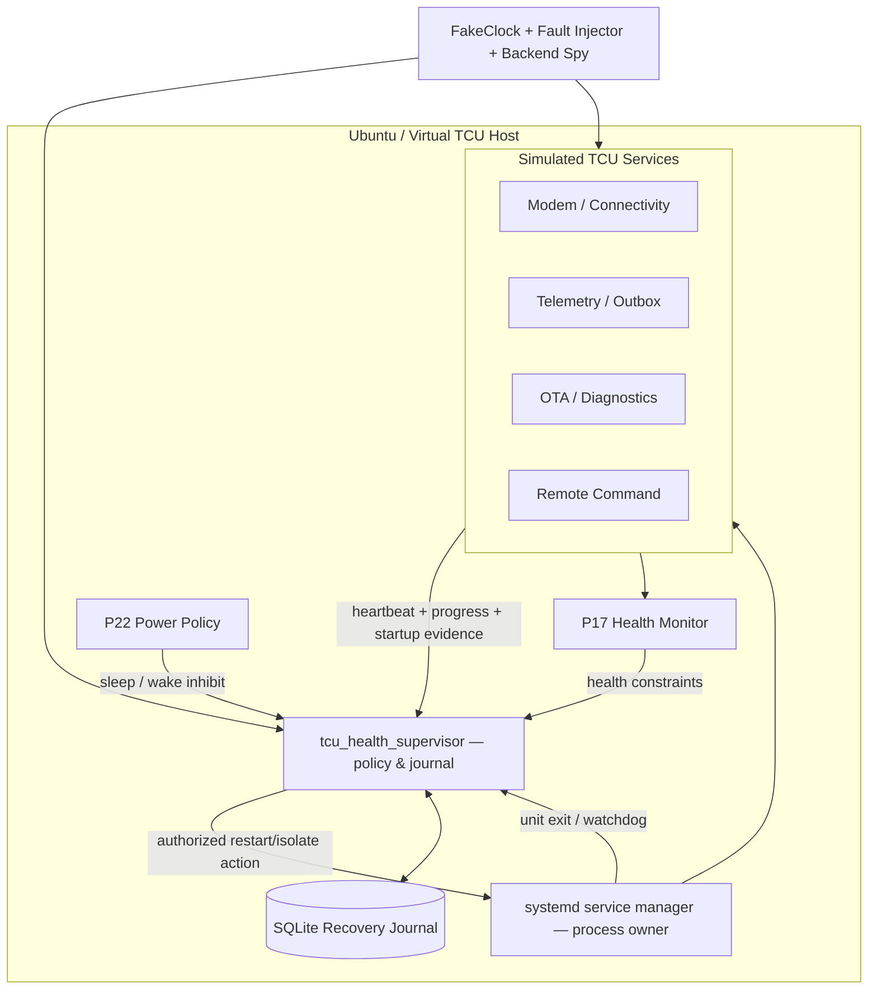
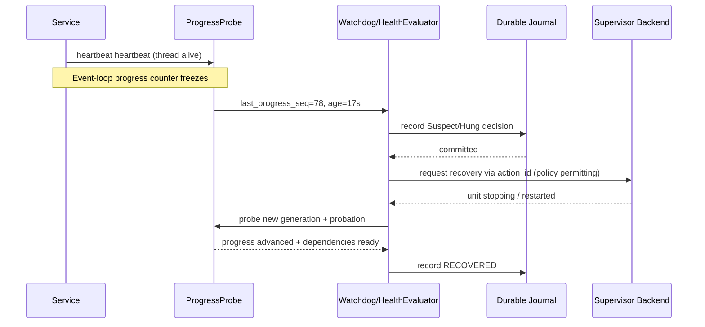
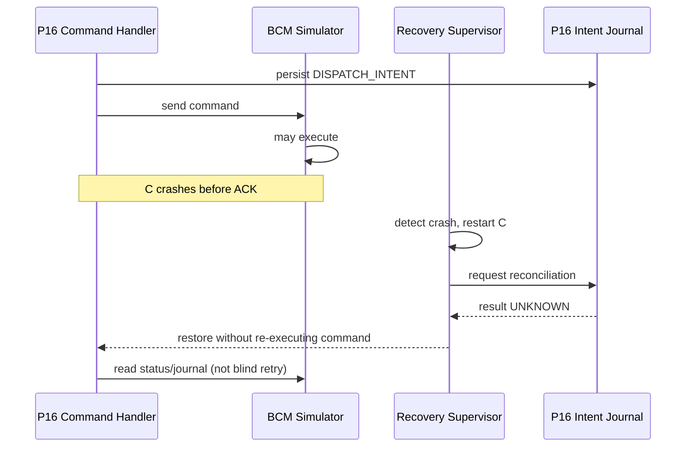
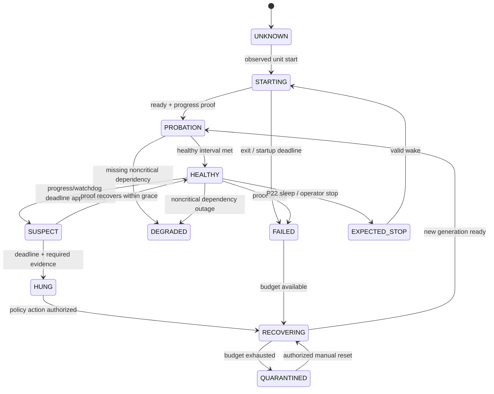
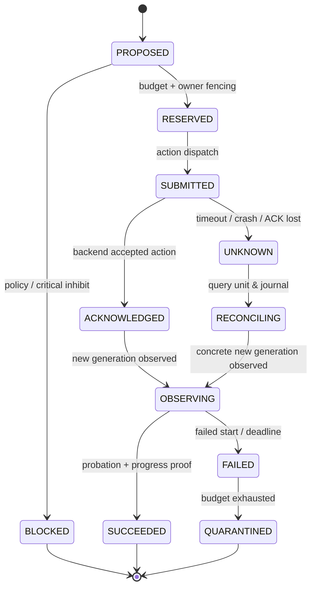
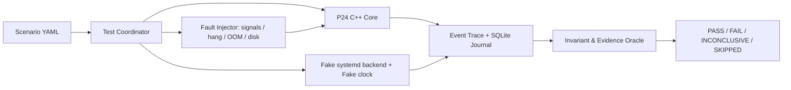

# Project 24 — Crash Recovery & Watchdog

**Virtual TCU Lab · System Design, Operational Behaviors, Failure Injection & Resilience Test Plan · Version 1.0 · 2026-10-30**  
**Target:** Middle C++ Developer · C++17 · Ubuntu Linux (simulation-first) · 24/30  
**Trạng thái:** Thiết kế và kế hoạch kiểm thử; **chưa** chứng minh phần mềm thực tế đã vượt qua các bài kiểm thử.

> **Giới hạn an toàn:** Không bật hoặc ping `/dev/watchdog`, không thực hiện reboot máy thật trong các bài demo. Tất cả shutdown, process-kill và reboot đều chạy trên **process giả lập, test runner cô lập hoặc VM do bạn sở hữu**. Dự án không thay thế safety case, HIL, system validation hoặc kiến trúc an toàn chức năng của OEM.

## 0. Executive summary, key decisions & reading map

**Mục tiêu:** Xây `libtcu_recovery` và `tcu_health_supervisor` phát hiện process crash, hang, progress stall, degraded service; quyết định giữa observe/retry/isolate/restart/quarantine/escalate; giới hạn restart storms; lưu recovery journal; phối hợp P22 power state và P17 health monitoring; tạo test harness deterministic để chứng minh các **invariants** dưới sự cố. Tận dụng **systemd** làm supervisor process và watchdog service trên Ubuntu; policy engine chỉ quyết định và yêu cầu action qua `ISupervisorBackend`, tránh hai bộ restart độc lập cùng tranh quyền.

**Không đánh đồng các khái niệm:**

1. **PID exists ≠ process khỏe**; process sống nhưng main event loop deadlock vẫn phải bị phát hiện.
2. **Heartbeat ≠ progress**; watchdog thread độc lập còn chạy không chứng minh service đang xử lý công việc.
3. **Process restart ≠ business recovery**; remote command có thể đã được gửi tới BCM trước crash, kết quả phải được reconcile.
4. **Watchdog service ≠ hardware watchdog**; `WatchdogSec` điều khiển lifecycle service qua systemd; hardware `/dev/watchdog` có thể reset toàn bộ máy và **không được kích hoạt trong lab**.
5. **Timeout ≠ failure chắc chắn**; khi dependency ngoài TCU mất phản hồi, có thể là `DEGRADED` hoặc `UNKNOWN`, không tự tạo hành động vật lý mới.
6. **Quarantine ≠ Disable forever**; trạng thái cách ly phải có quyền mở lại, audit, probation và giới hạn retry.
7. **Fail-safe ≠ reboot ngay**; reboot không được diễn ra trong P24 lab, chỉ giả lập escalation; cần chính sách ưu tiên bảo vệ dữ liệu, nguồn và safety.
8. **Một recovery action phải có owner duy nhất**; systemd là process lifecycle executor; P24 đóng vai trò policy/admission/reconciliation; test adapter thay thế khi unit test.

**Mục lục:** 1 Scope & dependencies · 2 Requirements/SLO · 3 Failure model · 4 Architecture · 5 Health semantics · 6 Process identity & heartbeat · 7 Service/recovery states · 8 Restart policy · 9 Persistence · 10 C++17 APIs · 11 Concurrency · 12 Interactions · 13 Behaviors · 14 Contracts · 15 Test harness · 16 What-if catalog · 17 Multi-fault campaigns · 18 Test matrix · 19 Jira tickets · 20 Runbook · 21 Release gates · 22 Open decisions · 23 References.

---

## 1. Scope, assumptions, responsibility boundaries

### 1.1 In scope

- Giám sát `tcu_telemetry`, `tcu_connectivity`, `tcu_ota`, `tcu_diagnostics`, `tcu_command` cùng một `tcu_supervisor` độc lập; giám sát systemd unit states và **application progress probes**.
- Detect exit by signal/exit code/OOM, hang/slow progress, missed liveness, stale observation, restart failures và dependency stalls; phân loại nguyên nhân có evidence.
- Policy per service: criticality, healthy checkpoints, heartbeat deadline, progress deadline, startup grace, dependency and restart budget, recovery action, quarantine.
- systemd `Type=notify`, `WatchdogSec`, `Restart=on-failure`, restart rate limiting; phần policy nâng cao thông qua D-Bus/systemctl adapter có kiểm tra ownership/authorization.
- Persist decision/action journal bền vững, recovery generation + boot ID, startup reconciliation, telemetry và audit không rò rỉ secrets.
- Tích hợp P22 Sleep/Resume, P19 OTA trial boot, P14 outbox, P16 command UNKNOWN, P17 Health Monitor; không xóa business state chỉ để làm lại process.
- Lab chạy fake supervisor backend hoặc systemd **user unit**; có mock clock (monotonic + boot epoch), simulated process handles, injected `SIGKILL` riêng process thí nghiệm.
- Measurement: detection time, recovery time, false positive, restart loop containment, outstanding work reconciliation, bounded resource use.

### 1.2 Out of scope

- Không quản lý hardware watchdog thật, không mở `/dev/watchdog`, không thay kernel panic policy, không thiết kế fail-operational automotive ECU.
- Không tự thực thi command khóa/mở cửa hoặc rollback firmware; P16/P19 giữ ownership và tính nhất quán nghiệp vụ.
- Không giả định systemd chạy trên QNX/RTOS. `ISupervisorBackend` phải thay thế bằng native backend nếu đổi OS.
- Không đảm bảo zero data loss cho producer nếu P14 chưa durable COMMIT; không cam kết recovery khi phần cứng storage đã hỏng vật lý.

### 1.3 Dependencies & contracts

| Project | Tương tác | Điều kiện bắt buộc |
|---|---|---|
| P01/P02/P03/P04 | Event Bus, IPC, monotonic timers, config/log | Bounded + epochs; logger failure không gây watchdog self-deadlock |
| P10/P11/P13 | Connectivity/MQTT/fault lab | Network offline ≠ local service crash |
| P14/P15 | Durable telemetry, cloud ACK | Resume/replay theo immutable event ID |
| P16/P23 | Remote Command & auth | Recovery không phát lại side-effect chưa rõ trạng thái |
| P17 | Health Monitoring | Monitor và supervisor giám sát **lẫn nhau thông qua external signals**, tránh cùng đổ lỗi vô hạn |
| P18/P19 | OTA download/trial boot | P19 là authority của boot-success; P24 không được mark slot GOOD |
| P20/P21 | Diagnostics/DTC | Quét dở thì hủy session; không coi missing DTC là cleared |
| P22 | Power & Wake Manager | Sleep hợp lệ không bị coi là hang; resume cần epoch mới |

### 1.4 Lab assumptions (không phải yêu cầu OEM)

| Biến | Default lab | Vì sao |
|---|---:|---|
| Liveness interval | 1s | Nhẹ, đủ minh họa |
| Liveness timeout | 5s | Bao gồm jitter |
| Progress timeout | 15s per critical path | Cấu hình theo workload |
| Startup grace | 20s | DB migration/warmup có hạn |
| Healthy probation | 60s | Cấm clear budget quá sớm |
| Auto restart budget | 3 failures / 5 min / service | Ngăn restart storms |
| Backoff | 1s, 2s, 4s, max 30s + deterministic jitter | Giảm thundering herd |
| Max restart attempts per wave | 2 | Giảm cascade |
| Action concurrency | 2 services | Bounded parallel recovery |
| Event queue / journal queue | 1024 / 1024 | Bounded overload |
| Recovery journal | SQLite WAL + synchronous FULL | Bắt buộc test storage profile |
| Soak | 24h + 10k synthetic restart decisions | Lab target, chưa phải SLA |

## 2. Requirements & measurable non-functional targets

### 2.1 Functional requirements

| ID | Requirement | Verification |
|---|---|---|
| FR-01 | Đăng ký danh mục services và criticality bằng cấu hình hợp lệ | Policy validation |
| FR-02 | Phân biệt alive / responsive / making progress / degraded / unknown | Fake probes |
| FR-03 | Dùng process identity (service, boot, generation và PID token), không chỉ numeric PID | PID reuse test |
| FR-04 | Sự kiện out-of-order/duplicate không thay thế trạng thái hiện tại | Epoch fencing |
| FR-05 | Phân biệt crash, clean stop, intended sleep, watchdog timeout, OOM | Cause matrix |
| FR-06 | Restart với budget, cooldown, jitter và circuit breaker | Restart storm tests |
| FR-07 | Restart có authority duy nhất, serialized action token | Double-supervisor race |
| FR-08 | Không tự restart service trong active OTA critical phase trái policy | P19 orchestration |
| FR-09 | Quarantine và manual recovery có audit/role checks | Authorization tests |
| FR-10 | Reconcile business side effects sau process recovery | P14/P16/P19 tests |
| FR-11 | Journal durable quyết định, sự kiện và kết quả recovery | Killpoints |
| FR-12 | Failed storage chuyển supervisor DEGRADED; không false confirmed recovery | Disk failure |
| FR-13 | Graceful shutdown + bounded force kill hợp lệ, bảo đảm không zombie / PID confusion | Process tests |
| FR-14 | Log/metrics/traces có correlation_id, run_id và service generation | Evidence harness |
| FR-15 | Không tự lặp reset/reboot toàn hệ thống từ cùng một lỗi | Restart/reboot fence |
| FR-16 | Sleep/wake sử dụng inhibit/grace với upper bound và epoch mới | P22 transitions |
| FR-17 | Tái cấu hình policy atomic; lỗi file không áp dụng một phần | Reload tests |
| FR-18 | Trigger fault injection có xác nhận thực tế, thiếu evidence → INCONCLUSIVE | Injection verification |

### 2.2 Non-functional targets — kiểm tra trên lab, không phải bảo đảm thời gian thực

| ID | Lab target | Test oracle |
|---|---|---|
| NFR-01 | Crash detection p99 ≤3s cho process được supervisor quan sát trong điều kiện CPU bình thường | Event timestamps + process exit |
| NFR-02 | Progress hang detection ≤20s nếu condition thực sự vượt ngưỡng 15s | Fake clock + progress sequence |
| NFR-03 | Không vượt 3 automatic restarts trong bất kỳ 5 phút cửa sổ thực thi đã thống nhất | Action history invariant |
| NFR-04 | 0 duplicate external restart action cùng service_generation/decision_id | Backend call log |
| NFR-05 | 0 stale callback thay đổi current generation | State snapshots |
| NFR-06 | 0 `RECOVERED` khi probe chưa qua probation | Acceptance log |
| NFR-07 | 0 cloud/BCM command phát lại tự động từ P24 | Adapter side-effect counter |
| NFR-08 | Bounded RSS/FD/threads/queue; không busy spin khi supervisor backend mất | Soak + profiling |
| NFR-09 | 0 ASan/UBSan/TSan errors ở đường code được kiểm thử | Isolated CI runs |
| NFR-10 | Khi không xác minh được fault, test không được PASS | Evidence validator |
| NFR-11 | Watchdog không đánh dấu HEALTHY khi tiến trình quan trọng đình trệ | Liveness-vs-progress fixtures |
| NFR-12 | 0 host reboot thật, 0 open `/dev/watchdog` trong lab | Host audit/permission check |

## 3. Fault and failure model

| Fault type | Ví dụ | Điểm quan sát | Phân loại ban đầu |
|---|---|---|---|
| Crash | SIGSEGV, abort, uncaught exception | wait status / systemd failed | FAILED |
| Intentional stop | systemctl stop, P22 sleep | policy token + systemd inactive | EXPECTED_STOP |
| Liveness lost | no valid heartbeat | watchdog / deadline | SUSPECT |
| Progress stall | heartbeat vẫn có, business sequence đứng | active probe, progress counter | HUNG |
| Dependency outage | broker unreachable, CAN down | dependency health | DEGRADED |
| Overload | CPU throttling, OOM, queue full | PSI, cgroup, queue metrics | DEGRADED/FAILED |
| Crash-loop | exit-restart-exit liên tục | restart history | QUARANTINED |
| Split-brain | 2 instances cùng claim owner | boot/generation/ownership | FENCED |
| Disk failure | journal commit fail | SQLite errors | RECOVERY_DEGRADED |
| State mismatch | process running, journal says failed | reconciliation | UNKNOWN until verified |

**Liveness probes phải có ít nhất một nguồn quan sát ngoài execution path nghi vấn.** Thread ping chỉ có thể dùng để phát hiện một lớp lỗi; progress proof và supervisor observation độc lập để tránh heartbeat giả.

## 4. Architecture, deployments & ownership



**Ownership design:** systemd được cấu hình là execution owner cho service. Policy engine có thể yêu cầu `restart`/`stop` nhưng phải nhận outcome từ systemd và reconcile; nó **không** fork hoặc `kill` PID lạ bằng numeric PID. Nếu dùng systemd auto `Restart=on-failure`, không đồng thời gọi restart cho cùng cause; hoặc **chọn mode A** (systemd full auto restart + P24 observes/admission/quarantine) hoặc **mode B** (P24 điều phối restart; systemd `Restart=no`), không pha trộn thiếu arbitration. **Mode A** là mặc định lab, P24 chỉ gọi isolation/stop khi policy yêu cầu.

### 4.1 Runtime components

| Component | Responsibility | Không được phép |
|---|---|---|
| UnitObserver | Nhận unit state/exit/OOM từ systemd | Suy luận execution business từ PID |
| ProbeGateway | Nhận health/progress proof có auth/session | Chấp nhận proof từ generation cũ |
| HealthEvaluator | Tính healthy/degraded/hung theo context | Lấy mỗi WATCHDOG ping làm health |
| PolicyEngine | Chọn observe/restart/quarantine/escalate | Bỏ qua P22/P19 inhibit |
| RestartBudget | Sliding window + startup reconciliation | Clear budget khi restart/crash |
| RecoveryCoordinator | Serializes decisions, idempotent action ID | Concurrent duplicate restart |
| DurableJournal | Atomic transitions & actions | Mark applied khi chưa có evidence |
| ReconciliationAgent | Kiểm tra business state sau restart | Automatically replay side effects |
| EventSink | Metrics/trace/audit | Block recovery vì logger synchronous |
| BackendAdapter | Fake, systemd D-Bus implementation | `kill -9 -1`, host reboot, real WDT |

### 4.2 Key sequence: hang with live watchdog thread



### 4.3 Key sequence: crash after external command dispatch



## 5. Heartbeat and proof-of-progress semantics

### 5.1 Signals and trust

- **ProcessAlive:** supervisor observes unit and process identity. Không đoán khỏe chỉ từ `kill(pid,0)` hoặc PID còn tồn tại.
- **WatchdogKeepalive:** `sd_notify("WATCHDOG=1")` được nhận bởi systemd đúng PID/protocol; nếu service dùng `sd_watchdog_enabled()`, gửi thông báo khoảng nửa watchdog interval. Đây là **keepalive của service**, không bảo đảm tất cả worker healthy.
- **ProgressProof:** critical path publish increments `progress_seq` + `completed_work_id` hoặc active-probe response qua event loop. Idle legitimate có `idle_proof`/poll tick thay vì buộc phải hoàn thành công việc mới.
- **DependencyHealth:** mạng/cloud offline, storage degraded, CAN stale… là tín hiệu riêng; không ép mọi dependency fault thành restart.
- **ObserverFreshness:** probe missing hoặc backend disconnected → `UNKNOWN`, không giữ healthy vô thời hạn.

### 5.2 Probe payload — internal lab schema

```json
{
  "service":"tcu_telemetry",
  "boot_id":"lab-boot-002",
  "generation":37,
  "instance_nonce":"random-per-start",
  "seq":481,
  "event_loop_progress":1220,
  "last_completed_work_id":"evt-987",
  "idle_proof":false,
  "observed_monotonic_ns":12345678901,
  "capability_version":2
}
```

Chỉ có **receiver monotonic receipt time** dùng để xét freshness qua IPC local; timestamp/seq của sender là claim cần xác minh, không dùng trực tiếp cho timeout. `generation` + `instance_nonce` + process identity chống stale/pid reuse. Nếu progress không có work, active-probe vào cùng event loop path có thể chứng minh responsive; **không** tự động tăng progress counter bằng watchdog helper thread.

### 5.3 Health decision truth table

| Process | Heartbeat | Progress/idle proof | Dependencies | Decision |
|---|---|---|---|---|
| Exited | N/A | N/A | Any | FAILED |
| Running | Fresh | Fresh | Ready | HEALTHY after probation |
| Running | Fresh | Stale | Any | SUSPECT → HUNG, per deadline |
| Running | Missing | Fresh independent path | Ready | DEGRADED / investigate probe path |
| Running | Fresh | Fresh | External cloud down | DEGRADED (no blind restart) |
| Running | Fresh | Missing | Unknown | UNKNOWN → policy timeout |
| Stopped intentionally | Missing | Missing | Sleep token valid | EXPECTED_STOP |
| Restarted new generation | Fresh | Fresh | Ready | STARTING/PROBATION until verified |

## 6. Life cycles and state machines

### 6.1 Service health state machine



### 6.2 Recovery action state machine



**Terminal invariant:** Action có thể được ghi `SUCCEEDED` **chỉ sau** khi unit observed new generation *và* dependency/progress policy được thỏa mãn. D-Bus method success = `SUBMITTED/ACKNOWLEDGED`, không phải `RECOVERED`.

## 7. Restart budgeting, escalation & feedback control

- **Window semantics:** Sliding window trên `steady_clock` trong cùng boot; lưu sample theo `(boot_id, boot_offset, durable UTC if trusted)`; sau reboot khi không suy ra elapsed time đáng tin, **không reset full budget để auto-restart vô hạn**: đưa về conservative quarantine/probation hoặc policy-defined boot budget.
- **Critical vs optional:** Critical services có safe fallback và explicit dependency constraints; optional services có thể bị disable/quarantine mà không restart toàn bộ TCU.
- **Action cap:** Token bucket tổng cho service fleet, tránh crash cascade; mỗi decision/action có `UUID` và generation fence.
- **Backoff:** Exponential bounded + deterministic jitter seed trong test; không busy wait; reset backoff sau healthy probation đủ thời gian.
- **Escalation:** Observe → local service restart → quarantine → alert/manual intervention. Reboot toàn hệ thống **chỉ là simulated recommendation event**, không auto reboot trong lab.
- **Failure classification:** `SIGKILL` do planned test không tính production crash budget; kernel OOM nên tính theo policy sau khi kiểm chứng unit result/cgroup metrics. Intentional sleep stop không tính vào crash-loop.
- **Dependency fan-out:** Nếu một shared IPC/broker down làm 10 clients lỗi, không restart cả 10 clients; đặt dependency primary incident với dedup/recovery wave budget.
- **Manual reset:** Authenticated operator + reason + expiry + journal; reset budget không xóa lịch sử sự cố; probation sau reset.
- **Restart version coherence:** Config generation update không được đổi restart budget đã lưu cho action cũ; hot reload thu hẹp quyền phải hiệu lực trước next dispatch.

## 8. Durable journal and storage crash consistency

SQLite chỉ để chứng minh state machine trong lab; production có thể dùng journal khác. Dùng `PRAGMA journal_mode=WAL; PRAGMA synchronous=FULL; PRAGMA foreign_keys=ON;` nhưng vẫn phải xác thực `fsync`/media behavior ở thiết bị thật; đừng gọi WAL là bảo đảm không mất dữ liệu trong mọi trường hợp.

```sql
PRAGMA journal_mode=WAL;
PRAGMA synchronous=FULL;
PRAGMA foreign_keys=ON;

CREATE TABLE IF NOT EXISTS service_observations (
  id INTEGER PRIMARY KEY AUTOINCREMENT,
  service TEXT NOT NULL,
  boot_id TEXT NOT NULL,
  generation INTEGER NOT NULL CHECK(generation >= 0),
  instance_nonce TEXT NOT NULL,
  observed_mono_ns INTEGER NOT NULL CHECK(observed_mono_ns >= 0),
  health TEXT NOT NULL CHECK(health IN
    ('UNKNOWN','STARTING','PROBATION','HEALTHY','SUSPECT','HUNG',
     'DEGRADED','FAILED','RECOVERING','QUARANTINED','EXPECTED_STOP')),
  reason TEXT NOT NULL,
  evidence_hash TEXT NOT NULL,
  created_at_utc TEXT NOT NULL
);
CREATE INDEX IF NOT EXISTS idx_obs_service_gen ON service_observations(service,generation,id);

CREATE TABLE IF NOT EXISTS recovery_actions (
  action_id TEXT PRIMARY KEY,
  service TEXT NOT NULL,
  boot_id TEXT NOT NULL,
  target_generation INTEGER NOT NULL CHECK(target_generation >= 0),
  policy_generation INTEGER NOT NULL CHECK(policy_generation >= 0),
  action_kind TEXT NOT NULL CHECK(action_kind IN ('OBSERVE','RESTART','QUARANTINE','ISOLATE','ESCALATE')),
  state TEXT NOT NULL CHECK(state IN ('PROPOSED','BLOCKED','RESERVED','SUBMITTED',
      'ACKNOWLEDGED','UNKNOWN','RECONCILING','OBSERVING','SUCCEEDED','FAILED','QUARANTINED')),
  cause TEXT NOT NULL,
  evidence_hash TEXT NOT NULL,
  created_at_utc TEXT NOT NULL,
  updated_at_utc TEXT NOT NULL
);
CREATE INDEX IF NOT EXISTS idx_actions_service ON recovery_actions(service,created_at_utc);

CREATE TABLE IF NOT EXISTS restart_attempts (
  action_id TEXT PRIMARY KEY REFERENCES recovery_actions(action_id),
  service TEXT NOT NULL,
  boot_id TEXT NOT NULL,
  attempt_mono_ns INTEGER NOT NULL CHECK(attempt_mono_ns >= 0),
  attempt_utc TEXT NOT NULL,
  result TEXT NOT NULL CHECK(result IN ('RESERVED','SUBMITTED','OBSERVED','FAILED','UNKNOWN'))
);
CREATE INDEX IF NOT EXISTS idx_restart_budget ON restart_attempts(service,boot_id,attempt_mono_ns);

CREATE TABLE IF NOT EXISTS service_fences (
  service TEXT PRIMARY KEY,
  boot_id TEXT NOT NULL,
  generation INTEGER NOT NULL,
  owner_nonce TEXT NOT NULL,
  policy_generation INTEGER NOT NULL,
  state TEXT NOT NULL,
  updated_at_utc TEXT NOT NULL
);

CREATE TABLE IF NOT EXISTS recovery_outbox (
  event_id TEXT PRIMARY KEY,
  action_id TEXT NOT NULL REFERENCES recovery_actions(action_id),
  category TEXT NOT NULL,
  payload TEXT NOT NULL,
  state TEXT NOT NULL CHECK(state IN ('PENDING','IN_FLIGHT','ACKED')),
  created_at_utc TEXT NOT NULL
);
```

**Atomicity contract:** Decision+restart-budget reservation+action intent+outbox intention trong **một SQLite transaction**. Sau commit mới có thể xin backend thực hiện action. Nếu action result timeout, đặt `UNKNOWN`, query runtime **trước** khi tiếp tục; không lặp restart mù. Transaction failure → không claim action đã reserved; fail-safe là không tạo thêm action tự động gây vòng lặp. Nhật ký chỉ định danh hành động và service generation, không tự diễn giải remote-command outcome.

**Crash killpoints:** K0 before reservation · K1 after transaction commit before backend dispatch · K2 after backend accept before DB ACK · K3 after process exited before new PID observed · K4 new process started before READY · K5 probation passed before durable success · K6 after quarantine commit before alert publish. Mỗi điểm phải có expected recovery rõ ràng.

## 9. C++17 API design (skeletal, no implementation yet)

```cpp
#pragma once
#include <chrono>
#include <cstdint>
#include <functional>
#include <optional>
#include <string>
#include <vector>

namespace tcu::recovery {

using SteadyPoint = std::chrono::steady_clock::time_point;
enum class HealthState {
  Unknown, Starting, Probation, Healthy, Suspect, Hung,
  Degraded, Failed, Recovering, Quarantined, ExpectedStop
};
enum class ActionKind { Observe, Restart, Quarantine, Isolate, Escalate };
enum class ActionState {
  Proposed, Blocked, Reserved, Submitted, Acknowledged,
  Unknown, Reconciling, Observing, Succeeded, Failed, Quarantined
};
struct ProcessIdentity {
  std::string service;
  std::string boot_id;
  std::uint64_t generation;
  std::string instance_nonce;
  int pid; // Observation only; do not use bare PID to signal unrelated process.
};
struct ProgressEvidence {
  ProcessIdentity process;
  std::uint64_t seq;
  std::uint64_t progress_seq;
  bool idle_proof;
  SteadyPoint received_at;  // Receiver clock, not sender clock.
};
struct HealthSnapshot {
  ProcessIdentity process;
  HealthState state;
  bool dependency_ready;
  bool progress_fresh;
  std::string reason;
  SteadyPoint observed_at;
};
struct RecoveryAction {
  std::string action_id;
  ProcessIdentity expected_process;
  ActionKind kind;
  std::uint64_t policy_generation;
  std::string reason;
};
struct BackendResult {
  bool accepted;
  bool definite_failure;
  std::string runtime_operation_id;
};

class IClock {
public:
  virtual ~IClock() = default;
  virtual SteadyPoint now() const = 0;
};
class IUnitObserver {
public:
  virtual ~IUnitObserver() = default;
  virtual std::optional<HealthSnapshot> query(const std::string& name) = 0;
};
class ISupervisorBackend {
public:
  virtual ~ISupervisorBackend() = default;
  virtual BackendResult request(const RecoveryAction& action) = 0;
  virtual std::optional<ProcessIdentity> current(const std::string& service) = 0;
};
class IRecoveryJournal {
public:
  virtual ~IRecoveryJournal() = default;
  virtual bool reserveActionAtomically(const RecoveryAction& action) = 0;
  virtual bool transition(const std::string& action_id,
                          ActionState from, ActionState to) = 0;
};
class IPolicyEngine {
public:
  virtual ~IPolicyEngine() = default;
  virtual ActionKind decide(const HealthSnapshot& snapshot) = 0;
};
class IRecoveryCoordinator {
public:
  virtual ~IRecoveryCoordinator() = default;
  virtual void onObservation(const HealthSnapshot& observation) = 0;
  virtual void stop() = 0;
};
} // namespace tcu::recovery
```

**Implementation notes:** APIs `IRecoveryJournal::transition` phải dùng compare-and-swap (`UPDATE ... WHERE state=?`, check rows affected). `ISupervisorBackend::request` chỉ trả **request accepted/definite failure**, không báo recovered. Interface chưa cố định async model; use `std::future`/callbacks với deadlines và cancellation token, không block event-loop. UnitObserver cần tách `unit lifetime`, `boot ID`, `invocation id` và PID starttime để tránh PID reuse. Tránh tự viết shared global singleton dễ cross-test contamination.

### 9.1 Example YAML policy (simulated)

```yaml
schema_version: 1
services:
  tcu_telemetry:
    criticality: high
    startup_grace_ms: 20000
    progress_timeout_ms: 15000
    restart:
      mode: systemd_auto
      max_attempts: 3
      window_ms: 300000
      backoff_base_ms: 1000
      backoff_cap_ms: 30000
      probation_ms: 60000
    inhibit_when: [power_sleep, ota_trial_critical]
  tcu_ota:
    criticality: high
    restart:
      mode: policy_coordinated
      max_attempts: 2
      window_ms: 300000
      probation_ms: 120000
```

**Cảnh báo:** Đây là design YAML; parser phải validate schema, range, dependency DAG và mode consistency; không đưa đồng thời `Restart=on-failure` cho service với `policy_coordinated` nếu chưa có cơ chế arbitration rõ ràng.

## 10. Concurrency, timers, ownership & shutdown

- Một **decision executor** duy nhất per service; `service_generation` là fencing token, `policy_generation` được snap tại decision time.
- Bounded MPSC event queue; callback from systemd/probe chỉ enqueue snapshot rồi return; worker processing không giữ lock khi gọi backend, SQLite, IPC hoặc logging.
- Sự kiện trễ `old_generation` → metrics + ignore; event mới hơn phải được reconcile với backend trước khi nâng generation.
- `stop()` chặn admission, cancel timers, flush journal theo bounded deadline; **không** đợi callback vô hạn hay tự `join()` trên chính worker thread.
- `steady_clock` cho timeout trong một boot; `boot_id` thay đổi invalidates deadlines, nhưng restart-budgets vẫn phải có conservatism cross-boot.
- Disk/fsync chậm không được khiến watchdog monitor self-invalidate vì gọi DB sync trên monitor loop; dùng bounded journal writer với deadline và degrade rõ ràng.
- Lock order: `service_state` → `action_registry` (chỉ internal); không khóa chéo DB/backend. Nên thay bằng single-writer actor để dễ reasoning.
- Restrict admin `reset-failed`/manual override: authenticated operator và audit; không tự xóa trạng thái quarantined khi health ping mới đến.

## 11. Integration: P17, P19, P22 and business recovery

| Context | Correct behavior after failure | Incorrect behavior |
|---|---|---|
| P14 outbox crash | Reopen journal, replay same event IDs after DB recovery | Xóa queue để khỏe lại |
| P16 command crash | Reconcile dispatch intent and BCM state; unknown remains unknown | Automatically execute same command again |
| P19 trial boot | Restore slot/journal, health decision owned by P19; P24 supplies service evidence | Watchdog ping = mark slot GOOD |
| P22 expected sleep | Armed sleep token + bounded quiesce; suppress false crash budget | Restart modem continuously while sleeping |
| P10 cloud disconnect | Mark DEGRADED and retry connection policy elsewhere | Restart all services for every network blip |
| P17 health monitor stuck | External progress probe/systemd detects; supervisor not assume monitor healthy | Heartbeat-only wellness |
| P21 DTC collection crash | Source generation invalidation; partial scan discarded | Mark all missing DTC resolved |

## 12. Operational behaviors — end-to-end

1. **Cold startup:** validate policy/schema → load journal → reconcile boot ID and runtime service states → discover units → gather active probes → classify `STARTING` → enter `PROBATION` after READY/progress, then `HEALTHY` only after stable interval. Pending action may remain `UNKNOWN` until queried.
2. **Normal operation:** unit observation + heartbeat + event-loop progress + dependencies sampled. Idle service must publish **idle proof** from critical loop; CPU idle alone is not health.
3. **Process exit:** systemd records exit cause → P24 correlates current invocation → budget logic → systemd auto restart if enabled → P24 observes new process generation → reconciles business state → probation → healthy. No double restart.
4. **Hang without crash:** heartbeat helper alive but active probe timeout → record `SUSPECT/HUNG`; if policy permits, trigger controlled restart or quarantine. Backend timeout produces `UNKNOWN`, not success.
5. **Crash loop:** 3 failures/5 min exhaust budget → quarantine + alert, do not endlessly restart, manual reset with audit.
6. **Dependency outage:** cloud down while core loop advances → `DEGRADED`, do not restart irrelevant modules.
7. **Power transition:** sleep token issued by P22 → expected stop is tagged, no crash budget; wake → generation changes + probes → probation.
8. **OTA trial:** P19 owns trial-boot deadline and slot selection, P24 supplies service readiness evidence. Failures do not silently mark slot good.
9. **Storage failure:** lost durable journal → stop issuing new automated recovery actions requiring reservations; emit degraded health and external observable error.
10. **Graceful shutdown:** reject new decisions, drain bounded queues, cancel probes, persist last intent; after deadline, stop monitoring without rebooting or killing unrelated services.

## 13. Behavioral contracts (Given / When / Then)

| Contract | Given | When | Then |
|---|---|---|---|
| BC-01 | Running healthy service | SIGSEGV on current generation | One failure counted; only configured supervisor restarts |
| BC-02 | Watchdog ping fresh but progress stale | Progress timeout expires | Mark HUNG, never HEALTHY |
| BC-03 | Cloud offline but local loop progresses | Cloud request timeout | DEGRADED, not unconditional restart |
| BC-04 | 3 failures in sliding 5 min | Fourth recovery requested | QUARANTINED, no auto restart |
| BC-05 | Prior generation exists | Delayed heartbeat arrives | Ignore it |
| BC-06 | Unit stop by P22 expected sleep | Watchdog stops | No failure budget consumed |
| BC-07 | Action submitted but ACK lost | Supervisor restarts | Reconcile actual service state before reissue |
| BC-08 | Journal COMMIT fails | Recovery intent requested | No unjournaled automatic action |
| BC-09 | Service restarts with pending P16 command | P16 journal says UNKNOWN | Do not resend command blindly |
| BC-10 | P19 trial boot pending | Service sends WATCHDOG=1 | P19 slot remains unconfirmed until health gate |
| BC-11 | PID recycled | Old observer event received | Process identity mismatch; ignore |
| BC-12 | Service marked healthy after probation | Dependency becomes stale | DEGRADED/UNKNOWN by policy |
| BC-13 | Multiple services fail from broker outage | Correlated event wave arrives | No unbounded restart cascade |
| BC-14 | Policy hot reload invalid | Parser rejects it | Existing policy snapshot remains active |
| BC-15 | Replay same action ID | Backend sees same token | No duplicate systemd request |
| BC-16 | Debugger pauses service in lab | Miss watchdog deadline | Controlled failure classification, no host reboot |
| BC-17 | Test fault not actually injected | Oracle evaluates | INCONCLUSIVE, not PASS |
| BC-18 | Unknown battery state | Recovery requires high-power restart | Block/DEGRADED according to P22 policy |
| BC-19 | Monitor itself hangs | Independent systemd watchdog/probe expires | Supervisor failure externally visible |
| BC-20 | Manual reset requested with no permission | Quarantine active | Deny, preserve audit |
| BC-21 | Recovery succeeds at process level | No business reconciliation proof | Not yet RECOVERED |
| BC-22 | New boot ID appears | Old monotonic deadline persisted | Deadline invalidated; conservative budget re-eval |
| BC-23 | Quiesce ACK then service crashes | P22 still quiescing | Re-evaluate sleep readiness, not assume safe |
| BC-24 | TCU command outcome unknown | Process restarts | Recovery never declares command executed |
| BC-25 | Restart requested for service already being stopped | Lifecycle token changed | Cancel/merge, single decision |

## 14. Test harness, isolation & pass/fail semantics



**Mandatory evidence per test:** `case_id`, seed, service_id, start `boot_id/generation`, policy generation, baseline precondition, fault trigger timestamp, **fault actually observed**, unit state trace, progress trace, journal query, side-effect spy counters, memory/CPU/FD samples, final outcome and log hash. A PASS requires *both* positive fault-injection proof and all expected invariants, not just absence of crash. If fault not observed → `INCONCLUSIVE`. Unsupported environment → `SKIPPED` with reason, never PASS.

```json
{
  "case_id":"P24-WI-001",
  "run_id":"r-20261030-001",
  "injection_verified":true,
  "service_generation_before":18,
  "service_generation_after":19,
  "action_ids":["act-001"],
  "business_side_effect_replayed":false,
  "invariants_ok":true,
  "result":"PASS"
}
```

**Fault methods:** simulated exits/signals, fake CPU starvation, fake progress stalls, simulated `OOMKilled` cgroup result, fake systemd D-Bus timeouts, corrupt/delay journal via VFS/SQLite fault wrapper, fake `boot_id`, controlled journal killpoints. `SIGKILL` only to **spawned test PID** validated via `/proc/<pid>/stat` starttime/pidfd; prefer namespaces/containers. `tc netem` only trong network namespace. Không có `killall`, `pkill` theo pattern rộng, `reboot`, `systemctl reboot` hay thao tác `/dev/watchdog`.

## 15. What-if catalog — 300 deterministic single-fault scenarios / 30 nhóm

Mỗi test là một **thiết kế** chưa chạy. `Inject` xác định điều kiện gây lỗi; `Expected` phải là kết luận/transition có thể kiểm tra; `Evidence` bắt buộc xác nhận fault đã xảy ra. P0 = correctness/security/safety; P1 = resilience/observability, không thay thế FMEA/HARA/OEM safety case.

### 15.01 — Process crash / exit classification (10 cases)

| ID | Priority | What-if / Inject | Expected behavior | Required evidence |
|---|---|---|---|---|
| P24-WI-001 | P0 | Current worker crashes with SIGSEGV after READY | Mark FAILED and count exactly one incident; systemd auto restarts under budget | Exit signal + incident counter + new invocation |
| P24-WI-002 | P0 | Worker exits with code 1 on startup | Preserve startup failure cause; no fake READY | Unit result + health state timeline |
| P24-WI-003 | P0 | Worker cleanly exits 0 without requested stop | Classify unexpected stop according to service policy, not HEALTHY | Stop authorization token + unit state |
| P24-WI-004 | P0 | Worker aborts via SIGABRT while DB flush pending | Recover DB first; restart does not assume flush committed | Exit status + SQLite rows |
| P24-WI-005 | P0 | Worker killed with SIGKILL by test runner | Detect exit, avoid graceful-shutdown assumptions | Verified target PID + exit event |
| P24-WI-006 | P0 | Worker terminates due to uncaught exception | Record failure then isolate any partial business operation | Exception marker + action journal |
| P24-WI-007 | P0 | Child thread dies but main process remains | Progress/active probe detects impaired path | Thread probe + state trace |
| P24-WI-008 | P1 | Worker exits twice inside one observation interval | Count distinct invocations, not one coalesced failure | Unit invocation IDs + budget ledger |
| P24-WI-009 | P1 | Worker receives SIGTERM requested by P22 sleep | Expected stop; no crash budget | P22 token + unit result |
| P24-WI-010 | P1 | Worker exits during scheduled rolling upgrade | Planned stop reason persists; no automatic restart conflict | Upgrade token + backend action log |

### 15.02 — Heartbeat anomalies & false confidence (10 cases)

| ID | Priority | What-if / Inject | Expected behavior | Required evidence |
|---|---|---|---|---|
| P24-WI-011 | P0 | Heartbeat arrives with old instance nonce | Drop stale heartbeat | Nonce mismatch trace + state unchanged |
| P24-WI-012 | P0 | Heartbeat arrives twice with identical seq | Ignore duplicate; freshness cannot advance twice | Seq audit + deadline |
| P24-WI-013 | P0 | Heartbeat seq decreases within same generation | Mark probe invalid, do not restore healthy | Probe invalid metric |
| P24-WI-014 | P0 | Heartbeat thread continues while main loop deadlocked | Mark HUNG when progress deadline expires | Progress trace + independent watchdog |
| P24-WI-015 | P0 | Heartbeat sent before READY during startup | Remain STARTING, no healthy declaration | Readiness timeline |
| P24-WI-016 | P0 | Heartbeat forged by unrelated local process | Reject source/identity mismatch | Peer credentials + reject counter |
| P24-WI-017 | P0 | Heartbeat queue blocked for several seconds | Mark observation unknown with explicit cause, not immediate SIGKILL | Queue metrics + unknown state |
| P24-WI-018 | P1 | Heartbeat bursts 1000 messages in one second | Rate-limit; bounded queue; no health laundering | Queue depth + dropped counter |
| P24-WI-019 | P1 | One heartbeat contains future sender timestamp | Use receiver monotonic time, reject sender clock claim for freshness | Clock comparison trace |
| P24-WI-020 | P1 | Heartbeat has valid token but wrong service name | Reject and audit, do not refresh target service | Service-binding assertion |

### 15.03 — Progress tracking & hang detection (10 cases)

| ID | Priority | What-if / Inject | Expected behavior | Required evidence |
|---|---|---|---|---|
| P24-WI-021 | P0 | Event loop freezes with heartbeat still fresh | Progress-based hung detection triggers | last_progress_seq + elapsed time |
| P24-WI-022 | P0 | Service legitimately idle with no messages | Active idle probe returns; remain healthy | Probe response on critical loop |
| P24-WI-023 | P0 | Progress counter increments without completed work | Do not use raw counter alone; require bounded active task/idle proof | Progress contract test |
| P24-WI-024 | P0 | Background worker progresses while command executor deadlocked | Critical path probe fails; DEGRADED/HUNG | Per-subsystem proof |
| P24-WI-025 | P0 | Telemetry pipeline blocked on SQLite mutex | Detect no forward progress; avoid watchdog logging deadlock | Stall trace + lock metrics |
| P24-WI-026 | P0 | Worker stuck in infinite retry loop | Detect lack of useful progress despite CPU activity | CPU+work-completion correlation |
| P24-WI-027 | P0 | Probe arrives exactly at hung deadline | Deterministic tie-break prevents dual transitions | Fake clock ordered events |
| P24-WI-028 | P1 | Progress resumes after SUSPECT but before action submit | Cancel pending restart and clear suspicion after proof | Backend spy zero actions |
| P24-WI-029 | P1 | Progress resumes after restart already submitted | Do not cancel/restart twice; reconcile backend | Action-state history |
| P24-WI-030 | P1 | One subsystem hangs while optional module healthy | Isolate affected unit; do not declare entire TCU healthy | Per-service health vector |

### 15.04 — Timeout, clock, scheduling races (10 cases)

| ID | Priority | What-if / Inject | Expected behavior | Required evidence |
|---|---|---|---|---|
| P24-WI-031 | P0 | Host wall clock jumps forward 1 year | Monotonic deadlines unaffected | Fake-clock age invariant |
| P24-WI-032 | P0 | Wall clock rolls back 30 days | No stale deadline revived; audit marks clock anomaly | Timeline + audit |
| P24-WI-033 | P0 | Boot ID changes but persisted monotonic timestamps remain | Invalidate timestamps across boots | Reconciliation state |
| P24-WI-034 | P0 | Timer callback from previous service generation fires | Ignore stale timeout | Callback generation log |
| P24-WI-035 | P0 | Timeout and progress proof arrive in same fake-clock tick | Exactly one consistent decision according to ordering rule | Transition count one |
| P24-WI-036 | P0 | Timer fires twice due to test scheduling | Idempotent action reservation | Unique action ID count |
| P24-WI-037 | P0 | CPU scheduler delays monitor thread by 25s | Classify observation uncertainty, no mass restart storm | Host pressure + decisions |
| P24-WI-038 | P1 | NTP update causes UTC to step during probation | Probation uses monotonic time | Probation durations |
| P24-WI-039 | P1 | RTC unavailable after reboot | Conservative budget and quarantine rules, not unlimited restarts | Boot recovery trace |
| P24-WI-040 | P1 | Suspend/resume causes clock behavior differences | Use configured BOOTTIME/steady strategy and P22 epoch | Suspend simulation timeline |

### 15.05 — systemd notify and watchdog semantics (10 cases)

| ID | Priority | What-if / Inject | Expected behavior | Required evidence |
|---|---|---|---|---|
| P24-WI-041 | P0 | Service sends WATCHDOG=1 but never READY=1 | Remain STARTING; startup timeout applies | Unit status + readiness |
| P24-WI-042 | P0 | Service sends READY=1 then stops keepalives | Watchdog failure after configured interval | journalctl unit result |
| P24-WI-043 | P0 | NotifyAccess excludes actual sender PID | Probe not accepted; detect notification misconfiguration | systemd notice + sender identity |
| P24-WI-044 | P0 | WATCHDOG_USEC absent because watchdog disabled | Service must not assume supervision active | Environment/feature flag |
| P24-WI-045 | P0 | WATCHDOG_PID points at previous process | New process does not reuse stale watchdog config | PID check + trace |
| P24-WI-046 | P0 | Service sends WATCHDOG=1 without work progress | P24 reports hung despite systemd keepalive | Progress oracle |
| P24-WI-047 | P0 | Systemd drops notification during restart | P24 reconciles unit invocation, not success by send call | Unit state history |
| P24-WI-048 | P1 | WatchdogSec much shorter than expected startup | Config validation flags startup/readiness mismatch | Config validator |
| P24-WI-049 | P1 | Service sends WATCHDOG=trigger from error path | Handle deliberate watchdog failure once | Unit failure + restart count |
| P24-WI-050 | P1 | WatchdogSec set but Type=notify service never reaches startup completion | Startup timeout classified separately from runtime watchdog | Startup status timestamps |

### 15.06 — PID reuse, generation and ownership fencing (10 cases)

| ID | Priority | What-if / Inject | Expected behavior | Required evidence |
|---|---|---|---|---|
| P24-WI-051 | P0 | OS reuses PID from stopped telemetry process | Old event rejected by invocation/starttime | PID/starttime record |
| P24-WI-052 | P0 | Two processes claim identical service + generation | One fenced; no split brain | Owner nonce assertions |
| P24-WI-053 | P0 | Old process sends heartbeat after replacement is READY | Old proof ignored | Generation trace |
| P24-WI-054 | P0 | Old D-Bus callback returns after new invocation | Old callback cannot mutate current state | Callback token |
| P24-WI-055 | P0 | Old backend restart ACK arrives for retired action | Move old action to reconciling; never complete new one | Action IDs |
| P24-WI-056 | P0 | Service restart changes PID but same executable path | Distinguish generation reliably | Invocation ID / boot ID |
| P24-WI-057 | P0 | Child process double-forks and main PID exits | Unit identity policy detects incorrect daemonization | systemd MainPID/unit state |
| P24-WI-058 | P1 | User attempts to restart unregistered unit name | Reject target not allowlisted | Allowlist and no backend call |
| P24-WI-059 | P1 | PID changes during kill request | Kill only owned verified instance, not numeric recycled PID | pidfd/starttime token |
| P24-WI-060 | P1 | Supervisor itself restarts and reloads ownership cache | Reconcile live backend instead of trusting old cache | Startup reconcile evidence |

### 15.07 — Restart budgets & crash loops (10 cases)

| ID | Priority | What-if / Inject | Expected behavior | Required evidence |
|---|---|---|---|---|
| P24-WI-061 | P0 | Same service crashes four times within five minutes | Fourth request quarantined by policy | Window ledger |
| P24-WI-062 | P0 | Failures straddle sliding window boundary | Correct aging; no off-by-one premature reset | Fake clock + budget count |
| P24-WI-063 | P0 | Service remains healthy for probation then fails | Reset backoff only under stated healthy threshold | Healthy duration journal |
| P24-WI-064 | P0 | Manual systemd restart occurs during budget exhausted | Observe, no hidden budget reset | Unit history + quota |
| P24-WI-065 | P0 | Two concurrent crash notifications for one exit | Count once | Unique invocation key |
| P24-WI-066 | P0 | Restart attempt is reserved then supervisor crashes | Reservation recovered; no duplicate backend dispatch | SQLite action ID |
| P24-WI-067 | P0 | Service crashes during its restart delay | Single scheduled attempt; no timer explosion | Scheduled tasks count |
| P24-WI-068 | P1 | Crash loop across TCU reboot boundary | Cross-boot conservative throttling | Boot ID + quarantine state |
| P24-WI-069 | P1 | Operator resets budget without authorization | Denied and audited | RBAC result |
| P24-WI-070 | P1 | Service fails repeatedly while dependency unavailable | Group root cause; no retry fan-out storm | Correlation and restart counts |

### 15.08 — Backoff, jitter, cooldown (10 cases)

| ID | Priority | What-if / Inject | Expected behavior | Required evidence |
|---|---|---|---|---|
| P24-WI-071 | P0 | Ten instances fail simultaneously | Bounded action concurrency and staggered retry | Max concurrent actions |
| P24-WI-072 | P0 | Exponential backoff multiplication overflows integer | Validate saturation at cap | Timer bounds |
| P24-WI-073 | P0 | Jitter seed identical across all units | Apply per-service variation to avoid synchronized starts | Delay distribution |
| P24-WI-074 | P0 | Timer cancelled immediately before execution | No duplicate dispatch | Backend call count |
| P24-WI-075 | P0 | Service healthy while cooldown still scheduled | Cancel obsolete retry | Generation+timer trace |
| P24-WI-076 | P0 | Retry deadline arrives during P22 sleep | Defer according to power policy | Sleep token + zero backend call |
| P24-WI-077 | P0 | Backoff clock changes after resume | Recompute using boot epoch, not wall UTC | Timeline |
| P24-WI-078 | P1 | Policy reload lowers max backoff while waiting | Atomic new policy only for future decisions | Policy generation log |
| P24-WI-079 | P1 | Failure happens during cooldown reservation commit | Single recoverable action | SQLite/action state |
| P24-WI-080 | P1 | Zero/negative backoff config supplied | Reject invalid policy, keep last good | Validator + config version |

### 15.09 — Supervisor backend / D-Bus failures (10 cases)

| ID | Priority | What-if / Inject | Expected behavior | Required evidence |
|---|---|---|---|---|
| P24-WI-081 | P0 | D-Bus service manager connection drops | Mark backend UNKNOWN; bounded retry | Connection trace |
| P24-WI-082 | P0 | Restart D-Bus call returns timeout but systemd did restart | Reconcile before reissue | Invocation delta + backend spy |
| P24-WI-083 | P0 | Restart request accepted but unit never becomes active | Action remains OBSERVING then FAILED | Unit final state |
| P24-WI-084 | P0 | Systemd unit is masked | Block restart, quarantine or alert according to policy | Unit masked state |
| P24-WI-085 | P0 | Unit name changes after upgrade | Reject stale mapping until validated migration | Mapping version |
| P24-WI-086 | P0 | Backend returns permission denied | No fallback to raw kill/PID signaling | Access log + zero kill |
| P24-WI-087 | P0 | Two supervisor coordinators call restart concurrently | Ownership lease/action token fences duplicate | Backend unique actions |
| P24-WI-088 | P1 | systemctl shows active while unit's main process dead | Treat contradictory observation UNKNOWN until reconciled | Unit/proc evidence |
| P24-WI-089 | P1 | D-Bus signal arrives out of order relative to poll | Latest invocation identity wins | Generation state |
| P24-WI-090 | P1 | Backend loses action ACK and subsequently restarts | Reconcile UNKNOWN before dispatch | Action journal + current unit |

### 15.10 — Dependencies and cascading failures (10 cases)

| ID | Priority | What-if / Inject | Expected behavior | Required evidence |
|---|---|---|---|---|
| P24-WI-091 | P0 | Cloud broker offline affects five services | Mark dependencies degraded; no five-process restart wave | Correlated incident ID |
| P24-WI-092 | P0 | IPC broker crash blocks diagnostics+telemetry | Prioritize broker recovery before dependents | Dependency DAG actions |
| P24-WI-093 | P0 | Primary service healthy but subordinate dependency stale | Health not fully healthy; distinguish DEGRADED | Health aggregation |
| P24-WI-094 | P0 | Dependency restarts after dependent already recovering | Probe readiness against new generation | Dependency epoch |
| P24-WI-095 | P0 | Cyclic service dependency in config | Reject config before activation | DAG validator |
| P24-WI-096 | P0 | Low-priority service consumes action budget for critical service | Per-criticality reservation and global cap | Budget trace |
| P24-WI-097 | P0 | Root dependency outage persists after child restart | Stop child retry storm | Action count |
| P24-WI-098 | P1 | Service A crash causes B liveness delay | Causal window prevents false mass restart | Incident grouping |
| P24-WI-099 | P1 | Two unrelated services fail at same time | Preserve separate root causes and budgets | Correlation evidence |
| P24-WI-100 | P1 | Dependency becomes available during cooldown | Probe readiness; avoid unnecessary restart | Backend spy count |

### 15.11 — CPU starvation, memory and OOM (10 cases)

| ID | Priority | What-if / Inject | Expected behavior | Required evidence |
|---|---|---|---|---|
| P24-WI-101 | P0 | Service cgroup OOM kill occurs | Classify memory exhaustion and restart within policy | cgroup result + memory peak |
| P24-WI-102 | P0 | Host global memory pressure delays all services | Avoid global watchdog reboot inference | PSI + health states |
| P24-WI-103 | P0 | One service consumes 100 percent CPU but makes progress | DEGRADED on resource, not false hang | Completion rate + CPU |
| P24-WI-104 | P0 | One service consumes 100 percent CPU and hangs | Progress deadline yields HUNG | Progress + CPU trace |
| P24-WI-105 | P0 | Scheduler starves supervisor process | External systemd watchdog detects supervisor failure | Independent unit state |
| P24-WI-106 | P0 | Memory leak grows across 100 restart cycles | Detect retained RSS growth in supervisor | RSS trend |
| P24-WI-107 | P0 | OOM kills child only, main still running | Critical path probe detects dependency failure | Child exit + probe |
| P24-WI-108 | P1 | cgroup CPU quota reduced dynamically | Respect workload-specific deadlines/grace | Quota + false-positive count |
| P24-WI-109 | P1 | Unexpected ENOMEM during action allocation | Fail safely with no unjournaled restart | Error metric + action log |
| P24-WI-110 | P1 | Recovery actions cause simultaneous memory spike | Global concurrent action limit prevents OOM cascade | Peak RSS + max in-flight |

### 15.12 — FDs, queues, threads, handles (10 cases)

| ID | Priority | What-if / Inject | Expected behavior | Required evidence |
|---|---|---|---|---|
| P24-WI-111 | P0 | Supervisor probe queue receives 1 million events | Memory bounded, metrics expose drops | Peak queue/RSS |
| P24-WI-112 | P0 | File descriptors leak on each reconnect | Soak detects FD slope; cap actions | /proc fd count |
| P24-WI-113 | P0 | Thread count grows after each restart | Steady-state returns to baseline | Thread sampling |
| P24-WI-114 | P0 | Progress callbacks enqueue recursively | Prevent reentrancy stack explosion | Stack trace + recursion count |
| P24-WI-115 | P0 | Queue full while critical crash event arrives | Reserved critical lane or explicit FAIL-SAFE state | Critical event trace |
| P24-WI-116 | P0 | Logger blocks while recovery mutex held | No deadlock due to out-of-lock logging | Lock/stall trace |
| P24-WI-117 | P0 | 100 slow observers await health snapshots | Bounded worker pool, backpressure | Worker count + latency |
| P24-WI-118 | P1 | Callback throws during health evaluation | Catch error, classify UNKNOWN, executor survives | Exception count |
| P24-WI-119 | P1 | Cancellation races with queue dequeue | Exactly one action lifecycle transition | Action state chain |
| P24-WI-120 | P1 | Probe transport disconnect reconnect 1000 times | No FD, timer, or callback leak | FD/heap profile |

### 15.13 — SQLite, WAL and storage failures (10 cases)

| ID | Priority | What-if / Inject | Expected behavior | Required evidence |
|---|---|---|---|---|
| P24-WI-121 | P0 | Disk full before action reservation COMMIT | No unjournaled backend action | SQLite error + backend zero |
| P24-WI-122 | P0 | WAL checkpoint blocks behind long reader | Budget deadline remains bounded; degraded journal health | WAL bytes + latency |
| P24-WI-123 | P0 | Power cut simulated before COMMIT | No half-committed reservation | Atomic DB rows |
| P24-WI-124 | P0 | Crash after COMMIT before dispatch | Recover RESERVED and reconcile runtime | DB action state |
| P24-WI-125 | P0 | SQLite locked by another writer beyond deadline | Refuse new unsafe recovery decisions | Busy metrics + no backend |
| P24-WI-126 | P0 | Database file read-only at startup | Supervisor reports RECOVERY_DEGRADED | Startup health |
| P24-WI-127 | P0 | Corrupted WAL checksum on recovery | Stop issuing new actions until integrity resolved | integrity_check + quarantine |
| P24-WI-128 | P1 | Filesystem rename or fsync error after checkpoint | Do not claim durable confirmation | fsync fault trace |
| P24-WI-129 | P1 | Outbox publisher crashes after sending recovery alert | Resend stable event_id, receiver dedup | Outbox IDs |
| P24-WI-130 | P1 | DB schema version newer than binary | Safe startup reject or read-only; do not destructive migrate | Schema version + data checksum |

### 15.14 — Crash consistency at decision boundaries (10 cases)

| ID | Priority | What-if / Inject | Expected behavior | Required evidence |
|---|---|---|---|---|
| P24-WI-131 | P0 | Crash before recovery action reservation | No action issued | No action row + backend spy |
| P24-WI-132 | P0 | Crash after reserved action but before dispatch | Reconcile, then dispatch at most once | Action state + token |
| P24-WI-133 | P0 | Crash immediately after backend accepts request | UNKNOWN; query current unit before retry | Invocation history |
| P24-WI-134 | P0 | Crash after new process observed but before journal updated | Recovery finds new generation and moves to probation | Reconcile trace |
| P24-WI-135 | P0 | Crash after probation passes before SUCCEEDED commit | Re-evaluate proof; no premature success | Stored status + probes |
| P24-WI-136 | P0 | Crash after quarantine COMMIT before alert publish | Durable alert outbox replays | Outbox event_id |
| P24-WI-137 | P0 | Crash during SQLite transaction containing restart budget | Budget and intent commit atomically | Ledger consistency |
| P24-WI-138 | P1 | Double crash of supervisor while first recovery unknown | No duplicate backend restart | Spy actions count |
| P24-WI-139 | P1 | Supervisor crash after marking action failed but backend later succeeds | Reconcile runtime; record late observation | Unit/progress proof |
| P24-WI-140 | P1 | Action journal says running while systemd unit absent | UNKNOWN/FAILED reconciliation, not HEALTHY | Unit vs DB snapshot |

### 15.15 — Startup, readiness, probation (10 cases)

| ID | Priority | What-if / Inject | Expected behavior | Required evidence |
|---|---|---|---|---|
| P24-WI-141 | P0 | Service READY signal arrives before config validated | Remain STARTING until readiness gate complete | Readiness criteria |
| P24-WI-142 | P0 | Service startup takes longer due to expected migration | Bounded grace/extend with progress evidence | Startup lease timer |
| P24-WI-143 | P0 | Service sends READY but DB connection broken | Remain DEGRADED/PROBATION, not recovered | Dependency probe |
| P24-WI-144 | P0 | Service passes first probe then hangs during probation | Fail probation and retry within budget | Progress trace |
| P24-WI-145 | P0 | Startup process exits during delayed READY notification | Old READY rejected | Invocation identity |
| P24-WI-146 | P0 | Service binary missing on restart | Quarantine/alert with executable-not-found cause | Unit status |
| P24-WI-147 | P0 | Service healthy for 59s with 60s probation | Remain PROBATION | Fake clock assertion |
| P24-WI-148 | P1 | Service switches from recovery to normal before business reconcile | Reject RECOVERED transition | Business reconcile flag |
| P24-WI-149 | P1 | Service starts then reports wrong config version | Fail readiness, isolate wrong config generation | Policy hash |
| P24-WI-150 | P1 | Two versions of service start during rolling upgrade | Fence old instance; only authorized version healthy | Version identity |

### 15.16 — Shutdown, cancellation, lifecycle (10 cases)

| ID | Priority | What-if / Inject | Expected behavior | Required evidence |
|---|---|---|---|---|
| P24-WI-151 | P0 | Shutdown requested while restart timer pending | Cancel pending action; no restart after stop | Backend spy |
| P24-WI-152 | P0 | Shutdown races with backend accepted restart | Reconcile and finish bounded lifecycle without double action | Action timeline |
| P24-WI-153 | P0 | Signal SIGTERM arrives while SQLite transaction active | Commit or rollback, no partial intent | DB consistency |
| P24-WI-154 | P0 | Shutdown called twice from two threads | Idempotent completion, no double join | Thread sanitizer + completion count |
| P24-WI-155 | P0 | Worker shutdown calls coordinator.stop from callback | Avoid self-join deadlock | Timeout test |
| P24-WI-156 | P0 | Service still alive after graceful-stop timeout | Escalate only to validated owned instance; do not kill others | Process identity proof |
| P24-WI-157 | P0 | Probe arrives after supervisor destroyed | Callback lifetime guarded; no UAF | ASan |
| P24-WI-158 | P1 | Action queue contains critical incidents on shutdown | Persist deferred intents or explicit unknown, no silent drop | Journal before/after |
| P24-WI-159 | P1 | Shutdown during systemd restart transition | Do not manufacture healthy event; reconcile on next startup | Replay journal |
| P24-WI-160 | P1 | Operator stops service but auto-restart policy active | Stop intent respected via systemd; no unexpected resurrection | Unit states |

### 15.17 — Operator controls and quarantine (10 cases)

| ID | Priority | What-if / Inject | Expected behavior | Required evidence |
|---|---|---|---|---|
| P24-WI-161 | P0 | Unauthorized user requests quarantine reset | Deny; leave state unchanged | RBAC audit |
| P24-WI-162 | P0 | Authorized operator resets but service still has broken configuration | Probation fails; quarantine again within policy | Retry state |
| P24-WI-163 | P0 | Manual reset while automated action active | Serialize reset with action lifecycle | Single transition log |
| P24-WI-164 | P0 | Two operators apply conflicting recovery commands | Deterministic compare-and-swap rejects stale command | Config/action version |
| P24-WI-165 | P0 | Quarantined service sends a fresh heartbeat | Quarantine remains until authorized reset | Quarantine state |
| P24-WI-166 | P0 | Reset token reused after expiry | Reject token and audit | Token expiry proof |
| P24-WI-167 | P0 | Operator requests forced restart during P19 trial boot | Require higher-level authorization/inhibit override policy | P19 constraint + no backend call |
| P24-WI-168 | P1 | Maintenance mode enabled with TTL elapsed | Exit maintenance safely, re-evaluate health | Timer and policy trace |
| P24-WI-169 | P1 | Manual rollback to old policy with missing signature | Reject unsigned/invalid policy (in secured profile) | Trust validator |
| P24-WI-170 | P1 | Operator clears systemd failed flag without P24 ledger reset | P24 durable budget remains in effect | Quarantine/ledger |

### 15.18 — Power sleep, resume and battery context (P22) (10 cases)

| ID | Priority | What-if / Inject | Expected behavior | Required evidence |
|---|---|---|---|---|
| P24-WI-171 | P0 | Ignition OFF while unit restarting | Hold or cancel restart according to quiesce phase | P22 state + action trace |
| P24-WI-172 | P0 | Ignition ON during expected sleep stop | New wake generation; do not interpret old exit as crash | Wake epoch |
| P24-WI-173 | P0 | Low battery blocks noncritical recovery | Defer restart, report degraded | Battery policy oracle |
| P24-WI-174 | P0 | Battery sensor missing when recovery is power costly | Fail safe on policy; do not assume good battery | Sensor quality |
| P24-WI-175 | P0 | Repeated modem wake storms while in low power | Rate-limit wake actions and preserve budget | Wake counts |
| P24-WI-176 | P0 | Resume after 8-hour sleep with old probe timestamp | Invalidate stale proof; enter probation | Boot/wake epoch |
| P24-WI-177 | P0 | Service quiesce ACK arrives after sleep cancellation | Ignore old quiesce token | Epoch trace |
| P24-WI-178 | P1 | Battery critical while telemetry DB flush pending | Coordinate bounded checkpoint with P22, never infinite wait | Flush state + battery policy |
| P24-WI-179 | P1 | Suspend pending but watchdog interval would expire | Use defined sleep supervision policy; no false crash loops | systemd/P22 timeline |
| P24-WI-180 | P1 | Wake event and crash event share timestamp | Deterministic ordering and one action | Event sequence |

### 15.19 — OTA trial, update and rollback (P18/P19) (10 cases)

| ID | Priority | What-if / Inject | Expected behavior | Required evidence |
|---|---|---|---|---|
| P24-WI-181 | P0 | OTA download process crashes with complete partial file | Reconcile P18 checkpoint, no READY without verify | P18 artifact state |
| P24-WI-182 | P0 | Trial boot slot B reports process watchdog healthy only | P19 health gate still required before mark-good | Slot journal |
| P24-WI-183 | P0 | OTA slot commit ongoing when recovery requests restart | P19 inhibit honored or safe checkpoint | Transaction+policy |
| P24-WI-184 | P0 | OTA has activated slot B then watchdog failure | P19 handles trial boot count / rollback | Boot selector trace |
| P24-WI-185 | P0 | Recovery supervisor starts from a new software version | Schema/policy version reconciled without data loss | Migration trace |
| P24-WI-186 | P0 | Rollback to slot A leaves stale slot B restart tokens | Fence older software/boot epoch | Boot ID + tokens |
| P24-WI-187 | P0 | OTA health gate deadline expires as all services READY | P19 final decision wins per explicit policy, no late mark-good | Trial gate journal |
| P24-WI-188 | P1 | Update manifest corrupt triggers service failure | Quarantine faulty updater; do not reboot endlessly | Signature/manifest status |
| P24-WI-189 | P1 | Supervisor crashes during OTA health report upload | Outbox replay same event, not duplicate slot confirmation | Event IDs |
| P24-WI-190 | P1 | Two successive OTA packages queued during trial boot | Freeze conflicting activation; avoid overlapping recovery | Artifact/boot slots |

### 15.20 — Remote commands and side effects (P16/P23) (10 cases)

| ID | Priority | What-if / Inject | Expected behavior | Required evidence |
|---|---|---|---|---|
| P24-WI-191 | P0 | Command dispatched to BCM immediately before P16 crash | Preserve UNKNOWN; reconcile BCM journal, no blind retry | BCM execution count |
| P24-WI-192 | P0 | Cloud sends duplicate command during recovery | P16 command ID dedup remains authoritative | Durable command journal |
| P24-WI-193 | P0 | Security validator crashes after accepting command but before P16 ACK | Reconcile P23/P16 handoff; no extra dispatch | Admission IDs |
| P24-WI-194 | P0 | P16 restarts while command has expired | Do not replay expired command | Expiry proof |
| P24-WI-195 | P0 | Command handler healthy but authorization cache stale | P23 revocation blocks dispatch; restart not a bypass | Authz ledger |
| P24-WI-196 | P0 | Power low while door command pending | P22/P16 policy guard not overridden by recovery | Safety gate output |
| P24-WI-197 | P0 | Late BCM ACK arrives from previous process generation | Reconcile by command ID, never label new command executed | BCM transaction ID |
| P24-WI-198 | P1 | P16 DB disk full causes watchdog crash loop | Quarantine, preserve durable command intent | SQLite/BCM crosscheck |
| P24-WI-199 | P1 | Command service restarted, vehicle state stale | DENY / defer unsafe commands, not force healthy | CAN quality |
| P24-WI-200 | P1 | Cloud result ACK lost during P16 restart | Resend stable result_id through outbox | Cloud dedup assertion |

### 15.21 — Telemetry, MQTT and durable outbox (P13/P14) (10 cases)

| ID | Priority | What-if / Inject | Expected behavior | Required evidence |
|---|---|---|---|---|
| P24-WI-201 | P0 | Telemetry process crashes after SQLite COMMIT before publish | Replay same event IDs | Outbox rows |
| P24-WI-202 | P0 | MQTT PUBACK arrives after telemetry process replaced | Previous generation callback ignored, persisted state reconciled | Session/DB evidence |
| P24-WI-203 | P0 | Offline queue full triggers service watchdog | Distinguish backpressure from hang; avoid restart loops | Queue and progress |
| P24-WI-204 | P0 | MQTT broker down for one hour | DEGRADED network state; do not classify process failed | P10/P13 health |
| P24-WI-205 | P0 | Telemetry service crashes during WAL checkpoint | SQLite recovery retains atomic rows | Integrity check |
| P24-WI-206 | P0 | Cloud backend committed event but application ACK lost | Replay with same event ID, dedup in P15 | Canonical row count |
| P24-WI-207 | P0 | Service resumes with old retained message subscription | Reconcile MQTT session identity before READY | Session present + subscriptions |
| P24-WI-208 | P1 | Backpressure unblocks while recovery pending | Cancel unnecessary restart if progress restored before dispatch | Probe trace |
| P24-WI-209 | P1 | P14 disk full and P24 journal also full | Stop unsafe auto actions, surface dual DEGRADED health | Disk errors+actions |
| P24-WI-210 | P1 | Watchdog restarts telemetry 100 times under broker outage | Global budget contains loop, preserve outbox | Restarts limited + data count |

### 15.22 — Diagnostics, UDS, DTC and vehicle inputs (10 cases)

| ID | Priority | What-if / Inject | Expected behavior | Required evidence |
|---|---|---|---|---|
| P24-WI-211 | P0 | UDS tester session expires as diagnostic process restarts | Retired session has no implicit authorization | Session IDs |
| P24-WI-212 | P0 | Diagnostics process crashes after clear-DTC COMMIT before response | Do not repeat clear automatically | DTC journal |
| P24-WI-213 | P0 | CAN interface down makes vehicle data stale | Mark input degraded; no full TCU reboot | P05/P06 signal status |
| P24-WI-214 | P0 | Gateway restarts during DTC scan | Invalidate partial scan, do not mark DTC cleared | Scan generation |
| P24-WI-215 | P0 | Late ISO-TP response arrives to restarted service | Fence old transport session | Session/generation |
| P24-WI-216 | P0 | Diagnostics service receives malformed UDS flood then hangs | Bounded parser; recover/quarantine if needed | Parser and RSS |
| P24-WI-217 | P0 | SecurityAccess unlocked before process crash | Restart resets session authority per policy | Auth state |
| P24-WI-218 | P1 | DTC uploader fails with cloud outage | Preserve durable outbox; no DTC state fabrication | P21 DB |
| P24-WI-219 | P1 | UDS negative response due to ECU busy | Classified dependency condition, not service crash | NRC and incident |
| P24-WI-220 | P1 | Power policy enters sleep mid diagnostic long operation | Graceful cancel and release resources | P22 lease+UDS trace |

### 15.23 — Network, IPC and communication failures (10 cases)

| ID | Priority | What-if / Inject | Expected behavior | Required evidence |
|---|---|---|---|---|
| P24-WI-221 | P0 | Network disconnects while health reporter sends alert | Durable outbox retains event | Alert pending |
| P24-WI-222 | P0 | IPC socket drops during progress probe | Mark UNKNOWN, not immediate process crashed | IPC trace + unit alive |
| P24-WI-223 | P0 | IPC reply delayed beyond deadline then received | Old response cannot override timeout decision | Correlation token |
| P24-WI-224 | P0 | Two health probes return out of order | Latest generation and seq monotonic wins | Snapshot trace |
| P24-WI-225 | P0 | DNS server unavailable while TCU process loops | Connectivity degraded, no repeated service restart | Restart count |
| P24-WI-226 | P0 | Network namespace isolated while local service works | Health evaluated per local path and dependency | Netns + local probe |
| P24-WI-227 | P0 | systemd D-Bus temporarily busy | Backoff and reconcile instead of spamming restart | D-Bus call rate |
| P24-WI-228 | P1 | IPC peer sends huge invalid payload | Reject at frame bound, no OOM | Parser+RSS |
| P24-WI-229 | P1 | Reconnect event from old IPC channel after service restart | Connection epoch fencing | Epoch log |
| P24-WI-230 | P1 | Network recovery + queued restart timer fire together | Re-evaluate current healthy proof before dispatch | Timer vs backend events |

### 15.24 — Logging, metrics and observability (10 cases)

| ID | Priority | What-if / Inject | Expected behavior | Required evidence |
|---|---|---|---|---|
| P24-WI-231 | P0 | Log filesystem fills while recovery event recorded | Critical journal remains authoritative; logging degrades | Journal vs log status |
| P24-WI-232 | P0 | Logger mutex deadlocks while watchdog checks health | Health path remains nonblocking or detects own stall | Lock trace |
| P24-WI-233 | P0 | Metrics exporter blocks on slow cloud | Noncritical metrics cannot stall decision loop | Callback latency |
| P24-WI-234 | P0 | System clock wrong causes log timestamps reorder | Trace still sortable by boot+seq+monotonic | Ordering test |
| P24-WI-235 | P0 | Audit record has secret token in crash trace | Redaction enforced in log/core fixture | Secret scan |
| P24-WI-236 | P0 | 1 million debug messages generated by crash loop | Log bounded; useful failure evidence retained | Disk usage and counters |
| P24-WI-237 | P0 | Logs unavailable after restart | Journal remains sufficient for recovery decision | DB+unit trace |
| P24-WI-238 | P1 | Health metrics show process alive but work stopped | Alert based on progress not alive gauge alone | Health dashboard |
| P24-WI-239 | P1 | Two incidents share same correlation ID by bug | Collision detected, enforce unique run/action IDs | Uniqueness assertion |
| P24-WI-240 | P1 | Export pipeline ACKs alert but remote cloud DB fails | Do not mark business alarm delivered | App ACK journal |

### 15.25 — Config hot reload and policy validation (10 cases)

| ID | Priority | What-if / Inject | Expected behavior | Required evidence |
|---|---|---|---|---|
| P24-WI-241 | P0 | Config file truncated during hot reload | Reject candidate; keep old atomic snapshot | Version hash |
| P24-WI-242 | P0 | Restart max changed during active action | Existing action retains policy generation | Action row policy ID |
| P24-WI-243 | P0 | Invalid dependency cycle inserted | Reject config, no partial service restart | DAG validator |
| P24-WI-244 | P0 | Config reload disables watchdog for critical service | Reject or require authorized policy exception | Criticality gate |
| P24-WI-245 | P0 | Malformed YAML causes parser exception | Service continues with last good config | Parser exception and health |
| P24-WI-246 | P0 | Duplicate service names appear in config | Reject ambiguous mapping | Schema duplicate error |
| P24-WI-247 | P0 | Policy reload during quarantine reset | Compare generation; deterministic outcome | Audit order |
| P24-WI-248 | P1 | Config update starts 100 services simultaneously | Stagger action schedule and global cap | Max concurrency |
| P24-WI-249 | P1 | Secrets introduced in configuration logging | Redact/skip, do not expose | Secret scanner |
| P24-WI-250 | P1 | Supervisor crashes mid policy commit | Restart loads either old or new full version, never mix | Policy hash |

### 15.26 — Security, privilege and abuse (10 cases)

| ID | Priority | What-if / Inject | Expected behavior | Required evidence |
|---|---|---|---|---|
| P24-WI-251 | P0 | Unauthorized IPC client sends recovery action | Deny without backend call | Peer credentials |
| P24-WI-252 | P0 | Attacker spoofs health heartbeat from retired PID | Reject nonce/identity mismatch | Token trace |
| P24-WI-253 | P0 | Operator requests restart of arbitrary host unit | Allowlist prevents unrelated unit operations | Backend no-call |
| P24-WI-254 | P0 | Stale authorization token used after revocation | Deny before action boundary | Policy epoch |
| P24-WI-255 | P0 | Config from untrusted source asks disable all limits | Validation/approval fails | Authz log |
| P24-WI-256 | P0 | Probe payload contains malformed oversize string | Bounded parser; no crash | Fuzzer and RSS |
| P24-WI-257 | P0 | Recovery action message replayed with same action ID | Idempotent request, no second effect | Unique backend calls |
| P24-WI-258 | P1 | Log injection tries to forge RECOVERED entry | Structured journal authoritative | Signed/hash trace |
| P24-WI-259 | P1 | Supervisor loses permission to use systemd | DEGRADED, never escalate to root shell fallback | Denied API calls |
| P24-WI-260 | P1 | Low-trust service tries to mark OTA slot GOOD via health API | No capability: P19 owns gate | Interface access test |

### 15.27 — Saturation, storms and performance (10 cases)

| ID | Priority | What-if / Inject | Expected behavior | Required evidence |
|---|---|---|---|---|
| P24-WI-261 | P0 | 100k exit events injected rapidly | Bounded queue, no service state corruption | Queue peak+state invariants |
| P24-WI-262 | P0 | 10k independent services configured accidentally | Reject scale beyond configured max | Config max |
| P24-WI-263 | P0 | Service receives 10k concurrent progress probes | Rate-limit, bounded worker count | Memory/threads |
| P24-WI-264 | P0 | Action queue full when critical service crashes | Critical incident remains observable; safe fail state | Evidence and queue policy |
| P24-WI-265 | P0 | Restart wave consumes entire I/O bandwidth | Global concurrency cap protects disk | IO latency+actions |
| P24-WI-266 | P0 | One slow filesystem operation blocks 30 other recoveries | Separate bounded worker lanes or degrade | Head-of-line metric |
| P24-WI-267 | P0 | Telemetry workload spikes while watchdog checks | No false positives from transient specified grace | Probe latencies |
| P24-WI-268 | P1 | Circuit breaker flips open/closed repeatedly | Hysteresis/cooldown stabilizes | Transition count |
| P24-WI-269 | P1 | Mass unit startup after simulated power restoration | Stagger and dependency order | Startup order trace |
| P24-WI-270 | P1 | 24h fault injection soak leaks action IDs in cache | Bounded registry and stable RSS | Long-run sampling |

### 15.28 — Supervisor self-failure and split-brain (10 cases)

| ID | Priority | What-if / Inject | Expected behavior | Required evidence |
|---|---|---|---|---|
| P24-WI-271 | P0 | Supervisor process crashes while services remain healthy | systemd restarts supervisor, no mass child restarts | Unit invocations |
| P24-WI-272 | P0 | Supervisor main evaluator deadlocks but notifier still pings | External watchdog/progress signal detects | Independent active probe |
| P24-WI-273 | P0 | Supervisor writer thread deadlocks on SQLite | Decision loop degrades; no unsafe actions | DB lock telemetry |
| P24-WI-274 | P0 | Two supervisor instances launch concurrently | Exclusive lock/lease fences one owner | Owner nonce |
| P24-WI-275 | P0 | Old supervisor process remains alive after new starts | Old instance barred from backend actions | Fencing token |
| P24-WI-276 | P0 | Supervisor crashes during quarantine publish | Outbox replays once logically | Alert event ID |
| P24-WI-277 | P0 | Supervisor receives its own health failure event recursively | Prevent self-restart feedback storm | Restart counters |
| P24-WI-278 | P1 | Supervisor restarts and finds action UNKNOWN | Query backend, no blind reissue | Reconcile trace |
| P24-WI-279 | P1 | External systemd unavailable during supervisor recovery | Enter degraded observe-only mode | Action calls zero |
| P24-WI-280 | P1 | Supervisor deadlocked and no independent observer exists | Mark test as architecture gap, not PASS | External watchdog missing proof |

### 15.29 — Kernel, host boot and environmental faults (10 cases)

| ID | Priority | What-if / Inject | Expected behavior | Required evidence |
|---|---|---|---|---|
| P24-WI-281 | P0 | Host reboot simulated while actions pending | New boot ID conservative reconciliation | Boot transition log |
| P24-WI-282 | P0 | Kernel reports cgroup OOM but process PID still briefly present | Wait for authoritative exit state before restart | cgroup + unit state |
| P24-WI-283 | P0 | Host filesystem becomes read-only | No unjournaled action, alert degraded | Filesystem error and DB |
| P24-WI-284 | P0 | Linux kernel clock source anomaly injected | Deadline confidence lost, safe degraded classification | Clock source trace |
| P24-WI-285 | P0 | Host CPU hotplug alters scheduling latency | No uncontrolled restart storm | CPU topology + actions |
| P24-WI-286 | P0 | Systemd PID1 restarts in virtualized fixture | Rebind observer, reconcile unit identities | D-Bus subscription trace |
| P24-WI-287 | P0 | Root filesystem low space and journal high volume | Restrict writes, preserve critical action intent | Disk quota + DB |
| P24-WI-288 | P1 | Machine shut down during probation | Boot-level reconcile, cannot assume recovered | Journal and boot ID |
| P24-WI-289 | P1 | Procfs data partially unavailable | Process state UNKNOWN; avoid killing wrong PID | Error classification |
| P24-WI-290 | P1 | No hardware watchdog exists in host VM | Software simulation still runs; no device access attempt | Host audit |

### 15.30 — Full integration and fault-tolerance assertions (10 cases)

| ID | Priority | What-if / Inject | Expected behavior | Required evidence |
|---|---|---|---|---|
| P24-WI-291 | P0 | P13 disconnected + P14 durable queue + P24 crash | Restore supervisor with queue unmodified | Outbox row hashes |
| P24-WI-292 | P0 | P16 ACK lost + service restart + duplicate command | Preserve BCM single execution | BCM counter |
| P24-WI-293 | P0 | P19 trial slot B + P24 supervisor crash | P19 owns health gate and rollback | Slot journal |
| P24-WI-294 | P0 | P22 sleeps + P17 reports UNKNOWN + watchdog expiry | Expected sleep does not cause restart loop | Sleep token |
| P24-WI-295 | P0 | P10 modem reset + P13 reconnect + progress timer | No false service recovered before usable proof | Layered connectivity |
| P24-WI-296 | P0 | P20 ECU restart + P21 scan partial + diagnostics crash | Discard partial results; no false cleared DTC | Scan snapshots |
| P24-WI-297 | P0 | P04 config rollback + P24 quarantine state | Keep old policy and durable quarantine | Config/journal generations |
| P24-WI-298 | P1 | P11 70 percent packet loss + P14 replay + service restart | No new event IDs or false BackendCommitted | Cloud DB count |
| P24-WI-299 | P1 | P23 authorization revoke + P16 restart + backend retry | No unauthorized actuation | Security and BCM logs |
| P24-WI-300 | P1 | P17 monitor hang + P24 restart storm + P22 low battery | Contain restart, report critical/unknown, no host reboot | Multi-service action journal |

## 16. Multi-fault campaigns — 50 deterministic T0–T3 timelines

Đây là **compound test plans**, không phải kết quả test. T0 baseline, T1/T2 faults, T3 recovery / competing event. Mỗi campaign cần seed cố định, precondition và synchronized barriers trong test adapter. Có thể bổ sung mutation để chứng minh oracle bắt được lỗi thiết kế.

| Campaign | T0 | T1 | T2 | T3 | Expected invariants | Evidence |
|---|---|---|---|---|---|---|
| P24-MF-001 **Crash + ACK lost + restart** | P16 dispatch command to BCM | BCM executes; response packet disappears | P16 SIGKILL, supervisor restart requested | New P16 process queries BCM journal | BCM executes once; command stays UNKNOWN until reconciled | BCM execution counter + P16 journal + restart action |
| P24-MF-002 **Live heartbeat + deadlocked work** | Service starts and READY | Block main event loop mutex | Independent notifier continues WATCHDOG=1 | Progress deadline passes; recovery request | Do not mark HEALTHY; HUNG is observable | Progress_seq + watchdog notices + policy state |
| P24-MF-003 **Restart budget + reboot** | 3 process crashes in 5 min | Simulated TCU reboot changes boot_id | RTC invalid on reboot | New process fails again | Conservative boot-budget policy prevents endless loop | boot_id + ledger + quarantine |
| P24-MF-004 **Action ACK lost + supervisor crash** | Persist restart action RESERVED | systemd accepts restart but reply is lost | Supervisor process SIGKILL | Supervisor restarts and reconciles unit | No second backend restart for same action | systemd invocation IDs + action_id |
| P24-MF-005 **Cloud offline + telemetry DB full** | MQTT unavailable | P14 outbox reaches configured capacity | P24 event queue experiences pressure | Connectivity recovers but journal still full | No invented delivery success; noncritical restart capped | P14 outbox rows + P24 health |
| P24-MF-006 **systemd watchdog + probe spoof** | Service worker blocks | Fake helper keeps WATCHDOG=1 | Attacker sends forged progress from old PID | External probe deadline expires | Reject forged proof; restart/quarantine per policy | peer creds + nonce + progress seq |
| P24-MF-007 **Power quiesce + ignition ON** | P22 requests quiesce | Recovery action waiting on cooldown | Ignition ON cancels sleep epoch | Old quiesce ACK arrives | No missed wake or stale sleep completion | P22 epoch + restart action |
| P24-MF-008 **OTA trial + service OOM** | P19 boots trial slot B | Critical service OOMKill | P24 initiates bounded recovery | Trial health deadline expires | Only P19 decides rollback/mark-good | slot journal + OOM result |
| P24-MF-009 **DB COMMIT + process exit + stale observer** | Recovery action persisted | Target process exits and restarts | Delayed old PID alive event arrives | Service new generation passes active probe | Old observation cannot restore wrong service | service fence + observer records |
| P24-MF-010 **High CPU + logger block + crash** | Service CPU quota restricted | Logger synchronous sink blocks | Progress deadline expires | Service SIGSEGV during recovery decision | Exactly one terminal decision; no supervisor deadlock | thread trace + action journal |
| P24-MF-011 **Dependency outage + wave of children** | Shared IPC broker fails | Five dependent services appear degraded | Auto restart timers fire together | Broker recovers during cooldown | No dependent service restart storm | correlation ID + restart count |
| P24-MF-012 **Corrupt journal + old action ACK** | SQLite WAL corrupted in fixture | Previous systemd restart reply arrives | Recovery supervisor restarts | Authoritative backend says unit running | No fabricated durable success or blind restart | integrity_check + backend spy |
| P24-MF-013 **Clock jump + overdue timers + policy reload** | Service in probation | RTC jumps 40 days | Policy hot reload reduces timeout | Old monotonic callback fires | No fake probation pass or double recovery | fake clock timeline + policy gen |
| P24-MF-014 **Watchdog failure + double coordinator** | First supervisor holds ownership | Second supervisor process starts | Service times out progress deadline | Both coordinators propose restart | One action reaches backend | owner lease + backend calls |
| P24-MF-015 **Security revoke + recovery + command** | P23 authorization revoked | P16 service crashes | Old command replayed from MQTT | P16 comes READY | No revoked command reaches BCM | P23/P16 journal + BCM count |
| P24-MF-016 **Sleep + missed ping + late callback** | P22 arms expected sleep | Service stops reporting WATCHDOG | Old health callback comes late | P22 wakes the service | No false crash budget consumed | sleep token + epoch trace |
| P24-MF-017 **Retry scheduled + manual stop + restart** | Failure schedules restart | Operator requests planned stop | Backoff timer expires | systemd reports inactive | No unexpected resurrection | intent token + unit history |
| P24-MF-018 **Disk pressure + OOM + recovery alert** | Supervisor journal near capacity | Telemetry process OOMKilled | Recovery alert publisher blocks | Systemd starts a replacement | One incident; durable alert eventual delivery or explicit degraded | journal + memory peak + alert outbox |
| P24-MF-019 **PID reused + kill request + old action** | Old process exits | OS reuses numeric PID in fixture | Backend action timeout handler executes | Current unit runs new process | No signal to recycled/unrelated PID | pidfd identity + signal spy |
| P24-MF-020 **Stale DTC scan + connectivity outage** | P21 begins DTC scan | Gateway restarts midscan | Cloud MQTT disconnects | P21 process dies | Discard partial scan, preserve prior DTC state | scan snapshots + outbox |
| P24-MF-021 **Health monitor deadlock + supervisor overload** | P17 evaluator stalls | P24 receives event storm | P24 own watchdog still alive | Independent progress probe expires | P24 failure externally visible; no false HEALTHY | systemd unit + progress oracle |
| P24-MF-022 **DB busy + backend timeout + crash** | SQLite transaction waits | Recovery backend does not respond | Supervisor SIGKILL | Systemd target has already restarted | Reconcile new invocation before another action | DB and unit timeline |
| P24-MF-023 **Multi-service OOM + reboot request** | Memory pressure triggers 3 OOM kills | Global recovery concurrency at max | Policy emits simulated reboot recommendation | Battery low arrives | No real host reboot and action cap maintained | host audit + policy decisions |
| P24-MF-024 **Policy rollback + quarantine + manual reset** | Service in quarantine | Invalid policy file swapped | Operator manual reset sent | Restart attempt fails startup | Retain known-good policy; quarantine reenters | policy gen + budget ledger |
| P24-MF-025 **WAL checkpoint + shutdown + old callback** | Long SQLite reader blocks checkpoint | Supervisor shutdown begins | Previous action callback arrives | Process terminates under test | No UAF, no partial durable action | ASan + DB quick_check |
| P24-MF-026 **Cloud reconnect + retry storm + low battery** | P10 reconnects after outage | Many services schedule retries | P22 battery quality becomes CRITICAL | MQTT service READY arrives | Power policy constrains restarts; reconnect remains scoped | P22 power + restart counters |
| P24-MF-027 **A/B trial + SQLite unavailable + P24 failure** | P19 trial slot active | P24 journal becomes read-only | P24 supervisor process crashes | P19 trial timer expires | P19 can make explicit fallback decision; no P24 false confirmation | P19 slot trace + journal status |
| P24-MF-028 **Graceful stop + SIGKILL + late READY** | Operator authorizes shutdown | Process does not exit by deadline | Owned instance force-killed by test backend | Stale READY arrives after replacement | Old process never reinstated as HEALTHY | instance nonce + unit state |
| P24-MF-029 **Revoked trust + forged heartbeat + pid reuse** | Probe credential revoked | Old PID reused by unrelated process | Forged heartbeat includes old generation | New service still STARTING | Reject forged health; preserve current state | peer creds + probe error |
| P24-MF-030 **Telemetry commit + watchdog restart + ACK** | P14 commits a telemetry record | Telemetry event loop deadlocks | systemd restarts service | Old PUBACK arrives late | No dropped or new event ID; delivery state reconciled | outbox + MQTT correlation |
| P24-MF-031 **Concurrent reboot of client and server** | P02 IPC broker starts restarting | P24 observes diagnostics hang | P22 issues sleep token | Late IPC ACK arrives | No duplicate dependency restart and no sleep violation | IPC epoch + P22 event |
| P24-MF-032 **Crash loop + alert outbox disk full** | Service exceeds budget | P24 writes QUARANTINED | Alert outbox DB fails disk full | Operator retries manual recovery | No auto restart; clear external degraded indication | budget + durable state |
| P24-MF-033 **Startup migration + watchdog short interval** | Service performs DB migration | WATCHDOG interval config too short | Unit fails before READY | Systemd retries quickly | Validator prevents endless migration restart; bounded attempts | unit traces + migration id |
| P24-MF-034 **Unexpected clean exit + stale maintenance** | Maintenance TTL expired | Service unexpectedly exits 0 | Old maintenance stop token delivered | Auto restart policy evaluates | Expired token not used as planned stop evidence | TTL + exit status |
| P24-MF-035 **Probe flood + journal corruption + restart** | 1 million invalid probe events | SQLite quick_check fails | Health event from current service arrives | Supervisor exits and restarts | Conservative recovery, bounded memory | RSS + DB integrity + backend actions |
| P24-MF-036 **OTA download + low power + modem reset** | P18 downloading | P22 battery critical | Modem reset causes disconnection | P18 process terminated | P18 resume checkpoint not treated as verified READY | P18 manifest/hash + power state |
| P24-MF-037 **Systemd masked + manual override + bad unit** | Service quarantined | Unit becomes masked | Unauthorized user requests forced restart | Operator repairs config but not mask | No unsafe restart without authorized reenable | systemd mask + audit |
| P24-MF-038 **Network fault + progress proof lag + CPU pressure** | P11 injects high latency | Monitor CPU quota reduced | Probe response late | Service makes local progress normally | Avoid catastrophic restart due to combined observation uncertainty | CPU quota + local work IDs |
| P24-MF-039 **Rolling upgrade + duplicate owner + OOM** | Old service graceful stop delayed | New binary instance starts | Both claim health ownership | Old instance OOMKilled | Only new authenticated invocation owns health | invocation ID + health fence |
| P24-MF-040 **Active probe timeout + stale recovery ACK + fault cleared** | Event loop blocks | Recovery action submitted | Worker unblocks before backend response | Old ACK arrives | Resolve to one coherent action state, no second restart | action timeline + progress |
| P24-MF-041 **Simulated host reboot + pending OTA + offline cloud** | P19 trial image pending | P24 restart action RESERVED | Host boot ID changes | Cloud still offline | No premature slot GOOD or recovery success | boot record + action journal |
| P24-MF-042 **Disk encryption key unavailable + watchdog recovery** | Outbox storage cannot open | P24 service reports degraded | Auto restart initiated once | Key remains unavailable | No repeated restart storm or data deletion | storage errors + budget |
| P24-MF-043 **DTC clear unknown + diagnostics crash + stale sensor** | P20 ClearDTC dispatched | UDS response lost | Diagnostics service restarts | CAN data stale | Do not declare DTC cleared, never replay clear blindly | DTC journal + UDS operations |
| P24-MF-044 **Log sink flooding + malicious oversized probe + memory** | Logger receives event storm | Oversized probe arrives | Memory pressure throttles supervisor | Critical service crashes | Reject malicious input, handle critical incident without unbounded growth | parser metrics + peak RSS |
| P24-MF-045 **Battery sensor invalid + power restart + GNSS stale** | Battery quality becomes INVALID | GNSS location stale | P24 requests high-cost modem recovery | P22 sleep preparation starts | Power policy blocks unsafe restart; health UNKNOWN/DEGRADED | P22 quality + restart spy |
| P24-MF-046 **Soft failure + hard failure + probation** | Cloud down degrades telemetry | Telemetry process SIGSEGV | systemd restarts telemetry | New process runs but cloud still down | Process probation passes only as DEGRADED, not cloud READY | health facets + unit state |
| P24-MF-047 **Wrong systemd NotifyAccess + manual reset + crash** | Service misconfigured NotifyAccess | Watchdog fails and restart loops | Operator resets failed state | Same misconfigured service restarts | Budget protects loop and identifies config defect | unit config + journal |
| P24-MF-048 **cgroup OOM + trace loss + zero evidence** | Test injects memory pressure | Child exits but no OOM evidence captured | Runner marks OOM scenario success | Oracle evaluates run | INCONCLUSIVE not PASS for alleged OOM kill | fault proof missing + result |
| P24-MF-049 **Recovery success + database commit loss + new fault** | New service passes probation | SQLite SUCCEEDED COMMIT fails | Service fails again | Supervisor recovers after crash | Reconcile runtime/action; no double terminal state | action history + DB error |
| P24-MF-050 **Repeated wake + dependency outage + watchdog hang** | P22 wakes service repeatedly | Broker down | Watchdog helper thread alive | Critical event loop stalls | Bound wake/restart budget and detect HUNG independent of cloud | wake counts + progress sequence |

## 17. Test strategy: layers, fuzzing, invariants, false positives & gates

### 17.1 Layers

1. **Unit:** FakeClock/FakeSupervisor; verify state transitions, time math, budgets, backoff, policy parser, duplicate action filtering; deterministic test seeds.
2. **Integration:** Real SQLite and fake unit adapter; IPC/probes; validate death/restart ordering; systemd optional user-unit profile.
3. **Chaos / fault injection:** `SIGSEGV`, isolated `SIGKILL`, block event loop, simulated OOM result, delayed D-Bus response, corrupt journal fixture, fake boot ID, resource limits.
4. **Soak:** 24h workloads + 10k injected state transitions; memory, FD, thread and action map leak profiling; sanitizer in independent CI job.
5. **Mutation/property tests:** Mutate `generation` comparison, reverse timeout tie-break, remove budget decrement, allow command replay or make monotonic use wall-clock; ensure corresponding tests FAIL.
6. **Model checking / property based:** For small finite state space, enumerate event permutations for `(Crash, Timeout, NewReady, Stop, Sleep, Ack)` and assert single owner, no invalid RECOVERED and no duplicate restart.

### 17.2 Invariants encoded in every run

```text
INV-01: one process lifecycle owner, one action effect per action_id
INV-02: never RECOVERED without current-generation progress + probation
INV-03: no stale events mutate current health / action state
INV-04: no restart-budget bypass under crash loop or clock changes
INV-05: no host reboot, no /dev/watchdog in simulation
INV-06: no P16 command or P19 slot side effects from P24
INV-07: no action labelled durable if SQLite transaction failed
INV-08: no automatic blind retry when backend outcome UNKNOWN
INV-09: no unlimited queue, thread, timer, FD or log growth
INV-10: every PASS includes evidence of injected fault + final-state oracle
INV-11: planned P22 sleep does not count as unexpected crash
INV-12: cross-boot new boot_id invalidates old monotonic deadlines
INV-13: quarantine retains incident history; unlock requires authorization
INV-14: unknown dependency state never silently classified HEALTHY
INV-15: restart wave global cap; dependency correlated failures do not cascade
```

### 17.3 Test result taxonomy

| Status | Điều kiện |
|---|---|
| PASS | Inject confirmed, expected transitions and all invariants verified |
| FAIL | Any invariant violated or contradiction in evidence |
| INCONCLUSIVE | Fault did not occur / proof missing / ambiguous runtime outcome |
| SKIPPED | Feature unavailable (e.g. no systemd user daemon) with recorded reason |

### 17.4 Recommended fault matrix coverage

| Axis | Values to cross |
|---|---|
| Service state | STARTING, PROBATION, HEALTHY, DEGRADED, HUNG, QUARANTINED, EXPECTED_STOP |
| Fault point | before-commit, after-commit, before-backend, after-backend, during-probe, after-READY |
| OS backend | fake, systemd user-service, optional VM root sandbox |
| Network | online, offline, high latency, intermittent, no cloud |
| Power | ignition on/off, low battery, sleep pending, waking |
| OTA | inactive, download, trial boot, health check, rollback |
| Recovery | first attempt, retry, budget exhausted, manual reset, cross-boot |

**Không exhaustive mọi tổ hợp:** Tích Descartes này quá lớn và có nhiều state bất khả thi; ưu tiên boundary, pairwise, causal faults, LTL invariants, mutation coverage, FMEA and unknown-risk reviews. Số lượng 300+50 không phải bằng chứng đạt reliability.

### 17.5 Example deterministic assertions

```cpp
// Pseudocode — unit test intent, not ready-to-run production test.
TEST(RecoveryPolicy, LiveHeartbeatButNoProgressMustNotBeHealthy) {
    FakeClock clock;
    FakeSupervisor backend;
    RecoveryFixture f(clock, backend);
    f.startReady("telemetry");
    f.publishHeartbeat("telemetry", /*heartbeat=*/true, /*progress=*/10);
    clock.advance(16s);
    f.publishHeartbeat("telemetry", true, 10);
    f.tick();
    EXPECT_NE(f.health("telemetry"), HealthState::Healthy);
    EXPECT_EQ(f.health("telemetry"), HealthState::Hung);
}
TEST(RecoveryPolicy, LostRestartAckMustReconcileBeforeRepeat) {
    FakeSupervisor backend;
    backend.acceptThenDropAck();
    // Retry decision may happen, but request count must remain one
    // until authoritative unit observation resolves the UNKNOWN result.
}
```

## 18. Jira backlog — 36 executable implementation tickets / 4 sprints

`DoD` chung: code review + CMake + Google Test, fake-clock deterministic tests, sanitizer job, consistent log correlation, docs update, no test reported PASS without injection evidence. Ước lượng sprint là hướng dẫn học, không cam kết team velocity.

| Ticket | Sprint | Work item | Acceptance criterion |
|---|---|---|---|
| P24-JIRA-01 | S1 | Define invariants and threat/failure model | Define 15 invariants; trace each to at least one test |
| P24-JIRA-02 | S1 | CMake libraries, CI and sanitizers | Build C++17 core with ASan/UBSan/TSan separate jobs |
| P24-JIRA-03 | S1 | IClock + FakeClock + boot epochs | No wall-clock usage in per-boot deadline logic |
| P24-JIRA-04 | S1 | Service identity/invocation fencing | Old PID/generation/nonce events rejected |
| P24-JIRA-05 | S1 | Probe gateway and bounded decoding | Oversize/forged/stale probes rejected; queue bounded |
| P24-JIRA-06 | S1 | Progress evidence evaluator | Heartbeat-live/main-loop-hung test catches stall |
| P24-JIRA-07 | S1 | Health state machine and transitions | Invalid transitions rejected; evidence logged |
| P24-JIRA-08 | S1 | Policy parser + dependency DAG checks | Bad schema/cycles/negative delays rejected |
| P24-JIRA-09 | S1 | FakeSupervisor backend & spy | Simulate exit/restart/timeout and count actions |
| P24-JIRA-10 | S2 | Real systemd observer adapter | Observe unit state, invocation, exit and watchdog result |
| P24-JIRA-11 | S2 | sd_notify readiness/watchdog helper | Notify only current process; progress proof independent |
| P24-JIRA-12 | S2 | Restart budget sliding window | 3/5min and cross-boot policy tests pass |
| P24-JIRA-13 | S2 | Exponential backoff and cooldown scheduler | Timers canceled/fenced and jitter deterministic |
| P24-JIRA-14 | S2 | Recovery action state machine | UNKNOWN/SUBMITTED/OBSERVING terminal semantics correct |
| P24-JIRA-15 | S2 | Per-service action serialization | At most one active recovery action per service |
| P24-JIRA-16 | S2 | SQLite schema/migrations/constraints | DDL quick_check and transaction rollback tests pass |
| P24-JIRA-17 | S2 | Atomic action reservation and budget ledger | COMMIT fail means zero backend action |
| P24-JIRA-18 | S2 | Crash recovery reconciliation agent | K0–K6 killpoints handled correctly |
| P24-JIRA-19 | S3 | Quarantine, allowlist, manual reset RBAC | Unauthorized reset/foreign unit denied |
| P24-JIRA-20 | S3 | Global recovery concurrency and dependency grouping | Dependency outage does not fan out restarts |
| P24-JIRA-21 | S3 | P17 health monitor integration | Health+progress semantics preserved; evaluator hang detected |
| P24-JIRA-22 | S3 | P22 sleep/wake integration | Expected sleep never consumes crash budget |
| P24-JIRA-23 | S3 | P19 OTA trial-boot evidence interface | P24 cannot mark boot slot GOOD |
| P24-JIRA-24 | S3 | P16 command outcome reconciliation hook | No blind command re-execution after restart |
| P24-JIRA-25 | S3 | P14 outbox recovery hook | Same event_id survives telemetry crash |
| P24-JIRA-26 | S3 | Structured logging, metrics and alert outbox | Correlation IDs and no sensitive data leaked |
| P24-JIRA-27 | S3 | Policy hot reload and generation-fencing | Invalid reload atomic; stale callbacks ignored |
| P24-JIRA-28 | S4 | Scenario DSL and fault injector | Each scenario proves injection happened |
| P24-JIRA-29 | S4 | What-if 001–100 automation | 100 distinct test IDs with expected outcomes |
| P24-JIRA-30 | S4 | What-if 101–200 automation | 100 additional test IDs in CI |
| P24-JIRA-31 | S4 | What-if 201–300 automation | Final 100 distinct test IDs in CI |
| P24-JIRA-32 | S4 | 50 multi-fault deterministic campaigns | All campaigns produce timeline and evidence |
| P24-JIRA-33 | S4 | Fuzzer/mutation tests for probes/state machine | Detect intentionally introduced faulty transitions |
| P24-JIRA-34 | S4 | 24h soak, restart storms, resource limits | No growing leaks; action concurrency bounded |
| P24-JIRA-35 | S4 | Ubuntu user systemd lab runbook | Reproducible demo and safe cleanup, no host reboot |
| P24-JIRA-36 | S4 | Release gate documentation and final review | Coverage matrix + known limitations + open risks |

## 19. Source tree and architecture boundaries

```text
virtual-tcu-lab/
  modules/recovery/
    include/tcu/recovery/{types,policy,coordinator,probe,backend,journal}.hpp
    src/{health_evaluator,policy_engine,recovery_coordinator,restart_budget}.cpp
    src/{sqlite_journal,systemd_adapter,probe_gateway}.cpp
    tests/unit/{clock,health,budget,epochs,policy}.cpp
    tests/integration/{sqlite,systemd_adapter,restart}.cpp
    tests/chaos/{killpoints,multifault,soak}.cpp
  apps/tcu_health_supervisor/main.cpp
  apps/fake_services/{telemetry,connectivity,ota,command}_fake.cpp
  lab/p24/{scenarios,policies,scripts,systemd-user-units,results}/
  docs/system-design/24_Crash_Recovery_Watchdog_System_Design.md
```

**Build:** CMake targets `tcu_recovery_core`, `tcu_recovery_sqlite`, `tcu_recovery_systemd`, `tcu_health_supervisor`, `p24_test_fake_service`, `p24_fault_runner`. Adapter riêng cho systemd, SQLite và timers; core thuần C++17 và chạy unit test không có quyền root.

## 20. Ubuntu simulation runbook — safe, isolated and reproducible

### 20.1 Prerequisites

```bash
sudo apt update
sudo apt install -y build-essential cmake ninja-build pkg-config \
  libsystemd-dev libsqlite3-dev libgtest-dev libgmock-dev \
  gdb valgrind sqlite3 python3
systemd --version
uname -r
```

Dùng **fake backend trước**, không cần systemd ở WSL2/container không hỗ trợ user systemd. Test thực tế với systemd chỉ chạy trong **test VM** hoặc môi trường user-unit của chính bạn; không thay đổi unit hệ thống hiện hữu. Đường dẫn/command ví dụ giả định source implementation đã được viết theo tài liệu (chưa được cung cấp trong file này).

```bash
# After implementation: example build flow
cmake -S . -B build -G Ninja -DCMAKE_BUILD_TYPE=Debug
cmake --build build --target tcu_health_supervisor p24_fault_runner
ctest --test-dir build --output-on-failure
```

### 20.2 systemd user-service example (after implementing C++ daemon)

File `~/.config/systemd/user/p24-fake-telemetry.service` (chỉ dùng trong test VM/user session):

```ini
[Unit]
Description=P24 simulated telemetry under user systemd
StartLimitIntervalSec=300
StartLimitBurst=3

[Service]
Type=notify
ExecStart=%h/virtual-tcu-lab/build/p24_test_fake_service --name telemetry
NotifyAccess=main
WatchdogSec=6s
Restart=on-failure
RestartSec=2s
TimeoutStartSec=20s
TimeoutStopSec=5s

[Install]
WantedBy=default.target
```

> **Cảnh báo:** `p24_test_fake_service` ở trên là binary **sẽ được implement** theo backlog, không phải chương trình có sẵn trong repo. `Type=notify` đòi app thực sự gửi `READY=1`, và `WatchdogSec` đòi gửi `WATCHDOG=1` từ nguồn hợp lệ. `WatchdogSec=6s` chỉ là lab value; thời gian dự kiến tối thiểu phải đối chiếu với startup/progress policy và đặc tính thực tế. `StartLimitIntervalSec` và `StartLimitBurst` thuộc section `[Unit]`, `Restart`/`WatchdogSec` thuộc `[Service]`. P24 cần đồng bộ own restart budget với systemd start-limit; không giả vờ systemd bảo đảm sliding window giống chính sách P24.

```bash
# Chỉ trong VM/user session; kiểm tra đúng tên unit trước khi thao tác
systemctl --user daemon-reload
systemctl --user start p24-fake-telemetry.service
systemctl --user status p24-fake-telemetry.service
journalctl --user -u p24-fake-telemetry.service --since '5 minutes ago'

# Cleanup — only the test unit owned by this lab
systemctl --user stop p24-fake-telemetry.service
systemctl --user disable p24-fake-telemetry.service
```

### 20.3 Fault injection recipes

**Fake-backend tests** (`p24_fault_runner` planned):

```bash
# Planned CLI interface; requires implementation
./build/p24_fault_runner --case P24-WI-021 --seed 42 --backend fake
./build/p24_fault_runner --campaign P24-MF-001 --seed 42 --backend fake
./build/p24_fault_runner --suite all --backend fake --report-json lab/p24/results/run.json
```

**Fault injection trên systemd user service (chỉ test VM)**: dùng instrumentation/CLI của chính `p24_test_fake_service` để làm đơ event loop, ngừng heartbeat, tự abort; không chỉ dựa vào `kill -9` theo PID vì PID có thể bị tái sử dụng. Runner phải đọc danh tính process hiện tại và xác minh owner/unit trước khi gửi tín hiệu. **Không** đưa lệnh reset/reboot kernel hoặc hardware watchdog vào test.

**Gợi ý test thủ công:** chạy một fake telemetry service; ngắt work-loop nhưng để notifier thread chạy; quan sát hệ thống không còn progress nhưng unit vẫn active; xem `tcu_health_supervisor` chuyển `HEALTHY → SUSPECT → HUNG`, journal có một action; kiểm tra cùng một action không thực thi hai lần. Sau đó restore service và quan sát `PROBATION → HEALTHY`, không tự động reset crash budget trái policy.

### 20.4 Evidence layout

```text
lab/p24/results/<run_id>/
  meta.json                    # host + kernel + systemd versions, seed
  injection_trace.jsonl        # proof fault happened
  systemd_units.jsonl          # unit state + invocation id
  probe_events.jsonl           # heartbeat + progress evidence
  recovery_actions.sqlite     # durable decisions and budgets
  metrics.prom                # rss, fd, queue, latency, restarts
  assertions.json              # pass/fail/inconclusive and why
  summary.md                   # human review; known gaps
```

**Tester không được coi unit active là recover success.** Cần ít nhất: runtime identity đúng, READY, progress/idle proof trong probation, business-reconciliation condition, và durable action state.

## 21. Release gates, traceability & review checklist

| Gate | Acceptance |
|---|---|
| G1 Requirements | All FR/NFR mapped to test IDs, owner and evidence |
| G2 State safety | No forbidden transitions in enumerated event orders |
| G3 Persistence | K0–K6 killpoints pass, DB constraints/integrity pass |
| G4 Actions | 0 duplicate backend restarts, 0 service-identity confusion |
| G5 Functional recovery | Probe recovery + probation + business reconciliation required |
| G6 Resource resilience | No unbounded RSS/FD/thread/queue growth in stress |
| G7 Security/safety | No unauthorized unit operations or host reboot; power/OTA constraints honored |
| G8 Fault evidence | Every PASS has verified injection + oracle; no silent SKIPPED |
| G9 Cross-project | At least P14/P16/P19/P22 mixed failures testable |
| G10 Limitations | Known gaps and hardware-specific unknowns disclosed |

**Traceability:** Every What-if and multi-fault includes one or more `INV` rules + Jira ownership when implemented; attach stable `case_id`, `run_id`, service incarnation, policy generation and evidence hash. Mandatory regression for action UNKNOWN, stale probe, restart budget, P16 side effects and P19 slot ownership on every policy change.

## 22. Open decisions / design review questions

1. Which processes are `critical`, `important`, or `optional` in the target TCU architecture? Decide with safety/system team, not arbitrary application code.
2. Is systemd available? If QNX/RTOS, identify native process supervision and IPC; replace adapter, not core semantics.
3. Which watchdog signal proves **actual forward progress** of each service? Idle proof must run on the critical execution path, not helper only.
4. Does P24 own restart budgets, or does systemd? Specify one source of truth and precise correspondence with `StartLimit...`.
5. What is the allowed operator/recovery authority during OTA trial boot, diagnostic sessions and low-battery mode?
6. Which actions are idempotent and which require reconciliation after unknown outcome? Never derive from generic restart policy.
7. What are expected recovery-time objectives per service, and what is allowed behavior when a critical service cannot recover?
8. How is journal storage protected, quota-limited and reconciled after corrupt WAL or power cuts?
9. How are boot IDs, unit invocation IDs and owner leases generated and protected from stale instances?
10. How will test cases graduate from fake adapter to actual systemd unit and then HIL without enabling unsafe host actions?

## 23. References / source notes

- Linux kernel — Watchdog driver API (hardware watchdog behavior, nowayout, pretimeout): https://docs.kernel.org/watchdog/watchdog-api.html
- systemd — `systemd.service` (`WatchdogSec=`, `Restart=`, unit behaviors): https://www.freedesktop.org/software/systemd/man/latest/systemd.service.html
- systemd — `sd_notify` (`READY=1`, `WATCHDOG=1`, notification semantics): https://www.freedesktop.org/software/systemd/man/latest/sd_notify.html
- systemd — `sd_watchdog_enabled` (`WATCHDOG_USEC`, `WATCHDOG_PID`): https://www.freedesktop.org/software/systemd/man/latest/sd_watchdog_enabled.html
- systemd — `systemd.unit` (`StartLimitIntervalSec`, `StartLimitBurst`): https://www.freedesktop.org/software/systemd/man/latest/systemd.unit.html
- Linux — `pidfd_open(2)`: https://man7.org/linux/man-pages/man2/pidfd_open.2.html
- SQLite — WAL / synchronous: https://www.sqlite.org/wal.html and https://www.sqlite.org/pragma.html#pragma_synchronous
- GoogleTest — https://google.github.io/googletest/

**Nguồn đọc là tham khảo cho feature/protocol, không phải chứng nhận tuân thủ chuẩn.** Các ngưỡng SLO và retry trong tài liệu là giả định của Virtual TCU Lab, phải đo và hiệu chỉnh khi triển khai. Không thể liệt kê mọi lỗi có thể xảy ra trong thực tế; danh mục cố gắng bao phủ ranh giới khó, state interleavings và single/multi-fault chains có thể giả lập được.

---

**Definition of Done cho Project 24:** Có `libtcu_recovery` hoạt động, fake supervisor và (khi khả dụng) systemd user adapter, journal/reconciliation đáng tin, test harness tái hiện được lỗi, toàn bộ các invariant quan trọng có automated evidence, không thao tác reboot hoặc hardware watchdog thật. Mọi tuyên bố PASS chỉ dựa trên test thực thi đã có bằng chứng, không dựa trên bản thiết kế này.

