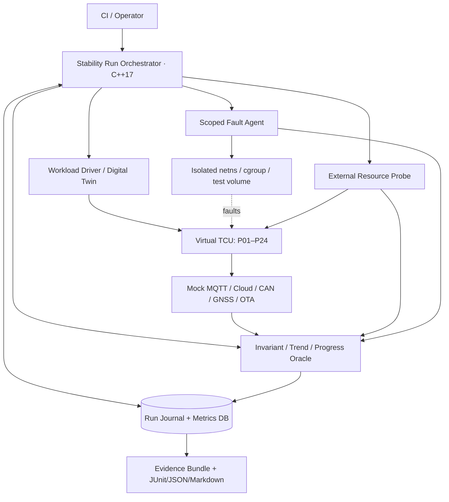
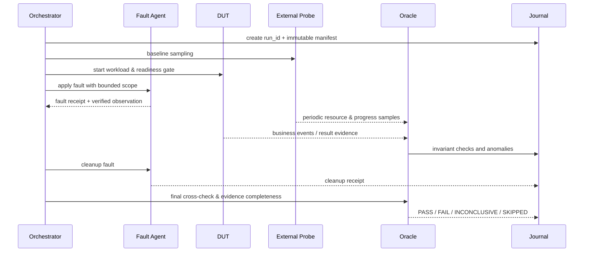
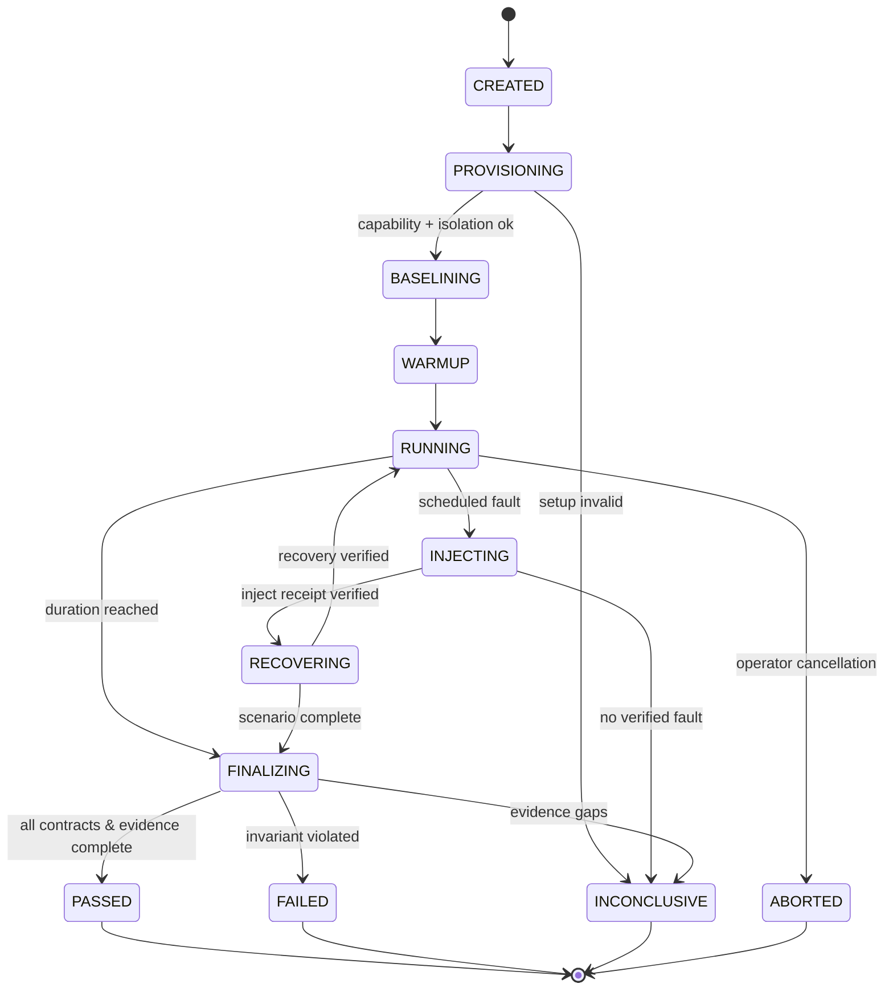

# Project 25 — Long-Running Stability Test
## Virtual TCU Lab · System Design, Operational Behaviors & Resilience/Fault-Injection Test Plan

| Trường | Giá trị |
|---|---|
| Project | P25 / Long-Running Stability Test |
| Version | 1.0 — 2026-10-30 |
| Target | Middle C++ Developer · C++17 · Ubuntu Linux · hoàn toàn giả lập |
| Artifact | Bản thiết kế và test plan; **không phải** báo cáo kiểm thử đã thực thi |
| Thời lượng profile | 30 phút smoke, 24 giờ endurance, 7 ngày soak, 12 giờ chaos (tham số cấu hình) |
| Phụ thuộc | P01–P24 (chạy được từng phần; mock adapter khi module chưa triển khai) |
| Deliverables | `tcu_stability_runner`, `tcu_resource_probe`, `tcu_fault_agent`, `tcu_oracle`, báo cáo JSON/HTML/Markdown, test evidence |
| Test scope | 300 What-if đơn lẻ; 50 multi-fault campaigns; 36 Jira tickets |

> **Cảnh báo:** Các ngưỡng trong tài liệu là **giá trị minh họa để làm lab**, không phải đặc tính được chứng nhận cho bất kỳ OEM/TCU nào. Mọi can thiệp lỗi phải giới hạn vào VM, container hoặc Linux network namespace được cấp riêng cho lab; không inject lên xe thật hoặc mạng máy chủ dùng chung.

## Mục lục

1. Mục tiêu, non-goals và phạm vi
2. Kiến trúc tổng thể và trust boundaries
3. Workload profiles, SLO và oracle kiểm thử
4. Data model, event schema và evidence
5. Thiết kế các module C++17 và APIs
6. Lifecycle state machine và operation workflow
7. Đo tài nguyên, dữ liệu và phân tích xu hướng
8. Fault injection và kiểm chứng fault thực sự xảy ra
9. Thread safety, đồng hồ, restarts, crash consistency
10. Các behavioral contracts Given/When/Then
11. Bộ 300 What-if cases với step, expected, evidence
12. 50 multi-fault campaigns có timeline và invariants
13. Automated testing, fuzzing và performance methodology
14. Hướng dẫn chạy lab trên Ubuntu
15. SQLite schema của test journal
16. Security, safety, privacy và giới hạn mô phỏng
17. Jira backlog 36 tickets, dependencies và DoD
18. Báo cáo, release gate, risk register
19. Integration với các project TCU trước
20. Tài liệu tham khảo và checklist cuối

---

## 1. Mục tiêu, non-goals và phạm vi

**Vấn đề cần giải quyết:** Một TCU có thể chạy qua smoke test 10 phút nhưng sau 2–7 ngày gặp memory growth, file descriptor leak, deadlock, retry storm, queue tích tụ, database phình to, telemetry mất thứ tự, hoặc restart che giấu lỗi. P25 tạo một hệ thống **quan sát độc lập, phát workload, gây lỗi có kiểm soát và xác minh bất biến** trong thời gian dài.

### 1.1 Functional requirements

| ID | Requirement | Acceptance |
|---|---|---|
| FR-01 | Chạy profile định nghĩa workload/duration/seed trên Virtual TCU | Lưu manifest bất biến của từng run |
| FR-02 | Quan sát tài nguyên process/cgroup/host độc lập với DUT | Phát hiện PID restart và không nối nhầm timeline |
| FR-03 | Gây lỗi mạng, disk, process, IPC, cloud, CAN, GNSS, OTA theo scope | Mỗi fault có apply + verify + cleanup receipt |
| FR-04 | Kiểm tra state invariants end-to-end liên tục | FAIL khi quan sát vi phạm có evidence; không dựa riêng vào heartbeat |
| FR-05 | Đo memory/FD/thread/CPU/latency/backlog & service progress | Thống kê theo phase, process generation, workload |
| FR-06 | Recover runner sau runner crash | Dữ liệu ghi bền vững, resume hoặc phân loại partial run rõ ràng |
| FR-07 | Báo cáo PASS/FAIL/INCONCLUSIVE/SKIPPED | Trace được từ verdict đến artifacts và software version |
| FR-08 | Hỗ trợ mock/fake adapters khi P01–P24 chưa có implementation | Các capability được đánh dấu REAL/FAKE/MISSING |
| FR-09 | Stress/soak với load pattern có seed và chaos timeline | Có thể replay seed + manifest + dependency versions |
| FR-10 | Export JUnit/JSON/CSV/Markdown + summary | Có failure triage và regression baseline |

### 1.2 Non-functional requirements

- **Isolation:** fault agent không có quyền can thiệp host network/system ngoài lab resource allowlist.
- **Boundedness:** runner/probes/fault agent cũng phải có giới hạn RAM, FD, số thread, queue, disk, số event/minute và timeout.
- **Observability:** sample bị thiếu/không đáng tin không được suy luận là hệ thống ổn định.
- **Noninterference:** phải định lượng overhead do probes và log gây ra; có control run không instrument.
- **Determinism:** unit/state-machine test dùng fake clock và seed; soak test thực sử dụng elapsed monotonic time.
- **Durability:** run journal và result verdict có transaction boundary rõ ràng.
- **Security:** fault endpoints chỉ dùng Unix socket quyền hạn chế hoặc mTLS nội bộ lab; không nhận raw shell command từ workload.
- **Audit:** mỗi inject/cleanup được ghi theo run_id, actor, time và expected verification.

### 1.3 Non-goals

- Không chứng nhận ISO 26262, ISO/SAE 21434, ASPICE, AUTOSAR compliance hoặc yêu cầu của OEM.
- Không chứng minh độ bền flash, nhiệt độ, EMC, modem RF, CPU real-time trên ECU thật.
- Không chứng minh mọi lỗi có thể xảy ra: tổ hợp lỗi và lịch trình thread là không hữu hạn.
- Không thay P24 watchdog, P17 Health Monitor hay P11 Network Fault Lab; P25 đóng vai trò orchestrator/evaluator.

### 1.4 Quy tắc tối cao: không có PASS giả

1. **Không inject thành công => `INCONCLUSIVE`**, kể cả hệ thống có vẻ ổn.
2. **Mất telemetry của harness => `INCONCLUSIVE`** cho khoảng thời gian không quan sát được, trừ khi một invariant độc lập đã chứng minh FAIL.
3. **Không thấy exception != không có lỗi**: cần kiểm tra business invariants, backlog, tài nguyên và tốc độ progress.
4. **Restart không làm reset bằng chứng**: resource trends phải chia theo process generation và tích lũy counter global.
5. **Không quy chụp tăng RSS là leak**: cần warm-up, heap/allocator analysis, PSS/private dirty và biến thiên workload.
6. **Đủ số giờ không đồng nghĩa đạt**: phải có coverage, observation quality và evidence continuity.

---

## 2. Kiến trúc hệ thống





**Hai ranh giới độc lập:** (A) dữ liệu DUT tự báo qua API/metrics, (B) dữ liệu từ host observer và mock cloud/ECU độc lập. Khi (A) nói khỏe nhưng (B) chứng minh progress dừng, ưu tiên kết quả quan sát độc lập.

**Các thành phần:**

- `RunOrchestrator`: chạy scenario graph; kiểm soát state, seed, timeout và pause/cancel.
- `WorkloadDriver`: phát CAN frames, GNSS NMEA, MQTT telemetry/commands, OTA jobs, DTC polls và các mức tải.
- `FaultAgent`: cung cấp API **định kiểu** cho faults; mỗi action có scope allowlist và cleanup.
- `ResourceProbe`: đọc `/proc`, cgroup v2, PSI, `systemd` trạng thái process, DB stats; hỗ trợ missing values.
- `OracleEngine`: kiểm tra bất biến, resource trend, liveness vs progress, recovery SLA và kết quả dữ liệu end-to-end.
- `EvidenceStore`: SQLite journal cục bộ + append-only files/manifest/checksums; hỗ trợ chạy tiếp sau crash.
- `Reporter`: tóm tắt thời gian, fault coverage, failure triage, dữ liệu và ảnh hưởng của instrumentation.

**Không dùng cùng một daemon để vừa gây lỗi vừa quan sát duy nhất:** khi daemon đó crash, cần out-of-process witness hoặc observer từ host độc lập để không mất chứng cứ.

## 3. Workload profiles và SLO/SLI

### 3.1 Các profile tham khảo

| Profile | Thời gian | Workload | Mục tiêu |
|---|---:|---|---|
| `smoke` | 30 phút | steady + vài lỗi chủ động | Xác minh harness, metric + cleanup |
| `endurance` | 24 giờ | chu kỳ ignition, burst, idle, reconnect | Phát hiện leak/latency tích lũy |
| `soak` | 7 ngày | profile tuần: day/night, mixed normal workload | Phát hiện lỗi chỉ lộ sau thời gian dài |
| `chaos` | 12 giờ | nhiều faults giới hạn + cooldown | Kiểm tra degradation, recovery invariants |
| `accelerated` | 2 giờ | workload tăng tốc so với sản phẩm | Tìm điểm gãy capacity; **không tương đương** 7 ngày soak |

### 3.2 Ví dụ cấu hình ngưỡng lab (cần hiệu chuẩn theo baseline và hardware)

| Signal/SLI | Ngưỡng mẫu | Cách diễn giải |
|---|---|---|
| `crashes_unplanned` | = 0 trong steady phase | Crash **được inject** được đánh dấu riêng; không che lỗi không mong đợi |
| `health_progress_gap` | <= 30 s ở steady phase | Cần ít nhất một phép đo tiến triển nghiệp vụ độc lập |
| `event_lost_without_policy` | = 0 | Data loss có policy phải ghi reasons/counters; đếm bằng oracle từ nguồn |
| `telemetry_latency_p99` | <= 3 s khi online ổn định | Chỉ tính từ producer-to-backend-commit, clock được hiệu chuẩn |
| `queue_depth` | <= capacity cấu hình | Overflow có reason và backpressure |
| `fds_after_recovery` | không vượt baseline ổn định > 8 FD sau 3 chu kỳ | Con số demo; phân biệt FD hợp lệ/caches |
| `thread_count_after_recovery` | không tăng theo số vòng reconnect | Chứng minh stable/plateau |
| `memory_pss_growth` | không có xu thế tăng bền vững vượt tolerance đã chốt | Không áp dụng ngưỡng slope mù cho RSS |
| `cloud_command_duplicate_effects` | = 0 cho một command id | Đối chiếu BCM simulator independent execution log |
| `fault_injection_verified` | 100% cho cases được coi PASS | Không có proof => INCONCLUSIVE |
| `evidence_coverage` | >= 99.9% theo sample windows | Hệ số tham khảo, thiếu mẫu trọng yếu => INCONCLUSIVE |

**Không dùng một số duy nhất để kết luận memory leak.** Thu resource theo các phase: warm-up → steady → burst → recovery → idle và so sánh dưới cùng load; kiểm tra trend robust (Theil–Sen hoặc windowed median), memory retained sau warm-down, OOM counters, heap profiling và allocator caches.

### 3.3 Fault classification / verdict

| Verdict | Chính sách |
|---|---|
| `PASS` | Setup, fault, oracle và evidence đủ; mọi invariant trong scope đều thỏa |
| `FAIL` | Invariant bị vi phạm có evidence xác thực; không cần đủ mọi sample khác |
| `INCONCLUSIVE` | Fault không thực sự áp dụng; thiếu observation; môi trường bị nhiễu; oracle thiếu quyền hoặc replay không tái hiện được |
| `SKIPPED` | Test không áp dụng/capability MISSING và được khai báo trước |
| `ABORTED` | Operator/harness dừng chủ động; kết quả không được coi PASS |

## 4. Data contract và evidence model

Mỗi `run_id` có `artifact_manifest.json` bất biến: commit SHA, compiler flags, binaries hashes, kernel version, container image digest, topology, fault policy version, monotonic reference, sampling interval, seed, baseline metrics, capability inventory và operator. Mỗi sample có:

```json
{
  "run_id":"lab-20261030-01", "seq":4210,
  "phase":"steady", "monotonic_ns":7342103000000,
  "wall_utc":"2026-10-30T06:20:00Z",
  "process_key":{"boot_id":"b...","pid":4321,"starttime_ticks":81234,"generation":4},
  "metric":"process.pss_bytes", "value":17301504,
  "quality":"GOOD", "source":"/proc/4321/smaps_rollup"
}
```

- `monotonic_ns` dùng cho elapsed/timeout trong cùng boot; không so trực tiếp giữa hai kernel boots; run journal mang `boot_id` và segments.
- `wall_utc` dùng correlation/audit, không phải freshness oracle duy nhất; ghi time source/trust.
- Dữ liệu bị rỗng hoặc lỗi đọc phải ghi `MISSING/UNTRUSTED`; không tự đổi thành `0`.
- `process_key` không chỉ dùng PID: kết hợp boot ID, PID, starttime và generation; hoặc pidfd khi phù hợp.
- Mỗi fault receipt có `action_id`, `scope`, `before`, `after`, `verified`, `cleanup_verified`.

## 5. C++17 API Design

```cpp
using RunId = std::string;
using FaultId = std::string;
using MonotonicTime = std::chrono::steady_clock::time_point;

enum class Verdict { Pass, Fail, Inconclusive, Skipped, Aborted };
enum class Quality { Good, Missing, Stale, Untrusted, Unsupported };
enum class Phase { Provision, Baseline, Warmup, Steady, Injecting,
                   Recovering, Cooldown, Finalizing, Finished };

struct ProcessIdentity {
    std::string bootId;
    int pid;
    unsigned long long startTicks;
    uint64_t generation;
};
struct MetricSample {
    std::string metric;
    double value;
    std::string unit;
    Quality quality;
    ProcessIdentity process;
    MonotonicTime observed;
};
struct FaultSpec {
    FaultId id;
    std::string type;
    std::string targetResource;  // allowlisted lab resource only
    std::chrono::milliseconds duration;
    std::string parametersJson; // validate against fault-type schema
};
struct FaultReceipt {
    FaultId id;
    bool applied;
    bool verified;
    bool cleaned;
    std::string evidencePath;
};

class IClock {
public:
    virtual ~IClock() = default;
    virtual MonotonicTime now() const = 0;
};
class IResourceProbe {
public:
    virtual ~IResourceProbe() = default;
    virtual std::vector<MetricSample> sample() = 0;
};
class IFaultAgent {
public:
    virtual ~IFaultAgent() = default;
    virtual FaultReceipt apply(const FaultSpec&) = 0;
    virtual FaultReceipt cleanup(const FaultId&) = 0;
};
class IInvariantOracle {
public:
    virtual ~IInvariantOracle() = default;
    virtual void ingest(const MetricSample&) = 0;
    virtual Verdict finalize(const RunId&) = 0;
};
class IRunJournal {
public:
    virtual ~IRunJournal() = default;
    virtual void appendEvent(const RunId&, std::string_view payload) = 0;
    virtual void checkpoint(const RunId&, Phase) = 0;
};
```

**Interface extension:** `IWorkloadDriver`, `IProcessSupervisor`, `IBusinessEvidenceSource`, `ITestCase`, `IReportSink`, `ICapabilityProbe`; injection và oracle được mock độc lập trong unit tests.

**Ownership & threading:** orchestrator một thread điều phối; probe có worker độc lập và bounded sample queue; fault agent process riêng; database một writer thread và batch transactions; test reporter chạy ngoài hot path. Callback chỉ nhận immutable snapshot hoặc `shared_ptr<const ...>`; mọi shutdown đều có deadline và cancellation token; không detach thread tùy tiện.

## 6. Lifecycle & operational behaviors



### 6.1 Workflow chính

1. **Provision:** tạo namespace/volume/cgroup có tag `run_id`; validate allowlist, ownership, cloud mock, disk quota, package versions; không ảnh hưởng host thật.
2. **Baseline:** chụp resource 5–15 phút và calibration data path; cố định config/seed; ghi baseline profile đầy đủ.
3. **Warm-up:** load module và caches, chạy online/idle; không kết luận memory leak khi vẫn khởi tạo.
4. **Steady:** phát mix workload chuẩn; định kỳ đo latency, progress, resource, data integrity.
5. **Inject:** validate preconditions → ghi intention journal → apply typed fault → xác minh fault thực sự có tác dụng → workload tiếp tục.
6. **Recover:** cleanup/rollback fault được xác minh, giám sát return-to-service và reconciliation; tránh báo khỏe chỉ vì PID chạy lại.
7. **Cooldown:** cùng mức workload/idle cố định; đo retained memory, còn lại FD/thread, queue age, DB backlog.
8. **Finalize:** so sánh oracle, tính metric với confidence/coverage, gom artifacts, ký hash/checksum, xuất verdict.

### 6.2 Invariants (số ID ổn định dùng trong test)

| ID | Invariant |
|---|---|
| INV-01 | Không báo PASS khi fault không được xác nhận đã xảy ra |
| INV-02 | Bounded memory/FD/thread/queue trong limits và không có growth không giải thích được |
| INV-03 | Tiến triển nghiệp vụ phải được chứng minh ngoài heartbeat/process alive |
| INV-04 | Không mất dữ liệu nếu policy không cho phép; trường hợp drop phải có reason và counter |
| INV-05 | Không nhân đôi hiệu ứng command non-idempotent |
| INV-06 | QoS PUBACK không được coi là backend commit/command executed |
| INV-07 | Không dùng stale data như fresh data trong safety/health/telemetry |
| INV-08 | Recovery chỉ thành công sau reconciliation, probation và independent probes |
| INV-09 | Không leak resources qua restart, reconnect, sleep/wakeup cycles |
| INV-10 | Fault/cleanup không ra ngoài run-owned scope |
| INV-11 | Config reload/callback cũ không làm thay đổi thế hệ mới |
| INV-12 | Journals/DB/files không báo thành công giả sau lỗi ghi bền vững |
| INV-13 | Test evidence có chain of custody: seed, manifest, event, raw samples, verdict |
| INV-14 | Không có deadlock/use-after-free/double completion do concurrency |
| INV-15 | Các metric bị missing được phân loại rõ; không tự coi là zero |
| INV-16 | Hệ thống degrade có giới hạn và phục hồi theo yêu cầu sau khi fault kết thúc |

## 7. Metric measurement & trend analysis

| Resource | Phương thức | Điều cần tránh |
|---|---|---|
| RSS | `/proc/<pid>/status` VmRSS | RSS có shared pages/caches; không kết luận leak đơn lẻ |
| PSS, Private Dirty | `/proc/<pid>/smaps_rollup` | Quyền đọc/chi phí và sample race; quality nếu unavailable |
| FD count | `/proc/<pid>/fd` | Đếm sai do PID recycle hoặc proc permission |
| Thread count | `/proc/<pid>/task` | Phân biệt thread pool warm-up và leaked threads |
| CPU usage | Delta CPU ticks / delta monotonic time, cores | Phân biệt single-core vs toàn máy và CPU quota |
| Memory OOM | cgroup v2 `memory.events(.local)` | Counter cumulative, phải lấy delta theo sample |
| CPU/Memory/IO pressure | `/proc/pressure/*` | PSI >0 không nhất thiết là DUT lỗi; đối chiếu host |
| I/O, disk | cgroup io.stat, `statvfs`, SQLite stats | Page-cache/backlog khác durable used bytes |
| Reconnect/restart | Process generation + service events | Restart mask memory leak; thời gian unavailable |
| Queue and backlog | app metrics + independent producer sequence | Queue size 0 có thể do drop silent; cross-check producer |
| E2E delivery | monotonic producer time ↔ cloud persisted event_id | Clock offset giữa process/host, backend ACK semantics |

**Trend oracle:** normalize theo workload, loại warm-up, chia thành windows, so sánh distributions; cảnh báo growth khi tăng nhiều consecutive windows kèm retained growth sau idle, nhưng chỉ FAIL khi vượt **contract cụ thể** hoặc có chứng cứ leak. Hệ thống có trách nhiệm phân loại `POTENTIAL_LEAK` khi bằng chứng chưa đủ, không dùng arbitrary slope như chứng nhận.

### 7.1 Headline metrics

- `duty_cycle`, `availability_fraction`, `mean_time_to_recover` theo loại fault.
- `p50/p95/p99` end-to-end latency với sample count và confidence.
- `memory_pss_bytes`, `memory_current_bytes`, `cpu_usage_cores`, `fds`, `threads`, `oom_kill_delta`.
- `queue_depth`, `queue_oldest_age_ms`, `producer_event_count`, `backend_committed_unique_count`.
- `health_progress_counter`, `restarts`, `recovery_budget_used`, `unplanned_crashes`.
- `fault_applied_verified`, `fault_cleaned_verified`, `evidence_gap_ratio`, `observer_overhead`.

## 8. Fault injection engine

**Fault types allowlisted:** `net.delay`, `net.loss`, `net.disconnect`, `dns.failure`, `process.sigterm`, `process.sigkill`, `process.pause`, `memory.pressure`, `cpu.limit`, `disk.full.testvolume`, `sqlite.busy`, `clock.fakejump`, `ipc.drop`, `can.pause`, `gnss.stale`, `mqtt.ackloss`, `ota.failstage`, `power.fakebrownout`. Mỗi fault có precondition và owner; fault đang áp dụng được journal trước khi hành động.

**Safety barrier:** `SIGKILL` chỉ dùng target PID đã kiểm tra `boot_id+starttime`; file full chỉ trên quota volume do lab tạo; `tc netem` chỉ trong `ip netns` do run sở hữu; không dùng global `iptables`/`tc` trên host network. Có TTL + external sweeper cho orphan faults.

**Verify → observe → cleanup:** Fault Agent trả receipt có observation qua nguồn khác, ví dụ `tc -s qdisc` chứng minh rule đang áp dụng, packet capture/round-trip cho thấy tác dụng; xác minh cleanup trở về baseline. Nếu không chứng minh được, **không** đánh PASS.

## 9. Concurrency, clocks, persistence & restart semantics

- Không giữ mutex trong callbacks hoặc trong SQLite I/O; bounded queues có overflow policy định nghĩa rõ.
- Mỗi asynchronous operation mang run generation / process generation và cancellation epoch để bỏ stale callback.
- Runner journal giữ các transition `PREPARED/APPLIED/VERIFIED/CLEANED`; resume sau crash đối chiếu thực tế trước khi tiếp tục.
- `CLOCK_MONOTONIC` dùng timeout trong một boot; khi OS reboot, dựng `BootSegment` mới; không cộng monotonic offsets qua reboot.
- Data source trả `MISSING` khi permission bị revoke, probe timeout, file biến mất hoặc lỗi parse.
- Workload callback không thể gửi lệnh điều khiển xe thật; endpoint được cấu hình hardcoded trong test topology.
- Không replay fault như `SIGKILL`/`disk.full` trên recovery nếu chưa kiểm tra action đã tác động.

## 10. Behavioral contracts (Given / When / Then)

| Contract | Given | When | Then |
|---|---|---|---|
| BC-01 | Workload steady, no faults | 24h run kết thúc | không unplanned crash, metric evidence đầy đủ, PASS nếu hết gate |
| BC-02 | Producer gửi 10k events | Network offline 20m | backlog tăng bounded và app-level ACK không thành công giả |
| BC-03 | Service chạy ổn định | Inject SIGKILL | restart budget hợp lệ, process generation mới, reconciliation hoàn tất |
| BC-04 | Main loop deadlock | Heartbeat thread vẫn ping | observer xác định no-progress, không báo healthy |
| BC-05 | Database đang COMMIT | Disk full | không ghi nhận commit thành công giả |
| BC-06 | Cloud ack missing | Replay event | cùng event_id, backend không có duplicate canonical record |
| BC-07 | Fault agent crash | Network fault đang active | sweeper độc lập cleanup hoặc run INCONCLUSIVE |
| BC-08 | Probe mất quyền đọc | Sampling tiếp tục | metric MISSING, không báo 0 |
| BC-09 | Process restart | PID cũ tái sử dụng | không nối sample process khác vào generation cũ |
| BC-10 | Time nhảy lùi | Soak timer | elapsed vẫn theo monotonic segment |
| BC-11 | OTA trial boot | Health gate timeout | không đánh dấu slot GOOD thiếu xác minh |
| BC-12 | Remote command result unknown | TCU restart | không tự thực thi lại command |
| BC-13 | Inject netem trên iface sai | kịch bản mất mạng | nhận diện fault không có tác dụng, INCONCLUSIVE |
| BC-14 | 10k wake events | Power sleep | bounded queue/rate limiting và wake priority |
| BC-15 | Runner crash | Restart harness | journal restore, không nhân đôi fault không idempotent |
| BC-16 | Monitoring overhead quá cao | workload giữ nguyên | testcase INCONCLUSIVE, cần calibration lại |
| BC-17 | Cloud recover | Queue có oldest data | replay theo policy và không phát sinh stale-safety data |
| BC-18 | CPU 100% workload | low-priority probe starved | observer gắn missing sample; không kết luận khỏe |
| BC-19 | Lặp 1k reconnect cycles | warm-down | số FD/threads nằm trong baseline tolerance |
| BC-20 | Cancel run | faults still active | cleanup được verified hoặc báo residual hazard và fail/inconclusive |

---

## 11. Danh mục 300 What-if scenarios

**Cách đọc:** `P0` là lỗi có thể tạo kết luận sai, hỏng dữ liệu/side effect, mất khả năng quan sát, hoặc vượt resource limit nghiêm trọng. `P1` là rủi ro khác cần cover. Đây là một **risk catalog hữu hạn**, không phải khẳng định bao phủ mọi trường hợp. Các test phải được triển khai dưới dạng scenario definition và tự động hóa dần.

**Chuẩn evidence bắt buộc cho mọi case:** `run_id`, case ID, environment manifest, before/after snapshot, fault `action_id`/receipt `verified=true`, timestamps, DUT generation, độc lập oracle verdict; cùng artifact đặc thù trong cột Evidence. Nếu precondition hay fault không xác minh được thì `INCONCLUSIVE` hoặc `SKIPPED` có lý do.

### 11.1 — Environment, setup & baseline (`SET`, 10 cases)

Evidence chủ đạo: **manifest/digest, capability probe, run journal, environment diff**.

| ID | What if? | Cách inject / tái hiện | Expected behavior / oracle | Evidence | Priority |
|---|---|---|---|---|---|
| `P25-SET-01` | Baseline đo khi CPU host đang có tiến trình lạ | Tạo background CPU load ở host bên ngoài test cgroup trước baseline | Đánh dấu baseline contaminated hoặc cách ly test host; không gán blame cho DUT | manifest/digest, capability probe, run journal, environment diff + receipt và invariant result | P0 |
| `P25-SET-02` | Kernel thiếu cgroup v2 | Khởi chạy runner trong VM dùng cgroup v1/không mount v2 | Mark capability MISSING và SKIPPED test yêu cầu v2, không dùng chỉ số giả | manifest/digest, capability probe, run journal, environment diff + receipt và invariant result | P0 |
| `P25-SET-03` | DUT image đổi giữa hai lần chạy | Thay image digest sau khi manifest được ký | Reject run hoặc tạo run_id mới, không so sánh baseline sai version | manifest/digest, capability probe, run journal, environment diff + receipt và invariant result | P0 |
| `P25-SET-04` | Profile khai báo workload không tồn tại | Chỉ định workload driver chưa đăng ký | Fail provisioning rõ ràng, không chạy với workload rỗng | manifest/digest, capability probe, run journal, environment diff + receipt và invariant result | P0 |
| `P25-SET-05` | NTP sync thay đổi giờ lúc setup | Chuyển wall clock bằng fake time source khi lưu manifest | Snapshot lưu both wall/monotonic và time trust; elapsed không sai | manifest/digest, capability probe, run journal, environment diff + receipt và invariant result | P0 |
| `P25-SET-06` | Tạo netns thiếu quyền | Chạy runner không CAP_NET_ADMIN cần thiết | Không inject lên default namespace; trả INCONCLUSIVE/SKIPPED theo policy | manifest/digest, capability probe, run journal, environment diff + receipt và invariant result | P0 |
| `P25-SET-07` | DUT chạy trước khi probes sẵn sàng | Cố tình làm chậm probe registration | Không bắt đầu measurement window; evidence gap rõ ràng | manifest/digest, capability probe, run journal, environment diff + receipt và invariant result | P0 |
| `P25-SET-08` | Số core CPU thay đổi giữa run | Hotplug CPU trên VM/test host cô lập | Normalize CPU quota/core capacity; baseline có topology change | manifest/digest, capability probe, run journal, environment diff + receipt và invariant result | P0 |
| `P25-SET-09` | Config và build flags không đồng bộ | Dùng Debug ASan binary so với Release baseline | Reject invalid comparison hoặc phân profile khác nhau | manifest/digest, capability probe, run journal, environment diff + receipt và invariant result | P1 |
| `P25-SET-10` | Thiếu dung lượng cho evidence trước run | Giới hạn test evidence volume trước provision | Không start long run khi disk headroom dưới cấu hình | manifest/digest, capability probe, run journal, environment diff + receipt và invariant result | P1 |

### 11.2 — Workload patterns & synthetic traffic (`WLD`, 10 cases)

Evidence chủ đạo: **producer counters, workload schedule, emitted event IDs, latency histograms**.

| ID | What if? | Cách inject / tái hiện | Expected behavior / oracle | Evidence | Priority |
|---|---|---|---|---|---|
| `P25-WLD-01` | Load tăng đột ngột gấp 100 lần | Tăng synthetic producer rate từ 100 lên 10000 events/s trong 30s | Bounded queue và policy backpressure, không OOM/silent loss | producer counters, workload schedule, emitted event IDs, latency histograms + receipt và invariant result | P0 |
| `P25-WLD-02` | Workload burst kéo dài hơn kỳ vọng | Giữ peak load liên tục 20 phút | Throttling được ghi rõ; throughput sau burst phục hồi | producer counters, workload schedule, emitted event IDs, latency histograms + receipt và invariant result | P0 |
| `P25-WLD-03` | Producer dừng gửi khi DUT vẫn alive | Pause traffic producer 60s và giữ process sống | Oracle nhận biết stimulus absent, không kết luận DUT bị hang | producer counters, workload schedule, emitted event IDs, latency histograms + receipt và invariant result | P0 |
| `P25-WLD-04` | Producer gửi bản tin với ID lặp | Gửi 1000 telemetry messages cùng event_id | Downstream policy dedupe, không tăng canonical count | producer counters, workload schedule, emitted event IDs, latency histograms + receipt và invariant result | P0 |
| `P25-WLD-05` | Workload chuyển day/night liên tục | Thay đổi phase steady/idle mỗi 5s | Không tạo timer/FD leakage theo số chuyển phase | producer counters, workload schedule, emitted event IDs, latency histograms + receipt và invariant result | P0 |
| `P25-WLD-06` | Hai workload profiles chạy chồng nhau | Scheduler vô tình kích hoạt stress và idle đồng thời | Detect profile conflict/priority rõ ràng, không âm thầm ghi wrong phase | producer counters, workload schedule, emitted event IDs, latency histograms + receipt và invariant result | P0 |
| `P25-WLD-07` | Workload driver crash giữa test | Kill process driver nhưng giữ DUT | Run evidence INCONCLUSIVE cho đoạn thiếu stimulus; không báo PASS vì load giảm | producer counters, workload schedule, emitted event IDs, latency histograms + receipt và invariant result | P0 |
| `P25-WLD-08` | Workload seed cố định nhưng đầu ra khác | Replay cùng seed trên hai lần chạy cùng build | Ghi sources nondeterminism/clock; không tuyên bố deterministic tuyệt đối | producer counters, workload schedule, emitted event IDs, latency histograms + receipt và invariant result | P0 |
| `P25-WLD-09` | Thay producer mix giữa chừng | Đổi tỉ lệ CAN/MQTT/GNSS 90:10 sang 10:90 | Metric phân theo phase/mix; không so slope thiếu normalize | producer counters, workload schedule, emitted event IDs, latency histograms + receipt và invariant result | P1 |
| `P25-WLD-10` | Workload có payload cỡ lớn bất thường | Generate telemetry payload gần size cap | Reject hoặc apply size limit, không memory explosion | producer counters, workload schedule, emitted event IDs, latency histograms + receipt và invariant result | P1 |

### 11.3 — Heap, RSS/PSS & memory pressure (`MEM`, 10 cases)

Evidence chủ đạo: **PSS/RSS, Private Dirty, cgroup memory.current/events, heap profiles**.

| ID | What if? | Cách inject / tái hiện | Expected behavior / oracle | Evidence | Priority |
|---|---|---|---|---|---|
| `P25-MEM-01` | Small allocation leak mỗi reconnect | Inject mock module giữ lại 4 KB mỗi reconnect trong 10000 vòng | Trend retained heap được phát hiện, không che bởi restart | PSS/RSS, Private Dirty, cgroup memory.current/events, heap profiles + receipt và invariant result | P0 |
| `P25-MEM-02` | RSS tăng do allocator cache nhưng PSS ổn định | Tạo burst allocations rồi release theo allocator | Không tự động kết luận leak chỉ từ RSS; báo phân tích | PSS/RSS, Private Dirty, cgroup memory.current/events, heap profiles + receipt và invariant result | P0 |
| `P25-MEM-03` | Memory growth do backend queue chính đáng | Tắt cloud, tăng pending events có giới hạn | Báo expected backlog growth theo policy, không nhầm heap leak | PSS/RSS, Private Dirty, cgroup memory.current/events, heap profiles + receipt và invariant result | P0 |
| `P25-MEM-04` | Process memory vượt cgroup limit | Set memory.max trên test cgroup ở mức nhỏ | OOM event/failed allocations được ghi; DUT degrade có giới hạn | PSS/RSS, Private Dirty, cgroup memory.current/events, heap profiles + receipt và invariant result | P0 |
| `P25-MEM-05` | OOM kill xảy ra giữa SQLite write | Gây memory pressure khi commit trong isolated cgroup | Restart/reconcile journal; không commit dữ liệu giả | PSS/RSS, Private Dirty, cgroup memory.current/events, heap profiles + receipt và invariant result | P0 |
| `P25-MEM-06` | Memory metrics biến mất do permission | Chặn đọc /proc/PID/smaps_rollup của observer | Chất lượng sample MISSING và không PASS memory gate | PSS/RSS, Private Dirty, cgroup memory.current/events, heap profiles + receipt và invariant result | P0 |
| `P25-MEM-07` | Cgroup memory giảm nhưng process RSS không giảm | Drop page cache trong isolated environment có kiểm soát | Không suy luận leak chỉ từ tổng memory.current | PSS/RSS, Private Dirty, cgroup memory.current/events, heap profiles + receipt và invariant result | P0 |
| `P25-MEM-08` | Memory growth chỉ ở child process | Spawn leak ở service con của DUT cgroup | Cgroup-level probe bắt được, không bỏ qua child | PSS/RSS, Private Dirty, cgroup memory.current/events, heap profiles + receipt và invariant result | P0 |
| `P25-MEM-09` | THP/page-cache gây spike | Chạy workload có file mmap lớn trong test volume | Segregate anonymous/file memory, không chẩn đoán lệch | PSS/RSS, Private Dirty, cgroup memory.current/events, heap profiles + receipt và invariant result | P1 |
| `P25-MEM-10` | Đường tiến triển có 1 outlier cực lớn | Inject one-time allocation 200MB rồi release | Robust trend và peak alarm riêng; không biến outlier thành slope | PSS/RSS, Private Dirty, cgroup memory.current/events, heap profiles + receipt và invariant result | P1 |

### 11.4 — File descriptors & socket lifecycle (`FD`, 10 cases)

Evidence chủ đạo: **/proc/PID/fd identities, sockets by type, generation, FD peak/plateau**.

| ID | What if? | Cách inject / tái hiện | Expected behavior / oracle | Evidence | Priority |
|---|---|---|---|---|---|
| `P25-FD-01` | Socket leak sau mỗi MQTT reconnect | Mock transport không close một socket trong 1000 cycles | FD growth được phát hiện theo generation | /proc/PID/fd identities, sockets by type, generation, FD peak/plateau + receipt và invariant result | P0 |
| `P25-FD-02` | FD count nhảy do logging rotation | Rotate 1000 log files | FD trả baseline sau grace period, không báo leak giả | /proc/PID/fd identities, sockets by type, generation, FD peak/plateau + receipt và invariant result | P0 |
| `P25-FD-03` | IPC connection bị peer reset | Tạo 500 connect/disconnect ngắn | Không leak socket; reconnection bounded | /proc/PID/fd identities, sockets by type, generation, FD peak/plateau + receipt và invariant result | P0 |
| `P25-FD-04` | File descriptors tăng do subprocess | Spawn child process leak descriptors | Monitor process-tree/cgroup, không chỉ PID chính | /proc/PID/fd identities, sockets by type, generation, FD peak/plateau + receipt và invariant result | P0 |
| `P25-FD-05` | FD close khi callback còn dùng | Inject close-before-callback trong fake adapter | Detect EBADF/use-after-close; không crash silent | /proc/PID/fd identities, sockets by type, generation, FD peak/plateau + receipt và invariant result | P0 |
| `P25-FD-06` | PID đổi trong lúc liệt kê /proc/PID/fd | Kill/restart process giữa readdir | Mark sample racy/stale và dùng generation key | /proc/PID/fd identities, sockets by type, generation, FD peak/plateau + receipt và invariant result | P0 |
| `P25-FD-07` | Ephemeral port exhaustion | Tạo hàng nghìn TCP sockets trong netns riêng | Retry/cleanup có giới hạn, không busy loop | /proc/PID/fd identities, sockets by type, generation, FD peak/plateau + receipt và invariant result | P0 |
| `P25-FD-08` | FD limit RLIMIT_NOFILE thấp | Launch DUT với soft limit 64 | Graceful EMFILE handling, không corrupt state | /proc/PID/fd identities, sockets by type, generation, FD peak/plateau + receipt và invariant result | P0 |
| `P25-FD-09` | Unix socket file còn lại sau crash | Kill IPC server nhiều lần | Rebind có policy, không xóa socket thuộc service khác | /proc/PID/fd identities, sockets by type, generation, FD peak/plateau + receipt và invariant result | P1 |
| `P25-FD-10` | inotify watchers leak sau hot reload | Reload config 5000 lần | Watcher count plateau, không vượt system limit | /proc/PID/fd identities, sockets by type, generation, FD peak/plateau + receipt và invariant result | P1 |

### 11.5 — Threads, locks & synchronization (`THR`, 10 cases)

Evidence chủ đạo: **/proc/PID/task, progress counters, sanitizer diagnostics, stack traces**.

| ID | What if? | Cách inject / tái hiện | Expected behavior / oracle | Evidence | Priority |
|---|---|---|---|---|---|
| `P25-THR-01` | Thread leak sau reconnect | Mock tạo thread mới không join qua 1000 lần reconnect | Threads tăng có xu hướng, FAIL resource gate | /proc/PID/task, progress counters, sanitizer diagnostics, stack traces + receipt và invariant result | P0 |
| `P25-THR-02` | Main loop deadlock nhưng heartbeat riêng vẫn chạy | Freeze worker progress lock, giữ heartbeat thread | Oracle phát hiện no progress bằng independent workload | /proc/PID/task, progress counters, sanitizer diagnostics, stack traces + receipt và invariant result | P0 |
| `P25-THR-03` | Double completion khi timeout đụng ACK | Arrange barrier để timeout và ACK cùng lúc | Một terminal result duy nhất, không UAF | /proc/PID/task, progress counters, sanitizer diagnostics, stack traces + receipt và invariant result | P0 |
| `P25-THR-04` | Shutdown khi callback còn giữ shared_ptr | Block callback rồi request shutdown | Hủy theo deadline, không deadlock/callback after free | /proc/PID/task, progress counters, sanitizer diagnostics, stack traces + receipt và invariant result | P0 |
| `P25-THR-05` | Condition variable notify bị mất | Schedule notify trước wait bằng fake scheduler | Predicate-based wait, không treo vô hạn | /proc/PID/task, progress counters, sanitizer diagnostics, stack traces + receipt và invariant result | P0 |
| `P25-THR-06` | priority inversion gây latency tail | Giữ mutex trên low-priority task trong stress | Detect p99 degradation; phân tích lock wait | /proc/PID/task, progress counters, sanitizer diagnostics, stack traces + receipt và invariant result | P0 |
| `P25-THR-07` | Thread pool saturated bởi callback chậm | Tạo N callbacks sleep vượt worker count | Bounded queue, health progress và timeout theo policy | /proc/PID/task, progress counters, sanitizer diagnostics, stack traces + receipt và invariant result | P0 |
| `P25-THR-08` | Shared mutable config bị update đồng thời | Run hot reload với 100 reader threads | Snapshot consistent; TSan profile không race | /proc/PID/task, progress counters, sanitizer diagnostics, stack traces + receipt và invariant result | P0 |
| `P25-THR-09` | Thread chết nhưng process còn alive | Kill simulated worker thread logic/throw exception | Supervisor phát hiện worker missing, không báo healthy | /proc/PID/task, progress counters, sanitizer diagnostics, stack traces + receipt và invariant result | P1 |
| `P25-THR-10` | Semaphore permit leak sau exception | Fault injection trong scoped permit holder | Permit được trả/RAII; throughput phục hồi | /proc/PID/task, progress counters, sanitizer diagnostics, stack traces + receipt và invariant result | P1 |

### 11.6 — CPU load, starvation, scheduling & PSI (`CPU`, 10 cases)

Evidence chủ đạo: **cpu.stat, CPU usage normalized cores, PSI, latency samples, event progress**.

| ID | What if? | Cách inject / tái hiện | Expected behavior / oracle | Evidence | Priority |
|---|---|---|---|---|---|
| `P25-CPU-01` | Busy loop khi mạng mất | Giả lập connect() trả lỗi ngay liên tục | CPU không tăng vô hạn; exponential backoff | cpu.stat, CPU usage normalized cores, PSI, latency samples, event progress + receipt và invariant result | P0 |
| `P25-CPU-02` | CPU quota giảm còn 20% một core | Set cpu.max chỉ trong test cgroup | Hệ thống degrade có policy; không giả định baseline full cores | cpu.stat, CPU usage normalized cores, PSI, latency samples, event progress + receipt và invariant result | P0 |
| `P25-CPU-03` | High CPU ở background service khác | Gây CPU load trên host ngoài DUT cgroup | Phân loại host contention, không blame DUT | cpu.stat, CPU usage normalized cores, PSI, latency samples, event progress + receipt và invariant result | P0 |
| `P25-CPU-04` | Watchdog thread bị starvation | Tạo CPU-bound jobs trên worker pool | Watchdog báo no progress đúng, không false recovery | cpu.stat, CPU usage normalized cores, PSI, latency samples, event progress + receipt và invariant result | P0 |
| `P25-CPU-05` | CPU usage luôn thấp nhưng event loop bị kẹt | Block I/O thread không tiêu CPU | Progress probe phát hiện failure | cpu.stat, CPU usage normalized cores, PSI, latency samples, event progress + receipt và invariant result | P0 |
| `P25-CPU-06` | CPU throttling delta bị hiểu là CPU usage | Force cgroup quota throttling | Metrics phân biệt throttled vs actual CPU spent | cpu.stat, CPU usage normalized cores, PSI, latency samples, event progress + receipt và invariant result | P0 |
| `P25-CPU-07` | Kernel scheduler jitter làm timer trễ | Gây load trong VM và đo timer delay | Report latency distribution, không kết luận timer exact | cpu.stat, CPU usage normalized cores, PSI, latency samples, event progress + receipt và invariant result | P0 |
| `P25-CPU-08` | Spinlock contention giữa 8 workers | Tăng contention vào fake shared resource | p99/CPU spike được phát hiện và trace | cpu.stat, CPU usage normalized cores, PSI, latency samples, event progress + receipt và invariant result | P0 |
| `P25-CPU-09` | PSI tăng mà throughput vẫn đạt SLO | Inject unrelated memory pressure controlled | Không FAIL chỉ vì PSI; cảnh báo điều kiện | cpu.stat, CPU usage normalized cores, PSI, latency samples, event progress + receipt và invariant result | P1 |
| `P25-CPU-10` | CPU crash của probe collector | SIGKILL collector giữa peak load | Evidence gap + independent witness; INCONCLUSIVE nếu thiếu | cpu.stat, CPU usage normalized cores, PSI, latency samples, event progress + receipt và invariant result | P1 |

### 11.7 — Queues, backpressure, loss & progress (`QUE`, 10 cases)

Evidence chủ đạo: **queue depth/age, accepted/rejected counters, producer vs backend IDs**.

| ID | What if? | Cách inject / tái hiện | Expected behavior / oracle | Evidence | Priority |
|---|---|---|---|---|---|
| `P25-QUE-01` | Queue đầy nhưng producer không nhận báo lỗi | Phát rate vượt capacity, kích hoạt fake silent drop | Invariant phát hiện missing IDs và FAIL | queue depth/age, accepted/rejected counters, producer vs backend IDs + receipt và invariant result | P0 |
| `P25-QUE-02` | Queue backlog giảm vì service bỏ hết dữ liệu | Inject drop-all mode sau reconnect | Không coi depth 0 là recovery; reconcile event IDs | queue depth/age, accepted/rejected counters, producer vs backend IDs + receipt và invariant result | P0 |
| `P25-QUE-03` | Oldest message không tiến triển | Stop consumer với queue depth nhỏ | Queue age/progress alarm dù count không tăng | queue depth/age, accepted/rejected counters, producer vs backend IDs + receipt và invariant result | P0 |
| `P25-QUE-04` | Queue fairness làm high priority starve | Flood low-priority events 100x | High priority latency bounded theo policy | queue depth/age, accepted/rejected counters, producer vs backend IDs + receipt và invariant result | P0 |
| `P25-QUE-05` | Retry liên tục sinh bản sao trong queue | Gây transient cloud error rồi replay | Dedup/correlation tránh unbounded duplicate queue | queue depth/age, accepted/rejected counters, producer vs backend IDs + receipt và invariant result | P0 |
| `P25-QUE-06` | Discard policy khi sleep | Trigger power sleep lúc queue đang có dữ liệu | Durable jobs retained hoặc explicit drop per policy | queue depth/age, accepted/rejected counters, producer vs backend IDs + receipt và invariant result | P0 |
| `P25-QUE-07` | Bounded queue có off-by-one | Flood đúng capacity/capacity+1 | Capacity bất biến, không overflow | queue depth/age, accepted/rejected counters, producer vs backend IDs + receipt và invariant result | P0 |
| `P25-QUE-08` | Queue metrics bị reset khi service restart | Kill consumer rồi restart | Run-level counters cross-check independent IDs | queue depth/age, accepted/rejected counters, producer vs backend IDs + receipt và invariant result | P0 |
| `P25-QUE-09` | Two consumers reorder message không được phép | Thêm jitter khác nhau trên workers | Ordering contract chỉ áp dụng per-key; violation detected | queue depth/age, accepted/rejected counters, producer vs backend IDs + receipt và invariant result | P1 |
| `P25-QUE-10` | Backpressure gây deadlock upstream | Block consumer rồi chặn producer synchronous | Deadline và cancellation, không thread deadlock | queue depth/age, accepted/rejected counters, producer vs backend IDs + receipt và invariant result | P1 |

### 11.8 — Storage pressure, logs & filesystem (`DISK`, 10 cases)

Evidence chủ đạo: **statvfs, IO pressure, log size, open FD, fsync receipts**.

| ID | What if? | Cách inject / tái hiện | Expected behavior / oracle | Evidence | Priority |
|---|---|---|---|---|---|
| `P25-DISK-01` | Log file phình liên tục 7 ngày | Enable verbose logs và phát events liên tục | Rotation/quota giữ log bounded, không ăn hết volume | statvfs, IO pressure, log size, open FD, fsync receipts + receipt và invariant result | P0 |
| `P25-DISK-02` | Disk full khi ghi critical evidence | Quota evidence volume xuống 0 sau baseline | Persist failure observable, run INCONCLUSIVE trừ invariant FAIL đã chứng minh | statvfs, IO pressure, log size, open FD, fsync receipts + receipt và invariant result | P0 |
| `P25-DISK-03` | Disk full trong DUT outbox | Dùng tmpfs có quota nhỏ cho test DB volume | DUT áp dụng storage policy, không corrupt DB | statvfs, IO pressure, log size, open FD, fsync receipts + receipt và invariant result | P0 |
| `P25-DISK-04` | Filesystem read-only giữa hoạt động | Remount isolated test volume read-only qua controlled backend | Fail writes rõ ràng; recover khi trở lại rw | statvfs, IO pressure, log size, open FD, fsync receipts + receipt và invariant result | P0 |
| `P25-DISK-05` | Disk latency tăng 1000ms | Inject I/O delay qua fake storage adapter | Detect p99/backpressure và graceful timeout | statvfs, IO pressure, log size, open FD, fsync receipts + receipt và invariant result | P0 |
| `P25-DISK-06` | Rotated log bị giữ FD cũ vô thời hạn | Force rotation khi writer không reopen | Disk-used-but-unlinked phát hiện và cleanup | statvfs, IO pressure, log size, open FD, fsync receipts + receipt và invariant result | P0 |
| `P25-DISK-07` | Evidence file nhiều triệu dòng | Stress append 1e6 small records | Bounded memory, incremental flush/rotation | statvfs, IO pressure, log size, open FD, fsync receipts + receipt và invariant result | P0 |
| `P25-DISK-08` | Disk usage giảm giả do symlink | Thay test log path thành symlink ngoài run root | Reject traversal, không xóa dữ liệu ngoài lab | statvfs, IO pressure, log size, open FD, fsync receipts + receipt và invariant result | P0 |
| `P25-DISK-09` | Out of inodes dù còn bytes | Tạo nhiều file nhỏ trên quota volume | Xử lý ENOSPC tương đương, không silent write | statvfs, IO pressure, log size, open FD, fsync receipts + receipt và invariant result | P1 |
| `P25-DISK-10` | Filesystem sync trả lỗi sau write() success | Fake file backend trả EIO ở fsync | Không báo durable success giả | statvfs, IO pressure, log size, open FD, fsync receipts + receipt và invariant result | P1 |

### 11.9 — SQLite, WAL & journal reliability (`DB`, 10 cases)

Evidence chủ đạo: **SQLite integrity_check, WAL counters, row counts, commit logs, outbox IDs**.

| ID | What if? | Cách inject / tái hiện | Expected behavior / oracle | Evidence | Priority |
|---|---|---|---|---|---|
| `P25-DB-01` | Crash ngay trước DB COMMIT | Inject SIGKILL trước commit trong test transaction | Không có partial committed record | SQLite integrity_check, WAL counters, row counts, commit logs, outbox IDs + receipt và invariant result | P0 |
| `P25-DB-02` | Crash ngay sau COMMIT nhưng trước ACK | Kill worker đúng transaction boundary | Reconcile committed data, không redo side effects mù | SQLite integrity_check, WAL counters, row counts, commit logs, outbox IDs + receipt và invariant result | P0 |
| `P25-DB-03` | WAL checkpoint bị chặn nhiều giờ | Giữ reader transaction mở trong DB test | WAL pressure được phát hiện, storage policy bounded | SQLite integrity_check, WAL counters, row counts, commit logs, outbox IDs + receipt và invariant result | P0 |
| `P25-DB-04` | SQLITE_BUSY kéo dài | Lock DB từ process độc lập | Bounded retry/backoff, không block all worker threads | SQLite integrity_check, WAL counters, row counts, commit logs, outbox IDs + receipt và invariant result | P0 |
| `P25-DB-05` | DB file bị corrupt vài bytes | Bit flip bản sao DB test sau shutdown | Integrity check fail, quarantine, không tự báo recovered | SQLite integrity_check, WAL counters, row counts, commit logs, outbox IDs + receipt và invariant result | P0 |
| `P25-DB-06` | DB journal ghi lỗi nhưng fault action đã xảy ra | Force journal write failure trước inject commit | Không tiếp tục inject action chưa có receipt/intent durable | SQLite integrity_check, WAL counters, row counts, commit logs, outbox IDs + receipt và invariant result | P0 |
| `P25-DB-07` | DB migration giữa soak | Nâng schema khi workload đang hoạt động | Safe migration/rollback và version pin | SQLite integrity_check, WAL counters, row counts, commit logs, outbox IDs + receipt và invariant result | P0 |
| `P25-DB-08` | Ứng dụng báo commit nhưng dữ liệu không tồn tại | Mock repository trả false-positive commit | Independent DB query phát hiện divergence | SQLite integrity_check, WAL counters, row counts, commit logs, outbox IDs + receipt và invariant result | P0 |
| `P25-DB-09` | Storage bị full khi VACUUM | Quota volume dưới temp-file cần thiết | Không mất DB chính, báo failure | SQLite integrity_check, WAL counters, row counts, commit logs, outbox IDs + receipt và invariant result | P1 |
| `P25-DB-10` | Hai workers update cùng outbox row | Tạo concurrent ACK và retry lease | Single terminal state, unique constraints enforced | SQLite integrity_check, WAL counters, row counts, commit logs, outbox IDs + receipt và invariant result | P1 |

### 11.10 — Network disconnect, jitter & routing (`NET`, 10 cases)

Evidence chủ đạo: **tc/netns receipts, independent connectivity probes, timeouts/reconnect stats**.

| ID | What if? | Cách inject / tái hiện | Expected behavior / oracle | Evidence | Priority |
|---|---|---|---|---|---|
| `P25-NET-01` | Mất Internet 20 phút trong soak | Apply netns link drop giữa TCU và mock cloud | Không báo CloudReady; lưu offline có giới hạn | tc/netns receipts, independent connectivity probes, timeouts/reconnect stats + receipt và invariant result | P0 |
| `P25-NET-02` | Packet loss 40% ngẫu nhiên | Apply tc netem loss có seed trong ns | Retry bounded; data integrity theo event IDs | tc/netns receipts, independent connectivity probes, timeouts/reconnect stats + receipt và invariant result | P0 |
| `P25-NET-03` | Jitter cao nhưng không mất packet | Apply netem delay 100ms 90ms | Latency p99 tăng có giải thích, không false disconnect | tc/netns receipts, independent connectivity probes, timeouts/reconnect stats + receipt và invariant result | P0 |
| `P25-NET-04` | DNS timeout trong khi TCP connection cũ còn sống | Poison DNS sandbox nhưng giữ established socket | Tách reachability level, không báo readiness sai | tc/netns receipts, independent connectivity probes, timeouts/reconnect stats + receipt và invariant result | P0 |
| `P25-NET-05` | Route thay đổi đúng lúc TLS handshake | Update route trong namespace khi connect pending | Drop stale callback, retry an toàn | tc/netns receipts, independent connectivity probes, timeouts/reconnect stats + receipt và invariant result | P0 |
| `P25-NET-06` | Network flapping 500 cycles | Bật/tắt veth có lịch seed | Không tăng FD/thread, retry có jitter/budget | tc/netns receipts, independent connectivity probes, timeouts/reconnect stats + receipt và invariant result | P0 |
| `P25-NET-07` | Wrong interface nhận netem rule | Inject fault vào non-DUT interface | Verify effect fail => INCONCLUSIVE | tc/netns receipts, independent connectivity probes, timeouts/reconnect stats + receipt và invariant result | P0 |
| `P25-NET-08` | TCP half-open lâu dài | Drop return packets, giữ socket | Heartbeat/probe timeout đúng; không busy loop | tc/netns receipts, independent connectivity probes, timeouts/reconnect stats + receipt và invariant result | P0 |
| `P25-NET-09` | IPv6 fail còn IPv4 hoạt động | Chặn IPv6 route trong netns | Fallback theo policy, không kẹt dual-stack | tc/netns receipts, independent connectivity probes, timeouts/reconnect stats + receipt và invariant result | P1 |
| `P25-NET-10` | Network phục hồi trước cleanup receipt | Remove netem ngoài agent có giám sát | Agent nhận external mutation, evidence metadata nhất quán | tc/netns receipts, independent connectivity probes, timeouts/reconnect stats + receipt và invariant result | P1 |

### 11.11 — MQTT delivery, session & reconnect (`MQT`, 10 cases)

Evidence chủ đạo: **broker trace, PUBACK, SUBACK, IDs, client state, MQTT counters**.

| ID | What if? | Cách inject / tái hiện | Expected behavior / oracle | Evidence | Priority |
|---|---|---|---|---|---|
| `P25-MQT-01` | PUBACK mất sau khi broker nhận | Drop broker-to-client PUBACK in proxy | Không báo backend committed, retry cùng event_id | broker trace, PUBACK, SUBACK, IDs, client state, MQTT counters + receipt và invariant result | P0 |
| `P25-MQT-02` | MQTT QoS1 deliver duplicate | Broker simulator inject DUP retransmit | Backend dedup canonical rows | broker trace, PUBACK, SUBACK, IDs, client state, MQTT counters + receipt và invariant result | P0 |
| `P25-MQT-03` | Session expiry khi offline dài | Broker expire session rồi client reconnect | Resubscribe/reconcile, không giả session cũ | broker trace, PUBACK, SUBACK, IDs, client state, MQTT counters + receipt và invariant result | P0 |
| `P25-MQT-04` | Broker restart giữa in-flight QoS2 | Kill/restart local broker with persistence profile | State machine hợp lệ hoặc outcome unknown, không double business effect | broker trace, PUBACK, SUBACK, IDs, client state, MQTT counters + receipt và invariant result | P0 |
| `P25-MQT-05` | Client ID takeover | Kết nối hai client cùng ID vào mock broker | Phát hiện takeover, không dùng callback session cũ | broker trace, PUBACK, SUBACK, IDs, client state, MQTT counters + receipt và invariant result | P0 |
| `P25-MQT-06` | SUBACK đến sau unsubscribe | Delay ACK để vượt subscription generation | Không khôi phục subscription đã hủy | broker trace, PUBACK, SUBACK, IDs, client state, MQTT counters + receipt và invariant result | P0 |
| `P25-MQT-07` | Keepalive miss do CPU overload | Throttle DUT cgroup khi MQTT alive | Reconnect policy bounded, đo downtime | broker trace, PUBACK, SUBACK, IDs, client state, MQTT counters + receipt và invariant result | P0 |
| `P25-MQT-08` | Broker retained command cũ | Preload retained command từ run cũ vào topic test | Command expiry/idempotency reject | broker trace, PUBACK, SUBACK, IDs, client state, MQTT counters + receipt và invariant result | P0 |
| `P25-MQT-09` | Topic wildcard sai tenant | Publish topic tenant-B tới client tenant-A | ACL/authorization deny, không điều khiển xe B | broker trace, PUBACK, SUBACK, IDs, client state, MQTT counters + receipt và invariant result | P1 |
| `P25-MQT-10` | TCP connected nhưng app ack pipeline deadlocked | Block backend DB commit while broker responds | CloudReady không đồng nghĩa BackendCommitted | broker trace, PUBACK, SUBACK, IDs, client state, MQTT counters + receipt và invariant result | P1 |

### 11.12 — Cloud backend, application ACK & duplicates (`CLD`, 10 cases)

Evidence chủ đạo: **backend DB rows, app ACK trace, canonical counts, command result journal**.

| ID | What if? | Cách inject / tái hiện | Expected behavior / oracle | Evidence | Priority |
|---|---|---|---|---|---|
| `P25-CLD-01` | Cloud DB commit xong nhưng ACK mất | Drop application ACK after commit | Same event_id replay, canonical count = 1 | backend DB rows, app ACK trace, canonical counts, command result journal + receipt và invariant result | P0 |
| `P25-CLD-02` | Backend ghi trùng khi concurrent consumers | Run 10 ingestion workers same event_id | DB uniqueness/idempotency maintained | backend DB rows, app ACK trace, canonical counts, command result journal + receipt và invariant result | P0 |
| `P25-CLD-03` | Cloud broker online nhưng database down | Pause DB, leave broker responding | Do not report application-level success | backend DB rows, app ACK trace, canonical counts, command result journal + receipt và invariant result | P0 |
| `P25-CLD-04` | Cloud API trả HTTP 500 sau khi side effect | Fake backend commits then error | Client does not blindly re-execute non-idempotent command | backend DB rows, app ACK trace, canonical counts, command result journal + receipt và invariant result | P0 |
| `P25-CLD-05` | Cloud clock nhảy xa tương lai | Fake backend UTC clock shift one year | Expiry trust policy prevents false deletion/acceptance | backend DB rows, app ACK trace, canonical counts, command result journal + receipt và invariant result | P0 |
| `P25-CLD-06` | Tenant revoked giữa telemetry ingest | Revoke principal while DB transaction pending | Authorization recheck per policy and evidence | backend DB rows, app ACK trace, canonical counts, command result journal + receipt và invariant result | P0 |
| `P25-CLD-07` | Cloud restarts mỗi 30 giây | Loop restart backend over 1 hour | Outbox bounded, recovery no duplicate effects | backend DB rows, app ACK trace, canonical counts, command result journal + receipt và invariant result | P0 |
| `P25-CLD-08` | Command queue quá tải | Submit 100k authorized mock commands | Rate limit and reject with trace, not OOM | backend DB rows, app ACK trace, canonical counts, command result journal + receipt và invariant result | P0 |
| `P25-CLD-09` | Server sends stale application ACK | Deliver ACK from previous run_id/generation | Do not accept stale ACK for new event | backend DB rows, app ACK trace, canonical counts, command result journal + receipt và invariant result | P1 |
| `P25-CLD-10` | ACK for unknown event_id | Send forged mismatched ACK from mock endpoint | Ignore/audit, no unrelated deletion | backend DB rows, app ACK trace, canonical counts, command result journal + receipt và invariant result | P1 |

### 11.13 — CAN frame stream, stale signals & gateway (`CAN`, 10 cases)

Evidence chủ đạo: **vcan captures, signal validity, route counters, frame timestamps**.

| ID | What if? | Cách inject / tái hiện | Expected behavior / oracle | Evidence | Priority |
|---|---|---|---|---|---|
| `P25-CAN-01` | CAN frame stream 100x bình thường | Publish millions frames through vcan0 simulator | Bounded ingress and missing/dropped count | vcan captures, signal validity, route counters, frame timestamps + receipt và invariant result | P0 |
| `P25-CAN-02` | Ignition frame dừng trong 30s | Stop only ignition CAN ID | Signal becomes STALE; power policy not based on old value | vcan captures, signal validity, route counters, frame timestamps + receipt và invariant result | P0 |
| `P25-CAN-03` | CAN interface down giữa telematics | Bring down vcan0 within VM | Degrade vehicle data and reconnect after up | vcan captures, signal validity, route counters, frame timestamps + receipt và invariant result | P0 |
| `P25-CAN-04` | CAN gateway route loop được cấu hình | Supply cyclic route in gateway config | Reject configuration rather than broadcast loop | vcan captures, signal validity, route counters, frame timestamps + receipt và invariant result | P0 |
| `P25-CAN-05` | Duplicate CAN frame bùng phát | Replay same frame rate 10x | No spurious state transitions beyond policy | vcan captures, signal validity, route counters, frame timestamps + receipt và invariant result | P0 |
| `P25-CAN-06` | CAN decoder crash giữa process restart | Kill decoder under continuous input | Reject mixed generations and recover cleanly | vcan captures, signal validity, route counters, frame timestamps + receipt và invariant result | P0 |
| `P25-CAN-07` | CAN malformed DLC | Inject frames with unsupported DLC via fake adapter | Reject, no out-of-bounds read | vcan captures, signal validity, route counters, frame timestamps + receipt và invariant result | P0 |
| `P25-CAN-08` | Door state arrives after command timeout | Delay BCM response signal | OUTCOME_UNKNOWN and reconciliation; no false success | vcan captures, signal validity, route counters, frame timestamps + receipt và invariant result | P0 |
| `P25-CAN-09` | CAN timestamp backward | Fake source timestamps older than previous | Freshness based trusted receive monotonic time | vcan captures, signal validity, route counters, frame timestamps + receipt và invariant result | P1 |
| `P25-CAN-10` | Route rule hot reload during TX | Revoke route with in-flight frame | Apply defined epoch barrier and no unsafe replay | vcan captures, signal validity, route counters, frame timestamps + receipt và invariant result | P1 |

### 11.14 — GNSS, timestamps & location consistency (`GPS`, 10 cases)

Evidence chủ đạo: **NMEA sequence, fix quality, stale counters, location samples**.

| ID | What if? | Cách inject / tái hiện | Expected behavior / oracle | Evidence | Priority |
|---|---|---|---|---|---|
| `P25-GPS-01` | GNSS serial stops without closing | Pause NMEA while PTY stays open | Position transitions STALE then LOST | NMEA sequence, fix quality, stale counters, location samples + receipt và invariant result | P0 |
| `P25-GPS-02` | GPS jumps 1000km in one second | Inject valid checksum but implausible position | Quality gate marks suspect, not valid position | NMEA sequence, fix quality, stale counters, location samples + receipt và invariant result | P0 |
| `P25-GPS-03` | RMC valid and GGA no fix | Emit conflicting paired sentences | Do not publish Valid fix without policy reconciliation | NMEA sequence, fix quality, stale counters, location samples + receipt và invariant result | P0 |
| `P25-GPS-04` | NMEA fragment split across reads | Feed RMC sentence one byte at time | Parser reassembles boundedly without leak | NMEA sequence, fix quality, stale counters, location samples + receipt và invariant result | P0 |
| `P25-GPS-05` | GNSS time jumps backwards 24 hours | Inject older UTC sentence after new | Age/ordering safe, do not delete backlog | NMEA sequence, fix quality, stale counters, location samples + receipt và invariant result | P0 |
| `P25-GPS-06` | NMEA sentence flood | Send 100k sentences/s from fake GPS | Bounded parser queues, CPU/memory constraints | NMEA sequence, fix quality, stale counters, location samples + receipt và invariant result | P0 |
| `P25-GPS-07` | PTY disappears during read | Close PTY master and recreate slave | No mixed session bytes or stale callbacks | NMEA sequence, fix quality, stale counters, location samples + receipt và invariant result | P0 |
| `P25-GPS-08` | GNSS recovers during cloud outage | Resume valid fixes while MQTT offline | Outbox events preserve quality metadata | NMEA sequence, fix quality, stale counters, location samples + receipt và invariant result | P0 |
| `P25-GPS-09` | Two GPS adapters produce conflicting fixes | Supply GNSS-A/B contradictory coordinates | Source provenance/priority recorded, fail closed on uncertain | NMEA sequence, fix quality, stale counters, location samples + receipt và invariant result | P1 |
| `P25-GPS-10` | Location privacy policy changes | Revoke location publishing during active run | Suppress further data and prove no unauthorized publish | NMEA sequence, fix quality, stale counters, location samples + receipt và invariant result | P1 |

### 11.15 — UDS/DTC collector & diagnostics (`DTC`, 10 cases)

Evidence chủ đạo: **UDS request logs, ECU session ID, DTC status snapshots, DB history**.

| ID | What if? | Cách inject / tái hiện | Expected behavior / oracle | Evidence | Priority |
|---|---|---|---|---|---|
| `P25-DTC-01` | UDS ISO-TP loses consecutive frame | Drop segment in vcan ISO-TP test | No partial DTC snapshot committed | UDS request logs, ECU session ID, DTC status snapshots, DB history + receipt và invariant result | P0 |
| `P25-DTC-02` | ECU reboot halfway DTC scan | Restart fake ECU between response fragments | Session generation invalidated, scan incomplete | UDS request logs, ECU session ID, DTC status snapshots, DB history + receipt và invariant result | P0 |
| `P25-DTC-03` | DTC not returned on a partial scan | Make one response timeout for a known DTC | Do not infer DTC cleared | UDS request logs, ECU session ID, DTC status snapshots, DB history + receipt và invariant result | P0 |
| `P25-DTC-04` | DTC status flips during read | Change status byte between DID/DTC calls | Store snapshots with timestamps and quality | UDS request logs, ECU session ID, DTC status snapshots, DB history + receipt và invariant result | P0 |
| `P25-DTC-05` | ClearDTC commit succeeds but response lost | Drop UDS positive response post-clear | No blind repeated clear; reconcile | UDS request logs, ECU session ID, DTC status snapshots, DB history + receipt và invariant result | P0 |
| `P25-DTC-06` | UDS pending response extended 0x78 | Inject ResponsePending then delay final | Do not mark request successful before final result | UDS request logs, ECU session ID, DTC status snapshots, DB history + receipt và invariant result | P0 |
| `P25-DTC-07` | SecurityAccess expires mid-diagnostic | Advance fake S3 timer during restricted UDS read | Abort denied operations per policy | UDS request logs, ECU session ID, DTC status snapshots, DB history + receipt và invariant result | P0 |
| `P25-DTC-08` | 100 diagnostic clients flood ECU | Create concurrent tester mock clients | Rate limit, fair queues and bounded resource | UDS request logs, ECU session ID, DTC status snapshots, DB history + receipt và invariant result | P0 |
| `P25-DTC-09` | DTC outbox grows during cloud offline | Disable broker while DTC poll continues | Persistent bounded storage and replay | UDS request logs, ECU session ID, DTC status snapshots, DB history + receipt và invariant result | P1 |
| `P25-DTC-10` | DTC data stale in health aggregation | Stop UDS collection but keep Health Monitor running | Health quality UNKNOWN, not healthy | UDS request logs, ECU session ID, DTC status snapshots, DB history + receipt và invariant result | P1 |

### 11.16 — OTA download, A/B, trial & rollback (`OTA`, 10 cases)

Evidence chủ đạo: **slot hashes, boot journal, signed manifest, health verdict, OTA outbox**.

| ID | What if? | Cách inject / tái hiện | Expected behavior / oracle | Evidence | Priority |
|---|---|---|---|---|---|
| `P25-OTA-01` | OTA download interrupted 100 times | Disconnect network every 3MB then resume | Resume uses ETag/Range safely; integrity verification | slot hashes, boot journal, signed manifest, health verdict, OTA outbox + receipt và invariant result | P0 |
| `P25-OTA-02` | OTA package modified at byte 1000 | Corrupt downloaded image before SHA verification | Reject artifact; never mark READY | slot hashes, boot journal, signed manifest, health verdict, OTA outbox + receipt và invariant result | P0 |
| `P25-OTA-03` | Power cut while inactive slot writing | Kill OTA simulator mid-write | Active known-good slot remains bootable | slot hashes, boot journal, signed manifest, health verdict, OTA outbox + receipt và invariant result | P0 |
| `P25-OTA-04` | Slot B boots but health check hangs | Block health evaluator after trial boot | Boot never marked GOOD without health proof | slot hashes, boot journal, signed manifest, health verdict, OTA outbox + receipt và invariant result | P0 |
| `P25-OTA-05` | Slot record and journal disagree | Modify only one simulated boot record | Detect conflict, reconcile or RECOVERY_REQUIRED | slot hashes, boot journal, signed manifest, health verdict, OTA outbox + receipt và invariant result | P0 |
| `P25-OTA-06` | Rollback version blocked by policy | Set simulated anti-rollback floor above old slot | No insecure fallback; explicit recovery route | slot hashes, boot journal, signed manifest, health verdict, OTA outbox + receipt và invariant result | P0 |
| `P25-OTA-07` | OTA file grows beyond declared size | Mock server streams extra bytes | Abort on size boundary, bounded disk | slot hashes, boot journal, signed manifest, health verdict, OTA outbox + receipt và invariant result | P0 |
| `P25-OTA-08` | Two OTA jobs target same slot | Start concurrent update campaigns | Serialize exclusive slot writes | slot hashes, boot journal, signed manifest, health verdict, OTA outbox + receipt và invariant result | P0 |
| `P25-OTA-09` | Cloud disconnect after install success | Drop cloud status ACK | Local state committed, upload may retry idempotently | slot hashes, boot journal, signed manifest, health verdict, OTA outbox + receipt và invariant result | P1 |
| `P25-OTA-10` | Long soak includes periodic update | Stage mock update every 2 hours with rollback tests | Resource/FD/thread return to baseline between campaigns | slot hashes, boot journal, signed manifest, health verdict, OTA outbox + receipt và invariant result | P1 |

### 11.17 — Remote command & security validation (`CMD`, 10 cases)

Evidence chủ đạo: **command_id journal, BCM execution log, auth decisions, policy epochs**.

| ID | What if? | Cách inject / tái hiện | Expected behavior / oracle | Evidence | Priority |
|---|---|---|---|---|---|
| `P25-CMD-01` | Same unlock command delivered 100 times | Replay identical command_id via mock cloud | BCM effect at most once according to journal | command_id journal, BCM execution log, auth decisions, policy epochs + receipt và invariant result | P0 |
| `P25-CMD-02` | Command payload changed with same command_id | Modify signed command payload in replay | Conflict rejected, not treated as duplicate success | command_id journal, BCM execution log, auth decisions, policy epochs + receipt và invariant result | P0 |
| `P25-CMD-03` | Vehicle moving while unlock requested | Fake fresh speed above safety threshold | Reject per simulation policy before dispatch | command_id journal, BCM execution log, auth decisions, policy epochs + receipt và invariant result | P0 |
| `P25-CMD-04` | Vehicle speed signal stale before unlock | Stop CAN speed messages then command | Safety gate rejects unavailable speed context | command_id journal, BCM execution log, auth decisions, policy epochs + receipt và invariant result | P0 |
| `P25-CMD-05` | BCM executes but response is dropped | Drop only command completion ACK | UNKNOWN + reconcile, no blind resend | command_id journal, BCM execution log, auth decisions, policy epochs + receipt và invariant result | P0 |
| `P25-CMD-06` | Credential revoked after validation | Revoke auth before handoff to P16 | Authorization rechecked at boundary | command_id journal, BCM execution log, auth decisions, policy epochs + receipt và invariant result | P0 |
| `P25-CMD-07` | Replay nonce ledger disk full | Fill test auth DB before persisting nonce | Deny command rather than dispatch unchecked | command_id journal, BCM execution log, auth decisions, policy epochs + receipt và invariant result | P0 |
| `P25-CMD-08` | Cloud TLS cert expired | Present invalid local test certificate | Fail closed, not bypass verification | command_id journal, BCM execution log, auth decisions, policy epochs + receipt và invariant result | P0 |
| `P25-CMD-09` | Command arrives during battery sleep | Put P22 into SLEEP and send command | Wake and authorize per policy or reject deterministically | command_id journal, BCM execution log, auth decisions, policy epochs + receipt và invariant result | P1 |
| `P25-CMD-10` | Operator cancels after dispatch | Cancel at action barrier when BCM execution uncertain | Never claim command not executed without reconciliation | command_id journal, BCM execution log, auth decisions, policy epochs + receipt và invariant result | P1 |

### 11.18 — Power modes, ignition & battery policy (`PWR`, 10 cases)

Evidence chủ đạo: **P22 state transitions, leases, wake counters, battery voltage simulator**.

| ID | What if? | Cách inject / tái hiện | Expected behavior / oracle | Evidence | Priority |
|---|---|---|---|---|---|
| `P25-PWR-01` | Ignition turns ON during QUIESCING | Raise ignition event at sleep commit boundary | Wake not lost; no stable Sleep with pending ignition | P22 state transitions, leases, wake counters, battery voltage simulator + receipt và invariant result | P0 |
| `P25-PWR-02` | Battery critical while OTA writing | Lower fake voltage while slot write in progress | Checkpoint/abort per safe power policy | P22 state transitions, leases, wake counters, battery voltage simulator + receipt và invariant result | P0 |
| `P25-PWR-03` | Ignition chatters 1000 times | Alternate ON/OFF at 10ms intervals | Debounce, bounded transitions, no wake loop | P22 state transitions, leases, wake counters, battery voltage simulator + receipt và invariant result | P0 |
| `P25-PWR-04` | Sleep lasts entire soak test | Hold virtual sleep 8h with fake time schedule | Monitor intentionally suppressed activity without false hang | P22 state transitions, leases, wake counters, battery voltage simulator + receipt và invariant result | P0 |
| `P25-PWR-05` | Service refuses quiesce | Block Telemetry ACK indefinitely | Quiesce timeout policy, no unsafe sleep state | P22 state transitions, leases, wake counters, battery voltage simulator + receipt và invariant result | P0 |
| `P25-PWR-06` | Modem remote wake storm | Inject 100k authenticated/unauthenticated wake signals | Rate limit while preserving priority events | P22 state transitions, leases, wake counters, battery voltage simulator + receipt và invariant result | P0 |
| `P25-PWR-07` | Battery sensor goes missing | Remove battery data source at threshold crossing | Conservative state; no safe-power assumption | P22 state transitions, leases, wake counters, battery voltage simulator + receipt và invariant result | P0 |
| `P25-PWR-08` | Resume with stale connectivity callback | Delay pre-sleep modem callback into post-resume | Epoch fencing rejects old status | P22 state transitions, leases, wake counters, battery voltage simulator + receipt và invariant result | P0 |
| `P25-PWR-09` | RTC alarm fires twice | Duplicate scheduled wake event in fake backend | Idempotent wake transition, no duplicate operations | P22 state transitions, leases, wake counters, battery voltage simulator + receipt và invariant result | P1 |
| `P25-PWR-10` | Sleep/wakeup 10000 cycles | Accelerate state transitions using fake backend | No FD/thread/timer growth, correct state invariants | P22 state transitions, leases, wake counters, battery voltage simulator + receipt và invariant result | P1 |

### 11.19 — Watchdog, supervision & progress (`WAT`, 10 cases)

Evidence chủ đạo: **systemd unit state, watchdog notices, independent progress counters, restart logs**.

| ID | What if? | Cách inject / tái hiện | Expected behavior / oracle | Evidence | Priority |
|---|---|---|---|---|---|
| `P25-WAT-01` | Process alive but deadlocked | Keep main service process and watchdog ping alive, freeze work | Detect no-progress independently | systemd unit state, watchdog notices, independent progress counters, restart logs + receipt và invariant result | P0 |
| `P25-WAT-02` | Process exits with SIGSEGV | Kill only service inside test cgroup | Detect unplanned crash, restart per P24 budget | systemd unit state, watchdog notices, independent progress counters, restart logs + receipt và invariant result | P0 |
| `P25-WAT-03` | Crash loop every 500ms | Crash a service repeatedly under systemd | StartLimit/quarantine prevents infinite restart storm | systemd unit state, watchdog notices, independent progress counters, restart logs + receipt và invariant result | P0 |
| `P25-WAT-04` | Watcher reports healthy after fresh PID only | Restart service while DB still unavailable | Require probation and actual business progress | systemd unit state, watchdog notices, independent progress counters, restart logs + receipt và invariant result | P0 |
| `P25-WAT-05` | Watchdog service itself dies | Kill simulated watchdog and retain DUT | Independent supervisor notices monitoring gap | systemd unit state, watchdog notices, independent progress counters, restart logs + receipt và invariant result | P0 |
| `P25-WAT-06` | All services restart together | SIGKILL multiple P24-managed services | Dependency order/reconciliation without resurrection storm | systemd unit state, watchdog notices, independent progress counters, restart logs + receipt và invariant result | P0 |
| `P25-WAT-07` | Heartbeat sent from obsolete generation | Delay old process heartbeat packet after restart | Reject stale heartbeat by generation | systemd unit state, watchdog notices, independent progress counters, restart logs + receipt và invariant result | P0 |
| `P25-WAT-08` | P24 quarantine and health service disagree | Force restart budget exhausted while P17 says OK | Aggregate system health remains degraded/critical | systemd unit state, watchdog notices, independent progress counters, restart logs + receipt và invariant result | P0 |
| `P25-WAT-09` | Systemd watchdog interval changes during soak | Reload service config with new WatchdogSec | No false failure, record version transition | systemd unit state, watchdog notices, independent progress counters, restart logs + receipt và invariant result | P1 |
| `P25-WAT-10` | One service silently stops publishing progress | Pause actual work while process alive | Independent progress oracle flags functional hang | systemd unit state, watchdog notices, independent progress counters, restart logs + receipt và invariant result | P1 |

### 11.20 — Process lifecycle, crashes & resource inheritance (`LIF`, 10 cases)

Evidence chủ đạo: **process generation tree, pidfds, proc identities, restart counters**.

| ID | What if? | Cách inject / tái hiện | Expected behavior / oracle | Evidence | Priority |
|---|---|---|---|---|---|
| `P25-LIF-01` | PID reuse during rapid restart | Launch/kill 10k mock short processes to encourage reuse | Identity key not just PID, no sample mixing | process generation tree, pidfds, proc identities, restart counters + receipt và invariant result | P0 |
| `P25-LIF-02` | Forked child inherits sockets unexpectedly | Launch test child with inherited FDs | Detect FD ownership, avoid server port retention | process generation tree, pidfds, proc identities, restart counters + receipt và invariant result | P0 |
| `P25-LIF-03` | Worker restarted while old callback pending | Delay IPC response beyond restart | Old generation response ignored | process generation tree, pidfds, proc identities, restart counters + receipt và invariant result | P0 |
| `P25-LIF-04` | Service disappears mid-resource sample | SIGKILL target between proc reads | Sample quality MISSING and lifecycle transition, no fake zero | process generation tree, pidfds, proc identities, restart counters + receipt và invariant result | P0 |
| `P25-LIF-05` | Restart resets in-memory queue metrics | Reboot one service after backlog | Compare durable and independent counters, not memory-only metrics | process generation tree, pidfds, proc identities, restart counters + receipt và invariant result | P0 |
| `P25-LIF-06` | Service enters zombie state | Spawn child and intentionally omit waitpid in fake supervisor | Zombie count detected and bounded | process generation tree, pidfds, proc identities, restart counters + receipt và invariant result | P0 |
| `P25-LIF-07` | Crash creates core dump unexpectedly huge | Trigger crash with core enabled and quota test volume | Core collection bounded; no host disk exhaustion | process generation tree, pidfds, proc identities, restart counters + receipt và invariant result | P0 |
| `P25-LIF-08` | Process startup takes longer under I/O pressure | Inject test disk latency at startup | Readiness timeout policy, not process-alive shortcut | process generation tree, pidfds, proc identities, restart counters + receipt và invariant result | P0 |
| `P25-LIF-09` | Signals overlap during termination | Send SIGTERM and simulated timeout cancellation | One shutdown transition, no double-free | process generation tree, pidfds, proc identities, restart counters + receipt và invariant result | P1 |
| `P25-LIF-10` | Graceful restart loses ownership of lock file | Terminate writer while flock held | New process can recover/rebind without two active writers | process generation tree, pidfds, proc identities, restart counters + receipt và invariant result | P1 |

### 11.21 — Clock, timers & schedule drift (`CLK`, 10 cases)

Evidence chủ đạo: **boot_id, monotonic clock, wall time, timer traces, lease deadlines**.

| ID | What if? | Cách inject / tái hiện | Expected behavior / oracle | Evidence | Priority |
|---|---|---|---|---|---|
| `P25-CLK-01` | Wall clock jumps 1 year forward | Fake wall time jump in app while monotonic unchanged | TTL does not silently purge valid outbox | boot_id, monotonic clock, wall time, timer traces, lease deadlines + receipt và invariant result | P0 |
| `P25-CLK-02` | Wall clock jumps 1 year backward | Fake backward time while update timer active | Retry/elapsed stays monotonic and sane | boot_id, monotonic clock, wall time, timer traces, lease deadlines + receipt và invariant result | P0 |
| `P25-CLK-03` | OS host reboots mid-soak | Reboot isolated VM in scheduled environment | New boot segment and recovery; no cross-boot monotonic subtraction | boot_id, monotonic clock, wall time, timer traces, lease deadlines + receipt và invariant result | P0 |
| `P25-CLK-04` | Monotonic timer delayed by CPU stall | Suspend app thread 2min before callback | Late timer handled once with bounded catch-up | boot_id, monotonic clock, wall time, timer traces, lease deadlines + receipt và invariant result | P0 |
| `P25-CLK-05` | Timer overflow from huge duration | Pass near max int64 milliseconds into scheduler | Reject overflow without wraparound | boot_id, monotonic clock, wall time, timer traces, lease deadlines + receipt và invariant result | P0 |
| `P25-CLK-06` | Daylight savings/timezone change | Change TZ in isolated process while logs active | UTC timestamps consistent, timeout unaffected | boot_id, monotonic clock, wall time, timer traces, lease deadlines + receipt và invariant result | P0 |
| `P25-CLK-07` | Timestamp from GNSS is invalid | Inject NMEA impossible date with valid checksum | No trust escalation to system clock | boot_id, monotonic clock, wall time, timer traces, lease deadlines + receipt và invariant result | P0 |
| `P25-CLK-08` | Two observers clocks disagree | Shift independent worker wall clock ±1 minute | Cross-host correlation via protocol/offset not naive compare | boot_id, monotonic clock, wall time, timer traces, lease deadlines + receipt và invariant result | P0 |
| `P25-CLK-09` | Backoff retry fired after cancellation | Cancel network retry, then invoke queued timer callback | Stale epoch prevents reconnect | boot_id, monotonic clock, wall time, timer traces, lease deadlines + receipt và invariant result | P1 |
| `P25-CLK-10` | Delayed schedule accumulates millions timers | Simulate missed 24h fixed-rate periods | Skip/coalesce policy, bounded ready queue | boot_id, monotonic clock, wall time, timer traces, lease deadlines + receipt và invariant result | P1 |

### 11.22 — IPC, event bus & internal messaging (`IPC`, 10 cases)

Evidence chủ đạo: **IPC request IDs, event bus depths, responder traces, socket counters**.

| ID | What if? | Cách inject / tái hiện | Expected behavior / oracle | Evidence | Priority |
|---|---|---|---|---|---|
| `P25-IPC-01` | IPC server process restarts during call | Kill P02 IPC server with request in flight | Client returns timeout/unknown per action semantics | IPC request IDs, event bus depths, responder traces, socket counters + receipt và invariant result | P0 |
| `P25-IPC-02` | IPC response reaches after timeout | Delay response beyond deadline | One terminal callback, no memory leak | IPC request IDs, event bus depths, responder traces, socket counters + receipt và invariant result | P0 |
| `P25-IPC-03` | IPC request arrives in many fragments | Split length-prefixed frame across writes | Correct reassembly bounded by max length | IPC request IDs, event bus depths, responder traces, socket counters + receipt và invariant result | P0 |
| `P25-IPC-04` | IPC peer sends oversized frame | Emit absurd 4GB length header | Reject immediately, no allocation spike | IPC request IDs, event bus depths, responder traces, socket counters + receipt và invariant result | P0 |
| `P25-IPC-05` | EventBus subscriber callback throws | Inject exception in one consumer | Isolate subscriber, dispatcher remains alive | IPC request IDs, event bus depths, responder traces, socket counters + receipt và invariant result | P0 |
| `P25-IPC-06` | EventBus queue full on health event | Flood telemetry during critical health event | Priority/overflow handling preserves critical observability | IPC request IDs, event bus depths, responder traces, socket counters + receipt và invariant result | P0 |
| `P25-IPC-07` | Subscriber unsubscribes during dispatch | Race unsubscribe and callback start via barrier | Well-defined callback lifetime, no UAF | IPC request IDs, event bus depths, responder traces, socket counters + receipt và invariant result | P0 |
| `P25-IPC-08` | Two processes share stale socket path | Leave old Unix socket path after crash | Validate ownership and safe rebind | IPC request IDs, event bus depths, responder traces, socket counters + receipt và invariant result | P0 |
| `P25-IPC-09` | IPC version mismatch after OTA | Start client v2 against server v1 | Protocol negotiation/rejection, no corrupt parsing | IPC request IDs, event bus depths, responder traces, socket counters + receipt và invariant result | P1 |
| `P25-IPC-10` | Request ID wraps around in accelerated mock | Set counter near max then issue calls | Collision prevention / generation scope | IPC request IDs, event bus depths, responder traces, socket counters + receipt và invariant result | P1 |

### 11.23 — Configuration, logger & hot reload (`CFG`, 10 cases)

Evidence chủ đạo: **config hashes/generation, validation errors, active snapshots, log throughput**.

| ID | What if? | Cách inject / tái hiện | Expected behavior / oracle | Evidence | Priority |
|---|---|---|---|---|---|
| `P25-CFG-01` | Invalid JSON arrives during soak | Atomic replace config with malformed file | Reject reload, keep last valid snapshot | config hashes/generation, validation errors, active snapshots, log throughput + receipt và invariant result | P0 |
| `P25-CFG-02` | Valid new config changes queue size mid-load | Hot reload bounded queue cap from 1000 to 100 | Explicit transition policy and no silent discard | config hashes/generation, validation errors, active snapshots, log throughput + receipt và invariant result | P0 |
| `P25-CFG-03` | Config file partial write observed | Overwrite bytes non-atomically during watch | Parse failure handled, no partial config use | config hashes/generation, validation errors, active snapshots, log throughput + receipt và invariant result | P0 |
| `P25-CFG-04` | Reload occurs during OTA transaction | Modify download policy while transfer active | Pin job policy generation or fail safely | config hashes/generation, validation errors, active snapshots, log throughput + receipt và invariant result | P0 |
| `P25-CFG-05` | Invalid log level creates infinite log loop | Set unsupported severity field | Validation reject, stable logging | config hashes/generation, validation errors, active snapshots, log throughput + receipt và invariant result | P0 |
| `P25-CFG-06` | Log stream contains secrets | Inject fake tokens in command payload | Redaction before sink, no plaintext evidence exposure | config hashes/generation, validation errors, active snapshots, log throughput + receipt và invariant result | P0 |
| `P25-CFG-07` | Logger queue overflows at 1M logs/s | Flood debug logs within test process | Backpressure/drop policy bounded and audit essential events | config hashes/generation, validation errors, active snapshots, log throughput + receipt và invariant result | P0 |
| `P25-CFG-08` | Config version reverts during restart | Write older valid config and restart | Rollback policy explicit; do not merge generations | config hashes/generation, validation errors, active snapshots, log throughput + receipt và invariant result | P0 |
| `P25-CFG-09` | Two simultaneous reload notifications | Deliver duplicate inotify events | At most one effective generation update | config hashes/generation, validation errors, active snapshots, log throughput + receipt và invariant result | P1 |
| `P25-CFG-10` | Global config reload while 100 readers active | Race update and reads with TSan build | No torn reads or races | config hashes/generation, validation errors, active snapshots, log throughput + receipt và invariant result | P1 |

### 11.24 — Security, authorization & resource abuse (`SEC`, 10 cases)

Evidence chủ đạo: **TLS/identity audit, auth decisions, replay ledger, integrity traces**.

| ID | What if? | Cách inject / tái hiện | Expected behavior / oracle | Evidence | Priority |
|---|---|---|---|---|---|
| `P25-SEC-01` | Flood malformed MQTT commands | Send 100k invalid commands within lab broker | Rate-limit, bounded parse memory and no unauthorized dispatch | TLS/identity audit, auth decisions, replay ledger, integrity traces + receipt và invariant result | P0 |
| `P25-SEC-02` | Expired signing certificate during soak | Advance fake trust clock past certificate expiry | Reject new sensitive commands | TLS/identity audit, auth decisions, replay ledger, integrity traces + receipt và invariant result | P0 |
| `P25-SEC-03` | Revocation event lost during network outage | Block trust bundle update channel | Conservative key policy, no silent trust extension | TLS/identity audit, auth decisions, replay ledger, integrity traces + receipt và invariant result | P0 |
| `P25-SEC-04` | Auth ledger disk unavailable | Disable test security journal | Fail closed on commands requiring replay protection | TLS/identity audit, auth decisions, replay ledger, integrity traces + receipt và invariant result | P0 |
| `P25-SEC-05` | Input JSON deeply nested | Generate pathological depth and sizes | Parser limit rejects without stack overflow | TLS/identity audit, auth decisions, replay ledger, integrity traces + receipt và invariant result | P0 |
| `P25-SEC-06` | Symlink-based artifact path escape | Supply OTA path symlink outside run root | Reject path traversal, never modify host files | TLS/identity audit, auth decisions, replay ledger, integrity traces + receipt và invariant result | P0 |
| `P25-SEC-07` | Fault API request from unauthorized process | Connect to fault-agent socket with wrong UID | Deny, audit, no action | TLS/identity audit, auth decisions, replay ledger, integrity traces + receipt và invariant result | P0 |
| `P25-SEC-08` | Stale credential from old process generation | Replay old token after service restart | Recheck freshness/identity and reject if invalid | TLS/identity audit, auth decisions, replay ledger, integrity traces + receipt và invariant result | P0 |
| `P25-SEC-09` | Too many TLS reconnects cause memory rise | Run 20k TLS handshakes/reconnects | TLS context/session resources plateau | TLS/identity audit, auth decisions, replay ledger, integrity traces + receipt và invariant result | P1 |
| `P25-SEC-10` | Audit pipeline blocked while security event arrives | Pause log sink during unauthorized command | Security deny still works, audit failure visible | TLS/identity audit, auth decisions, replay ledger, integrity traces + receipt và invariant result | P1 |

### 11.25 — Monitoring sampling & observer integrity (`OBS`, 10 cases)

Evidence chủ đạo: **sample continuity, probe health, observer vs app metrics, coverage report**.

| ID | What if? | Cách inject / tái hiện | Expected behavior / oracle | Evidence | Priority |
|---|---|---|---|---|---|
| `P25-OBS-01` | Observer process dies mid-run | SIGKILL resource probe while independent witness remains | Record gap; restart observer without pretending complete | sample continuity, probe health, observer vs app metrics, coverage report + receipt và invariant result | P0 |
| `P25-OBS-02` | Metrics endpoint responds cached sample | Freeze metric timestamp but keep HTTP 200 | Freshness check rejects stale samples | sample continuity, probe health, observer vs app metrics, coverage report + receipt và invariant result | P0 |
| `P25-OBS-03` | Observer samples wrong PID after restart | Reuse PID while probe caches old identity | Detect generation mismatch | sample continuity, probe health, observer vs app metrics, coverage report + receipt và invariant result | P0 |
| `P25-OBS-04` | Telemetry counter resets without reboot record | Reset app counters in mock DUT | Independent producer prevents silent counter reset | sample continuity, probe health, observer vs app metrics, coverage report + receipt và invariant result | P0 |
| `P25-OBS-05` | Probe overhead doubles DUT latency | Set sampling interval to 1ms and compare no-probe run | Calibrate overhead and INCONCLUSIVE when excessive | sample continuity, probe health, observer vs app metrics, coverage report + receipt và invariant result | P0 |
| `P25-OBS-06` | Metrics scrape temporarily denied | chmod/restrict test proc view to observer | Quality missing, do not substitute zero | sample continuity, probe health, observer vs app metrics, coverage report + receipt và invariant result | P0 |
| `P25-OBS-07` | Counter 64-bit wraps in long accelerated run | Initialize synthetic metric near uint64 max | Delta logic detects wrap or marks untrusted | sample continuity, probe health, observer vs app metrics, coverage report + receipt và invariant result | P0 |
| `P25-OBS-08` | Host metrics show pressure from other tenant | Start background stress outside DUT cgroup | Distinguish ambient noise from DUT effect | sample continuity, probe health, observer vs app metrics, coverage report + receipt và invariant result | P0 |
| `P25-OBS-09` | Two collectors disagree by 30% | Fake resource probe corrupt PSS values | Cross-check/oracle flags instrumentation inconsistency | sample continuity, probe health, observer vs app metrics, coverage report + receipt và invariant result | P1 |
| `P25-OBS-10` | Observation starts after first fault | Delay probe startup beyond fault trigger | Missing pre-fault baseline => INCONCLUSIVE | sample continuity, probe health, observer vs app metrics, coverage report + receipt và invariant result | P1 |

### 11.26 — Fault agent correctness & containment (`FAL`, 10 cases)

Evidence chủ đạo: **fault receipts, allowlist decisions, tc snapshots, cleanup verification**.

| ID | What if? | Cách inject / tái hiện | Expected behavior / oracle | Evidence | Priority |
|---|---|---|---|---|---|
| `P25-FAL-01` | Agent injects fault on wrong interface | Give agent mislabeled test interface | Independent endpoint test fails verifying effect => INCONCLUSIVE | fault receipts, allowlist decisions, tc snapshots, cleanup verification + receipt và invariant result | P0 |
| `P25-FAL-02` | Agent crashes after applying netem | Kill agent before cleanup | External sweeper cleans only tagged resource | fault receipts, allowlist decisions, tc snapshots, cleanup verification + receipt và invariant result | P0 |
| `P25-FAL-03` | Agent sends SIGKILL to reused PID | Recycle target PID between lookup and kill | Identity/pidfd validation prevents wrong kill | fault receipts, allowlist decisions, tc snapshots, cleanup verification + receipt và invariant result | P0 |
| `P25-FAL-04` | Two faults race on same qdisc | Schedule packet loss and delay simultaneously | Compose deterministic qdisc policy or reject conflict | fault receipts, allowlist decisions, tc snapshots, cleanup verification + receipt và invariant result | P0 |
| `P25-FAL-05` | Cleanup says success but qdisc remains | Mock cleanup receipt success without removing actual rule | Independent check detects residual fault | fault receipts, allowlist decisions, tc snapshots, cleanup verification + receipt và invariant result | P0 |
| `P25-FAL-06` | Fault applies partly to target set | Kill one of three selected services only | Mark partial scope, not full successful injection | fault receipts, allowlist decisions, tc snapshots, cleanup verification + receipt và invariant result | P0 |
| `P25-FAL-07` | Operator cancels while agent applying fault | Trigger cancel at apply boundary | Journaled rollback and explicit final receipt | fault receipts, allowlist decisions, tc snapshots, cleanup verification + receipt và invariant result | P0 |
| `P25-FAL-08` | Fault duration exceeds run timeout | Schedule fault TTL longer than run | Reject policy or ensure sweeper cleanup | fault receipts, allowlist decisions, tc snapshots, cleanup verification + receipt và invariant result | P0 |
| `P25-FAL-09` | Fault request names host root volume | Attempt disk.full on '/' instead of run volume | Strict allowlist reject before action | fault receipts, allowlist decisions, tc snapshots, cleanup verification + receipt và invariant result | P1 |
| `P25-FAL-10` | Unprivileged user tries to inject CPU pressure on host | Submit unauthorized cgroup path | Reject/alert, no host mutation | fault receipts, allowlist decisions, tc snapshots, cleanup verification + receipt và invariant result | P1 |

### 11.27 — Runner durability, crash & orchestration (`RUN`, 10 cases)

Evidence chủ đạo: **runner journal, event sequence, reconciliation report, result DB**.

| ID | What if? | Cách inject / tái hiện | Expected behavior / oracle | Evidence | Priority |
|---|---|---|---|---|---|
| `P25-RUN-01` | Runner crashes after fault intent write | Kill runner immediately before action applied | Resume reconciles actual fault, no blind replay | runner journal, event sequence, reconciliation report, result DB + receipt và invariant result | P0 |
| `P25-RUN-02` | Runner crashes after action but before receipt | Kill runner at apply success boundary | Re-query fault state; avoid duplicating non-idempotent action | runner journal, event sequence, reconciliation report, result DB + receipt và invariant result | P0 |
| `P25-RUN-03` | Runner restarts twice concurrently | Launch two orchestrators same run_id | Lease/unique lock prevents double ownership | runner journal, event sequence, reconciliation report, result DB + receipt và invariant result | P0 |
| `P25-RUN-04` | Journal disk full during test | Fill runner evidence disk in isolated volume | Stop unsafe new faults, INCONCLUSIVE for missing evidence | runner journal, event sequence, reconciliation report, result DB + receipt và invariant result | P0 |
| `P25-RUN-05` | Two workers append same sample seq | Duplicate sample ID in reporter DB | Unique constraints and deterministic dedup handling | runner journal, event sequence, reconciliation report, result DB + receipt và invariant result | P0 |
| `P25-RUN-06` | Result marked PASS before cleanup | Force oracle finish while residual netem active | Finalization gate blocks PASS until cleanup verified | runner journal, event sequence, reconciliation report, result DB + receipt và invariant result | P0 |
| `P25-RUN-07` | CI job terminated by timeout | SIGTERM runner with active workload | Cleanup and ABORTED, preserved artifacts | runner journal, event sequence, reconciliation report, result DB + receipt và invariant result | P0 |
| `P25-RUN-08` | Run resume after different software commit | Mutate DUT binary before resume | Refuse resume as same run or new segment with clear version | runner journal, event sequence, reconciliation report, result DB + receipt và invariant result | P0 |
| `P25-RUN-09` | Runner CPU starvation delays fault timing | Throttle only orchestrator process | Record actual injection time; don't falsify timeline | runner journal, event sequence, reconciliation report, result DB + receipt và invariant result | P1 |
| `P25-RUN-10` | Report generator crashes while summarizing | Kill report process after run complete | Immutable raw evidence retained, report retry idempotent | runner journal, event sequence, reconciliation report, result DB + receipt và invariant result | P1 |

### 11.28 — Host resource contention & virtualization (`HOST`, 10 cases)

Evidence chủ đạo: **host PSI, CPU steal, cgroup events, VM info, environmental controls**.

| ID | What if? | Cách inject / tái hiện | Expected behavior / oracle | Evidence | Priority |
|---|---|---|---|---|---|
| `P25-HOST-01` | Host memory thrashing unrelated to DUT | Stress host VM background in separate cgroup | Attribute degradation cautiously; environmental contamination flagged | host PSI, CPU steal, cgroup events, VM info, environmental controls + receipt và invariant result | P0 |
| `P25-HOST-02` | VM ballooning changes available memory | Shrink VM RAM while soak is running | Annotate topology and invalid comparison segment | host PSI, CPU steal, cgroup events, VM info, environmental controls + receipt và invariant result | P0 |
| `P25-HOST-03` | Host filesystem 99% full | Fill separate host test partition within safe VM | Runner refuses unsafe cleanup/overwrites | host PSI, CPU steal, cgroup events, VM info, environmental controls + receipt và invariant result | P0 |
| `P25-HOST-04` | Hypervisor pauses VM 1 minute | Pause/resume virtual machine | Distinguish VM pause from DUT process hang via host witness | host PSI, CPU steal, cgroup events, VM info, environmental controls + receipt và invariant result | P0 |
| `P25-HOST-05` | CPU frequency governor changes dynamically | Change isolated VM governor when available | Capture frequency/perf phase metadata | host PSI, CPU steal, cgroup events, VM info, environmental controls + receipt và invariant result | P0 |
| `P25-HOST-06` | Container OOM kills child but parent stays | Lower cgroup limit for one subprocess | Detect memory.events + tree change | host PSI, CPU steal, cgroup events, VM info, environmental controls + receipt và invariant result | P0 |
| `P25-HOST-07` | Kernel logs show unrelated OOM | Trigger OOM in neighbor isolated cgroup | Do not misattribute to DUT OOM | host PSI, CPU steal, cgroup events, VM info, environmental controls + receipt và invariant result | P0 |
| `P25-HOST-08` | Network namespace removed unexpectedly | Delete run-owned netns mid-run | Fault agent/runner detect teardown, cleanup in scoped resources | host PSI, CPU steal, cgroup events, VM info, environmental controls + receipt và invariant result | P0 |
| `P25-HOST-09` | Storage cache flushed during sample window | Force test-only filesystem cache pressure | Separate I/O latency from app logic failure | host PSI, CPU steal, cgroup events, VM info, environmental controls + receipt và invariant result | P1 |
| `P25-HOST-10` | Environment clock source unstable | Change VM time sync source/host NTP step | Mark timing intervals untrusted where clocks cannot reconcile | host PSI, CPU steal, cgroup events, VM info, environmental controls + receipt và invariant result | P1 |

### 11.29 — Long-term soak, aging & progressive deterioration (`SOA`, 10 cases)

Evidence chủ đạo: **daily segment metrics, retained memory trends, cycles, p99 drift**.

| ID | What if? | Cách inject / tái hiện | Expected behavior / oracle | Evidence | Priority |
|---|---|---|---|---|---|
| `P25-SOA-01` | Memory rises 1MB/hour for 7 days | Inject slow leak in mock service over real soak | Trend oracle detects sustained retained growth with confidence | daily segment metrics, retained memory trends, cycles, p99 drift + receipt và invariant result | P0 |
| `P25-SOA-02` | FDs grow only after midnight log rotate | Rotate log at fake midnight over 7 cycles | FD plateau per cycle; detect delayed leak | daily segment metrics, retained memory trends, cycles, p99 drift + receipt và invariant result | P0 |
| `P25-SOA-03` | CPU p99 latency drifts after 48h | Increase synthetic lock contention gradually | Segment-wise latency degradation flagged | daily segment metrics, retained memory trends, cycles, p99 drift + receipt và invariant result | P0 |
| `P25-SOA-04` | Cloud retry budget never resets correctly | Cycle offline 1h/online 1h for days | Retry state within policy across days | daily segment metrics, retained memory trends, cycles, p99 drift + receipt và invariant result | P0 |
| `P25-SOA-05` | Clock wrap occurs near simulated 32-bit boundary | Initialize counter/timer near 2^32-1 in accelerated test | No overflow or loop lock | daily segment metrics, retained memory trends, cycles, p99 drift + receipt và invariant result | P0 |
| `P25-SOA-06` | DB fragmentation increases with churn | Insert/delete millions outbox events over days | Track page_count/free pages, DB cap enforced | daily segment metrics, retained memory trends, cycles, p99 drift + receipt và invariant result | P0 |
| `P25-SOA-07` | Memory leak masked by process restart | Restart leaky service every 3h during soak | Leak per-generation recorded; report not false negative | daily segment metrics, retained memory trends, cycles, p99 drift + receipt và invariant result | P0 |
| `P25-SOA-08` | Aging of certificate expires during run | Fast-forward fake cert validity to expiry boundary | Fail closed and recover after valid rotation | daily segment metrics, retained memory trends, cycles, p99 drift + receipt và invariant result | P0 |
| `P25-SOA-09` | Repeated power cycles cause duplicated startup jobs | Run simulated ignition cycle 100k times | Startup idempotency and no job count accumulation | daily segment metrics, retained memory trends, cycles, p99 drift + receipt và invariant result | P1 |
| `P25-SOA-10` | Latency histogram window resets at wrong time | Restart metrics process at day boundary | Preserve cohort/calibration and note reset | daily segment metrics, retained memory trends, cycles, p99 drift + receipt và invariant result | P1 |

### 11.30 — Recovery correctness, degraded modes & finalization (`REC`, 10 cases)

Evidence chủ đạo: **state transition trace, business reconciliation, residual fault audit**.

| ID | What if? | Cách inject / tái hiện | Expected behavior / oracle | Evidence | Priority |
|---|---|---|---|---|---|
| `P25-REC-01` | Service restarted but CloudReady false | Restart modem manager without valid TLS | Not mark recovered until end-to-end readiness | state transition trace, business reconciliation, residual fault audit + receipt và invariant result | P0 |
| `P25-REC-02` | Queue drained by discarding data after outage | Enable fake clear-on-reconnect bug | FAIL data reconciliation despite queue depth 0 | state transition trace, business reconciliation, residual fault audit + receipt và invariant result | P0 |
| `P25-REC-03` | BCM action unknown after TCU restart | Kill P16 post-BCM-dispatch before result | No automatic duplicate command, reconcile status | state transition trace, business reconciliation, residual fault audit + receipt và invariant result | P0 |
| `P25-REC-04` | OTA rollback succeeds but updater reports success | Inject false success event after rollback | Independent slot status rejects false success | state transition trace, business reconciliation, residual fault audit + receipt và invariant result | P0 |
| `P25-REC-05` | Power resume returns ACTIVE while core service hung | Keep telemetry worker deadlocked after resume | Health remains degraded, probation fails | state transition trace, business reconciliation, residual fault audit + receipt và invariant result | P0 |
| `P25-REC-06` | Recovery takes longer than SLA despite eventual success | Delay service readiness for 2min with SLA 30s | Mark recovery SLO violation, don't PASS just because later ready | state transition trace, business reconciliation, residual fault audit + receipt và invariant result | P0 |
| `P25-REC-07` | Stale connection callback marks online after new outage | Deliver old connection success after epoch changed | Reject stale state transition | state transition trace, business reconciliation, residual fault audit + receipt và invariant result | P0 |
| `P25-REC-08` | Fault cleanup incomplete at run finish | Leave test-only qdisc rule active | Final verdict not PASS and preserve cleanup failure report | state transition trace, business reconciliation, residual fault audit + receipt và invariant result | P0 |
| `P25-REC-09` | Shutdown starts while 1M events enqueued | Cancel runner/DUT under load | Bounded termination, policy-consistent drain/drop and logs | state transition trace, business reconciliation, residual fault audit + receipt và invariant result | P1 |
| `P25-REC-10` | Cleanup removes resources belonging to different run | Simulate overlapping run-owned namespace tags | Ownership prevents cross-run deletion | state transition trace, business reconciliation, residual fault audit + receipt và invariant result | P1 |

## 12. Multi-fault campaigns (50 tổ hợp có timeline)

**Protocol bắt buộc:** Snapshot baseline → ghi T0/T1/T2/T3 với mốc thực tế → verify từng fault đã xảy ra → chạy oracle trong lúc fault → cleanup độc lập → sau recovery kiểm tra lại business invariants. Nếu một fault không đạt precondition, không coi campaign PASS.

### 12.1 — Campaign family `NET-CLOUD` (10 scenarios)

Evidence chính: netns packet traces, MQTT ACK DB rows, outbox event IDs.

| ID | Campaign | Timeline inject | Oracle/expected | Evidence |
|---|---|---|---|---|
| `MF-001` | Offline + outbox near quota + broker restart | T0 fill outbox 80%; T1 disconnect netns; T2 restart broker; T3 reconnect | No silent drop; app ACK only on DB commit; backpressure recorded; luôn thỏa INV-01/10/13 | netns packet traces, MQTT ACK DB rows, outbox event IDs, timestamps, inject/cleanup receipts |
| `MF-002` | PUBACK lost + TCU crash + replay | T0 send QoS1; T1 drop PUBACK; T2 kill client; T3 restart | Same event_id, backend canonical row exactly one; luôn thỏa INV-01/10/13 | netns packet traces, MQTT ACK DB rows, outbox event IDs, timestamps, inject/cleanup receipts |
| `MF-003` | DNS timeout + TLS expiry + retry storm | T0 fail DNS; T1 expire test cert; T2 restore DNS; T3 observe backoff | No insecure fallback, retry capped, CloudReady false; luôn thỏa INV-01/10/13 | netns packet traces, MQTT ACK DB rows, outbox event IDs, timestamps, inject/cleanup receipts |
| `MF-004` | Session expiry + SUBACK loss + old callback | T0 expire session; T1 drop SUBACK; T2 deliver stale callback | Subscription state from current generation only; luôn thỏa INV-01/10/13 | netns packet traces, MQTT ACK DB rows, outbox event IDs, timestamps, inject/cleanup receipts |
| `MF-005` | Wi-Fi/cellular toggle + route loss + stale connect success | T0 switch bearer; T1 remove route; T2 deliver old success | No false CloudReady, bounded reconnect; luôn thỏa INV-01/10/13 | netns packet traces, MQTT ACK DB rows, outbox event IDs, timestamps, inject/cleanup receipts |
| `MF-006` | Host CPU stall + keepalive loss + database slow | T0 limit CPU; T1 delay broker; T2 slow DB | Client degrades without unbounded thread/memory; luôn thỏa INV-01/10/13 | netns packet traces, MQTT ACK DB rows, outbox event IDs, timestamps, inject/cleanup receipts |
| `MF-007` | Duplicate telemetry + cloud crash + ACK delay | T0 send event; T1 backend COMMIT; T2 crash before ACK; T3 replay | Exactly one canonical row; duplicate ACK safe; luôn thỏa INV-01/10/13 | netns packet traces, MQTT ACK DB rows, outbox event IDs, timestamps, inject/cleanup receipts |
| `MF-008` | Broker takeover + retained stale command + low battery | T0 takeover client ID; T1 push retained command; T2 P22 critical | No stale/unsafe command execution; luôn thỏa INV-01/10/13 | netns packet traces, MQTT ACK DB rows, outbox event IDs, timestamps, inject/cleanup receipts |
| `MF-009` | Packet reorder + ack duplication + config reload | T0 netem reorder; T1 duplicate ACK; T2 change MQTT settings | No double completion; epoch correct; luôn thỏa INV-01/10/13 | netns packet traces, MQTT ACK DB rows, outbox event IDs, timestamps, inject/cleanup receipts |
| `MF-010` | Network recovered + offline queue rush + disk slowdown | T0 accumulate backlog; T1 reconnect; T2 add IO delay | Replay controlled; p99 and queue bounded by policy; luôn thỏa INV-01/10/13 | netns packet traces, MQTT ACK DB rows, outbox event IDs, timestamps, inject/cleanup receipts |

### 12.2 — Campaign family `STORAGE-CRASH` (10 scenarios)

Evidence chính: WAL/journal snapshots, fsync points, integrity_check, outbox IDs.

| ID | Campaign | Timeline inject | Oracle/expected | Evidence |
|---|---|---|---|---|
| `MF-011` | SQLite commit + power cut + duplicate producer | T0 enqueue; T1 kill at commit; T2 producer retries; T3 restart | Canonical durable event/no partial record; luôn thỏa INV-01/10/13 | WAL/journal snapshots, fsync points, integrity_check, outbox IDs, timestamps, inject/cleanup receipts |
| `MF-012` | WAL checkpoint + disk full + process crash | T0 block checkpoint reader; T1 fill volume; T2 SIGKILL | DB consistency retained or explicit recovery required; luôn thỏa INV-01/10/13 | WAL/journal snapshots, fsync points, integrity_check, outbox IDs, timestamps, inject/cleanup receipts |
| `MF-013` | Logger flood + evidence disk full + cloud offline | T0 flood log; T1 quota runner evidence; T2 network disconnect | No false PASS; DUT behavior independently observed; luôn thỏa INV-01/10/13 | WAL/journal snapshots, fsync points, integrity_check, outbox IDs, timestamps, inject/cleanup receipts |
| `MF-014` | File rename + fsync EIO + reboot | T0 stage artifact; T1 fake fsync EIO; T2 reboot VM | Never mark artifact READY without durability; luôn thỏa INV-01/10/13 | WAL/journal snapshots, fsync points, integrity_check, outbox IDs, timestamps, inject/cleanup receipts |
| `MF-015` | Outbox lease + ACK loss + two workers | T0 acquire lease; T1 ACK missing; T2 two upload workers claim | At most one canonical backend effect; lease fenced; luôn thỏa INV-01/10/13 | WAL/journal snapshots, fsync points, integrity_check, outbox IDs, timestamps, inject/cleanup receipts |
| `MF-016` | Journal corruption + restart storm + observer down | T0 corrupt test journal; T1 restart service 10x; T2 kill probe | Recovery/uncertainty explicit, no fabricated healthy period; luôn thỏa INV-01/10/13 | WAL/journal snapshots, fsync points, integrity_check, outbox IDs, timestamps, inject/cleanup receipts |
| `MF-017` | Disk readonly + security command + logger blocked | T0 readonly ledger; T1 send command; T2 block logs | Command DENY before dispatch; audit gap visible; luôn thỏa INV-01/10/13 | WAL/journal snapshots, fsync points, integrity_check, outbox IDs, timestamps, inject/cleanup receipts |
| `MF-018` | Process memory OOM + SQLite open txn + restart | T0 begin transaction; T1 lower cgroup memory; T2 restart | Committed data only, no half-state; luôn thỏa INV-01/10/13 | WAL/journal snapshots, fsync points, integrity_check, outbox IDs, timestamps, inject/cleanup receipts |
| `MF-019` | Concurrent schema migration + ACK arrival + disk pressure | T0 migration; T1 ACK callback; T2 near-full volume | Transactional migration or failure; no orphaned ACK; luôn thỏa INV-01/10/13 | WAL/journal snapshots, fsync points, integrity_check, outbox IDs, timestamps, inject/cleanup receipts |
| `MF-020` | Large outbox + slow checkpoint + cancel | T0 fill backlog; T1 slow checkpoint; T2 cancel run | Bounded shutdown, clean journal and clear verdict; luôn thỏa INV-01/10/13 | WAL/journal snapshots, fsync points, integrity_check, outbox IDs, timestamps, inject/cleanup receipts |

### 12.3 — Campaign family `POWER-OTA` (10 scenarios)

Evidence chính: P19 boot state, P22 power state, batteries, slot/journal evidence.

| ID | Campaign | Timeline inject | Oracle/expected | Evidence |
|---|---|---|---|---|
| `MF-021` | Ignition ON + quiesce complete + wake callback delayed | T0 enter QUIESCING; T1 wake ignition; T2 hold callback; T3 resume | Wake not lost, no stable sleep with pending wake; luôn thỏa INV-01/10/13 | P19 boot state, P22 power state, batteries, slot/journal evidence, timestamps, inject/cleanup receipts |
| `MF-022` | Low battery + OTA slot write + Cloud offline | T0 stage update; T1 cut voltage; T2 drop network | Known-good slot preserved, update checkpoint policy; luôn thỏa INV-01/10/13 | P19 boot state, P22 power state, batteries, slot/journal evidence, timestamps, inject/cleanup receipts |
| `MF-023` | Trial boot + health deadlock + watchdog restart | T0 boot B; T1 freeze evaluator; T2 restart monitor | Cannot mark B GOOD, rollback/recovery; luôn thỏa INV-01/10/13 | P19 boot state, P22 power state, batteries, slot/journal evidence, timestamps, inject/cleanup receipts |
| `MF-024` | RTC jump + wake timer + remote command expiry | T0 skew wall time; T1 schedule wake; T2 send command | No false expiry authorization / wake storm; luôn thỏa INV-01/10/13 | P19 boot state, P22 power state, batteries, slot/journal evidence, timestamps, inject/cleanup receipts |
| `MF-025` | Power lease leak + service crash + repeated wake | T0 hold lease; T1 SIGKILL owner; T2 fire wake events | Lease ownership expires/reconciles; no indefinite active; luôn thỏa INV-01/10/13 | P19 boot state, P22 power state, batteries, slot/journal evidence, timestamps, inject/cleanup receipts |
| `MF-026` | OTA hash mismatch + redundant boot record failure + restart | T0 corrupt artifact; T1 corrupt one boot record; T2 restart | Reject update and preserve valid boot fallback; luôn thỏa INV-01/10/13 | P19 boot state, P22 power state, batteries, slot/journal evidence, timestamps, inject/cleanup receipts |
| `MF-027` | Ignition chatter + modem URC storm + telemetry backlog | T0 toggle ignition; T1 flood URC; T2 queue offline telemetry | Bounded work; critical wake honored; luôn thỏa INV-01/10/13 | P19 boot state, P22 power state, batteries, slot/journal evidence, timestamps, inject/cleanup receipts |
| `MF-028` | Sleep + independent probe quiet + forced host pause | T0 sleep; T1 suspend VM; T2 resume | Intentional sleep distinguished from process hang; luôn thỏa INV-01/10/13 | P19 boot state, P22 power state, batteries, slot/journal evidence, timestamps, inject/cleanup receipts |
| `MF-029` | Power critical + DTC alert + SQLite full | T0 critical battery; T1 DTC alarm; T2 fill DB | No fabricated persisted alert; safe policy dominates; luôn thỏa INV-01/10/13 | P19 boot state, P22 power state, batteries, slot/journal evidence, timestamps, inject/cleanup receipts |
| `MF-030` | OTA successful slot flip + result ACK lost + health probation | T0 switch trial slot; T1 lose report ACK; T2 verify health | Mark-good only by local health proof, cloud ACK independent; luôn thỏa INV-01/10/13 | P19 boot state, P22 power state, batteries, slot/journal evidence, timestamps, inject/cleanup receipts |

### 12.4 — Campaign family `CONCURRENCY` (10 scenarios)

Evidence chính: GDB/TSan where applicable, generation trace, state transitions.

| ID | Campaign | Timeline inject | Oracle/expected | Evidence |
|---|---|---|---|---|
| `MF-031` | ACK + timeout + shutdown collision | T0 begin request; T1 barrier on ACK; T2 timeout and shutdown | One terminal state; no UAF/deadlock; luôn thỏa INV-01/10/13 | GDB/TSan where applicable, generation trace, state transitions, timestamps, inject/cleanup receipts |
| `MF-032` | Hot reload + stale callback + process restart | T0 reload config; T1 old async callback; T2 restart | Old epoch cannot mutate new state; luôn thỏa INV-01/10/13 | GDB/TSan where applicable, generation trace, state transitions, timestamps, inject/cleanup receipts |
| `MF-033` | EventBus saturation + timer cancellation + consumer panic | T0 fill queue; T1 cancel timers; T2 throw callback | Bounded queue; no stale callback dispatch; luôn thỏa INV-01/10/13 | GDB/TSan where applicable, generation trace, state transitions, timestamps, inject/cleanup receipts |
| `MF-034` | IPC server crash + request retry + duplicate command | T0 send command; T1 server crash; T2 replay request | No non-idempotent double execution; luôn thỏa INV-01/10/13 | GDB/TSan where applicable, generation trace, state transitions, timestamps, inject/cleanup receipts |
| `MF-035` | Concurrent memory pressure + thread creation failure + logging | T0 lower mem limit; T1 thread spawn; T2 flood logs | Clean failure path, no half-initialized services; luôn thỏa INV-01/10/13 | GDB/TSan where applicable, generation trace, state transitions, timestamps, inject/cleanup receipts |
| `MF-036` | Pid reuse + observer restart + service startup race | T0 kill service; T1 churn PID; T2 restart observer | No attribution to wrong process identity; luôn thỏa INV-01/10/13 | GDB/TSan where applicable, generation trace, state transitions, timestamps, inject/cleanup receipts |
| `MF-037` | Signal arrives as destructor runs + watchdog timeout | T0 request shutdown; T1 deliver SIGTERM; T2 watchdog expiry | Defined owner state; no double release; luôn thỏa INV-01/10/13 | GDB/TSan where applicable, generation trace, state transitions, timestamps, inject/cleanup receipts |
| `MF-038` | Two schedulers claim same fault step + runner failover | T0 create duplicate runner; T1 kill owner; T2 standby takeover | Durable lease prevents duplicate fault; luôn thỏa INV-01/10/13 | GDB/TSan where applicable, generation trace, state transitions, timestamps, inject/cleanup receipts |
| `MF-039` | Source sample invalid + health rule reload + delayed alert | T0 invalidate sensor; T1 update rule; T2 late callback | No trusted critical/healthy state from stale sample; luôn thỏa INV-01/10/13 | GDB/TSan where applicable, generation trace, state transitions, timestamps, inject/cleanup receipts |
| `MF-040` | CPU saturation + queue starvation + reconnect | T0 saturate workers; T1 disconnect; T2 reconnect | Critical recovery tasks scheduled per priority policy; luôn thỏa INV-01/10/13 | GDB/TSan where applicable, generation trace, state transitions, timestamps, inject/cleanup receipts |

### 12.5 — Campaign family `RUNNER-OBS` (10 scenarios)

Evidence chính: runner ledger, fault receipts, observer sample gaps, final report.

| ID | Campaign | Timeline inject | Oracle/expected | Evidence |
|---|---|---|---|---|
| `MF-041` | Runner crash + active netem + stale cleanup receipt | T0 apply loss; T1 kill runner; T2 restore; T3 old receipt arrives | Verify actual qdisc, no PASS without cleanup; luôn thỏa INV-01/10/13 | runner ledger, fault receipts, observer sample gaps, final report, timestamps, inject/cleanup receipts |
| `MF-042` | Probe missing + DUT alive + business progress stalled | T0 stop probe; T1 freeze business handler; T2 recover observer | Missing samples recorded; independent witness confirms failure; luôn thỏa INV-01/10/13 | runner ledger, fault receipts, observer sample gaps, final report, timestamps, inject/cleanup receipts |
| `MF-043` | Observer overhead + baseline mismatch + 7d trend | T0 run with heavy probe; T1 compare no-probe; T2 soak | Mark benchmark contaminated when observation overhead too high; luôn thỏa INV-01/10/13 | runner ledger, fault receipts, observer sample gaps, final report, timestamps, inject/cleanup receipts |
| `MF-044` | Host OOM + DUT OOM + service reboot | T0 stress neighbor cgroup; T1 DUT OOM; T2 reboot service | Attribute separate events via cgroups, no conflation; luôn thỏa INV-01/10/13 | runner ledger, fault receipts, observer sample gaps, final report, timestamps, inject/cleanup receipts |
| `MF-045` | Runner journal disk full + cancellation + active fault | T0 fill evidence disk; T1 cancel; T2 cleanup | No PASS, external receipt tracks cleanup or unresolved hazard; luôn thỏa INV-01/10/13 | runner ledger, fault receipts, observer sample gaps, final report, timestamps, inject/cleanup receipts |
| `MF-046` | UTC backward + VM reboot + monotonic epoch reset | T0 jump wall clock; T1 reboot VM; T2 resume run | Create new boot segment, no bad time delta; luôn thỏa INV-01/10/13 | runner ledger, fault receipts, observer sample gaps, final report, timestamps, inject/cleanup receipts |
| `MF-047` | Test environment changed + evidence tamper + rerun | T0 change binary digest; T1 edit evidence; T2 request comparison | Reject in-place continuation, report manifest mismatch; luôn thỏa INV-01/10/13 | runner ledger, fault receipts, observer sample gaps, final report, timestamps, inject/cleanup receipts |
| `MF-048` | CI timeout + orphan fault agent + second run | T0 CI sends SIGTERM; T1 agent alive; T2 start new run | Sweeper reconciles old tagged faults before new run; luôn thỏa INV-01/10/13 | runner ledger, fault receipts, observer sample gaps, final report, timestamps, inject/cleanup receipts |
| `MF-049` | Long soak passes resource limits but loses cloud data | T0 run 7d; T1 inject silent drop; T2 evaluate final | FAIL data-integrity gate despite resource PASS; luôn thỏa INV-01/10/13 | runner ledger, fault receipts, observer sample gaps, final report, timestamps, inject/cleanup receipts |
| `MF-050` | Cleanup deletes wrong run + concurrent orchestration | T0 two run IDs; T1 cleanup first; T2 verify second | Never remove second run's resources; ownership enforced; luôn thỏa INV-01/10/13 | runner ledger, fault receipts, observer sample gaps, final report, timestamps, inject/cleanup receipts |

## 13. Automated testing strategy

### 13.1 Test pyramid

| Level | Test design | Tools | Oracle |
|---|---|---|---|
| Unit | Metric parsing, monotonic windows, trend calculation, state transitions, fault schema, idempotency | Google Test/Mock, fake clock | Deterministic expected result |
| Component | C++ runner + fake probe/fault adapter + SQLite journal | CTest, ASan/UBSan build | One result, durable journal, bounded queues |
| Integration | Namespace + vcan + Mosquitto + mocked services | Docker Compose + P11 fault agents | E2E events, independent source of truth |
| 30m/24h endurance | Real time workload on isolated VM | native Release binaries + resource probes | SLO/SLI, progress, growth/cooldown |
| 7d soak | Independent host witness, retention/rotation | systemd, external collector | Long trends, no false PASS on gaps |
| Chaos | Inject seeded multi-fault timelines | Typed scenario API + network namespace | Invariants and verified cleanup |
| Fuzz/mutation | Invalid frames, log values, parser, metrics and injected false-success bug | libFuzzer/AFL++ optional | Fail on injected defect, not merely avoid crash |

**Tooling caveat:** TSan/ASan instrumented binaries có overhead lớn; chạy các job riêng để tìm lỗi, không dùng số liệu performance của TSan làm baseline production. TSan và ASan không nên bật cùng nhau trong một binary; chỉ phát hiện lỗi trên path được thực thi. Chạy soak native Release để đo performance và sanitizer CI ngắn để săn lỗi concurrency/memory.

### 13.2 Required negative-control / mutation tests

- Inject fake `ACK_SUCCESS` khi DB chưa COMMIT → oracle **phải FAIL**.
- Inject fake `READY` khi Connectivity Manager mất TLS → oracle **phải FAIL**.
- Inject fake heartbeat khi worker deadlock → progress oracle **phải FAIL**.
- Inject silent telemetry drop khi queue biến mất → source/DB cross-check **phải FAIL**.
- Inject observer missing sample → check metric **INCONCLUSIVE**, không PASS.
- Inject fault có `verified=false` → **INCONCLUSIVE** bất kể DUT biểu hiện bình thường.
- Inject PID reuse → resource probe **không** merge samples hai generation.
- Inject cleanup false-success → invariant **INV-10** fail/hazard, không cho report PASS.

### 13.3 Oracle math / controls

- Slope: dùng median per window và Theil–Sen slope trên comparable steady windows; báo sample count, confidence và outliers.
- Liveness: process alive != business progress; health criteria tối thiểu là unique event accepted/committed, queue progress, control requests hoặc defined no-activity exception (Sleep).
- Latency: tránh tự đo E2E qua UTC của hai host chưa đồng bộ; dùng correlation/monotonic intervals trên cùng clock domain hoặc đo offset/certainty.
- Drop accounting: `produced = persisted + explicitly_rejected + still_pending + allowed_dropped` tại snapshot boundary, với no-double-count semantics; phân biệt accepted-to-queue và durable-to-disk.
- Reconciliation: backend committed dedup theo `(device_id, event_id)`; command execution dùng journal/BCM independent trace, không suy từ MQTT QoS.
- Availability: phân biệt `PROCESS_UP`, `SERVICE_RESPONSIVE`, `BUSINESS_READY`, `CLOUD_READY` và `RECOVERED`.

## 14. Ubuntu simulation runbook

### 14.1 Môi trường đề xuất

Ubuntu VM chuyên dụng (không phải host sản xuất). Cần C++17, CMake, Ninja, Google Test, SQLite, `iproute2`, `can-utils`, `mosquitto`, `tc`, `python3` cho script. Các lệnh cài phổ biến:

```bash
sudo apt update
sudo apt install -y build-essential cmake ninja-build     libgtest-dev libgmock-dev libsqlite3-dev sqlite3     iproute2 can-utils mosquitto mosquitto-clients     jq python3 gdb valgrind
```

### 14.2 Tạo mạng và CAN ảo trong VM (chỉ chạy trong máy lab)

```bash
# Tạo vCAN cho các bài P05-P07 nếu chưa có
sudo modprobe vcan
sudo ip link add dev vcan0 type vcan 2>/dev/null || true
sudo ip link set dev vcan0 up
candump vcan0
# terminal khác: cansend vcan0 123#1122334455667788
```

**Không chạy** lệnh `tc qdisc add` trên interface vật lý/default route của host. P25 dùng P11 Network Fault Lab, cho phép thao tác *chỉ* trên veth nằm trong namespace thuộc run. Mẫu kiểm tra trước khi inject:

```bash
# Tên namespace và interface chỉ là ví dụ; phải tồn tại do provisioning tạo
sudo ip netns list
sudo ip -n tcu-lab link show
sudo ip netns exec tcu-lab tc -s qdisc show dev veth-tcu
```

### 14.3 Cấu trúc repository

```text
virtual-tcu-lab/
  apps/stability_runner/main.cpp
  apps/resource_probe/main.cpp
  apps/fault_agent/main.cpp
  libs/stability_core/{include,src}/
  libs/stability_oracle/{include,src}/
  libs/stability_journal/{include,src}/
  adapters/{procfs,cgroup2,systemd,mqtt,vcan,gnss,sqlite}/
  scenarios/{smoke,endurance,soak,chaos,multi_fault}/
  configs/{smoke.yaml,endurance.yaml,soak.yaml,chaos.yaml}
  tests/{unit,integration,mutation,fuzz,stress}/
  scripts/{provision.sh,cleanup.sh,verify_evidence.py}
  docs/{architecture.md,contracts.md,runbook.md}
  reports/<run_id>/{manifest.json,metrics.csv,events.jsonl,result.json,checksums.sha256}
```

### 14.4 Scenario YAML ví dụ (spec dành cho implementation, chưa có runner binary)

```yaml
schema_version: 1
run:
  id: lab-p25-example
  profile: smoke
  duration: 30m
  seed: 250901
  target: virtual-tcu
  fault_scope: netns:tcu-lab
phases:
  - name: baseline
    duration: 5m
  - name: steady
    duration: 10m
    workload: {vehicle_hz: 10, telemetry_hz: 2}
  - name: fault
    duration: 5m
    action:
      type: net.loss
      target: veth-tcu
      loss_pct: 30
      seed: 12345
    require_fault_verified: true
  - name: recovery
    duration: 10m
    assertions:
      - INV-01
      - INV-02
      - INV-04
      - INV-08
      - INV-10
output:
  persist_samples_every: 5s
  require_cleanup_receipt: true
```

**Giả định parser:** `duration` dạng `5m` phải parse checked integer; % valid `[0,100]`; target phải thuộc capability inventory/allowlist; runner không interpret YAML thành shell command. Không chạy các lệnh dưới đây trước khi implement build targets.

### 14.5 Build và chạy — mục tiêu mong muốn sau implementation

```bash
cmake -S . -B build -G Ninja -DCMAKE_BUILD_TYPE=Release
cmake --build build -j
ctest --test-dir build --output-on-failure
# Lệnh CLI được thiết kế, hiện CHƯA có executable:
# ./build/apps/stability_runner/tcu_stability_runner --scenario configs/smoke.yaml
# ./build/apps/stability_runner/tcu_stability_runner --scenario configs/soak.yaml
```

### 14.6 Live witness trong lab

```bash
# Xem trạng thái tiến trình và metrics thô để so sánh với probe
pidof tcu_main || true
ps -o pid,ppid,etimes,%cpu,rss,nlwp,cmd -C tcu_main
cat /proc/pressure/cpu /proc/pressure/memory /proc/pressure/io
# Khi biết PID thật:
# cat /proc/<PID>/smaps_rollup
# ls /proc/<PID>/fd | wc -l
# ls /proc/<PID>/task | wc -l
```

Không dùng `smaps_rollup` trên mỗi millisecond; chi phí thu thập cao. Ghi profile phù hợp (ví dụ counters 5s, smaps 60s, expensive heap dump on anomaly). Cần lưu `probe_error` khi `/proc` bị race hoặc không có quyền.

## 15. SQLite Evidence / Journal Schema (đề xuất)

```sql
PRAGMA foreign_keys = ON;
PRAGMA journal_mode = WAL;
CREATE TABLE IF NOT EXISTS runs (
    run_id TEXT PRIMARY KEY,
    manifest_sha256 TEXT NOT NULL,
    profile TEXT NOT NULL,
    status TEXT NOT NULL CHECK(status IN
      ('CREATED','RUNNING','FINALIZING','PASS','FAIL','INCONCLUSIVE','SKIPPED','ABORTED')),
    created_utc TEXT NOT NULL,
    final_verdict TEXT
);
CREATE TABLE IF NOT EXISTS run_events (
    run_id TEXT NOT NULL REFERENCES runs(run_id),
    seq INTEGER NOT NULL,
    monotonic_ns INTEGER NOT NULL,
    boot_id TEXT NOT NULL,
    kind TEXT NOT NULL,
    payload_json TEXT NOT NULL,
    PRIMARY KEY (run_id,seq)
);
CREATE TABLE IF NOT EXISTS metric_samples (
    run_id TEXT NOT NULL REFERENCES runs(run_id),
    seq INTEGER NOT NULL,
    phase TEXT NOT NULL,
    process_generation INTEGER NOT NULL,
    metric TEXT NOT NULL,
    value REAL,
    quality TEXT NOT NULL CHECK(quality IN
      ('GOOD','MISSING','STALE','UNTRUSTED','UNSUPPORTED')),
    PRIMARY KEY (run_id,seq,metric,process_generation)
);
CREATE TABLE IF NOT EXISTS fault_receipts (
    run_id TEXT NOT NULL REFERENCES runs(run_id),
    fault_id TEXT NOT NULL,
    scope TEXT NOT NULL,
    applied INTEGER NOT NULL CHECK(applied IN (0,1)),
    verified INTEGER NOT NULL CHECK(verified IN (0,1)),
    cleaned INTEGER NOT NULL CHECK(cleaned IN (0,1)),
    payload_json TEXT NOT NULL,
    PRIMARY KEY (run_id,fault_id)
);
CREATE TABLE IF NOT EXISTS test_results (
    run_id TEXT NOT NULL REFERENCES runs(run_id),
    test_id TEXT NOT NULL,
    verdict TEXT NOT NULL CHECK(verdict IN
      ('PASS','FAIL','INCONCLUSIVE','SKIPPED','ABORTED')),
    evidence_path TEXT NOT NULL,
    reason TEXT NOT NULL,
    PRIMARY KEY (run_id,test_id)
);
CREATE INDEX IF NOT EXISTS idx_samples_by_metric
  ON metric_samples(run_id,metric,seq);
CREATE INDEX IF NOT EXISTS idx_events_kind
  ON run_events(run_id,kind,seq);
```

**Durability profile:** cần xác định `synchronous`/WAL/fsync policy theo yêu cầu cụ thể; SQLite COMMIT success không thể chứng minh toàn bộ storage/HW là power-loss safe. Các test crash injection phải tách `process kill` và `VM power cut`.

## 16. Security, privacy, safety & simulation limits

- Chỉ dùng dữ liệu xe **giả lập**; không hardcode thông tin nhận diện xe thật hoặc credential thật.
- Fault Agent không có endpoint shell tự do và không chạy root toàn hệ thống; capability được giảm tối thiểu, allowlist namespace/volume/cgroup.
- HTTP/MQTT endpoints chỉ trên local VM/lab network, TLS dev CA riêng; không fallback plaintext cho commands nhạy cảm.
- Không gây lỗi ở host interface nếu không có môi trường được cô lập và cấp quyền.
- Không đưa secrets, signed tokens, credential vào logs/HTML reports.
- Report có checksum cho evidence và audit trail; không tự sửa raw evidence khi phân tích.
- Soak test không thay thế HIL/physical CAN, modem RF, flash endurance, low battery hardware hoặc hệ thống safety OEM.

---

## 17. Jira backlog — 36 tickets

**Gợi ý kế hoạch:** 6 sprint để đạt năng lực lab hoàn chỉnh; thời lượng tùy quy mô team, trạng thái implementation của P01–P24 và tài nguyên VM. Ưu tiên thiết lập oracle + evidence trước khi mở rộng catalog fault. Mỗi ticket phải có C++17 code/tests, logs, docs và design review; không đóng ticket chỉ vì demo UI chạy.

### Sprint 1 — Harness & telemetry foundations

| Jira ID | Task | Implementation | Acceptance criteria |
|---|---|---|---|
| `P25-001` | **Create build + feature flags + CI** | CMake C++17, Google Test, native/sanitizer profiles | ctest green, Release/ASan/TSan separated |
| `P25-002` | **Implement immutable run manifest** | Capture build/kernel/deps/seed/profile/hashes | Same run rejects binary/config drift |
| `P25-003` | **Run lifecycle state machine** | Create start/abort/finalize and transition audit | Illegal transitions rejected; deterministic tests |
| `P25-004` | **ResourceProbe procfs adapter** | PSS/RSS/FD/threads with process identity | Missing/permission/PID-reuse tests green |
| `P25-005` | **cgroup v2 and PSI adapter** | memory/current/events, cpu.stat, PSI | Counter delta and missing capability tests |
| `P25-006` | **Independent business progress witness** | Producer-to-backend evidence and progress | Heartbeat-only hang caught by mutation test |

### Sprint 2 — Journal, oracles and trend

| Jira ID | Task | Implementation | Acceptance criteria |
|---|---|---|---|
| `P25-007` | **SQLite run journal** | Transactional run_events + recovery | Kill-before/after-commit tests green |
| `P25-008` | **MetricSample pipeline + bounded queue** | Tagged generation/quality, backpressure | Overload does not OOM; dropped samples visible |
| `P25-009` | **Verdict aggregator** | PASS/FAIL/INCONCLUSIVE/SKIPPED/ABORTED | Missing fault verification never PASS |
| `P25-010` | **Resource growth oracle** | Warmup/phase-aware PSS/FD/threads trends | Synthetic slow leak detected; allocator cache not auto FAIL |
| `P25-011` | **E2E event reconciliation oracle** | Produced/persisted/dropped/backend counts | Injected silent drop causes FAIL |
| `P25-012` | **Report exporter** | JSON/CSV/JUnit/Markdown + evidence links | Every verdict resolves to manifest/receipt/artifact |

### Sprint 3 — Scoped fault infrastructure

| Jira ID | Task | Implementation | Acceptance criteria |
|---|---|---|---|
| `P25-013` | **Fault API schema and allowlist** | Validated typed commands, scoped ownership | Root path/global interface inject rejected |
| `P25-014` | **Namespace network fault adapter** | P11 netem loss/delay/flap and verification | Fault + effect + cleanup independently verified |
| `P25-015` | **Process crash/pause adapter** | Identity-safe SIGTERM/SIGKILL/pause within cgroup | PID reuse test never kills wrong target |
| `P25-016` | **Disk/DB fault adapter** | Test quota, ENOSPC, SQLITE_BUSY, fake fsync error | No mutation outside run volume |
| `P25-017` | **Fault sweeper & orphan recovery** | TTL, durable intents, cleanup checks | Agent crash leaves no indefinite fault |
| `P25-018` | **Fault timeline scheduler** | Seeded trigger sequence, actual timestamps | Reproducible event order in deterministic fake clock |

### Sprint 4 — DUT integrations

| Jira ID | Task | Implementation | Acceptance criteria |
|---|---|---|---|
| `P25-019` | **Integrate CAN/DBC/Gateway adapters** | vcan signals & freshness oracle | Drop/stale/gateway down tests produce correct verdict |
| `P25-020` | **Integrate Connectivity + MQTT + Cloud** | P10/P13/P14/P15 event IDs & ACK | PUBACK != backend commit tests green |
| `P25-021` | **Integrate GNSS & diagnostics** | P12/P20/P21 quality and DTC history | Partial scan cannot clear DTC state |
| `P25-022` | **Integrate OTA & A/B slots** | P18/P19 install/rollback/health status | Trial boot not GOOD without independent proof |
| `P25-023` | **Integrate Remote Commands & Security** | P16/P23 independent execution log | Unknown command never blindly retried |
| `P25-024` | **Integrate Power & Watchdog** | P22/P24 sleep vs deadlock and restart | Healthy != process alive, sleep not false hang |

### Sprint 5 — Automation, chaos & validation

| Jira ID | Task | Implementation | Acceptance criteria |
|---|---|---|---|
| `P25-025` | **What-if scenario loader & schema** | 300 IDs, capability/preconditions/expected | IDs unique, invalid scenario rejected |
| `P25-026` | **Implement critical What-if P0 suite** | Prioritize false-pass/data-loss/cleanup tests | Every P0 has automated or explicitly open coverage |
| `P25-027` | **Multi-fault campaign engine** | 50 timelines with barriers + verification | Partial inject is INCONCLUSIVE not PASS |
| `P25-028` | **Mock/mutation negative control** | False READY, false ACK, missing sample injected | Oracle catches all seeded mutations |
| `P25-029` | **Stress under limits** | Quota memory/CPU/disk + queue flood | Resource policy bounded and report complete |
| `P25-030` | **Concurrency sanitizer CI** | ASan/UBSan/TSan separate jobs | No unsuppressed critical reports in covered paths |

### Sprint 6 — Endurance, soak and release gates

| Jira ID | Task | Implementation | Acceptance criteria |
|---|---|---|---|
| `P25-031` | **30-minute smoke profile** | Provision->baseline->fault->cleanup->report | Runs consistently, residual hazard zero |
| `P25-032` | **24-hour endurance profile** | Steady/day-night/recovery + sample coverage | SLO gates and independent witness satisfied |
| `P25-033` | **7-day soak profile** | Resource trends + cycles + evidence retention | Retention and probe stability for 7d |
| `P25-034` | **12-hour multi-fault chaos profile** | Seeded compound failures + recovery SLA | Campaign verdicts and artifacts traceable |
| `P25-035` | **False-PASS audit & reviewer signoff** | Audit unknown, missing, wrong injection, masked leak | 0 false PASS on mutation suite |
| `P25-036` | **Documentation + handover** | Runbook, architecture, maintenance, risk register | New developer can provision and reproduce failures |

### 17.1 Definition of Done

- Sản phẩm có API/testable design; error path và cleanup path có unit tests.
- Không có memory/resource leak rõ ràng theo sanitizer/tool trên những path đã bao phủ.
- Fault đã được chứng minh tác động qua nguồn quan sát độc lập.
- Mọi FAIL/INCONCLUSIVE có trace evidence; không có false PASS từ missing data.
- Tất cả test runner actions bị giới hạn scope; cleanup có independent verify.
- Coverage delta được cập nhật trong requirements matrix và CI artifact.

## 18. Release gate, báo cáo & risk register

### 18.1 Test report format

```json
{
  "run_id":"lab-20261030-01",
  "manifest_sha256":"<sha256>",
  "profile":"endurance",
  "duration_requested_s":86400,
  "duration_observed_s":86391,
  "verdict":"INCONCLUSIVE",
  "reason":"9-second external probe blind spot during a mandatory evidence window",
  "faults_requested":12,
  "faults_verified":12,
  "faults_cleaned_verified":12,
  "invariant_failures":[],
  "missing_metric_intervals":[{"start_ns":0,"end_ns":9000000000}],
  "artifacts":["metrics.csv","events.jsonl","manifest.json","checksums.sha256"]
}
```

*Đây là ví dụ report schema, không phải kết quả một lần chạy thật.*

### 18.2 Release gate để chuyển P25 sang project 26

- **Gate A (correctness):** 100% invariants quan trọng có unit/integration tests; mọi injected false-PASS mutation được phát hiện.
- **Gate B (observability):** Required metric coverage đạt profile; fault + cleanup proof bắt buộc; provenance đầy đủ.
- **Gate C (performance):** Có performance baselines Release và instrumented riêng; kết luận theo percentile và statistical confidence.
- **Gate D (reliability):** Đã chạy smoke/endurance; soak/chaos có kế hoạch, outcomes minh bạch; không bỏ qua INCONCLUSIVE.
- **Gate E (safety):** Không có fault vượt lab scope, không còn residual namespaces/qdiscs/volumes do run tạo.

### 18.3 Risk register

| Risk | Impact | Mitigation |
|---|---|---|
| Sampling overhead che hoặc gây lỗi | False-positive/negative | Baseline no-probe, calibrate intervals |
| Restart che memory leak | False PASS | Trend per generation + cumulative restart counts |
| Test chưa tác động đúng interface | False PASS | Independent effect verification |
| TCU tự báo health sai | False PASS | Outside-process progress witness |
| Chaotic timing không tái hiện | Khó debug | Seed, barriers, detailed actual timeline |
| Soak trên VM bị host contention | Sai số benchmark | cgroup/PSI snapshots; segment INCONCLUSIVE |
| Fault cleanup không hoàn tất | Host risk | Allowlist, TTL, external sweeper |
| App ACK lẫn MQTT PUBACK | Data loss/false success | E2E application-level oracle |
| Full run mất nhật ký | Không thể đánh giá | Durable journal + separate evidence storage |
| Hard-coded threshold sai OEM | Sai release decision | Threshold calibration và requirements signoff |

## 19. Integration với các project khác

| Dependencies | Vai trò trong P25 |
|---|---|
| P01–P04 EventBus / IPC / Scheduler / Config | Test internal throughput, race, timers, hot reload |
| P05–P08 CAN / DBC / Gateway / SOME-IP | Generate and check vehicle data correctness under soak |
| P09–P12 Modem / Connectivity / Network Lab / GNSS | Network/power fluctuations, position freshness, fault transport |
| P13–P15 MQTT / Durable Outbox / Cloud | E2E telemetry, ACK/dedup and data integrity oracle |
| P16–P17 Remote Control / Health | Verify command side effects and health alert correctness |
| P18–P19 OTA | Long-term update trial, slot durability and recovery |
| P20–P21 UDS / DTC | Diagnostic data lifecycle and completeness |
| P22–P24 Power / Security / Watchdog | Cross-service safety, battery, process recovery |
| P26 (upcoming) Linux Daemon & systemd | Deployment, journalctl, supervision and daemon lifecycle |

## 20. References & final checklist

Các tài liệu công khai nền tảng, đã được đối chiếu khi soạn thiết kế (truy cập 2026-10-30):

1. Linux procfs: https://docs.kernel.org/filesystems/proc.html — `/proc/<pid>`, PSS, process metadata, caveats.
2. Linux cgroup v2: https://docs.kernel.org/admin-guide/cgroup-v2.html — `memory.current`, `memory.events`, CPU/IO isolation.
3. Linux PSI: https://www.kernel.org/doc/html/v6.6/accounting/psi.html — pressure CPU, memory, I/O.
4. `tc netem`: https://man7.org/linux/man-pages/man8/tc-netem.8.html — packet delay/loss/reorder and limitations.
5. systemd service watchdog: https://www.freedesktop.org/software/systemd/man/latest/systemd.service.html — watchdog/auto-restart.
6. systemd resource control: https://www.freedesktop.org/software/systemd/man/latest/systemd.resource-control.html — memory/CPU limits.
7. ThreadSanitizer documentation: https://github.com/google/sanitizers/wiki/ThreadSanitizerCppManual — dynamic race detection and overhead.

### Checklist review trước khi viết C++

- [ ] Không lẫn process alive với service progress.
- [ ] Không lẫn MQTT PUBACK với backend commit.
- [ ] Có independent oracle cho data integrity và command side effects.
- [ ] Không khẳng định leak từ RSS tăng đơn thuần.
- [ ] Có quota và thời hạn cho mỗi fault, evidence log và queue.
- [ ] Có PID/process-generation fencing và time boot segments.
- [ ] Có PASS/FAIL/INCONCLUSIVE/SKIPPED/ABORTED rõ ràng.
- [ ] Có test tự chứng minh oracle sẽ FAIL khi hệ thống cố tình sai.
- [ ] Có verified cleanup và không tác động ngoài lab.
- [ ] Có tài liệu áp dụng giới hạn giả lập, điều kiện release và open risks.

---

**Next:** Project 26 — Linux Daemon & systemd Service. P25 cung cấp framework kiểm thử endurance/chaos cho P26 và toàn bộ Virtual TCU Lab.

