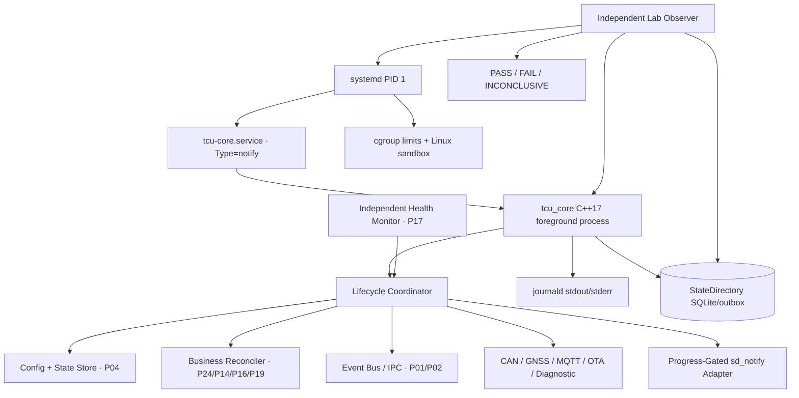
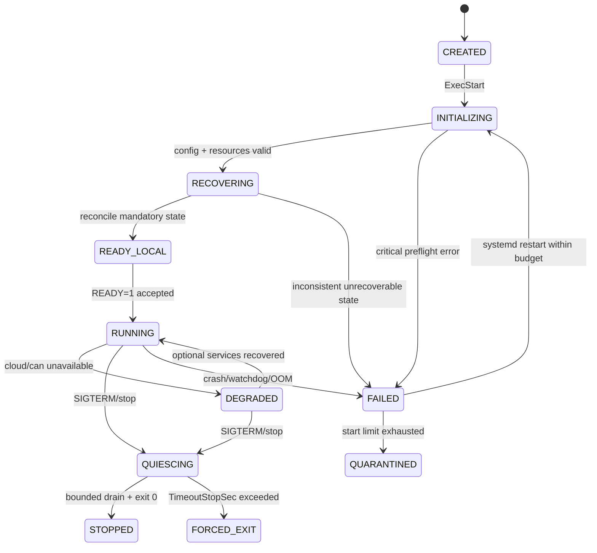
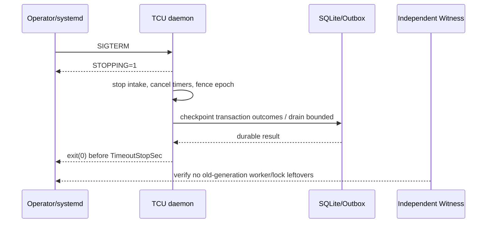
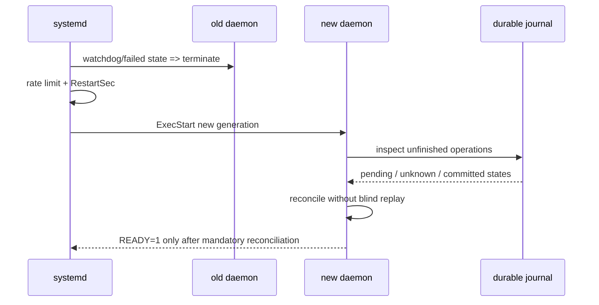
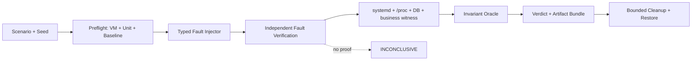

# Project 26 — Linux Daemon & systemd Service
## Virtual TCU Lab · System Design, Operational Behavior, Failure Engineering & Resilience Test Plan

| Trường | Giá trị |
|---|---|
| Project | P26 — Linux Daemon & systemd Service |
| Version | 1.0 — 2026-10-30 |
| Target | Middle C++ Developer · C++17 · Ubuntu/Debian VM với systemd chạy PID 1 |
| Phụ thuộc | P01 Event Bus; P02 IPC; P03 Scheduler; P04 Config/Logging; P10 Connectivity; P17 Health; P22 Power; P24 Recovery; P25 Stability |
| Deliverables | `tcu_core` daemon, `libtcu_lifecycle`, `tcu-core.service`, unit hardening profile, bootstrap script, test harness, evidence reports |
| Kiểm thử được thiết kế | **300 What-if** / 30 nhóm; **50 multi-fault campaigns**; **36 Jira tickets** |
| Mức cam kết | **Design + kế hoạch kiểm thử**; không phải implementation hay báo cáo đã PASS |

> **Chỉ thực hành trong VM hoặc máy lab do bạn sở hữu.** Các ví dụ `systemctl kill`, phá cấu hình service, giới hạn memory, SIGSTOP và fault injection có thể làm gián đoạn dịch vụ. Tuyệt đối không chạy trên TCU xe thật hay host dùng chung. Các giá trị timeout/limit là thông số LAB, không phải ngưỡng OEM hay chứng nhận an toàn.

## Mục lục

1. Mục tiêu, phạm vi, giả định, non-goals
2. Requirements, SLIs, invariants và acceptance gates
3. Kiến trúc System Design và phân chia ownership
4. Linux/systemd service model và dependency ordering
5. Lifecycle state machine, startup/READY protocol
6. Watchdog và business-progress health gating
7. Shutdown, restart, crash, reboot và reconciliation
8. C++17 interfaces, thread model, lifetime
9. Unit file tham khảo, packaging và sandboxing
10. Logging, observability, metrics và evidence
11. Config reload, file/state directories, migrations
12. Fault model, safety, isolation, injection/oracle
13. Behavioral contracts Given/When/Then
14. **300 What-if test cases** (30 nhóm, trigger/expected/evidence)
15. **50 multi-fault campaigns** (timeline/invariants)
16. Automated testing methodology và coverage
17. Ubuntu VM runbook, build, verify, demo
18. SQLite evidence/journal schema
19. Jira implementation backlog — 36 tickets / 6 sprint
20. Risk register, release gate, dependencies và references

---

## 1. Mục tiêu, phạm vi, giả định và non-goals

**Vấn đề:** Một chương trình TCU C++ chạy được trong terminal chưa phải service nhúng đủ tin cậy. Nó cần khởi động dưới init manager, xác định đúng readiness, được supervision khi treo/crash, không tạo restart storm, dừng được trong thời hạn, giữ dữ liệu bền vững sau restart và bị giới hạn đặc quyền/tài nguyên. P26 biến các module Virtual TCU thành **Linux-native supervised daemon** và tạo thí nghiệm để chứng minh từng behavior.

**Mục tiêu:**
- Xây một executable `tcu_core` chạy **foreground**, không daemonize/double-fork khi dùng `Type=notify`.
- Cung cấp `tcu-core.service` do systemd điều phối. Boot/start/restart/stop/reload hoạt động nhất quán.
- Chỉ phát `READY=1` khi local initialization và kiểm tra các dependency **bắt buộc** xong; Cloud offline là trạng thái DEGRADED, không nhất thiết chặn daemon lên READY.
- Bảo đảm watchdog ping dựa trên **business progress có chứng cứ** và health check; không phát ping chỉ nhờ heartbeat thread.
- Phân tách systemd **process supervision** với P24 **business recovery policy** và P17 **health monitoring**; tránh hai tác nhân restart cùng lúc.
- Chuẩn hóa logging có structured fields, journal, process generation và evidence chạy lab.
- Triển khai unit sandbox theo nguyên tắc tối thiểu quyền; giới hạn CPU/RAM/threads/FD thích hợp, kiểm thử cả khi hạn mức cắt đứt đường đi hợp lệ.
- Viết bộ test tái hiện lỗi có oracle độc lập: **PASS / FAIL / INCONCLUSIVE / SKIPPED / ABORTED**.

**Giả định:** Target ban đầu là systemd version đủ hỗ trợ Type=notify, WatchdogSec, StateDirectory và RuntimeDirectory (kiểm tra tại runtime); sự khác nhau giữa distro/version phải được ghi vào run manifest. VM có systemd làm PID 1 (WSL/containers chỉ được dùng nếu init và quyền cgroup hỗ trợ thực tế). Các API CAN/MQTT/SQLite có thể dùng fake trước khi P05–P24 đã hoàn thiện.

**Non-goals:** Không xây Linux init system; không tự viết PID 1; không giả định `systemd-analyze security` là chứng nhận bảo mật; không cam kết hardware watchdog, bootloader, deep sleep, ASIL, ISO 26262, ISO/SAE 21434 compliance; không tự động sửa mọi lỗi dữ liệu nghiệp vụ sau crash.

## 2. Requirements, SLI và các invariants

| ID | Requirement | Acceptance / kiểm chứng |
|---|---|---|
| FR-01 | Cài và enable/disable unit có version | `systemd-analyze verify`; start/stop/status có evidence |
| FR-02 | Foreground service chính xác với Type=notify | systemd thấy READY sau local prerequisites; MainPID đúng |
| FR-03 | Watchdog liveness + progress | deliberate main-loop hang bị phát hiện dù heartbeat worker còn sống |
| FR-04 | Crash auto-restart nhưng có budget | crash có kiểm soát restart; storm bị chặn bằng StartLimit* |
| FR-05 | Graceful shutdown, drain và deadline | trong timeout, không mất trạng thái đã cam kết; SIGKILL case được reconcile |
| FR-06 | Dependency ordering không tạo boot hang | Cloud offline => local service vẫn READY/DEGRADED theo policy |
| FR-07 | Journal & recover ownership | từng generation đối soát SQLite/outbox/remote command/OTA trước khi READY nghiệp vụ |
| FR-08 | Service identity và permission | user không root; chỉ ghi StateDirectory/RuntimeDirectory cần thiết |
| FR-09 | Observe process generations | InvocationID/MainPID/boot-id/generation tương quan được với business events |
| FR-10 | Config reload an toàn | snapshot atomic; invalid reload không làm mất cấu hình cũ |
| FR-11 | Fault lab không chạm host ngoài scope | allowlisted VM/unit name, cleanup receipts và environmental guard |
| FR-12 | Chứng cứ bền vững | PASS chỉ khi fault xảy ra đúng và oracle đủ quan sát |

### 2.1 Invariants cần giữ

- **INV-01** `systemd active` **không đủ** để kết luận business HEALTHY; health và progress phải được xác minh riêng.
- **INV-02** `READY=1` không phát trước khi binding IPC, open required stores, config validation và local recovery hoàn thành.
- **INV-03** Không gửi `WATCHDOG=1` khi main execution path mất tiến triển ngoài ngưỡng, dù daemon còn process/heartbeat thread.
- **INV-04** Mỗi process generation có generation ID riêng; callbacks/ACK từ generation trước không làm thay đổi state mới.
- **INV-05** `After=` là ràng buộc thứ tự, không phải dependency pull-in; `Wants=` không bảo đảm dependency thành công.
- **INV-06** `network-online.target` chỉ tham gia khởi tạo, **không** xác nhận Internet/Cloud luôn online.
- **INV-07** Một lệnh đã rời boundary sang BCM/OTA có thể có outcome UNKNOWN sau crash: không retry tùy tiện.
- **INV-08** Shutdown có deadline; không được kéo dài vô hạn bằng `EXTEND_TIMEOUT_USEC` hoặc chờ callback không kết thúc.
- **INV-09** Không làm hỏng SQLite journal/outbox chỉ vì forced kill; nếu outcome không biết thì reconcile.
- **INV-10** Bất kỳ hành động privileged, secret, logging hoặc recovery phải tuân policy sandbox và audit.
- **INV-11** Resource usage và các queue bị bound; không có không gian lưu log vô hạn.
- **INV-12** Test case không inject được lỗi, thiếu evidence, hoặc kiểm nhầm PID/unit => **INCONCLUSIVE**, không phải PASS.

### 2.2 Demo SLO (KHÔNG phải yêu cầu OEM)

| SLI | Tham số lab | Oracle |
|---|---|---|
| Local readiness | <= 10 s trên VM khỏe (không gồm slow storage fault) | monotonic từ start job đến `READY=1` + independent probe |
| Graceful shutdown | <= 15 s | `systemctl stop` hoàn tất; không outstanding queued critical work |
| Watchdog detect | `WatchdogSec=20s`, ping interval mục tiêu 5–8 s | journal result + process generation + progress witness |
| Crash restart | 1–10 s khi còn budget | `NRestarts`, InvocationID và readiness recovery |
| False healthy | 0 trong known-hang fault scenarios | independent progress observer |
| Unauthorized FS writes | 0 thành công | denied syscalls + sandbox audit |
| Lost committed outbox events | 0 do supervision | đối chiếu SQLite event_id và backend oracle |
| Crash loop runaway | 0 | StartLimit policy / quarantine & operator action |
| Missing evidence | 0 cho các bước quan trọng được đánh PASS | injection proof + service result + DB/witness |

---

## 3. System Architecture, trust boundaries và ownership



**Responsibility split:**

| Chủ thể | Quyền & trách nhiệm | Tuyệt đối không làm |
|---|---|---|
| systemd | Spawn/stop/cgroup/watchdog trigger/restart throttling, unit dependencies | Phán quyết command đã thực thi hoặc backend đã commit |
| `LifecycleCoordinator` | Startup/shutdown ordering, READY/STOPPING/status, service generation | Phát READY khi stores/recovery còn chưa hoàn tất |
| `ProgressGate` | Theo dõi tiến triển business đa nguồn; quyết định ping watchdog | Ping định kỳ vô điều kiện từ thread riêng |
| P24 Recovery Coordinator | Policy và reconciliation nghiệp vụ, quarantine signal | Restart song song với systemd không có fencing |
| P17 Monitor | Independent health assessment, alerts | Kết luận OK chỉ từ `systemctl is-active` |
| P22 Power Manager | Quiesce/sleep/wake policy | Bỏ qua timer của sleep và tưởng watchdog fault là crash |
| Test Harness | Controlled fault + external observation + verdict | Đánh PASS dựa vào duy nhất log của DUT |

### 3.1 Các ranh giới đáng tin

1. `unit file` và filesystem permissions là privileged configuration; cập nhật unit phải qua deployment có kiểm toán, **không** nhận từ MQTT command.
2. `NOTIFY_SOCKET` và `sd_notify` được systemd gắn với process được cho phép theo `NotifyAccess`; không tin một helper không được phân quyền.
3. IPC/MQTT có thể không đáng tin; khôi phục tiến trình không được tự động công nhận message hay lệnh cũ.
4. Journald logs không là source-of-truth bền vững cho business transaction; SQLite/outbox và independent witness mới xác nhận durable business events.

## 4. Service model và dependency ordering

- Chọn `Type=notify`, `ExecStart` chạy foreground, `NotifyAccess=main` mặc định trong profile này; cần dùng `libsystemd` `sd_notify()` từ main process.
- Không đặt `After=network-online.target` một cách phản xạ; Connectivity Manager P10 tự kết nối và phục hồi. Nếu một service thực sự *không thể khởi tạo* nếu thiếu cấu hình mạng, khai báo dependency với lý do cụ thể và chấp nhận giới hạn một-lần của target.
- `After=foo.service` **không kéo** `foo.service` lên. `Wants=foo.service` **không bắt** foo thành công. `Requires=` mạnh hơn nhưng cũng phải kết hợp ordering nếu muốn ngăn start khi dependency fail; dependency graph cần test.
- `systemd` rate-limit restart bằng `StartLimitIntervalSec=` và `StartLimitBurst=`; tránh in-app restart process để không chồng policy P24.
- `ExecStartPre` chỉ thực hiện preflight ngắn với thời hạn; không chạy migration phá hủy hoặc chuỗi lệnh shell không kiểm soát.
- Chấp nhận degraded mode hợp lệ: thiếu Cloud => service còn hoạt động với offline outbox; thiếu mandatory local journal => startup FAIL, không READY.

```mermaid
sequenceDiagram
    participant PID as systemd
    participant APP as tcu_core
    participant DB as Local Journal
    participant IPC as IPC/Gateway
    participant P as Progress Oracle
    PID->>APP: ExecStart (systemd tracks MAINPID)
    APP->>APP: parse + validate configuration
    APP->>DB: open, schema check, reconcile committed work
    DB-->>APP: recovery outcome
    APP->>IPC: bind mandatory local services
    IPC-->>APP: ready
    APP->>P: init health and progress witnesses
    P-->>APP: local ready
    APP-->>PID: READY=1; STATUS=Local ready / Cloud degraded
    loop healthy progress
      P->>APP: verify business progress / bounded idle proof
      APP-->>PID: WATCHDOG=1 (only if healthy)
    end
```

**Idle proof:** Trong trạng thái không có workload, health không nhất thiết yêu cầu counter business tăng; cần một `event-loop iteration timestamp` / probe command được thực hiện thành công *trên chính execution path* và proof bounded latency. Không coi timer ping ở thread độc lập là bằng chứng main loop hoạt động.

## 5. Lifecycle state machine và API contract



- `READY_LOCAL` ≠ `CLOUD_READY`: có thể báo tình trạng DEGRADED qua STATUS/health endpoint nhưng không báo thất bại startup nếu Cloud là optional.
- `RELOADING` chỉ áp dụng khi đã chọn protocol hỗ trợ (`Type=notify-reload` ở systemd phù hợp), không dùng lẫn lộn. MVP dùng API reload từ application hoặc restart có kiểm soát; **không** hứa `ExecReload` tồn tại nếu chưa implement.
- `STOPPING=1` phát ngay khi bắt đầu shutdown; sau đó ngừng nhận job mới, chặn callbacks generation cũ, snapshot state, drain có hạn và trả exit code rõ ràng.
- Long timeout extension (nếu cần) chỉ khi **đang thực sự tiến triển**, phải gửi đúng chu kỳ và có maximum outer deadline của ứng dụng.

### 5.1 C++17 API Design

```cpp
#pragma once
#include <chrono>
#include <cstdint>
#include <memory>
#include <string>

namespace tcu::lifecycle {
enum class State {
    Created, Initializing, Recovering, ReadyLocal,
    Running, Degraded, Quiescing, Stopped, Failed
};
enum class Readiness { NotReady, LocalReady, Degraded, Healthy };
enum class ShutdownCause { OperatorStop, SystemShutdown, Error, WatchdogRisk };
struct Generation { std::string boot_id; std::string invocation_id; uint64_t epoch; };
struct ProgressSample {
    uint64_t io_loop_seq{0};
    uint64_t critical_jobs_finished{0};
    std::chrono::steady_clock::time_point last_main_loop_progress;
    bool critical_worker_responsive{false};
};
struct StartupResult { bool ok; Readiness readiness; std::string diagnostic; };
struct StopResult { bool drained; bool state_checkpointed; uint64_t pending_count; };
class ISystemdNotifier {
public:
    virtual ~ISystemdNotifier() = default;
    virtual bool ready(const std::string& status) = 0;
    virtual bool stopping() = 0;
    virtual bool watchdog() = 0;
    virtual bool status(const std::string& msg) = 0;
};
class IProgressOracle {
public:
    virtual ~IProgressOracle() = default;
    virtual bool healthyForWatchdog(const ProgressSample& sample,
                                    std::chrono::steady_clock::time_point now) = 0;
};
class ILifecycleService {
public:
    virtual ~ILifecycleService() = default;
    virtual StartupResult start() = 0;
    virtual StopResult stop(ShutdownCause cause,
                            std::chrono::steady_clock::time_point deadline) = 0;
    virtual State state() const = 0;
};
} // namespace tcu::lifecycle
```

### 5.2 Vòng lặp notify — pseudocode, không phải chương trình hoàn chỉnh

```cpp
#include <systemd/sd-daemon.h>
// CMake link library: systemd via pkg-config libsystemd
// Chỉ dùng khi systemd thực sự cấp NOTIFY_SOCKET và sd_watchdog_enabled > 0.
uint64_t watchdog_usec = 0;
const int enabled = sd_watchdog_enabled(0, &watchdog_usec);
// ... validate config, recover journal, open mandatory IPC ...
sd_notify(0, "READY=1
STATUS=Local ready; cloud optional");
// heartbeat interval <= WATCHDOG_USEC/2; orchestration bằng steady_clock.
// Only if oracle proves required execution paths progressed / responsive:
if (enabled > 0 && progress_oracle.healthyForWatchdog(sample, now)) {
    sd_notify(0, "WATCHDOG=1");
}
// On SIGTERM handled outside async signal-handler unsafe code:
sd_notify(0, "STOPPING=1
STATUS=Draining pending work");
// ... bounded drain/checkpoint ... then return from main().
```

**Không gọi các C++ methods/locks trong async signal handler.** Dùng `signalfd` với signal mask thích hợp, hoặc self-pipe/eventfd + event-loop polling; RAII dừng join threads và ownership đúng thứ tự. `std::steady_clock` cho timeout trong một boot; persist boot ID nếu dữ liệu checkpoint vượt reboot.

## 6. Watchdog và business progress

- Watchdog chỉ nên gửi `WATCHDOG=1` khi main event loop, critical worker, IPC local probe và queue progress *thỏa tình huống hiện hành*. Idle có health probe độc lập, busy có deadline và acknowledgement.
- `sd_watchdog_enabled()` để nhận khoảng chu kỳ; không tự giả định manager bật watchdog. `sd_notify` có thể trả failure khi không có socket; log có kiểm soát, không dùng nó làm timer độc quyền.
- Vấn đề time-of-check-to-time-of-use: progress đi qua generation, callback từ old generation phải reject. Nếu đang shutdown, dừng watchdog ping và hoàn tất trong `TimeoutStopSec`.
- Phân biệt **watchdog timeout** (systemd đánh failed) và **application error** (`exit nonzero`): report `Result`, `ExecMainCode`, `ExecMainStatus`, InvocationID; không coi signal do test inject là bug bất ngờ.
- Khi P22 power manager đang chuẩn bị ngủ, cần hợp đồng riêng về suspend vs watchdog; systemd watchdog không thay thế power backend. Bài VM chỉ mô phỏng suspend, không chứng minh wake from deep sleep.

## 7. Crash, graceful stop, restart và reconciliation





- **Restart source-of-truth:** systemd thực hiện restart; P24 ban hành chính sách/quarantine nhưng không kill/start song song trừ khi có single-writer orchestration rõ ràng.
- **Command P16/OTA P19:** trước recovery, truy vấn durable journal/BCM simulator hoặc virtual boot state; nếu mất ACK sau effect, ghi `UNKNOWN`, không double execute.
- **Stop deadline:** Stop requests phải trả kết quả trong deadline và log unfinished work đã checkpoint. Nếu bị SIGKILL, restart phải đọc journal để reconcile.
- **Stop vs Restart:** thao tác operator stop không được lén tự start vì app logic; hành vi Restart=, SuccessExitStatus= và PreventExitStatus phải được thử với từng exit mode.

## 8. Threads, ownership, metrics và data model

Mỗi process có `ServiceGeneration { boot_id, invocation_id, monotonic_start, uuid }`. Services nhận `GenerationToken`, cancellation token và `StopDeadline`. Event listener RAII giải đăng ký trước khi destroy target; I/O thread chỉ thao tác qua `weak_ptr`/owner-safe transport; timer callbacks được fence theo generation.

**Counters:** `ready_sent_total`, `watchdog_sent_total`, `watchdog_suppressed_progress_total`, `health_probe_fail_total`, `stop_requested_total`, `stop_timeout_total`, `recovery_completed_total`, `recovery_unknown_total`, `restart_observed_total`, `config_generation`, `journal_errors_total` và các gauge CPU/memory/FD/queue. Chỉ dùng counter để gợi ý, verdict cần external witness.

**Quan sát độc lập:** Query `systemctl show` (Result/ActiveState/SubState/InvocationID/NRestarts/ExecMainStatus), `journalctl -u`, `/proc/$PID`, database SQLite read-only, mock cloud/BCM, và evidence time windows. PID riêng lẻ không phải identity đáng tin do PID reuse; phối hợp boot ID + PID starttime + InvocationID.

## 9. Unit file, packaging và sandboxing

### 9.1 `tcu-core.service` mẫu dành cho VM Lab

```ini
[Unit]
Description=Virtual TCU Core Service (LAB ONLY)
Documentation=https://www.freedesktop.org/software/systemd/man/latest/systemd.service.html
After=local-fs.target
StartLimitIntervalSec=120s
StartLimitBurst=5

[Service]
Type=notify
NotifyAccess=main
User=tcu-lab
Group=tcu-lab
ExecStart=/opt/tcu-lab/bin/tcu-core --config /etc/tcu-lab/config.json
WorkingDirectory=/var/lib/tcu-lab
Restart=on-failure
RestartSec=2s
TimeoutStartSec=30s
TimeoutStopSec=15s
WatchdogSec=20s
KillMode=control-group
StateDirectory=tcu-lab
StateDirectoryMode=0750
RuntimeDirectory=tcu-lab
RuntimeDirectoryMode=0750
UMask=0027
NoNewPrivileges=yes
ProtectSystem=strict
ProtectHome=yes
PrivateTmp=yes
StandardOutput=journal
StandardError=journal
SyslogIdentifier=tcu-core
TasksMax=128
LimitNOFILE=2048
MemoryMax=256M

[Install]
WantedBy=multi-user.target
```

**Điều kiện tiên quyết:** tài khoản `tcu-lab` đã được provision bằng `sysusers.d` hoặc công cụ admin lab, `/etc/tcu-lab/config.json` tồn tại và readable; binary có `sd_notify()` thật và có đủ quyền đọc config/đụng IPC/network nếu cần. Nếu cần AF_CAN/AF_UNIX/network, phải kiểm thử firewall/capabilities và khai báo một profile có đặc quyền tối thiểu; không bật `RestrictAddressFamilies` mù. `MemoryMax`/`TasksMax`/`LimitNOFILE` là các giá trị thử nghiệm cần điều chỉnh theo resource baseline.

Không thêm `ExecStop=/bin/kill ...` không cần thiết: mặc định systemd SIGTERM main process sau khi stop job, ứng dụng tự drain. `KillMode=control-group` giúp không để lại child processes, nhưng cần kiểm thử những child được phép tồn tại hay không (khuyên không fork unmanaged child). `ProtectSystem=strict` + `StateDirectory` tạo ngoại lệ ghi hợp lệ, cần thử trên filesystem và distro mục tiêu.

### 9.2 `sysusers.d/tcu-lab.conf` (đề xuất)

```text
u tcu-lab - "Virtual TCU Lab service user" /var/lib/tcu-lab /usr/sbin/nologin
```

### 9.3 CMake liên kết libsystemd (đề xuất)

```cmake
cmake_minimum_required(VERSION 3.16)
project(tcu_lifecycle LANGUAGES CXX)
set(CMAKE_CXX_STANDARD 17)
find_package(PkgConfig REQUIRED)
pkg_check_modules(LIBSYSTEMD REQUIRED IMPORTED_TARGET libsystemd)
add_library(tcu_lifecycle STATIC src/lifecycle.cpp src/systemd_notifier.cpp)
target_include_directories(tcu_lifecycle PUBLIC include)
target_link_libraries(tcu_lifecycle PRIVATE PkgConfig::LIBSYSTEMD)
add_executable(tcu-core apps/tcu_main.cpp)
target_link_libraries(tcu-core PRIVATE tcu_lifecycle)
```

### 9.4 Sandboxing nên triển khai theo tầng

1. `User`/`Group`, `NoNewPrivileges`, `StateDirectory`, `RuntimeDirectory`, `UMask`, `ProtectSystem`, `ProtectHome`.
2. `CapabilityBoundingSet`, `AmbientCapabilities`, `PrivateDevices`, `ProtectKernelTunables`, `ProtectControlGroups`, `RestrictAddressFamilies` — **chỉ sau khi** biết chính xác CAN/GNSS/modem/IPC paths.
3. `SystemCallFilter` và `RestrictNamespaces` chỉ áp dụng sau profiling đúng workload và fuzz negative-controls; một filter chặn syscall hợp lệ dễ gây failure ngẫu nhiên.
4. `systemd-analyze security` là **ước tính exposure**, không xác nhận đúng nghiệp vụ hay khả năng chống tấn công.

### 9.5 Journald

Ghi log ra stdout/stderr (hoặc libsystemd journal) với `service_generation`, correlation ID, version, state và reason codes. Không ghi keys/tokens/PII. journal rate limits, storage quota và vacuum có thể loại log; giữ journal nghiệp vụ SQLite độc lập. Rate limit overflow phải observable từ bên ngoài nếu không đủ log để chẩn đoán.

## 10. Evidence / verdict / operational observability

Mỗi test ghi: test ID, fault inject command/action, allowlist scope, precondition, service manager version, unit checksum, tool versions, before/after `systemctl show`, exit reason, NRestarts, InvocationID, boot_id, process starttime, log cursor, DB journal status và external probe state.

| Verdict | Quy tắc |
|---|---|
| PASS | Fault chắc chắn đã xảy ra và cả supervisor + business invariant được chứng minh qua evidence độc lập |
| FAIL | Có evidence cụ thể về violation (false READY, double execution, unbounded growth, security bypass, v.v.) |
| INCONCLUSIVE | Fault không inject được, thiếu quyền, không quan sát đầy đủ, nhầm PID/unit, mismatch version hoặc host nhiễu |
| SKIPPED | Capability thực sự không có và được khai báo trước khi run |
| ABORTED | Operator/harness dừng, cleanup và audit đầy đủ; không coi là PASS |

**Điều kiện kiểm soát test:** mọi destructive action cần `lab_scope_token` và unit prefix `tcu-lab-*`/`tcu-core.service` trong VM allowlist; cleanup có receipt, verify systemd unit returned normal configuration; không thay host networking ngoài namespace.

## 11. Reload/config/boot/recovery consistency

- Mặc định `SIGHUP` không tự nhiên tương đương config reload. Nếu chọn hỗ trợ: signalfd/event loop bắt sự kiện, parse config mới hoàn chỉnh, validate, publish immutable snapshot hoặc rollback; không ứng dụng một nửa.
- Reload service unit khác ứng dụng reload: thay unit file cần `systemctl daemon-reload`; `daemon-reload` **không** restart process hoặc tự reload data config. Test phải phân biệt.
- Update binary in-place khi process còn chạy có semantics phụ thuộc deployment; dùng versioned binaries + atomic symlink/swap có quản lý và test rollback, không xóa file đang dùng dựa vào đoán.
- Process restart != host reboot; invalid monotonic timestamps phải được gắn boot generation. Filesystem corruption/permissions/migrations có thể khiến startup FAIL trước READY; không tự xóa DB để “tự sửa”.
- Cấu hình hệ thống sau reboot phải tương thích StateDirectory ownership, app schema và previous generation data. Không rely on journald to restore exact business data.

---

## 12. Fault model và test harness an toàn

**Fault injector** cung cấp các action typed: `KillMainProcess`, `StopMainProcess`, `ChangeUnitDirectiveInTestOverlay`, `CorruptLabConfig`, `DelayLocalDependency`, `MakeTestVolumeReadOnly`, `FillTestVolume`, `DisconnectLabIPC`, `ThrottleLabCgroup`, `RestartMockCloud`, `RebootDisposableVM`. Mọi action **phải** bind `run_id`, `vm_id`, `unit_allowlist`, `precondition`, `cleanup`, `injection_receipt` và `verification_probe`.



**Policy:** Cấm test script đi theo user input tới `bash -c` làm root; không thao tác `/etc/systemd/system` production. Unit mutation dùng snapshot unit dưới VM lab và rollback bằng checksum. Mỗi test phải xuất `start_state`, `fault_verified`, `end_state`, `systemd_result`, `business_result`, `oracle_evidence`, `cleanup_verified`.

## 13. Behavioral contracts — Given/When/Then

| ID | Given | When | Then |
|---|---|---|---|
| BC-01 | Service chưa khởi tạo mandatory store | App định phát READY | Bị chặn; systemd chưa active-ready |
| BC-02 | Cloud offline, SQLite local khỏe | Boot | Local READY, Cloud DEGRADED; outbox nhận dữ liệu |
| BC-03 | Main worker bị deadlock | Heartbeat thread còn hoạt động | Progress gate không ping; watchdog restart theo budget |
| BC-04 | Retry budget cạn | Crash tiếp | systemd rate limiting; alert không auto-reset |
| BC-05 | SIGTERM đang drain | New command đến | Reject/defer, không thực thi ngoài lifecycle |
| BC-06 | Command dispatch đã qua BCM | Service crash, ACK mất | Outcome UNKNOWN, reconcile, không double execute |
| BC-07 | Config mới invalid | Reload | Old immutable snapshot giữ nguyên |
| BC-08 | Unit file đổi | daemon-reload mà không restart | Process binary không đổi; deployment pending |
| BC-09 | MainPID reuse | Fault injector định kill PID cũ | Refuse stale identity |
| BC-10 | Journald bị rate-limit | Critical event được commit | Business SQLite vẫn đúng, log loss observable |
| BC-11 | StateDirectory không ghi được | Startup | FAIL/degraded theo mandatory policy, không READY |
| BC-12 | RuntimeDirectory bị xóa lúc stop | Start lần sau | Recreate socket và owner hợp lệ |
| BC-13 | Sandbox chặn AF_CAN | CAN là mandatory | Startup fails rõ; không tắt toàn bộ sandbox |
| BC-14 | Services đang sleep theo P22 | Watchdog probe | Không kết luận hardware correctness dựa vào VM suspend |
| BC-15 | OTA trial boot | Service READY nhưng chưa có progress | P19 health gate không mark-good |
| BC-16 | Harness không chứng minh inject | Other logs nhìn bình thường | INCONCLUSIVE |
| BC-17 | stop timeout | systemd SIGKILL | Business journal recover trên next generation |
| BC-18 | P24 và systemd cùng muốn restart | Recovery action triggered | Single process-restarter, no two restarts |
| BC-19 | Worker timeout và callback cũ đến | New generation active | Ignore stale callback |
| BC-20 | 7-day soak | Resource trends tăng | FAIL nếu vượt baseline-tolerance đã ký, kể cả crash được systemd che |

---

## 14. **What-if catalog: 300 cases, 30 failure domains**

**Đọc bảng:** cột *What if / Inject* là precondition + cách tạo điều kiện; *Expected* là behavior phải đạt; *Evidence* là nguồn kiểm chứng độc lập cần giữ lại. Các case ưu tiên P0 nếu liên quan data safety, false healthy, persistent corruption, authentication, crash-loop hoặc service boundary; P1 cho compatibility/observability/performance. P0/P1 có thể được điều chỉnh sau HARA/TARA của OEM (ngoài scope lab).

**Không có thuật toán nào liệt kê được mọi tổ hợp lỗi và thread interleaving.** Catalog là baseline có khả năng mở rộng bằng fuzzing, model checking, mutation tests và real-soak runs.

### 14.01 — Unit syntax, installation, deployment (`UNT`, 10 cases)

**Oracle độc lập:** unit checksum + systemd-analyze verify + show Loaded/FragmentPath.

| ID | What if / cách inject trong VM | Expected behavior / invariant | Evidence tối thiểu | Priority |
|---|---|---|---|---|
| `P26-UNT-01` | Unit thiếu [Service] ExecStart | verify phát hiện hoặc start fail rõ ràng, không có READY giả | unit checksum + systemd-analyze verify + show Loaded/FragmentPath + action receipt `P26-UNT-01` | P0 |
| `P26-UNT-02` | Unit dùng directive không hỗ trợ phiên bản systemd hiện tại | compatibility check từ chối profile hoặc ghi degradation được phê duyệt | unit checksum + systemd-analyze verify + show Loaded/FragmentPath + action receipt `P26-UNT-02` | P0 |
| `P26-UNT-03` | Binary ExecStart không tồn tại | startup FAILED; không chuyển active/ready | unit checksum + systemd-analyze verify + show Loaded/FragmentPath + action receipt `P26-UNT-03` | P0 |
| `P26-UNT-04` | Binary không có execute bit | manager báo permission error; không restart vô hạn ngoài budget | unit checksum + systemd-analyze verify + show Loaded/FragmentPath + action receipt `P26-UNT-04` | P0 |
| `P26-UNT-05` | Unit file sửa nhưng không daemon-reload | runner phát hiện loaded definition còn cũ, không báo deploy mới thành công | unit checksum + systemd-analyze verify + show Loaded/FragmentPath + action receipt `P26-UNT-05` | P0 |
| `P26-UNT-06` | daemon-reload được gọi nhưng binary chưa đổi | không tuyên bố binary code đã được reload | unit checksum + systemd-analyze verify + show Loaded/FragmentPath + action receipt `P26-UNT-06` | P0 |
| `P26-UNT-07` | Enable symlink bị hỏng | boot check FAIL; remediation trên VM không lặng lẽ assume enabled | unit checksum + systemd-analyze verify + show Loaded/FragmentPath + action receipt `P26-UNT-07` | P0 |
| `P26-UNT-08` | Unit masked khi deploy | deployment từ chối enable/start và giữ trạng thái cũ có audit | unit checksum + systemd-analyze verify + show Loaded/FragmentPath + action receipt `P26-UNT-08` | P1 |
| `P26-UNT-09` | Cùng tên unit xuất hiện ở /etc và /usr/lib | phát hiện FragmentPath thực dùng, tránh kiểm file sai | unit checksum + systemd-analyze verify + show Loaded/FragmentPath + action receipt `P26-UNT-09` | P1 |
| `P26-UNT-10` | Unit cài đặt chưa đầy đủ rồi process bị restart | detect checksum mismatch, không mark deployment successful | unit checksum + systemd-analyze verify + show Loaded/FragmentPath + action receipt `P26-UNT-10` | P1 |

### 14.02 — Boot dependencies, ordering, targets (`ORD`, 10 cases)

**Oracle độc lập:** systemd-analyze critical-chain + list-dependencies + boot timeline.

| ID | What if / cách inject trong VM | Expected behavior / invariant | Evidence tối thiểu | Priority |
|---|---|---|---|---|
| `P26-ORD-01` | Chỉ có After=local-helper.service nhưng helper chưa enabled | helper không được kéo lên; P26 xử lý graceful theo policy | systemd-analyze critical-chain + list-dependencies + boot timeline + action receipt `P26-ORD-01` | P0 |
| `P26-ORD-02` | Chỉ có Wants=local-helper.service mà bỏ After= | readiness gate không assume helper đã sẵn sàng | systemd-analyze critical-chain + list-dependencies + boot timeline + action receipt `P26-ORD-02` | P0 |
| `P26-ORD-03` | Requires=mandatory-db.service và After= khi DB fail | daemon không READY, lỗi dependency hiển thị | systemd-analyze critical-chain + list-dependencies + boot timeline + action receipt `P26-ORD-03` | P0 |
| `P26-ORD-04` | Wants=optional-logger.service lỗi | TCU vẫn startup nếu log không mandatory, có DEGRADED evidence | systemd-analyze critical-chain + list-dependencies + boot timeline + action receipt `P26-ORD-04` | P0 |
| `P26-ORD-05` | Hai service có After= tạo vòng lặp | systemd graph check phát hiện, boot không silently skip mandatory unit | systemd-analyze critical-chain + list-dependencies + boot timeline + action receipt `P26-ORD-05` | P0 |
| `P26-ORD-06` | Local fs mount chậm 40s | start timeout có phân loại, không hứa READY khi data store chưa mounted | systemd-analyze critical-chain + list-dependencies + boot timeline + action receipt `P26-ORD-06` | P0 |
| `P26-ORD-07` | Boot song song nhiều services dùng chung socket path | chỉ owner được bind; others fail/retry có budget | systemd-analyze critical-chain + list-dependencies + boot timeline + action receipt `P26-ORD-07` | P0 |
| `P26-ORD-08` | target is-active nhưng mandatory service không chạy | kiểm per-service readiness; không suy luận từ target | systemd-analyze critical-chain + list-dependencies + boot timeline + action receipt `P26-ORD-08` | P1 |
| `P26-ORD-09` | Unit được yêu cầu stop khi service khác vẫn After nó | stop ordering rõ ràng; drain không phụ thuộc mù | systemd-analyze critical-chain + list-dependencies + boot timeline + action receipt `P26-ORD-09` | P1 |
| `P26-ORD-10` | Dependency được restart ngay khi app đang RECOVERING | generation fencing, không publish READY sai | systemd-analyze critical-chain + list-dependencies + boot timeline + action receipt `P26-ORD-10` | P1 |

### 14.03 — Network ordering and optional Cloud readiness (`NET`, 10 cases)

**Oracle độc lập:** Connectivity P10 state + local ready timestamp + cloud probe.

| ID | What if / cách inject trong VM | Expected behavior / invariant | Evidence tối thiểu | Priority |
|---|---|---|---|---|
| `P26-NET-01` | network-online.target active nhưng DNS không resolve | local READY/degraded, không cloud-ready giả | Connectivity P10 state + local ready timestamp + cloud probe + action receipt `P26-NET-01` | P0 |
| `P26-NET-02` | network-online.target reached rồi mất interface | runtime P10 nhận mất kết nối, không dựa vào target | Connectivity P10 state + local ready timestamp + cloud probe + action receipt `P26-NET-02` | P0 |
| `P26-NET-03` | Không có Internet từ lúc boot | daemon local READY và offline outbox hoạt động | Connectivity P10 state + local ready timestamp + cloud probe + action receipt `P26-NET-03` | P0 |
| `P26-NET-04` | DHCP trả IP sau local READY | kết nối cloud hồi phục không cần restart process | Connectivity P10 state + local ready timestamp + cloud probe + action receipt `P26-NET-04` | P0 |
| `P26-NET-05` | IPv6 ready nhưng IPv4 route lỗi | network health theo bearer/endpoint, không tự kết luận toàn bộ online | Connectivity P10 state + local ready timestamp + cloud probe + action receipt `P26-NET-05` | P0 |
| `P26-NET-06` | Cloud TLS fail dù link online | local daemon DEGRADED; không báo Connected Cloud | Connectivity P10 state + local ready timestamp + cloud probe + action receipt `P26-NET-06` | P0 |
| `P26-NET-07` | `network.target` active nhưng không có địa chỉ IP | app không block startup mãi, retry có backoff | Connectivity P10 state + local ready timestamp + cloud probe + action receipt `P26-NET-07` | P0 |
| `P26-NET-08` | systemd-networkd chưa chạy nhưng daemon không cần network để mở journal | local operation vẫn lên | Connectivity P10 state + local ready timestamp + cloud probe + action receipt `P26-NET-08` | P1 |
| `P26-NET-09` | Modem reset ngay khi systemd đánh ready | service quản lý reconnect bằng state machine, không restart storm | Connectivity P10 state + local ready timestamp + cloud probe + action receipt `P26-NET-09` | P1 |
| `P26-NET-10` | Network flapping cùng restart counter gần limit | không biến network event thành process exit liên tục | Connectivity P10 state + local ready timestamp + cloud probe + action receipt `P26-NET-10` | P1 |

### 14.04 — READY protocol and readiness false positives (`RDY`, 10 cases)

**Oracle độc lập:** sd_notify trace + systemctl show ActiveState + local probe.

| ID | What if / cách inject trong VM | Expected behavior / invariant | Evidence tối thiểu | Priority |
|---|---|---|---|---|
| `P26-RDY-01` | `READY=1` phát trước DB integrity check | FAIL; startup gate phải ngăn | sd_notify trace + systemctl show ActiveState + local probe + action receipt `P26-RDY-01` | P0 |
| `P26-RDY-02` | `READY=1` phát khi IPC listener bind thất bại | FAIL; manager không nhận READY | sd_notify trace + systemctl show ActiveState + local probe + action receipt `P26-RDY-02` | P0 |
| `P26-RDY-03` | Startup hoàn thành nhưng không gửi READY | TimeoutStartSec làm FAIL, có diagnostic | sd_notify trace + systemctl show ActiveState + local probe + action receipt `P26-RDY-03` | P0 |
| `P26-RDY-04` | READY gửi từ short-lived child với NotifyAccess=main | không assume manager đã nhận; process chính gửi | sd_notify trace + systemctl show ActiveState + local probe + action receipt `P26-RDY-04` | P0 |
| `P26-RDY-05` | READY gửi lại liên tục từ app healthy | không chuyển state sai hoặc lạm dụng manager notifications | sd_notify trace + systemctl show ActiveState + local probe + action receipt `P26-RDY-05` | P0 |
| `P26-RDY-06` | READY thuộc process generation cũ đến sau restart | không công nhận làm READY generation mới | sd_notify trace + systemctl show ActiveState + local probe + action receipt `P26-RDY-06` | P0 |
| `P26-RDY-07` | Local ready nhưng cloud offline | STATUS nói DEGRADED thay vì báo toàn bộ HEALTHY | sd_notify trace + systemctl show ActiveState + local probe + action receipt `P26-RDY-07` | P0 |
| `P26-RDY-08` | Startup probe trả lỗi không ổn định do timeout | phân loại mandatory vs optional và deadline rõ | sd_notify trace + systemctl show ActiveState + local probe + action receipt `P26-RDY-08` | P0 |
| `P26-RDY-09` | Readiness command trả OK nhưng business event loop bị treo | independent progress check bác bỏ HEALTHY | sd_notify trace + systemctl show ActiveState + local probe + action receipt `P26-RDY-09` | P0 |
| `P26-RDY-10` | Một phần initialization bị rollback rồi callback cũ báo success | generation gate từ chối READY | sd_notify trace + systemctl show ActiveState + local probe + action receipt `P26-RDY-10` | P0 |

### 14.05 — Watchdog, progress proof, false heartbeat (`WDG`, 10 cases)

**Oracle độc lập:** watchdog result + business progress counters + independent loop probe.

| ID | What if / cách inject trong VM | Expected behavior / invariant | Evidence tối thiểu | Priority |
|---|---|---|---|---|
| `P26-WDG-01` | Heartbeat thread vẫn ping khi main loop deadlock | không phát WATCHDOG; systemd phát hiện timeout | watchdog result + business progress counters + independent loop probe + action receipt `P26-WDG-01` | P0 |
| `P26-WDG-02` | Worker critical bị block nhưng timer heartbeat vẫn chạy | progress gate suppress WATCHDOG | watchdog result + business progress counters + independent loop probe + action receipt `P26-WDG-02` | P0 |
| `P26-WDG-03` | Không có workload 5 phút và loop idle hợp lệ | synthetic in-loop probe chứng minh sức khỏe, không false crash | watchdog result + business progress counters + independent loop probe + action receipt `P26-WDG-03` | P0 |
| `P26-WDG-04` | Workload tăng 100 lần làm loop latency vượt ngưỡng | watchdog đánh fail hoặc degrade rõ, không ping khỏe giả | watchdog result + business progress counters + independent loop probe + action receipt `P26-WDG-04` | P0 |
| `P26-WDG-05` | WATCHDOG_USEC environment không tồn tại | adapter không gửi giả định watchdog active | watchdog result + business progress counters + independent loop probe + action receipt `P26-WDG-05` | P0 |
| `P26-WDG-06` | sd_notify trả lỗi hoặc socket không tồn tại | log bounded và monitor tình trạng, không spin | watchdog result + business progress counters + independent loop probe + action receipt `P26-WDG-06` | P0 |
| `P26-WDG-07` | WATCHDOG=1 bị gửi từ không đúng PID | test phân biệt manager nhận hay bỏ qua | watchdog result + business progress counters + independent loop probe + action receipt `P26-WDG-07` | P0 |
| `P26-WDG-08` | Event loop backlog tăng không ngừng dù counter tick vẫn tăng | progress oracle phát hiện throughput deficit | watchdog result + business progress counters + independent loop probe + action receipt `P26-WDG-08` | P0 |
| `P26-WDG-09` | Timeout watchdog đúng lúc shutdown bắt đầu | dừng ping, ưu tiên bounded stop và log outcome | watchdog result + business progress counters + independent loop probe + action receipt `P26-WDG-09` | P0 |
| `P26-WDG-10` | WatchdogSec thay đổi qua unit deployment nhưng app dùng interval cũ | app đọc lại enable info từ new generation | watchdog result + business progress counters + independent loop probe + action receipt `P26-WDG-10` | P0 |

### 14.06 — Exit codes and restart semantics (`RCE`, 10 cases)

**Oracle độc lập:** ExecMainCode/Status + Result + NRestarts + process generations.

| ID | What if / cách inject trong VM | Expected behavior / invariant | Evidence tối thiểu | Priority |
|---|---|---|---|---|
| `P26-RCE-01` | `exit(0)` do operator stop | không auto-restart bất ngờ | ExecMainCode/Status + Result + NRestarts + process generations + action receipt `P26-RCE-01` | P0 |
| `P26-RCE-02` | `exit(1)` do fatal config error | restart theo policy có budget; không clear config sai | ExecMainCode/Status + Result + NRestarts + process generations + action receipt `P26-RCE-02` | P0 |
| `P26-RCE-03` | SIGSEGV thử nghiệm làm process chết | systemd on-failure restart và lưu evidence crash | ExecMainCode/Status + Result + NRestarts + process generations + action receipt `P26-RCE-03` | P0 |
| `P26-RCE-04` | SIGKILL trực tiếp MainPID trong lab | manager ghi result và restart nếu policy cho phép | ExecMainCode/Status + Result + NRestarts + process generations + action receipt `P26-RCE-04` | P0 |
| `P26-RCE-05` | `systemctl restart` operator | generation mới, old pending callback không hoàn tất job mới | ExecMainCode/Status + Result + NRestarts + process generations + action receipt `P26-RCE-05` | P0 |
| `P26-RCE-06` | OOM kill process trong cgroup | classify OOM vs crash, không báo recovered trước journal recovery | ExecMainCode/Status + Result + NRestarts + process generations + action receipt `P26-RCE-06` | P0 |
| `P26-RCE-07` | Main process exit nhưng child còn sống | KillMode policy không để process orphan giữ lock/socket | ExecMainCode/Status + Result + NRestarts + process generations + action receipt `P26-RCE-07` | P0 |
| `P26-RCE-08` | Startup thất bại nhiều lần với exit code giống nhau | chạm StartLimit; không thoát limit bằng self-fork | ExecMainCode/Status + Result + NRestarts + process generations + action receipt `P26-RCE-08` | P1 |
| `P26-RCE-09` | Watchdog kill làm restart | cause có Result=watchdog hoặc tương ứng, không nhầm operator stop | ExecMainCode/Status + Result + NRestarts + process generations + action receipt `P26-RCE-09` | P1 |
| `P26-RCE-10` | Restart thành công nhưng command journal có outcome UNKNOWN | business recovery giữ UNKNOWN, không retry mù | ExecMainCode/Status + Result + NRestarts + process generations + action receipt `P26-RCE-10` | P1 |

### 14.07 — StartLimit, backoff, quarantine (`LIM`, 10 cases)

**Oracle độc lập:** NRestarts + Result=start-limit-hit + monotonic restart times.

| ID | What if / cách inject trong VM | Expected behavior / invariant | Evidence tối thiểu | Priority |
|---|---|---|---|---|
| `P26-LIM-01` | Crash 6 lần trong 120s khi StartLimitBurst=5 | stop retry trong cửa sổ, alert/quarantine | NRestarts + Result=start-limit-hit + monotonic restart times + action receipt `P26-LIM-01` | P0 |
| `P26-LIM-02` | Crash spaced ngoài cửa sổ | restart theo policy, không đếm nhầm tổng trọn đời | NRestarts + Result=start-limit-hit + monotonic restart times + action receipt `P26-LIM-02` | P0 |
| `P26-LIM-03` | Operator spam `systemctl start` khi bị rate limited | không auto reset limit để đánh PASS | NRestarts + Result=start-limit-hit + monotonic restart times + action receipt `P26-LIM-03` | P0 |
| `P26-LIM-04` | Unit bị reset-failed thủ công khi root cause chưa sửa | nhận biết manual intervention và tiếp tục risk | NRestarts + Result=start-limit-hit + monotonic restart times + action receipt `P26-LIM-04` | P0 |
| `P26-LIM-05` | 100 services restart cùng lúc | cgroup/concurrency budgets, không spawn quá tải host | NRestarts + Result=start-limit-hit + monotonic restart times + action receipt `P26-LIM-05` | P0 |
| `P26-LIM-06` | App gọi tự restart riêng trong khi systemd restart | single-owner rule phát hiện double restart | NRestarts + Result=start-limit-hit + monotonic restart times + action receipt `P26-LIM-06` | P0 |
| `P26-LIM-07` | Backoff policy P24 và RestartSec xung đột | chọn systemd làm process restarter, P24 là adviser | NRestarts + Result=start-limit-hit + monotonic restart times + action receipt `P26-LIM-07` | P0 |
| `P26-LIM-08` | `Restart=always` vô tình thêm vào unit | verify policy từ chối profile nếu stop semantics sai | NRestarts + Result=start-limit-hit + monotonic restart times + action receipt `P26-LIM-08` | P1 |
| `P26-LIM-09` | `RestartPreventExitStatus` trùng với lỗi recoverable | kiểm test-matrix trước deploy | NRestarts + Result=start-limit-hit + monotonic restart times + action receipt `P26-LIM-09` | P1 |
| `P26-LIM-10` | Failed/quarantined unit vẫn được dashboard hiển thị Healthy | độc lập status oracle xác nhận thất bại | NRestarts + Result=start-limit-hit + monotonic restart times + action receipt `P26-LIM-10` | P1 |

### 14.08 — Graceful shutdown and bounded draining (`STP`, 10 cases)

**Oracle độc lập:** STOPPING timestamp + journal pending + SIGTERM/SIGKILL outcome.

| ID | What if / cách inject trong VM | Expected behavior / invariant | Evidence tối thiểu | Priority |
|---|---|---|---|---|
| `P26-STP-01` | SIGTERM khi input queue đang rỗng | dừng sạch và release all FDs trong deadline | STOPPING timestamp + journal pending + SIGTERM/SIGKILL outcome + action receipt `P26-STP-01` | P0 |
| `P26-STP-02` | SIGTERM khi 1000 telemetry còn queue | checkpoint/drop có lý do, không silent data loss | STOPPING timestamp + journal pending + SIGTERM/SIGKILL outcome + action receipt `P26-STP-02` | P0 |
| `P26-STP-03` | Shutdown trong lúc SQLite transaction đang commit | outcome bền vững hoặc pending reconcile, không nửa transaction | STOPPING timestamp + journal pending + SIGTERM/SIGKILL outcome + action receipt `P26-STP-03` | P0 |
| `P26-STP-04` | Client mới gửi IPC request sau STOPPING | reject có reason, không nhận thêm critical work | STOPPING timestamp + journal pending + SIGTERM/SIGKILL outcome + action receipt `P26-STP-04` | P0 |
| `P26-STP-05` | Worker block vô thời hạn khi stop | timeout, escalation và recovery journal giữ state | STOPPING timestamp + journal pending + SIGTERM/SIGKILL outcome + action receipt `P26-STP-05` | P0 |
| `P26-STP-06` | Shutdown đúng lúc MQTT PUBACK đến | không double completion/mark backend commit giả | STOPPING timestamp + journal pending + SIGTERM/SIGKILL outcome + action receipt `P26-STP-06` | P0 |
| `P26-STP-07` | Stop requested hai lần đồng thời | idempotent stop, không double free/join | STOPPING timestamp + journal pending + SIGTERM/SIGKILL outcome + action receipt `P26-STP-07` | P0 |
| `P26-STP-08` | SIGTERM tới trước READY | initialization cancel an toàn, không gửi READY muộn | STOPPING timestamp + journal pending + SIGTERM/SIGKILL outcome + action receipt `P26-STP-08` | P0 |
| `P26-STP-09` | SIGTERM + hot reload | không apply config snapshot sau STOPPING | STOPPING timestamp + journal pending + SIGTERM/SIGKILL outcome + action receipt `P26-STP-09` | P0 |
| `P26-STP-10` | System shutdown trước cloud flush | dừng theo timeout, outbox replay sau reboot | STOPPING timestamp + journal pending + SIGTERM/SIGKILL outcome + action receipt `P26-STP-10` | P0 |

### 14.09 — Forced stop, KillMode and process tree (`KIL`, 10 cases)

**Oracle độc lập:** cgroup.procs + process starttime + systemd kill log.

| ID | What if / cách inject trong VM | Expected behavior / invariant | Evidence tối thiểu | Priority |
|---|---|---|---|---|
| `P26-KIL-01` | Process cố ý bỏ qua SIGTERM | TimeoutStopSec dẫn đến forced kill, không treo stop job | cgroup.procs + process starttime + systemd kill log + action receipt `P26-KIL-01` | P0 |
| `P26-KIL-02` | Child process giữ unix socket sau parent chết | KillMode=control-group cleanup child | cgroup.procs + process starttime + systemd kill log + action receipt `P26-KIL-02` | P0 |
| `P26-KIL-03` | Child reparent/setsid ngoài quản lý unit | phát hiện leak và policy cấm unmanaged detached child | cgroup.procs + process starttime + systemd kill log + action receipt `P26-KIL-03` | P0 |
| `P26-KIL-04` | KillMode=process được cấu hình nhầm | lint cảnh báo khả năng child orphan | cgroup.procs + process starttime + systemd kill log + action receipt `P26-KIL-04` | P0 |
| `P26-KIL-05` | `TimeoutStopSec=0` nhầm | review gate chặn unit không có cơ hội checkpoint | cgroup.procs + process starttime + systemd kill log + action receipt `P26-KIL-05` | P0 |
| `P26-KIL-06` | SIGABRT watchdog tạo core dump rất lớn | giới hạn/retention và không lấp disk state | cgroup.procs + process starttime + systemd kill log + action receipt `P26-KIL-06` | P0 |
| `P26-KIL-07` | Service đã STOPPED nhưng PID cũ được OS dùng lại | witness không kill/test nhầm process mới | cgroup.procs + process starttime + systemd kill log + action receipt `P26-KIL-07` | P0 |
| `P26-KIL-08` | Kill trong khi file descriptor khóa DB còn mở ở child | check release locks trước restart | cgroup.procs + process starttime + systemd kill log + action receipt `P26-KIL-08` | P0 |
| `P26-KIL-09` | `FinalKillSignal` thay đổi khỏi profile | unit compatibility/acceptance verify | cgroup.procs + process starttime + systemd kill log + action receipt `P26-KIL-09` | P0 |
| `P26-KIL-10` | Forced kill trùng thời điểm StateDirectory rotation | journal recovery kiểm outcome, không xóa dữ liệu | cgroup.procs + process starttime + systemd kill log + action receipt `P26-KIL-10` | P0 |

### 14.10 — Signal handling and async-signal safety (`SIG`, 10 cases)

**Oracle độc lập:** signal timeline + TSAN/ASAN + event-loop trace.

| ID | What if / cách inject trong VM | Expected behavior / invariant | Evidence tối thiểu | Priority |
|---|---|---|---|---|
| `P26-SIG-01` | SIGTERM vào worker đang giữ mutex | signal handler không lấy mutex; handler poll path xử lý an toàn | signal timeline + TSAN/ASAN + event-loop trace + action receipt `P26-SIG-01` | P0 |
| `P26-SIG-02` | SIGINT từ interactive test | mapping stop được tài liệu hóa, không crash không rõ nguyên nhân | signal timeline + TSAN/ASAN + event-loop trace + action receipt `P26-SIG-02` | P0 |
| `P26-SIG-03` | SIGHUP khi handler chưa được implement | không giả định reload, policy rõ ràng | signal timeline + TSAN/ASAN + event-loop trace + action receipt `P26-SIG-03` | P0 |
| `P26-SIG-04` | Hai SIGTERM đến sát nhau | shutdown idempotent | signal timeline + TSAN/ASAN + event-loop trace + action receipt `P26-SIG-04` | P0 |
| `P26-SIG-05` | SIGTERM đến lúc thread creator spawn | token cancel tránh leak thread mới | signal timeline + TSAN/ASAN + event-loop trace + action receipt `P26-SIG-05` | P0 |
| `P26-SIG-06` | SIGPIPE khi IPC peer disconnect | không terminate bất ngờ; socket write xử lý EPIPE | signal timeline + TSAN/ASAN + event-loop trace + action receipt `P26-SIG-06` | P0 |
| `P26-SIG-07` | SIGCHLD từ child simulation | reap đúng, không zombie leak | signal timeline + TSAN/ASAN + event-loop trace + action receipt `P26-SIG-07` | P0 |
| `P26-SIG-08` | SIGUSR1 diagnostic trigger đến trong STOPPING | bounded/no blocking diagnostics | signal timeline + TSAN/ASAN + event-loop trace + action receipt `P26-SIG-08` | P1 |
| `P26-SIG-09` | Signal arrives sau notify READY trước khi watchdog init | startup-stop race không deadlock | signal timeline + TSAN/ASAN + event-loop trace + action receipt `P26-SIG-09` | P1 |
| `P26-SIG-10` | signal mask sai khiến signalfd không nhận | test negative control phát hiện timeout | signal timeline + TSAN/ASAN + event-loop trace + action receipt `P26-SIG-10` | P1 |

### 14.11 — Thread and object lifetime (`LIF`, 10 cases)

**Oracle độc lập:** ASAN/TSAN + thread count + generation fencing.

| ID | What if / cách inject trong VM | Expected behavior / invariant | Evidence tối thiểu | Priority |
|---|---|---|---|---|
| `P26-LIF-01` | Timer callback đến sau destructor | cancellation token ngăn use-after-free | ASAN/TSAN + thread count + generation fencing + action receipt `P26-LIF-01` | P0 |
| `P26-LIF-02` | Callback từ prior generation gọi vào new object reused address | reject generation mismatch | ASAN/TSAN + thread count + generation fencing + action receipt `P26-LIF-02` | P0 |
| `P26-LIF-03` | IPC worker join khi callback chờ same thread | shutdown order tránh self-join deadlock | ASAN/TSAN + thread count + generation fencing + action receipt `P26-LIF-03` | P0 |
| `P26-LIF-04` | std::future vẫn pending sau daemon stop | complete/cancel đúng một lần | ASAN/TSAN + thread count + generation fencing + action receipt `P26-LIF-04` | P0 |
| `P26-LIF-05` | Condvar notification xảy ra trước waiter start | predicate-based wait tránh lost wakeup | ASAN/TSAN + thread count + generation fencing + action receipt `P26-LIF-05` | P0 |
| `P26-LIF-06` | thread spawn fail do TasksMax | degrade/reject có lý do, không READY nửa vời | ASAN/TSAN + thread count + generation fencing + action receipt `P26-LIF-06` | P0 |
| `P26-LIF-07` | logging worker chết trong khi app vẫn sống | logging degraded nhưng không che critical loss | ASAN/TSAN + thread count + generation fencing + action receipt `P26-LIF-07` | P0 |
| `P26-LIF-08` | producer block forever do bounded queue full | stop cancellation unblock | ASAN/TSAN + thread count + generation fencing + action receipt `P26-LIF-08` | P1 |
| `P26-LIF-09` | destructor throw trong stack unwind | không terminate không kiểm soát | ASAN/TSAN + thread count + generation fencing + action receipt `P26-LIF-09` | P1 |
| `P26-LIF-10` | 100k repeated restart cycles in shortened test | thread/FD/resources về baseline sau stop | ASAN/TSAN + thread count + generation fencing + action receipt `P26-LIF-10` | P1 |

### 14.12 — RuntimeDirectory/StateDirectory, persistence and permissions (`DIR`, 10 cases)

**Oracle độc lập:** stat ownership/mode + sqlite + journald + manager paths.

| ID | What if / cách inject trong VM | Expected behavior / invariant | Evidence tối thiểu | Priority |
|---|---|---|---|---|
| `P26-DIR-01` | StateDirectory chưa tồn tại ở boot | systemd tạo thư mục đúng owner; DB được mở | stat ownership/mode + sqlite + journald + manager paths + action receipt `P26-DIR-01` | P0 |
| `P26-DIR-02` | RuntimeDirectory xóa khi stop | không để stale Unix socket hoặc giả định persistence | stat ownership/mode + sqlite + journald + manager paths + action receipt `P26-DIR-02` | P0 |
| `P26-DIR-03` | StateDirectory còn sau stop/reboot | dữ liệu bền vững không bị tự dọn | stat ownership/mode + sqlite + journald + manager paths + action receipt `P26-DIR-03` | P0 |
| `P26-DIR-04` | Partition /var full khi startup | FAILED/DEGRADED không READY giả | stat ownership/mode + sqlite + journald + manager paths + action receipt `P26-DIR-04` | P0 |
| `P26-DIR-05` | Owner của SQLite file sai sau deploy | service từ chối access, không chmod toàn bộ hệ thống | stat ownership/mode + sqlite + journald + manager paths + action receipt `P26-DIR-05` | P0 |
| `P26-DIR-06` | `/run` tmpfs mất khi reboot | endpoint IPC rebind, không restore socket cũ | stat ownership/mode + sqlite + journald + manager paths + action receipt `P26-DIR-06` | P0 |
| `P26-DIR-07` | ProtectSystem=strict chặn ghi /etc | config là readonly; không ghi config trái policy | stat ownership/mode + sqlite + journald + manager paths + action receipt `P26-DIR-07` | P0 |
| `P26-DIR-08` | StateDirectoryMode=0750 khác quyền thực tế | provisioning check fail, không hứa sandbox chuẩn | stat ownership/mode + sqlite + journald + manager paths + action receipt `P26-DIR-08` | P1 |
| `P26-DIR-09` | Mount /var/lib read-only khi service đã chạy | DB failures rõ, không silent ACK | stat ownership/mode + sqlite + journald + manager paths + action receipt `P26-DIR-09` | P1 |
| `P26-DIR-10` | Disk phục hồi sau error | verify DB consistency trước tiếp tục critical commands | stat ownership/mode + sqlite + journald + manager paths + action receipt `P26-DIR-10` | P1 |

### 14.13 — journald, log rate limits and evidence (`JNL`, 10 cases)

**Oracle độc lập:** journal cursor + log metrics + external witness.

| ID | What if / cách inject trong VM | Expected behavior / invariant | Evidence tối thiểu | Priority |
|---|---|---|---|---|
| `P26-JNL-01` | 1 triệu INFO logs trong 1 phút | rate limit/dropped log observable, không hỏng service business | journal cursor + log metrics + external witness + action receipt `P26-JNL-01` | P0 |
| `P26-JNL-02` | Secret token xuất hiện trong error payload | redaction ngăn ghi secret ra journal | journal cursor + log metrics + external witness + action receipt `P26-JNL-02` | P0 |
| `P26-JNL-03` | Journald process restart | core service tiếp tục, logging phục hồi hoặc DEGRADED báo rõ | journal cursor + log metrics + external witness + action receipt `P26-JNL-03` | P0 |
| `P26-JNL-04` | Journal bị vacuum đúng lúc audit | business journal vẫn là source of truth | journal cursor + log metrics + external witness + action receipt `P26-JNL-04` | P0 |
| `P26-JNL-05` | Output stderr bị đóng hoặc ENOSPC | daemon không chết chỉ do logging (trừ policy bắt buộc) | journal cursor + log metrics + external witness + action receipt `P26-JNL-05` | P0 |
| `P26-JNL-06` | Log timestamps bị NTP nhảy lùi | correlate bằng monotonic/generation, không đảo order sự kiện | journal cursor + log metrics + external witness + action receipt `P26-JNL-06` | P0 |
| `P26-JNL-07` | Service restart trong khi journal cursor được đọc | không trộn generation | journal cursor + log metrics + external witness + action receipt `P26-JNL-07` | P0 |
| `P26-JNL-08` | PID reuse làm journal filter theo PID trả log sai | filter theo `_SYSTEMD_UNIT`/InvocationID kết hợp | journal cursor + log metrics + external witness + action receipt `P26-JNL-08` | P1 |
| `P26-JNL-09` | Log flood gây CPU throttling | bounded logging không làm mất watchdog progress | journal cursor + log metrics + external witness + action receipt `P26-JNL-09` | P1 |
| `P26-JNL-10` | Structured log chứa newline/control char injected | escape/normalize, không giả dòng audit | journal cursor + log metrics + external witness + action receipt `P26-JNL-10` | P1 |

### 14.14 — Sandboxing, least privileges and capability faults (`SBX`, 10 cases)

**Oracle độc lập:** systemd-analyze security + file/network probes + audit deny.

| ID | What if / cách inject trong VM | Expected behavior / invariant | Evidence tối thiểu | Priority |
|---|---|---|---|---|
| `P26-SBX-01` | Daemon cố ghi `/etc/shadow` | denied, không escalate root | systemd-analyze security + file/network probes + audit deny + action receipt `P26-SBX-01` | P0 |
| `P26-SBX-02` | Daemon muốn ghi StateDirectory hợp lệ dưới ProtectSystem=strict | thành công và DB bền vững | systemd-analyze security + file/network probes + audit deny + action receipt `P26-SBX-02` | P0 |
| `P26-SBX-03` | RestrictAddressFamilies bỏ AF_CAN trong CAN profile | integration FAIL, config review nhận biết | systemd-analyze security + file/network probes + audit deny + action receipt `P26-SBX-03` | P0 |
| `P26-SBX-04` | PrivateDevices=yes che mất GNSS/modem device | simulator phát hiện missing capability và chọn mock/adjust least privilege | systemd-analyze security + file/network probes + audit deny + action receipt `P26-SBX-04` | P0 |
| `P26-SBX-05` | CapabilityBoundingSet thiếu capability thực sự cần | startup fail có diagnostic, không tắt sandbox toàn bộ | systemd-analyze security + file/network probes + audit deny + action receipt `P26-SBX-05` | P0 |
| `P26-SBX-06` | Có quyền root do User directive bị xóa | deployment guard FAIL | systemd-analyze security + file/network probes + audit deny + action receipt `P26-SBX-06` | P0 |
| `P26-SBX-07` | NoNewPrivileges bị tắt trong profile | security baseline gate FAIL | systemd-analyze security + file/network probes + audit deny + action receipt `P26-SBX-07` | P0 |
| `P26-SBX-08` | SystemCallFilter chặn syscall của SQLite/fsync | regression test phát hiện corruption/recovery path | systemd-analyze security + file/network probes + audit deny + action receipt `P26-SBX-08` | P0 |
| `P26-SBX-09` | Sandbox cho phép ghi ngoài /var/lib/tcu-lab qua bind path rộng | negative control phát hiện overbroad write | systemd-analyze security + file/network probes + audit deny + action receipt `P26-SBX-09` | P0 |
| `P26-SBX-10` | DynamicUser thử nghiệm với persistent state và IPC peer policy | verify UID reuse không làm lộ data, hoặc không enable | systemd-analyze security + file/network probes + audit deny + action receipt `P26-SBX-10` | P0 |

### 14.15 — User identity, IPC credential, secret handling (`USR`, 10 cases)

**Oracle độc lập:** id/proc/status + file modes + IPC peer credentials.

| ID | What if / cách inject trong VM | Expected behavior / invariant | Evidence tối thiểu | Priority |
|---|---|---|---|---|
| `P26-USR-01` | tcu-lab account không tồn tại | start fails with clear identity error, provisioning check catches | id/proc/status + file modes + IPC peer credentials + action receipt `P26-USR-01` | P0 |
| `P26-USR-02` | User vừa được tạo nhưng group quyền thiếu | detect before READY và không chmod 777 workaround | id/proc/status + file modes + IPC peer credentials + action receipt `P26-USR-02` | P0 |
| `P26-USR-03` | Binary được cài SUID ngoài ý muốn | package/security gate reject | id/proc/status + file modes + IPC peer credentials + action receipt `P26-USR-03` | P0 |
| `P26-USR-04` | Credentials file mode 0644 | permission policy FAIL, không load sensitive key | id/proc/status + file modes + IPC peer credentials + action receipt `P26-USR-04` | P0 |
| `P26-USR-05` | IPC peer gửi lệnh dưới UID không được phép | SO_PEERCRED/transport auth deny | id/proc/status + file modes + IPC peer credentials + action receipt `P26-USR-05` | P0 |
| `P26-USR-06` | Service user bị đổi giữa hai package versions | migrate DB file ownership có kế hoạch và audit | id/proc/status + file modes + IPC peer credentials + action receipt `P26-USR-06` | P0 |
| `P26-USR-07` | user service bị thêm `AmbientCapabilities=CAP_SYS_ADMIN` | security gate reject overprivilege | id/proc/status + file modes + IPC peer credentials + action receipt `P26-USR-07` | P0 |
| `P26-USR-08` | Secret trong Environment= in systemctl show | không đặt secret trong unit environment plain text | id/proc/status + file modes + IPC peer credentials + action receipt `P26-USR-08` | P1 |
| `P26-USR-09` | Key/certificate rotation khi daemon đang chạy | reload policy không dùng key revoked sau fence | id/proc/status + file modes + IPC peer credentials + action receipt `P26-USR-09` | P1 |
| `P26-USR-10` | Independent monitor chạy root nhưng phát log secret | minimize observer permissions và redaction | id/proc/status + file modes + IPC peer credentials + action receipt `P26-USR-10` | P1 |

### 14.16 — Sockets, descriptors, connection life cycles (`IPC`, 10 cases)

**Oracle độc lập:** ss/lsof/proc fd + endpoint probe + generation tags.

| ID | What if / cách inject trong VM | Expected behavior / invariant | Evidence tối thiểu | Priority |
|---|---|---|---|---|
| `P26-IPC-01` | Unix socket file còn lại từ crash | bind cleanup chỉ sau xác minh không có owner khác | ss/lsof/proc fd + endpoint probe + generation tags + action receipt `P26-IPC-01` | P0 |
| `P26-IPC-02` | IPC client request tới generation cũ khi daemon restart | reject stale request hoặc reconnect | ss/lsof/proc fd + endpoint probe + generation tags + action receipt `P26-IPC-02` | P0 |
| `P26-IPC-03` | FD leak 1 mỗi reconnect | detect FD trend, restart không che nguyên nhân leak | ss/lsof/proc fd + endpoint probe + generation tags + action receipt `P26-IPC-03` | P0 |
| `P26-IPC-04` | Restart giữa lúc đang accept client | old connection closes; client handles retry policy | ss/lsof/proc fd + endpoint probe + generation tags + action receipt `P26-IPC-04` | P0 |
| `P26-IPC-05` | systemd socket activation được bật nhưng daemon không hỗ trợ | startup contract mismatch detected | ss/lsof/proc fd + endpoint probe + generation tags + action receipt `P26-IPC-05` | P0 |
| `P26-IPC-06` | FD limit 2048 nhưng 3000 sockets đến | bounded accept/backpressure, no crash loop | ss/lsof/proc fd + endpoint probe + generation tags + action receipt `P26-IPC-06` | P0 |
| `P26-IPC-07` | Client giữ IPC connection lâu sau service stop | cgroup cleanup + client EOF | ss/lsof/proc fd + endpoint probe + generation tags + action receipt `P26-IPC-07` | P0 |
| `P26-IPC-08` | D-Bus name already owned | service fail/degraded theo mandatory policy, không READY mù | ss/lsof/proc fd + endpoint probe + generation tags + action receipt `P26-IPC-08` | P1 |
| `P26-IPC-09` | Local TCP listener accidentally binds 0.0.0.0 | security oracle detect external exposure | ss/lsof/proc fd + endpoint probe + generation tags + action receipt `P26-IPC-09` | P1 |
| `P26-IPC-10` | Reopen listener khi reload ngay trước stop | no new listener from stale epoch | ss/lsof/proc fd + endpoint probe + generation tags + action receipt `P26-IPC-10` | P1 |

### 14.17 — SQLite state and crash recovery (`DBR`, 10 cases)

**Oracle độc lập:** SQLite integrity + event/outbox reconciliation + fsync fault receipts.

| ID | What if / cách inject trong VM | Expected behavior / invariant | Evidence tối thiểu | Priority |
|---|---|---|---|---|
| `P26-DBR-01` | Process SIGKILL sau SQLite COMMIT trước READY | next generation finds committed state, no duplicate apply | SQLite integrity + event/outbox reconciliation + fsync fault receipts + action receipt `P26-DBR-01` | P0 |
| `P26-DBR-02` | Process SIGKILL giữa transaction | rollback incomplete transaction, no partial state | SQLite integrity + event/outbox reconciliation + fsync fault receipts + action receipt `P26-DBR-02` | P0 |
| `P26-DBR-03` | Journal schema tương lai hơn binary sau rollback | FAIL incompatibility, không erase DB | SQLite integrity + event/outbox reconciliation + fsync fault receipts + action receipt `P26-DBR-03` | P0 |
| `P26-DBR-04` | SQLite busy/locked bởi process cũ trong stop race | bounded retry và owner verification | SQLite integrity + event/outbox reconciliation + fsync fault receipts + action receipt `P26-DBR-04` | P0 |
| `P26-DBR-05` | Disk full khi checkpoint outbox | reject transaction outcome; do not claim durable acceptance | SQLite integrity + event/outbox reconciliation + fsync fault receipts + action receipt `P26-DBR-05` | P0 |
| `P26-DBR-06` | WAL checkpoint giữa reboot VM | recover per SQLite transaction guarantees under chosen sync profile | SQLite integrity + event/outbox reconciliation + fsync fault receipts + action receipt `P26-DBR-06` | P0 |
| `P26-DBR-07` | Journal corrupted trên boot | quarantine/recovery required, không tự xóa và READY | SQLite integrity + event/outbox reconciliation + fsync fault receipts + action receipt `P26-DBR-07` | P0 |
| `P26-DBR-08` | DB migrated nhưng unit restart sang binary cũ | compatibility check prevents unsafe rollback | SQLite integrity + event/outbox reconciliation + fsync fault receipts + action receipt `P26-DBR-08` | P0 |
| `P26-DBR-09` | Two tcu_core processes cùng mở exclusive journal | lease/lock fail one, no split-brain | SQLite integrity + event/outbox reconciliation + fsync fault receipts + action receipt `P26-DBR-09` | P0 |
| `P26-DBR-10` | Time metadata stored from old boot monotonic domain | mark untrusted/recompute, no invalid TTL expiry | SQLite integrity + event/outbox reconciliation + fsync fault receipts + action receipt `P26-DBR-10` | P0 |

### 14.18 — Config & unit reload semantics (`CFG`, 10 cases)

**Oracle độc lập:** config hashes/epoch + daemon-reload evidence + binary version.

| ID | What if / cách inject trong VM | Expected behavior / invariant | Evidence tối thiểu | Priority |
|---|---|---|---|---|
| `P26-CFG-01` | JSON config invalid khi SIGHUP đến | old snapshot retained; rejected reload observed | config hashes/epoch + daemon-reload evidence + binary version + action receipt `P26-CFG-01` | P0 |
| `P26-CFG-02` | SIGHUP khi app không implement handler | no claim reload; explicit status instruct restart | config hashes/epoch + daemon-reload evidence + binary version + action receipt `P26-CFG-02` | P0 |
| `P26-CFG-03` | Reload valid config khi callback cũ pending | atomic snapshot generation fence | config hashes/epoch + daemon-reload evidence + binary version + action receipt `P26-CFG-03` | P0 |
| `P26-CFG-04` | `daemon-reload` nhưng config.json thay đổi | application snapshot không đổi nếu không reload/restart | config hashes/epoch + daemon-reload evidence + binary version + action receipt `P26-CFG-04` | P0 |
| `P26-CFG-05` | Config says watchdog interval 40s while unit WatchdogSec=20s | runtime reconcile actual manager interval | config hashes/epoch + daemon-reload evidence + binary version + action receipt `P26-CFG-05` | P0 |
| `P26-CFG-06` | Changing ExecStart unit file without restart | current MainPID code unchanged, deployment status pending | config hashes/epoch + daemon-reload evidence + binary version + action receipt `P26-CFG-06` | P0 |
| `P26-CFG-07` | Config permission becomes unreadable mid-run | current snapshot safely kept; future reload fails | config hashes/epoch + daemon-reload evidence + binary version + action receipt `P26-CFG-07` | P0 |
| `P26-CFG-08` | Two reload requests concurrent | serialized/policy last-writer with version evidence | config hashes/epoch + daemon-reload evidence + binary version + action receipt `P26-CFG-08` | P1 |
| `P26-CFG-09` | Reload turns optional subsystem mandatory while offline | readiness transition policy explicit, no false healthy | config hashes/epoch + daemon-reload evidence + binary version + action receipt `P26-CFG-09` | P1 |
| `P26-CFG-10` | Config shrink of bounded queues below currently queued items | deterministic drop/block policy + metrics | config hashes/epoch + daemon-reload evidence + binary version + action receipt `P26-CFG-10` | P1 |

### 14.19 — Versioned deployment, upgrade, rollback (`DEP`, 10 cases)

**Oracle độc lập:** artifact checksum + unit checksum + DB schema version + process image.

| ID | What if / cách inject trong VM | Expected behavior / invariant | Evidence tối thiểu | Priority |
|---|---|---|---|---|
| `P26-DEP-01` | Partial copy executable under /opt | atomic version switch prevents partial binary launch | artifact checksum + unit checksum + DB schema version + process image + action receipt `P26-DEP-01` | P0 |
| `P26-DEP-02` | New binary crashes immediately after deploy | start limit/quarantine and controlled rollback criteria | artifact checksum + unit checksum + DB schema version + process image + action receipt `P26-DEP-02` | P0 |
| `P26-DEP-03` | Rollback older binary with upgraded DB schema | reject incompatible startup, preserve journal | artifact checksum + unit checksum + DB schema version + process image + action receipt `P26-DEP-03` | P0 |
| `P26-DEP-04` | Unit changed but `daemon-reload` omitted | deployment verification fails on FragmentPath/unit hash mismatch | artifact checksum + unit checksum + DB schema version + process image + action receipt `P26-DEP-04` | P0 |
| `P26-DEP-05` | Multiple deploy operations race | single deployment lock and manifest transaction | artifact checksum + unit checksum + DB schema version + process image + action receipt `P26-DEP-05` | P0 |
| `P26-DEP-06` | New binary has different sd_notify behavior | staging tests prevent false READY | artifact checksum + unit checksum + DB schema version + process image + action receipt `P26-DEP-06` | P0 |
| `P26-DEP-07` | Rollback triggered during P19 trial boot | P19 decides OTA slot, P26 only reports service result | artifact checksum + unit checksum + DB schema version + process image + action receipt `P26-DEP-07` | P0 |
| `P26-DEP-08` | Critical security update requires restart during active remote command | checkpoint unknown results before restart | artifact checksum + unit checksum + DB schema version + process image + action receipt `P26-DEP-08` | P1 |
| `P26-DEP-09` | Old service generation writes after new binary installed | fencing ensures no stale writes | artifact checksum + unit checksum + DB schema version + process image + action receipt `P26-DEP-09` | P1 |
| `P26-DEP-10` | Artifact SHA matches but linked libsystemd ABI missing | loader failure captured before READY | artifact checksum + unit checksum + DB schema version + process image + action receipt `P26-DEP-10` | P1 |

### 14.20 — Power/Sleep/Wakeup coordination (P22) (`PWR`, 10 cases)

**Oracle độc lập:** power state + notifier timeline + simulated sleep clock.

| ID | What if / cách inject trong VM | Expected behavior / invariant | Evidence tối thiểu | Priority |
|---|---|---|---|---|
| `P26-PWR-01` | Ignition OFF while outbox drain pending | P22 lease negotiation; daemon stop/sleep policy bounded | power state + notifier timeline + simulated sleep clock + action receipt `P26-PWR-01` | P0 |
| `P26-PWR-02` | Ignition ON during QUIESCING | abort sleep or latch wake per P22; no dropped wake event | power state + notifier timeline + simulated sleep clock + action receipt `P26-PWR-02` | P0 |
| `P26-PWR-03` | VM suspend freezes watchdog scheduling | do not infer hardware power safety from VM; report scope | power state + notifier timeline + simulated sleep clock + action receipt `P26-PWR-03` | P0 |
| `P26-PWR-04` | Low battery disables cloud retries | daemon remains local healthy/degraded, watchdog policy context aware | power state + notifier timeline + simulated sleep clock + action receipt `P26-PWR-04` | P0 |
| `P26-PWR-05` | Power loss SIGKILL during StateDirectory transaction | journal recovery on next boot | power state + notifier timeline + simulated sleep clock + action receipt `P26-PWR-05` | P0 |
| `P26-PWR-06` | Sleep timer and service restart overlap | wake source and boot generation reconcile | power state + notifier timeline + simulated sleep clock + action receipt `P26-PWR-06` | P0 |
| `P26-PWR-07` | Remote wake arrives while unit stopped intentionally | only authorized activation path can start it | power state + notifier timeline + simulated sleep clock + action receipt `P26-PWR-07` | P0 |
| `P26-PWR-08` | Repeated wake events 100000/s | bounded queue/cooldown and no restart storm | power state + notifier timeline + simulated sleep clock + action receipt `P26-PWR-08` | P1 |
| `P26-PWR-09` | systemd watchdog timeout while intentionally sleeping in simulated power state | policy avoids false crash classification | power state + notifier timeline + simulated sleep clock + action receipt `P26-PWR-09` | P1 |
| `P26-PWR-10` | Power Manager crash during shutdown negotiation | safe fallback and explicit uncertainty, not sleep ready | power state + notifier timeline + simulated sleep clock + action receipt `P26-PWR-10` | P1 |

### 14.21 — OTA/P18/P19 update integration (`OTA`, 10 cases)

**Oracle độc lập:** OTA phase journal + slot state + unit version + systemd result.

| ID | What if / cách inject trong VM | Expected behavior / invariant | Evidence tối thiểu | Priority |
|---|---|---|---|---|
| `P26-OTA-01` | OTA download ongoing when service restarted | P18 persists partial download and resumes safely | OTA phase journal + slot state + unit version + systemd result + action receipt `P26-OTA-01` | P0 |
| `P26-OTA-02` | OTA writing inactive slot while tcu_core exits | P19 owns write/rollback and checkpoint state | OTA phase journal + slot state + unit version + systemd result + action receipt `P26-OTA-02` | P0 |
| `P26-OTA-03` | P19 trial boot service READY but no business progress | health gate refuses mark-good | OTA phase journal + slot state + unit version + systemd result + action receipt `P26-OTA-03` | P0 |
| `P26-OTA-04` | OTA package installed but coredump indicates crash after first boot | P19 may rollback by policy | OTA phase journal + slot state + unit version + systemd result + action receipt `P26-OTA-04` | P0 |
| `P26-OTA-05` | `systemctl restart` on OTA trial boot while health check running | generation-aware probation | OTA phase journal + slot state + unit version + systemd result + action receipt `P26-OTA-05` | P0 |
| `P26-OTA-06` | old binary exits cleanly though migration failed | deployment health gate catches schema failure | OTA phase journal + slot state + unit version + systemd result + action receipt `P26-OTA-06` | P0 |
| `P26-OTA-07` | Power loss between slot mark good and cloud ACK | reconcile boot state, do not commit twice | OTA phase journal + slot state + unit version + systemd result + action receipt `P26-OTA-07` | P0 |
| `P26-OTA-08` | Service log says OTA success while signature verify failed | independent P19 result takes precedence | OTA phase journal + slot state + unit version + systemd result + action receipt `P26-OTA-08` | P0 |
| `P26-OTA-09` | CLI user forcibly marks slot good based only on active PID | runbook refuses, requires P19 acceptance | OTA phase journal + slot state + unit version + systemd result + action receipt `P26-OTA-09` | P0 |
| `P26-OTA-10` | Download verified but disk/full prevents unit install | no READY/activation of partial update | OTA phase journal + slot state + unit version + systemd result + action receipt `P26-OTA-10` | P0 |

### 14.22 — Cloud and telemetry integration (`CLD`, 10 cases)

**Oracle độc lập:** P13/P14/P15 event-ID traces + DB commits + connectivity state.

| ID | What if / cách inject trong VM | Expected behavior / invariant | Evidence tối thiểu | Priority |
|---|---|---|---|---|
| `P26-CLD-01` | Broker unavailable at boot | local READY with durable telemetry queue, cloud degraded | P13/P14/P15 event-ID traces + DB commits + connectivity state + action receipt `P26-CLD-01` | P0 |
| `P26-CLD-02` | MQTT PUBACK received before forced restart but backend no ACK | outbox remains pending | P13/P14/P15 event-ID traces + DB commits + connectivity state + action receipt `P26-CLD-02` | P0 |
| `P26-CLD-03` | Cloud ACK to old process generation during restart | reconciliation by event_id, no double commit | P13/P14/P15 event-ID traces + DB commits + connectivity state + action receipt `P26-CLD-03` | P0 |
| `P26-CLD-04` | TLS certificate expired while daemon active | cloud fail closed, local service continues | P13/P14/P15 event-ID traces + DB commits + connectivity state + action receipt `P26-CLD-04` | P0 |
| `P26-CLD-05` | Network reconnect causes reconnect storm | P10 backoff and no unit-level crash loops | P13/P14/P15 event-ID traces + DB commits + connectivity state + action receipt `P26-CLD-05` | P0 |
| `P26-CLD-06` | Telemetry queue full during service stop | explicit drop/retain policy and counters | P13/P14/P15 event-ID traces + DB commits + connectivity state + action receipt `P26-CLD-06` | P0 |
| `P26-CLD-07` | Cloud command arrives during QUIESCING | reject/defer; do not execute outside lifecycle | P13/P14/P15 event-ID traces + DB commits + connectivity state + action receipt `P26-CLD-07` | P0 |
| `P26-CLD-08` | Duplicate command after service restart | P16 journal idempotency prevents duplicate effect | P13/P14/P15 event-ID traces + DB commits + connectivity state + action receipt `P26-CLD-08` | P1 |
| `P26-CLD-09` | Device registry revokes auth while app offline | server denial not mistaken service crash | P13/P14/P15 event-ID traces + DB commits + connectivity state + action receipt `P26-CLD-09` | P1 |
| `P26-CLD-10` | 24h offline followed by 100k events replay | bounded throughput and healthy watchdog progress proof | P13/P14/P15 event-ID traces + DB commits + connectivity state + action receipt `P26-CLD-10` | P1 |

### 14.23 — CAN/GNSS/Modem and local hardware adapter (`HWL`, 10 cases)

**Oracle độc lập:** vcan/PTy simulator + per-device health + state generation.

| ID | What if / cách inject trong VM | Expected behavior / invariant | Evidence tối thiểu | Priority |
|---|---|---|---|---|
| `P26-HWL-01` | vcan0 missing during startup though CAN optional | DEGRADED with retry, not fatal loop | vcan/PTy simulator + per-device health + state generation + action receipt `P26-HWL-01` | P0 |
| `P26-HWL-02` | CAN mandatory policy and interface missing | no READY until explicit deadline and valid policy | vcan/PTy simulator + per-device health + state generation + action receipt `P26-HWL-02` | P0 |
| `P26-HWL-03` | Modem PTY closes during reinitialization | local service stays alive and modem reconnects | vcan/PTy simulator + per-device health + state generation + action receipt `P26-HWL-03` | P0 |
| `P26-HWL-04` | GNSS produces stale NMEA after restart | timestamp/generation rejects stale fix | vcan/PTy simulator + per-device health + state generation + action receipt `P26-HWL-04` | P0 |
| `P26-HWL-05` | Gateway simulator process restarts while IPC open | client reconnect and source epoch renewal | vcan/PTy simulator + per-device health + state generation + action receipt `P26-HWL-05` | P0 |
| `P26-HWL-06` | CAN frame storm blocks main event loop | bounded ingress and watchdog catches starvation | vcan/PTy simulator + per-device health + state generation + action receipt `P26-HWL-06` | P0 |
| `P26-HWL-07` | Modem URC flood overwhelms logging | bounded log and worker queue; no OOM | vcan/PTy simulator + per-device health + state generation + action receipt `P26-HWL-07` | P0 |
| `P26-HWL-08` | An old GNSS reader thread holds PTY FD after restart | cleanup and no leaked device ownership | vcan/PTy simulator + per-device health + state generation + action receipt `P26-HWL-08` | P1 |
| `P26-HWL-09` | Hardware probe waits forever for absent modem | startup timeout bounded, degraded or fail as specified | vcan/PTy simulator + per-device health + state generation + action receipt `P26-HWL-09` | P1 |
| `P26-HWL-10` | CAN ACK received after forced restart of remote command | not assign ACK to new command | vcan/PTy simulator + per-device health + state generation + action receipt `P26-HWL-10` | P1 |

### 14.24 — P24/P17 supervision ownership and health (`OWN`, 10 cases)

**Oracle độc lập:** P24 decision journal + P17 alert + systemd NRestarts/Result.

| ID | What if / cách inject trong VM | Expected behavior / invariant | Evidence tối thiểu | Priority |
|---|---|---|---|---|
| `P26-OWN-01` | P24 requests restart while systemd already restarting | avoid duplicate restart request | P24 decision journal + P17 alert + systemd NRestarts/Result + action receipt `P26-OWN-01` | P0 |
| `P26-OWN-02` | P17 reports CRITICAL but MainPID still exists | health not equal to is-active | P24 decision journal + P17 alert + systemd NRestarts/Result + action receipt `P26-OWN-02` | P0 |
| `P26-OWN-03` | P24 claims RECOVERED while SQLite reconciliation pending | block recovered terminal state | P24 decision journal + P17 alert + systemd NRestarts/Result + action receipt `P26-OWN-03` | P0 |
| `P26-OWN-04` | P24 quarantine decision conflicts with automatic Restart=on-failure | explicit single-writer quarantine strategy | P24 decision journal + P17 alert + systemd NRestarts/Result + action receipt `P26-OWN-04` | P0 |
| `P26-OWN-05` | watchdog process hangs while P17 separate monitor is healthy | independent manager detects | P24 decision journal + P17 alert + systemd NRestarts/Result + action receipt `P26-OWN-05` | P0 |
| `P26-OWN-06` | recovery policy changes mid-restart | generation-tagged policy decision controls next transition | P24 decision journal + P17 alert + systemd NRestarts/Result + action receipt `P26-OWN-06` | P0 |
| `P26-OWN-07` | P17 itself crashes and service is healthy | unknown monitoring quality, not healthy-by-default | P24 decision journal + P17 alert + systemd NRestarts/Result + action receipt `P26-OWN-07` | P0 |
| `P26-OWN-08` | systemd start-limit hit, P24 keeps posting restart requests | bounded/rejected with alert | P24 decision journal + P17 alert + systemd NRestarts/Result + action receipt `P26-OWN-08` | P0 |
| `P26-OWN-09` | Service Running yet critical worker deadlocked | P17 progress probe fails; watchdog suppressed | P24 decision journal + P17 alert + systemd NRestarts/Result + action receipt `P26-OWN-09` | P0 |
| `P26-OWN-10` | Manual operator restart while recovery coordinator waits | journal reconciles external action without replay | P24 decision journal + P17 alert + systemd NRestarts/Result + action receipt `P26-OWN-10` | P0 |

### 14.25 — Clock, suspend, monotonic and boot generation (`CLK`, 10 cases)

**Oracle độc lập:** boot_id/monotonic timestamps + wall clock audit + timers.

| ID | What if / cách inject trong VM | Expected behavior / invariant | Evidence tối thiểu | Priority |
|---|---|---|---|---|
| `P26-CLK-01` | RTC jumps forward 1 year | no watchdog/retry storms from wall-clock-based timers | boot_id/monotonic timestamps + wall clock audit + timers + action receipt `P26-CLK-01` | P0 |
| `P26-CLK-02` | RTC jumps backwards 1 year | monotonic elapsed remains sane within boot | boot_id/monotonic timestamps + wall clock audit + timers + action receipt `P26-CLK-02` | P0 |
| `P26-CLK-03` | Host reboot resets monotonic origin | persisted deadlines tagged boot_id and reconciled | boot_id/monotonic timestamps + wall clock audit + timers + action receipt `P26-CLK-03` | P0 |
| `P26-CLK-04` | VM suspend for 10m | distinguish suspend-aware boottime vs steady clock and document semantics | boot_id/monotonic timestamps + wall clock audit + timers + action receipt `P26-CLK-04` | P0 |
| `P26-CLK-05` | NTP sync occurs between READY and first ping | watchdog cadence based monotonic clock | boot_id/monotonic timestamps + wall clock audit + timers + action receipt `P26-CLK-05` | P0 |
| `P26-CLK-06` | Wall timestamps overlap across process generations | include InvocationID and sequence | boot_id/monotonic timestamps + wall clock audit + timers + action receipt `P26-CLK-06` | P0 |
| `P26-CLK-07` | Clock jumps during config certificate expiry | TLS validation follows trustworthy time policy and denies unsafe | boot_id/monotonic timestamps + wall clock audit + timers + action receipt `P26-CLK-07` | P0 |
| `P26-CLK-08` | timer callback fires after shutdown epoch changed | ignored, no new work | boot_id/monotonic timestamps + wall clock audit + timers + action receipt `P26-CLK-08` | P1 |
| `P26-CLK-09` | startup deadline races with slow db commit | terminal completion exactly once | boot_id/monotonic timestamps + wall clock audit + timers + action receipt `P26-CLK-09` | P1 |
| `P26-CLK-10` | log sequence unavailable due journald loss | external monotonic witness prevents false event order | boot_id/monotonic timestamps + wall clock audit + timers + action receipt `P26-CLK-10` | P1 |

### 14.26 — Cgroup, CPU throttling, memory and FD budgets (`RES`, 10 cases)

**Oracle độc lập:** cgroup v2 counters + PSI + /proc task/fd/smaps + manager state.

| ID | What if / cách inject trong VM | Expected behavior / invariant | Evidence tối thiểu | Priority |
|---|---|---|---|---|
| `P26-RES-01` | MemoryMax=256M exceeded under synthetic load | OOM classification, restart bounded, no data corruption | cgroup v2 counters + PSI + /proc task/fd/smaps + manager state + action receipt `P26-RES-01` | P0 |
| `P26-RES-02` | TasksMax=128 reached by accidental thread storm | reject new tasks, contain memory and preserve state | cgroup v2 counters + PSI + /proc task/fd/smaps + manager state + action receipt `P26-RES-02` | P0 |
| `P26-RES-03` | CPUQuota too low for watchdog period | performance gate detects false timeout due underprovisioning | cgroup v2 counters + PSI + /proc task/fd/smaps + manager state + action receipt `P26-RES-03` | P0 |
| `P26-RES-04` | LimitNOFILE reached under 3000 concurrent sockets | bounded rejection without busy loop | cgroup v2 counters + PSI + /proc task/fd/smaps + manager state + action receipt `P26-RES-04` | P0 |
| `P26-RES-05` | Disk I/O throttled 50x | adapt timeout and avoid fake local READY/commit | cgroup v2 counters + PSI + /proc task/fd/smaps + manager state + action receipt `P26-RES-05` | P0 |
| `P26-RES-06` | Pressure stalls event loop but RSS stable | PSI/latency catches degradation | cgroup v2 counters + PSI + /proc task/fd/smaps + manager state + action receipt `P26-RES-06` | P0 |
| `P26-RES-07` | Resource limit removed accidentally from unit | release gate detects config drift | cgroup v2 counters + PSI + /proc task/fd/smaps + manager state + action receipt `P26-RES-07` | P0 |
| `P26-RES-08` | cgroup memory usage includes page cache changing | do not claim leak from one metric | cgroup v2 counters + PSI + /proc task/fd/smaps + manager state + action receipt `P26-RES-08` | P1 |
| `P26-RES-09` | systemd restarted process but cgroup memory remains high due child | KillMode/ownership check | cgroup v2 counters + PSI + /proc task/fd/smaps + manager state + action receipt `P26-RES-09` | P1 |
| `P26-RES-10` | Two TCU units share cgroup budget incorrectly | check slice placement and independent budgets | cgroup v2 counters + PSI + /proc task/fd/smaps + manager state + action receipt `P26-RES-10` | P1 |

### 14.27 — Host faults, kernel/systemd edge cases (`OOM`, 10 cases)

**Oracle độc lập:** host metrics + systemd manager version + reboot/kill evidence.

| ID | What if / cách inject trong VM | Expected behavior / invariant | Evidence tối thiểu | Priority |
|---|---|---|---|---|
| `P26-OOM-01` | Host low memory kills unrelated process instead of target | INCONCLUSIVE vì injection mismatch; không gán nhầm fault cho DUT | host metrics + systemd manager version + reboot/kill evidence + action receipt `P26-OOM-01` | P0 |
| `P26-OOM-02` | VM root filesystem read-only during reboot | no READY until mandatory journal usable | host metrics + systemd manager version + reboot/kill evidence + action receipt `P26-OOM-02` | P0 |
| `P26-OOM-03` | PID 1/systemd manager reload while service running | no false process restart or READY event | host metrics + systemd manager version + reboot/kill evidence + action receipt `P26-OOM-03` | P0 |
| `P26-OOM-04` | Host reboot immediately after READY | recovery works, no false durable business ACK | host metrics + systemd manager version + reboot/kill evidence + action receipt `P26-OOM-04` | P0 |
| `P26-OOM-05` | journald unavailable during crash | independent witness retains process death evidence | host metrics + systemd manager version + reboot/kill evidence + action receipt `P26-OOM-05` | P0 |
| `P26-OOM-06` | Host CPU contention delays sd_notify delivery | test notes timing uncertainty and manager Result | host metrics + systemd manager version + reboot/kill evidence + action receipt `P26-OOM-06` | P0 |
| `P26-OOM-07` | Container lacks systemd PID1 even though systemctl binary exists | preflight SKIPPED/INCONCLUSIVE, no fake integration | host metrics + systemd manager version + reboot/kill evidence + action receipt `P26-OOM-07` | P0 |
| `P26-OOM-08` | cgroup hierarchy not delegated in container | resource test SKIPPED rather than PASS | host metrics + systemd manager version + reboot/kill evidence + action receipt `P26-OOM-08` | P1 |
| `P26-OOM-09` | VM network namespace operations denied | net fault test INCONCLUSIVE, no false connectivity PASS | host metrics + systemd manager version + reboot/kill evidence + action receipt `P26-OOM-09` | P1 |
| `P26-OOM-10` | Kernel panic simulated by VM hard reset | recovery state checked, test records crash boundary not graceful stop | host metrics + systemd manager version + reboot/kill evidence + action receipt `P26-OOM-10` | P1 |

### 14.28 — Fault harness reliability and oracle independence (`TST`, 10 cases)

**Oracle độc lập:** fault receipts + unit identity + independent witness + cleanup checks.

| ID | What if / cách inject trong VM | Expected behavior / invariant | Evidence tối thiểu | Priority |
|---|---|---|---|---|
| `P26-TST-01` | Harness injects SIGKILL to wrong PID (reused) | abort and INCONCLUSIVE; no PASS | fault receipts + unit identity + independent witness + cleanup checks + action receipt `P26-TST-01` | P0 |
| `P26-TST-02` | Fault command returns 0 but service never affected | external verifier detects unapplied fault | fault receipts + unit identity + independent witness + cleanup checks + action receipt `P26-TST-02` | P0 |
| `P26-TST-03` | Observer crashes during watchdog test | INCONCLUSIVE for missing critical time window | fault receipts + unit identity + independent witness + cleanup checks + action receipt `P26-TST-03` | P0 |
| `P26-TST-04` | Service self-log says recovered but probe sees no progress | FAIL false recovery | fault receipts + unit identity + independent witness + cleanup checks + action receipt `P26-TST-04` | P0 |
| `P26-TST-05` | Unit under test is production-named unit outside lab allowlist | prevent injection completely | fault receipts + unit identity + independent witness + cleanup checks + action receipt `P26-TST-05` | P0 |
| `P26-TST-06` | Cleanup command fails, unit remains masked | verdict/cleanup alert, no next test contamination | fault receipts + unit identity + independent witness + cleanup checks + action receipt `P26-TST-06` | P0 |
| `P26-TST-07` | Harness invokes root shell with user-supplied text | reject arbitrary commands, typed fault API only | fault receipts + unit identity + independent witness + cleanup checks + action receipt `P26-TST-07` | P0 |
| `P26-TST-08` | Test run lacks baseline config checksum | FAIL preflight / INCONCLUSIVE on result | fault receipts + unit identity + independent witness + cleanup checks + action receipt `P26-TST-08` | P0 |
| `P26-TST-09` | Metrics agent samples only once during 20s watchdog window | observation coverage insufficient | fault receipts + unit identity + independent witness + cleanup checks + action receipt `P26-TST-09` | P0 |
| `P26-TST-10` | Negative-control intentionally breaks READY gate but oracle says PASS | mark test infrastructure FAIL | fault receipts + unit identity + independent witness + cleanup checks + action receipt `P26-TST-10` | P0 |

### 14.29 — Fleet profiles, multi-unit, reboot and long-run drift (`FLE`, 10 cases)

**Oracle độc lập:** unit inventory + resource trend + no cross-unit writes + run seed.

| ID | What if / cách inject trong VM | Expected behavior / invariant | Evidence tối thiểu | Priority |
|---|---|---|---|---|
| `P26-FLE-01` | Two tcu-core@ instance units share same SQLite path | detect collision and deny split-brain | unit inventory + resource trend + no cross-unit writes + run seed + action receipt `P26-FLE-01` | P0 |
| `P26-FLE-02` | Instance ID contains path traversal | sanitize escaping and path isolation | unit inventory + resource trend + no cross-unit writes + run seed + action receipt `P26-FLE-02` | P0 |
| `P26-FLE-03` | Enable 20 instance units in VM | per-instance budget prevents host overload and cross-talk | unit inventory + resource trend + no cross-unit writes + run seed + action receipt `P26-FLE-03` | P0 |
| `P26-FLE-04` | Rolling restart one simulated device while others active | no shared-broker credential leakage | unit inventory + resource trend + no cross-unit writes + run seed + action receipt `P26-FLE-04` | P0 |
| `P26-FLE-05` | 1000 stop/start cycles | FD and task resources stable after warmdown | unit inventory + resource trend + no cross-unit writes + run seed + action receipt `P26-FLE-05` | P0 |
| `P26-FLE-06` | Unit file mutated silently over 7-day soak | drift detection by hash/`systemctl cat` | unit inventory + resource trend + no cross-unit writes + run seed + action receipt `P26-FLE-06` | P0 |
| `P26-FLE-07` | Credential rotation across 10 instances mid-reconnect | tenant/device isolation maintained | unit inventory + resource trend + no cross-unit writes + run seed + action receipt `P26-FLE-07` | P0 |
| `P26-FLE-08` | Journal rotation during fleet-wide crash | evidence still reconciles with independent event store | unit inventory + resource trend + no cross-unit writes + run seed + action receipt `P26-FLE-08` | P1 |
| `P26-FLE-09` | Stale state from instance A mounted into instance B | identity guard refuses startup or quarantines | unit inventory + resource trend + no cross-unit writes + run seed + action receipt `P26-FLE-09` | P1 |
| `P26-FLE-10` | VM reboots every hour in soak | no false readiness, outbox convergence and bounded restart histories | unit inventory + resource trend + no cross-unit writes + run seed + action receipt `P26-FLE-10` | P1 |

### 14.30 — sd_notify attribution, socket and timeout extensions (`NTF`, 10 cases)

**Oracle độc lập:** NOTIFY_SOCKET/notify trace + manager state + process identity.

| ID | What if / cách inject trong VM | Expected behavior / invariant | Evidence tối thiểu | Priority |
|---|---|---|---|---|
| `P26-NTF-01` | Short-lived child sends READY while NotifyAccess=main | child notification ignored, main must send READY | NOTIFY_SOCKET/notify trace + manager state + process identity + action receipt `P26-NTF-01` | P0 |
| `P26-NTF-02` | NotifyAccess=all mistakenly enables untrusted helper to send READY | security test catches false readiness, revert profile | NOTIFY_SOCKET/notify trace + manager state + process identity + action receipt `P26-NTF-02` | P0 |
| `P26-NTF-03` | Child sends WATCHDOG and exits before PID attribution resolves | do not rely on child; main process owns notifications | NOTIFY_SOCKET/notify trace + manager state + process identity + action receipt `P26-NTF-03` | P0 |
| `P26-NTF-04` | NOTIFY_SOCKET missing after running binary outside systemd | adapter detects disabled mode and logs bounded diagnostic | NOTIFY_SOCKET/notify trace + manager state + process identity + action receipt `P26-NTF-04` | P0 |
| `P26-NTF-05` | sd_notify called during STOPPING by stale worker | reject old lifecycle notifications and preserve stop decision | NOTIFY_SOCKET/notify trace + manager state + process identity + action receipt `P26-NTF-05` | P0 |
| `P26-NTF-06` | `STATUS=healthy` emitted while critical task deadlocked | external business probe overrides untrusted status | NOTIFY_SOCKET/notify trace + manager state + process identity + action receipt `P26-NTF-06` | P0 |
| `P26-NTF-07` | EXTEND_TIMEOUT_USEC sent repeatedly without startup progress | outer deadline terminates, no unbounded extension | NOTIFY_SOCKET/notify trace + manager state + process identity + action receipt `P26-NTF-07` | P0 |
| `P26-NTF-08` | Invalid notify datagram formatting / embedded newline from input | notifier sanitizes fields before send | NOTIFY_SOCKET/notify trace + manager state + process identity + action receipt `P26-NTF-08` | P1 |
| `P26-NTF-09` | MainPID changes due double-fork while Type=notify configured | startup contract fails and deployment gate blocks | NOTIFY_SOCKET/notify trace + manager state + process identity + action receipt `P26-NTF-09` | P1 |
| `P26-NTF-10` | Watchdog notification races process exit and new start | matching InvocationID prevents attributing old ping to new generation | NOTIFY_SOCKET/notify trace + manager state + process identity + action receipt `P26-NTF-10` | P1 |

## 15. Multi-fault campaigns — 50 tổ hợp có timeline

Các chiến dịch bên dưới kiểm tra cả **manager behavior** và **business consistency** sau ít nhất hai sự cố. T0/T1/T2/T3 là các mốc quan hệ có thể thay bằng virtual barriers để chạy deterministic. `PASS` yêu cầu injection receipts và proof từ independent observer. `Systemd recovered` chỉ là *một* điều kiện, chưa phải verdict cuối.

### 15.1 — Startup, dependency and config races (`BOOT`, 10 campaigns)

**`P26-MF-BOOT-01` — Boot cloud offline + DB startup delay**

- **T0 boot VM without WAN**.
- **Timeline T1–T3:** T1 delay DB 20s, T2 P10 ready, T3 local store recovers.
- **Invariant / evidence:** Never false READY before DB; Cloud degraded; verify readiness timeline + DB.
- **Verdict:** PASS khi tất cả faults đã được xác nhận, systemd/cgroup state chính xác và business oracle đạt; nếu bất kỳ inject không xảy ra, kết quả INCONCLUSIVE.

**`P26-MF-BOOT-02` — systemd dependency restart + local IPC bind**

- **T0 start helper**.
- **Timeline T1–T3:** T1 restart helper during TCU recovery, T2 old IPC callback, T3 new endpoint.
- **Invariant / evidence:** Exactly one READY generation, stale IPC rejected; show MainPID + IPC epoch.
- **Verdict:** PASS khi tất cả faults đã được xác nhận, systemd/cgroup state chính xác và business oracle đạt; nếu bất kỳ inject không xảy ra, kết quả INCONCLUSIVE.

**`P26-MF-BOOT-03` — Invalid config + fast restart**

- **T0 deploy invalid JSON**.
- **Timeline T1–T3:** T1 service fails, T2 restart attempts, T3 hit start limit.
- **Invariant / evidence:** No READY/no endless storm; show Result and config hash.
- **Verdict:** PASS khi tất cả faults đã được xác nhận, systemd/cgroup state chính xác và business oracle đạt; nếu bất kỳ inject không xảy ra, kết quả INCONCLUSIVE.

**`P26-MF-BOOT-04` — daemon-reload + new binary missing**

- **T0 update unit ExecStart**.
- **Timeline T1–T3:** T1 daemon-reload, T2 remove test binary, T3 restart.
- **Invariant / evidence:** Startup fails safely, previous state preserved; loader logs + no READY.
- **Verdict:** PASS khi tất cả faults đã được xác nhận, systemd/cgroup state chính xác và business oracle đạt; nếu bất kỳ inject không xảy ra, kết quả INCONCLUSIVE.

**`P26-MF-BOOT-05` — Parallel service startup + socket conflict**

- **T0 launch two instances**.
- **Timeline T1–T3:** T1 both bind same path, T2 retry, T3 stop losing instance.
- **Invariant / evidence:** Single socket owner, no split-brain; ss + journal.
- **Verdict:** PASS khi tất cả faults đã được xác nhận, systemd/cgroup state chính xác và business oracle đạt; nếu bất kỳ inject không xảy ra, kết quả INCONCLUSIVE.

**`P26-MF-BOOT-06` — Mount delay + start timeout + late callback**

- **T0 block test mount**.
- **Timeline T1–T3:** T1 timeout startup, T2 unblock mount, T3 stale callback fires.
- **Invariant / evidence:** No READY from canceled generation; journal + generation ID.
- **Verdict:** PASS khi tất cả faults đã được xác nhận, systemd/cgroup state chính xác và business oracle đạt; nếu bất kỳ inject không xảy ra, kết quả INCONCLUSIVE.

**`P26-MF-BOOT-07` — Port binding + security credentials revoked**

- **T0 start service**.
- **Timeline T1–T3:** T1 bind IPC, T2 revoke file access, T3 business recovery.
- **Invariant / evidence:** No false READY/valid command; permissions + security journal.
- **Verdict:** PASS khi tất cả faults đã được xác nhận, systemd/cgroup state chính xác và business oracle đạt; nếu bất kỳ inject không xảy ra, kết quả INCONCLUSIVE.

**`P26-MF-BOOT-08` — Local data directory missing + module load burst**

- **T0 remove lab StateDirectory**.
- **Timeline T1–T3:** T1 systemd recreates, T2 many module starts, T3 observe.
- **Invariant / evidence:** One state directory owner, no permissions race; stat + journal.
- **Verdict:** PASS khi tất cả faults đã được xác nhận, systemd/cgroup state chính xác và business oracle đạt; nếu bất kỳ inject không xảy ra, kết quả INCONCLUSIVE.

**`P26-MF-BOOT-09` — Version rollback + schema mismatch + optional cloud outage**

- **T0 upgrade schema**.
- **Timeline T1–T3:** T1 rollback binary, T2 disconnect WAN, T3 start.
- **Invariant / evidence:** Reject incompatible journal before READY; db schema + systemd Result.
- **Verdict:** PASS khi tất cả faults đã được xác nhận, systemd/cgroup state chính xác và business oracle đạt; nếu bất kỳ inject không xảy ra, kết quả INCONCLUSIVE.

**`P26-MF-BOOT-10` — Boot loop + operator manual reset + still-bad config**

- **T0 crash 5x**.
- **Timeline T1–T3:** T1 start-limit hit, T2 reset-failed intentionally, T3 crash again.
- **Invariant / evidence:** Do not report recovered; manual audit + NRestarts + fault receipts.
- **Verdict:** PASS khi tất cả faults đã được xác nhận, systemd/cgroup state chính xác và business oracle đạt; nếu bất kỳ inject không xảy ra, kết quả INCONCLUSIVE.

### 15.2 — Watchdog, concurrency, crash and restart (`WDCR`, 10 campaigns)

**`P26-MF-WDCR-01` — Deadlocked main loop + healthy ping thread**

- **T0 run workload**.
- **Timeline T1–T3:** T1 block main loop, T2 ping thread still alive, T3 watchdog deadline.
- **Invariant / evidence:** No WATCHDOG ping from fake health, systemd detects; progress + Result.
- **Verdict:** PASS khi tất cả faults đã được xác nhận, systemd/cgroup state chính xác và business oracle đạt; nếu bất kỳ inject không xảy ra, kết quả INCONCLUSIVE.

**`P26-MF-WDCR-02` — SIGKILL during ACK handling + restart**

- **T0 dispatch remote command**.
- **Timeline T1–T3:** T1 BCM applies, T2 kill app before ACK, T3 new generation.
- **Invariant / evidence:** UNKNOWN reconciled, BCM effect once; command journal + BCM witness.
- **Verdict:** PASS khi tất cả faults đã được xác nhận, systemd/cgroup state chính xác và business oracle đạt; nếu bất kỳ inject không xảy ra, kết quả INCONCLUSIVE.

**`P26-MF-WDCR-03` — Busy loop + CPUQuota + watchdog**

- **T0 throttle CPU**.
- **Timeline T1–T3:** T1 enter retry busy-loop, T2 miss progress, T3 systemd restart.
- **Invariant / evidence:** No false healthy; throttle stats + watchdog reason.
- **Verdict:** PASS khi tất cả faults đã được xác nhận, systemd/cgroup state chính xác và business oracle đạt; nếu bất kỳ inject không xảy ra, kết quả INCONCLUSIVE.

**`P26-MF-WDCR-04` — Watchdog timeout + operator stop**

- **T0 induce progress stall**.
- **Timeline T1–T3:** T1 send stop near watchdog due, T2 timeout, T3 observe.
- **Invariant / evidence:** Single terminal shutdown/restart outcome; systemd Result + logs.
- **Verdict:** PASS khi tất cả faults đã được xác nhận, systemd/cgroup state chính xác và business oracle đạt; nếu bất kỳ inject không xảy ra, kết quả INCONCLUSIVE.

**`P26-MF-WDCR-05` — Restart while callback holds old weak_ptr**

- **T0 enqueue timer**.
- **Timeline T1–T3:** T1 crash and restart => T2 old callback executes, T3 check state.
- **Invariant / evidence:** Old generation callback cannot modify new state; ASAN/epoch trace.
- **Verdict:** PASS khi tất cả faults đã được xác nhận, systemd/cgroup state chính xác và business oracle đạt; nếu bất kỳ inject không xảy ra, kết quả INCONCLUSIVE.

**`P26-MF-WDCR-06` — Crash loop + disk full during logging**

- **T0 fill lab log volume**.
- **Timeline T1–T3:** T1 inject crash 6x, T2 startup logging fails, T3 limit hit.
- **Invariant / evidence:** bounded restarts and no state corruption; NRestarts + SQLite integrity.
- **Verdict:** PASS khi tất cả faults đã được xác nhận, systemd/cgroup state chính xác và business oracle đạt; nếu bất kỳ inject không xảy ra, kết quả INCONCLUSIVE.

**`P26-MF-WDCR-07` — Two simultaneous restart requests P24/systemd**

- **T0 P24 detects hung**.
- **Timeline T1–T3:** T1 systemd watchdog triggers, T2 both request restart, T3 reconcile.
- **Invariant / evidence:** Single process-generation transition; InvocationID timeline.
- **Verdict:** PASS khi tất cả faults đã được xác nhận, systemd/cgroup state chính xác và business oracle đạt; nếu bất kỳ inject không xảy ra, kết quả INCONCLUSIVE.

**`P26-MF-WDCR-08` — Forced SIGKILL while IPC blocked**

- **T0 block IPC worker**.
- **Timeline T1–T3:** T1 SIGTERM, T2 timeout SIGKILL, T3 restart.
- **Invariant / evidence:** No orphan process and no stale IPC owner; cgroup + socket probe.
- **Verdict:** PASS khi tất cả faults đã được xác nhận, systemd/cgroup state chính xác và business oracle đạt; nếu bất kỳ inject không xảy ra, kết quả INCONCLUSIVE.

**`P26-MF-WDCR-09` — Host clock jump + watchdog + network reconnection**

- **T0 live app**.
- **Timeline T1–T3:** T1 set lab clock jump, T2 WAN reconnect, T3 watchdog interval.
- **Invariant / evidence:** monotonic watchdog stays valid; clock/process witness.
- **Verdict:** PASS khi tất cả faults đã được xác nhận, systemd/cgroup state chính xác và business oracle đạt; nếu bất kỳ inject không xảy ra, kết quả INCONCLUSIVE.

**`P26-MF-WDCR-10` — Health-check reports READY during recovery but no worker progress**

- **T0 crash service**.
- **Timeline T1–T3:** T1 start new gen, T2 fake ready callback, T3 main loop blocked.
- **Invariant / evidence:** READY blocked/progress fails; probe + notification receipts.
- **Verdict:** PASS khi tất cả faults đã được xác nhận, systemd/cgroup state chính xác và business oracle đạt; nếu bất kỳ inject không xảy ra, kết quả INCONCLUSIVE.

### 15.3 — SQLite/outbox, OTA, durability and release transitions (`DATA`, 10 campaigns)

**`P26-MF-DATA-01` — DB COMMIT + SIGKILL + lost cloud ACK**

- **T0 enqueue event**.
- **Timeline T1–T3:** T1 DB commit, T2 kill + drop ACK, T3 restart/replay.
- **Invariant / evidence:** same event_id, single cloud record; SQLite + mock cloud.
- **Verdict:** PASS khi tất cả faults đã được xác nhận, systemd/cgroup state chính xác và business oracle đạt; nếu bất kỳ inject không xảy ra, kết quả INCONCLUSIVE.

**`P26-MF-DATA-02` — WAL checkpoint + disk full + forced stop**

- **T0 begin checkpoint**.
- **Timeline T1–T3:** T1 exhaust test volume, T2 stop timeout, T3 restart.
- **Invariant / evidence:** no false COMMIT; SQLite integrity + state review.
- **Verdict:** PASS khi tất cả faults đã được xác nhận, systemd/cgroup state chính xác và business oracle đạt; nếu bất kỳ inject không xảy ra, kết quả INCONCLUSIVE.

**`P26-MF-DATA-03` — P16 command accepted + TCU crash + BCM duplicate reply**

- **T0 journal dispatch**.
- **Timeline T1–T3:** T1 BCM executes, T2 kill TCU, T3 duplicate reply.
- **Invariant / evidence:** one BCM effect; journal + BCM audit.
- **Verdict:** PASS khi tất cả faults đã được xác nhận, systemd/cgroup state chính xác và business oracle đạt; nếu bất kỳ inject không xảy ra, kết quả INCONCLUSIVE.

**`P26-MF-DATA-04` — Trial OTA boot + service READY false + watchdog crash**

- **T0 activate trial slot**.
- **Timeline T1–T3:** T1 send READY early, T2 critical worker crash, T3 P19 health gate.
- **Invariant / evidence:** slot not marked good; P19 journal + systemd result.
- **Verdict:** PASS khi tất cả faults đã được xác nhận, systemd/cgroup state chính xác và business oracle đạt; nếu bất kỳ inject không xảy ra, kết quả INCONCLUSIVE.

**`P26-MF-DATA-05` — OTA firmware swap + schema migration + rollback**

- **T0 install new binary**.
- **Timeline T1–T3:** T1 migrate DB, T2 crash, T3 rollback old binary.
- **Invariant / evidence:** reject incompatible rollback; DB schema + manifest.
- **Verdict:** PASS khi tất cả faults đã được xác nhận, systemd/cgroup state chính xác và business oracle đạt; nếu bất kỳ inject không xảy ra, kết quả INCONCLUSIVE.

**`P26-MF-DATA-06` — StateDirectory permission drift + reconnect + telemetry burst**

- **T0 change db owner**.
- **Timeline T1–T3:** T1 restart, T2 cloud online, T3 burst telemetry.
- **Invariant / evidence:** no durable ACK if DB unusable; owner + event IDs.
- **Verdict:** PASS khi tất cả faults đã được xác nhận, systemd/cgroup state chính xác và business oracle đạt; nếu bất kỳ inject không xảy ra, kết quả INCONCLUSIVE.

**`P26-MF-DATA-07` — SQLite corrupted + unit auto-restart + alert store full**

- **T0 corrupt lab DB snapshot**.
- **Timeline T1–T3:** T1 startup fail, T2 repeat restarts, T3 P17 alert attempt.
- **Invariant / evidence:** quarantine without erasing DB; journal snapshots + Result.
- **Verdict:** PASS khi tất cả faults đã được xác nhận, systemd/cgroup state chính xác và business oracle đạt; nếu bất kỳ inject không xảy ra, kết quả INCONCLUSIVE.

**`P26-MF-DATA-08` — OTA freeze download + battery low + stop**

- **T0 active download**.
- **Timeline T1–T3:** T1 simulate low battery, T2 SIGTERM, T3 resume.
- **Invariant / evidence:** checkpoint safe, P18 knows pending bytes; hash/journal.
- **Verdict:** PASS khi tất cả faults đã được xác nhận, systemd/cgroup state chính xác và business oracle đạt; nếu bất kỳ inject không xảy ra, kết quả INCONCLUSIVE.

**`P26-MF-DATA-09` — Data volume read-only + ACK timeout + SIGKILL**

- **T0 make test volume RO**.
- **Timeline T1–T3:** T1 publish telemetry, T2 drop ACK, T3 kill.
- **Invariant / evidence:** no false backend commit; DB + cloud independent witness.
- **Verdict:** PASS khi tất cả faults đã được xác nhận, systemd/cgroup state chính xác và business oracle đạt; nếu bất kỳ inject không xảy ra, kết quả INCONCLUSIVE.

**`P26-MF-DATA-10` — 7-day state retention + log vacuum + restart storm**

- **T0 seed events**.
- **Timeline T1–T3:** T1 vacuum logs, T2 inject crashes, T3 inspect store.
- **Invariant / evidence:** evidence gaps marked; durable business journal intact; event reconciliation.
- **Verdict:** PASS khi tất cả faults đã được xác nhận, systemd/cgroup state chính xác và business oracle đạt; nếu bất kỳ inject không xảy ra, kết quả INCONCLUSIVE.

### 15.4 — Power, modem, network and service integration (`PWRNET`, 10 campaigns)

**`P26-MF-PWRNET-01` — Ignition wake + shutdown + SIGTERM**

- **T0 P22 requests sleep**.
- **Timeline T1–T3:** T1 begin QUIESCING, T2 ignition ON, T3 stop signal.
- **Invariant / evidence:** wake latched, no missed wake; P22 and daemon timelines.
- **Verdict:** PASS khi tất cả faults đã được xác nhận, systemd/cgroup state chính xác và business oracle đạt; nếu bất kỳ inject không xảy ra, kết quả INCONCLUSIVE.

**`P26-MF-PWRNET-02` — Low battery + Cloud reconnect + watchdog tick**

- **T0 enter battery-critical**.
- **Timeline T1–T3:** T1 network online, T2 retry disabled, T3 ping gate.
- **Invariant / evidence:** controlled local degraded health, no restart storm; power+P10 witness.
- **Verdict:** PASS khi tất cả faults đã được xác nhận, systemd/cgroup state chính xác và business oracle đạt; nếu bất kỳ inject không xảy ra, kết quả INCONCLUSIVE.

**`P26-MF-PWRNET-03` — Modem reset + Cloud disconnect + unit restart**

- **T0 modem registered**.
- **Timeline T1–T3:** T1 reset PTY, T2 kill service, T3 restore cloud.
- **Invariant / evidence:** no stale URC result; new epoch connectivity.
- **Verdict:** PASS khi tất cả faults đã được xác nhận, systemd/cgroup state chính xác và business oracle đạt; nếu bất kỳ inject không xảy ra, kết quả INCONCLUSIVE.

**`P26-MF-PWRNET-04` — CAN flood + IPC timeout + watchdog**

- **T0 steady workload**.
- **Timeline T1–T3:** T1 flood vcan, T2 IPC queue saturates, T3 watchdog fires.
- **Invariant / evidence:** bounded queues and progress fault detection; queue stats + manager result.
- **Verdict:** PASS khi tất cả faults đã được xác nhận, systemd/cgroup state chính xác và business oracle đạt; nếu bất kỳ inject không xảy ra, kết quả INCONCLUSIVE.

**`P26-MF-PWRNET-05` — GNSS stale + network offline + journal restart**

- **T0 GNSS fix valid**.
- **Timeline T1–T3:** T1 stale, T2 offline, T3 restart.
- **Invariant / evidence:** no fresh location false claim; source quality + outbox.
- **Verdict:** PASS khi tất cả faults đã được xác nhận, systemd/cgroup state chính xác và business oracle đạt; nếu bất kỳ inject không xảy ra, kết quả INCONCLUSIVE.

**`P26-MF-PWRNET-06` — Power sleep + VM suspend + systemd restart**

- **T0 sleep simulation**.
- **Timeline T1–T3:** T1 suspend VM, T2 resume, T3 observe daemon.
- **Invariant / evidence:** explicitly inconclusive for hardware wake; service state correctly reconciled.
- **Verdict:** PASS khi tất cả faults đã được xác nhận, systemd/cgroup state chính xác và business oracle đạt; nếu bất kỳ inject không xảy ra, kết quả INCONCLUSIVE.

**`P26-MF-PWRNET-07` — Remote command + network flapping + unit stop**

- **T0 command received**.
- **Timeline T1–T3:** T1 link flaps, T2 SIGTERM, T3 late reply.
- **Invariant / evidence:** no new dispatch after stop; BCM effect at most once.
- **Verdict:** PASS khi tất cả faults đã được xác nhận, systemd/cgroup state chính xác và business oracle đạt; nếu bất kỳ inject không xảy ra, kết quả INCONCLUSIVE.

**`P26-MF-PWRNET-08` — DTC poll + ECU restart + service watchdog**

- **T0 UDS scan**.
- **Timeline T1–T3:** T1 ECU simulator restart, T2 main loop stalls, T3 watchdog recovers.
- **Invariant / evidence:** stale scan rejected; DTC history preserved.
- **Verdict:** PASS khi tất cả faults đã được xác nhận, systemd/cgroup state chính xác và business oracle đạt; nếu bất kỳ inject không xảy ra, kết quả INCONCLUSIVE.

**`P26-MF-PWRNET-09` — DNS failure + TLS revoke + rate limit**

- **T0 disconnect DNS**.
- **Timeline T1–T3:** T1 revoke cert, T2 command arrives, T3 retry.
- **Invariant / evidence:** fail closed and no unit crash loop; security + systemd.
- **Verdict:** PASS khi tất cả faults đã được xác nhận, systemd/cgroup state chính xác và business oracle đạt; nếu bất kỳ inject không xảy ra, kết quả INCONCLUSIVE.

**`P26-MF-PWRNET-10` — Modem URC storm + disk pressure + 24h soak**

- **T0 load modem**.
- **Timeline T1–T3:** T1 flood URCs, T2 disk limited, T3 soak.
- **Invariant / evidence:** bounded resources and evidence continuity; P25 metrics + logs.
- **Verdict:** PASS khi tất cả faults đã được xác nhận, systemd/cgroup state chính xác và business oracle đạt; nếu bất kỳ inject không xảy ra, kết quả INCONCLUSIVE.

### 15.5 — Sandbox, harness, manager and evidence integrity (`SECQ`, 10 campaigns)

**`P26-MF-SECQ-01` — Unit privilege drift + filesystem probe**

- **T0 remove NoNewPrivileges in lab copy**.
- **Timeline T1–T3:** T1 deploy check, T2 attempt restricted write, T3 inspect.
- **Invariant / evidence:** release gate blocks drift; security audit.
- **Verdict:** PASS khi tất cả faults đã được xác nhận, systemd/cgroup state chính xác và business oracle đạt; nếu bất kỳ inject không xảy ra, kết quả INCONCLUSIVE.

**`P26-MF-SECQ-02` — Test runner wrong PID + PID reused**

- **T0 snapshot MainPID**.
- **Timeline T1–T3:** T1 restart, T2 injector uses stale PID, T3 verify.
- **Invariant / evidence:** safe abort INCONCLUSIVE; process identity receipts.
- **Verdict:** PASS khi tất cả faults đã được xác nhận, systemd/cgroup state chính xác và business oracle đạt; nếu bất kỳ inject không xảy ra, kết quả INCONCLUSIVE.

**`P26-MF-SECQ-03` — journal missing + observer crash + injected watchdog**

- **T0 start test**.
- **Timeline T1–T3:** T1 disable lab logs, T2 observer dies, T3 watchdog fires.
- **Invariant / evidence:** INCONCLUSIVE unless independent evidence complete; gaps declared.
- **Verdict:** PASS khi tất cả faults đã được xác nhận, systemd/cgroup state chính xác và business oracle đạt; nếu bất kỳ inject không xảy ra, kết quả INCONCLUSIVE.

**`P26-MF-SECQ-04` — Root filesystem RO + missing account + daemon start**

- **T0 RO lab mount**.
- **Timeline T1–T3:** T1 rename account away, T2 start, T3 restore.
- **Invariant / evidence:** safe failure no privileged workaround; unit status + ownership.
- **Verdict:** PASS khi tất cả faults đã được xác nhận, systemd/cgroup state chính xác và business oracle đạt; nếu bất kỳ inject không xảy ra, kết quả INCONCLUSIVE.

**`P26-MF-SECQ-05` — Unknown systemd version + unsupported directives**

- **T0 lower-version VM profile**.
- **Timeline T1–T3:** T1 load unit, T2 verify directives, T3 start.
- **Invariant / evidence:** compatibility check or SKIPPED not PASS; version manifest.
- **Verdict:** PASS khi tất cả faults đã được xác nhận, systemd/cgroup state chính xác và business oracle đạt; nếu bất kỳ inject không xảy ra, kết quả INCONCLUSIVE.

**`P26-MF-SECQ-06` — Service escapes test slice + fault injection**

- **T0 move process to other cgroup**.
- **Timeline T1–T3:** T1 apply memory fault, T2 inspect actual target, T3 verdict.
- **Invariant / evidence:** INCONCLUSIVE if fault missed DUT; cgroup snapshot.
- **Verdict:** PASS khi tất cả faults đã được xác nhận, systemd/cgroup state chính xác và business oracle đạt; nếu bất kỳ inject không xảy ra, kết quả INCONCLUSIVE.

**`P26-MF-SECQ-07` — Hard shutdown + corrupted results file + cleanup error**

- **T0 inject VM reset**.
- **Timeline T1–T3:** T1 evidence writer interrupted, T2 restore VM, T3 cleanup.
- **Invariant / evidence:** partial artifact flagged, cleanup escalated; checksums.
- **Verdict:** PASS khi tất cả faults đã được xác nhận, systemd/cgroup state chính xác và business oracle đạt; nếu bất kỳ inject không xảy ra, kết quả INCONCLUSIVE.

**`P26-MF-SECQ-08` — Jounald PID attribution spoof + remote audit**

- **T0 inject false text log**.
- **Timeline T1–T3:** T1 repeat command, T2 replay logs, T3 compare.
- **Invariant / evidence:** service identity and DB witness override untrusted log; no false PASS.
- **Verdict:** PASS khi tất cả faults đã được xác nhận, systemd/cgroup state chính xác và business oracle đạt; nếu bất kỳ inject không xảy ra, kết quả INCONCLUSIVE.

**`P26-MF-SECQ-09` — systemd manager daemon-reexec + ongoing unit watchdog + hot reload**

- **T0 stable run**.
- **Timeline T1–T3:** T1 daemon-reexec in disposable VM, T2 app reload, T3 probe.
- **Invariant / evidence:** no false generation restart; manager state verified.
- **Verdict:** PASS khi tất cả faults đã được xác nhận, systemd/cgroup state chính xác và business oracle đạt; nếu bất kỳ inject không xảy ra, kết quả INCONCLUSIVE.

**`P26-MF-SECQ-10` — Sensor missing + monitor says healthy + unit active**

- **T0 unplug fake GNSS**.
- **Timeline T1–T3:** T1 freeze P17 metric, T2 active service, T3 oracle.
- **Invariant / evidence:** FAIL false health, not PASS from is-active; independent GNSS witness.
- **Verdict:** PASS khi tất cả faults đã được xác nhận, systemd/cgroup state chính xác và business oracle đạt; nếu bất kỳ inject không xảy ra, kết quả INCONCLUSIVE.

## 16. Chiến lược automated test / fault injection

### 16.1 Test pyramid

| Tầng | Công cụ / scope | Tập trung |
|---|---|---|
| Unit | Google Test/Mock, fake `ISystemdNotifier`, fake clock | Lifecycle state, signal cancellation, progress oracle, config generation |
| Integration | systemd trong disposable Ubuntu VM, real Unix sockets | READY/STOPPING/watchdog/start-limit, directory permissions, journald |
| End-to-end | P01–P25 mocks/implementations + MQTT + vcan | Crash consistency, Cloud degraded, CAN/Modem, OTA/P16 reconciliation |
| Fault/chaos | VM snapshot, typed fault agent, cgroup/network/volume scopes | Multi-fault convergence, restart budget, no false healthy |
| Soak | 24h / 7 days, P25 runner | FD/threads/RAM/restarts trends, hidden crash loops, retained backlog |

### 16.2 Test design sâu để phát hiện lỗi bị che

1. **Mutation/negative-controls:** Cho fake notifier phát READY sớm; cho watchdog ping vô điều kiện; bật `Restart=always` sai; xóa StateDirectory; làm observer sai PID; oracle **bắt buộc FAIL**. Nếu không FAIL, test framework sai.
2. **Model-based testing:** sinh ngẫu nhiên các sequence `start`, `ready`, `reload`, `stop`, `crash`, `reboot`, `watchdog`, `network-down`; verify state machine không có transition bất hợp lệ.
3. **Schedule/race stress:** TSAN và ASAN cho C++ core; gắn barriers vào ngay trước/ sau sd_notify, SQLite COMMIT, signal handling, timer expiry và callback completion.
4. **Crash-consistency matrix:** kill trước COMMIT, sau COMMIT, trước READY, giữa STOPPING/checkpoint, sau BCM effect/trước ACK; so business journal với observed physical simulator effect.
5. **Unavailability as capability:** Nếu phiên bản systemd/VM thiếu systemd PID1, cgroup controller, seccomp hoặc kernel namespaces cần thiết => SKIPPED/INCONCLUSIVE, không chuyển sang giả lập silent.
6. **Observability coverage:** run manifest ghi unit file hash, binary build ID, linker deps, systemd/kernel version, process generation, full fault receipts và probe sample completeness.
7. **Regression release gate:** sau mỗi sandbox/unit thay đổi phải chạy startup/stop/restart/watchdog/permission/DB/network matrix. Không suy đoán thông qua việc `systemctl status` màu xanh.

### 16.3 Fault injection safety gate

- Chỉ cho phép `unit == tcu-core.service` trong **disposable VM được xác minh**; reviewer phải approve fault plan. Hard reset chỉ dành cho snapshot VM.
- Không đưa path/command nhập từ network vào shell chạy root; dùng enum typed + whitelist cho unit, test volume, signal và limits.
- Mỗi scenario có `setup -> baseline -> inject -> independently verify -> observe -> cleanup -> independently verify cleanup`.
- `INCONCLUSIVE` nếu không đạt min evidence, kể cả systemd tự restart thành công.
- Nếu thấy log audit mất nhưng DB vẫn đúng, không che việc mất bằng chứng: phân loại observability regression riêng.

## 17. Ubuntu VM Runbook (chỉ sau khi implement các binary được đề xuất)

### 17.1 Provision và kiểm tra tiền đề

```bash
# NÊN chạy trong Ubuntu VM disposable với systemd PID 1
ps -p 1 -o comm=
systemd --version | head -n 1
sudo apt update
sudo apt install -y build-essential cmake ninja-build gdb pkg-config   libsystemd-dev libgtest-dev libsqlite3-dev strace

# Kiểm tra công cụ (không tạo service)
systemd-analyze --version | head -n 1
```

### 17.2 Build source code — đường dẫn mục tiêu, chưa có implementation

```bash
# Sau khi hiện thực src/ và apps/ theo project design:
cmake -S . -B build -G Ninja -DCMAKE_BUILD_TYPE=Debug
cmake --build build
ctest --test-dir build --output-on-failure

# Debug options (không thay release toolchain)
# -fsanitize=address,undefined -fno-omit-frame-pointer
# ThreadSanitizer nên chạy trong separate build để tránh kết hợp unsupported
```

### 17.3 Install vào VM, validate và start unit (không chạy trên host chung)

```bash
# Chuẩn bị tài khoản riêng cho LAB (nếu chưa provision qua sysusers.d)
sudo useradd --system --home-dir /var/lib/tcu-lab   --shell /usr/sbin/nologin tcu-lab

# Install /opt/tcu-lab/bin/tcu-core và /etc/tcu-lab/config.json
# Chỉ chạy sau khi binary thực sự được build và file đã có.
# sudo install -m 0755 build/tcu-core /opt/tcu-lab/bin/tcu-core
# sudo install -m 0640 -o root -g tcu-lab configs/tcu.json /etc/tcu-lab/config.json
# sudo install -m 0644 packaging/tcu-core.service /etc/systemd/system/tcu-core.service

sudo systemd-analyze verify /etc/systemd/system/tcu-core.service
sudo systemctl daemon-reload
sudo systemctl enable --now tcu-core.service
systemctl show tcu-core.service -p ActiveState -p SubState -p MainPID   -p NRestarts -p Result -p InvocationID
journalctl -u tcu-core.service -n 100 --no-pager
```

**Lưu ý:** dòng `useradd` báo lỗi nếu user đã tồn tại; hãy kiểm tra trước trong automation. Các đường dẫn cài đặt chỉ là cấu trúc đề xuất. `systemctl enable --now` cần daemon đã thực sự implement protocol READY; nếu chưa, Type=notify sẽ timeout.

### 17.4 Lab fault & observer commands (có thể gián đoạn service)

```bash
# Chỉ trên VM disposable và tcu-core.service do chính bạn tạo:
systemctl show tcu-core.service -p MainPID -p InvocationID -p NRestarts -p Result
# Thực thi sau khi preflight kiểm cả unit name, PID starttime và VM lab scope:
# sudo systemctl kill --kill-whom=main --signal=SIGKILL tcu-core.service
# systemctl show tcu-core.service -p NRestarts -p Result -p MainPID
# journalctl -u tcu-core.service --since '5 minutes ago' --no-pager
# sudo systemctl stop tcu-core.service

# Tùy version systemd: helper cho structural security assessment
systemd-analyze security tcu-core.service
```

### 17.5 Gợi ý cấu trúc repository

```text
virtual-tcu-lab/
  project26/
    CMakeLists.txt
    include/tcu/lifecycle/{lifecycle.hpp,notifier.hpp,progress_oracle.hpp}
    src/{lifecycle.cpp,systemd_notifier.cpp,progress_oracle.cpp}
    apps/tcu_main.cpp
    packaging/{tcu-core.service,tcu-lab.sysusers}
    configs/{tcu.json,test_policies.yaml}
    tests/{unit,integration,systemd_vm,fault_injection,soak}/
    scripts/{vm_provision.sh,unit_verify.sh,collect_evidence.sh}
    docs/{architecture.md,behavior_contracts.md,runbook.md}
```

### 17.6 `systemd-analyze verify` kiểm gì và không kiểm gì?

Verify phân tích cấu trúc unit và một số ràng buộc, nhưng **không** chứng minh daemon dùng `sd_notify` đúng, stop đúng, watchdog dựa vào progress hay database còn nguyên. Bắt buộc kết hợp integration tests trên VM với binary thật và independent oracle.

## 18. SQLite evidence schema (harness, không phải journal nghiệp vụ TCU)

```sql
PRAGMA foreign_keys = ON;
CREATE TABLE IF NOT EXISTS test_runs (
    run_id TEXT PRIMARY KEY,
    vm_id TEXT NOT NULL,
    seed INTEGER NOT NULL,
    config_sha256 TEXT NOT NULL,
    binary_sha256 TEXT NOT NULL,
    systemd_version TEXT NOT NULL,
    started_utc TEXT NOT NULL,
    status TEXT NOT NULL CHECK(status IN ('RUNNING','COMPLETED','ABORTED'))
);
CREATE TABLE IF NOT EXISTS scenarios (
    run_id TEXT NOT NULL,
    scenario_id TEXT NOT NULL,
    started_monotonic_ns INTEGER NOT NULL,
    outcome TEXT NOT NULL CHECK(outcome IN
       ('PENDING','PASS','FAIL','INCONCLUSIVE','SKIPPED','ABORTED')),
    reason TEXT NOT NULL DEFAULT '',
    PRIMARY KEY (run_id, scenario_id),
    FOREIGN KEY (run_id) REFERENCES test_runs(run_id)
);
CREATE TABLE IF NOT EXISTS service_generations (
    run_id TEXT NOT NULL,
    generation_id TEXT NOT NULL,
    boot_id TEXT NOT NULL,
    invocation_id TEXT NOT NULL,
    main_pid INTEGER NOT NULL,
    pid_starttime_ticks INTEGER NOT NULL,
    observed_monotonic_ns INTEGER NOT NULL,
    PRIMARY KEY (run_id, generation_id),
    FOREIGN KEY (run_id) REFERENCES test_runs(run_id)
);
CREATE TABLE IF NOT EXISTS fault_receipts (
    run_id TEXT NOT NULL,
    fault_id TEXT NOT NULL,
    scenario_id TEXT NOT NULL,
    scope TEXT NOT NULL,
    apply_verified INTEGER NOT NULL CHECK(apply_verified IN (0,1)),
    cleanup_verified INTEGER NOT NULL CHECK(cleanup_verified IN (0,1)),
    evidence_sha256 TEXT NOT NULL,
    PRIMARY KEY (run_id, fault_id),
    FOREIGN KEY (run_id, scenario_id) REFERENCES scenarios(run_id, scenario_id)
);
CREATE TABLE IF NOT EXISTS observations (
    run_id TEXT NOT NULL,
    scenario_id TEXT NOT NULL,
    observation_seq INTEGER NOT NULL,
    source TEXT NOT NULL,
    monotonic_ns INTEGER NOT NULL,
    quality TEXT NOT NULL CHECK(quality IN ('GOOD','MISSING','UNTRUSTED')),
    evidence_sha256 TEXT NOT NULL,
    PRIMARY KEY (run_id, scenario_id, observation_seq),
    FOREIGN KEY (run_id, scenario_id) REFERENCES scenarios(run_id, scenario_id)
);
CREATE INDEX IF NOT EXISTS idx_generations_invocation
  ON service_generations(run_id, invocation_id);
CREATE INDEX IF NOT EXISTS idx_observation_time
  ON observations(run_id, scenario_id, monotonic_ns);
```

**Oracle `PASS`:** assert required faults all `apply_verified=1`, all required critical observations `GOOD`, manager events aligned with business witness, no violated invariants, required cleanup verified. `cleanup_verified=0` khiến run không được auto-promote sang PASS. Evidence store không chứa raw secret; các checksums tham chiếu artifact local riêng, versioned, quyền hạn chế.

## 19. Jira backlog — 36 implementation tickets / 6 sprints

Ticket IDs dùng namespace **`P26-JIRA-###`** để không nhầm với test cases. Mỗi ticket bao gồm deliverable + acceptance đo được. Ước lượng sprint là **đề xuất cho lab**; không là cam kết tiến độ đội sản phẩm.

### 19.1 — Sprint 1 — Runtime skeleton, lifecycle & test harness

| Jira ID | Task | Acceptance criteria |
|---|---|---|
| `P26-JIRA-001` | Create C++17 daemon skeleton and CMake | `tcu-core` chạy foreground; no double fork; unit tests khởi động exit clean |
| `P26-JIRA-002` | Implement ILifecycleService state machine | transition table, invalid transition rejection, idempotent start/stop tests |
| `P26-JIRA-003` | Implement ISystemdNotifier real/fake adapters | test READY/STOPPING/status; graceful degradation when no notify socket |
| `P26-JIRA-004` | Implement generation identity, boot-ID and epochs | stale callback rejects with deterministic fake-clock/epoch tests |
| `P26-JIRA-005` | Create safe lab-scoped harness and VM preflight | assert PID1 systemd, allowed unit, isolated VM identity, abort unsafe actions |
| `P26-JIRA-006` | Add metrics/log correlation and evidence manifest | store binary hash, unit hash, InvocationID, generation and log cursor |

### 19.2 — Sprint 2 — Startup ordering, readiness, local storage

| Jira ID | Task | Acceptance criteria |
|---|---|---|
| `P26-JIRA-007` | Design mandatory/optional dependency readiness gate | Cloud offline local READY; DB unavailable no READY; independent witnesses |
| `P26-JIRA-008` | Add SQLite startup recovery and corruption checks | COMMIT/crash window tests and non-destructive recovery failure |
| `P26-JIRA-009` | Implement IPC bind/startup sequencing | no READY before listener ready; stale IPC callbacks canceled |
| `P26-JIRA-010` | Package Type=notify unit, sysusers and directories | `systemd-analyze verify` and real VM start; ownership verified |
| `P26-JIRA-011` | Add unit version drift and deployment integrity checks | daemon-reload vs process restart differentiated; hashes compared |
| `P26-JIRA-012` | Implement configuration loader/hot reload policy | atomic config snapshot; invalid reload retains old generation |

### 19.3 — Sprint 3 — Shutdown, watchdog, process recovery

| Jira ID | Task | Acceptance criteria |
|---|---|---|
| `P26-JIRA-013` | Implement signal handling using signalfd/self-pipe | SIGTERM/SIGHUP/SIGCHLD tests; no async-unsafe methods in handlers |
| `P26-JIRA-014` | Implement bounded shutdown coordinator | StopDeadline, intake-off, drain/checkpoint and forced-stop test |
| `P26-JIRA-015` | Implement progress-gated watchdog | deadlocked main loop despite heartbeat worker causes watchdog failure |
| `P26-JIRA-016` | Implement P24 handoff and single-restarter ownership | prevent double restart; operator/systemd events reconciled |
| `P26-JIRA-017` | Add start-limit/crash-loop lab profile | force 6 crashes/120s and verify no infinite restart storm |
| `P26-JIRA-018` | Add process lifetime, FD/thread leak regression | ASAN/TSAN and stop/restart resource baseline checks |

### 19.4 — Sprint 4 — Security, resource controls and logging

| Jira ID | Task | Acceptance criteria |
|---|---|---|
| `P26-JIRA-019` | Apply minimum-privilege sandbox baseline | no root, no new privileges, protected FS, writable StateDirectory only |
| `P26-JIRA-020` | Validate CAN, serial, IPC capability profiles | AF_CAN/PTY/socket tests; no broad privilege relaxation |
| `P26-JIRA-021` | Implement structured logging and redaction | secret negative-control, log rate-limit and journal rotation tests |
| `P26-JIRA-022` | Add cgroup budgets CPU/memory/tasks/FD | resource pressure bounded; OOM classification and recovery |
| `P26-JIRA-023` | Build external systemd/proc/DB evidence collector | MainPID identity, Result, NRestarts, IPC/business proof |
| `P26-JIRA-024` | Implement outcome oracle and verdict classifier | missing injected fault => INCONCLUSIVE; false healthy => FAIL |

### 19.5 — Sprint 5 — Integration, multi-fault & deployment

| Jira ID | Task | Acceptance criteria |
|---|---|---|
| `P26-JIRA-025` | Integrate P10/P13/P14 local readiness and cloud degradation | offline backlog accepted; loss of broker not unit restart storm |
| `P26-JIRA-026` | Integrate P16 command journal / P19 trial boot safety | unknown command remains unknown; READY insufficient for mark-good |
| `P26-JIRA-027` | Integrate P22 power/sleep lifecycle | ignition race and simulated resume have explicit outcomes |
| `P26-JIRA-028` | Create versioned deployment, migration and rollback gates | schema incompatible rollback refused without deleting DB |
| `P26-JIRA-029` | Automate 300 What-if cases with coverage/evidence | 100% cases have test hook or explicit capability SKIPPED rationale |
| `P26-JIRA-030` | Automate 50 multi-fault campaigns + negative controls | verified fault timelines, independent proof and cleanup receipts |

### 19.6 — Sprint 6 — Soak, release readiness and documentation

| Jira ID | Task | Acceptance criteria |
|---|---|---|
| `P26-JIRA-031` | Run 24-hour endurance in disposable VM | resource slopes measured by generation and external oracle |
| `P26-JIRA-032` | Run 7-day soak profile (when time/resources permit) | no false PASS from missing samples; restart patterns audited |
| `P26-JIRA-033` | Perform security regression and unit hardening review | verify deny-list negative controls, least privilege and compatible syscalls |
| `P26-JIRA-034` | Produce runbooks for failure/rollback/quarantine | commands, preconditions, operator stop vs crash, evidence rollback |
| `P26-JIRA-035` | Create CI artifact bundle and JUnit/Markdown report | reproducible seed, versions, test outcomes and checksums |
| `P26-JIRA-036` | Conduct design review and final release gate | all P0 tests implemented/passed when run; uncertainties documented |

### 19.7 Definition of Done — mỗi ticket

- Source code C++17 compile bằng CMake; warnings configured, static analysis (nếu có), và review 2 chiều cho concurrency/security changes.
- Unit tests và integration tests đã chạy trên đúng môi trường được mô tả; case chưa chạy **không được tự đánh dấu PASS**.
- Có behavior contract, failure paths, class/sequence/state diagram được cập nhật khi design thay đổi.
- Các điều kiện timeout, resource budgets, retry và queue caps được cấu hình và có metrics.
- Thêm proof: process generation, journal/outbox DB state, manager Result, independent fault receipt.
- CLI scripts có scope guard/rollback, không chạy privileged arbitrary commands trên host thật.

## 20. Risk Register, release gate và references

| ID | Rủi ro | Tác động | Giảm thiểu |
|---|---|---|---|
| R-01 | `READY=1` được gửi trước hoàn tất DB recovery | False healthy, data corruption | local readiness gate + negative mutation |
| R-02 | Watchdog chỉ theo timer heartbeat | Deadlock không bị phát hiện | independent progress health probe |
| R-03 | `Restart=always` / StartLimit cấu hình sai | Restart storm, power drain | verify unit + start-limit integration |
| R-04 | Dependency graph cứng nhắc với network-online | Boot chậm, mất chức năng offline | P10 runtime reconnect và optional dependency |
| R-05 | Sandbox quá chặt chặn AF_CAN/PTY/SQLite | Chức năng hỏng dưới production profile | staged hardening + capability tests |
| R-06 | Sandbox quá rộng / root service | Security breach | non-root, StateDirectory, negative access probes |
| R-07 | Journal logs bị coi là dữ liệu durable | False ACK/recovery | SQLite transaction + external oracle |
| R-08 | Child/process orphan sau stop | stale lock/socket, memory leak | KillMode=control-group + cgroup witness |
| R-09 | Cross-boot monotonic timestamp được tái sử dụng | stale timeout/retry | boot ID + generation tags |
| R-10 | CI chạy trong container không có PID1 systemd | False test coverage | VM capability preflight |
| R-11 | P24 và systemd cùng restart | Duplicate action, race | systemd single-owner process lifecycle |
| R-12 | Test harness thiếu proof do journald mất | False PASS | INCONCLUSIVE, independent witness and checksums |

### 20.1 Release gate đề xuất

1. **P0 coverage:** Các P0 What-if được implement bằng test thực, PASS có evidence hoặc ghi rõ OPEN/RISK/NOT_RUN; không tự coi thiết kế là kết quả.
2. **False READY / false HEALTHY:** 100% negative controls bắt được lỗi cố ý.
3. **Startup/shutdown:** 100 vòng boot/service restart ở VM không orphan, DB corruption, deadlock; load profile định trước.
4. **Data integrity:** BCM command once, cloud event ID dedup, OTA trial health policy với independent witness.
5. **Resilience:** Endurance và soak có thống kê nguồn dữ liệu, không có observation gap quan trọng; kiểm soát restart rate.
6. **Security:** no-root, filesystem privilege probes fail as expected, negative secret logging tests pass.
7. **Traceability:** mọi release phải có `unit_file_sha256`, `binary_sha256`, `systemd_version`, kernel, `run_id`, scenario ID, fault proof, verdict evidence.

### 20.2 Integration map với 30 dự án

| Project | P26 tích hợp như thế nào |
|---|---|
| P01–P04 | Lifecycle event bus, IPC, timers, logging và config reload |
| P05–P09 | vcan/DBC/gateway/SOME-IP/Modem PTY transport availability + degraded mode |
| P10–P15 | Connectivity, GNSS, MQTT, Outbox, Backend startup/reconnect/replay |
| P16 | No duplicate remote vehicle command after crash/restart |
| P17 | Independent health; false heartbeat detection |
| P18–P19 | OTA download persistence, trial boot health acceptance/rollback owner |
| P20–P21 | UDS/DTC background processes and partial scan recovery |
| P22 | Quiesce/sleep/wake policy; watchdog contextualization |
| P23 | Secure command identity, unit privileges, key handling |
| P24 | Single restart owner, process recovery vs business recovery |
| P25 | Endurance/soak runner and external verdict oracle |
| P27 | Yocto/QEMU packaging port, service startup in image |
| P28–P30 | Multi-process lab, digital twin and full chaos integration |

### 20.3 Tài liệu chính thức / nguồn tham khảo (kiểm tra trước khi dùng)

- **systemd.service / Type=notify / WatchdogSec / Restart / TimeoutStopSec:** https://www.freedesktop.org/software/systemd/man/latest/systemd.service.html
- **sd_notify() semantics (`READY=1`, `WATCHDOG=1`, `STOPPING=1`):** https://www.freedesktop.org/software/systemd/man/latest/sd_notify.html
- **systemd.unit ordering / `Wants`, `Requires`, `After`:** https://www.freedesktop.org/software/systemd/man/latest/systemd.unit.html
- **systemd.special (`network-online.target` one-time startup concept):** https://www.freedesktop.org/software/systemd/man/latest/systemd.special.html
- **systemd.exec sandbox / StateDirectory / RuntimeDirectory / ProtectSystem:** https://www.freedesktop.org/software/systemd/man/latest/systemd.exec.html
- **systemd.kill stop and kill semantics:** https://www.freedesktop.org/software/systemd/man/latest/systemd.kill.html
- **systemd.resource-control cgroup budgets:** https://www.freedesktop.org/software/systemd/man/latest/systemd.resource-control.html
- **Linux Kernel cgroup v2:** https://docs.kernel.org/admin-guide/cgroup-v2.html
- **Linux PSI:** https://docs.kernel.org/accounting/psi.html
- **systemd-analyze verify/security:** https://www.freedesktop.org/software/systemd/man/latest/systemd-analyze.html
- **SQLite transactions/WAL/durability:** https://www.sqlite.org/wal.html và https://www.sqlite.org/pragma.html

**Compatibility:** Một số systemd directives có mặt từ phiên bản nhất định. Chạy `systemd-analyze verify` và integration tests trên đúng target OS + systemd version. Các tham số `WatchdogSec=20s`, `MemoryMax=256M`, `StartLimitBurst=5` chỉ là mẫu cho disposable VM.

### 20.4 Checklist kết thúc thiết kế

- [ ] Unit và binary tương thích đúng phiên bản systemd target
- [ ] P26 không bị nhầm với P24: systemd restart process, P24 reconcile nghiệp vụ
- [ ] Không gửi READY trước khi mandatory local state recover
- [ ] Watchdog phụ thuộc business progress, có negative-control kiểm tra
- [ ] Stop bounded, forced kill recover và không orphan
- [ ] Network offline không vô hiệu hóa toàn bộ TCU nếu policy cho phép
- [ ] P16 command, P19 OTA, SQLite journal invariant được kiểm chứng qua independent witness
- [ ] Sandboxing và file directory permissions thực thi đúng với CAN/PTY/IPC
- [ ] 300 What-if và 50 campaigns có test implementation/evidence status riêng, không auto-PASS
- [ ] Fault harness giới hạn đúng VM/unit, có cleanup receipts
- [ ] 36 Jira tickets trace tới behavior, test case và source code
- [ ] Tài liệu được review lại khi systemd target khác Ubuntu/Debian VM

> **Quan trọng:** Đây là **System Design + Resilience Test Plan**, không phải chứng nhận phần mềm đã chịu được các lỗi kể trên. Thực tế cần triển khai C++, chạy integration tests trên VM có systemd thật, thực thi soak và cuối cùng kiểm thử trên môi trường tích hợp phù hợp với TCU đích.


## Phụ lục A — Báo cáo kiểm tra cấu trúc tài liệu (2026-10-30)

- Tập What-if: **300 cases trong 30 nhóm**; ID được tạo duy nhất. Mỗi case có trigger/expected/evidence/priority.
- Multi-fault: **50 campaigns trong 5 nhóm**; có timeline T0–T3, invariant và verdict contract.
- Jira: **36 tickets trong 6 sprint**; có acceptance criteria.
- Markdown: các code fences đã được đóng đầy đủ; nội dung có Mermaid diagrams, C++ API, CMake, INI, Bash, SQL.
- SQLite DDL của test evidence: đã tạo được **5 bảng** bằng SQLite; thử `INSERT` vào toàn bộ 5 bảng và kiểm tra `PRAGMA quick_check`, `PRAGMA integrity_check`, cả hai đều trả về `ok`.
- Mẫu unit systemd: `systemd-analyze verify` thành công với **systemd 257** trong môi trường kiểm tra, bằng cách **tạm thay ExecStart bằng `/bin/true`** vì executable `tcu-core` chưa được hiện thực. Đây là kiểm tra cú pháp/metadata, **không** phải kiểm thử process `Type=notify` đang chạy hoặc watchdog trên VM.
- **Chưa thực hiện:** build daemon hoàn chỉnh, chạy unit dưới PID 1, chạy 300 What-if, 50 campaigns, đo 24h/7-day soak hay đánh giá phần cứng. Mọi kết quả test runtime giữ trạng thái `NOT_RUN` đến khi có implementation và evidence độc lập.
