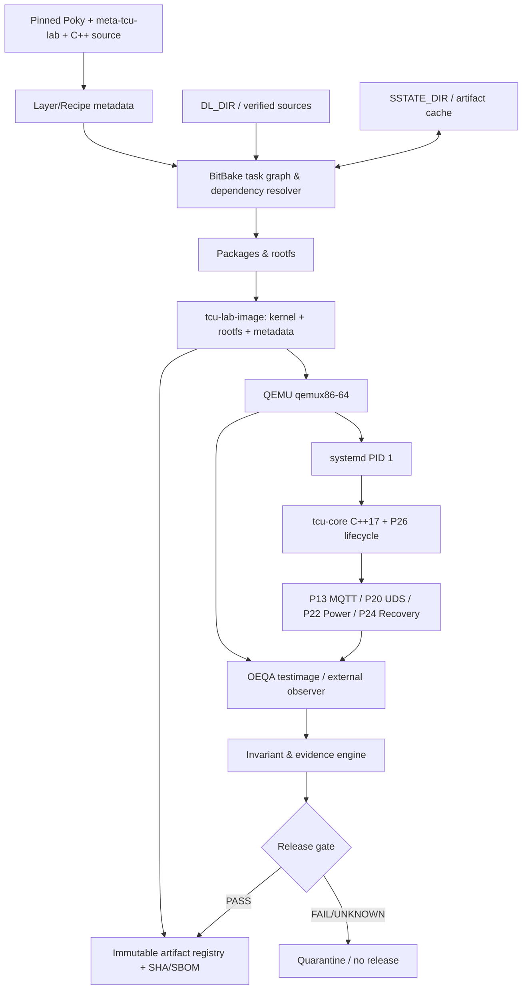
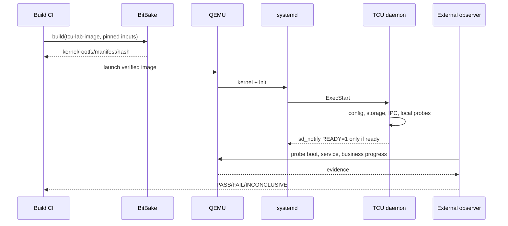
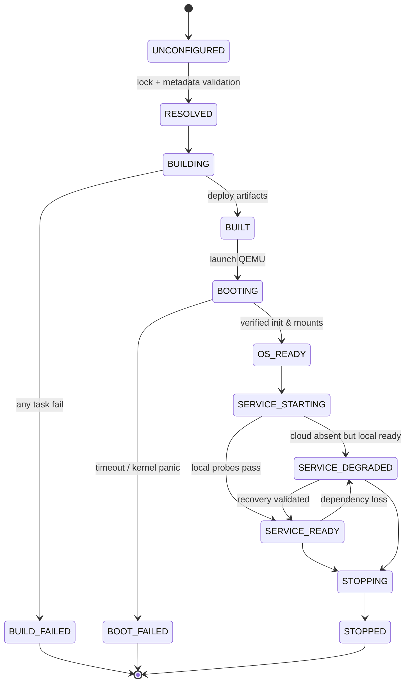

# Project 27 — Yocto / QEMU Embedded Linux Image — System Design & Resilience Test Plan

> **Virtual TCU Lab · P27 · Version 1.0 · 30/10/2026 · C++17 · Yocto Scarthgap 5.0 LTS · QEMU qemux86-64**
>
> **Status:** Design / chưa triển khai. Các ngưỡng trong tài liệu là *acceptance targets đề xuất*, cần baseline và được Tech Lead phê duyệt; KHÔNG phải kết quả thực đo.
>
> **Tiếp nối:** P01–P26 (đặc biệt P24 Crash Recovery, P25 Stability và P26 Linux Daemon/systemd); bàn giao cho P28 Container Lab, P29 Digital Twin, P30 Integration & Chaos Test.

## 0. Executive summary / quyết định thiết kế

Mục tiêu là tạo được **image Linux nhúng được kiểm soát bằng mã nguồn**, khởi động qua QEMU và chạy `tcu-core` C++17 như một systemd service. Image phải có manifest/traceability, kiểm thử boot/health/restart, bảo đảm phân tách dữ liệu bền vững với rootfs và có pipeline CI tái lập. QEMU là môi trường mô phỏng, **không chứng minh được** độ bền flash, brownout, secure boot, hardware watchdog, CAN controller, RF hay timing trên board thật.

**Architecture Decision Records (ADR):**

| ADR | Quyết định | Lý do / điều kiện |
|---|---|---|
| ADR-01 | Baseline Yocto **Scarthgap 5.0 LTS**; khóa mọi Git SHA | Đơn giản hóa tutorial và kiểm chứng. Yocto 6.0 Wrynose cũng là LTS (2026), nhưng không trộn metadata từ hai release. |
| ADR-02 | `MACHINE = "qemux86-64"` và VM Ubuntu được hỗ trợ | QEMU serial/network/filesystem không cần TCU board. |
| ADR-03 | `INIT_MANAGER = "systemd"` được cấu hình tường minh | Poky mặc định có thể dùng SysVinit, nên không suy đoán systemd có sẵn. |
| ADR-04 | `meta-tcu-lab` chứa recipe, image, test metadata; source C++ được pin | Phân tách build metadata khỏi application source. |
| ADR-05 | Build artifact immutable; manifest và hashes gắn với commit | Truy vết source→binary→image→test evidence. |
| ADR-06 | `/var/lib/tcu` và `/var/log/tcu` chỉ ghi trên partition/volume **nếu được provision** | Tránh giả định rootfs persist; phải kiểm tra filesystem layout thực. |
| ADR-07 | TCU daemon chỉ phát `READY=1` sau local readiness; cloud offline = DEGRADED | Không đợi Internet để hoàn thành boot hay báo healthy giả. |
| ADR-08 | `systemd` restart process; application tự reconcile business journal | Restart không được hiểu là command/OTA đã hoàn tất. |
| ADR-09 | Test verdict: `PASS`/`FAIL`/`INCONCLUSIVE`/`SKIPPED` | Không báo PASS nếu fault không gây được hoặc mất evidence. |
| ADR-10 | Không chứa private key/secret trong image; root/SSH debug chỉ bật ở profile lab | Bảo vệ production profile và tách chính sách build/test. |

### Phạm vi

**In scope:** build graph Yocto/BitBake, layer/recipe/CMake, image composition, init/systemd, QEMU boot, artifacts, SBOM/license metadata, testimage, fault injection có giới hạn, crash recovery, CI, runbook, acceptance criteria.

**Out of scope:** BSP chip thực, OTA flashing phần cứng, đo điện tiêu thụ, secure boot/TPM vật lý, CAN hardware bus-off, radio 4G/5G thật, chứng nhận ISO 26262 hoặc ISO/SAE 21434. Không tự coi đây là image production hay quy trình compliance.

### Định nghĩa lỗi quan sát

- **Build failure:** recipe/task không sinh artifact hợp lệ; pipeline fail, không xuất bản image.
- **Boot failure:** kernel/init/rootfs không vào trạng thái đủ để observer độc lập xác minh.
- **Service failure:** OS boot OK nhưng TCU daemon fail hoặc không tiến triển.
- **Functional failure:** daemon READY nhưng gửi dữ liệu/lệnh sai; kiểm tra invariant nghiệp vụ.
- **Test infrastructure failure:** không inject được lỗi, observer/evidence hỏng; verdict `INCONCLUSIVE`.

## 1. Stakeholders, use cases và yêu cầu

**Actors:** Embedded C++ Developer, Yocto Integrator, Release Engineer, QA/SDET, Security Engineer, CI Runner, Virtual TCU, Cloud/Gateway simulators.

### Functional requirements

| ID | Requirement | Acceptance evidence |
|---|---|---|
| FR-01 | Chốt release + toàn bộ source/layer commit | `sources.lock`, `git rev-parse`, build manifest |
| FR-02 | Build image qemux86-64 từ source được quản lý | `bitbake tcu-lab-image` return 0 |
| FR-03 | Cài C++17 daemon từ recipe (`inherit cmake`) | package manifest + file executable |
| FR-04 | Tạo và enable systemd unit đúng profile | `systemctl is-enabled`, unit status |
| FR-05 | Boot QEMU và quan sát login, kernel, systemd | serial log, `systemctl` status |
| FR-06 | Không phụ thuộc cloud để khởi chạy local services | offline boot test |
| FR-07 | Quản lý config, dữ liệu bền vững, quyền truy cập | mode/owner/mount tests |
| FR-08 | Tự động chạy image tests và các invariant ứng dụng | `bitbake -c testimage ...`, JUnit |
| FR-09 | Lưu image hashes, license manifest, SBOM khi được cấu hình | signed build report + artifacts |
| FR-10 | CI build không tái sử dụng artifact sai source | full/clean build diff |
| FR-11 | Stop, restart, crash loop và reboot có recovery định nghĩa | logs, state journal, external observer |
| FR-12 | Kết nối P13/P20/P22/P24/P26 qua interface mô phỏng | integrated smoke / chaos reports |

### Non-functional requirements (gates đề xuất, không phải đo được)

| ID | Invariant / SLO đề xuất | Oracle và điều kiện |
|---|---|---|
| NFR-01 | Không có artifact phát hành khi build/test gate FAIL | CI release gate |
| NFR-02 | Không có `READY=1` khi local init incomplete | independent probe + notify trace |
| NFR-03 | Dữ liệu mô phỏng có `event_id` không bị silent loss trong durability profile | end-to-end source/outbox/cloud reconciliation |
| NFR-04 | Backpressure phải bounded (RAM, FD, threads, disk) | cgroup, `/proc`, counters |
| NFR-05 | Build clean & warm được đo thời gian nhưng không đặt ngưỡng tùy tiện | CI duration, cache-hit metrics |
| NFR-06 | Image security profile không có debug password/default credential | filesystem inspection + auth tests |
| NFR-07 | Không chạy script can thiệp host ngoài VM/lab sở hữu | ownership/namespace guard |
| NFR-08 | Reproducibility được kiểm bằng SHA và diffoscope có cùng inputs | clean-build comparison; sai khác phải giải thích |
| NFR-09 | Boot/recovery budget do profile định nghĩa, đo P95 và max | boot_id timestamps + test evidence |
| NFR-10 | Test evidence luôn gắn `run_id`, `image_sha256`, machine, source lock | evidence schema checks |

## 2. Kiến trúc tổng thể



### 2.1 Ranh giới tin cậy

1. **Build host**: developer/CI VM, có toolchain và caches; không coi là production target.
2. **Source/artifact storage**: source pin, hash, chữ ký khi có PKI; integrity và provenance cần được verify trước release.
3. **QEMU guest**: image target chạy systemd và TCU, không được cấp đặc quyền host không cần thiết.
4. **External simulators**: MQTT, fake CAN, test runner; không được giả lập cloud OK khi không có backend evidence.
5. **Release process**: artifact chỉ promote nếu build/test/security gates và hashes cùng một `run_id`.

### 2.2 Luồng boot thành công



### 2.3 Trạng thái image build và runtime



## 3. Repository layout & configuration contracts

```text
virtual-tcu-lab/
├── manifests/
│   ├── sources.lock                  # immutable per release
│   └── build-profile.json
├── poky/                             # pinned Yocto checkout, external
├── meta-tcu-lab/
│   ├── conf/layer.conf
│   ├── recipes-core/images/tcu-lab-image.bb
│   ├── recipes-tcu/tcu-core/
│   │   ├── tcu-core_1.0.bb
│   │   └── files/{tcu-core.service,tcu-config.json}
│   └── lib/oeqa/runtime/cases/tcu_health.py
├── tcu-core/                          # C++ source, tagged + SHA pinned
│   ├── CMakeLists.txt
│   ├── include/tcu/lifecycle.hpp
│   ├── src/main.cpp
│   └── tests/
├── build/                             # generated; never commit
├── scripts/{prepare,build,boot,inject,collect,cleanup}.sh
├── tests/{unit,integration,image,chaos}/
├── docs/{architecture,adr,runbooks,release}/
└── evidence/<run_id>/
```

**Config contract (`sources.lock` — ví dụ cấu trúc, giá trị thay bằng SHA có thật):**

```json
{
  "yocto_series": "scarthgap",
  "machine": "qemux86-64",
  "distro": "poky",
  "poky_commit": "<40-hex-pinned-sha>",
  "meta_tcu_lab_commit": "<40-hex-pinned-sha>",
  "tcu_core_commit": "<40-hex-pinned-sha>",
  "image_recipe": "tcu-lab-image",
  "build_profile": "lab",
  "source_date_epoch": "<policy-derived-value>"
}
```

Contract: SHA chưa được pin => `BUILD_BLOCKED`; dirty worktree => lab cho phép nhưng gắn untrusted, release từ chối; thay đổi layer => phải phát sinh release build identity mới.

## 4. Build & integration implementation blueprint

### 4.1 Host setup và Yocto baseline

Yêu cầu môi trường build: Ubuntu LTS được Yocto Scarthgap hỗ trợ, đủ RAM/disk cho target; dung lượng cần xác định qua tài liệu phiên bản, **đừng cấp phát cố định theo tài liệu này**. Chạy trong VM Linux thật/runner phù hợp; tránh trộn toolchain từ host với target. Kiểm tra phiên bản Git/Python/locale, free disk và quyền ghi trước khi build.

```bash
mkdir -p "$HOME/virtual-tcu" && cd "$HOME/virtual-tcu"
git clone -b scarthgap https://git.yoctoproject.org/poky.git
# Trước build phát hành: kiểm tra và pin commit theo sources.lock:
git -C poky rev-parse HEAD
source poky/oe-init-build-env build
# source đưa shell vào build/
```

**Ví dụ trong `build/conf/local.conf` (lab profile cho Scarthgap):**

```bitbake
MACHINE = "qemux86-64"
INIT_MANAGER = "systemd"
# Khi cần tự động test image:
IMAGE_CLASSES += "testimage"
# TEST_SUITES được điều chỉnh theo cấu hình image và SSH/network thực tế
# TEST_SUITES = "ping ssh tcu_health"
```

`INIT_MANAGER = "systemd"` là quyết định bắt buộc: Poky không đảm bảo init mặc định là systemd. Không đặt `debug-tweaks`, root login rỗng, SSH root password hay insecure test credential ở production profile.

### 4.2 Tạo layer và recipe

```bash
# Chạy từ build/ sau khi source environment
bitbake-layers create-layer ../meta-tcu-lab
bitbake-layers add-layer ../meta-tcu-lab
bitbake-layers show-layers
```

**`meta-tcu-lab/recipes-core/images/tcu-lab-image.bb`:**

```bitbake
SUMMARY = "Virtual TCU lab Linux image"
LICENSE = "MIT"
inherit core-image
IMAGE_INSTALL:append = " tcu-core"
IMAGE_FEATURES:append = " ssh-server-dropbear"
# ssh-server-dropbear dành riêng lab profile; tùy policy mà loại khỏi production
```

**`meta-tcu-lab/recipes-tcu/tcu-core/tcu-core_1.0.bb`:**

```bitbake
SUMMARY = "C++17 TCU lifecycle demo"
DESCRIPTION = "TCU application and systemd unit for QEMU lab"
LICENSE = "MIT"
LIC_FILES_CHKSUM = "file://LICENSE;md5=<real-md5-of-LICENSE>"
SRC_URI = "git://<trusted-source-repo>;protocol=https;branch=main \
           file://tcu-core.service \
           file://tcu-config.json"
SRCREV = "<real-40-hex-commit>"
S = "${WORKDIR}/git"

inherit cmake systemd
SYSTEMD_SERVICE:${PN} = "tcu-core.service"
SYSTEMD_AUTO_ENABLE:${PN} = "enable"

# CMakeLists.txt phải install binary đến ${bindir}.
do_install:append() {
    install -d ${D}${systemd_system_unitdir}
    install -m 0644 ${WORKDIR}/tcu-core.service ${D}${systemd_system_unitdir}/
    install -d ${D}${sysconfdir}/tcu
    install -m 0644 ${WORKDIR}/tcu-config.json ${D}${sysconfdir}/tcu/config.json
}

FILES:${PN} += "${systemd_system_unitdir}/tcu-core.service ${sysconfdir}/tcu/config.json"
CONFFILES:${PN} += "${sysconfdir}/tcu/config.json"
```

**Cực kỳ quan trọng:** `<...>` là placeholder, **không chạy nguyên văn**. Đặt `LIC_FILES_CHKSUM`, `SRCREV`, URL và license thực trước khi BitBake fetch. `SYSTEMD_SERVICE` chỉ kích hoạt nếu `systemd` có trong `DISTRO_FEATURES`. Đối với source local/offline có thể dùng `file://` recipe + files hoặc `externalsrc` cho development, nhưng release phải pin source và chứng minh traceability.

**`tcu-core/CMakeLists.txt` tối thiểu:**

```cmake
cmake_minimum_required(VERSION 3.16)
project(tcu_core LANGUAGES CXX)
add_executable(tcu-core src/main.cpp)
target_compile_features(tcu-core PRIVATE cxx_std_17)
install(TARGETS tcu-core RUNTIME DESTINATION bin)
```

**`tcu-core.service` minh họa:**

```ini
[Unit]
Description=Virtual TCU Core (Lab)
After=local-fs.target
RequiresMountsFor=/var/lib/tcu

[Service]
Type=notify
ExecStart=/usr/bin/tcu-core --config /etc/tcu/config.json
Restart=on-failure
RestartSec=5s
WatchdogSec=30s
TimeoutStartSec=45s
TimeoutStopSec=20s
StateDirectory=tcu
LogsDirectory=tcu
NoNewPrivileges=yes
ProtectSystem=strict
ProtectHome=yes
ReadWritePaths=/var/lib/tcu /var/log/tcu

[Install]
WantedBy=multi-user.target
```

Điều kiện: C++ app liên kết `libsystemd`, gọi `sd_notify()` chính xác; nếu không, unit `Type=notify` sẽ timeout. `After=` chỉ là ordering; **không** đảm bảo Internet online; `RequiresMountsFor` phụ thuộc mount thực được provision. Hardened options cần kiểm tra lại với kernel/QEMU/Yocto và đường dẫn runtime thực tế. `/usr/bin/tcu-core` phải khớp CMake install. `StateDirectory` có thể tạo directory trên rootfs hiện tại nhưng **không tự tạo partition persist riêng**.

### 4.3 Build, boot, verify

```bash
bitbake tcu-lab-image
# image artifacts: tmp/deploy/images/qemux86-64/
find tmp/deploy/images/qemux86-64 -maxdepth 1 -type f -name '*tcu-lab-image*' -print
# Nếu qemuboot artifacts hợp lệ đã được build:
runqemu qemux86-64 tcu-lab-image nographic
```

Trong guest:

```bash
cat /proc/cmdline
cat /etc/os-release
systemctl status tcu-core.service --no-pager
systemctl is-enabled tcu-core.service
journalctl -u tcu-core.service --no-pager -n 100
findmnt /var/lib/tcu || true
```

Nếu `runqemu` không tự tìm image, cung cấp đường dẫn rootfs/kernel/qemuboot theo artifacts thực tế. QEMU SSH/TAP networking cần cấu hình và phân quyền đúng; testimage có thể yêu cầu TAP hoặc network path phù hợp, không coi `slirp` tự thay thế hoàn toàn test TAP.

### 4.4 Automated image testing

```bitbake
# local.conf / test profile
IMAGE_CLASSES += "testimage"
TEST_SUITES = "ping ssh tcu_health"
```

```bash
bitbake tcu-lab-image -c testimage
```

Đảm bảo đã cài thành phần SSH và chọn target test phù hợp; runtime cases được đặt ở `meta-tcu-lab/lib/oeqa/runtime/cases/tcu_health.py`, đồng thời layer phải được nhận diện bởi framework. Tùy Yocto phiên bản, API của OEQA có thể khác; pin version và viết smoke test cho chính runner. Test suite cần quan sát `systemctl is-active`, daemon progress, durable journal, configuration và kết quả inject.

## 5. C++17 API / orchestration design

Mục tiêu của project là **OS/image integration**, không tự viết lại BitBake hoặc systemd bằng C++. Một CLI C++17 nhỏ có thể chuẩn hóa evidence chạy trong guest, trong khi Python/Bash thực hiện điều phối build/VM/testimage bên ngoài.

```cpp
struct BootEvidence {
    std::string boot_id;
    std::string image_sha256;
    bool systemd_ready{};
    bool tcu_local_ready{};
    bool business_progress{};
    std::string failure_reason;
};

class IHealthProbe {
public:
    virtual ~IHealthProbe() = default;
    virtual BootEvidence snapshot() const = 0;
};

class IRuntimeStateStore {
public:
    virtual ~IRuntimeStateStore() = default;
    virtual bool reconcileAfterBoot(
        const std::string& boot_id) = 0;
};

class ISystemdNotify {
public:
    virtual ~ISystemdNotify() = default;
    virtual bool ready() = 0;
    virtual bool watchdog() = 0;
    virtual bool stopping() = 0;
};
```

**Ownership:** `IHealthProbe` đọc snapshot immutable; `RuntimeStateStore` là nơi sở hữu crash journal; unit test inject fake probe + fake clock. `sd_notify READY=1` chỉ được gọi sau khi startup local complete, không sau khi chỉ vào `main()`.

**Error policy:** không tự phục hồi từ image hỏng bằng cách viết lại protected rootfs; mode `RECOVERY_REQUIRED` nếu thiếu trust, partition hoặc journal không nhất quán; cloud mất mạng không được chặn local boot nếu không phải hard dependency.

## 6. Behavioral contracts — Given/When/Then

| ID | Given/When | Then / oracle |
|---|---|---|
| BC-01 | Pin thiếu SHA hoặc Git dirty trong release | Build gate chặn, ghi rõ source mismatch |
| BC-02 | Recipe fetch tarball có checksum sai | Fail fetch/verify; không xuất bản image |
| BC-03 | Build thiếu dependency/package | Do_rootfs fail; không silent-skip file |
| BC-04 | QEMU boot, network offline | systemd + TCU local ready, connectivity DEGRADED |
| BC-05 | `tcu-core` báo READY trước storage ready | Oracle fail; không promote artifact |
| BC-06 | C++ app SIGSEGV | systemd restart theo policy; journal reconcile |
| BC-07 | Watchdog heartbeat vẫn gửi nhưng business loop kẹt | Independent progress oracle FAIL/HUNG |
| BC-08 | Rootfs read-only, daemon ghi sai path | Observe error, không remount rw tùy tiện |
| BC-09 | Shutdown giữa SQLite commit | DB recovery/reconcile, không mark success giả |
| BC-10 | QEMU reboot trong OTA trial | P19 xác định rollback; P27 không tự confirm slot |
| BC-11 | Artifact SHA không khớp với build record | Quarantine image |
| BC-12 | SBOM/manifest thiếu | Reject release theo profile policy |
| BC-13 | QEMU observer mất kết nối | `INCONCLUSIVE`, không `PASS` |
| BC-14 | Test fault injected sai guest | `INCONCLUSIVE`, cleanup lab-scoped resources |
| BC-15 | Two builds cùng sources nhưng binary khác | Compare diffoscope; quarantine pending explanation |
| BC-16 | Service restart generation đổi | Drop callback/metrics session cũ |
| BC-17 | Time jump làm expiry sai | Không xác nhận dữ liệu/command khi clock untrusted |
| BC-18 | Disk full khi log | Không làm hỏng persistent outbox ngoài quota |
| BC-19 | CI runner crash đang publish | Artifact không được promote nếu chưa commit đầy đủ metadata |
| BC-20 | `systemd-analyze verify` pass nhưng daemon logic hỏng | Image test phải FAIL, không dựa riêng vào unit syntax |

## 7. Operational behavior & failure recovery

### 7.1 Build lifecycle

1. `PRECHECK`: host OS/space/locale, toolchain, source lock, Git tree clean; fail-fast.
2. `RESOLVE`: lớp/layer, versions, licenses, packages; store `bitbake -e` selected vars.
3. `FETCH`: downloads verified by upstream checksums and Git pins; network failures retry within bounded CI policy.
4. `BUILD`: tasks + sstate; capture task hash and failures; never overwrite baseline artifact.
5. `PACKAGE/IMAGE`: `do_package`, `do_rootfs`, `do_image`; verify executable, unit, config, ownership.
6. `BOOT/TEST`: QEMU + systemd + business probes; collect serial, journal, resource statistics.
7. `PUBLISH`: compute SHA256 and attach immutable `sources.lock`, `build_id`, test evidence. `PASS` only when required gates complete.

### 7.2 Runtime lifecycle

1. Kernel boot, systemd starts and mounts state storage.
2. `tcu-core` validates config version, storage, journal; reconciles old tasks.
3. Starts local interfaces; publishes readiness **only when operational**.
4. Network/cloud may be offline; enters `LOCAL_READY_CLOUD_DEGRADED`.
5. On fault: systemd may restart process; P24 policy decides probation/quarantine; P19 exclusively controls OTA rollback.
6. On stop: refuse new work, flush within configured deadline, journal unresolved outcomes, issue `STOPPING=1` if supported, exit.

### 7.3 Crash/power-cut simulation caveats

- `kill -9` is a **process crash**, not a sudden power loss.
- `reboot -f` simulates an OS-level interruption, not NAND/flash power failure.
- QEMU termination approximates abrupt VM power-off, not controller-level torn writes/FTL behavior.
- `dm-flakey`/`dm-error` or file-backed fault injection can exercise storage error paths only in **dedicated disposable image copies** and with permission; never on host root disk.
- File corruption injected into a mounted rootfs should be done against a **clone offline** or controlled overlay; protect baseline artifacts.

## 8. Test infrastructure, observability & oracles

**Sources:** serial console, QEMU exit status, `systemctl show`, `journalctl`, `/proc`, cgroup v2, application progress counters, outbox DB invariants, `bitbake` task logs, package/image manifest, SBOM, hashes, host-side resource sampler, network packet captures.

**Mandatory evidence** for each test: `run_id`, `case_id`, `source_lock_sha`, `image_sha256`, `qemu_pid + generation`, `boot_id`, injection timestamp and success proof, observer result, service state, logs, before/after snapshot, cleanup result, verdict.

**Verdict rules:**

- `PASS`: injection confirmed + all invariants verified + evidence complete.
- `FAIL`: invariant violated or explicitly prohibited result occurred.
- `INCONCLUSIVE`: injection unverified, missing observer, incomplete evidence, ambiguous outcome.
- `SKIPPED`: prerequisite not met and predeclared exclusion; never silently count as PASS.

**Primary invariants:** image identity cannot change during same run; no stale `READY`; persisted telemetry/dtc/commands reconcile; no duplicate unsafe side effect; no unbounded resource growth; rootfs / data partitions have documented persistence; watchdog does not mask hang; rollback/confirm only from P19; no promotion of unknown source or unverified artifact.

### 8.1 SQLite test evidence schema (host-side, optional)

```sql
PRAGMA foreign_keys=ON;
CREATE TABLE IF NOT EXISTS runs (
  run_id TEXT PRIMARY KEY,
  image_sha256 TEXT NOT NULL,
  source_lock_sha256 TEXT NOT NULL,
  started_utc TEXT NOT NULL,
  finished_utc TEXT,
  verdict TEXT CHECK(verdict IN ('PASS','FAIL','INCONCLUSIVE','SKIPPED'))
);
CREATE TABLE IF NOT EXISTS cases (
  run_id TEXT NOT NULL REFERENCES runs(run_id),
  case_id TEXT NOT NULL,
  injected INTEGER NOT NULL CHECK(injected IN (0,1)),
  evidence_uri TEXT,
  verdict TEXT NOT NULL CHECK(verdict IN ('PASS','FAIL','INCONCLUSIVE','SKIPPED')),
  PRIMARY KEY(run_id, case_id)
);
CREATE TABLE IF NOT EXISTS artifacts (
  run_id TEXT NOT NULL REFERENCES runs(run_id),
  artifact_name TEXT NOT NULL,
  sha256 TEXT NOT NULL,
  PRIMARY KEY(run_id, artifact_name)
);
```

### 8.2 Simulation tooling

| Phần | Tool/approach | Chú ý |
|---|---|---|
| Yocto build | BitBake, `bitbake-layers`, `bitbake -e` | Pin Scarthgap và mọi layer |
| VM boot | `runqemu`, QEMU serial | Boot ID và VM generation |
| Runtime tests | OEQA `testimage`, Google Test (guest) | Image SSH/TAP prereqs |
| Fault: network | `tc netem`, netns *ở lab riêng* | Đúng interface và chiều |
| Fault: resource | cgroup v2, bounded synthetic load | Không gây quá tải host shared |
| Fault: storage | disposable disk clone, loop/dm (VM scope) | Không sửa host disk |
| Fault: process | `systemctl kill`, simulated crash/hang | Ghi signal + process generation |
| Inspection | `journalctl`, `systemctl`, `strace`, `perf`, `diffoscope` | Availability tùy image và host |
| Security checks | image fs scan, SBOM/manifest, readelf | No secrets; license/CVE gate |

## 9. What-if catalog — 300 tình huống / 30 nhóm

**Cách sử dụng:** chọn case ID, thiết lập preconditions, inject trong sandbox, thu bằng chứng, đối chiếu expected behavior; không đánh PASS dựa trên log giả định. P0 là nhóm cần chạy trước; P1 là mở rộng. Tình huống chỉ là specification, chưa thực thi.

### 9.01 Source pinning và version control

Evidence chủ đạo: `sources.lock, git sha, release gate`. Mỗi trường hợp có thao tác inject trong **lab cô lập**, oracle và bằng chứng được lưu theo `run_id`.

| Case ID | What if? | Fault injection | Expected behavior / acceptance oracle | Evidence | Priority |
|---|---|---|---|---|---|
| `YQ27-WI-01-01` | Poky HEAD thay đổi sau checkout | sửa commit upstream giữa resolve và build | build identity gắn SHA đầu, phát hiện mismatch và chặn release | sources.lock, git sha, release gate | P0 |
| `YQ27-WI-01-02` | Layer của P27 trỏ nhầm branch Yocto 6.0 | đổi LAYERSERIES_COMPAT/checkout sai | reject incompatible metadata thay vì build ngầm | sources.lock, git sha, release gate | P0 |
| `YQ27-WI-01-03` | Git working tree dirty | sửa recipe nhưng không commit | lab gắn dirty; release gate từ chối | sources.lock, git sha, release gate | P0 |
| `YQ27-WI-01-04` | Cùng tag bị force-move | giả lập tag trỏ SHA khác | chỉ tin SHA đã khóa, báo supply-chain anomaly | sources.lock, git sha, release gate | P0 |
| `YQ27-WI-01-05` | Submodule C++ lệch revision | checkout submodule cũ | build block khi lock/HEAD không khớp | sources.lock, git sha, release gate | P0 |
| `YQ27-WI-01-06` | Patch file bị sửa trong lúc build | mutate patch ở do_patch | task fail hoặc fingerprint change, không publish output cũ | sources.lock, git sha, release gate | P0 |
| `YQ27-WI-01-07` | Lock thiếu revision dependency | xóa SHA trong lock | fail-fast trước fetch | sources.lock, git sha, release gate | P0 |
| `YQ27-WI-01-08` | Hai layer cùng recipe PN version ưu tiên khác | thêm layer priority cao | detect effective provider/recipe, require explicit approval | sources.lock, git sha, release gate | P1 |
| `YQ27-WI-01-09` | Release config trộn debug và production | bật debug-tweaks trên release | policy gate reject trước image publish | sources.lock, git sha, release gate | P1 |
| `YQ27-WI-01-10` | Artifact gán nhầm release tag | rename artifact không đổi hash | verify metadata/image digest; quarantine mismatch | sources.lock, git sha, release gate | P1 |

### 9.02 Metadata, parsing và dependency graph

Evidence chủ đạo: `bitbake -e, bitbake-layers, parse/task logs`. Mỗi trường hợp có thao tác inject trong **lab cô lập**, oracle và bằng chứng được lưu theo `run_id`.

| Case ID | What if? | Fault injection | Expected behavior / acceptance oracle | Evidence | Priority |
|---|---|---|---|---|---|
| `YQ27-WI-02-01` | Syntax error trong .bb | chèn dấu ngoặc/quote sai | do_parse fail, không reuse artifact sai | bitbake -e, bitbake-layers, parse/task logs | P0 |
| `YQ27-WI-02-02` | Override viết kiểu cũ | đổi IMAGE_INSTALL:append thành syntax lỗi | warning/error được phát hiện và flag gate | bitbake -e, bitbake-layers, parse/task logs | P0 |
| `YQ27-WI-02-03` | Cyclic dependency qua RDEPENDS | thêm A→B→A bất hợp lệ | task graph báo lỗi, không treo vô hạn | bitbake -e, bitbake-layers, parse/task logs | P0 |
| `YQ27-WI-02-04` | Layer.conf BBFILES sai pattern | bỏ recipes khỏi BBFILES | recipe mất được phát hiện trước build | bitbake -e, bitbake-layers, parse/task logs | P0 |
| `YQ27-WI-02-05` | Duplicate layer collection name | cấu hình BBFILE_COLLECTIONS trùng | reject metadata ambiguity | bitbake -e, bitbake-layers, parse/task logs | P0 |
| `YQ27-WI-02-06` | Missing dependency layer | bỏ dependency trong bblayers | parse/build fail rõ nguyên nhân | bitbake -e, bitbake-layers, parse/task logs | P0 |
| `YQ27-WI-02-07` | Unexpected PREFERRED_PROVIDER | ép provider không tồn tại | fail dependency resolution | bitbake -e, bitbake-layers, parse/task logs | P0 |
| `YQ27-WI-02-08` | Recipe build nhưng service unit không được package | bỏ FILES path | package QA hoặc image test fail | bitbake -e, bitbake-layers, parse/task logs | P1 |
| `YQ27-WI-02-09` | Build profile chọn sai MACHINE | đổi qemux86-64 sang qemuarm | machine guard reject release-target mismatch | bitbake -e, bitbake-layers, parse/task logs | P1 |
| `YQ27-WI-02-10` | BitBake variable override vô tình bị thay đổi | đổi DISTRO_FEATURES sau parsing | resolve snapshot khác lock; abort | bitbake -e, bitbake-layers, parse/task logs | P1 |

### 9.03 Fetcher, mirror và network trong build

Evidence chủ đạo: `fetch log, network probe, checksum, DL_DIR`. Mỗi trường hợp có thao tác inject trong **lab cô lập**, oracle và bằng chứng được lưu theo `run_id`.

| Case ID | What if? | Fault injection | Expected behavior / acceptance oracle | Evidence | Priority |
|---|---|---|---|---|---|
| `YQ27-WI-03-01` | Git server unreachable | block outbound 443 lab | retry có budget; build fail nếu cache thiếu | fetch log, network probe, checksum, DL_DIR | P0 |
| `YQ27-WI-03-02` | Source server trả 404 | đổi SRC_URI đến resource thiếu | fail do_fetch, không tạo binary placeholder | fetch log, network probe, checksum, DL_DIR | P0 |
| `YQ27-WI-03-03` | Proxy trả 407 | inject proxy authentication error | báo cấu hình proxy, không disable TLS | fetch log, network probe, checksum, DL_DIR | P0 |
| `YQ27-WI-03-04` | Mirror trả archive khác checksum | thay checksum-valid source bằng bytes khác | reject checksum, không extract | fetch log, network probe, checksum, DL_DIR | P0 |
| `YQ27-WI-03-05` | Connection reset khi tải tarball | cắt download giữa chunk | re-fetch/resume theo fetcher, xác minh cuối | fetch log, network probe, checksum, DL_DIR | P0 |
| `YQ27-WI-03-06` | DNS poisoned sang nguồn giả | map host đến endpoint khác | TLS/checksum bảo vệ, không promote | fetch log, network probe, checksum, DL_DIR | P0 |
| `YQ27-WI-03-07` | DL_DIR read-only | thay quyền thư mục cache trong VM | build fail có evidence, không silent fallback | fetch log, network probe, checksum, DL_DIR | P0 |
| `YQ27-WI-03-08` | Concurrent fetch cùng file | chạy 2 build share cache có kiểm soát | no corrupted download; revalidate content | fetch log, network probe, checksum, DL_DIR | P1 |
| `YQ27-WI-03-09` | Offline build với cache thiếu | chặn network + xóa một source khỏi mirror | fail offline deterministic, báo missing object | fetch log, network probe, checksum, DL_DIR | P1 |
| `YQ27-WI-03-10` | Credential xuất hiện trong fetch error logs | inject URL có token giả | redact logs, secret-scanner gate fail nếu lộ | fetch log, network probe, checksum, DL_DIR | P1 |

### 9.04 Artifact checksum và dependency integrity

Evidence chủ đạo: `SRCREV, SRC_URI hashes, SHA256, signed manifest`. Mỗi trường hợp có thao tác inject trong **lab cô lập**, oracle và bằng chứng được lưu theo `run_id`.

| Case ID | What if? | Fault injection | Expected behavior / acceptance oracle | Evidence | Priority |
|---|---|---|---|---|---|
| `YQ27-WI-04-01` | Tarball đổi nội dung giữ nguyên tên | phục vụ archive mới tại URL cũ | checksum mismatch => fail closed | SRCREV, SRC_URI hashes, SHA256, signed manifest | P0 |
| `YQ27-WI-04-02` | Recipe trỏ Git commit không tồn tại | sửa SRCREV SHA giả | reject fetch | SRCREV, SRC_URI hashes, SHA256, signed manifest | P0 |
| `YQ27-WI-04-03` | Repo chứa Git LFS pointer thay binary | omit LFS object | checksum/artifact validation fail trước image | SRCREV, SRC_URI hashes, SHA256, signed manifest | P0 |
| `YQ27-WI-04-04` | Manifest signed bằng key không tin cậy | thay chữ ký ở release manifest | reject provenance validation | SRCREV, SRC_URI hashes, SHA256, signed manifest | P0 |
| `YQ27-WI-04-05` | Artifact upload bị truncate | cắt image trên storage | SHA mismatch, không khởi động test | SRCREV, SRC_URI hashes, SHA256, signed manifest | P0 |
| `YQ27-WI-04-06` | Artifact store thay binary giữa build và test | swap image path trước boot | rehash trước launch; reject | SRCREV, SRC_URI hashes, SHA256, signed manifest | P0 |
| `YQ27-WI-04-07` | SHA metadata thiếu trường source lock | xóa digest lock | release block | SRCREV, SRC_URI hashes, SHA256, signed manifest | P0 |
| `YQ27-WI-04-08` | Image hash khớp nhưng build log thiếu | xóa required evidence | INCONCLUSIVE/quarantine theo policy | SRCREV, SRC_URI hashes, SHA256, signed manifest | P1 |
| `YQ27-WI-04-09` | Source key revoked sau build | cập nhật trust policy trước promote | revalidate và reject nếu không còn tin | SRCREV, SRC_URI hashes, SHA256, signed manifest | P1 |
| `YQ27-WI-04-10` | Digest file đổi trong upload chunk cuối | mutate multipart upload bytes | verify completed object hash, quarantine | SRCREV, SRC_URI hashes, SHA256, signed manifest | P1 |

### 9.05 BitBake task graph và sstate cache

Evidence chủ đạo: `siginfo, taskhash, bitbake logs, package hashes`. Mỗi trường hợp có thao tác inject trong **lab cô lập**, oracle và bằng chứng được lưu theo `run_id`.

| Case ID | What if? | Fault injection | Expected behavior / acceptance oracle | Evidence | Priority |
|---|---|---|---|---|---|
| `YQ27-WI-05-01` | Cache sstate bị corrupt | truncate một object cache | restore/rebuild an toàn hoặc fail, không xuất binary hỏng | siginfo, taskhash, bitbake logs, package hashes | P0 |
| `YQ27-WI-05-02` | Cache chứa object của build cũ | thay recipe input nhưng giữ cache | new task hash hoặc detect non-reproducibility | siginfo, taskhash, bitbake logs, package hashes | P0 |
| `YQ27-WI-05-03` | Hash-equivalence cho output không tương đương | inject artifact khác cùng metadata giả | detect binary diff; release block | siginfo, taskhash, bitbake logs, package hashes | P0 |
| `YQ27-WI-05-04` | Cache đầy giữa setscene | giới hạn filesystem sstate | error rõ, không publish incomplete | siginfo, taskhash, bitbake logs, package hashes | P0 |
| `YQ27-WI-05-05` | Task do_compile SIGKILL | kill worker trên build host VM | partial output không được release | siginfo, taskhash, bitbake logs, package hashes | P0 |
| `YQ27-WI-05-06` | Task do_install thiếu file | sửa install target | do_package/image smoke phát hiện thiếu binary | siginfo, taskhash, bitbake logs, package hashes | P0 |
| `YQ27-WI-05-07` | Sstate hit nhưng code ABI không tương thích | thay header dependency | cross link/runtime ABI tests FAIL | siginfo, taskhash, bitbake logs, package hashes | P0 |
| `YQ27-WI-05-08` | BitBake server restart trong build | kill bitbake daemon | build recover/retry có giới hạn và record generation | siginfo, taskhash, bitbake logs, package hashes | P1 |
| `YQ27-WI-05-09` | Task chạy song song gây race vào shared file | chạy max BB_NUMBER_THREADS | deterministic output hoặc detect fail | siginfo, taskhash, bitbake logs, package hashes | P1 |
| `YQ27-WI-05-10` | Build trở lại sau clean cache | xóa tmp/sstate copy lab | outputs compare reproducible; anomaly investigation | siginfo, taskhash, bitbake logs, package hashes | P1 |

### 9.06 Host toolchain và environment drift

Evidence chủ đạo: `host manifest, compiler metadata, build report`. Mỗi trường hợp có thao tác inject trong **lab cô lập**, oracle và bằng chứng được lưu theo `run_id`.

| Case ID | What if? | Fault injection | Expected behavior / acceptance oracle | Evidence | Priority |
|---|---|---|---|---|---|
| `YQ27-WI-06-01` | Host Python sai phiên bản | chạy trên runner unsupported | precheck fail rõ; không hack runtime | host manifest, compiler metadata, build report | P0 |
| `YQ27-WI-06-02` | Host locale khác UTF-8 | ép LC_ALL=C trong runner | metadata/test handle hoặc environment precheck fail | host manifest, compiler metadata, build report | P0 |
| `YQ27-WI-06-03` | Host clock nhảy về 1970 | fake time trong isolated runner | timestamp/provenance policy reject invalid clock | host manifest, compiler metadata, build report | P0 |
| `YQ27-WI-06-04` | Host disk inode đầy | tạo nhiều files trong scratch filesystem | fail with disk/inode evidence | host manifest, compiler metadata, build report | P0 |
| `YQ27-WI-06-05` | Host thiếu qemu-system-x86_64 | disable binary trong PATH | build có thể pass; boot gate FAIL đúng nguyên nhân | host manifest, compiler metadata, build report | P0 |
| `YQ27-WI-06-06` | Host GCC native khác giữa runners | compare pinned supported hosts | build output diff được điều tra | host manifest, compiler metadata, build report | P0 |
| `YQ27-WI-06-07` | Host umask rộng 000 | chạy precheck với umask 000 | target permissions explicit, no world-writable secrets | host manifest, compiler metadata, build report | P0 |
| `YQ27-WI-06-08` | Host path có khoảng trắng đặc biệt | đặt build path invalid cho Yocto | precheck reject with actionable error | host manifest, compiler metadata, build report | P1 |
| `YQ27-WI-06-09` | Host filesystem không case-sensitive | chạy trên mount incompatible | precheck fail, tránh build khó tái lập | host manifest, compiler metadata, build report | P1 |
| `YQ27-WI-06-10` | Host container không cho namespaces/KVM | tắt capabilities | chạy TCG nếu phù hợp hoặc SKIPPED có lý do | host manifest, compiler metadata, build report | P1 |

### 9.07 Resource pressure trong build

Evidence chủ đạo: `host df/free/PSI, task metrics, CI logs`. Mỗi trường hợp có thao tác inject trong **lab cô lập**, oracle và bằng chứng được lưu theo `run_id`.

| Case ID | What if? | Fault injection | Expected behavior / acceptance oracle | Evidence | Priority |
|---|---|---|---|---|---|
| `YQ27-WI-07-01` | Disk đầy khi do_rootfs | giới hạn scratch volume | build fail, no artifact promotion | host df/free/PSI, task metrics, CI logs | P0 |
| `YQ27-WI-07-02` | Disk đầy khi image compression | truncate free space near deploy | reject partial image bằng hash | host df/free/PSI, task metrics, CI logs | P0 |
| `YQ27-WI-07-03` | OOM kill compiler | hạn chế RAM của build VM | failure recorded; no success marker | host df/free/PSI, task metrics, CI logs | P0 |
| `YQ27-WI-07-04` | CPU oversubscription gây timeout | tăng parallel jobs quá mức | measured slow build, budget riêng; không kết luận code hỏng | host df/free/PSI, task metrics, CI logs | P0 |
| `YQ27-WI-07-05` | Open file limit quá thấp | ulimit -n 64 trong VM | precheck hoặc task fail có evidence | host df/free/PSI, task metrics, CI logs | P0 |
| `YQ27-WI-07-06` | Process limit cạn | giới hạn pids.max | no daemon stuck; CI failure explicit | host df/free/PSI, task metrics, CI logs | P0 |
| `YQ27-WI-07-07` | Tmpfs /tmp đầy | áp quota /tmp riêng | fail-fast và cleanup riêng | host df/free/PSI, task metrics, CI logs | P0 |
| `YQ27-WI-07-08` | Cache sstate chiếm hết host disk | fill SSTATE_DIR volume | block new job; preserve validated artifacts | host df/free/PSI, task metrics, CI logs | P1 |
| `YQ27-WI-07-09` | Two CI builds cạnh tranh RAM | chạy jobs trên runner cô lập | scheduler quota, no host-wide OOM | host df/free/PSI, task metrics, CI logs | P1 |
| `YQ27-WI-07-10` | SIGTERM CI job trong publish | cancel runner controlled | rollback temp upload; no half-promoted artifact | host df/free/PSI, task metrics, CI logs | P1 |

### 9.08 Cross-compilation và CMake integration

Evidence chủ đạo: `readelf, file, CMake cache, compile commands`. Mỗi trường hợp có thao tác inject trong **lab cô lập**, oracle và bằng chứng được lưu theo `run_id`.

| Case ID | What if? | Fault injection | Expected behavior / acceptance oracle | Evidence | Priority |
|---|---|---|---|---|---|
| `YQ27-WI-08-01` | Binary build thành x86 host thay vì target | cố ý dùng host g++ | readelf ABI/machine gate reject | readelf, file, CMake cache, compile commands | P0 |
| `YQ27-WI-08-02` | Link thư viện host /usr/lib | chèn absolute host link path | QA RPATH/sysroot checks fail | readelf, file, CMake cache, compile commands | P0 |
| `YQ27-WI-08-03` | Sai C++ standard | build với C++14 | CMake compile feature test fail | readelf, file, CMake cache, compile commands | P0 |
| `YQ27-WI-08-04` | ABI mismatch libstdc++ | đổi compiler ABI flags | runtime linker test FAIL | readelf, file, CMake cache, compile commands | P0 |
| `YQ27-WI-08-05` | Thiếu shared dependency | bỏ runtime RDEPENDS | runtime loader fail; image gate catch | readelf, file, CMake cache, compile commands | P0 |
| `YQ27-WI-08-06` | CMake install path /usr/local | sửa install DESTINATION | package QA/image scanner reject | readelf, file, CMake cache, compile commands | P0 |
| `YQ27-WI-08-07` | Debug symbol không được strip theo policy | đóng gói debug binary vào release | size/security policy fail | readelf, file, CMake cache, compile commands | P0 |
| `YQ27-WI-08-08` | File static lib được đóng gói thay executable | install sai target | executable existence & systemd start fail | readelf, file, CMake cache, compile commands | P1 |
| `YQ27-WI-08-09` | Endian/architecture changed | chuyển MACHINE qemuarm64 | build/boot matrix kiểm tra đúng binary target | readelf, file, CMake cache, compile commands | P1 |
| `YQ27-WI-08-10` | Dependency được build native không build target | dùng DEPENDS sai provider | sysroot build fail/QA cảnh báo, không tham chiếu host | readelf, file, CMake cache, compile commands | P1 |

### 9.09 Package composition và rootfs

Evidence chủ đạo: `pkg manifest, oe-pkgdata-util, rootfs QA`. Mỗi trường hợp có thao tác inject trong **lab cô lập**, oracle và bằng chứng được lưu theo `run_id`.

| Case ID | What if? | Fault injection | Expected behavior / acceptance oracle | Evidence | Priority |
|---|---|---|---|---|---|
| `YQ27-WI-09-01` | Image thiếu tcu-core | xóa IMAGE_INSTALL | image manifest checker FAIL | pkg manifest, oe-pkgdata-util, rootfs QA | P0 |
| `YQ27-WI-09-02` | Image có hai package xung đột | kéo hai providers file collision | do_rootfs fail | pkg manifest, oe-pkgdata-util, rootfs QA | P0 |
| `YQ27-WI-09-03` | systemd unit tồn tại nhưng bị disable | đổi SYSTEMD_AUTO_ENABLE | image test is-enabled FAIL | pkg manifest, oe-pkgdata-util, rootfs QA | P0 |
| `YQ27-WI-09-04` | Rootfs thiếu CA certificates | bỏ cert bundle nhưng bật TLS client | cloud auth fails closed, local boot DEGRADED | pkg manifest, oe-pkgdata-util, rootfs QA | P0 |
| `YQ27-WI-09-05` | Runtime package bất ngờ tăng 100MB | thêm dependency lớn | size budget gating và diff manifest | pkg manifest, oe-pkgdata-util, rootfs QA | P0 |
| `YQ27-WI-09-06` | Image chứa testing tools production | thêm gdb/strace trong release | policy gate reject debug packages | pkg manifest, oe-pkgdata-util, rootfs QA | P0 |
| `YQ27-WI-09-07` | Dữ liệu mặc định ghi nhầm vào /etc read-only | inject config needing write | daemon DEGRADED with clear error | pkg manifest, oe-pkgdata-util, rootfs QA | P0 |
| `YQ27-WI-09-08` | Package upgrade bỏ config hợp lệ | đổi CONFFILES policy | preserve/migrate user data theo policy | pkg manifest, oe-pkgdata-util, rootfs QA | P1 |
| `YQ27-WI-09-09` | File uid/gid không tồn tại | dùng user không được tạo | startup fails; prepublish check detect | pkg manifest, oe-pkgdata-util, rootfs QA | P1 |
| `YQ27-WI-09-10` | Rootfs package manager lỗi script postinst | inject failing postinst | build/first boot checks fail, no READY giả | pkg manifest, oe-pkgdata-util, rootfs QA | P1 |

### 9.10 Filesystem ownership, mounts, persistence

Evidence chủ đạo: `mountinfo, ls -l, journal, DB integrity`. Mỗi trường hợp có thao tác inject trong **lab cô lập**, oracle và bằng chứng được lưu theo `run_id`.

| Case ID | What if? | Fault injection | Expected behavior / acceptance oracle | Evidence | Priority |
|---|---|---|---|---|---|
| `YQ27-WI-10-01` | /var/lib/tcu không persist sau reboot | chạy rootfs snapshot không có persistent disk | test profile nhận ra persistence disabled, không claim durability | mountinfo, ls -l, journal, DB integrity | P0 |
| `YQ27-WI-10-02` | Application chạy uid không có write quyền | chmod data path 0500 | fail safely; no false READY | mountinfo, ls -l, journal, DB integrity | P0 |
| `YQ27-WI-10-03` | Rootfs mount read-only | bật ro policy | services only write writable mounts, otherwise fail visible | mountinfo, ls -l, journal, DB integrity | P0 |
| `YQ27-WI-10-04` | State partition mount mất | remove optional virtual disk at boot | block durable features, report DEGRADED | mountinfo, ls -l, journal, DB integrity | P0 |
| `YQ27-WI-10-05` | State partition corrupted | inject fs errors vào disk clone | no destructive auto-format, recovery required | mountinfo, ls -l, journal, DB integrity | P0 |
| `YQ27-WI-10-06` | Symlink /var/lib/tcu trỏ path ngoài cho phép | inject malicious symlink | reject path escape, no unsafe write | mountinfo, ls -l, journal, DB integrity | P0 |
| `YQ27-WI-10-07` | Disk inode cạn trong /var/log | fill via test-owned temp logs | no data journal corruption | mountinfo, ls -l, journal, DB integrity | P0 |
| `YQ27-WI-10-08` | mount retry trở lại sau daemon start | delay mount | recovery/refetch persistent state before READY | mountinfo, ls -l, journal, DB integrity | P1 |
| `YQ27-WI-10-09` | Cleanup test xóa baseline rootfs | inject wrong target path | guard prevents delete of non-owned artifacts | mountinfo, ls -l, journal, DB integrity | P1 |
| `YQ27-WI-10-10` | File config đặt permissions 0777 | chmod trong recipe | image scanner FAIL | mountinfo, ls -l, journal, DB integrity | P1 |

### 9.11 systemd dependencies & startup ordering

Evidence chủ đạo: `systemd-analyze, show, journal, unit graph`. Mỗi trường hợp có thao tác inject trong **lab cô lập**, oracle và bằng chứng được lưu theo `run_id`.

| Case ID | What if? | Fault injection | Expected behavior / acceptance oracle | Evidence | Priority |
|---|---|---|---|---|---|
| `YQ27-WI-11-01` | After=network-online nhưng WAN offline | isolate WAN | local service starts, connectivity DEGRADED | systemd-analyze, show, journal, unit graph | P0 |
| `YQ27-WI-11-02` | Dependency unit disabled | disable prerequisite | unit fails or enters degraded, no false READY | systemd-analyze, show, journal, unit graph | P0 |
| `YQ27-WI-11-03` | RequiresMountsFor trỏ mount không tồn tại | remove data mount config | startup block with evidence, no silent fallback | systemd-analyze, show, journal, unit graph | P0 |
| `YQ27-WI-11-04` | Circular unit ordering | add After=A/B circular | systemd verification/test detect problematic ordering | systemd-analyze, show, journal, unit graph | P0 |
| `YQ27-WI-11-05` | ExecStart sai binary path | modify unit path | systemd failure, release gate FAIL | systemd-analyze, show, journal, unit graph | P0 |
| `YQ27-WI-11-06` | TimeoutStartSec thấp hơn initialization | add fake init delay | no READY; policy tune and record cause | systemd-analyze, show, journal, unit graph | P0 |
| `YQ27-WI-11-07` | Unit WantedBy sai target | change target | boot test detects service not started | systemd-analyze, show, journal, unit graph | P0 |
| `YQ27-WI-11-08` | Unit permission/run user invalid | set User to missing account | deterministic start failure | systemd-analyze, show, journal, unit graph | P1 |
| `YQ27-WI-11-09` | Reload unit file không daemon-reload | change unit in running guest | config drift observable, don't assume applied | systemd-analyze, show, journal, unit graph | P1 |
| `YQ27-WI-11-10` | Unit depends on cloud health hard target | create blocking Wants/After | offline boot regression test FAIL | systemd-analyze, show, journal, unit graph | P1 |

### 9.12 systemd watchdog, restart, readiness

Evidence chủ đạo: `sd_notify trace, progress probe, restart counters`. Mỗi trường hợp có thao tác inject trong **lab cô lập**, oracle và bằng chứng được lưu theo `run_id`.

| Case ID | What if? | Fault injection | Expected behavior / acceptance oracle | Evidence | Priority |
|---|---|---|---|---|---|
| `YQ27-WI-12-01` | Daemon không gọi READY=1 | suppress notification | startup timeout and failure, no healthy status | sd_notify trace, progress probe, restart counters | P0 |
| `YQ27-WI-12-02` | READY phát trước journal recovery | inject slow reconciliation | observer rejects premature readiness | sd_notify trace, progress probe, restart counters | P0 |
| `YQ27-WI-12-03` | WATCHDOG=1 vẫn gửi khi main loop deadlock | freeze processing loop only | independent business progress oracle detects HUNG | sd_notify trace, progress probe, restart counters | P0 |
| `YQ27-WI-12-04` | Notify từ process khác bị từ chối | notify helper wrong PID/credentials | status not spuriously marked ready | sd_notify trace, progress probe, restart counters | P0 |
| `YQ27-WI-12-05` | Watchdog heartbeat bị ngắt | block notifier | systemd timeout triggers configured restart | sd_notify trace, progress probe, restart counters | P0 |
| `YQ27-WI-12-06` | Service crash loop 20 lần | repeated SIGSEGV | StartLimit/restart budget quarantines | sd_notify trace, progress probe, restart counters | P0 |
| `YQ27-WI-12-07` | OOM kills service | enforce MemoryMax low | detect OOM and reconcile after restart | sd_notify trace, progress probe, restart counters | P0 |
| `YQ27-WI-12-08` | Systemctl stop giữa callback | stop during work | bounded drain, journal unresolved, no UAF | sd_notify trace, progress probe, restart counters | P1 |
| `YQ27-WI-12-09` | Restart succeeds but local DB corrupted | inject DB corruption + restart | process running does not imply recovered | sd_notify trace, progress probe, restart counters | P1 |
| `YQ27-WI-12-10` | systemd manager daemon-reexec | reexecute manager in VM | daemon health coherent; no double starts | sd_notify trace, progress probe, restart counters | P1 |

### 9.13 Kernel boot, initramfs và rootfs

Evidence chủ đạo: `serial console, boot IDs, kernel logs`. Mỗi trường hợp có thao tác inject trong **lab cô lập**, oracle và bằng chứng được lưu theo `run_id`.

| Case ID | What if? | Fault injection | Expected behavior / acceptance oracle | Evidence | Priority |
|---|---|---|---|---|---|
| `YQ27-WI-13-01` | Kernel file missing | remove kernel from cloned deploy set | boot gate fails before init | serial console, boot IDs, kernel logs | P0 |
| `YQ27-WI-13-02` | Wrong machine/kernel pair | point QEMU to incompatible kernel | reject config/machine mismatch | serial console, boot IDs, kernel logs | P0 |
| `YQ27-WI-13-03` | Root= argument sai | change QEMU bootparams | kernel cannot mount root, captured boot failure | serial console, boot IDs, kernel logs | P0 |
| `YQ27-WI-13-04` | Kernel panic before init | inject fatal cmdline into clone | observer records panic, not timeout only | serial console, boot IDs, kernel logs | P0 |
| `YQ27-WI-13-05` | Init executable missing | remove /sbin/init in disposable rootfs | boot fails with root cause | serial console, boot IDs, kernel logs | P0 |
| `YQ27-WI-13-06` | Initramfs module thiếu | disable required storage driver in cloned build | rootfs mount fails; no application start | serial console, boot IDs, kernel logs | P0 |
| `YQ27-WI-13-07` | Storage probe chậm | delay virtual device availability | boot timeout budget evaluated not false success | serial console, boot IDs, kernel logs | P0 |
| `YQ27-WI-13-08` | Corrupt root filesystem image | alter cloned image bytes | fsck/boot gate catches; preserve original | serial console, boot IDs, kernel logs | P1 |
| `YQ27-WI-13-09` | Kernel clocksource bất thường | run with time skew injection supported | monotonic timer tests detect anomaly | serial console, boot IDs, kernel logs | P1 |
| `YQ27-WI-13-10` | Kernel boot thành công nhưng PID1 crash | kill init in guest test VM | QEMU terminates/reboots, FAIL | serial console, boot IDs, kernel logs | P1 |

### 9.14 QEMU devices, clock và virtual hardware

Evidence chủ đạo: `QEMU args, dmesg, device inventory`. Mỗi trường hợp có thao tác inject trong **lab cô lập**, oracle và bằng chứng được lưu theo `run_id`.

| Case ID | What if? | Fault injection | Expected behavior / acceptance oracle | Evidence | Priority |
|---|---|---|---|---|---|
| `YQ27-WI-14-01` | NIC bị remove | boot no NIC | TCU local ready, cloud degraded | QEMU args, dmesg, device inventory | P0 |
| `YQ27-WI-14-02` | Virtual disk hot-remove trong write | detach expendable data disk | storage error, no success ACK | QEMU args, dmesg, device inventory | P0 |
| `YQ27-WI-14-03` | Virtual serial port không tồn tại | remove console/configured tty | test uses independent observer, no silent PASS | QEMU args, dmesg, device inventory | P0 |
| `YQ27-WI-14-04` | CPU count giảm khi boot | set -smp 1 | service concurrency correct under low cores | QEMU args, dmesg, device inventory | P0 |
| `YQ27-WI-14-05` | RAM thấp hơn cấu hình | reduce VM -m | bounded startup behavior, no host OOM | QEMU args, dmesg, device inventory | P0 |
| `YQ27-WI-14-06` | Virtual RTC nhảy lùi | qemu time adjustment in lab | expiration policy rejects untrusted time | QEMU args, dmesg, device inventory | P0 |
| `YQ27-WI-14-07` | QEMU accelerator KVM không có | disable /dev/kvm | fallback TCG where supported or explicit skip | QEMU args, dmesg, device inventory | P0 |
| `YQ27-WI-14-08` | QEMU guest agent vắng mặt | remove agent package | test runner uses serial/SSH fallback, evidence marked | QEMU args, dmesg, device inventory | P1 |
| `YQ27-WI-14-09` | Different virtio network model | switch model with supported args | driver availability checked before release | QEMU args, dmesg, device inventory | P1 |
| `YQ27-WI-14-10` | QEMU reset giữa package setup | trigger monitor reset | boot generation changes, journal reconcile | QEMU args, dmesg, device inventory | P1 |

### 9.15 Read-only rootfs, quotas, endurance

Evidence chủ đạo: `mount, checksum, sqlite quick_check, reboot evidence`. Mỗi trường hợp có thao tác inject trong **lab cô lập**, oracle và bằng chứng được lưu theo `run_id`.

| Case ID | What if? | Fault injection | Expected behavior / acceptance oracle | Evidence | Priority |
|---|---|---|---|---|---|
| `YQ27-WI-15-01` | Image rootfs read-only nhưng logger ghi /usr | inject log path under /usr | fail visible, no remount RW | mount, checksum, sqlite quick_check, reboot evidence | P0 |
| `YQ27-WI-15-02` | Journalfsync rất chậm | throttle VM data disk | timeout/backpressure without data lie | mount, checksum, sqlite quick_check, reboot evidence | P0 |
| `YQ27-WI-15-03` | State quota 100% | fill dedicated /var/lib/tcu disk | reject or shed noncritical, no silent loss | mount, checksum, sqlite quick_check, reboot evidence | P0 |
| `YQ27-WI-15-04` | Partial rename before forced reset | interrupt staging update | recover old/new atomic state, no partial READY | mount, checksum, sqlite quick_check, reboot evidence | P0 |
| `YQ27-WI-15-05` | Snapshot mode mất dữ liệu sau exit | run QEMU snapshot | test flags nonpersistent profile; never report durability PASS | mount, checksum, sqlite quick_check, reboot evidence | P0 |
| `YQ27-WI-15-06` | Duplicate UUID trên hai data disks | attach cloned disks same ID | mount ambiguity rejected | mount, checksum, sqlite quick_check, reboot evidence | P0 |
| `YQ27-WI-15-07` | FS repair thay đổi file critical | corrupt on disposable copy | recovery journal checksums/metadata validated | mount, checksum, sqlite quick_check, reboot evidence | P0 |
| `YQ27-WI-15-08` | SQLite database read-only | chmod DB path | daemon report DEGRADED, not successful commit | mount, checksum, sqlite quick_check, reboot evidence | P1 |
| `YQ27-WI-15-09` | Disk latency spikes periodically | rate-limit backing storage | service remains bounded and metrics capture tail | mount, checksum, sqlite quick_check, reboot evidence | P1 |
| `YQ27-WI-15-10` | 24h create/delete temp artifacts | soak cycle in VM | disk/inode return to baseline within threshold | mount, checksum, sqlite quick_check, reboot evidence | P1 |

### 9.16 Users, auth, security startup

Evidence chủ đạo: `getent, passwd shadow policy, service audit`. Mỗi trường hợp có thao tác inject trong **lab cô lập**, oracle và bằng chứng được lưu theo `run_id`.

| Case ID | What if? | Fault injection | Expected behavior / acceptance oracle | Evidence | Priority |
|---|---|---|---|---|---|
| `YQ27-WI-16-01` | Default root password rỗng trong release | enable debug-tweaks | image scan gate reject | getent, passwd shadow policy, service audit | P0 |
| `YQ27-WI-16-02` | SSH root login enabled | edit dropbear config | production policy gate reject | getent, passwd shadow policy, service audit | P0 |
| `YQ27-WI-16-03` | TCU service chạy root không cần thiết | remove User setting in prod | least-privilege test fail | getent, passwd shadow policy, service audit | P0 |
| `YQ27-WI-16-04` | System user tcu thiếu | delete account from rootfs clone | unit fails clearly; no insecure fallback | getent, passwd shadow policy, service audit | P0 |
| `YQ27-WI-16-05` | App có thể đọc private key khác service | loosen file mode on test key | security test FAIL | getent, passwd shadow policy, service audit | P0 |
| `YQ27-WI-16-06` | Credentials hardcoded trong binary | embed canary token | scanner catches string; no artifact promotion | getent, passwd shadow policy, service audit | P0 |
| `YQ27-WI-16-07` | System clock chưa đồng bộ nhưng TLS được bypass | block time + expired cert | fail closed, cloud DEGRADED | getent, passwd shadow policy, service audit | P0 |
| `YQ27-WI-16-08` | Key file trên writable rootfs không kiểm soát | change permissions/owner | reject credential use and log audit | getent, passwd shadow policy, service audit | P1 |
| `YQ27-WI-16-09` | Service privileged helper không audit | add unsafe setuid executable | security policy reject image | getent, passwd shadow policy, service audit | P1 |
| `YQ27-WI-16-10` | Guest exposes unnecessary open TCP ports | scan VM loopback/host side | unexpected services fail allowlist | getent, passwd shadow policy, service audit | P1 |

### 9.17 Networking trong boot và connectivity

Evidence chủ đạo: `ip route, resolv.conf, DNS/TLS, telemetry`. Mỗi trường hợp có thao tác inject trong **lab cô lập**, oracle và bằng chứng được lưu theo `run_id`.

| Case ID | What if? | Fault injection | Expected behavior / acceptance oracle | Evidence | Priority |
|---|---|---|---|---|---|
| `YQ27-WI-17-01` | DHCP không cấp IP | block DHCP in isolated lab | local TCU ready; cloud DEGRADED | ip route, resolv.conf, DNS/TLS, telemetry | P0 |
| `YQ27-WI-17-02` | Default route bị xóa | ip route del default trong guest | connectivity false, no CloudReady | ip route, resolv.conf, DNS/TLS, telemetry | P0 |
| `YQ27-WI-17-03` | DNS server trả NXDOMAIN | mock resolver NXDOMAIN | bounded retry, no TLS bypass | ip route, resolv.conf, DNS/TLS, telemetry | P0 |
| `YQ27-WI-17-04` | TCP SYN bị drop | tc netem network namespace | timeout bounded, offline queue keeps records | ip route, resolv.conf, DNS/TLS, telemetry | P0 |
| `YQ27-WI-17-05` | TLS handshake bị reset | proxy cut connection | no CloudReady, reason captured | ip route, resolv.conf, DNS/TLS, telemetry | P0 |
| `YQ27-WI-17-06` | SSH test runner mất link | disconnect host→guest control path | test INCONCLUSIVE, not application PASS | ip route, resolv.conf, DNS/TLS, telemetry | P0 |
| `YQ27-WI-17-07` | MQTT broker reboot lúc guest boot | restart lab broker | reconnect, once-per-event semantics | ip route, resolv.conf, DNS/TLS, telemetry | P0 |
| `YQ27-WI-17-08` | IPv6 preferred nhưng unreachable | IPv6 blackhole case | fallback per policy, latency measured | ip route, resolv.conf, DNS/TLS, telemetry | P1 |
| `YQ27-WI-17-09` | NAT/slirp thay đổi peer IP | reconfigure QEMU user networking | telemetry correlation device identity stable | ip route, resolv.conf, DNS/TLS, telemetry | P1 |
| `YQ27-WI-17-10` | Network returns đúng lúc shutdown | lift fault during SIGTERM | no new connect after STOPPING | ip route, resolv.conf, DNS/TLS, telemetry | P1 |

### 9.18 Configuration migration và rollout

Evidence chủ đạo: `config schema, unit logs, effective config hash`. Mỗi trường hợp có thao tác inject trong **lab cô lập**, oracle và bằng chứng được lưu theo `run_id`.

| Case ID | What if? | Fault injection | Expected behavior / acceptance oracle | Evidence | Priority |
|---|---|---|---|---|---|
| `YQ27-WI-18-01` | Config file malformed JSON | inject truncated config | fail startup/degraded, no partial apply | config schema, unit logs, effective config hash | P0 |
| `YQ27-WI-18-02` | Schema version mới nhưng app cũ | change config major version | reject incompatible startup | config schema, unit logs, effective config hash | P0 |
| `YQ27-WI-18-03` | Default config ghi đè customer config | run simulated package upgrade | honor CONFFILES/migration policy | config schema, unit logs, effective config hash | P0 |
| `YQ27-WI-18-04` | Reload khi thread đang đọc config | send SIGHUP during workload | immutable snapshot, no mixed generation | config schema, unit logs, effective config hash | P0 |
| `YQ27-WI-18-05` | Config đổi khi daemon restart | swap config between exits | new generation validated before READY | config schema, unit logs, effective config hash | P0 |
| `YQ27-WI-18-06` | Secret/token nằm trong log during parse | inject fake test token | redact & scanner verify absence | config schema, unit logs, effective config hash | P0 |
| `YQ27-WI-18-07` | Hot reload invalid rollback | invalid threshold in new file | preserve last known-good snapshot | config schema, unit logs, effective config hash | P0 |
| `YQ27-WI-18-08` | Power/OTA policies conflict | inject contradictory config | reject with explicit policy error | config schema, unit logs, effective config hash | P1 |
| `YQ27-WI-18-09` | Config file missing on boot | remove `/etc/tcu/config.json` clone | fail with reason, not use unsafe defaults | config schema, unit logs, effective config hash | P1 |
| `YQ27-WI-18-10` | Two config versions loaded by two services | skew shared schema version | integration gate detects mismatch | config schema, unit logs, effective config hash | P1 |

### 9.19 Time, randomness và security dependencies

Evidence chủ đạo: `UTC/monotonic metrics, certificate trace`. Mỗi trường hợp có thao tác inject trong **lab cô lập**, oracle và bằng chứng được lưu theo `run_id`.

| Case ID | What if? | Fault injection | Expected behavior / acceptance oracle | Evidence | Priority |
|---|---|---|---|---|---|
| `YQ27-WI-19-01` | RTC thời gian quá khứ | set fake guest time 1970 | reject expiry-sensitive commands | UTC/monotonic metrics, certificate trace | P0 |
| `YQ27-WI-19-02` | NTP jumps forward 5 years | time warp in disposable VM | no mass deletion of outbox data | UTC/monotonic metrics, certificate trace | P0 |
| `YQ27-WI-19-03` | Monotonic timer bị so với wall clock | skew UTC mid-retry | timeout behavior unchanged | UTC/monotonic metrics, certificate trace | P0 |
| `YQ27-WI-19-04` | Entropy chưa đủ khi generating keys | constrain entropy path in VM | bounded startup and no weak-key fallback | UTC/monotonic metrics, certificate trace | P0 |
| `YQ27-WI-19-05` | Certificate mới chưa valid vì clock sai | inject clock skew | authentication fails closed | UTC/monotonic metrics, certificate trace | P0 |
| `YQ27-WI-19-06` | Boot_id không đổi trong runner sau reboot giả | fake stale observer file | oracle detects mismatch and INCONCLUSIVE | UTC/monotonic metrics, certificate trace | P0 |
| `YQ27-WI-19-07` | Timezone khác host | set guest TZ UTC+ offset | event timestamps normalized correctly | UTC/monotonic metrics, certificate trace | P0 |
| `YQ27-WI-19-08` | Leap second boundary mocked | inject trusted time sequence | no negative duration/wrong TTL | UTC/monotonic metrics, certificate trace | P1 |
| `YQ27-WI-19-09` | Multiple CPUs produce jitter | stress timekeeping in VM | scheduler bounded; timed tests use tolerances | UTC/monotonic metrics, certificate trace | P1 |
| `YQ27-WI-19-10` | RTC trust lost while OTA manifest expiry checked | invalidate clock source | do not accept expired/unverifiable metadata | UTC/monotonic metrics, certificate trace | P1 |

### 9.20 Image provenance, release artifacts

Evidence chủ đạo: `deploy dir, SHA256, manifests, artifact registry`. Mỗi trường hợp có thao tác inject trong **lab cô lập**, oracle và bằng chứng được lưu theo `run_id`.

| Case ID | What if? | Fault injection | Expected behavior / acceptance oracle | Evidence | Priority |
|---|---|---|---|---|---|
| `YQ27-WI-20-01` | Image copied to release without package manifest | remove manifest attachment | release BLOCKED | deploy dir, SHA256, manifests, artifact registry | P0 |
| `YQ27-WI-20-02` | Two different images share human-readable version | assign same version string | digest disambiguates, reject collision | deploy dir, SHA256, manifests, artifact registry | P0 |
| `YQ27-WI-20-03` | Layer SHA mismatch deploy metadata | alter `sources.lock` post build | publish gate fail | deploy dir, SHA256, manifests, artifact registry | P0 |
| `YQ27-WI-20-04` | Image compressed then decompressed changes metadata | change compression options | compare canonical target and archive hashes separately | deploy dir, SHA256, manifests, artifact registry | P0 |
| `YQ27-WI-20-05` | Build report loses timestamp | delete time evidence | completeness gate fail/inconclusive | deploy dir, SHA256, manifests, artifact registry | P0 |
| `YQ27-WI-20-06` | Artifact uploads incomplete on network loss | cut artifact store transfer | no visible release until atomic promotion | deploy dir, SHA256, manifests, artifact registry | P0 |
| `YQ27-WI-20-07` | Old symlink in tmp/deploy points stale image | switch symlink target | rehash explicit resolved file before testing | deploy dir, SHA256, manifests, artifact registry | P0 |
| `YQ27-WI-20-08` | Unsigned SBOM required by policy | omit signed metadata | quarantine artifact | deploy dir, SHA256, manifests, artifact registry | P1 |
| `YQ27-WI-20-09` | Release pipeline reuses debug image | redirect lab build to prod bucket | profile-identity gate reject | deploy dir, SHA256, manifests, artifact registry | P1 |
| `YQ27-WI-20-10` | Artifact downloaded by tester is corrupt | mutate download before QEMU | SHA check before launch fails | deploy dir, SHA256, manifests, artifact registry | P1 |

### 9.21 CVE, SBOM và license compliance

Evidence chủ đạo: `SBOM, license manifest, vulnerability reports`. Mỗi trường hợp có thao tác inject trong **lab cô lập**, oracle và bằng chứng được lưu theo `run_id`.

| Case ID | What if? | Fault injection | Expected behavior / acceptance oracle | Evidence | Priority |
|---|---|---|---|---|---|
| `YQ27-WI-21-01` | Source component license unknown | remove LICENSE from recipe | QA/license gate fail | SBOM, license manifest, vulnerability reports | P0 |
| `YQ27-WI-21-02` | LIC_FILES_CHKSUM stale | change LICENSE file in source | recipe QA blocks until reviewed | SBOM, license manifest, vulnerability reports | P0 |
| `YQ27-WI-21-03` | New critical CVE in dependency | inject advisory in mock CVE feed | policy gate blocks or documented exception | SBOM, license manifest, vulnerability reports | P0 |
| `YQ27-WI-21-04` | CVE feed unreachable | disconnect vulnerability source | mark security gate INCONCLUSIVE not clean | SBOM, license manifest, vulnerability reports | P0 |
| `YQ27-WI-21-05` | SBOM omits a runtime package | delete package from SBOM | reconcile SBOM vs image manifest fails | SBOM, license manifest, vulnerability reports | P0 |
| `YQ27-WI-21-06` | Package declared MIT but contains GPL-only files | add test component with license discrepancy | manual/legal review gate, no auto-approve | SBOM, license manifest, vulnerability reports | P0 |
| `YQ27-WI-21-07` | Expired vulnerability waiver | advance waiver expiry time | release blocked | SBOM, license manifest, vulnerability reports | P0 |
| `YQ27-WI-21-08` | Untrusted third-party layer added | add unknown source URL/layer | require provenance approval | SBOM, license manifest, vulnerability reports | P1 |
| `YQ27-WI-21-09` | Dependency version suppressed by package rename | change PN mapping | component matching catches via source metadata | SBOM, license manifest, vulnerability reports | P1 |
| `YQ27-WI-21-10` | Security scan reports zero findings without running | disable scanner job | missing evidence is INCONCLUSIVE | SBOM, license manifest, vulnerability reports | P1 |

### 9.22 Reproducibility & drift

Evidence chủ đạo: `clean-build SHA, diffoscope, taskhash, source lock`. Mỗi trường hợp có thao tác inject trong **lab cô lập**, oracle và bằng chứng được lưu theo `run_id`.

| Case ID | What if? | Fault injection | Expected behavior / acceptance oracle | Evidence | Priority |
|---|---|---|---|---|---|
| `YQ27-WI-22-01` | Two clean builds yield different image hash | build same commit on two runners | diffoscope root cause; release no reproducibility claim | clean-build SHA, diffoscope, taskhash, source lock | P0 |
| `YQ27-WI-22-02` | Embedded build timestamp in C++ binary | inject __DATE__/__TIME__ | binary diff reveals nondeterminism | clean-build SHA, diffoscope, taskhash, source lock | P0 |
| `YQ27-WI-22-03` | Unpinned dependency branch advances | move branch head | reject dynamic version in release | clean-build SHA, diffoscope, taskhash, source lock | P0 |
| `YQ27-WI-22-04` | Host absolute path leaks into debug symbols | vary checkout directory | detect path leaks in binary/source maps | clean-build SHA, diffoscope, taskhash, source lock | P0 |
| `YQ27-WI-22-05` | Non-deterministic file iteration order | shuffle install inputs | compare package file order/hashes | clean-build SHA, diffoscope, taskhash, source lock | P0 |
| `YQ27-WI-22-06` | UID/GID allocation differs across host builds | vary host /etc/passwd | explicit target UID/GID yields stable output | clean-build SHA, diffoscope, taskhash, source lock | P0 |
| `YQ27-WI-22-07` | Sstate cache on/off yields different binaries | build with and without cache | quarantine if output differs without reason | clean-build SHA, diffoscope, taskhash, source lock | P0 |
| `YQ27-WI-22-08` | Build time zone changes artifact byte | build in UTC and +07 VM | same image digest or documented exception | clean-build SHA, diffoscope, taskhash, source lock | P1 |
| `YQ27-WI-22-09` | Random build ID in generated config | inject UUID at compile step | reproducibility gate fails | clean-build SHA, diffoscope, taskhash, source lock | P1 |
| `YQ27-WI-22-10` | Parallelism changes artifact contents | build -j1 vs -jN | compare hashes with identical metadata | clean-build SHA, diffoscope, taskhash, source lock | P1 |

### 9.23 CI, runners & concurrent builds

Evidence chủ đạo: `CI run IDs, lock, resource metrics`. Mỗi trường hợp có thao tác inject trong **lab cô lập**, oracle và bằng chứng được lưu theo `run_id`.

| Case ID | What if? | Fault injection | Expected behavior / acceptance oracle | Evidence | Priority |
|---|---|---|---|---|---|
| `YQ27-WI-23-01` | Two jobs write same deploy location | run competing builds same output path | isolate workdirs/artifacts; no race | CI run IDs, lock, resource metrics | P0 |
| `YQ27-WI-23-02` | Build job canceled midway | terminate pipeline during do_rootfs | no partial artifact promoted | CI run IDs, lock, resource metrics | P0 |
| `YQ27-WI-23-03` | Runner reboot after boot test PASS but before publish | force CI host reboot | persisted gate metadata prevents false release | CI run IDs, lock, resource metrics | P0 |
| `YQ27-WI-23-04` | Stale cached test results reused | alter image SHA and return old result | evidence/image binding rejects reuse | CI run IDs, lock, resource metrics | P0 |
| `YQ27-WI-23-05` | One step skipped due to CI condition | disable security scan job | required gate incomplete; no release | CI run IDs, lock, resource metrics | P0 |
| `YQ27-WI-23-06` | CI secrets exposed to guest | inject fake secret env variable | secret boundary test fails before publish | CI run IDs, lock, resource metrics | P0 |
| `YQ27-WI-23-07` | Artifact registry outage | make endpoint unavailable | hold staging locally with deadline; no incomplete publish | CI run IDs, lock, resource metrics | P0 |
| `YQ27-WI-23-08` | CI disk pressure kills log collector | fill runner disk | verdict inconclusive, no fake green | CI run IDs, lock, resource metrics | P1 |
| `YQ27-WI-23-09` | Concurrent testimage uses same TAP name | run two VM tests same network | unique VM/network identity, no collision | CI run IDs, lock, resource metrics | P1 |
| `YQ27-WI-23-10` | Untrusted PR pipeline publishes artifact | change permission context | publish denied, test-only artifacts isolated | CI run IDs, lock, resource metrics | P1 |

### 9.24 QEMU runtime, VM lifecycle & crash

Evidence chủ đạo: `QEMU pid, boot_id, guest serial, hypervisor logs`. Mỗi trường hợp có thao tác inject trong **lab cô lập**, oracle và bằng chứng được lưu theo `run_id`.

| Case ID | What if? | Fault injection | Expected behavior / acceptance oracle | Evidence | Priority |
|---|---|---|---|---|---|
| `YQ27-WI-24-01` | QEMU process exits with non-zero | SIGKILL guest VM | classify power-cut simulation and boot failure evidence | QEMU pid, boot_id, guest serial, hypervisor logs | P0 |
| `YQ27-WI-24-02` | QEMU freezes but PID alive | pause VM via monitor | external progress timeout detects hang | QEMU pid, boot_id, guest serial, hypervisor logs | P0 |
| `YQ27-WI-24-03` | Guest kernel panic during stable workload | inject panic in disposable VM | FAIL with serial evidence, no PASS timeout | QEMU pid, boot_id, guest serial, hypervisor logs | P0 |
| `YQ27-WI-24-04` | VM restarts while observer connected | force reset | old boot generation invalid, restart detection | QEMU pid, boot_id, guest serial, hypervisor logs | P0 |
| `YQ27-WI-24-05` | QEMU snapshot reverted after recording ACK | revert snapshot with test data | stale state not reported as current success | QEMU pid, boot_id, guest serial, hypervisor logs | P0 |
| `YQ27-WI-24-06` | VM shutdown and restart 1,000 times | repeated boot-loop soak | no unbounded host resources; app recovers | QEMU pid, boot_id, guest serial, hypervisor logs | P0 |
| `YQ27-WI-24-07` | QEMU disk overlay accumulates forever | run multiple snapshots | cleanup targets overlays owned by run | QEMU pid, boot_id, guest serial, hypervisor logs | P0 |
| `YQ27-WI-24-08` | VM process PID reused by OS | rapid start/stop VMs | observer checks starttime & run_id | QEMU pid, boot_id, guest serial, hypervisor logs | P1 |
| `YQ27-WI-24-09` | Hypervisor guest/host clocks diverge | pause VM and resume | monotonic business timers reconciled | QEMU pid, boot_id, guest serial, hypervisor logs | P1 |
| `YQ27-WI-24-10` | Guest virtio driver crashes | inject module fault in disposable VM | service degrades, crash evidence captured | QEMU pid, boot_id, guest serial, hypervisor logs | P1 |

### 9.25 QEMU network, IPC and integration links

Evidence chủ đạo: `packet captures, IPC traces, service generations`. Mỗi trường hợp có thao tác inject trong **lab cô lập**, oracle và bằng chứng được lưu theo `run_id`.

| Case ID | What if? | Fault injection | Expected behavior / acceptance oracle | Evidence | Priority |
|---|---|---|---|---|---|
| `YQ27-WI-25-01` | IPC socket absent at boot | disable gateway service | local core degraded, bounded retry | packet captures, IPC traces, service generations | P0 |
| `YQ27-WI-25-02` | Unix socket permission wrong | chmod 000 socket path | IPC auth failure, no unauthorized fallback | packet captures, IPC traces, service generations | P0 |
| `YQ27-WI-25-03` | Server restart while client requests pending | kill IPC server in VM | pending outcome unknown/timeout, no double execution | packet captures, IPC traces, service generations | P0 |
| `YQ27-WI-25-04` | Network namespace mapping wrong VM | target wrong TAP while inject | injection proof fails, verdict inconclusive | packet captures, IPC traces, service generations | P0 |
| `YQ27-WI-25-05` | MQTT messages duplicated after broker reconnect | inject QoS1 replay | same application event_id, no duplicate business commit | packet captures, IPC traces, service generations | P0 |
| `YQ27-WI-25-06` | CAN vcan unavailable in guest | omit kernel module/feature | vehicle service degraded; no fake signals | packet captures, IPC traces, service generations | P0 |
| `YQ27-WI-25-07` | UDS service returns response after timeout | delay P20 simulator | stale response discarded by generation | packet captures, IPC traces, service generations | P0 |
| `YQ27-WI-25-08` | Remote unlock command repeats after VM snapshot restore | resend old command ID | deny replay / reconcile with journal | packet captures, IPC traces, service generations | P1 |
| `YQ27-WI-25-09` | GNSS data stale while telemetry sends | suspend GNSS simulator | valid=false/stale metadata correct | packet captures, IPC traces, service generations | P1 |
| `YQ27-WI-25-10` | Cloud simulator unavailable during VM stop | disconnect broker then SIGTERM | bounded shutdown, durable outbox consistency | packet captures, IPC traces, service generations | P1 |

### 9.26 OTA, A/B slot and image update integration

Evidence chủ đạo: `P18/P19 journal, slots, boot selector, manifest`. Mỗi trường hợp có thao tác inject trong **lab cô lập**, oracle và bằng chứng được lưu theo `run_id`.

| Case ID | What if? | Fault injection | Expected behavior / acceptance oracle | Evidence | Priority |
|---|---|---|---|---|---|
| `YQ27-WI-26-01` | OTA bundle built for wrong MACHINE | tamper hardware compatibility field | P19 rejects before slot write | P18/P19 journal, slots, boot selector, manifest | P0 |
| `YQ27-WI-26-02` | Update image not signed | remove manifest signature | verify fail closed | P18/P19 journal, slots, boot selector, manifest | P0 |
| `YQ27-WI-26-03` | Slot B partially written then VM powered off | interrupt virtual slot writer | boot old known-good, no half-image activation | P18/P19 journal, slots, boot selector, manifest | P0 |
| `YQ27-WI-26-04` | Boot selector points missing slot | corrupt selector on disk clone | enter recovery, no blind boot | P18/P19 journal, slots, boot selector, manifest | P0 |
| `YQ27-WI-26-05` | Trial boot READY but health probe fails | fake daemon READY while blocked | P19 does not mark slot GOOD | P18/P19 journal, slots, boot selector, manifest | P0 |
| `YQ27-WI-26-06` | Rollback image violates anti-rollback floor | raise trusted version floor | safety fallback policy explicit; no security bypass | P18/P19 journal, slots, boot selector, manifest | P0 |
| `YQ27-WI-26-07` | OTA trial boot + disk full | fill state volume at boot | no successful confirmation if journal cannot persist | P18/P19 journal, slots, boot selector, manifest | P0 |
| `YQ27-WI-26-08` | Update version mismatches service config schema | install config newer than binary | rollback or safe degraded per policy | P18/P19 journal, slots, boot selector, manifest | P1 |
| `YQ27-WI-26-09` | OTA download checksum verified but manifest revoked | revoke key before activate | reject activation and log audit | P18/P19 journal, slots, boot selector, manifest | P1 |
| `YQ27-WI-26-10` | Power cut after mark-good but before cloud ACK | reboot VM at confirmation boundary | reconcile bootloader good state; no duplicate operation | P18/P19 journal, slots, boot selector, manifest | P1 |

### 9.27 Security hardening, attack surface & policies

Evidence chủ đạo: `image scan, permissions, TLS tests, audit events`. Mỗi trường hợp có thao tác inject trong **lab cô lập**, oracle và bằng chứng được lưu theo `run_id`.

| Case ID | What if? | Fault injection | Expected behavior / acceptance oracle | Evidence | Priority |
|---|---|---|---|---|---|
| `YQ27-WI-27-01` | Production image ships SSH password login | enable password auth | security gate FAIL | image scan, permissions, TLS tests, audit events | P0 |
| `YQ27-WI-27-02` | Debug kernel cmdline enables unsafe console | add permissive boot flag | boot config allowlist fails | image scan, permissions, TLS tests, audit events | P0 |
| `YQ27-WI-27-03` | Binary compiled without requested hardening flags | drop PIE/RELRO in build config | readelf/security profile flags detect | image scan, permissions, TLS tests, audit events | P0 |
| `YQ27-WI-27-04` | Writable executable directory | chmod /usr/bin 0777 clone | filesystem policy FAIL | image scan, permissions, TLS tests, audit events | P0 |
| `YQ27-WI-27-05` | TOCTOU config symlink change | race config open with symlink swap | safe open policy, no path escape | image scan, permissions, TLS tests, audit events | P0 |
| `YQ27-WI-27-06` | Untrusted network time sets command TTL | spoof NTP response | fail closed on untrusted clock | image scan, permissions, TLS tests, audit events | P0 |
| `YQ27-WI-27-07` | Unverified downloaded package injected | install package from unsigned feed | package trust gate reject | image scan, permissions, TLS tests, audit events | P0 |
| `YQ27-WI-27-08` | Log leaks simulated token | print canary secret from daemon | redaction scanner detects and test FAIL | image scan, permissions, TLS tests, audit events | P1 |
| `YQ27-WI-27-09` | Unprivileged service gains CAP_SYS_ADMIN | add capability to unit | sandbox policy reject | image scan, permissions, TLS tests, audit events | P1 |
| `YQ27-WI-27-10` | Dev/production trust stores accidentally mixed | import lab CA into prod image | policy diff/CA allowlist gate fail | image scan, permissions, TLS tests, audit events | P1 |

### 9.28 Metrics, evidence collection & false PASS

Evidence chủ đạo: `run journal, watcher heartbeat, counters, verdict`. Mỗi trường hợp có thao tác inject trong **lab cô lập**, oracle và bằng chứng được lưu theo `run_id`.

| Case ID | What if? | Fault injection | Expected behavior / acceptance oracle | Evidence | Priority |
|---|---|---|---|---|---|
| `YQ27-WI-28-01` | Evidence collector crashes mid-run | kill collector during fault | verdict inconclusive, not PASS | run journal, watcher heartbeat, counters, verdict | P0 |
| `YQ27-WI-28-02` | Application logs healthy but process hung | fake healthy log line | independent progress oracle FAIL | run journal, watcher heartbeat, counters, verdict | P0 |
| `YQ27-WI-28-03` | CPU graph gaps coincide with restart | crash sampler during restart | annotate observation gap, not assume zero CPU | run journal, watcher heartbeat, counters, verdict | P0 |
| `YQ27-WI-28-04` | Timestamp reused after reboot | simulate stale logs from old boot | boot_id separation enforced | run journal, watcher heartbeat, counters, verdict | P0 |
| `YQ27-WI-28-05` | Test injects fault into host instead guest | wrong namespace guard | abort before damage, no test PASS | run journal, watcher heartbeat, counters, verdict | P0 |
| `YQ27-WI-28-06` | Fault triggered but script returns non-zero | force partial inject | classify injection failure as inconclusive | run journal, watcher heartbeat, counters, verdict | P0 |
| `YQ27-WI-28-07` | Build PASS while testimage never ran | skip runtime task | release gate FAIL required tests | run journal, watcher heartbeat, counters, verdict | P0 |
| `YQ27-WI-28-08` | SSTATE reports hit but app binary differs | swap package post cache | hash/evidence mismatch catches | run journal, watcher heartbeat, counters, verdict | P1 |
| `YQ27-WI-28-09` | Metrics backlog causes OOM of observer | push event storm to collector | observer bounded; if missing data INCONCLUSIVE | run journal, watcher heartbeat, counters, verdict | P1 |
| `YQ27-WI-28-10` | Clean-up failure leaves QEMU VM alive | simulate failed cleanup | runner FAIL cleanup gate and isolate resources | run journal, watcher heartbeat, counters, verdict | P1 |

### 9.29 Cross-project system behavior under faults

Evidence chủ đạo: `P13/P16/P19/P22/P24 journals, end-to-end IDs`. Mỗi trường hợp có thao tác inject trong **lab cô lập**, oracle và bằng chứng được lưu theo `run_id`.

| Case ID | What if? | Fault injection | Expected behavior / acceptance oracle | Evidence | Priority |
|---|---|---|---|---|---|
| `YQ27-WI-29-01` | Power Manager starts sleep while OTA verifying | inject ignition OFF + verify | lease/precondition prevents unsafe sleep | P13/P16/P19/P22/P24 journals, end-to-end IDs | P0 |
| `YQ27-WI-29-02` | Critical battery during download | fake battery critical | pause/checkpoint per policy, do not corrupt artifact | P13/P16/P19/P22/P24 journals, end-to-end IDs | P0 |
| `YQ27-WI-29-03` | Remote unlock sent before journal migration | boot with old schema + cloud command | fail closed until migration/reconciliation | P13/P16/P19/P22/P24 journals, end-to-end IDs | P0 |
| `YQ27-WI-29-04` | Connectivity restored while shutdown starting | bring network up during stop | no new long-lived work, graceful exit | P13/P16/P19/P22/P24 journals, end-to-end IDs | P0 |
| `YQ27-WI-29-05` | Health monitor says OK but business backlog growing | freeze outbox replay | independent end-to-end progress flags degraded | P13/P16/P19/P22/P24 journals, end-to-end IDs | P0 |
| `YQ27-WI-29-06` | DTC scan while vcan interface down | drop CAN interface | no false cleared DTC, stale source handling | P13/P16/P19/P22/P24 journals, end-to-end IDs | P0 |
| `YQ27-WI-29-07` | GNSS clock jumps during TLS reconnect | inject time skew + broker restart | auth/TTL fail closed, no CloudReady | P13/P16/P19/P22/P24 journals, end-to-end IDs | P0 |
| `YQ27-WI-29-08` | OOM kills P16 after command dispatched | kill remote service after BCM action | UNKNOWN outcome and dedup on restart | P13/P16/P19/P22/P24 journals, end-to-end IDs | P1 |
| `YQ27-WI-29-09` | P19 rollback triggered during P26 unit restart | fail boot health while restarting services | one owner for slot decision; no false mark-good | P13/P16/P19/P22/P24 journals, end-to-end IDs | P1 |
| `YQ27-WI-29-10` | P24 watchdog restarts service while P22 sleeps | simulate intentional sleep transition | watchdog policy respects sleep state, avoids restart storm | P13/P16/P19/P22/P24 journals, end-to-end IDs | P1 |

### 9.30 Test runner, oracle & chaos safety

Evidence chủ đạo: `fault proof, expected oracle, ownership, cleanup`. Mỗi trường hợp có thao tác inject trong **lab cô lập**, oracle và bằng chứng được lưu theo `run_id`.

| Case ID | What if? | Fault injection | Expected behavior / acceptance oracle | Evidence | Priority |
|---|---|---|---|---|---|
| `YQ27-WI-30-01` | Fault targeted to wrong QEMU PID | pass PID from previous run | generation guard blocks injection | fault proof, expected oracle, ownership, cleanup | P0 |
| `YQ27-WI-30-02` | Test expected log absent because logging disabled | disable journald | INCONCLUSIVE unless independent signal proves behavior | fault proof, expected oracle, ownership, cleanup | P0 |
| `YQ27-WI-30-03` | Wrong expected result hard-coded | mutate test oracle | mutation testing exposes false PASS | fault proof, expected oracle, ownership, cleanup | P0 |
| `YQ27-WI-30-04` | Fault injection tool unavailable | remove tc/dm tool | test SKIPPED/INCONCLUSIVE, not PASS | fault proof, expected oracle, ownership, cleanup | P0 |
| `YQ27-WI-30-05` | Runner uses wall clock for timeout | jump host time in isolated VM | monotonic deadline independent | fault proof, expected oracle, ownership, cleanup | P0 |
| `YQ27-WI-30-06` | Test stopped before recovery window | kill harness at 30% duration | INCONCLUSIVE, no premature PASS | fault proof, expected oracle, ownership, cleanup | P0 |
| `YQ27-WI-30-07` | Cleanup deletes shared download cache | point temp path at DL_DIR | ownership guard prevents destructive delete | fault proof, expected oracle, ownership, cleanup | P0 |
| `YQ27-WI-30-08` | Intentional test seed not stored | run randomized chaos without seed record | reject unverifiable evidence | fault proof, expected oracle, ownership, cleanup | P1 |
| `YQ27-WI-30-09` | Failure reproduction requires unavailable hardware | mark HIL-only scenario | SKIPPED with limitation, not fake QEMU PASS | fault proof, expected oracle, ownership, cleanup | P1 |
| `YQ27-WI-30-10` | Test count inflated with duplicate ID | add duplicate case ID | catalog validator fails CI | fault proof, expected oracle, ownership, cleanup | P1 |

## 10. Multi-fault campaigns — nhiều sự cố giao thoa

Mỗi campaign được chạy **trên artifact copy** của image đã pin. Khác với 300 What-if đơn lẻ, các campaign cố tình sắp xếp các lỗi theo thứ tự để kích hoạt những race và trạng thái nửa hoàn tất. Các pha T0/T1/T2/T3 là thứ tự logic, không nhất thiết cách nhau thời gian cố định. Đặc biệt phải chụp trạng thái tại *fault boundary*. Các case dưới đây chưa chạy.

**Global invariant:** Không được có trạng thái thành công giả; không có command unsafe duplicate; không overwrite image baseline; không mất telemetry đã được ACK durable theo profile; không promoted artifact thiếu metadata; không quên cleanup tài nguyên lab.

### 10.1 Campaign 1–10

| ID | Campaign | T0 → T1 → T2 → T3 | Expected invariant | Evidence |
|---|---|---|---|---|
| `YQ27-MF-001` | Source pin đổi + cache còn cũ + publish | Pin sources.lock; cache image A → Đổi source SHA B khi do_rootfs chờ → Cache hit cũ cố gắng xuất bản B → reconcile/observe | Reject image/hash lock mismatch; no B release | source hashes, siginfo, registry |
| `YQ27-MF-002` | Build task SIGKILL + disk full + retry | Build clean trên disk riêng → Kill do_compile khi gần xong → Fill filesystem và retry CI → reconcile/observe | Fail reason rõ; no partial publish; cleanup | disk log, task log, artifacts |
| `YQ27-MF-003` | Layer override + missing package + false green | Pin layer priorities → Override tcu-core recipe sai → Image thiếu executable, runner chỉ ping → reconcile/observe | Release gate FAIL on package/unit probe | pkg manifest, QEMU test |
| `YQ27-MF-004` | Mirror compromised + token leakage + TLS error | Build with mock mirror → Mirror trả checksum mismatch → Proxy TLS error log có canary token → reconcile/observe | Reject fetch, redact token, preserve evidence | fetch logs, secret scan |
| `YQ27-MF-005` | Host change + sstate reuse + nondeterministic binary | Build A on host X → Use same sstate on host Y → Inject timestamp into binary → reconcile/observe | Detect mismatch; diffoscope; quarantine | hashes, diffoscope |
| `YQ27-MF-006` | Concurrent builds + shared deploy + runner crash | Two jobs with different locks → Attempt same DEPLOY_DIR_IMAGE → Kill one runner during publish → reconcile/observe | Isolation; no cross-run artifact promotion | run IDs, storage listing |
| `YQ27-MF-007` | QEMU wrong kernel + rootfs corrupt + stale PASS | Build verified image → Swap kernel and corrupt copied rootfs → Feed old PASS report to publisher → reconcile/observe | Boot FAIL; old evidence rejected | kernel digest, boot_id, report |
| `YQ27-MF-008` | systemd false READY + delayed mount + watchdog | Boot without state mount → Daemon wrongly notifies READY → Watchdog still ticks while DB missing → reconcile/observe | Independent health FAIL; no promotion | systemd, mount, progress |
| `YQ27-MF-009` | Local ready + Cloud offline + DNS stale | Boot with no WAN → Restore link but DNS stale → MQTT session callback old arrives → reconcile/observe | Stay DEGRADED until authenticated live cloud | net trace, epoch, MQTT status |
| `YQ27-MF-010` | OTA trial + daemon crash + READY fake | Trial boot new slot → Kill main thread; heartbeat remains → Health gate receives old READY → reconcile/observe | P19 does not mark-good; rollback policy | slot journal, watchdog |

### 10.2 Campaign 11–20

| ID | Campaign | T0 → T1 → T2 → T3 | Expected invariant | Evidence |
|---|---|---|---|---|
| `YQ27-MF-011` | Persistent disk full + SQLite commit + reboot | Fill state volume near capacity → Commit telemetry during disk exhaustion → Abrupt VM exit/reboot → reconcile/observe | No false durable ACK; reconcile DB | SQLite check, outbox IDs |
| `YQ27-MF-012` | Network loss + publish ACK lost + VM reset | Publish QoS1 event → Broker commits but PUBACK withheld → Kill QEMU then reconnect → reconcile/observe | Replay same event_id, backend dedup | outbox, broker, backend rows |
| `YQ27-MF-013` | Certificate expired + RTC rollback + reconnect | Load expiring cert → Move guest time backward → Reconnect cloud via new link → reconcile/observe | No TLS bypass or expired command acceptance | TLS log, trusted clock |
| `YQ27-MF-014` | Boot machine mismatch + service path drift + cache | Change MACHINE to qemuarm64 → Retain qemux86-64 unit binary path → Reuse unrelated sstate → reconcile/observe | Target ABI and service tests block release | readelf, QEMU boot |
| `YQ27-MF-015` | Power sleep + watchdog + network restored | Ignition OFF & prepare sleep → Freeze cloud network then service suspend → Restore link + watchdog fires → reconcile/observe | No false crash loop during valid sleep | P22 state, systemd restart |
| `YQ27-MF-016` | Config schema new + old binary + OTA rollback | Build new config for image B → Boot old daemon with new config → Rollback from B to A → reconcile/observe | Compatibility gate or known-good recovery | config generation, slot states |
| `YQ27-MF-017` | Watcher PID reuse + guest reboot + log gap | Start VM instance A → Exit and reuse OS PID for B → Observer attaches stale serial logs → reconcile/observe | Detect generation mismatch; INCONCLUSIVE | PID starttime, boot_id |
| `YQ27-MF-018` | Missing SSH + TAP down + testimage runner | Boot image without SSH package → Break test TAP route → Run ping/ssh tests → reconcile/observe | Explicit failure/inconclusive, no fake green | OEQA logs, interface state |
| `YQ27-MF-019` | Kernel panic + cloud backlog + recovery journal | Queue events offline → Trigger kernel panic → Boot again with old data volume → reconcile/observe | No false backend commit; replay coherent | panic, DB, cloud IDs |
| `YQ27-MF-020` | Two VMs share MAC + duplicate device identity | Start two qemux86 VMs → Give same MAC and device credentials → Publish concurrent telemetry → reconcile/observe | Reject identity collision; separate run IDs | packet captures, device audit |

### 10.3 Campaign 21–30

| ID | Campaign | T0 → T1 → T2 → T3 | Expected invariant | Evidence |
|---|---|---|---|---|
| `YQ27-MF-021` | Readonly rootfs + wrong logger path + disk pressure | Enable read-only rootfs → Point logger to /usr → Fill /var/log partition → reconcile/observe | No rootfs remount; bounded fallback | mount state, logs |
| `YQ27-MF-022` | Package/license mismatch + SBOM missing + publish | Inject wrong LICENSE metadata → Remove SBOM → Try release promotion → reconcile/observe | Block promotion with audit trail | license task, manifest |
| `YQ27-MF-023` | KVM unavailable + slow TCG + watchdog timeout | Boot benchmark on KVM → Disable KVM and fallback TCG → Use rigid timeout thresholds → reconcile/observe | Rebaseline supported profile; no app false fail | QEMU backend, latencies |
| `YQ27-MF-024` | Service hangs + watchdog healthy + runner healthy log | Freeze business executor → Continue sd_notify heartbeat → Print HEALTHY string repeatedly → reconcile/observe | Progress oracle detects hang despite logs | business counters, probe |
| `YQ27-MF-025` | Artifact replacement + image hash + reboot test | Pass build & boot tests → Replace file under deploy symlink → Launch second test via same path → reconcile/observe | Rehash blocks mismatched image | hash + resolved path |
| `YQ27-MF-026` | CA rotation + NTP outage + command expiry | Rotate CA trust profile → Block NTP and skew time → Issue expiring remote command → reconcile/observe | Fail closed if time/identity unverifiable | TLS trace, anti-replay ledger |
| `YQ27-MF-027` | QEMU snapshot revert + command journal + duplicate MQTT | Execute fake lock via P16 → Snapshot rewind to before journal → Replay same cloud command → reconcile/observe | No blind duplicate actuation; UNKNOWN if unreconciled | BCM simulator, command journal |
| `YQ27-MF-028` | fsync delay + shutdown SIGTERM + service restart | Run durable outbox write → Delay I/O then SIGTERM → systemd restart while old work pending → reconcile/observe | No double commit, bounded shutdown | DB, service generation |
| `YQ27-MF-029` | Yocto recipe rev change + cache corruption + no net | Pin new commit → Corrupt sstate object → Force fetcher offline → reconcile/observe | Fail deterministic, cannot release old image | task hashes, cache logs |
| `YQ27-MF-030` | Host clock jump + source expiry + signed manifest | Verify signed release metadata → Skew host/guest RTC → Retry artifact promotion → reconcile/observe | Trusted-time gate blocks invalid expiry | manifest, time source |

### 10.4 Campaign 31–40

| ID | Campaign | T0 → T1 → T2 → T3 | Expected invariant | Evidence |
|---|---|---|---|---|
| `YQ27-MF-031` | Low RAM + CAN flood + daemon restart | Boot 1 CPU/low RAM → Flood vcan with malformed frames → OOM kill TCU daemon → reconcile/observe | Bounded queue and valid recovery | cgroup OOM, CAN logs |
| `YQ27-MF-032` | Rootfs mount corruption + trial boot + recovery | Corrupt cloned B rootfs → Boot trial B and lose mount → Monitor reports READY from A logs → reconcile/observe | P19 rollback; reject stale logs | boot_id, rootfs, slot journal |
| `YQ27-MF-033` | Policy update + reboot + lingering old process | Apply new service sandbox policy → Reboot while old handler exits → Old callback writes new state → reconcile/observe | Reject old generation; policy effective | process IDs, audit |
| `YQ27-MF-034` | CI scanner outage + successful boot + publish | Build/test pass → Disable required CVE scanner → Attempt artifact release → reconcile/observe | Missing security evidence blocks publish | CI gate ledger |
| `YQ27-MF-035` | Network fault wrong direction + artificial success | Define 100% egress loss → Inject on wrong TAP interface → TCU telemetry still passes → reconcile/observe | Fault proof fails; INCONCLUSIVE | tc counters, pcap |
| `YQ27-MF-036` | Disk clone cleanup + artifact registry down + retry | Make two QEMU disk clones → Fail registry after tests → Retry cleanup with stale run IDs → reconcile/observe | Only owned disks deleted; no partial publish | ownership records, registry |
| `YQ27-MF-037` | Guest UTC change + retention cleanup + DB reopen | Queue telemetry → Advance UTC unexpectedly → Restart DB and cleanup worker → reconcile/observe | No mass deletion from untrusted time | retention logs, DB counts |
| `YQ27-MF-038` | systemd StartLimit + OTA health + WAN outage | Start OTA trial boot → Induce daemon crash loop → Disable WAN during health gate → reconcile/observe | P19 owns rollback; no false GOOD | restart counters, P19 |
| `YQ27-MF-039` | Test runner crash + fault still active + new run | Inject netem drop → Kill runner before cleanup → Start next run with same host → reconcile/observe | Old fault detected/cleaned safely; INCONCLUSIVE prior run | tc qdisc, run ledger |
| `YQ27-MF-040` | Source lock updated + shared download cache + license | Switch source release → Reuse DL_DIR and changed LICENSE → Build two releases concurrently → reconcile/observe | Verify each source/license; no cross-talk | build hashes, license manifests |

### 10.5 Campaign 41–50

| ID | Campaign | T0 → T1 → T2 → T3 | Expected invariant | Evidence |
|---|---|---|---|---|
| `YQ27-MF-041` | Stale systemd status + process replacement + health | Start daemon generation 1 → Crash and restart generation 2 → Replay old D-Bus health response → reconcile/observe | Reject old generation health evidence | boot/service IDs, IPC |
| `YQ27-MF-042` | Interface down + service restart + DNS recovery | Drop QEMU NIC → Restart connectivity service → Restore NIC with cached old DNS → reconcile/observe | Probe actual reachability/auth before CloudReady | route, DNS, TLS |
| `YQ27-MF-043` | Powercut during DB migration + unit restart + OTA | Boot new schema migration → Kill VM during transaction → Boot slot fallback version → reconcile/observe | Migration atomic/backward policy; no silent data reset | DB schema, boot journal |
| `YQ27-MF-044` | Secret injected + crash dump + artifact collection | Put fake sensitive token in memory → Crash daemon to generate core → Collect/publish core as test evidence → reconcile/observe | Redact/encrypt/restrict dumps, no public exposure | core ACL, secret scan |
| `YQ27-MF-045` | Boot probe false positive + QEMU freeze + SSH up | Start guest with SSH → Freeze tcu-core but keep ssh responsive → Test asserts ping/SSH only → reconcile/observe | Business progress FAIL, no image promotion | progress counters, monitor |
| `YQ27-MF-046` | Dependency unit restart + mount loss + reactivation | Boot active tcu-core → Drop persistent mount → Restart state mount & dependent service → reconcile/observe | Reconcile after mount; no old DB handles | mountinfo, file handles |
| `YQ27-MF-047` | QEMU overlay filled + data partition filled + logging | Use copy-on-write overlay → Fill backing overlay and guest state → Generate critical health alert → reconcile/observe | No false durable alert; runner records both errors | host/guest df, alert outbox |
| `YQ27-MF-048` | Security sandbox + IPC permissions + startup readiness | Run daemon with non-root user → Tighten unit sandbox → Change IPC socket owner wrongly → reconcile/observe | No READY until required IPC healthy | systemd sandbox, socket stats |
| `YQ27-MF-049` | All-layers stress: OTA + command + low battery + cloud loss | Begin OTA staging and remote command → Battery critical + WAN down → Kill P16 and reboot QEMU → reconcile/observe | P19/P22 policy prevails; command outcome UNKNOWN not repeated | slot, battery, BCM, cloud |
| `YQ27-MF-050` | Evidence corruption + old PASS + release emergency | Complete test with PASS → Corrupt evidence archive → Try emergency release with stale report → reconcile/observe | Integrity and run-id gates block promotion | artifact signatures, CI records |

## 11. Test execution framework

### 11.1 Test fixture contract

```yaml
run_id: "generated-uuid"
image_sha256: "sha256-of-tested-image"
source_lock_sha256: "sha256-of-sources.lock"
machine: "qemux86-64"
profile: "lab"
case_id: "YQ27-WI-01-01"
seed: 424242
fault:
  owner: "this-run-only"
  target: "disposable-qemu-instance"
  expected_effect: "source commit mismatch"
oracles:
  - "no artifact promoted"
  - "release gate blocked"
required_evidence:
  - "precheck.json"
  - "fault-proof.json"
  - "build.log"
  - "artifact-sha256.txt"
cleanup:
  only_owned_resources: true
```

### 11.2 Thứ tự chạy và phân tầng

1. **Static:** parse recipes, `bitbake -e`, layer dependencies, license/manifest, unit syntax checks.
2. **Host unit:** lock/source verifier, release gate, oracle, artifact collector, cleanup ownership.
3. **Guest smoke:** QEMU boot, serial login, systemd/TCU health, 2 boots, no network.
4. **Runtime integration:** P13/P16/P20/P22/P24/P26 under QEMU, snapshots and event ID reconciliation.
5. **Fault single:** 300 What-if; chạy ưu tiên P0 trước, P1 sau; chỉ đánh PASS khi inject chứng minh được.
6. **Multi-fault:** 50 campaigns với replayable seed + fault boundary checkpoints.
7. **Soak:** 24h / 7d tùy tài nguyên; evidence nhiều thế hệ boot/process.
8. **Release promotion:** close all P0, manually review residual P1; sign/hash image/metadata, publish atomically.

### 11.3 Performance, correctness, security gates

| Gate | Target (đề xuất) | Điều kiện |
|---|---|---|
| G-01 | Image build complete | `do_rootfs/do_image` return 0, validated output digest |
| G-02 | Critical runtime tests PASS | Required OEQA tests complete; no INCONCLUSIVE P0 |
| G-03 | No false readiness | Independent oracle versus systemd READY & application progress |
| G-04 | Resource bounded | RAM/FD/threads/disk within baselined budgets under P25 workloads |
| G-05 | Image integrity | SHA256+source lock+package manifest consistent |
| G-06 | Security policy | No lab debug access in production profile; trust/keys validated |
| G-07 | Reliability | No unsafe duplicate effect, no false durable commit, no hidden data loss |
| G-08 | Reproducibility | Dual build/hash or documented, reviewed diff; never silently assert reproducible |
| G-09 | Evidence completeness | run ID, boot ID, fault proof, screenshots/logs, cleanup outcome |
| G-10 | 100% owned-resource cleanup | No leaked lab VM, overlay, netns, qdisc, test files |

**Gates không được đánh tráo:** một service có `active (running)` nhưng không xử lý request thì test business progress vẫn FAIL; image boot + SSH accessible không có nghĩa TCU healthy; server MQTT `PUBACK` không tương đương backend commit; `systemd-analyze verify` pass không có nghĩa runtime pass.

## 12. Jira backlog — 36 implementation tickets

**Ước lượng** là tương đối, không cam kết thời gian. Các ticket thuộc 6 sprint giả định, sắp theo dependency; team Middle có thể chia workstreams song song.

| Jira ID | Sprint | Ticket | Scope | Acceptance criteria | Depends on |
|---|---|---|---|---|---|
| `YQ27-001` | S1 | Lock toolchain and Yocto baseline | Define Scarthgap source lock; host precheck | Lock and dirty-source tests green | — |
| `YQ27-002` | S1 | Create meta-tcu-lab layer | Implement layer.conf, compatibility, layer lint | Layer parses and appears exactly once | YQ27-001 |
| `YQ27-003` | S1 | Build minimal QEMU baseline | qemux86-64 + core-image-minimal | Image boots with serial log and identified SHA | YQ27-001 |
| `YQ27-004` | S1 | Define build profile policy | Separate lab and release image features | Debug feature cannot enter release | YQ27-001 |
| `YQ27-005` | S1 | Implement artifact naming & hashing | Collect image, kernel, manifest SHA | No stale-symlink release | YQ27-003 |
| `YQ27-006` | S1 | Create QEMU smoke runner | Launch disposable VM, capture boot ID | Boot PASS/FAIL/UNKNOWN externally verified | YQ27-003 |
| `YQ27-007` | S2 | Create tcu-core C++17 CMake skeleton | Add minimal lifecycle and compile | Target cross-compiled correct ABI | YQ27-002 |
| `YQ27-008` | S2 | Write tcu-core BitBake recipe | inherit cmake/systemd; pin SRCREV | Files packaged; license correct | YQ27-007 |
| `YQ27-009` | S2 | Add tcu-lab-image recipe | Install tcu-core and named dependencies | Manifest contains correct packages | YQ27-008 |
| `YQ27-010` | S2 | Write tcu-core.service for systemd | Type=notify, restart, watchdog, sandbox | Unit syntax and runtime readiness pass | YQ27-008 |
| `YQ27-011` | S2 | Add config schema and storage paths | StateDirectory, ownership and durable volume policy | No false durability without persistence | YQ27-009 |
| `YQ27-012` | S2 | Add guest health and progress probe | Separate process-ready vs business progress | Deadlock test fails even if WATCHDOG ticks | YQ27-010 |
| `YQ27-013` | S3 | Integrate journald and diagnostics | Structured boot/run IDs and log redaction | No secrets; searchable recovery timeline | YQ27-012 |
| `YQ27-014` | S3 | Implement independent health oracle | External test reads service state + progress | False READY mutation detected | YQ27-012 |
| `YQ27-015` | S3 | Implement OEQA tcu_health test | Layer lib/oeqa runtime case | testimage executes intended suite | YQ27-009 |
| `YQ27-016` | S3 | Build offline boot scenario | Disable WAN/DHCP and verify local ready | Cloud degraded, boot PASS | YQ27-015 |
| `YQ27-017` | S3 | Integrate persistent journal on reboot | SQLite controlled disk with recovery | Powercut simulation reconciles records | YQ27-011 |
| `YQ27-018` | S3 | Add release metadata evidence | Source lock, sha, package/license manifest | Unmatched artifact cannot promote | YQ27-005 |
| `YQ27-019` | S4 | Implement host-side fault agent | Owned VM/netns/overlay fault actions | Wrong-target tests do not modify host | YQ27-006 |
| `YQ27-020` | S4 | Implement single-fault runner & fake time | Case schema, deterministic seed, expected oracle | P0 sample suite reproducible | YQ27-019 |
| `YQ27-021` | S4 | Implement image corruption & boot fault tests | Clone artifact, inject bad root/kernel | No baseline mutation; boot failure caught | YQ27-019 |
| `YQ27-022` | S4 | Implement resource/FD leak probes | cgroup, proc, queue, file descriptors | Resource saturation oracle measurable | YQ27-014 |
| `YQ27-023` | S4 | Implement security image scanner | Debug access, permissions, CA/secret policy | Production profile blocks deliberate bad image | YQ27-018 |
| `YQ27-024` | S4 | Build build-cache/reproducibility tests | Dual build plus diffoscope workflow | Cache-source mismatch detected | YQ27-005 |
| `YQ27-025` | S5 | Integrate P13/MQTT under QEMU | Guest telemetry to mock broker | PUBACK/backend ACK semantics tested | YQ27-016 |
| `YQ27-026` | S5 | Integrate P20/UDS or virtual CAN | Guest vehicle data via simulator | Missing CAN reports stale/degraded | YQ27-025 |
| `YQ27-027` | S5 | Integrate P19 OTA trial boot | Virtual slot activation and P19 health gate | No mark-good on false READY | YQ27-016 |
| `YQ27-028` | S5 | Integrate P22 battery/power state | Low battery and sleep interaction | No watchdog restart storm in valid sleep | YQ27-027 |
| `YQ27-029` | S5 | Integrate P24 recovery policy | Crash loops and probation | Recovered not based on PID alone | YQ27-012 |
| `YQ27-030` | S5 | Implement multi-fault timeline runner | 50 campaign descriptors and run fixtures | Injection proof + stable cleanup | YQ27-020 |
| `YQ27-031` | S6 | CI build/test/promotion pipeline | Immutable run IDs and release gate | No publish on unknown/failed P0 | YQ27-018 |
| `YQ27-032` | S6 | Add SBOM/license/CVE reports | Capture metadata and approval policy | Missing required scan blocks publish | YQ27-031 |
| `YQ27-033` | S6 | Run clean build reproducibility check | Two separate clean build environments | Diff explained or artifact quarantined | YQ27-024 |
| `YQ27-034` | S6 | Execute 24-hour stability pilot | P25 resource + reboot/network cycles | Trends and observation gaps reported | YQ27-029 |
| `YQ27-035` | S6 | Run prioritized P0 what-if campaigns | Repeat deterministic failures | All required P0 results documented | YQ27-030 |
| `YQ27-036` | S6 | Release runbook and final review | README, ADR, operator SOP, residual risks | Rebuild/boot/test from lock demonstrable | YQ27-031 |

**Definition of Done chung:** code review, commit pinned, CMake/BitBake QA, unit/integration test, negative path, metrics, runbook, no secret in logs, CI evidence, cleanup, documented scope limitation. Each P0 fault must have an independent proof that injection truly happened.

## 13. Ubuntu / QEMU runbook — thực hành an toàn

### 13.1 Trước khi bắt đầu

- Dùng VM/runner riêng có dung lượng phù hợp Yocto. Kiểm tra [Yocto Scarthgap Quick Build](https://docs.yoctoproject.org/scarthgap/brief-yoctoprojectqs/), disk/RAM requirements và host dependencies.
- Không chạy xóa disk, `dmsetup`, `tc`, namespace hoặc host power operations ngoài **tài nguyên riêng của lab**; ghi danh sách resource owner `run_id`.
- Trên Scarthgap, baseline: `git clone -b scarthgap`, `source poky/oe-init-build-env build`, `bitbake ...`, `runqemu ...`.
- Verify actual kernel/VM profile supports `systemd`, `CONFIG_VCAN` nếu muốn CAN, UNIX socket, tun/tap, SSH và journald. Nếu chưa, điều chỉnh config/recipe chứ không đánh dấu PASS giả.

### 13.2 Guided smoke test

```bash
# In shell đã source Yocto environment và checkout project layer:
bitbake-layers show-layers
bitbake -e tcu-lab-image | grep -E '^(MACHINE|DISTRO|INIT_MANAGER)='
bitbake tcu-lab-image
ls -lah tmp/deploy/images/qemux86-64/
sha256sum tmp/deploy/images/qemux86-64/*tcu-lab-image* 2>/dev/null
runqemu qemux86-64 tcu-lab-image nographic
```

Guest console:

```bash
systemctl list-units --failed --no-pager
systemctl show tcu-core.service -p ActiveState -p SubState -p NRestarts
journalctl -b -u tcu-core.service --no-pager -n 100
cat /proc/sys/kernel/random/boot_id
systemctl restart tcu-core.service
systemctl status tcu-core.service --no-pager
```

**Lưu ý:** `runqemu` image name/options và vị trí artifact phụ thuộc generated qemuboot config, image fstype, recipe image naming. Lệnh `sha256sum *tcu-lab-image*` chỉ để khảo sát (có thể bao gồm symlink và metadata); khi phát hành dùng **danh sách file được chỉ định chính xác** và hash của resolved artifacts.

### 13.3 Fault injection recipes (chỉ disposable QEMU VM)

```bash
# Process restart (guest only)
systemctl kill --signal=SIGKILL tcu-core.service
systemctl show tcu-core.service -p NRestarts -p Result

# Network unavailable (guest; chọn đúng interface):
ip -br link
# ip link set dev <guest-nic> down
# Sau đó khôi phục cùng interface trước khi test kết thúc.

# Resource cap phải được áp trong VM bằng systemd/cgroup và có rollback.
# Không fill /dev/sda host, không dùng kill -9 host PID 1.
```

**Expected evidence:** boot ID, service generation, exit signal, restart counter, no false READY, journal consistency, cleanup success.

### 13.4 Khi lỗi xảy ra

1. Preserve `tmp/work/.../temp/log.do_*`, `runqemu` serial output và `journalctl -b`/`dmesg` khi guest còn chạy.
2. Check SHA image và source lock trước khi tái chạy; đừng overwrite rootfs baseline.
3. Xác định failure domain: metadata/fetch/build/package/boot/init/service/business/test.
4. Khi mất observer hoặc fault proof, mark `INCONCLUSIVE`; không cố đoán root cause từ một log.
5. Cleanup theo `run_id`, re-run deterministic seed, đính kèm before-after diff và quyết định xử lý.

## 14. Risk register / trade-offs / open design questions

| Risk | Impact | Mitigation |
|---|---|---|
| Boot QEMU thành công nhưng board thật lỗi | Cao | HIL, vendor BSP validation, power measurements sau này |
| False READY che giấu deadlock | Rất cao | Independent progress oracle, P24 watchdog integration |
| Source artifact drift giữa CI jobs | Rất cao | SHA locks, immutable artifact & metadata, release gate |
| Host-based fault injection trúng disk/mạng thật | Rất cao | VM/cgroup/netns scoping, run ownership guard, disposable images |
| False durability trên QEMU snapshot | Rất cao | Persistent volume policy/test, label simulated limitations |
| Security profile dính root/debug defaults | Cao | Lab vs release policy, image scanner, ACL review |
| SSTATE nondeterminism | Trung bình–cao | Clean-build diffoscope, explicit cache metadata |
| Reboot làm mất telemetry/command journal | Rất cao | Separate persistent store, P14/P16 reconciliation |
| License/CVE evidence thiếu | Cao | Immutable reports, human waiver approval |
| Test harness gây fake PASS | Rất cao | Injection proof + mutation test + external observer |

**Open questions cần chốt với Tech Lead:** chọn Scarthgap hay Wrynose? `qemux86-64` hay `qemuarm64`? image read-only? rootfs ext4 hay WIC/verity? persistent data partition mô phỏng cách nào? BSP vendor? root/SSH debug profile policy? Có yêu cầu TPM/secure boot? systemd watchdog supervision? Update/rollback do P19 hay service khác nắm quyền? Ngưỡng boot time và memory cgroup? License/CVE exception handling? Cách lưu signed build provenance?

## 15. Definition of Done và acceptance checklist

- [ ] `sources.lock` có SHA thật; layer series tương thích và **CI từ chối dirty/undefined source** trong release.
- [ ] Build image sạch thành công; `tcu-core` C++17 chạy đúng target architecture.
- [ ] `tcu-core.service` được đóng gói và enable đúng; startup dependency, notify, watchdog hoạt động.
- [ ] QEMU boot có serial proof, independent status và business progress.
- [ ] Boot không mạng không bị treo; service DEGRADED thay vì báo cloud OK.
- [ ] Persistent volume behavior được thử reboot/snapshot với bằng chứng, không claim durability sai.
- [ ] Logs/metrics, source hashes, `run_id`, `boot_id`, test IDs và fault proof đầy đủ.
- [ ] CI tự động chạy OEQA + smoke + security/manifest/license gates.
- [ ] All P0 What-if có oracle và kết quả thực thi được review; P1 residual risks được document.
- [ ] Multi-fault campaigns ưu tiên restart+OTA+storage+network có kết quả; no false success.
- [ ] Artifact không được promote khi `FAIL` hoặc `INCONCLUSIVE` ở gate bắt buộc.
- [ ] File Markdown này là **test plan**, không bị dùng thay cho test results.

## 16. Tài liệu tham khảo chính (đã đối chiếu 30/10/2026)

1. Yocto Project Releases — <https://www.yoctoproject.org/development/releases/>. Scarthgap 5.0 LTS; Wrynose 6.0 LTS.
2. Yocto Scarthgap Quick Build — <https://docs.yoctoproject.org/scarthgap/brief-yoctoprojectqs/>.
3. Yocto Development Manual: Layers — <https://docs.yoctoproject.org/scarthgap/dev-manual/layers.html>.
4. Yocto Init Manager — <https://docs.yoctoproject.org/scarthgap/dev-manual/init-manager.html>.
5. Yocto Reference Classes (cmake/systemd/testimage) — <https://docs.yoctoproject.org/scarthgap/ref-manual/classes.html>.
6. Yocto Runtime Testing — <https://docs.yoctoproject.org/scarthgap/test-manual/runtime-testing.html>.
7. Yocto QEMU use — <https://docs.yoctoproject.org/scarthgap/dev-manual/qemu.html>.
8. Yocto Reproducible Builds — <https://docs.yoctoproject.org/scarthgap/test-manual/reproducible-builds.html>.
9. systemd Service & sandboxing — <https://www.freedesktop.org/software/systemd/man/latest/systemd.service.html>.
10. Yocto Security Manual — <https://docs.yoctoproject.org/scarthgap/dev-manual/vulnerabilities.html>.

## 17. Giới hạn xác minh / trạng thái deliverable

Tài liệu này được tạo và tự kiểm tra về cấu trúc, case IDs, code fences, mẫu SQL. **Chưa chạy Yocto/BitBake, QEMU, Systemd trong image target, chưa chạy 300 What-if và 50 multi-fault campaigns; không có kết quả đo boot time, durability hay resource usage**. Các recipe snippet minh họa cần thay placeholders và được test với source thật. Không tồn tại một tập test hữu hạn nào chứng minh hệ thống chịu được *mọi* lỗi; mục tiêu là bao phủ có hệ thống, bổ sung risk review, fuzzing/mutation và feedback từ HIL/production.

