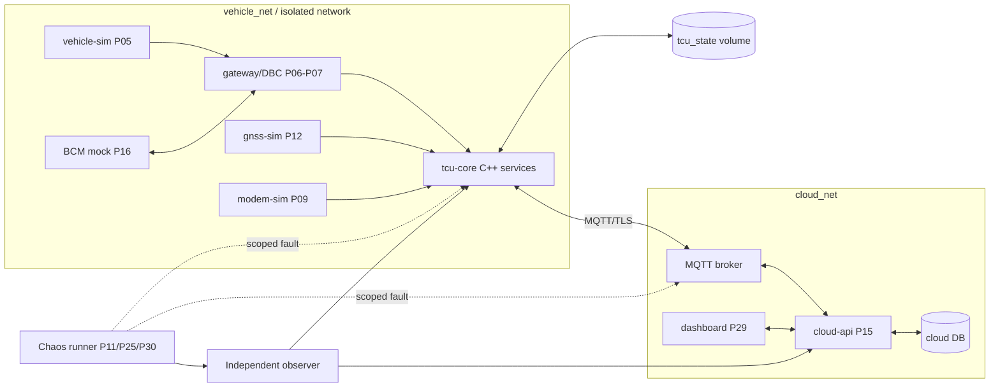
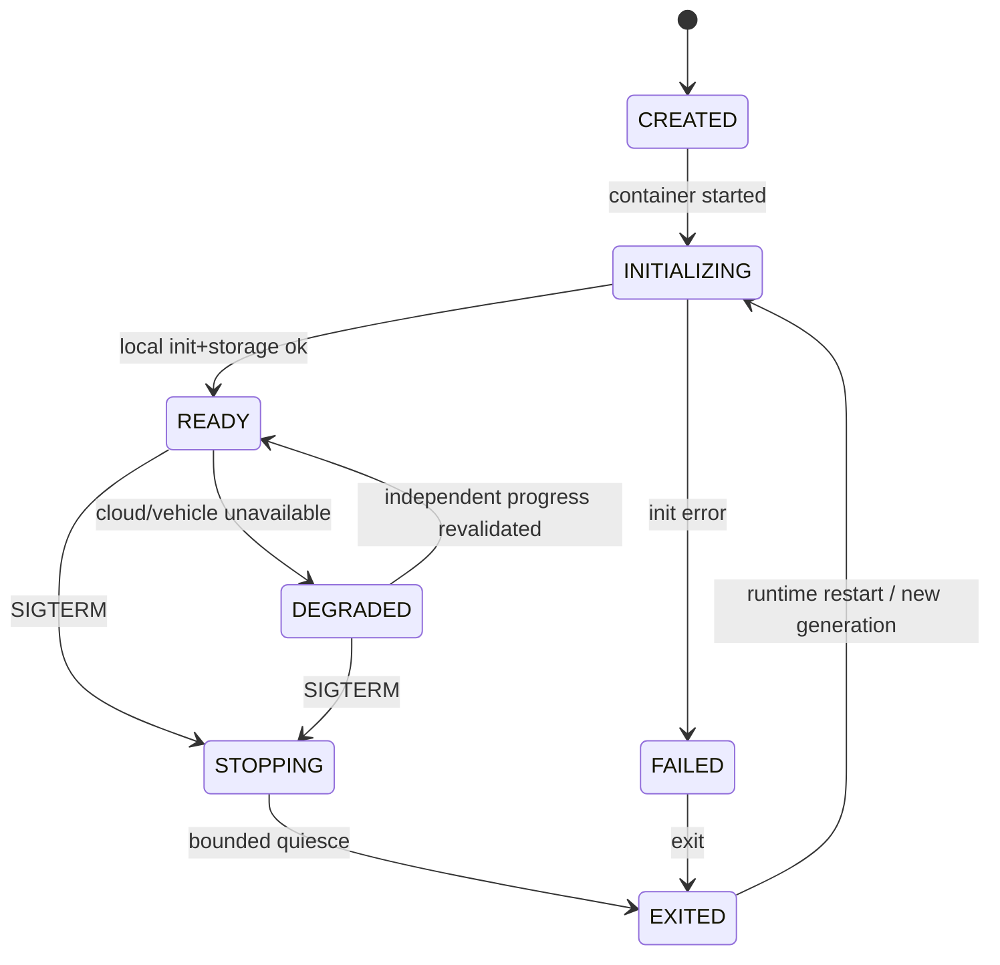
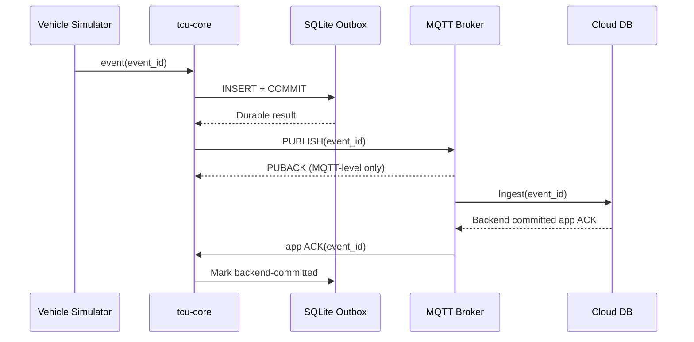
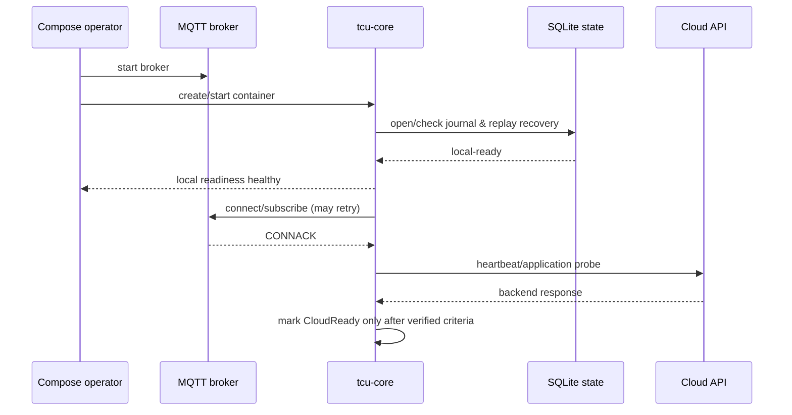
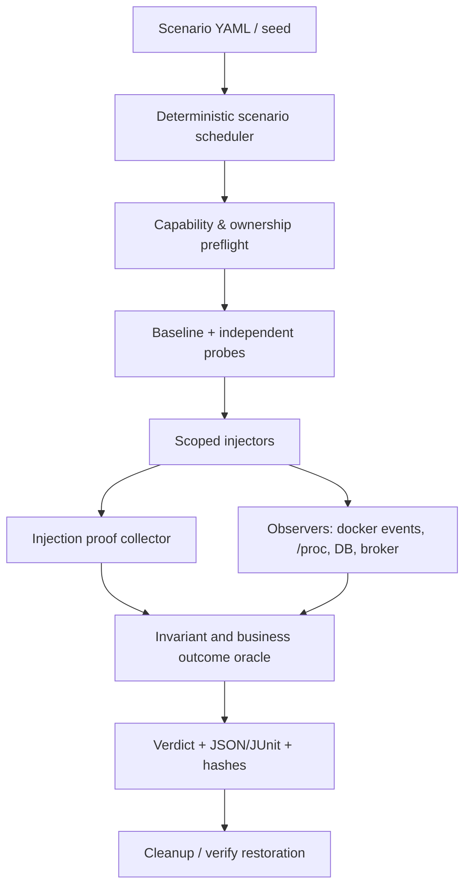

# Project 28 — Multi-Process TCU Container Lab — System Design & Resilience Test Plan

> **Virtual TCU Lab · P28 · v1.0 · 30/10/2026 · C++17/20 · Docker Compose v2 · Ubuntu Linux**
>
> **Trạng thái:** **DESIGN / TEST PLAN — chưa implement, chưa chạy 300 test cases.** Các thông số SLO đều là **mức đề xuất** để thảo luận, không phải số đo hoặc cam kết production.
>
> **Dependencies:** P01 Event Bus, P02 IPC, P03 Timer, P04 Config/Log, P05/P06/P07 CAN/Gateway, P09/P10 Modem/Connectivity, P11 Network Fault Injection, P12 GNSS, P13/P14 MQTT/Outbox, P15 Cloud, P16 Commands, P17 Health, P18/P19 OTA, P20/P21 Diagnostics, P22 Power, P23 Security, P24 Watchdog, P25 Soak Test, P26 Daemon, P27 Yocto/QEMU. **Feeds:** P29 Digital Twin, P30 Integration/Chaos.

## 0. Executive summary

Tạo **một TCU ảo đa tiến trình trên máy tính**, mỗi module được build thành executable C++ và chạy trong container riêng. Docker Compose chỉ là *lab orchestrator*: cung cấp network, volumes, container lifecycle, health probes và bộ công cụ test. Chức năng nghiệp vụ (reconnect, durable outbox, idempotency, safety, replay, OTA state) thuộc các service hoặc thư viện P01–P27, không được giả định Compose tự cung cấp.

Kết quả cuối cùng phải cho phép `docker compose up -d --build` khởi động topology giả lập; một runner độc lập inject network/disk/process faults; các oracle so sánh **source → TCU → broker → backend → SQLite**; sinh báo cáo `PASS/FAIL/INCONCLUSIVE/SKIPPED` có bằng chứng. Chỉ dùng credentials/lệnh CAN/OTA mô phỏng; **không kết nối xe hoặc modem thật**.

### Architecture Decision Records (ADR)

| ID | Quyết định | Lý do / trade-off |
|---|---|---|
| ADR-01 | Linux Docker Engine + Compose plugin v2; lưu phiên bản thực tế vào report | Hành vi plugin/Engine và kernel khác nhau; không khóa bằng từ khóa `latest`. |
| ADR-02 | Mỗi service nghiệp vụ là 1 process PID 1 trong container, nhận SIGTERM và reap child qua `init: true` khi cần | Quan sát lifecycle, shutdown, signal chính xác; không chạy systemd trong mỗi container. |
| ADR-03 | Mạng `vehicle_net` và `cloud_net`; `control_net` chỉ cho runner/observer khi cần | Đặt giới hạn east-west traffic; mạng `internal` không phải firewall theo user identity. |
| ADR-04 | Local *fake CAN bridge* là baseline portable; profile `socketcan_linux` dùng vcan do host provision sẵn | Không cần `--privileged` ở cấu hình chuẩn, Docker Desktop/WSL không bảo đảm vcan. |
| ADR-05 | Shared-memory Event Bus P01 chỉ nội process; cross-process dùng P02 IPC hoặc MQTT | Không đánh đồng queue memory với IPC giữa containers. |
| ADR-06 | Named volumes riêng cho `tcu_state`, `cloud_state`, `broker_data`; `/run` và `/tmp` tạm thời | Ngăn hủy data khi recreate container; `down -v` là destructive và chỉ được dùng với data test có consent. |
| ADR-07 | Dùng service-name DNS (`broker`, `cloud-api`) thay vì container IP | Container IP có thể đổi sau recreate. |
| ADR-08 | `depends_on: condition: service_healthy` chỉ hỗ trợ startup gating; mỗi client tự reconnect | Dependency healthy lúc start không bảo đảm duy trì healthy hoặc restart cascading. |
| ADR-09 | `healthcheck` = local basic readiness, `/progress` + end-to-end oracle = business health | Tránh false-positive khỏe chỉ vì TCP port open. |
| ADR-10 | Policy queue/retry hữu hạn, log/metrics bounded, CPU/memory/PIDs caps | Không tạo restart/reconnect storm hoặc OOM host. |
| ADR-11 | Runner có scope `COMPOSE_PROJECT_NAME` riêng và verify resource ownership | Fault injection/cleanup không được đụng container/network/volume ngoài lab. |
| ADR-12 | Command/OTA phải có test-only signed policy, idempotency journal, safety gate; failure state `UNKNOWN` | Không retry lệnh nguy hiểm một cách mù quáng. |
| ADR-13 | Trạng thái DB durable bằng `COMMIT` theo profile; MQTT PUBACK ≠ backend commit | Tránh thông báo success giả. |
| ADR-14 | CI release gate dựa trên oracle, injection proof và independent evidence | `INCONCLUSIVE` không được coi là `PASS`. |

### In scope / Out of scope

**In scope:** multi-process C++ architecture, Compose networks/volumes/config, startup graph, service discovery, UDS IPC, simulated CAN/GNSS/modem, MQTT/cloud, state/health/watchdog, bounded resources, observability, multiple faults, cleanup, reproducible tests, CI, Jira backlog.

**Out of scope:** HIL ECU, kiểm chứng arbitration/bus-off CAN thật, 4G modem RF, automotive secure boot, đo sleep current, safety certification ISO 26262 / cyber compliance ISO/SAE 21434, production Kubernetes/Swarm HA. Docker container không thay thế P27 Yocto/QEMU image: hai môi trường bổ sung nhau.

### Điều kiện môi trường

- Ubuntu 22.04/24.04 hoặc Linux tương đương với Docker Engine/Compose plugin; ghi `docker version`, `docker compose version`, kernel, cgroup mode, rootful/rootless.
- Tối thiểu khuyến nghị cho full lab: 8 CPU logical, 16 GB RAM, 30 GB disk *free* (đây là planning estimate; cấu hình nhỏ hơn chạy profile `core`).
- Fault tests yêu cầu sandbox VM/host test riêng, tránh chạy trên máy production/cùng data cá nhân.
- Rootless Docker, Docker Desktop và kernel thiếu `vcan`, `tc netem`, `CAP_NET_ADMIN` sẽ được `SKIPPED/INCONCLUSIVE` theo capability detection, không cố vượt quyền.

## 1. Actors, use cases và functional requirements

**Actors:** Middle C++ developer; DevOps/Embedded Linux integrator; SDET; Security Reviewer; Simulator Operator; independent test runner; TCU, mock ECU, broker, cloud, dashboard.

| ID | Functional requirement | Acceptance oracle |
|---|---|---|
| FR-01 | Compose tạo đủ service profile core/full từ pinned images | `docker compose config`, `ps --format json`, image digests |
| FR-02 | TCU services khám phá nhau bằng service DNS; reconnect sau recreate | health + actual request/response sau recreate |
| FR-03 | P02 IPC trên Unix socket hoặc loopback TCP tùy adapter, có framing và timeout | correlated request_id trace |
| FR-04 | P05/P06 gửi vehicle signals qua virtual CAN adapter, dữ liệu stale được đánh dấu | source frame_id → signal quality trace |
| FR-05 | P13 gửi telemetry và P14 lưu offline khi mất cloud/network | event_id in outbox, cloud database reconciliation |
| FR-06 | P15 tạo lệnh test, P23 validate, P16 + BCM mock thực thi theo policy | one logical command ID ↔ at-most-one execution effect |
| FR-07 | P18/P19 OTA mock và P22 Power có thể dùng trong profile full | journal + boot generation + safety constraints |
| FR-08 | Mỗi service có startup/health/degraded/shutdown protocol rõ | health/progress external oracle |
| FR-09 | Persist đúng state trên volume khi container recreate/restart | checksums, journal recovery, dedup IDs |
| FR-10 | Test runner inject faults có scope và rollback, chứng minh fault đã xảy ra | pre/post network/process/storage evidence |
| FR-11 | Crash/OOM/timeout làm toàn hệ thống degraded đúng thay vì success giả | independent status + invariant engine |
| FR-12 | Metrics/log/traces có `run_id`, `boot_id`, `service_generation`, `correlation_id` | consistency in report artifact |
| FR-13 | Security hardening: run nonroot, minimal capabilities, no embedded secrets | `docker inspect`, config linter, access tests |
| FR-14 | CI có repeatable smoke, integration và chaos suites | JUnit + signed/hash evidence manifest |

### NFRs / acceptance targets **đề xuất, cần baseline đo**

| ID | Tiêu chí | Cách kiểm chứng |
|---|---|---|
| NFR-01 | Không silent drop và không false business success trong profile đã cấu hình | count source IDs vs stored/failed IDs; ACK semantics oracle |
| NFR-02 | 100% command denied không đi vào BCM dispatcher | audit + BCM independent execution journal |
| NFR-03 | Không có `READY` khi local dependency/journal cần thiết chưa sẵn sàng | independent readiness observer |
| NFR-04 | Retry có exponential backoff + jitter, bounded pending ops | retry timestamps, queue depth, resource caps |
| NFR-05 | P95 local IPC latency < 100 ms tại baseline lab (giả định demo) | histogram dưới workload và hardware cố định |
| NFR-06 | Recovery P95 < 30 s sau broker recreate tại baseline (giả định demo) | failure-to-progress timestamps |
| NFR-07 | Memory/FD/thread usage đạt plateau trong 24h profile soak | per process generation trend, no restarts hiding leak |
| NFR-08 | Không xuất hiện secret plaintext trong logs/artifacts | redaction scan, rotate proof |
| NFR-09 | Không có container cap `privileged`/host network mặc định | generated config inspect |
| NFR-10 | Test `PASS` chỉ khi injection, oracle và evidence đều hợp lệ | result schema and negative-control tests |

## 2. Architecture: container topology



**Luồng dữ liệu:** `vehicle-sim → gateway → tcu-core.signal-service → outbox(SQLite) → MQTT → broker → cloud ingest → cloud DB → app ACK → outbox reconciler`. `event_id` không đổi trong retry/replay. `request_id` và `command_id` tách khỏi packet ID MQTT.

**Luồng lệnh:** `cloud API → authorized publish → MQTT → secure-command P23 → remote-control P16 → gateway/BCM mock → persisted result → MQTT → cloud`. Validation không bảo đảm execution; chỉ khi có chứng cứ từ BCM mock mới báo `EXECUTED`. Trạng thái không rõ là `OUTCOME_UNKNOWN`.

**Lưu ý network:** Containers phải cùng network mới resolve được tên nhau (trừ routing khác được cấu hình). `vehicle_net.internal: true` không ngăn một service **dual-homed** sang `cloud_net` đi internet bằng network còn lại. Network segregation cần `docker network inspect` và negative connectivity tests.

## 3. Module / process boundaries

| Container/service | Binary / nguồn | Input | Output | State | Liveness/Readiness |
|---|---|---|---|---|---|
| `vehicle-sim` | `vehicle_sim` | seed, route | CAN mock frames | seed journal optional | frame producer progression |
| `gateway` | `gateway_service` | CAN frame | validated signal/BCM request | route config | count + routing probe |
| `modem-sim` | `modem_sim` | AT/PTY scripted events | modem events | simulated session | AT response probe |
| `gnss-sim` | `gnss_sim` | route | NMEA/position | route index | GNSS sample progression |
| `tcu-core` | `tcu_core` | CAN, GPS, IPC, MQTT | telemetry, command result | SQLite durable outbox | journal ready + progress |
| `broker` | `mosquitto` | MQTT | MQTT | named volume optional | authenticated PUB/SUB probe |
| `cloud-api` | `cloud_api` | MQTT, HTTP | ACK, command | cloud SQLite | DB ready + commit probe |
| `observer` | test-only | event stream, health endpoints | metrics/evidence | artifacts volume | observer self-health |
| `chaos-runner` | test-only | scenario YAML | scoped faults | run journal | independent timeout |

**P01 EventBus** phục vụ event *trong* từng process; **P02 IPC** phục vụ liên process. Socket Unix chỉ dùng nếu cả hai container có mount cùng socket directory với permission kiểm soát; không dùng shared PID namespace như giải pháp IPC mặc định.

## 4. State models and lifecycles

### Service state machine



- `HEALTHY` của Docker là kết quả lệnh healthcheck; `READY` của ứng dụng là contract cục bộ; `BUSINESS_PROGRESS` yêu cầu oracle độc lập. Không suy ra lẫn nhau.
- Docker runtime **không tự restart container chỉ vì healthcheck `unhealthy`**; cần action/restart có cấu hình và operator/supervisor cụ thể.
- `depends_on.service_healthy` chờ điều kiện health lúc tạo phụ thuộc; không thay thế tự reconnect khi dependency sau đó chết.
- `depends_on.restart: true` áp dụng cho **explicit Compose operations** trên dependency, không phải mọi restart tự động do Docker runtime.

### Command lifecycle

`RECEIVED → VERIFIED → AUTHORIZED → JOURNALED → DISPATCHING → (EXECUTED | DENIED | FAILED | OUTCOME_UNKNOWN)`; trạng thái terminal có fencing. Trường hợp timeout sau dispatch **không được hạ thành DENIED**.

### Fault test lifecycle

`PLANNED → PROVISIONED → BASELINED → ARMED → INJECTED → OBSERVED → RECOVERED → EVALUATED → CLEANED`; nếu không có injection proof hoặc mất evidence chính thì `INCONCLUSIVE`, không `PASS`.

## 5. API / C++17 contracts

```cpp
namespace tcu::lab {
struct ServiceIdentity {
    std::string name;
    std::string instance_id;       // container incarnation
    uint64_t generation;            // persisted/session epoch
};
struct Envelope {
    std::string event_id;
    std::string correlation_id;
    uint64_t source_generation;
    std::chrono::steady_clock::time_point received_at;
    std::vector<std::byte> payload;
};
enum class TransportStatus { Connected, Degraded, Disconnected };
class ITransport {
public:
    virtual ~ITransport() = default;
    virtual TransportStatus status() const noexcept = 0;
    virtual bool send(Envelope message) = 0;
};
class ILifecycle {
public:
    virtual ~ILifecycle() = default;
    virtual bool start() = 0;
    virtual void requestStop() noexcept = 0;
    virtual void join() = 0;
};
class IHealthProbe {
public:
    virtual ~IHealthProbe() = default;
    virtual bool isLocalReady() const noexcept = 0;
    virtual uint64_t businessProgress() const noexcept = 0;
};
class IMonotonicClock {
public:
    virtual ~IMonotonicClock() = default;
    virtual std::chrono::steady_clock::time_point now() const noexcept = 0;
};
}
```

**Contracts:**

1. `send()` success chỉ = được local transport chấp nhận; không chứng minh MQTT broker/backend/vehicle effect.
2. `generation` đổi khi service incarnation đổi. Callback old generation bị loại bỏ trước khi mutate state mới.
3. `start()` idempotent theo policy hoặc trả lỗi rõ; không spawn duplicate workers.
4. `requestStop()` phải nonblocking/idempotent; `join()` không tự join chính worker thread.
5. Handler không giữ mutex khi gọi external IPC/network callbacks; bounded queue quyết định drop/reject policy rõ.
6. Cancellation không hủy cưỡng bức transaction đã dispatch; cần reconcile outcome.
7. Không dùng `std::chrono::system_clock` để đo timeout; UTC chỉ dành cho timestamp hiển thị với quality flag.

## 6. IPC, event ordering, delivery semantics

- Unix Domain Socket frame `[magic, version, flags, length, correlation_id, payload, CRC]`; decode partial reads và multi-frame; giới hạn `max_frame_bytes` (mặc định demo 64 KiB) trước allocation.
- Mỗi request có một terminal result, keyed `(service_generation, correlation_id)`; late response khác generation bị bỏ và ghi metric.
- Receiver không suy ra exactly-once từ TCP, MQTT QoS hay IPC ACK. Replay/duplicate xử lý ở business layer bằng idempotency ledger.
- Ordering chỉ cam kết trong một per-device lane khi policy cần; không cam kết total ordering qua nhiều MQTT topics/processes.
- IPC UDS path dùng **named volume chung chuyên dụng** mount ở `/run/tcu-ipc` trong đúng hai containers được phép (không tạo `tmpfs` đè chính mount này); xóa stale socket đúng owner/generation, không xóa nhầm socket service đang chạy.

## 7. Persistence, durability, event contracts



- `SQLite COMMIT` durability phụ thuộc PRAGMA `synchronous` và storage profile; không tuyên bố khả năng chống power loss của host từ container-only test.
- WAL, DB, `-shm`, `-wal` cần ở cùng volume/mount; không mount SQLite DB qua mạng tùy tiện.
- Idempotency key `(tenant_id, device_id, event_id)` tại backend; event ID payload conflict phải bị reject/audit.
- `docker compose down` mặc định giữ named volumes; `docker compose down -v` **xóa volume do Compose quản lý** và chỉ được dùng với test data đã xác định. Không coi `docker compose restart` là reconfigure (phải recreate).
- `RUN_ID` test không được làm thay đổi `event_id` của một event đang replay.

## 8. Security and isolation design

- `user: 10001:10001`, drop all caps, `no-new-privileges:true`, `read_only:true`, `tmpfs:/tmp`, chỉ thêm volume/state writable và `pids_limit`, `mem_limit`, `cpus` khi host hỗ trợ. Hạn chế syscalls với seccomp mặc định.
- Không mount `/var/run/docker.sock` vào TCU services. **Chaos runner** nếu cần Docker API chỉ chạy ngoài sandbox TCU, giới hạn theo label/project allowlist và môi trường riêng; quyền Docker API gần tương đương quyền mạnh trên host.
- Secrets là files/Compose secrets demo hoặc external secret store; **không đưa credentials thật vào repo, image layer, ENV hoặc logs**; chmod/uid/rotation/expiry được test.
- TLS/mTLS trên MQTT và HTTPS khi test security profile. Local unencrypted MQTT chỉ ở isolated development profile được dán nhãn `INSECURE_LAB_ONLY`.
- Host network, `privileged: true`, bind mount `/dev` hay `/` host: **forbidden** mặc định. Test CAN thật phải có profile/threat review riêng.
- Port published cho Dashboard/API mặc định `127.0.0.1:...` nếu cần; không publish broker/SQLite ngoài host.
- Container image digest pin; CI scan SBOM, verify provenance và test người dùng non-root.

## 9. Resource budgets, observability và invariants

**Budget demo** (điều chỉnh sau profiling): `tcu-core` CPU 1.5, RAM 768 MiB, PIDs 128; `broker` 0.5 CPU / 256 MiB; `cloud-api` 1 CPU / 512 MiB; `vehicle-sim` 0.5 CPU / 256 MiB; total lab cap độc lập. Giới hạn không chứng minh latency yêu cầu; phải đo dưới load.

**Metrics:** `tcu_events_received_total`, `tcu_events_persisted_total`, `tcu_event_outbox_depth`, `tcu_backend_acked_total`, `tcu_commands_dispatched_total`, `tcu_commands_executed_total`, `tcu_stale_callback_total`, `tcu_reconnect_attempts_total`, `tcu_queue_rejected_total`, `tcu_health_progress_epoch`, `tcu_last_business_progress_seconds`, `lab_fault_injection_success`, cgroup memory/CPU/oom, container restart count.

**Top invariants (đánh số để liên kết với test):**

| ID | Invariant bắt buộc |
|---|---|
| INV-01 | Không có lệnh chưa xác thực/chưa đủ safety state đi tới mock BCM. |
| INV-02 | Một command_id + payload canonical chỉ tạo tối đa một effect; conflict phải deny. |
| INV-03 | Không báo backend committed từ MQTT PUBACK đơn thuần. |
| INV-04 | Không biến signal stale/invalid thành VALID sau restart/reconnect. |
| INV-05 | Không leak, deadlock, unbounded queue, zombie child sau stop/restart vòng lặp. |
| INV-06 | Không nhận callback session/generation cũ làm hoàn tất tác vụ mới. |
| INV-07 | Quá tải phải có bounded reject/backpressure, visible metrics, không silent loss. |
| INV-08 | State durable được reconcile trước khi READY; no false recovery. |
| INV-09 | Không truy cập service/storage trái segment/quyền. |
| INV-10 | Fault runner chỉ mutate resource của run được phép và restore hoặc ghi cleanup failure. |
| INV-11 | Không đánh PASS nếu injection proof/oracle evidence thiếu hoặc source observer mất dữ liệu. |
| INV-12 | OTA trial/rollback policy và power safety giữ ưu tiên dù các container khác crash. |

**Verdicts:** `PASS` = fault proved + oracle passed + evidence complete; `FAIL` = invariant violated; `INCONCLUSIVE` = fault not proved, missing observer, ambiguous outcome; `SKIPPED` = unsupported environment/capability with reason. Failure trong cleanup là kết quả riêng và cần cảnh báo, không nuốt vào PASS.

## 10. Baseline Compose topology (snippet mẫu)

> Ví dụ dùng **image build sẵn** `local/tcu-*:<gitsha>` được thay bằng image từ source riêng. Chưa phải tập Compose đã được chạy kiểm chứng. Host Linux/Engine có thể khác ở một số trường hỗ trợ. Có thể kiểm tra bằng `docker compose config` sau khi thiết lập biến môi trường. Không đưa quyền Docker socket vào container TCU.

```yaml
name: virtual-tcu-lab
services:
  broker:
    image: eclipse-mosquitto:2
    volumes:
      - ./configs/mosquitto.conf:/mosquitto/config/mosquitto.conf:ro
      - broker_data:/mosquitto/data
    networks: [cloud_net]
    restart: on-failure:3
    healthcheck:
      test: ["CMD", "sh", "-c", "test -r /mosquitto/config/mosquitto.conf"]
      interval: 10s
      retries: 3
    # Demo check above only proves file readability, NOT MQTT business readiness.

  cloud-api:
    image: local/tcu-cloud:${TCU_IMAGE_TAG:?set_TCU_IMAGE_TAG}
    user: "10001:10001"
    cap_drop: [ALL]
    security_opt: ["no-new-privileges:true"]
    read_only: true
    tmpfs: [/tmp]
    volumes: ["cloud_state:/var/lib/tcu"]
    networks: [cloud_net]
    depends_on:
      broker: {condition: service_started}
    restart: on-failure:3

  vehicle-sim:
    image: local/tcu-vehicle-sim:${TCU_IMAGE_TAG:?set_TCU_IMAGE_TAG}
    user: "10001:10001"
    cap_drop: [ALL]
    security_opt: ["no-new-privileges:true"]
    networks: [vehicle_net]
    restart: on-failure:3

  tcu-core:
    image: local/tcu-core:${TCU_IMAGE_TAG:?set_TCU_IMAGE_TAG}
    init: true
    user: "10001:10001"
    cap_drop: [ALL]
    security_opt: ["no-new-privileges:true"]
    read_only: true
    tmpfs: [/tmp, /run]
    volumes: ["tcu_state:/var/lib/tcu"]
    networks: [vehicle_net, cloud_net]
    mem_limit: 768m
    pids_limit: 128
    cpus: 1.5
    stop_grace_period: 30s
    depends_on:
      vehicle-sim: {condition: service_started}
      broker: {condition: service_started}
    restart: on-failure:3

networks:
  vehicle_net: {internal: true}
  cloud_net: {}
volumes:
  tcu_state: {}
  cloud_state: {}
  broker_data: {}
```

**Cần cải thiện khi implement:** thay probe broker file-readable bằng MQTT authenticated roundtrip; readiness endpoint của `tcu-core` độc lập với cloud; `cloud-api` có TLS, application ACK outbox, healthprobe; điều chỉnh volume ownership (named volumes tạo bởi root cần init ownership có kiểm soát); thêm profiles `core/full/chaos`/network monitor, log retention và không lạm dụng `depends_on`.

### Dockerfile C++17 multi-stage (khung)

```dockerfile
FROM ubuntu:24.04 AS builder
RUN apt-get update && apt-get install -y --no-install-recommends     g++ cmake ninja-build libssl-dev && rm -rf /var/lib/apt/lists/*
WORKDIR /src
COPY CMakeLists.txt ./
COPY src ./src
RUN cmake -S . -B /build -G Ninja -DCMAKE_BUILD_TYPE=Release  && cmake --build /build --parallel

FROM ubuntu:24.04
RUN groupadd -g 10001 tcu && useradd -u 10001 -g 10001 -m tcu
# Production: copy required runtime libraries, pin base image digest, vulnerability scan.
COPY --from=builder /build/bin/tcu-core /usr/local/bin/tcu-core
USER 10001:10001
ENTRYPOINT ["/usr/local/bin/tcu-core"]
```

**Lưu ý:** runtime may need shared libraries not copied by skeleton. Verify `ldd`/ELF ABI and use final image integration test. Pin `ubuntu@sha256:...` **khi có digest hợp lệ** thay vì invent digest. Không bật systemd `Type=notify` bên trong container theo mặc định (P26 dùng ngoài host/Yocto).

## 11. Operational behavior / sequence

### 11.1 Startup, READY và reconnect



**B-01:** Offline cloud at startup leaves local state `READY/DEGRADED`, not false `CloudReady`; bounded retry resumes later. **B-02:** Broker recreate changes IP, client resolves service name again. **B-03:** A container showing `healthy` does not mean end-to-end telemetry accepted.

### 11.2 Graceful shutdown / crash recovery

1. Orchestrator sends SIGTERM to PID 1, tcu-core rejects new mutable work and starts shutdown deadline.
2. Stop producers, drain/stop queues by policy, persist reconciliation records, close IPC, flush local DB journal, stop workers, exit.
3. After grace period, runtime may SIGKILL; test must inject SIGKILL to validate idempotent recovery.
4. On restart, allocate fresh generation, reconcile outbox/command/OTA state **before** claiming local readiness.
5. Do not infer remote command result from process exit code or MQTT QoS acknowledgement.

### 11.3 Cloud down / telemetry recovery

- `tcu-core` continues CAN/GNSS ingestion while bounded outbox has room.
- On storage pressure reject or drop **only by explicit priority policy**, emit metrics and durable alert when possible.
- When cloud recovers, replay original `event_id`; backend stores canonical event once; APP ACK reconciles outbox.

### 11.4 Health and watchdog

- Docker `healthcheck`: local address/IPC/journal ability only; counter progress check separate.
- Health observer detects non-progress with independent clock and distinct process; restarts are owned by runtime policy, recovery reconciliation by P24.
- Healthcheck `unhealthy` **không** tự làm Docker Engine restart container. Nếu lab muốn remediation, tạo observer action theo allowlist, test repeatability và restart budget, không lặp restart vô hạn.

## 12. Fault injection engine design

`FaultSpec = {run_id, target_service, generation, fault_type, activate_at, duration, rollback, precondition, proof}`. Supported baseline actions: `docker compose kill`, `docker compose stop/restart`, `docker network disconnect/connect`, `docker pause/unpause`, resource pressure in lab-only service, network latency/loss via scoped Linux netns where supported, fake broker/DNS/clock/IPC/SQLite errors inside adapters. Every fault must verify target's label/project and identity **immediately before execution**, use fail-closed on mismatch.

| Fault type | Inject method | Prove applied | Cleanup |
|---|---|---|---|
| Process SIGKILL | `docker compose kill -s SIGKILL tcu-core` | exit code, container event/generation | restart explicit if policy allows |
| Broker unavailable | stop `broker` | observer active MQTT probe fails | `docker compose up -d broker` |
| Network disconnect | `docker network disconnect` scoped network + container | Docker network inspect, probe fails | scoped connect + verify |
| Delay/loss | P11 `tc netem` within owned netns or fake transport | tc counters + measured probe RTT/loss | restore exactly owned qdisc |
| IPC malformed payload | simulator sends invalid length/frame | decoder rejection counter | close test client |
| DB busy/full/corrupt | SQLite fake VFS, disk quota/test volume fixture | DB error code, pragma, disk proof | use disposable copy, never overwrite baseline |
| CPU/Memory pressure | cgroup/test workload within budget | cgroup `memory.events`, PSI, CPU stats | terminate workload + check baseline |
| Clock jump | injectable clock in service (not host date) | clock source snapshot | reset fake clock |
| SIGTERM mid-COMMIT | test process stop at hook then kill | persisted journal & pre/post DB diff | restart reconcile |

**No-go:** never inject on host network interface used for user connectivity, never run broad `docker system prune`, never delete arbitrary volumes, never expose Docker socket to workload services, never run unsafe privilege escalation in CI.

## 13. Test harness / evidence architecture



**Evidence fields:** `run_id`, `case_id`, `seed`, `git_sha`, `image_digest`, `compose_config_hash`, `host_kernel`, `docker_engine_version`, `compose_version`, `service`, `container_id`, `start_time_monotonic`, `fault_start/end`, `fault_proof`, `observer_gaps`, `event_id`, `command_id`, `invariant_id`, `verdict`, `reason`, `artifacts_sha256`, `cleanup_status`.

**Avoid false PASS:** inject negative-control fault known to violate invariant and ensure oracle FAILs; kill observer to force INCONCLUSIVE; mismatch target project name must fail closed; repeat same seed with changed scheduling/timing to reveal flakiness; do not consider logging-only evidence sufficient for durable data.

## 14. Test storage schema (SQLite evidence journal)

```sql
PRAGMA foreign_keys = ON;
CREATE TABLE IF NOT EXISTS runs (
  run_id TEXT PRIMARY KEY,
  project_name TEXT NOT NULL,
  source_sha TEXT NOT NULL,
  config_sha TEXT NOT NULL,
  status TEXT NOT NULL CHECK(status IN ('PLANNED','RUNNING','FINISHED','ABORTED')),
  started_utc TEXT NOT NULL
);
CREATE TABLE IF NOT EXISTS cases (
  run_id TEXT NOT NULL REFERENCES runs(run_id),
  case_id TEXT NOT NULL,
  seed INTEGER NOT NULL,
  verdict TEXT NOT NULL CHECK(verdict IN ('PASS','FAIL','INCONCLUSIVE','SKIPPED')),
  injected INTEGER NOT NULL CHECK(injected IN (0,1)),
  oracle_complete INTEGER NOT NULL CHECK(oracle_complete IN (0,1)),
  reason TEXT,
  PRIMARY KEY(run_id, case_id),
  CHECK(verdict <> 'PASS' OR (injected = 1 AND oracle_complete = 1))
);
CREATE TABLE IF NOT EXISTS evidence (
  run_id TEXT NOT NULL,
  case_id TEXT NOT NULL,
  evidence_id TEXT NOT NULL,
  kind TEXT NOT NULL,
  sha256 TEXT NOT NULL,
  uri TEXT NOT NULL,
  PRIMARY KEY(run_id,case_id,evidence_id),
  FOREIGN KEY(run_id,case_id) REFERENCES cases(run_id,case_id)
);
CREATE TABLE IF NOT EXISTS cleanup (
  run_id TEXT PRIMARY KEY REFERENCES runs(run_id),
  status TEXT NOT NULL CHECK(status IN ('PENDING','RESTORED','FAILED')),
  details TEXT
);
```

Never put secrets in evidence; apply redaction and access controls before archive. SQL schema controls only record structure: it does **not** prove that faults or system behavior were correctly observed.

## 15. What-if test catalog — 300 tình huống trong 30 nhóm

**Mục đích:** kiểm chứng khả năng chịu lỗi và *chất lượng phản ứng* của hệ thống, không chỉ “không crash”. Mỗi trường hợp dưới đây là test specification có **Fault/Inject**, **Expected behavior** và **Evidence/Oracle**. Các case chưa thực thi. Tester phải thêm preconditions, script version, test seed, input payload, SLA cụ thể và lưu raw evidence. `P0` = cần ưu tiên chạy trước theo mức nguy cơ trong lab, `P1` = mở rộng. Nhóm được thiết kế để không bỏ sót lớp OS/Compose cũng như các lỗi nghiệp vụ TCU.

**Test sequence chuẩn:** clean scoped baseline → chứng minh trạng thái trước lỗi → inject đúng target/generation → xác minh inject tác dụng → quan sát state/memory/network/data → restore → assert invariants → evidence hash → verdict. Không dùng cùng một oracle để vừa inject vừa tự tuyên bố pass. Những lỗi đụng thật tới host chỉ chạy trên VM disposable.

### 15.01. Compose configuration & profiles (WI-28-01-01..10)

| Case ID | Fault / cách inject | Expected behavior | Independent evidence / oracle | Priority |
|---|---|---|---|---|

| `WI-28-01-01` | Thiếu biến TCU_IMAGE_TAG trong profile full | Config validation phải fail trước khi tạo bất kỳ container nào | docker compose config + service topology diff | P0 |

| `WI-28-01-02` | Hai service định nghĩa container_name trùng nhau | Reject deployment; không dùng state của Compose project khác | docker compose config + service topology diff | P0 |

| `WI-28-01-03` | Dùng image tag floating thay vì pinned digest ở release profile | Release gate chặn và ghi rõ artifact chưa được khóa | docker compose config + service topology diff | P0 |

| `WI-28-01-04` | Bật profile chaos ngoài ý muốn trong CI smoke | Runner từ chối vì danh sách profiles không khớp run manifest | docker compose config + service topology diff | P0 |

| `WI-28-01-05` | Thứ tự merge nhiều compose override tạo mount bất ngờ | Effective config được diff, từ chối privileged/bind mounts lạ | docker compose config + service topology diff | P0 |

| `WI-28-01-06` | Đổi network name giữa hai lần up | Không tái sử dụng network ngoài scope; reconfigure có kiểm soát | docker compose config + service topology diff | P0 |

| `WI-28-01-07` | Thiếu dịch vụ bắt buộc do profile không active | Preflight phát hiện dependency absent, không false READY | docker compose config + service topology diff | P0 |

| `WI-28-01-08` | YAML có environment key sai type | Compose validation báo lỗi, không giả định parser ứng dụng tự sửa | docker compose config + service topology diff | P1 |

| `WI-28-01-09` | Config file có giá trị path trỏ ra ngoài lab | Ownership/path guard reject trước khi mount | docker compose config + service topology diff | P1 |

| `WI-28-01-10` | Cấu hình hợp lệ nhưng image local không tồn tại | Deployment FAIL rõ; không pull ngầm image không được phép | docker compose config + service topology diff | P1 |

### 15.02. Build images, ABI, supply chain (WI-28-02-01..10)

| Case ID | Fault / cách inject | Expected behavior | Independent evidence / oracle | Priority |
|---|---|---|---|---|

| `WI-28-02-01` | Container của tcu-core dùng binary ARM trong image amd64 | Startup fail rõ; không báo service READY | image inspect + digest / SBOM + ELF loader logs | P0 |

| `WI-28-02-02` | Binary link thư viện libc++/libstdc++ không có trong runtime | Image integration test fail tại load, không phát hành artifact | image inspect + digest / SBOM + ELF loader logs | P0 |

| `WI-28-02-03` | Pinned base digest khác so với lockfile | CI quarantine artifact, không chạy với base sai provenance | image inspect + digest / SBOM + ELF loader logs | P0 |

| `WI-28-02-04` | Build cache dùng nhầm header generated từ commit cũ | Build manifest/ABI smoke phát hiện mismatch | image inspect + digest / SBOM + ELF loader logs | P0 |

| `WI-28-02-05` | Đổi C++ ABI giữa gateway và IPC consumer | Handshake version reject thay vì decode sai payload | image inspect + digest / SBOM + ELF loader logs | P0 |

| `WI-28-02-06` | SBOM thiếu dependency TLS quan trọng | Release evidence không đầy đủ, gate block | image inspect + digest / SBOM + ELF loader logs | P0 |

| `WI-28-02-07` | Image có secret bị COPY từ build context | Scan image layer detect và fail pipeline | image inspect + digest / SBOM + ELF loader logs | P0 |

| `WI-28-02-08` | Một container chạy binary của source SHA khác các container còn lại | Compatibility matrix/version handshake chuyển degraded/deny | image inspect + digest / SBOM + ELF loader logs | P1 |

| `WI-28-02-09` | CI build xong nhưng image digest bị thay trước deploy | Digest verify fail closed | image inspect + digest / SBOM + ELF loader logs | P1 |

| `WI-28-02-10` | Rebuild cùng source nhưng dependency không pin tạo image khác | Reproducibility diff được báo, không gọi deterministic | image inspect + digest / SBOM + ELF loader logs | P1 |

### 15.03. Startup dependencies and partial readiness (WI-28-03-01..10)

| Case ID | Fault / cách inject | Expected behavior | Independent evidence / oracle | Priority |
|---|---|---|---|---|

| `WI-28-03-01` | Broker khởi động chậm hơn tcu-core 90 giây | TCU local READY/DEGRADED; retry bounded đến khi kết nối | docker events + independent readiness + service logs | P0 |

| `WI-28-03-02` | Cloud API chạy trước SQLite data migration | Cloud không phát business READY trước schema/version check | docker events + independent readiness + service logs | P0 |

| `WI-28-03-03` | Vehicle simulator chưa sẵn sàng khi TCU nhận IGNITION signal | Signal quality UNKNOWN; không tự suy ra ignition OFF | docker events + independent readiness + service logs | P0 |

| `WI-28-03-04` | Service A start trước dependency B mặc dù có depends_on short syntax | Reconnect được khi B xuất hiện; no startup deadlock | docker events + independent readiness + service logs | P0 |

| `WI-28-03-05` | Healthcheck broker chỉ đọc được file config nhưng không PUBLISH/SUBSCRIBE được | Business oracle ghi broker unavailable thay vì CloudReady | docker events + independent readiness + service logs | P0 |

| `WI-28-03-06` | Cloud API báo healthy rồi database connection mất ngay | Service chuyển degraded, không giữ readiness stale | docker events + independent readiness + service logs | P0 |

| `WI-28-03-07` | Watchdog bắt đầu trước khi recovery journal load | Không báo business progress đến khi reconcile xong | docker events + independent readiness + service logs | P0 |

| `WI-28-03-08` | Volume mount lỗi nhưng process vẫn mở cổng HTTP | Readiness gate fail vì state store không dùng được | docker events + independent readiness + service logs | P1 |

| `WI-28-03-09` | Dependency có healthcheck luôn unhealthy | Compose không tạo downstream theo service_healthy; báo blocked rõ | docker events + independent readiness + service logs | P1 |

| `WI-28-03-10` | Hai dependency chờ readiness của nhau theo cấu hình circular | Preflight graph detect cycle, không treo deployment vô hạn | docker events + independent readiness + service logs | P1 |

### 15.04. Healthcheck, false health, watchdog (WI-28-04-01..10)

| Case ID | Fault / cách inject | Expected behavior | Independent evidence / oracle | Priority |
|---|---|---|---|---|

| `WI-28-04-01` | HTTP /health trả 200 nhưng processing thread deadlock | Independent progress monitor phát hiện HUNG | independent /progress probe + last committed event | P0 |

| `WI-28-04-02` | Healthcheck script crash nhưng service vẫn xử lý dữ liệu | Tách probe failure khỏi business failure, verdict không false SUCCESS | independent /progress probe + last committed event | P0 |

| `WI-28-04-03` | Container bị unhealthy nhưng restart policy on-failure đang bật | Không giả định Docker tự restart chỉ vì unhealthy | independent /progress probe + last committed event | P0 |

| `WI-28-04-04` | Tăng start_period khiến probe chưa chạy trong giai đoạn lỗi | Không báo PASS khi chưa có probe evidence | independent /progress probe + last committed event | P0 |

| `WI-28-04-05` | Readiness local thành công nhưng broker auth thất bại | CloudReady false; local-ready không bị kéo xuống trừ policy | independent /progress probe + last committed event | P0 |

| `WI-28-04-06` | Service báo READY trước khi replay outbox | Invariant INV-08 fail | independent /progress probe + last committed event | P0 |

| `WI-28-04-07` | Process heartbeat còn chạy nhưng SQLite worker bị block | Progress oracle phát hiện zero commits | independent /progress probe + last committed event | P0 |

| `WI-28-04-08` | Healthcheck timeout do CPU starvation ngắn | Không restart storm; record transient/debounce | independent /progress probe + last committed event | P1 |

| `WI-28-04-09` | Observer đọc health từ container incarnation đã bị thay | Loại bỏ old generation result | independent /progress probe + last committed event | P1 |

| `WI-28-04-10` | Healthcheck qua stale DNS cache trả data cũ | Endpoint generation/version check chặn healthy giả | independent /progress probe + last committed event | P1 |

### 15.05. Container lifecycle, signals and PID 1 (WI-28-05-01..10)

| Case ID | Fault / cách inject | Expected behavior | Independent evidence / oracle | Priority |
|---|---|---|---|---|

| `WI-28-05-01` | SIGTERM đến giữa write SQLite transaction | Stop bounded; restart reconcile commit outcome | docker events + exit code + thread/FD snapshots | P0 |

| `WI-28-05-02` | SIGKILL ngay sau commit nhưng trước ACK | No duplicate business event; replay same event_id | docker events + exit code + thread/FD snapshots | P0 |

| `WI-28-05-03` | Container restart do manual compose restart | State loss chỉ với ephemeral, named volumes vẫn còn | docker events + exit code + thread/FD snapshots | P0 |

| `WI-28-05-04` | Process fork child rồi PID 1 thoát | init/reaper xử lý zombie; no stale successful exit | docker events + exit code + thread/FD snapshots | P0 |

| `WI-28-05-05` | SIGTERM đến hai lần trong lúc shutdown | Idempotent stop, không double-free | docker events + exit code + thread/FD snapshots | P0 |

| `WI-28-05-06` | Stop grace 1 giây ngắn hơn flush policy | Truyền thông báo incomplete drain, crash recovery kiểm chứng | docker events + exit code + thread/FD snapshots | P0 |

| `WI-28-05-07` | pause container khiến watchdog ngừng được scheduler | Observer báo paused, không phân loại nhầm crash | docker events + exit code + thread/FD snapshots | P0 |

| `WI-28-05-08` | unpause sau khi client request hết hạn | Timeout responses không được nhận thành success | docker events + exit code + thread/FD snapshots | P1 |

| `WI-28-05-09` | kill cloud-api khi HTTP response đang serialize | Client nhận UNKNOWN hoặc retry safe theo policy | docker events + exit code + thread/FD snapshots | P1 |

| `WI-28-05-10` | container được recreate liên tiếp 100 lần | Không leak sockets/FD/volumes ngoài scoped cleanup | docker events + exit code + thread/FD snapshots | P1 |

### 15.06. Restart policy & crash loops (WI-28-06-01..10)

| Case ID | Fault / cách inject | Expected behavior | Independent evidence / oracle | Priority |
|---|---|---|---|---|

| `WI-28-06-01` | tcu-core exit non-zero ba lần liên tiếp | Restart on-failure:3 có giới hạn theo runtime policy; escalation documented | restart counter + budget journal + docker events | P0 |

| `WI-28-06-02` | Process exit 0 dù functionality failed | Không kỳ vọng on-failure restart; independent oracle phát hiện | restart counter + budget journal + docker events | P0 |

| `WI-28-06-03` | On-failure restart tạo generation mới nhưng state file còn lock | Stale lock được reconcile theo owner epoch | restart counter + budget journal + docker events | P0 |

| `WI-28-06-04` | Broker auto-restart khi TCP connection đang sống | Client reconnect và resolve lại hostname | restart counter + budget journal + docker events | P0 |

| `WI-28-06-05` | Cloud process crash 50 lần khiến CPU/DNS storm | Circuit breaker, bounded retries, restart budget | restart counter + budget journal + docker events | P0 |

| `WI-28-06-06` | Supervisor và custom P24 cùng yêu cầu restart | Single restart owner/coordination, tránh double action | restart counter + budget journal + docker events | P0 |

| `WI-28-06-07` | Manual stop service với unless-stopped policy | Không tự bật lại ngoài ý định operator trong lifecycle kiểm thử | restart counter + budget journal + docker events | P0 |

| `WI-28-06-08` | Docker daemon restart nhưng Compose CLI không chạy | Runtime state phải được quan sát, không giả định Compose đang supervise | restart counter + budget journal + docker events | P1 |

| `WI-28-06-09` | depends_on restart:true gặp runtime auto-restart dependency | Không kỳ vọng dependent tự restart; tự reconnect | restart counter + budget journal + docker events | P1 |

| `WI-28-06-10` | Restart xảy ra giữa việc rotate identity certificate | Reload credential generation nhất quán, no credential rollback | restart counter + budget journal + docker events | P1 |

### 15.07. Service-name DNS and recreated endpoints (WI-28-07-01..10)

| Case ID | Fault / cách inject | Expected behavior | Independent evidence / oracle | Priority |
|---|---|---|---|---|

| `WI-28-07-01` | Broker container recreate đổi IP | Client DNS re-resolve broker, không hardcode IP | DNS lookup logs + connection attempts + TCP traces | P0 |

| `WI-28-07-02` | Cloud API bị replace khi TCP keepalive còn mở | Detect EOF/RST và reconnect đúng service name | DNS lookup logs + connection attempts + TCP traces | P0 |

| `WI-28-07-03` | DNS query tạm trả NXDOMAIN trong lúc service recreate | Bounded retry, không cache NXDOMAIN vĩnh viễn | DNS lookup logs + connection attempts + TCP traces | P0 |

| `WI-28-07-04` | DNS answer cũ dẫn đến endpoint không tồn tại | Reconnect không hoàn tất dựa vào old IP | DNS lookup logs + connection attempts + TCP traces | P0 |

| `WI-28-07-05` | Tên service tương tự broker/brokerr bị typo | Config validation hoặc connectivity error rõ, no unexpected fallback | DNS lookup logs + connection attempts + TCP traces | P0 |

| `WI-28-07-06` | Hai Compose projects có service name giống nhau | Mạng/namespace scope ngăn cross-project resolution sai | DNS lookup logs + connection attempts + TCP traces | P0 |

| `WI-28-07-07` | Network alias bị trùng trong cùng network | Detect ambiguous destination, không gửi command đến sai service | DNS lookup logs + connection attempts + TCP traces | P0 |

| `WI-28-07-08` | DNS trả IPv6 nhưng service chỉ lắng nghe IPv4 | Client có address-family fallback bounded theo policy | DNS lookup logs + connection attempts + TCP traces | P1 |

| `WI-28-07-09` | DNS query thành công nhưng TCP port chưa listen | Không đánh CloudReady trước handshake | DNS lookup logs + connection attempts + TCP traces | P1 |

| `WI-28-07-10` | Destination certificate không khớp service DNS | TLS reject, không bypass hostname validation | DNS lookup logs + connection attempts + TCP traces | P1 |

### 15.08. Network segmentation & east-west access (WI-28-08-01..10)

| Case ID | Fault / cách inject | Expected behavior | Independent evidence / oracle | Priority |
|---|---|---|---|---|

| `WI-28-08-01` | vehicle-sim thử truy cập cloud_state DB trực tiếp | Không có mount/network path hợp lệ; access denied | network inspect + negative TCP probes + ACL audit | P0 |

| `WI-28-08-02` | broker bị nối nhầm sang vehicle_net | Config policy checker fail vì unexpected network | network inspect + negative TCP probes + ACL audit | P0 |

| `WI-28-08-03` | Service dual-homed bridge traffic giữa hai net ngoài policy | Negative network probe và route audit phát hiện | network inspect + negative TCP probes + ACL audit | P0 |

| `WI-28-08-04` | Cloud DB công bố port ra 0.0.0.0 | Security gate reject published port | network inspect + negative TCP probes + ACL audit | P0 |

| `WI-28-08-05` | Dashboard cố kết nối gateway qua direct container IP | Blocked by segmentation, dùng API đã cho phép | network inspect + negative TCP probes + ACL audit | P0 |

| `WI-28-08-06` | Host port xung đột khi chạy hai labs song song | Deployment fail scoped, không kill process ngoài project | network inspect + negative TCP probes + ACL audit | P0 |

| `WI-28-08-07` | Network internal=true nhưng gateway egress qua second network | Audit route table không coi internal network là egress firewall | network inspect + negative TCP probes + ACL audit | P0 |

| `WI-28-08-08` | Network được external=true nhưng không tồn tại | Preflight báo missing external network, không tạo mù | network inspect + negative TCP probes + ACL audit | P1 |

| `WI-28-08-09` | Có container lạ join network attachable | Detect membership drift và reject isolation claim | network inspect + negative TCP probes + ACL audit | P1 |

| `WI-28-08-10` | Chaos runner cố disconnect network của project khác | Ownership guard DENY và ghi security event | network inspect + negative TCP probes + ACL audit | P1 |

### 15.09. Network fault injection / tc netem (WI-28-09-01..10)

| Case ID | Fault / cách inject | Expected behavior | Independent evidence / oracle | Priority |
|---|---|---|---|---|

| `WI-28-09-01` | Inject 30% loss chiều TCU→broker | Measured loss matches requested band; reconnect bounded | packet counters + tc status + probe histogram | P0 |

| `WI-28-09-02` | Inject 1000 ms jitter vào TCP ACK chiều downlink | Không timeout giả quá sớm và không success giả | packet counters + tc status + probe histogram | P0 |

| `WI-28-09-03` | Latency 200 ms + duplicate packet trong IPC-over-TCP profile | Request correlation giữ đúng một terminal result | packet counters + tc status + probe histogram | P0 |

| `WI-28-09-04` | Packet reorder mạnh trong traffic MQTT | Business ordering chỉ theo contract, không tự reorder events sai | packet counters + tc status + probe histogram | P0 |

| `WI-28-09-05` | DNS poison fake service trả endpoint lạ | TLS hoặc allowlist chặn kết nối | packet counters + tc status + probe histogram | P0 |

| `WI-28-09-06` | Network đi vào blackhole không có RST | Deadline hết hạn bằng steady_clock, không block vô hạn | packet counters + tc status + probe histogram | P0 |

| `WI-28-09-07` | Fault injector apply vào interface sai | Verdict INCONCLUSIVE, không PASS | packet counters + tc status + probe histogram | P0 |

| `WI-28-09-08` | tc qdisc đã có sẵn trước test | Runner không ghi đè outside-owned qdisc | packet counters + tc status + probe histogram | P1 |

| `WI-28-09-09` | Cleanup netem fail nhưng test assertions đạt | Run report cleanup FAILED, không phát artifact clean | packet counters + tc status + probe histogram | P1 |

| `WI-28-09-10` | TCU→broker down nhưng broker→TCU vẫn được | Asymmetric fault measurement phát hiện direction | packet counters + tc status + probe histogram | P1 |

### 15.10. MQTT sessions, duplicates & ACK (WI-28-10-01..10)

| Case ID | Fault / cách inject | Expected behavior | Independent evidence / oracle | Priority |
|---|---|---|---|---|

| `WI-28-10-01` | Broker nhận QoS1 PUBLISH nhưng PUBACK bị drop | Outbox giữ event pending và replay same event_id | broker packet trace + outbox + cloud DB rows | P0 |

| `WI-28-10-02` | PUBACK có nhưng cloud ingest DB rollback | Không mark backend-committed | broker packet trace + outbox + cloud DB rows | P0 |

| `WI-28-10-03` | Broker restart làm session mất | Resubscribe theo Session Present/version | broker packet trace + outbox + cloud DB rows | P0 |

| `WI-28-10-04` | QoS1 delivery lặp 20 lần | Cloud dedup cùng tenant/device/event_id | broker packet trace + outbox + cloud DB rows | P0 |

| `WI-28-10-05` | Message ID MQTT bị reuse sau reconnect | Không dùng packet ID làm business event_id | broker packet trace + outbox + cloud DB rows | P0 |

| `WI-28-10-06` | Offline queue lớn hơn broker receive max | Backpressure và negotiated limit compliance | broker packet trace + outbox + cloud DB rows | P0 |

| `WI-28-10-07` | Subscription ACK đến từ connection cũ | Reject stale callback by connection epoch | broker packet trace + outbox + cloud DB rows | P0 |

| `WI-28-10-08` | MQTT keepalive timeout trùng lúc shutdown | Không reconnect mới sau stop barrier | broker packet trace + outbox + cloud DB rows | P1 |

| `WI-28-10-09` | Retained command cũ xuất hiện khi subscribe lại | Expiry/nonce/safety gate chặn execution | broker packet trace + outbox + cloud DB rows | P1 |

| `WI-28-10-10` | Broker stores message nhưng disk bị full trước persistence | Không báo durable success nếu policy cần broker persistence | broker packet trace + outbox + cloud DB rows | P1 |

### 15.11. IPC Unix socket and permissions (WI-28-11-01..10)

| Case ID | Fault / cách inject | Expected behavior | Independent evidence / oracle | Priority |
|---|---|---|---|---|

| `WI-28-11-01` | Socket path cũ tồn tại sau container crash | Chỉ owner được cleanup stale socket sau generation check | socket inode/ownership + frame trace + request journal | P0 |

| `WI-28-11-02` | Hai containers mount cùng socket volume nhưng UID khác | Permission denied rõ; không chmod 777 mặc định | socket inode/ownership + frame trace + request journal | P0 |

| `WI-28-11-03` | IPC message dài hơn max_frame_bytes | Reject trước allocation, process sống | socket inode/ownership + frame trace + request journal | P0 |

| `WI-28-11-04` | Frame header bị chia thành 3 writes | Parser lắp đúng frame, không xử lý nửa chừng | socket inode/ownership + frame trace + request journal | P0 |

| `WI-28-11-05` | Hai frames đến trong một read | Decode được cả hai theo framing | socket inode/ownership + frame trace + request journal | P0 |

| `WI-28-11-06` | Client timeout nhưng server response muộn | Late response không hoàn tất request mới | socket inode/ownership + frame trace + request journal | P0 |

| `WI-28-11-07` | IPC peer disconnect giữa reply | No false ACK; state UNKNOWN khi dispatch không chắc chắn | socket inode/ownership + frame trace + request journal | P0 |

| `WI-28-11-08` | Process A restart trong lúc B đang cache socket fd | B phát hiện EOF và reconnect, không dùng stale fd | socket inode/ownership + frame trace + request journal | P1 |

| `WI-28-11-09` | Deadlock do IPC callback gọi ngược trong lock | Watchdog phát hiện và có test bounded timeout | socket inode/ownership + frame trace + request journal | P1 |

| `WI-28-11-10` | Shared socket mount read-only bên consumer | Endpoint contract fail hợp lệ, không đổi quyền host bừa bãi | socket inode/ownership + frame trace + request journal | P1 |

### 15.12. Virtual CAN, Gateway and signal integrity (WI-28-12-01..10)

| Case ID | Fault / cách inject | Expected behavior | Independent evidence / oracle | Priority |
|---|---|---|---|---|

| `WI-28-12-01` | Fake CAN bridge bị stop giữa ignition updates | Ignition chuyển STALE/UNKNOWN, không assume OFF | CAN mock capture + signal cache/DBC + gateway routing trace | P0 |

| `WI-28-12-02` | Vehicle simulator gửi frame trùng CAN ID với payload khác | Apply signal config + source validation, record conflict | CAN mock capture + signal cache/DBC + gateway routing trace | P0 |

| `WI-28-12-03` | Gateway route loop hai chiều giữa vcan0/vcan1 | Reject configuration cycle hoặc enforced direction | CAN mock capture + signal cache/DBC + gateway routing trace | P0 |

| `WI-28-12-04` | CAN frame thiếu bytes theo DBC signal layout | Reject invalid without out-of-bounds read | CAN mock capture + signal cache/DBC + gateway routing trace | P0 |

| `WI-28-12-05` | Network container không hỗ trợ AF_CAN | Fallback fake adapter only if explicit profile; SKIPPED real vcan test | CAN mock capture + signal cache/DBC + gateway routing trace | P0 |

| `WI-28-12-06` | CAN send queue 100x producer rate | Bounded drop/reject metrics, no host OOM | CAN mock capture + signal cache/DBC + gateway routing trace | P0 |

| `WI-28-12-07` | BCM ACK đến sau command timeout | State stays UNKNOWN/needs reconcile, no second completion | CAN mock capture + signal cache/DBC + gateway routing trace | P0 |

| `WI-28-12-08` | CAN source reset làm counter roll back | Generation counter xử lý discontinuity | CAN mock capture + signal cache/DBC + gateway routing trace | P1 |

| `WI-28-12-09` | Gateway metadata bị inject từ attacker network | Invalid origin not routed into privileged command path | CAN mock capture + signal cache/DBC + gateway routing trace | P1 |

| `WI-28-12-10` | vcan tồn tại trên host nhưng không vào container namespace | Preflight detect namespace mismatch, không false test PASS | CAN mock capture + signal cache/DBC + gateway routing trace | P1 |

### 15.13. GNSS & modem simulators (WI-28-13-01..10)

| Case ID | Fault / cách inject | Expected behavior | Independent evidence / oracle | Priority |
|---|---|---|---|---|

| `WI-28-13-01` | GNSS simulator gửi invalid checksum | Reject sentence, không update VALID position | NMEA/PTy trace + modem state machine + timestamp quality | P0 |

| `WI-28-13-02` | GNSS stream tắt 120 giây trong tunnel scenario | Position transitions VALID→STALE→LOST | NMEA/PTy trace + modem state machine + timestamp quality | P0 |

| `WI-28-13-03` | Modem simulator reset khi TCP cloud reconnect | Session epoch reset và stale URCs rejected | NMEA/PTy trace + modem state machine + timestamp quality | P0 |

| `WI-28-13-04` | AT OK cũ đến sau command timeout | Không gán response cho command mới | NMEA/PTy trace + modem state machine + timestamp quality | P0 |

| `WI-28-13-05` | URC chen giữa AT solicited response | Parser tách URC và transaction correctly | NMEA/PTy trace + modem state machine + timestamp quality | P0 |

| `WI-28-13-06` | GNSS time jumped backward 1 day | Freshness dùng monotonic time, UTC marked untrusted | NMEA/PTy trace + modem state machine + timestamp quality | P0 |

| `WI-28-13-07` | PTY endpoint mất khi container recreate | Reopen new endpoint, discard partial stream | NMEA/PTy trace + modem state machine + timestamp quality | P0 |

| `WI-28-13-08` | Modem registered nhưng DNS mất | Do not advertise Internet/CloudReady | NMEA/PTy trace + modem state machine + timestamp quality | P1 |

| `WI-28-13-09` | GPS location jumps 1500 km in one second | Quality filter abnormal jump, no false valid | NMEA/PTy trace + modem state machine + timestamp quality | P1 |

| `WI-28-13-10` | Start modem and GNSS without vehicle generator | Các service hoạt động độc lập, quality UNKNOWN nếu source missing | NMEA/PTy trace + modem state machine + timestamp quality | P1 |

### 15.14. Telemetry ingestion and offline outbox (WI-28-14-01..10)

| Case ID | Fault / cách inject | Expected behavior | Independent evidence / oracle | Priority |
|---|---|---|---|---|

| `WI-28-14-01` | Cloud down 30 phút trong khi ignition ON | Persist bounded outbox theo priority policy | event IDs + SQLite outbox queries + broker/cloud logs | P0 |

| `WI-28-14-02` | Outbox đầy trong lúc safety telemetry tới | Explicit reject/eviction policy; critical records priority | event IDs + SQLite outbox queries + broker/cloud logs | P0 |

| `WI-28-14-03` | Process crash after enqueue COMMIT | Original event_id survives restart | event IDs + SQLite outbox queries + broker/cloud logs | P0 |

| `WI-28-14-04` | Send succeeds transport but app ACK missing | Pending event not marked BACKEND_COMMITTED | event IDs + SQLite outbox queries + broker/cloud logs | P0 |

| `WI-28-14-05` | Cloud receives same event under two service generations | Dedup same canonical event identity | event IDs + SQLite outbox queries + broker/cloud logs | P0 |

| `WI-28-14-06` | Time jump causing TTL invalidation | Do not mass-expire records based on untrusted wall clock | event IDs + SQLite outbox queries + broker/cloud logs | P0 |

| `WI-28-14-07` | Telemetry payload schema version old/new interleaved | Versioned decode, reject unsupported gracefully | event IDs + SQLite outbox queries + broker/cloud logs | P0 |

| `WI-28-14-08` | GNSS stale but CAN valid in one telemetry batch | Per-field quality preserved | event IDs + SQLite outbox queries + broker/cloud logs | P1 |

| `WI-28-14-09` | Event producer runs 10x consumer rate | Queue bounded, rejection metrics and memory plateau | event IDs + SQLite outbox queries + broker/cloud logs | P1 |

| `WI-28-14-10` | Two consumers replay same leased outbox record | Lease/fencing prevents double uncontrolled transitions | event IDs + SQLite outbox queries + broker/cloud logs | P1 |

### 15.15. Cloud remote command / BCM safety (WI-28-15-01..10)

| Case ID | Fault / cách inject | Expected behavior | Independent evidence / oracle | Priority |
|---|---|---|---|---|

| `WI-28-15-01` | Cloud sends duplicate UNLOCK after response loss | BCM effect at most once per command ID | auth audit + BCM independent effect journal + command DB | P0 |

| `WI-28-15-02` | Remote UNLOCK arrives while speed signal stale | Safety gate DENY, no dispatch | auth audit + BCM independent effect journal + command DB | P0 |

| `WI-28-15-03` | Command signed for device A received by device B | Identity binding reject | auth audit + BCM independent effect journal + command DB | P0 |

| `WI-28-15-04` | Command expires during queue wait | Revalidate expiry at dispatch boundary | auth audit + BCM independent effect journal + command DB | P0 |

| `WI-28-15-05` | BCM executed but result MQTT lost | State OUTCOME_UNKNOWN until reconciliation | auth audit + BCM independent effect journal + command DB | P0 |

| `WI-28-15-06` | Conflicting LOCK then UNLOCK commands race | Per-device serialization or explicit conflict policy | auth audit + BCM independent effect journal + command DB | P0 |

| `WI-28-15-07` | Authorization revoked between validation and IPC dispatch | Recheck policy at boundary, fail closed | auth audit + BCM independent effect journal + command DB | P0 |

| `WI-28-15-08` | Cloud retry creates new command_id with same user intent | Exactly-once not assumed; policy/dedup on request intent | auth audit + BCM independent effect journal + command DB | P1 |

| `WI-28-15-09` | BCM simulator crash mid-write of execution journal | Atomic effect log, reconcile before any retry | auth audit + BCM independent effect journal + command DB | P1 |

| `WI-28-15-10` | Power manager enters sleep while command underway | Safety/power policy resolves or defers at explicit boundary | auth audit + BCM independent effect journal + command DB | P1 |

### 15.16. SQLite transactions and WAL (WI-28-16-01..10)

| Case ID | Fault / cách inject | Expected behavior | Independent evidence / oracle | Priority |
|---|---|---|---|---|

| `WI-28-16-01` | SQLite COMMIT returns SQLITE_BUSY | Bounded retry with no duplicate writes | db pragma/journal + checkpoint + crash post-recovery SQL | P0 |

| `WI-28-16-02` | WAL checkpoint fails due to read transaction pinned | Disk pressure monitored and degraded appropriately | db pragma/journal + checkpoint + crash post-recovery SQL | P0 |

| `WI-28-16-03` | Process SIGKILL between INSERT and COMMIT | Atomicity preserved, no partial outbox record | db pragma/journal + checkpoint + crash post-recovery SQL | P0 |

| `WI-28-16-04` | DB corruption injected into disposable state copy | Quarantine and fail closed; no destructive auto repair | db pragma/journal + checkpoint + crash post-recovery SQL | P0 |

| `WI-28-16-05` | Two containers accidentally write same SQLite DB volume | Detect unsupported multi-writer topology; no false durability | db pragma/journal + checkpoint + crash post-recovery SQL | P0 |

| `WI-28-16-06` | SQLite synchronous OFF configured in durability profile | Config/release gate reject | db pragma/journal + checkpoint + crash post-recovery SQL | P0 |

| `WI-28-16-07` | DB file permission altered to root-only | Storage readiness fail, no success ACK | db pragma/journal + checkpoint + crash post-recovery SQL | P0 |

| `WI-28-16-08` | WAL files placed on different mount than main DB | Preflight rejects invalid storage layout | db pragma/journal + checkpoint + crash post-recovery SQL | P1 |

| `WI-28-16-09` | Schema migration interrupted halfway | Transactional recovery or explicit migration failure | db pragma/journal + checkpoint + crash post-recovery SQL | P1 |

| `WI-28-16-10` | Cloud DB commit done but ACK outbox insert absent | Transaction invariant violation caught by oracle | db pragma/journal + checkpoint + crash post-recovery SQL | P1 |

### 15.17. Volumes, disk limits and filesystem (WI-28-17-01..10)

| Case ID | Fault / cách inject | Expected behavior | Independent evidence / oracle | Priority |
|---|---|---|---|---|

| `WI-28-17-01` | docker compose down -v accidentally requested on test project | Dangerous operation guard requires disposable-data flag | mount inspect + df/inode + hash DB and artifacts | P0 |

| `WI-28-17-02` | Recreate tcu-core with named volume preserved | Outbox/recovery journal persistent | mount inspect + df/inode + hash DB and artifacts | P0 |

| `WI-28-17-03` | Bind mount with unexpected host symlink target | Reject path by realpath/ownership check | mount inspect + df/inode + hash DB and artifacts | P0 |

| `WI-28-17-04` | Filesystem reaches 99% inode usage | Write errors visible; no false durable ACK | mount inspect + df/inode + hash DB and artifacts | P0 |

| `WI-28-17-05` | Log rotation fills same volume as SQLite data | Storage budget isolates or triggers explicit degraded | mount inspect + df/inode + hash DB and artifacts | P0 |

| `WI-28-17-06` | Cloud data volume mounted read-only by mistake | DB write fails before service business-ready | mount inspect + df/inode + hash DB and artifacts | P0 |

| `WI-28-17-07` | Overlapping test runs share a single named volume | Per-run project namespace prevents state contamination | mount inspect + df/inode + hash DB and artifacts | P0 |

| `WI-28-17-08` | Volume driver returns delayed I/O error | Verify commit/profile and recovery; do not invent success | mount inspect + df/inode + hash DB and artifacts | P1 |

| `WI-28-17-09` | Container image rootfs read-only but code writes /tmp | Use tmpfs or fail with actionable config | mount inspect + df/inode + hash DB and artifacts | P1 |

| `WI-28-17-10` | Fault runner cleanup removes volume from another run | Ownership guard DENY; other run data intact | mount inspect + df/inode + hash DB and artifacts | P1 |

### 15.18. Clocks, timers and deadlines (WI-28-18-01..10)

| Case ID | Fault / cách inject | Expected behavior | Independent evidence / oracle | Priority |
|---|---|---|---|---|

| `WI-28-18-01` | Host UTC jumps +24h during lab | Monotonic deadlines unaffected in properly designed adapters | fake clock traces + monotonic timestamps + expiry journal | P0 |

| `WI-28-18-02` | RTC jumps backward during command expiry | Sensitive command rejects if trusted time unavailable | fake clock traces + monotonic timestamps + expiry journal | P0 |

| `WI-28-18-03` | Timer callback from old process generation fires late | Generation fencing discards callback | fake clock traces + monotonic timestamps + expiry journal | P0 |

| `WI-28-18-04` | Leap-second-like timestamp duplicate produced by GNSS | Event identity not derived solely from UTC timestamp | fake clock traces + monotonic timestamps + expiry journal | P0 |

| `WI-28-18-05` | Cloud timestamp ahead of TCU by 30 minutes | Record clock quality, no false freshness | fake clock traces + monotonic timestamps + expiry journal | P0 |

| `WI-28-18-06` | NTP unavailable throughout boot | Local functionality preserved, security commands requiring trusted time fail closed | fake clock traces + monotonic timestamps + expiry journal | P0 |

| `WI-28-18-07` | Timer scheduled before sleep resumes after long pause | Do not execute expired jobs in burst without policy | fake clock traces + monotonic timestamps + expiry journal | P0 |

| `WI-28-18-08` | Timeout and ACK occur in same scheduling tick | Exactly one terminal outcome | fake clock traces + monotonic timestamps + expiry journal | P1 |

| `WI-28-18-09` | Two test workers use different fake clock epochs | Test harness rejects inconsistent timeline | fake clock traces + monotonic timestamps + expiry journal | P1 |

| `WI-28-18-10` | Container restart resets steady_clock process-local baseline | Persisted TTL recomputed with safe monotonic/wall quality rules | fake clock traces + monotonic timestamps + expiry journal | P1 |

### 15.19. C++ concurrency, deadlocks and callback ownership (WI-28-19-01..10)

| Case ID | Fault / cách inject | Expected behavior | Independent evidence / oracle | Priority |
|---|---|---|---|---|

| `WI-28-19-01` | Two threads call stop() concurrently | Idempotent stop, no double free or deadlock | TSan/ASan + thread snapshots + deterministic schedule hooks | P0 |

| `WI-28-19-02` | Callback fires after client object destroyed | No use-after-free under ASan/fake callback | TSan/ASan + thread snapshots + deterministic schedule hooks | P0 |

| `WI-28-19-03` | Event bus dispatcher holds mutex while calling IPC | Deadlock test detects lock-order inversion | TSan/ASan + thread snapshots + deterministic schedule hooks | P0 |

| `WI-28-19-04` | Old MQTT callback modifies new reconnect state | Epoch fence rejects stale completion | TSan/ASan + thread snapshots + deterministic schedule hooks | P0 |

| `WI-28-19-05` | Config hot reload while CAN decoder processes frame | Snapshot generation consistent per frame | TSan/ASan + thread snapshots + deterministic schedule hooks | P0 |

| `WI-28-19-06` | Telemetry queue reaches limit during shutdown | Reject with explicit status, no indefinite wait | TSan/ASan + thread snapshots + deterministic schedule hooks | P0 |

| `WI-28-19-07` | Executor callback throws exception | Worker containment: error metric, service stays coherent | TSan/ASan + thread snapshots + deterministic schedule hooks | P0 |

| `WI-28-19-08` | One consumer blocks indefinitely on external API | Isolation/timeout avoids total pipeline stall | TSan/ASan + thread snapshots + deterministic schedule hooks | P1 |

| `WI-28-19-09` | Concurrent command dispatch and vehicle state transition | Safety state checked at defined linearization point | TSan/ASan + thread snapshots + deterministic schedule hooks | P1 |

| `WI-28-19-10` | 100 threads spam subscribe/unsubscribe across process restart | No corruption, bounded workers, no stale subscriptions | TSan/ASan + thread snapshots + deterministic schedule hooks | P1 |

### 15.20. CPU starvation and scheduler behavior (WI-28-20-01..10)

| Case ID | Fault / cách inject | Expected behavior | Independent evidence / oracle | Priority |
|---|---|---|---|---|

| `WI-28-20-01` | CPU quota 0.2 on tcu-core under normal traffic | Backpressure/lag visible; no false progress | cgroup cpu.stat + PSI + latency histogram | P0 |

| `WI-28-20-02` | vehicle-sim generates 100k signals/s | Bounded ingress and explicit dropped counter | cgroup cpu.stat + PSI + latency histogram | P0 |

| `WI-28-20-03` | Observer CPU starved while TCU healthy | Evidence gap marks INCONCLUSIVE, not PASS | cgroup cpu.stat + PSI + latency histogram | P0 |

| `WI-28-20-04` | One busy-spin retry loop after cloud disconnect | CPU regression detected against baseline | cgroup cpu.stat + PSI + latency histogram | P0 |

| `WI-28-20-05` | Cloud API CPU saturation delays ACK | Outbox retains pending, no false commit | cgroup cpu.stat + PSI + latency histogram | P0 |

| `WI-28-20-06` | Chaos runner consumes all host CPUs accidentally | Preflight host budget guard stops run | cgroup cpu.stat + PSI + latency histogram | P0 |

| `WI-28-20-07` | High log verbosity doubles CPU load | Profile threshold and log sampling detected | cgroup cpu.stat + PSI + latency histogram | P0 |

| `WI-28-20-08` | Thread priority inversion on IPC worker | Latency watchdog flags degradation | cgroup cpu.stat + PSI + latency histogram | P1 |

| `WI-28-20-09` | CPU throttling causes scheduled timer drift | Timeout uses monotonic budget; metric records lateness | cgroup cpu.stat + PSI + latency histogram | P1 |

| `WI-28-20-10` | Container limits removed by Compose override | Effective config gate fail | cgroup cpu.stat + PSI + latency histogram | P1 |

### 15.21. Memory, OOM and allocator failures (WI-28-21-01..10)

| Case ID | Fault / cách inject | Expected behavior | Independent evidence / oracle | Priority |
|---|---|---|---|---|

| `WI-28-21-01` | Tcu-core crosses 768MB memory limit | OOM/pressure visible and restart recovery correct | memory.events + RSS/PSS + OOM kill + event reconciliation | P0 |

| `WI-28-21-02` | Cloud OOM while consuming event batch | No backend commit claim for uncommitted events | memory.events + RSS/PSS + OOM kill + event reconciliation | P0 |

| `WI-28-21-03` | OOM during SQLite COMMIT | DB recovery atomic, pending outbox reconciles | memory.events + RSS/PSS + OOM kill + event reconciliation | P0 |

| `WI-28-21-04` | Memory fragmentation grows 10MB/h for 24h | Soak analyzer detects monotonic trend per generation | memory.events + RSS/PSS + OOM kill + event reconciliation | P0 |

| `WI-28-21-05` | Observer killed by OOM | Run INCONCLUSIVE if lost authoritative evidence | memory.events + RSS/PSS + OOM kill + event reconciliation | P0 |

| `WI-28-21-06` | Unbounded JSON payload in MQTT message | Size guard rejects before large allocation | memory.events + RSS/PSS + OOM kill + event reconciliation | P0 |

| `WI-28-21-07` | Huge number of pending promises on reconnect | Bounded pending map prevents runaway RAM | memory.events + RSS/PSS + OOM kill + event reconciliation | P0 |

| `WI-28-21-08` | Repeated OOM restarts mask underlying memory leak | Report aggregate process generations and restart count | memory.events + RSS/PSS + OOM kill + event reconciliation | P1 |

| `WI-28-21-09` | allocator throws std::bad_alloc while serializing telemetry | Error isolated, no process false success | memory.events + RSS/PSS + OOM kill + event reconciliation | P1 |

| `WI-28-21-10` | Memory pressure + CPU throttle + disk latency together | Invariant budget holds or explicit FAIL with captured evidence | memory.events + RSS/PSS + OOM kill + event reconciliation | P1 |

### 15.22. FDs, threads, children and resource leaks (WI-28-22-01..10)

| Case ID | Fault / cách inject | Expected behavior | Independent evidence / oracle | Priority |
|---|---|---|---|---|

| `WI-28-22-01` | FD increases by 1 per MQTT reconnect | Soak test trend detects leaked sockets | /proc fd/thread counts + lsof + process generations | P0 |

| `WI-28-22-02` | Unix socket inode remains after process crash | Stale socket cleanup with owner checks | /proc fd/thread counts + lsof + process generations | P0 |

| `WI-28-22-03` | Each restart leaves zombie subprocess | PID1/init reaping prevents zombie growth | /proc fd/thread counts + lsof + process generations | P0 |

| `WI-28-22-04` | Too many open files causes EMFILE | Handle error without infinite busy loop | /proc fd/thread counts + lsof + process generations | P0 |

| `WI-28-22-05` | IPC clients create 1,000 concurrent sockets | Admission bounded by configured limit | /proc fd/thread counts + lsof + process generations | P0 |

| `WI-28-22-06` | Thread pool size grows each reconnect | Bounded worker count; thread diff fails test | /proc fd/thread counts + lsof + process generations | P0 |

| `WI-28-22-07` | stderr/stdout pipes block when log sink stalls | Logger backpressure avoids deadlocking business thread | /proc fd/thread counts + lsof + process generations | P0 |

| `WI-28-22-08` | Docker restart leaves old host mapped port bound | No cross-project process kill; startup fails loudly | /proc fd/thread counts + lsof + process generations | P1 |

| `WI-28-22-09` | Shared-memory IPC segment persists across recreate | Cleanup owned resource only, generation mismatch rejected | /proc fd/thread counts + lsof + process generations | P1 |

| `WI-28-22-10` | CAN adapter repeatedly opens/closes devices | No FD leak and no stale interface handles | /proc fd/thread counts + lsof + process generations | P1 |

### 15.23. Logging, metrics, traces and evidence (WI-28-23-01..10)

| Case ID | Fault / cách inject | Expected behavior | Independent evidence / oracle | Priority |
|---|---|---|---|---|

| `WI-28-23-01` | Container logging driver blocked under load | Business workload bounded or degraded; missing logs marked | journald/json logs + telemetry counters + correlation graph | P0 |

| `WI-28-23-02` | Logs rotate while crash diagnostics captured | Evidence hashes preserve trace continuity | journald/json logs + telemetry counters + correlation graph | P0 |

| `WI-28-23-03` | Two services share same correlation_id accidentally | Use run/service/generation namespace to disambiguate | journald/json logs + telemetry counters + correlation graph | P0 |

| `WI-28-23-04` | Metric counter resets on container restart | Per-generation reset explicit, no false rate calculation | journald/json logs + telemetry counters + correlation graph | P0 |

| `WI-28-23-05` | Application reports success but cloud DB has no record | Cross-system oracle fails | journald/json logs + telemetry counters + correlation graph | P0 |

| `WI-28-23-06` | Clock skew across containers affects trace timestamps | Use monotonic ordering per process and event IDs | journald/json logs + telemetry counters + correlation graph | P0 |

| `WI-28-23-07` | Secret token appears in debug log after TLS failure | Redaction scan fails security gate | journald/json logs + telemetry counters + correlation graph | P0 |

| `WI-28-23-08` | Metrics endpoint only listening on wrong network | Observer reports no evidence; do not PASS | journald/json logs + telemetry counters + correlation graph | P1 |

| `WI-28-23-09` | Sampling drops the only error event | Durable audit evidence required for critical path | journald/json logs + telemetry counters + correlation graph | P1 |

| `WI-28-23-10` | Dashboard says ONLINE but MQTT backend commit stalled | Oracle flags false health even if UI green | journald/json logs + telemetry counters + correlation graph | P1 |

### 15.24. Secrets, authorization and trust (WI-28-24-01..10)

| Case ID | Fault / cách inject | Expected behavior | Independent evidence / oracle | Priority |
|---|---|---|---|---|

| `WI-28-24-01` | Compose config leaks credential via environment expansion | Secret scan rejects artifact and logs | secret mount permissions + TLS + security audit | P0 |

| `WI-28-24-02` | Broker credentials missing in mounted secret file | Startup fails closed, no anonymous fallback | secret mount permissions + TLS + security audit | P0 |

| `WI-28-24-03` | TCU attempts to subscribe another device topic | ACL deny and audit | secret mount permissions + TLS + security audit | P0 |

| `WI-28-24-04` | Rotated certificate still cached by old connection | New connection validates current trust policy | secret mount permissions + TLS + security audit | P0 |

| `WI-28-24-05` | Expired command replayed after broker reconnect | Expiry and nonce deny before BCM dispatch | secret mount permissions + TLS + security audit | P0 |

| `WI-28-24-06` | Cloud principal from tenant A targets tenant B | Authorization deny, no cross-tenant leakage | secret mount permissions + TLS + security audit | P0 |

| `WI-28-24-07` | Signing key revoked during pending command | Revalidate at dispatch boundary | secret mount permissions + TLS + security audit | P0 |

| `WI-28-24-08` | Attacker sends unsigned command to test MQTT topic | Reject unauthenticated command | secret mount permissions + TLS + security audit | P1 |

| `WI-28-24-09` | Server cert chain valid but hostname mismatched | TLS reject; no insecure retry | secret mount permissions + TLS + security audit | P1 |

| `WI-28-24-10` | Secrets volume persists after lab teardown | Cleanup policy deletes only disposable secrets and audits leftovers | secret mount permissions + TLS + security audit | P1 |

### 15.25. Capabilities, sandboxing and host safety (WI-28-25-01..10)

| Case ID | Fault / cách inject | Expected behavior | Independent evidence / oracle | Priority |
|---|---|---|---|---|

| `WI-28-25-01` | Service requests privileged:true in override | Policy check deny deployment | docker inspect privileges + host state diff + denial logs | P0 |

| `WI-28-25-02` | Container tries access Docker socket | Not mounted; connection denied | docker inspect privileges + host state diff + denial logs | P0 |

| `WI-28-25-03` | Service tries mount host /etc in writable mode | Static config gate deny | docker inspect privileges + host state diff + denial logs | P0 |

| `WI-28-25-04` | tcu-core starts as root unexpectedly | Security gate fail; no release | docker inspect privileges + host state diff + denial logs | P0 |

| `WI-28-25-05` | CAN test profile requests NET_ADMIN without explicit approval | Capability checker SKIPPED/deny | docker inspect privileges + host state diff + denial logs | P0 |

| `WI-28-25-06` | Rootless engine does not support tc in target netns | Test SKIPPED with capability explanation | docker inspect privileges + host state diff + denial logs | P0 |

| `WI-28-25-07` | Network fault script matches host eth0 by string | Ownership/namespace guard rejects host interface | docker inspect privileges + host state diff + denial logs | P0 |

| `WI-28-25-08` | Chaos runner tries docker system prune | Unsafe-action allowlist reject | docker inspect privileges + host state diff + denial logs | P1 |

| `WI-28-25-09` | Container writes outside designated volume/tmpfs | Read-only filesystem denies and test logs reason | docker inspect privileges + host state diff + denial logs | P1 |

| `WI-28-25-10` | Two lab runs share a Docker network by hardcoded global name | Project isolation checker blocks collision | docker inspect privileges + host state diff + denial logs | P1 |

### 15.26. Fault runner, observer integrity and false PASS (WI-28-26-01..10)

| Case ID | Fault / cách inject | Expected behavior | Independent evidence / oracle | Priority |
|---|---|---|---|---|

| `WI-28-26-01` | Fault inject command returns 0 nhưng target không đổi trạng thái | INCONCLUSIVE do thiếu fault proof | runner journal + injection proof + independent probes | P0 |

| `WI-28-26-02` | Fault intended broker but targets cloud-api | FAIL/INCONCLUSIVE, explicit target mismatch audit | runner journal + injection proof + independent probes | P0 |

| `WI-28-26-03` | Observer dies halfway through 7-day soak | INCONCLUSIVE for unobserved interval | runner journal + injection proof + independent probes | P0 |

| `WI-28-26-04` | False PASS oracle được cố tình mutated thành always true | Negative-control test phải phát hiện và FAIL pipeline | runner journal + injection proof + independent probes | P0 |

| `WI-28-26-05` | Test fixture vẫn còn packet loss từ case trước | Baseline preflight block hoặc cleanup before next case | runner journal + injection proof + independent probes | P0 |

| `WI-28-26-06` | Random seed không ghi vào report | Evidence gate fail vì test không tái lập | runner journal + injection proof + independent probes | P0 |

| `WI-28-26-07` | Chaos runner crash giữa network disconnect và reconnect | External cleanup ownership journal restores network | runner journal + injection proof + independent probes | P0 |

| `WI-28-26-08` | Fault rollback làm mất traffic ngoài project | Cross-project negative test phát hiện phạm vi sai | runner journal + injection proof + independent probes | P1 |

| `WI-28-26-09` | Collector clock sai khiến timeline đảo chiều | Reject evidence timing inconsistency, INCONCLUSIVE | runner journal + injection proof + independent probes | P1 |

| `WI-28-26-10` | Kết quả cũ PASS được copy sang image digest mới | Artifact binding mismatch, release gate reject | runner journal + injection proof + independent probes | P1 |

### 15.27. CI pipeline and artifacts (WI-28-27-01..10)

| Case ID | Fault / cách inject | Expected behavior | Independent evidence / oracle | Priority |
|---|---|---|---|---|

| `WI-28-27-01` | PR thay đổi compose file nhưng chỉ build cache, không validate config | CI gate bắt buộc compose config before test | CI logs + image digests + evidence SHA manifest | P0 |

| `WI-28-27-02` | Hai CI jobs dùng cùng COMPOSE_PROJECT_NAME | Run guard fail, không đạp shared volumes | CI logs + image digests + evidence SHA manifest | P0 |

| `WI-28-27-03` | Image digest changed after integration tests | Release provenance mismatch | CI logs + image digests + evidence SHA manifest | P0 |

| `WI-28-27-04` | JUnit ghi PASS nhưng cleanup FAILED | Release gate chặn vì cleanup requirement | CI logs + image digests + evidence SHA manifest | P0 |

| `WI-28-27-05` | CI runner disk full khi lưu screenshots/logs | INCONCLUSIVE khi evidence incomplete | CI logs + image digests + evidence SHA manifest | P0 |

| `WI-28-27-06` | Flaky test chỉ PASS khi rerun lần thứ 5 | Flaky gate ghi failure history, không che kết quả | CI logs + image digests + evidence SHA manifest | P0 |

| `WI-28-27-07` | Security scan lỗi nhưng functional tests PASS | Release gate vẫn fail theo security profile | CI logs + image digests + evidence SHA manifest | P0 |

| `WI-28-27-08` | Integration tests không thực sự chạy command path | Coverage checklist đánh dấu thiếu oracle | CI logs + image digests + evidence SHA manifest | P1 |

| `WI-28-27-09` | Artifacts ký bằng key thuộc tenant/project khác | Signature verification block release | CI logs + image digests + evidence SHA manifest | P1 |

| `WI-28-27-10` | CI timeout kill toàn bộ worker giữa test | Persist ABORTED, cleanup and no PASS | CI logs + image digests + evidence SHA manifest | P1 |

### 15.28. OTA, Power, Diagnostics multi-service integration (WI-28-28-01..10)

| Case ID | Fault / cách inject | Expected behavior | Independent evidence / oracle | Priority |
|---|---|---|---|---|

| `WI-28-28-01` | OTA download active khi modem simulator offline | Pause/resume theo journal, không mark VERIFIED sớm | OTA boot-journal + power policy + DTC/UDS simulator | P0 |

| `WI-28-28-02` | OTA slot B readback hash sai | P19 refuse trial boot, keep known-good | OTA boot-journal + power policy + DTC/UDS simulator | P0 |

| `WI-28-28-03` | Low battery event arrives during OTA trial boot | P22/P19 policy precedence, avoid unsafe state | OTA boot-journal + power policy + DTC/UDS simulator | P0 |

| `WI-28-28-04` | UDS session expires while diagnostics request queued | Reject result from old session | OTA boot-journal + power policy + DTC/UDS simulator | P0 |

| `WI-28-28-05` | ClearDTC completed but response lost | Do not clear newly arrived DTC on blind retry | OTA boot-journal + power policy + DTC/UDS simulator | P0 |

| `WI-28-28-06` | Remote command arrives during system quiesce | Reject/defer by policy; no surprise BCM effect | OTA boot-journal + power policy + DTC/UDS simulator | P0 |

| `WI-28-28-07` | Watchdog detects OTA worker stuck but HTTP server healthy | Business progress oracle flags failure | OTA boot-journal + power policy + DTC/UDS simulator | P0 |

| `WI-28-28-08` | Power resume while SQLite WAL still recovering | No service business READY until recovery verified | OTA boot-journal + power policy + DTC/UDS simulator | P1 |

| `WI-28-28-09` | OTA rollback triggers during broker outage | Local known-good policy independent of cloud | OTA boot-journal + power policy + DTC/UDS simulator | P1 |

| `WI-28-28-10` | Diagnostics simulator fails during vehicle health aggregate | DTC/source quality UNKNOWN, not OK | OTA boot-journal + power policy + DTC/UDS simulator | P1 |

### 15.29. Config reload, upgrades and schema evolution (WI-28-29-01..10)

| Case ID | Fault / cách inject | Expected behavior | Independent evidence / oracle | Priority |
|---|---|---|---|---|

| `WI-28-29-01` | docker compose restart used after changing environment var | Warn config not applied until recreate/up | compose config diff + migration journal + version handshake | P0 |

| `WI-28-29-02` | Two services roll from schema v1 to v2 in different order | Version negotiation/backward-compatible path or explicit failure | compose config diff + migration journal + version handshake | P0 |

| `WI-28-29-03` | Hot reload changes MQTT topic ACL with pending publishes | Queued messages revalidate policy | compose config diff + migration journal + version handshake | P0 |

| `WI-28-29-04` | Container image update during active command dispatch | Journal/reconcile across generation, no double effect | compose config diff + migration journal + version handshake | P0 |

| `WI-28-29-05` | Database migration crashes after schema DDL but before metadata update | Transactional schema/version reconciliation | compose config diff + migration journal + version handshake | P0 |

| `WI-28-29-06` | Config changes retry interval below safety minimum | Validator rejects unsafe config | compose config diff + migration journal + version handshake | P0 |

| `WI-28-29-07` | Broker upgraded with old persistent session data | Session compatibility checked before ready | compose config diff + migration journal + version handshake | P0 |

| `WI-28-29-08` | TCU and cloud disagree about event payload schema | Quarantine incompatible events, no silent parse drop | compose config diff + migration journal + version handshake | P1 |

| `WI-28-29-09` | Rollback image but state DB already migrated forward | Fail closed or supported downgrade strategy | compose config diff + migration journal + version handshake | P1 |

| `WI-28-29-10` | Compose up --force-recreate invoked while 10k outbox pending | Durable state preserved; drain/replay safe and bounded | compose config diff + migration journal + version handshake | P1 |

### 15.30. Shutdown, teardown and compounded failure (WI-28-30-01..10)

| Case ID | Fault / cách inject | Expected behavior | Independent evidence / oracle | Priority |
|---|---|---|---|---|

| `WI-28-30-01` | docker compose down issued while command outcome UNKNOWN | Persist UNKNOWN, no optimistic EXECUTED | cleanup journal + Docker resource inventory + business state DB | P0 |

| `WI-28-30-02` | Teardown starts during fault injector disconnect | Restore scoped fault before remove or record FAILED cleanup | cleanup journal + Docker resource inventory + business state DB | P0 |

| `WI-28-30-03` | SIGKILL all containers at same time as cloud ACK | Reconcile app ACK idempotently on restart | cleanup journal + Docker resource inventory + business state DB | P0 |

| `WI-28-30-04` | Network disappears during outbox WAL checkpoint | No fake backend commit; local DB remains consistent | cleanup journal + Docker resource inventory + business state DB | P0 |

| `WI-28-30-05` | Disk full + broker restart + vehicle event storm | Bounded memory/outbox, no silent critical data success | cleanup journal + Docker resource inventory + business state DB | P0 |

| `WI-28-30-06` | Power sleep + OTA trial + health monitor deadlock | Local policies preserve known-good and report unknown health | cleanup journal + Docker resource inventory + business state DB | P0 |

| `WI-28-30-07` | Runner crashes after marking PASS but before hashing evidence | No trusted PASS artifact | cleanup journal + Docker resource inventory + business state DB | P0 |

| `WI-28-30-08` | Operator tries down -v on non-disposable volume | Safety guard blocks action | cleanup journal + Docker resource inventory + business state DB | P1 |

| `WI-28-30-09` | One host kernel fault causes containers to stop | Lab records environment outage, cannot claim app fault tolerance | cleanup journal + Docker resource inventory + business state DB | P1 |

| `WI-28-30-10` | 100 restart cycles + 24h soak + periodic packet loss | No unbounded resource growth; reconcilable source-to-cloud counts | cleanup journal + Docker resource inventory + business state DB | P1 |

## 16. Multi-fault campaigns — 50 kịch bản có timeline

Mỗi campaign phải chạy trong một **project name tách biệt**, với seed, fault boundaries và observer độc lập. `T0` là baseline có xác thực; `T1`/`T2` là các lỗi có thể chồng lấn; `T3` phục hồi và check invariants. Không xem thứ tự logical T0–T3 là deadline chính xác theo đồng hồ. Mỗi campaign **chưa chạy**, chỉ là kiểm thử được đặc tả.

| ID | Campaign | T0 (baseline) | T1 (inject) | T2/T3 (compound & recover) | Expected invariant / behavior | Evidence |
|---|---|---|---|---|---|---|

| `MF-28-01` | MQTT QoS1 ACK lost + broker recreate | TCU publishes event E | Drop PUBACK, recreate broker | Client reconnect and replay E | One backend row per E, outbox ACK only after backend commit | broker trace + backend unique constraint + outbox |

| `MF-28-02` | DNS stale + TLS rotation + retry | Client caches broker IP | Recreate broker and rotate certificate | Trigger reconnect while stale DNS cached | No insecure TLS bypass or false CloudReady | DNS answers + TLS error + cloud state |

| `MF-28-03` | Network loss + event storm + outbox pressure | Run normal telemetry | Disconnect cloud, inject 100x CAN rate | Restore cloud after storage crosses threshold | Bounded memory, explicit data admission decisions | cgroup + outbox + source IDs |

| `MF-28-04` | Broker authentication revoked + command pending | Authorize device principal | Revoke ACL while command queued | Deliver stale MQTT frame after reconnect | Unauthenticated command never reaches BCM | ACL audit + BCM journal |

| `MF-28-05` | Cloud DB rollback + duplicate MQTT + ACK timeout | Publish E once | Force DB rollback and duplicate delivery | Delay ACK and restart cloud | No BACKEND_COMMITTED without DB row | cloud transaction logs + outbox |

| `MF-28-06` | Partial dual-network outage + DNS failover | Both networks active | Disconnect cloud_net uplink only | Trigger service recreate while vehicle_net active | CAN ingestion continues; cloud state DEGRADED | CAN events + DNS + broker probe |

| `MF-28-07` | Broker disk full + session loss + reconnect | Persistent MQTT session established | Fill disposable broker storage, restart broker | Client resubscribes with lost session | Session reconciled; telemetry not falsely marked delivered | broker persistence + subscriptions + outbox |

| `MF-28-08` | Asymmetric loss + TLS handshake + clock skew | Trust bootstrap complete | Drop downlink packets, set fake clock skew | Force new TLS connection | Security fail closed or recover without false readiness | tc proof + TLS logs + fake clock |

| `MF-28-09` | IPv6 unavailable + service IP change + retry | Dual-stack lookup enabled | Recreate broker with new IP and block IPv6 | Run reconnection under retry budget | Valid IPv4 fallback if configured, no infinite retry | connect traces + retry histogram |

| `MF-28-10` | Network fault runner crash + dangling qdisc | Prepare network baseline | Apply netem then kill runner | External janitor restarts/cleans | Owned qdisc restored; no host interface mutation | qdisc before/after + ownership labels |

| `MF-28-11` | SQLite commit + SIGKILL + replay | Outbox contains event E | SIGKILL just after COMMIT | Restart tcu-core and replay | One canonical E and no data corruption | SQLite DB + cloud DB + event trace |

| `MF-28-12` | WAL checkpoint + storage full + process crash | Large WAL and pinned reader | Saturate test volume during checkpoint | SIGKILL writer, then restart | No success ACK for uncommitted events, recovery explicit | WAL, journal + DB check |

| `MF-28-13` | Cloud ACK outbox + backend crash + MQTT duplicate | Backend commits E and ACK-intent | Crash backend before ACK publish | TCU retries E, cloud recovers | Idempotent commit and durable ACK replay | DB rows + ACK outbox |

| `MF-28-14` | Permission drift + service restart + db fail | Volume initially owned by UID 10001 | Change ownership in disposable fixture | Restart service with nonroot user | Readiness failure, no privileged chmod workaround | file perms + health + container inspect |

| `MF-28-15` | Schema migration + rollback image + stale client | Cloud migrating to schema v2 | Crash cloud during migration | Deploy old image v1, replay messages | Explicit compatible recovery or fail closed | migration journal + schema version |

| `MF-28-16` | Two outbox workers + lease expiry + crash | Two workers share guarded queue | Pause worker A beyond lease TTL | Worker B claims; A resumes late | Fencing prevents old worker from acknowledging new lease | lease journal + event IDs |

| `MF-28-17` | File descriptor exhaustion + DB checkpoint + SIGTERM | Open near FD limit in tcu-core | Force EMFILE during checkpoint | Issue SIGTERM and restart | No hang, controlled shutdown, reconciled DB | /proc fd + DB pragma + exit |

| `MF-28-18` | Power-cut style VM stop + host fsync gap | Use disposable VM disk image | Stop VM during write/flush boundary | Boot clone and inspect DB | Report scope of durability; no fabricated guarantee | VM snapshot + fsync trace + DB check |

| `MF-28-19` | Two CI runs + volume name collision + cleanup | Launch projects A and B | Inject same volume name override | A teardown during B transaction | Preflight blocks collision; B data unchanged | volume labels + checksums |

| `MF-28-20` | Container restart + socket stale + file lock | IPC handler active | Kill handler retaining shared socket inode | Restart while client retries | No stale IPC result or permanent DB lock | socket identity + generation logs |

| `MF-28-21` | BCM execute + ACK loss + TCU crash | Valid LOCK command C journaled | BCM executes C, ACK dropped | Kill tcu-core and restart | At most one effect; outcome reconciled | BCM durable effect journal + cloud status |

| `MF-28-22` | Revoked auth + config reload + delayed dispatch | Command passes initial auth | Revoke credential and reload policies | Release delayed dispatch worker | Command rejected before execution boundary | auth logs + BCM journal |

| `MF-28-23` | Ignition becomes stale + remote unlock + network reconnect | Ignition GOOD at t0 | Stop CAN feed; wait freshness timeout | Reconnect cloud delivering queued UNLOCK | Safety DENY, no BCM effect | signal quality + command audit |

| `MF-28-24` | Power sleep + OTA download + low voltage | OTA downloading | Inject low voltage while sleep requested | Force modem reconnect and timer expiry | Power policy wins; OTA checkpoint safe | power journal + OTA files |

| `MF-28-25` | OTA trial boot + false readiness + watchdog | Slot B trial in progress | Keep HTTP /health working but block main loop | Trigger watchdog/health timeout | Do not mark slot B GOOD; rollback decision coherent | boot journal + independent progress |

| `MF-28-26` | Signature revocation + OTA resume + artifact rename | Signed manifest accepted initially | Revoke key during paused download | Resume and reach verification boundary | Never handoff artifact using revoked trust | trust epoch + verified artifact store |

| `MF-28-27` | Cloud command conflict + BCM reset + duplicate MQTT | LOCK C1 and UNLOCK C2 queued | Reset BCM before C1 ACK | Duplicate C1 while C2 arrives | Per-device ordering and no duplicate effect | BCM journal + command state transitions |

| `MF-28-28` | UDS ClearDTC + response loss + ECU restart | DTC D active; clear request issued | ECU commits clear, response lost | ECU restart then new DTC appears | No blind clear of new DTC on retry | ECU DTC journal + test IDs |

| `MF-28-29` | Security nonce DB full + reconnect + replay | Valid command C arriving | Fill security ledger; disconnect MQTT | Reconnect and deliver same C again | Fail closed until durable anti-replay admission possible | security DB + BCM effect count |

| `MF-28-30` | OTA rollback + cloud disconnected + health deadlock | Trial slot B starts | Disconnect cloud and hang health worker | Reach trial deadline | Local known-good policy decides; no false confirmed | boot selector + watchdog evidence |

| `MF-28-31` | OOM + MQTT callback late + service recreate | Publish in flight | Induce tcu-core OOM/recreate | Deliver stale callback from old epoch | No double completion; pending journal reconciled | memory.events + callback epoch + DB |

| `MF-28-32` | High CPU + slow SQLite + event burst | Baseline 1x ingest rate | Throttle CPU and delay DB writes | Increase producer to 20x | Bounded queues and rejected/drop counters visible | CPU PSI + depth + event IDs |

| `MF-28-33` | Thread deadlock + healthy HTTP probe + runtime no restart | Main loop operational | Deadlock business thread only | Observe healthy endpoint and on-failure policy | Independent progress flags HUNG, no false recovered | thread dump + /progress |

| `MF-28-34` | FD leak + 100 reconnects + logging overflow | Run baseline 30 minutes | Loop broker stop/start 100 times | Block log collector near final cycles | Resource trend identifies leak; business progress bounded | fd counts + logs + source/cloud |

| `MF-28-35` | Shutdown + timeout + SIGKILL edge | Remote request pending | Trigger timeout and SIGTERM in same tick | SIGKILL after half grace interval | One terminal result; restart journal coherent | state timeline + DB + thread dump |

| `MF-28-36` | Queue saturation + stale subscriber + config reload | 1000 active subscribers | Flood event bus to queue limit | Reload routing config and unsubscribe all | No use-after-free, bounded queue and generation correctness | ASan/TSan + queue metrics |

| `MF-28-37` | Disk log growth + memory pressure + API traffic | Run cloud normal load | Suppress log rotation and cap memory | Spike request rate | Critical data preserved or explicit failure, no silent ACK | disk + memory.events + backend rows |

| `MF-28-38` | Time jump + timer race + service recreate | Schedule periodic telemetry | Jump fake UTC backward | Recreate tcu-core at deadline | No burst of misexpired jobs or old-generation callback | fake clock + timer trace + outbox |

| `MF-28-39` | cgroup CPU throttle + healthcheck timeout + startup gate | Cloud API start under low quota | Throttle cloud to 0.1 CPU | TCU waits on service_healthy with timeout | Deployment reports readiness limit, no success false claim | cgroup CPU + compose status |

| `MF-28-40` | Observer OOM + runtime restart + test verdict | Soak run 12h | Kill observer by OOM | Restart observed service concurrently | Result INCONCLUSIVE for unobserved interval | observer traces + run DB |

| `MF-28-41` | Two Compose projects + network name collision + cleanup | Start A then B | Inject hardcoded external network name | Teardown A with B still active | Ownership guard prevents deleting B network/data | network labels + B data hash |

| `MF-28-42` | Compose override privilege escalation + CI publish | Release profile secure | Inject privileged:true override | Attempt publish while tests green | Config security gate FAILs regardless of functionality | compose config diff + security report |

| `MF-28-43` | Fault injector targets wrong service generation | Record tcu-core container ID | Recreate container before inject | Attempt kill using stale ID | Injector rejects wrong generation; INCONCLUSIVE | Docker events + target check |

| `MF-28-44` | Runner crash + incomplete cleanup + new test | Run netem scenario | Kill runner before rollback | Start next case on same host | Preflight blocks due to residual fault until restore | tc before/after + cleanup journal |

| `MF-28-45` | Evidence signing failure + stale PASS report | Run tests with valid image digest | Break evidence hashing/signing | CI tries to reuse previous PASS | Release gate rejects unverifiable artifact | report hashes + manifest verification |

| `MF-28-46` | Docker daemon restart + containers recreated + DB recovery | Telemetry running | Restart Docker daemon in disposable VM | Restore Engine and restart app if necessary | No silent event loss; state generation revalidated | Engine events + source/cloud reconciliation |

| `MF-28-47` | Rootless restriction + CAN profile + network injection | Rootless lab in VM | Enable socketcan_linux profile | Try tc netem requiring unavailable permission | Capability gate SKIPPED, no privilege escalation | capabilities + host diff |

| `MF-28-48` | Host disk nearly full + CI archive + service crash | Disk near quota in test VM | Generate large logs then crash service | CI collect artifacts and restart TCU | No false PASS; cleanup status explicit | df + reporter + DB |

| `MF-28-49` | Hot image upgrade + dual-schema + 24h soak | v1 stable, 24h telemetry | Upgrade cloud to v2 and TCU to v2 staggered | Inject network loss mid-rollout | Compat/replay correct or fail closed, no secret leak | version handshake + DB/event IDs |

| `MF-28-50` | Final composite: OTA + command + outage + shutdown | TCU active, trial OTA slot B | Drop cloud, inject UNLOCK and battery critical | SIGTERM during outbox flush then restart | Safety invariant, known-good policy, no false ACK, scoped cleanup | BCM journal + OTA journal + outbox + run manifest |

### Cách đánh giá campaigns

- Xác nhận tất cả sub-faults đã được inject theo đúng thứ tự/tương quan; thiếu một lỗi → `INCONCLUSIVE` (hoặc `SKIPPED` nếu khả năng lab không hỗ trợ).
- Bắt buộc xác minh **effect** từ một oracle độc lập: backend DB cho telemetry, BCM journal cho command, boot selector/trust store cho OTA, system process state và metrics cho crash.
- Khi dừng hoặc reboot, recovery action phải được log cùng `run_id` và `service_generation`; không tin callback trễ.
- Sau campaign phải thực hiện network/volume/container inventory diff để bảo đảm cleanup đúng scope; không xóa dữ liệu của run khác.

## 17. Verification strategy — test pyramid & confidence levels

| Level | Tests | Tooling | Gating |
|---|---|---|---|
| Unit | Parsers, state machines, queues, configuration, timers, service adapters | Google Test/Mock, fake clock, ASan/UBSan/TSan | mọi PR |
| Component | One C++ service with fake broker/IPC/DB | Docker container fixture, SQLite disposable dir | mọi PR |
| Contract | IPC framing, MQTT envelope, signed command, DBC schemas | schema fuzz + version matrix | mọi merge |
| Integration | Vehicle → TCU → broker → Cloud DB + command roundtrip | Compose core + oracle | nightly/pre-release |
| Fault single | 300 What-if có bằng chứng inject | P11/P25 fault harness | P0 first; release criteria |
| Multi-fault | 50 campaigns, replayable seeds | chaos runner / VM | staged/nightly |
| Soak | 24h và 7-day profiles, resource trend | P25 monitor, cgroup PSI | milestone |
| System/Hardware | P27 QEMU/Yocto, sau đó bench/HIL | lab-specific | không claim từ Compose |

### Acceptance / Definition of Done (đề xuất)

1. `docker compose config` và security policy validation PASS trên config thực, không có unexpected privileged/host mounts.
2. `core` profile khởi chạy được; local readiness tách biệt CloudReady, các dependencies recovery test PASS.
3. CAN/GNSS/modem mock chạy được; `event_id` traverse source→cloud; duplicate/replay reconciled.
4. BCM command mock có policy signature/authorization/safety, cùng independent effect journal; no command effect after DENY.
5. SQLite durability & restart behavior có post-crash assertions, không false ACK.
6. All P0 scenarios có kết quả được review; chưa hỗ trợ → SKIPPED công khai với coverage gap; không dùng SKIPPED như PASS.
7. Các campaign rủi ro cao (ACK loss + crash, OTA + low battery, network + OOM, test runner crash) có evidence và pass criteria rõ.
8. CPU/RSS/FD/thread/queue metrics có bảng trend theo container generation; test này không thay P25 7-day soak.
9. Secrets/permissions/scoped cleanup đạt negative tests; Docker socket không mount vào workload.
10. Mọi report có hash artifacts, source/image digest, Compose version, host capability matrix và runner seed.

## 18. Jira backlog — 36 implementation tickets (6 sprints)

Ticket IDs là placeholder `TCU28-001..036`. Ước lượng effort dựa trên sprint nội bộ, **không** là tiến độ cam kết. Cần tách nhỏ/điều chỉnh khi biết codebase và team size. Một ticket Done = code + review + unit/integration test + logs/metrics + failure handling + acceptance evidence.

| Jira ID | Sprint | Task | Scope | Acceptance criteria | Dependencies |
|---|---|---|---|---|---|

| `TCU28-001` | S1 | Baseline architecture ADR & source lock | Repo layout, profile core/full/chaos, compatibility matrix | ADR reviewed, source+image+Compose version lock traceable | - |

| `TCU28-002` | S1 | Compose config/static policy linter | Validate profiles/networks/volumes/secrets/privileged | Unsafe mounts/ports/privileges rejected in CI | 01 |

| `TCU28-003` | S1 | C++17 multi-stage image build | Builder/runtime, non-root user, minimal libs | Image starts; ELF deps/ABI verified, digest recorded | 01 |

| `TCU28-004` | S1 | Network segmentation design | vehicle_net/cloud_net/control_net, name DNS | Negative reachability tests and proper service DNS | 02 |

| `TCU28-005` | S1 | Volumes and permissions provisioning | Separate tcu/cloud/broker state volumes, tmpfs | Named-volume survive recreate; no incorrect shared DB | 02 |

| `TCU28-006` | S1 | Lifecycle and readiness contract | Start/stop/signal handling and local readiness | No READY before journal reconciliation; SIGTERM bounded | 03 |

| `TCU28-007` | S2 | Fake CAN bridge integration P05/P06 | CAN adapter, DBC signal simulation | Vehicle signals decoded; stale detection and no real CAN required | 04 |

| `TCU28-008` | S2 | GNSS & modem simulator adapters | NMEA/PTY and AT scripted faults | Invalid/stale streams handled, session generations tracked | 03 |

| `TCU28-009` | S2 | IPC service wiring P02 | Unix socket or loopback adapter with frames | Fragmentation/timeouts/reconnect/correlation tested | 06 |

| `TCU28-010` | S2 | MQTT broker + authenticated client | Mosquitto, P13 adapter, reconnection | Client publish/subscribe, retry bounded, security profile tested | 04 |

| `TCU28-011` | S2 | Cloud API and backend DB | P15 backend ingest, schema, app ACK | Broker ACK different from backend ACK; dedup verified | 10 |

| `TCU28-012` | S2 | Telemetry end-to-end smoke pipeline | Vehicle->Outbox->MQTT->Backend->ACK | One event identity consistent and reconcilable | 07,10,11 |

| `TCU28-013` | S3 | Durable outbox + crash recovery P14 | SQLite WAL, lease, state-machine recovery | SIGKILL after COMMIT preserves event and idempotent replay | 12 |

| `TCU28-014` | S3 | Secure command and BCM simulator | P23/P16 validation, journal, effect oracle | DENY never dispatches; duplicate command no double effect | 09,11 |

| `TCU28-015` | S3 | Service generation fencing | Epoch-based pending/callback and timer invalidation | Late callback does not complete new session | 06,09,10 |

| `TCU28-016` | S3 | Health/progress & watchdog observer | P17/P24 independent progress probes | Healthy TCP but hung worker detected, no false recovered | 06 |

| `TCU28-017` | S3 | Resource budgets / cgroups profile | Memory, CPU, PIDs, queue/admission policies | Limit effective config verified and bounded load handling | 03 |

| `TCU28-018` | S3 | Structured logs & correlation metrics | run_id, event_id, command_id, generation across services | End-to-end trace and redaction checks | 12,14 |

| `TCU28-019` | S4 | Fault runner project ownership guard | Project labels/allowlist, target generation check | Cross-run or host-mutating actions explicitly DENIED | 02 |

| `TCU28-020` | S4 | Process/network scoped fault adapters | SIGKILL, stop, disconnect, scoped netem | Fault proof verified and cleanup restore diff available | 19 |

| `TCU28-021` | S4 | SQLite storage failure fixtures | Busy/full/corrupt disposable DB and crash hooks | Fault error codes captured; no canonical DB deleted | 13,19 |

| `TCU28-022` | S4 | Business oracle and verdict engine | PASS/FAIL/INCONCLUSIVE/SKIPPED contract | Negative-control always-true oracle detected | 18,19 |

| `TCU28-023` | S4 | Evidence journal and JUnit reporter | SQLite schema, hashes, resource provenance | Cases and evidence tied to image digest and seed | 22 |

| `TCU28-024` | S4 | Per-run cleanup and recovery janitor | Network/qdisc/container cleanup rollback | Runner crash cleanup and no cross-project damage | 19,20 |

| `TCU28-025` | S5 | Build automated single-fault test catalog | 300 scenario IDs mapping hooks, fixtures, expected | All P0 mapped to executable or explicit SKIPPED | 20,21,22 |

| `TCU28-026` | S5 | Build 50 multi-fault timeline scenarios | Clock/hook timing and fault combinations | High-risk 10 campaigns replay deterministically | 20,21,22 |

| `TCU28-027` | S5 | Cloud outage/reconnect integration suite | Broker restart, DNS change, lost ACK | One app commit per event and no false CloudReady | 12,13,25 |

| `TCU28-028` | S5 | Command safety / OTA / power suite | BCM command, P19 trial, P22 battery | No unsafe command or false OTA GOOD | 14,26 |

| `TCU28-029` | S5 | Security hardening & secret rotation | TLS, ACL, non-root, read-only, no-new-privs | Policy check PASS, no secret leak and no privilege escalation | 02,10,14 |

| `TCU28-030` | S5 | Dashboard and metrics integration P29 | System health, queue, cloud, GPS statuses | Operator view matches oracle state; false ONLINE test | 16,18 |

| `TCU28-031` | S6 | Run single-fault P0 suites and triage | Fault coverage and failure tickets | No unreviewed P0 FAIL; unsupported gaps documented | 25 |

| `TCU28-032` | S6 | Run multi-fault high-risk suites | Crash+ACK+outbox, auth+command, OTA+power | Evidence/proof and recovery verified for selected campaigns | 26,27,28 |

| `TCU28-033` | S6 | 24h soak/resource leak profiling | CPU/RSS/FD/threads/queue/DB growth | Trend report per generation and no silent loss | 17,18 |

| `TCU28-034` | S6 | CI matrix across Linux capabilities | Compose versions, rootful/rootless limits | Supported matrix pass; unsupported tests correctly SKIPPED | 02,25 |

| `TCU28-035` | S6 | Runbook, cleanup safety and team review | Provision/run/test/teardown/recover commands | New engineer can run core lab without host modifications | 23,24 |

| `TCU28-036` | S6 | Release readiness and risk sign-off | Coverage, residual risk, evidence SHA, backlog | Review acknowledges Compose≠HIL, no false compliance claims | 31,32,33,34,35 |

## 19. Proposed repository layout

```text
virtual-tcu-lab/
├── compose.yaml                   # core profile; no privileged grants
├── compose.full.yaml              # add GPS, modem, OTA, diagnostics
├── compose.chaos.yaml             # test-only adapters / no production secrets
├── .env.example                   # non-secret configuration template
├── services/
│   ├── tcu-core/{src,include,tests,Dockerfile,CMakeLists.txt}
│   ├── gateway/{src,tests,Dockerfile}
│   ├── vehicle-sim/{src,tests,Dockerfile}
│   ├── gnss-sim/{src,tests,Dockerfile}
│   ├── modem-sim/{src,tests,Dockerfile}
│   └── cloud-api/{src,tests,Dockerfile}
├── libs/{event-bus,ipc,scheduler,config,logging,protocols}
├── configs/{broker,cloud,tcu,observability}
├── tests/
│   ├── unit/
│   ├── integration/
│   ├── contracts/
│   ├── what_if/                  # YAML cases WI-28-xx-yy
│   ├── multi_fault/             # YAML MF-28-01..50
│   ├── negative_controls/
│   └── fixtures/{sqlite,network,signals}
├── tools/{runner,observer,oracles,reporter}
├── scripts/{preflight,provision,build,run,cleanup}
├── docs/{architecture,adr,runbooks,tests}
└── artifacts/                    # gitignored: immutable run evidence
```

## 20. Ubuntu runbook — bước chạy lab

**Commands là skeleton để bạn hoàn thiện source/images; `docker compose config` có thể chạy khi có Compose file, các lệnh build/up cần source/broker config/images thực.** Không chạy ngay trên máy có Docker data quan trọng. Chọn `COMPOSE_PROJECT_NAME` riêng cho mỗi run; không sử dụng `docker system prune`.

```bash
# Preflight môi trường
uname -a
docker version
docker compose version
docker info --format '{{.CgroupVersion}} {{.SecurityOptions}}'

# Repo đã được checkout (ví dụ), KHÔNG chứa credential thật
cp .env.example .env
export TCU_IMAGE_TAG="your-pinned-git-sha"   # thay bằng tag thật
export COMPOSE_PROJECT_NAME="tcu28-lab-001"

docker compose -f compose.yaml config --quiet
# Lint security policy trước khi build/up (tool sẽ được implement)
# ./scripts/preflight/verify_compose_security.sh

docker compose -f compose.yaml up -d --build
docker compose -f compose.yaml ps
docker compose -f compose.yaml logs --tail 100 tcu-core

# Thực hành: broker crash; CHỈ dùng trong lab thuộc project này
docker compose -f compose.yaml kill broker
# Nếu restart policy không bật lại, start explicitly:
docker compose -f compose.yaml up -d broker

# Stop và xóa containers/networks Compose-owned; giữ named volumes
docker compose -f compose.yaml down
# Không tự ý dùng 'down -v' vì sẽ xóa dữ liệu của lab.
```

### Test scenario YAML format

```yaml
id: WI-28-10-01
suite: mqtt
priority: P0
required_capabilities: [docker_engine, mqtt_broker, disposable_volume]
preconditions:
  - tcu_core_local_ready
  - cloud_backend_commits_events
faults:
  - at: after_publish_before_ack
    target: broker
    type: drop_puback      # fake MQTT broker hook; cannot inject via Compose alone
assertions:
  - outbox_event_id_stable
  - no_false_backend_committed
  - backend_canonical_row_count_eq_1_after_replay
proof:
  - broker_packet_trace
  - sqlite_outbox_snapshot
  - cloud_database_query
cleanup:
  - disable_mqtt_fault_hook
verdict_if_unverified_fault: INCONCLUSIVE
```

**Testing priorities:** đầu tiên làm 4 đường cơ bản (startup, telemetry, remote command, shutdown), sau đó 12 single-fault tests quan trọng: broker restart, DNS change, local DB full, SIGKILL during COMMIT, dropped app ACK, lost BCM ACK, stale ignition, old callback, OOM, read-only volume, health false-positive, cross-project cleanup. Kế tiếp mở rộng coverage 300/50.

## 21. Sequence examples — Given/When/Then

| Contract | Given | When | Then |
|---|---|---|---|
| BT-01 | Cloud offline, CAN healthy | New vehicle signal | Store or reject by bounded policy, never pretend backend commit |
| BT-02 | QoS1 publish pending | Broker dies after receiving | Reconnect/replay original ID; cloud dedup |
| BT-03 | Command verified, BCM executing | ACK lost | OUTCOME_UNKNOWN; reconcile, no blind retry |
| BT-04 | TCU local DB intact | Container recreated | Recover journal before local READY |
| BT-05 | TCP health probe succeeds | Worker deadlocks | Progress oracle marks HUNG |
| BT-06 | GNSS had valid fix | NMEA source stops | STALE/LOST by deadline; no fabricated current position |
| BT-07 | Network name is reused by external project | Runner starts | Ownership check refuses mutation |
| BT-08 | Host doesn't support vcan | SocketCAN profile selected | SKIPPED with capability report; fake adapter may run separately |
| BT-09 | Rootless engine | Netem requires absent CAP_NET_ADMIN | SKIPPED/INCONCLUSIVE, never escalate |
| BT-10 | Test inject command claims success | Broker still reachable/no drop | INCONCLUSIVE, not PASS |
| BT-11 | Internal network + dual-homed service | Attempt egress test | Record actual routing, no false isolation claim |
| BT-12 | `docker compose restart` after env config change | Config expected to change | Detect stale container config and require recreate |
| BT-13 | OTA in trial boot | Health check reports false READY | External boot health gate rejects confirm |
| BT-14 | Power critical | Remote command and OTA competing | Defined power/safety precedence applied |
| BT-15 | Shutdown while outbox flush running | SIGKILL after grace | Reconcile durable state on next boot |
| BT-16 | One service emits `event_id` twice | Cloud ingests | Exactly one canonical business event |
| BT-17 | DB disk full | Incoming critical telemetry | Explicit admission failure and alert; no silent loss |
| BT-18 | Test observer dead | Target still active | INCONCLUSIVE for missing independent evidence |
| BT-19 | Restart loops repeatedly | Service daemon starts each time | Budget and resource trend reveal unhealthy loop |
| BT-20 | Compose project A running | Project B cleanup invoked | Project A resources/data unmodified |

## 22. Risk register & mitigation

| Risk | Why it matters | Mitigation / test |
|---|---|---|
| False CloudReady | Misrepresents connectivity and command eligibility | layered readiness, independent oracle, WI-28-03..04 |
| Compose health false-positive | Container alive != business progress | P17/P24 progress monitor, WI-28-04 |
| Unbounded queues and restart storms | RAM/CPU exhaustion | bounded queues, backoff, cgroup, WI-28-06/20/21 |
| Lost/duplicate commands | Unsafe vehicle effect | P16/P23 journals, BCM independent effect oracle |
| SQL durability assumption | Acknowledgment before durable commit | crash hook, durable outbox and recovery test |
| Host privilege spill | Fault runner affects local machine | VM only; scope/labels; deny Docker socket to service |
| Ambiguous CAN implementation | vcan across namespaces not available | fake adapter portable; explicit `socketcan_linux` profile |
| Unverifiable chaos tests | Green build with fault never injected | injection proof, negative-control, INCONCLUSIVE |
| Hidden production incompatibility | Compose differs from Yocto TCU | P27 image test and hardware/HIL plan |
| Secrets in logs/images | Credential compromise | secret scans, redaction, signed artifacts |

## 23. Architectural trade-offs, alternatives and decisions pending

1. **One process per container vs multiple services in one daemon:** isolate failures/metrics vs IPC overhead and complexity. Baseline uses tcu-core as 1 process containing logical modules, simulators separate; profiling may justify splitting further.
2. **IPC via Unix Socket vs TCP:** UDS simpler local, but shared volume/socket permissions are more fragile across containers; TCP over private network easier discovery, must protect authentication.
3. **SQLite vs backend database:** SQLite well suited embedded state, but shared SQLite volume across independently scheduled containers is discouraged; Cloud can use its own DB instance.
4. **Docker Compose vs QEMU/Yocto:** Compose accelerates integration, cannot validate target bootloader, hardware, RTOS scheduling or real CAN controller. Retain P27/P30 system testing.
5. **Docker runtime restart vs P24 recovery policy:** do not have multiple owners performing restarts. Service restart is process lifecycle; business reconciliation remains domain-level.
6. **Fault hooks inside software vs network namespaces:** fake adapters enable deterministic tests; netem captures actual network stack behavior but needs capabilities and careful cleanup.

## 24. Required design reviews before implementation

- [ ] Domain invariants agreed by Gateway/Cloud/Security/OTA owners.
- [ ] One restart owner per service, recovery boundary and durable transaction ownership documented.
- [ ] Shared vs private volumes and IPC socket permission matrix approved.
- [ ] Security policy for lab vs release profiles; no real vehicle/credential access.
- [ ] Capability matrix for Ubuntu/native Linux, WSL2, Docker Desktop/rootless.
- [ ] Source/image digests pinned and release gate configured.
- [ ] Baseline measurements and targets reviewed; never label hypothetical numbers measured.
- [ ] Fault runner owns only disposable resources and has independent cleanup journal.
- [ ] Independent oracles for backend commits/BCM execution/OTA GOOD decisions.
- [ ] All P0 tests have executable hooks or explicit unsupported reason.

## 25. References (official technical docs)

- Docker Compose networking: https://docs.docker.com/compose/how-tos/networking/
- Compose networking schema: https://docs.docker.com/reference/compose-file/networks/
- Compose service reference (`depends_on`, health, restart, read_only): https://docs.docker.com/reference/compose-file/services/
- Compose startup ordering and service_healthy: https://docs.docker.com/compose/how-tos/startup-order/
- Compose CLI restart semantics: https://docs.docker.com/reference/cli/docker/compose/restart/
- Docker Engine restart policy: https://docs.docker.com/engine/containers/start-containers-automatically/
- Docker container resource limits: https://docs.docker.com/engine/containers/resource_constraints/
- Docker Engine security: https://docs.docker.com/engine/security/
- Linux SocketCAN: https://docs.kernel.org/networking/can.html
- Linux tc netem manual: https://man7.org/linux/man-pages/man8/tc-netem.8.html
- SQLite WAL: https://www.sqlite.org/wal.html
- OASIS MQTT v5.0 specification: https://docs.oasis-open.org/mqtt/mqtt/v5.0/mqtt-v5.0.html

## 26. Validation status & limitations

**Document validation**: script validates 300 What-if IDs, 50 multi-fault IDs, 36 Jira IDs, SQLite DDL/constraints, Mermaid/code fence count and parseability of Compose/YAML snippet if parser available. These are **document quality checks only**.

**Not executed**: Docker Compose lab deployment, C++ build, container health, network injection, 24h soak or any of 300 What-if/50 campaigns. No benchmark or proof of fault tolerance is claimed. Cannot exhaustively enumerate every possible fault combination; continue with risk-based exploration, fuzzing, mutation tests, field incident feedback and hardware/HIL verification.

