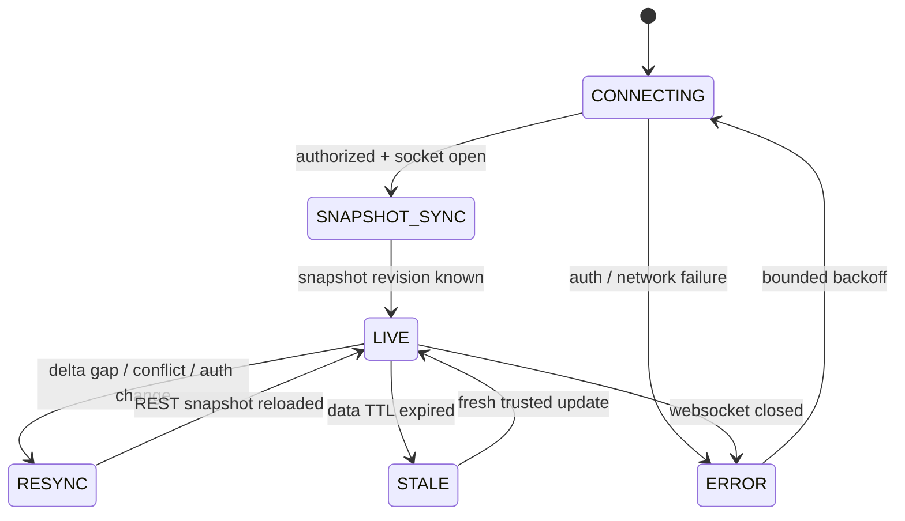
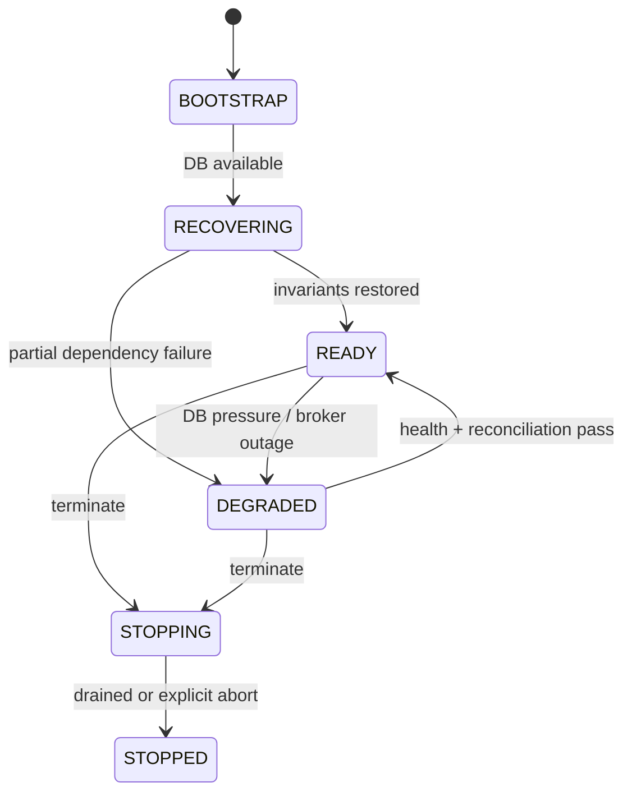

# Project 29 — Connected Vehicle Digital Twin: System Design & Resilience Test Plan

> **Virtual TCU Lab · C++17/20 · Ubuntu / Docker Compose · Version 1.0 · 2026-10-30**  
> **Trạng thái:** thiết kế và test plan; chưa triển khai hay chạy full test suite.  
> **Ưu tiên:** P0 cho tính đúng đắn, nguồn gốc và chất lượng trạng thái; P1 cho hoàn thiện dashboard, scale và UX.  
> **Phạm vi:** mô phỏng xe và TCU, digital twin phía Cloud, REST/WebSocket API, dashboard. Không điều khiển xe thật.

## 0. Executive Summary

Dự án xây **Digital Twin chỉ phản ánh trạng thái xe** từ các nguồn giả lập: CAN/DBC (P05–P07), GNSS (P12), Connectivity (P10), MQTT/Outbox (P13–P14), Cloud Backend (P15), Remote Vehicle Control (P16), Health (P17), DTC (P20–P21) và Container Lab (P28). Các hành động điều khiển phải đi qua P23/P16; dashboard **không** là đường tắt kích hoạt actuator.

Mục đích: quan sát trạng thái `current / stale / unknown / invalid` theo **từng trường**, truy nguyên nguồn và thời điểm, cập nhật gần thời gian thực, đối soát sau reconnect và tuyệt đối không trình bày dữ liệu không đáng tin như trạng thái hiện tại.

### Deliverables

1. `twin-ingest` (C++17): validate, deduplicate, xác lập epoch nguồn, ghi inbox và cập nhật projection trong một DB transaction.
2. `twin-api` (C++17): REST snapshot/history/DTC/command status và WebSocket events với authz theo tenant/vehicle.
3. `twin-dashboard` (TypeScript/React hoặc UI tương đương): biểu đồ speed/battery, bản đồ GPS giả, connectivity, DTC, freshness, command state.
4. `vehicle-simulator` + mock broker/cloud, fault injector và independent test oracle.
5. Test assets: Google Test, integration tests, 300 What-if, 50 multi-fault campaigns, 36 Jira tickets và evidence reports.

### Nguyên tắc tuyệt đối

- **Latest arrival ≠ latest trustworthy state**; event đến sau có thể là sự kiện cũ hoặc thuộc boot generation khác.
- `MQTT PUBACK` ≠ backend commit ≠ browser nhìn thấy dữ liệu ≠ lệnh đã thực thi.
- **Từng field** phải có `quality`, `observed_at`, `received_at`, `source_epoch`, `source_seq`, `origin`.
- `STALE/UNKNOWN/INVALID` không bao giờ tự động được hiển thị như `VALID` chỉ vì giá trị cuối cùng vẫn nằm trong cache.
- Mất tín hiệu **không** mặc định thành `0`, `OFF`, `CLOSED`, `HEALTHY` hoặc `NO_DTC`.
- Mỗi nguồn dữ liệu cần namespace định danh; `tenant_id + vehicle_id + source_id + event_id` hỗ trợ idempotency.
- Dữ liệu vị trí nhạy cảm: least privilege, history retention, audit access và dữ liệu thử nghiệm tổng hợp.
- Tests phải xác nhận **fault thực sự được inject**; thiếu chứng cứ => `INCONCLUSIVE`, không phải `PASS`.
- Không thể liệt kê toán học **mọi** lỗi; catalog này là ma trận rủi ro có thể mở rộng bằng fuzzing, property-based, model-based và chaos testing.

## 1. Scope, Assumptions, Dependencies

| Chủ đề | Quyết định thiết kế |
|---|---|
| Platform | Linux x86_64 + Docker Compose; `vcan0` tùy chọn cho P05; giả lập TCU và GNSS |
| Twin authoritative source | Backend `reported state` là quan sát được kiểm chứng, **không** là trạng thái vật lý tuyệt đối |
| Desired vs reported | `desired` chỉ là yêu cầu điều khiển, do P23/P16 duyệt; `reported` chỉ do nguồn phù hợp cập nhật |
| Tín hiệu P0 | ignition, speed, battery, door, location, GNSS quality, connectivity, DTC, health, command status |
| Cập nhật | Event-driven; snapshot REST để sync, WS delta cho realtime; refresh khi detect gap |
| Persistence | SQLite WAL cho lab 1 writer; production có thể thay DB adapter theo thông lượng |
| C++ | C++17; RAII, bounded queue, lock ownership, CMake, Google Test/Mock, ASan/TSan |
| Cloud transport | MQTT v5 qua P13/P15; thử nghiệm TLS/ACL qua broker mock |
| Security | AuthN/AuthZ ở API và mỗi WS subscribe; server không tin tenant/vehicle từ client |
| Ordering | Source `epoch` đã được xác minh + `source_seq`; version projection do DB cấp đơn điệu |
| SLA giả lập | Những ngưỡng dưới đây **là mục tiêu test mặc định**, không phải thông số OEM |

**Out of scope:** physics accurate vehicle dynamics, CAN arbitration hardware timing, thực thi khóa/mở cửa trực tiếp từ dashboard, OTA image installation, hệ thống GNSS/RF thật và chứng nhận an toàn chức năng.

### 1.1 SLO / Budgets ban đầu (configurable, không phải tiêu chuẩn)

| Metric | Test target | Oracle |
|---|---|---|
| P95 twin ingest → WS delivery trong lab không lỗi | <= 500 ms với 100 events/s, 10 xe | independent timestamps và trace IDs |
| REST snapshot P95 trong steady load | <= 250 ms | API load generator |
| RAM mỗi core service | <= 256 MiB với profile lab | cgroup memory.current + PSS |
| Pending ingest queue | <= 10.000 events, overload explicit | queue depth, rejection/drop counter |
| WS per-client buffer | <= 1 MiB hoặc 1.000 messages; disconnect/resync nếu quá giới hạn | buffer metrics, browser trace |
| Field freshness | speed 3s, ignition 5s, GNSS 10s, connectivity 15s (ví dụ) | fake monotonic clock |
| Recovery after broker restarts | <= 30s trong no-other-fault lab profile | epoch + snapshot parity |
| Multi-tenant leaks | **0** | cross-tenant negative tests |
| False `VALID`/`CURRENT` | **0** | independent oracle, quality history |
| Duplicate canonical event per idempotency key | **0** | DB uniqueness |

Giá trị phải được hiệu chỉnh dựa trên OEM requirement hoặc hardware/traffic thực tế; không tự suy từ profile lab.

## 2. Architecture & Data Flows

```mermaid
flowchart LR
  VS[Vehicle / CAN simulator P05–P07] --> TS[TCU telemetry + GNSS P12]
  TS --> MQ[MQTT Client / Outbox P13–P14]
  MQ --> BR[Broker / Cloud P15]
  BR --> IN[Twin Ingest + Validator]
  IN --> EP[Epoch / Ordering / Dedup]
  EP --> DB[(SQLite Inbox + Latest Fields + History)]
  DB --> OB[Durable Web Outbox]
  OB --> FAN[Event Fanout / WebSocket]
  DB --> API[REST Snapshot API]
  API --> UI[Digital Twin Dashboard]
  FAN --> UI
  HC[Health / DTC P17/P21] --> BR
  UI -. command requests only .-> P23[Secure Command Validation P23]
  P23 --> P16[Remote Vehicle Control P16]
```



```mermaid
sequenceDiagram
  participant T as TCU Sim
  participant M as MQTT Broker
  participant I as Twin Ingest
  participant D as DB
  participant W as WS Fanout
  participant U as UI
  T->>M: telemetry(event_id, epoch, seq, quality)
  M->>I: PUBLISH (may duplicate / reorder)
  I->>I: authz + schema + sequence + freshness policy
  I->>D: BEGIN; insert inbox; project fields; add outbox; COMMIT
  D-->>I: committed (or ambiguous on I/O failure)
  I-->>M: transport-level ACK governed by MQTT lib
  D->>W: outbox row
  W-->>U: delta(revision)
  U->>I: GET snapshot if revision gap
  I-->>U: canonical snapshot(revision + quality)
```

**Phân lớp / process:**

- `twin-ingest`: parsing (bounded), source credential mapping, event normalization, idempotency, projection, durable outbox.
- `twin-api`: authentication, authorized snapshot/history read, pagination, sensitive location redaction.
- `ws-fanout`: per-subscriber permissions, coalescing noncritical deltas, bounded buffers, connection generation.
- `dashboard`: UI state (connecting/syncing/current/stale/error), optimistic command trạng thái `requested` riêng, không optimistic reported actuator state.
- `oracle-agent`: độc lập với server, lưu producer truth + ack proof + DB snapshot + UI trace để đánh giá.

### 2.1 State ownership & invariants

1. `vehicle_id` và `tenant_id` lấy từ danh tính thiết bị đã xác thực hoặc mapping backend; **không** lấy từ JSON payload không đáng tin.
2. Một `source_epoch` phải được backend cấp/đăng ký cho boot instance (không suy thứ tự từ chuỗi UUID). Epoch mới chỉ được chấp nhận sau identity verification + epoch handoff.
3. Với một `(tenant, vehicle, source, epoch)`, `source_seq` tăng; `source_seq` cũ bị duplicate / out-of-order, không được lùi latest field.
4. Across epochs, `epoch_order` được backend gán theo trusted registration, không dựa vào clock thiết bị.
5. `revision` cloud tăng theo **transaction committed** và theo vehicle, dùng cho WS resync; không là timestamp vật lý.
6. Từng field có thể stale độc lập; tính freshness tại thời điểm đọc từ monotonic duration khi process đang sống và persisted anchor/reconciliation khi restart; nếu không biết thời gian đáng tin, ưu tiên `UNKNOWN`.
7. WS không là durable queue. Client reconnect phải lấy snapshot + cursor, không giả định nhận đủ deltas.
8. Vị trí giả lập chưa đủ bằng chứng chất lượng => `INVALID`, `UNTRUSTED` hoặc `STALE`, không vẽ như live location.

## 3. Domain Model & API Contract

### 3.1 Telemetry envelope ví dụ

```json
{
  "schema_version": 1,
  "event_id": "evt-000042",
  "source_id": "tcu-main",
  "source_epoch": "boot-f093",
  "source_seq": 42,
  "observed_at_utc": "2026-10-30T07:00:00Z",
  "payload": {
    "speed_kph": {"value": 54.0, "quality": "GOOD"},
    "battery_volts": {"value": 12.3, "quality": "GOOD"},
    "ignition": {"value": "ON", "quality": "GOOD"},
    "position": {"value": {"lat": 10.045, "lon": 105.747}, "quality": "STALE"}
  }
}
```

**Lưu ý:** thông điệp từ thiết bị không tự tuyên bố tenant/device authoritative; cloud enrich thông tin này từ authenticated principal. `source_epoch` trong payload chỉ là *claim* và cần map với registry đáng tin.

### 3.2 Field metadata

| Field | Type | Freshness | Display rule |
|---|---|---|---|
| speed_kph | float 0..profile_max | 3s | nếu stale: hiển thị 'giá trị cuối', không 'current speed' |
| battery_volts | float range theo profile | 10s | UNKNOWN nếu sensor disconnect; không 0V giả |
| ignition | enum ON/OFF/UNKNOWN | 5s | Missing khác với OFF |
| door_locked | enum LOCKED/UNLOCKED/UNKNOWN | 5s | command requested khác với reported |
| position | lat/lon + accuracy, fix_quality | 10s | track ẩn/redact nếu quyền không đủ |
| connectivity | modem/ip/cloud levels | 15s | không gộp 'connected' nếu chỉ registered |
| dtc_status | codes + scan_quality | theo scan | thiếu code do scan fail không có nghĩa đã cleared |
| health | OK/DEGRADED/CRITICAL/UNKNOWN | rule-defined | sensor missing khiến UNKNOWN, không OK |

### 3.3 REST + WebSocket (illustrative)

```http
GET /api/v1/vehicles/{id}/snapshot
GET /api/v1/vehicles/{id}/history?field=speed_kph&limit=100&cursor=...
GET /api/v1/vehicles/{id}/dtcs?cursor=...
GET /api/v1/vehicles/{id}/commands/{command_id}
POST /api/v1/vehicles/{id}/commands  # chỉ forward tới P23, không tự thực thi
GET /health/live
GET /health/ready
```

Response snapshot có `vehicle_revision`, `fields` cùng metadata, `server_observed_at`, `completeness` và `history_cursor`. Lệnh POST cần authenticated principal, permission, idempotency key, command expiry, confirmation policy và trả `ACCEPTED_FOR_VALIDATION` chứ không trả `EXECUTED`.

```json
{
  "type": "delta",
  "vehicle_id": "V-SIM-001",
  "revision": 128,
  "changes": {
    "speed_kph": {"value": 54.0, "quality": "GOOD", "observed_at": "2026-10-30T07:00:00Z"}
  }
}
```

### 3.4 C++17 interface sketch

```cpp
struct SourceStamp {
    std::string source_id;
    std::string source_epoch;
    uint64_t source_seq;
    std::chrono::system_clock::time_point observed_at;
};

enum class Quality { Good, Stale, Invalid, Missing, Untrusted, Unknown };
struct IngestResult {
    enum class Code { Committed, Duplicate, Rejected, UnknownCommit } code;
    uint64_t vehicle_revision = 0;
    std::string reason;
};

class ITwinRepository {
public:
    virtual ~ITwinRepository() = default;
    virtual IngestResult applyEventAtomically(const AuthenticatedDevice& principal,
                                              const TelemetryEnvelope& event) = 0;
    virtual VehicleSnapshot loadSnapshot(const AuthorizedViewer& viewer,
                                         const VehicleId& id) const = 0;
};

class ISourceEpochRegistry {
public:
    virtual ~ISourceEpochRegistry() = default;
    virtual EpochDecision validateEpoch(const AuthenticatedDevice& principal,
                                        const SourceStamp& stamp) const = 0;
};

class IRealtimeSink {
public:
    virtual ~IRealtimeSink() = default;
    virtual void publishCommittedRevision(const VehicleId& id,
                                          uint64_t revision) = 0;
};
```

`AuthenticatedDevice`, `VehicleSnapshot`, `TelemetryEnvelope`... là các kiểu miền cần định nghĩa trong implementation; đây là API sketch, không phải đoạn code build độc lập.

## 4. Persistence, Consistency & Reconciliation

Đề xuất dùng một SQLite database trên host/container có mounted volume local (không đặt WAL trên network filesystem). Một ghi ingest phải **atomic**: inbox idempotency record, snapshot projection, field history, revision và WS outbox được commit cùng transaction. Thất bại => rollback; commit outcome không chắc chắn => read-after-recovery bằng idempotency key, không khẳng định thất bại/chắc chắn thành công khi chưa đối soát.

```sql
PRAGMA foreign_keys = ON;
PRAGMA journal_mode = WAL;
PRAGMA synchronous = FULL;
CREATE TABLE IF NOT EXISTS vehicles (
  tenant_id TEXT NOT NULL,
  vehicle_id TEXT NOT NULL,
  revision INTEGER NOT NULL DEFAULT 0 CHECK(revision >= 0),
  PRIMARY KEY (tenant_id, vehicle_id)
);
CREATE TABLE IF NOT EXISTS source_epochs (
  tenant_id TEXT NOT NULL, vehicle_id TEXT NOT NULL, source_id TEXT NOT NULL,
  source_epoch TEXT NOT NULL, epoch_order INTEGER NOT NULL CHECK(epoch_order > 0),
  active INTEGER NOT NULL CHECK(active IN (0,1)),
  PRIMARY KEY (tenant_id, vehicle_id, source_id, source_epoch),
  FOREIGN KEY (tenant_id, vehicle_id) REFERENCES vehicles(tenant_id,vehicle_id)
);
CREATE UNIQUE INDEX IF NOT EXISTS ux_source_epoch_order
  ON source_epochs(tenant_id, vehicle_id, source_id, epoch_order);
CREATE UNIQUE INDEX IF NOT EXISTS ux_active_epoch
  ON source_epochs(tenant_id, vehicle_id, source_id) WHERE active = 1;
CREATE TABLE IF NOT EXISTS inbox (
  tenant_id TEXT NOT NULL, vehicle_id TEXT NOT NULL, source_id TEXT NOT NULL,
  event_id TEXT NOT NULL, source_epoch TEXT NOT NULL, source_seq INTEGER NOT NULL,
  received_ms INTEGER NOT NULL, payload_hash TEXT NOT NULL,
  PRIMARY KEY (tenant_id, vehicle_id, source_id, event_id),
  FOREIGN KEY (tenant_id,vehicle_id) REFERENCES vehicles(tenant_id,vehicle_id)
);
CREATE TABLE IF NOT EXISTS latest_fields (
  tenant_id TEXT NOT NULL, vehicle_id TEXT NOT NULL, field_key TEXT NOT NULL,
  source_id TEXT NOT NULL, source_epoch TEXT NOT NULL,
  epoch_order INTEGER NOT NULL, source_seq INTEGER NOT NULL,
  value_json TEXT, quality TEXT NOT NULL CHECK(quality IN
  ('GOOD','STALE','INVALID','MISSING','UNTRUSTED','UNKNOWN')),
  observed_ms INTEGER, received_ms INTEGER NOT NULL,
  revision INTEGER NOT NULL CHECK(revision > 0),
  PRIMARY KEY (tenant_id,vehicle_id,field_key),
  FOREIGN KEY (tenant_id,vehicle_id) REFERENCES vehicles(tenant_id,vehicle_id)
);
CREATE TABLE IF NOT EXISTS field_history (
  tenant_id TEXT NOT NULL, vehicle_id TEXT NOT NULL, revision INTEGER NOT NULL,
  field_key TEXT NOT NULL, value_json TEXT, quality TEXT NOT NULL,
  observed_ms INTEGER, received_ms INTEGER NOT NULL,
  PRIMARY KEY(tenant_id,vehicle_id,revision,field_key)
);
CREATE TABLE IF NOT EXISTS ws_outbox (
  tenant_id TEXT NOT NULL, vehicle_id TEXT NOT NULL, revision INTEGER NOT NULL,
  payload_json TEXT NOT NULL, published INTEGER NOT NULL DEFAULT 0 CHECK(published IN (0,1)),
  PRIMARY KEY(tenant_id,vehicle_id,revision)
);
CREATE TABLE IF NOT EXISTS command_views (
  tenant_id TEXT NOT NULL, vehicle_id TEXT NOT NULL, command_id TEXT NOT NULL,
  state TEXT NOT NULL CHECK(state IN
    ('REQUESTED','VALIDATING','DISPATCHED','EXECUTED','REJECTED','FAILED','UNKNOWN')),
  last_update_ms INTEGER NOT NULL,
  PRIMARY KEY(tenant_id,vehicle_id,command_id)
);
CREATE TABLE IF NOT EXISTS test_evidence (
  run_id TEXT NOT NULL, case_id TEXT NOT NULL,
  injection_verified INTEGER NOT NULL CHECK(injection_verified IN (0,1)),
  oracle_verified INTEGER NOT NULL CHECK(oracle_verified IN (0,1)),
  status TEXT NOT NULL CHECK(status IN ('PASS','FAIL','INCONCLUSIVE','SKIPPED')),
  evidence_path TEXT,
  CHECK(status <> 'PASS' OR (injection_verified = 1 AND oracle_verified = 1)),
  PRIMARY KEY(run_id,case_id)
);
```

### 4.1 Commit algorithm

```text
validate principal -> map tenant/vehicle -> validate schema/size
validate source_epoch belongs to principal & trusted active generation
BEGIN IMMEDIATE
  if inbox exists:
    if payload_hash matches => Duplicate; no new projection
    else => security conflict; reject
  else:
    insert inbox
    select affected fields, run per-field ordering + quality checks
    if any eligible field change:
      vehicles.revision += 1
      upsert latest_fields + insert field_history
      insert ws_outbox(vehicle, revision, delta)
COMMIT
return COMMITTED or DUPLICATE; on ambiguous failure query idempotency key
```

- **Duplicate không tăng revision.** Event hợp lệ nhưng toàn bộ field cũ hơn projection không được ghi đè, vẫn có thể được lưu inbox và measurement history có cờ `late` nếu chính sách yêu cầu; schema MVP chỉ lưu history của projection changes.
- `epoch_order` phải được kiểm chứng bằng registry; một nguồn không được tự nhảy epoch để vượt kiểm soát replay.
- Có thể chưa biết đúng thời gian tuyệt đối khi thiết bị offline: giữ `observed_at` + `received_at` + `trust_level`, không sort đơn thuần theo `observed_at`.
- DB `synchronous=FULL` dùng để luyện durability; cần đo I/O thực tế; giả lập `SIGKILL` không chứng minh được power-loss durability trên phần cứng thật.
- Dùng WAL checkpoint/backup có quản lý; writer/busy timeout không được làm event loop hoặc WebSocket threads bị kẹt vô hạn.

### 4.2 UI synchronization contract



UI có thể là `LIVE` ở kênh WS nhưng một số field vẫn `STALE`. Không dùng global LIVE để hiển thị mọi trường đều fresh. Client giữ cursor theo `(vehicle_id, revision, auth_session_generation)`; rev gap => snapshot fetch. WS buffering phải bounded; không cache unlimited deltas.

## 5. C++ Concurrency Design & Lifecycle

- **Ingest I/O:** MQTT network callback chỉ parse nhẹ/validate envelope size rồi enqueue; không block bằng SQLite transaction dài.
- **Worker:** bounded MPSC queue + DB single-writer loop, làm việc theo `(tenant,vehicle)` với transaction serialized; consumers của projection đọc snapshot committed.
- **Fanout:** durable outbox reader; backpressure mỗi subscriber; low-priority speed/location updates có thể coalesce **nhưng** critical alert/command status không được âm thầm mất.
- **Locks:** không gọi external callback hoặc network send khi giữ mutex của repository; lock order được tài liệu hóa.
- **Shutdown:** dừng ingress -> reject submissions mới -> finish/rollback in-flight DB -> flush outbox state -> close WS -> join threads; deadline hết => fail observable, không tuyên bố drain thành công giả.
- **Restart:** mở SQLite + kiểm tra schema/integrity phù hợp; restore source epoch registry, reconcile partial outcomes; rescan un-published outbox; mark UI data old/unknown cho đến khi có freshness evidence.
- **Config hot reload:** validate full immutable snapshot; swap atomically; policy generation pin cho một evaluation; invalid config không được partial apply.
- **Epoch fencing:** callback/token từ MQTT/WS/process generation cũ không được hoàn thành request thuộc generation mới.



### 5.1 Security / privacy defaults

- Tất cả endpoints tenant-scoped, mỗi vehicle subject-scoped authorization; WebSocket handshake xác minh Origin allowlist, session và channel authorization.
- Reauthorization khi token revoked/logout; xóa cached location/vehicle state phía UI khi quyền bị thu hồi.
- TLS cho traffic không phải localhost lab; device identity được broker/cloud xác minh. Tách public dashboard read-only khỏi admin commands.
- Location history có retention mặc định ngắn và được cấu hình; giả lập synthetic coordinates; không log raw token, location hoặc command payload ở cấp INFO.
- Chống XSS qua escaping; HTML không render raw telemetry; input bounded, rate limits, audit của history access.

## 6. Behavior Contracts (Given / When / Then)

| ID | Given | When | Then |
|---|---|---|---|
| BC-01 | CAN speed GOOD & fresh | event commit | UI hiển thị speed + source stamp + age |
| BC-02 | speed không còn cập nhật | vượt TTL | field STALE, không giả định speed=0 |
| BC-03 | vị trí GNSS quality invalid | frame đến | không cập nhật marker 'live' |
| BC-04 | browser bị mất WS | mở lại | fetch full snapshot trước khi phát delta mới |
| BC-05 | revision 105 | WS nhận revision 107 | phát hiện gap, resync; không bỏ qua 106 |
| BC-06 | event_id đã commit | MQTT replay | deduplicate không tạo history/delta mới |
| BC-07 | epoch cũ gửi seq rất lớn | event mới đến | reject, không ghi đè epoch hiện tại |
| BC-08 | clock device nhảy +1 ngày | telemetry đến | quality event time downgraded; vẫn giữ receive time |
| BC-09 | DTC scan timeout | kết quả thiếu code | DTC trạng thái UNKNOWN, không cleared |
| BC-10 | battery sensor bị mất | sample mới missing | UNKNOWN, không 0.0V |
| BC-11 | broker `PUBACK` | DB commit thất bại | không xuất backend-committed status |
| BC-12 | DB transaction committed | WS fanout crash | replay outbox hoặc snapshot parity sau restart |
| BC-13 | user tenant A | GET tenant B vehicle | 403/404 theo privacy policy, không rò metadata |
| BC-14 | WS viewer mất quyền | token revoked | unsubscribe/close, purge unauthorized cache |
| BC-15 | cloud command accepted | BCM chưa ACK | UI hiển thị DISPATCHED/UNKNOWN, không EXECUTED |
| BC-16 | queue saturated | new telemetry | explicit backpressure, không tăng RAM vô hạn |
| BC-17 | UI data stale | modal/map open | 'last known' timestamp và quality luôn rõ |
| BC-18 | SQLite WAL busy | ingest new event | retry bounded, không làm I/O thread treo |
| BC-19 | shutdown đang diễn ra | late callback | bỏ qua generation cũ, không double-complete |
| BC-20 | fault injector không inject được | oracle xét kết quả | INCONCLUSIVE, không PASS |

### 6.1 Demo acceptance journeys

1. Giả lập xe đi 50 điểm, lên dashboard map và charts, GNSS quality được giữ.
2. Mất cellular 10 phút, TCU outbox giữ telemetry, Dashboard báo `last seen`, không vẽ vị trí cũ là live.
3. Kết nối lại, P14 replay, P15 commit, Twin dedup và WS snapshot resync; lịch sử không đếm lặp.
4. DTC mới -> P21 gửi lên, dashboard cảnh báo; DTC scan fail -> `UNKNOWN` thay vì tự cleared.
5. Lệnh `LOCK` qua P23/P16 giả lập, cloud ACK/BCM ACK mất -> UI `UNKNOWN` và reconcile.
6. TCU restart khi vẫn có data, source_epoch được đăng ký lại, old events không overwrite new state.

## 7. What-if Test Catalog — 300 Scenarios / 30 Risk Domains

**Cấu trúc:** mỗi dòng là một test case riêng: `What if` (kịch bản), **Injection** (cách tái hiện), **Expected** (kết quả đúng), **Evidence** (bằng chứng độc lập). Mặc định `P0` khi đụng đến độ đúng dữ liệu, quyền truy cập, command/ACK, độ bền hoặc trạng thái không xác định; còn lại `P1`. Priority chỉ định hướng ban đầu và cần risk review với team.

**Test outcome:** `PASS` chỉ khi `injection_verified=1`, `oracle_verified=1` và mọi invariant đạt; `FAIL` nếu inject thành công nhưng invariant sai; `INCONCLUSIVE` nếu không chứng minh được injection/observation; `SKIPPED` khi thiếu dependency trước khi chạy.

### W01. Envelope & schema validation

**Primary evidence:** parser reject counter + inbox row count.

| ID | Priority | What if | Injection (lab) | Expected behavior / Oracle |
|---|---|---|---|---|
| W01-01 | P0 | Thiếu event_id | gửi payload không có event_id | reject trước khi chạm DB |
| W01-02 | P0 | Schema_version không hỗ trợ | gửi version 999 | reject có code UNSUPPORTED_SCHEMA |
| W01-03 | P0 | payload vượt 1 MiB | publish payload 2 MiB | limit kích thước và không OOM |
| W01-04 | P0 | JSON key trùng nhau | inject key speed hai lần | reject ambiguous encoding |
| W01-05 | P0 | JSON number NaN | gửi NaN hoặc Infinity | reject; không ghi NaN vào state |
| W01-06 | P0 | value sai kiểu | speed='fifty' | reject field hoặc toàn event theo atomic schema policy |
| W01-07 | P1 | field lạ | gửi trường actuator_override | không thi hành logic ngoài allowlist |
| W01-08 | P1 | UTF-8 không hợp lệ | inject invalid bytes | reject và bounded parser |
| W01-09 | P1 | payload thiếu source_seq | omit source_seq | reject; không tự gán thứ tự tùy ý |
| W01-10 | P1 | partial JSON qua MQTT | gửi truncated JSON | reject, không publish delta |

### W02. Device identity & source epoch

**Primary evidence:** identity registry audit + epoch transitions.

| ID | Priority | What if | Injection (lab) | Expected behavior / Oracle |
|---|---|---|---|---|
| W02-01 | P0 | Giả mạo vehicle_id | dùng credential xe A gửi payload xe B | device principal thắng payload, B không thay đổi |
| W02-02 | P0 | Source epoch chưa đăng ký | gửi epoch ngẫu nhiên | reject chưa xác minh |
| W02-03 | P0 | Epoch cũ gửi sau reboot | replay generation cũ | không overwrite field current |
| W02-04 | P0 | Boot ID trùng sau restart | simulator tái dùng boot ID | ngăn epoch registration conflict |
| W02-05 | P0 | Epoch mới nhưng credential bị thu hồi | revoke trước handoff | reject enrollment |
| W02-06 | P0 | Đăng ký epoch song song | hai requests cùng source mới | chỉ một active epoch |
| W02-07 | P0 | Epoch inactive có seq cao | inject seq 1e9 của inactive epoch | reject không dựa seq đơn thuần |
| W02-08 | P0 | Source A mạo nhận Source B | payload source_id khác principal scope | deny |
| W02-09 | P0 | Registry DB tạm lỗi | force timeout during epoch lookup | fail closed/UNKNOWN, không accept mặc định |
| W02-10 | P0 | Old callback after epoch switch | hold callback rồi activate epoch mới | fencing ngăn callback cũ cập nhật state |

### W03. Sequence, ordering & deduplication

**Primary evidence:** inbox unique key + revision trace.

| ID | Priority | What if | Injection (lab) | Expected behavior / Oracle |
|---|---|---|---|---|
| W03-01 | P0 | QoS 1 cùng event 100 lần | publish cùng id và hash | một inbox row, một state change |
| W03-02 | P0 | Cùng event_id payload khác | replay id với giá trị thay đổi | deny conflict và security audit |
| W03-03 | P0 | seq 101 đến trước seq 100 | reorder network delivery | projection giữ 101 |
| W03-04 | P0 | Hai event khác ID cùng seq | gửi 2 payload cạnh tranh | reject conflict/policy, không nondeterministic update |
| W03-05 | P0 | seq từ 2^64-1 rollover | fuzz uint boundary | không wrap âm thầm; yêu cầu epoch mới |
| W03-06 | P0 | Retry event đã commit sau crash | kill sau commit trước ack | dedup khi khởi động lại |
| W03-07 | P0 | Event mới có observed_at cũ hơn | delay event với seq cao | theo epoch/seq + time-quality policy, không chỉ sort wall clock |
| W03-08 | P0 | Duplicate delta qua outbox | fanout publish cùng revision hai lần | UI dedup revision |
| W03-09 | P0 | Revision 12 tới sau revision 14 | reorder WS packets | UI không rollback snapshot |
| W03-10 | P0 | Nhiều source cùng sửa speed | inject conflicting producers | source authority ưu tiên rõ ràng, không last-writer-wins tùy ý |

### W04. Clock, timestamp & time quality

**Primary evidence:** UTC/receive time + freshness trace.

| ID | Priority | What if | Injection (lab) | Expected behavior / Oracle |
|---|---|---|---|---|
| W04-01 | P0 | RTC device nhảy +24 giờ | set simulated wall clock future | time UNTRUSTED, không current false |
| W04-02 | P0 | RTC device lùi 48 giờ | set past wall clock | không xóa dữ liệu hàng loạt |
| W04-03 | P0 | Timezone DST chuyển | simulate zone adjustment | UTC storage unaffected |
| W04-04 | P0 | Timestamp thiếu timezone | send local timestamp ambiguous | reject hoặc normalize only with explicit offset |
| W04-05 | P0 | Received_at chậm 10 phút | hold broker delivery | field freshness phản ánh delay, không live |
| W04-06 | P0 | Monotonic counter reset khi reboot | new source epoch | reset không tạo negative elapsed |
| W04-07 | P0 | Observed_at > server now | clock skew threshold | đánh quality clock warning |
| W04-08 | P0 | Leap second-like timestamp | inject 23:59:60 string | parse theo documented policy, không crash |
| W04-09 | P0 | REST client clock lệch 1 ngày | override browser clock | server provided age quality quyết định |
| W04-10 | P0 | System time đồng bộ giữa event stream | NTP jump while process runs | deadline dựa monotonic; age coherent |

### W05. GNSS & map consistency

**Primary evidence:** position quality + UI map trace.

| ID | Priority | What if | Injection (lab) | Expected behavior / Oracle |
|---|---|---|---|---|
| W05-01 | P0 | GNSS NO_FIX nhưng có lat/lon | send position with invalid fix | không vẽ marker live |
| W05-02 | P0 | Latitude 91 | emit out-of-range coordinate | reject |
| W05-03 | P0 | Longitude -181 | emit invalid longitude | reject |
| W05-04 | P0 | Đổi dấu tọa độ | inject lat sign inverted | detect plausibility policy, flag suspect |
| W05-05 | P0 | Position teleport 1000 km/s | jump in simulator route | UNTRUSTED, không vẽ đường liền |
| W05-06 | P0 | GPS stale 15 giây | freeze GNSS messages | last-known + age, không live |
| W05-07 | P0 | Accuracy 10 km | emit poor accuracy | visual uncertainty; không precision giả |
| W05-08 | P0 | Out-of-order position | deliver older seq after newer | không đưa xe lùi theo packet order |
| W05-09 | P0 | Không có quyền location | viewer role without geo scope | không trả raw lat/lon ở REST hay WS |
| W05-10 | P0 | Route crossing antimeridian | synthetic 179°->-179° | render route đúng, không nối vòng trái đất |

### W06. CAN / vehicle signal semantics

**Primary evidence:** signal quality + decoder output.

| ID | Priority | What if | Injection (lab) | Expected behavior / Oracle |
|---|---|---|---|---|
| W06-01 | P0 | Speed signal timeout | stop CAN speed frame | speed STALE, không 0 |
| W06-02 | P0 | Speed = -1 unsigned error | inject decoder invalid marker | reject semantic invalid |
| W06-03 | P0 | Speed 4000 kph | inject out-of-range value | flag suspicious theo profile |
| W06-04 | P0 | Ignition missing | drop ignition frames | UNKNOWN, không OFF |
| W06-05 | P0 | BCM door command pending | publish desired LOCKED only | reported door không đổi |
| W06-06 | P0 | Battery sample zero due sensor disconnect | inject invalid zero+quality | không cho zero đánh lừa cảnh báo |
| W06-07 | P0 | CAN source switch | toggle Gateway ownership | authority pin theo signal source |
| W06-08 | P0 | DBC scale change giữa traffic | hot reload P06 spec | không trộn unit hai cấu hình |
| W06-09 | P0 | Rapid ON/OFF jitter | inject ignition bounce | apply debounce/hysteresis rule |
| W06-10 | P0 | CAN bus down rồi up | toggle vcan interface | clear stale/restore only after fresh samples |

### W07. DTC status & scan quality

**Primary evidence:** DTC diff log + freshness report.

| ID | Priority | What if | Injection (lab) | Expected behavior / Oracle |
|---|---|---|---|---|
| W07-01 | P0 | UDS ReadDTC timeout | drop ISO-TP response | DTC UNKNOWN, không CLEARED |
| W07-02 | P0 | Partial DTC list | truncate multi-frame response | không publish complete snapshot |
| W07-03 | P0 | Same DTC status toggles | emit status masks changes | lịch sử transitions theo source seq |
| W07-04 | P0 | ECU reset trong scan | restart P20 mid-scan | discard old source scan result |
| W07-05 | P0 | DTC không còn trong failed scan | force scan quality failed | không kết luận resolved |
| W07-06 | P0 | DTC snapshot duplicate | P21 replay same event | một canonical transition |
| W07-07 | P0 | Unknown DTC hex code | send code chưa được map | show code safely, không crash |
| W07-08 | P0 | Status availability mask đổi | simulate ECU capability change | không interpret bit chưa supported |
| W07-09 | P0 | ClearDTC response lost | drop P20 ack | command UNKNOWN, không tự giả cleared |
| W07-10 | P0 | Critical DTC + dashboard reload | reload page during alert | alert được phục hồi từ committed state |

### W08. Modem and connectivity levels

**Primary evidence:** modem/IP/cloud individual badges.

| ID | Priority | What if | Injection (lab) | Expected behavior / Oracle |
|---|---|---|---|---|
| W08-01 | P0 | Modem REGISTERED nhưng IP mất | drop DHCP route | cloud state offline/degraded |
| W08-02 | P0 | IP có route nhưng DNS lỗi | blackhole DNS | không báo cloud ready |
| W08-03 | P0 | DNS OK TLS invalid | serve expired cert | cloud unauthenticated |
| W08-04 | P0 | MQTT session online nhưng heartbeat business stalled | stop telemetry while socket alive | health/progress degrade |
| W08-05 | P0 | WiFi -> cellular failover | route switch | old path callback fenced |
| W08-06 | P0 | Network flapping 30 lần | toggle links rapid | retry budget, stable UI |
| W08-07 | P0 | Modem reset đúng lúc cloud ready | emit reset URC | invalidate old connectivity view |
| W08-08 | P0 | Cloud backend reachable nhưng auth revoked | deny connection | not authorized, không connected |
| W08-09 | P0 | Offline 10 phút | drop all transport | last-seen age increases, không giữ green online |
| W08-10 | P0 | Service reports READY giả | heartbeat only no ingest | independent progress probe marks degraded |

### W09. MQTT broker/session behavior

**Primary evidence:** broker logs + MQTT session + DB.

| ID | Priority | What if | Injection (lab) | Expected behavior / Oracle |
|---|---|---|---|---|
| W09-01 | P0 | Broker restart giữa QoS1 | restart broker after PUBLISH | idempotent replay |
| W09-02 | P0 | PUBACK loss | drop ACK packet | không gán committed chỉ từ ACK |
| W09-03 | P0 | Retained telemetry cũ | publish retained old state | not treated as new current |
| W09-04 | P0 | Session Present=false after reconnect | expire broker session | subscriptions rebuilt + snapshot sync |
| W09-05 | P0 | Two clients same client ID | force takeover | generation fence + recover |
| W09-06 | P0 | Topic prefix mismatch | publish wrong vehicle topic | reject/deny routing |
| W09-07 | P0 | QoS0 telemetry loss | drop packet | gap observable, không claim complete history |
| W09-08 | P0 | Malformed MQTT payload | publish invalid JSON bytes | reject without crash |
| W09-09 | P0 | Message expiry before delivery | expire queued event | mark gap/unknown by TTL |
| W09-10 | P0 | Broker ACL wrong scope | client publish cross-tenant topic | deny/authz audit |

### W10. Cloud ingestion and acknowledgement

**Primary evidence:** inbox DB + outbox journal.

| ID | Priority | What if | Injection (lab) | Expected behavior / Oracle |
|---|---|---|---|---|
| W10-01 | P0 | DB commit fails before ACK | SQLITE_FULL | no backend committed ack |
| W10-02 | P0 | Commit succeeds but response lost | drop HTTP/MQTT ack | same event replay no duplicate |
| W10-03 | P0 | Outbox row committed but publisher crash | kill ws-fanout before send | replay or resync after restart |
| W10-04 | P0 | Ingest crashes before commit | SIGKILL in transaction | no partial snapshot |
| W10-05 | P0 | Ingest retry concurrently | two worker duplicate event | uniqueness prevents double append |
| W10-06 | P0 | Credential revoked mid-ingest | revoke before txn admission | deny not authorize stale claim |
| W10-07 | P0 | DB busy long | hold write lock | bounded retry; no hung threads |
| W10-08 | P0 | Cloud backend restarts mid-batch | restart P15 | consistent event IDs |
| W10-09 | P0 | Payload hash collision simulation | mock hash same for distinct bytes | strong comparison/canonical verify policy, no silent false duplicate |
| W10-10 | P0 | Ingest ACK accepted but WS unavailable | stop fanout | DB valid and UI can resync |

### W11. Projection & snapshot consistency

**Primary evidence:** revision audit + latest_fields snapshot.

| ID | Priority | What if | Injection (lab) | Expected behavior / Oracle |
|---|---|---|---|---|
| W11-01 | P0 | Two fields in one event | send speed+ignition | atomic same revision |
| W11-02 | P0 | Concurrent events same vehicle | race two writers | serialized monotonic revision |
| W11-03 | P0 | Concurrent vehicles tenant A/B | mixed workloads | no cross-vehicle revision coupling visible |
| W11-04 | P0 | Field updates later then earlier | seq reorder | no rewind |
| W11-05 | P0 | Snapshot read during transaction | pause before commit | reader sees old or new complete state |
| W11-06 | P0 | WS delta revision gap | drop revision 103 | UI fetches snapshot |
| W11-07 | P0 | Projection corrupted index | inject test-only DB inconsistency | fail health/rebuild projection under audit |
| W11-08 | P0 | Outbox duplicate publish | repeat revision event | client applies once |
| W11-09 | P0 | Freshness update without new CAN event | advance fake clock | quality transitions, not fabricated measurement |
| W11-10 | P0 | Projection rebuild after crash | replay canonical inbox deterministically | final latest equals oracle |

### W12. WebSocket lifecycle

**Primary evidence:** client packet log + buffer gauges.

| ID | Priority | What if | Injection (lab) | Expected behavior / Oracle |
|---|---|---|---|---|
| W12-01 | P0 | WS disconnect while streaming | kill network pipe | client enters reconnect and resync |
| W12-02 | P0 | WS close mid JSON frame | abort TCP write | ignore partial message, snapshot resync |
| W12-03 | P0 | WS two updates out of order | reorder delivered frame test shim | revision protects state |
| W12-04 | P0 | WS heartbeat ping no pong | drop pong | close inactive socket |
| W12-05 | P0 | One slow browser subscriber | stall reads | bounded buffer or disconnect only that viewer |
| W12-06 | P0 | 1000 subscribers same vehicle | spawn clients | bounded fanout and rate controls |
| W12-07 | P1 | Revoked viewer keeps socket | revoke token live | disconnect + stop delivery |
| W12-08 | P1 | Client reconnect with stale cursor | cursor older than retention | send snapshot required |
| W12-09 | P1 | Server WS process restart | kill fanout | dashboard resync to committed DB |
| W12-10 | P1 | Duplicate WS event from replay | retransmit same revision | no double update in UI |

### W13. Dashboard rendering & UX

**Primary evidence:** browser DOM state + visual trace.

| ID | Priority | What if | Injection (lab) | Expected behavior / Oracle |
|---|---|---|---|---|
| W13-01 | P0 | Page reload during offline | reload browser with stale cache | show offline/last known warning |
| W13-02 | P0 | Chart missing samples | inject seq gap | draw gap, not line falsely continuous |
| W13-03 | P0 | Speed 0 from valid sensor | emit true zero quality GOOD | show 0, distinguish Missing |
| W13-04 | P0 | Battery UNKNOWN | sensor absent | show unknown not 0% |
| W13-05 | P0 | Very long DTC text | send oversized label | truncate/escape without layout crash |
| W13-06 | P0 | DOM injection payload | send HTML/JS string as label | render as text, no script execution |
| W13-07 | P1 | Browser background tab throttled | pause render 1 min | refresh age on resume |
| W13-08 | P1 | Browser local clock wrong | shift client time | freshness from trusted server metadata |
| W13-09 | P1 | UI color-only signal | test accessibility mode | status also text/icons, not only color |
| W13-10 | P1 | Large route 1 million points | inject huge history response | downsample/paginate and bounded render |

### W14. Freshness and quality policy

**Primary evidence:** clock-driven quality state transitions.

| ID | Priority | What if | Injection (lab) | Expected behavior / Oracle |
|---|---|---|---|---|
| W14-01 | P0 | Field expires exactly on TTL boundary | fake clock ticks at 3s | deterministic threshold contract |
| W14-02 | P0 | TTL config lowered live | reload 10s->2s | re-evaluate stale with new generation |
| W14-03 | P0 | TTL config invalid zero | reload illegal policy | reject and keep old |
| W14-04 | P0 | Quality GOOD from stale source | replay old sample as GOOD | server downgrades stale |
| W14-05 | P0 | Two sources conflict in quality | primary invalid backup good | documented source arbitration |
| W14-06 | P0 | Value same but quality worsens | send quality-only update | WS quality delta emitted |
| W14-07 | P0 | Unknown location gets default (0,0) | omit lat/lon | no Null Island marker |
| W14-08 | P0 | All samples missing after restart | restart without freshness anchor | UNKNOWN until verified fresh |
| W14-09 | P0 | Speed stale but ignition fresh | freeze one source | independent badges |
| W14-10 | P0 | History view selected date outside retention | request old window | explicit no data, not zero reading |

### W15. REST API & pagination

**Primary evidence:** HTTP trace + cursor audit.

| ID | Priority | What if | Injection (lab) | Expected behavior / Oracle |
|---|---|---|---|---|
| W15-01 | P0 | Snapshot while DB writer busy | hold write txn | bounded timeout or consistent snapshot |
| W15-02 | P0 | History cursor reused after new events | concurrent append | stable cursor semantics |
| W15-03 | P0 | Negative page limit | GET limit=-1 | 400 validation |
| W15-04 | P0 | Unbounded limit=1e9 | oversized request | enforced max page size |
| W15-05 | P0 | Invalid encoded vehicle ID | path traversal payload | reject, no file read |
| W15-06 | P0 | ETag cache stale after revision | 304 wrongly forced | revision-aware cache revalidation |
| W15-07 | P1 | Client loses auth mid pagination | revoke token after page1 | no page2 data |
| W15-08 | P1 | Cursor of tenant A used by tenant B | tamper opaque cursor | deny |
| W15-09 | P1 | Expired cursor under history compaction | delete older rows | return explicit resync/expired cursor |
| W15-10 | P1 | REST response interrupted mid body | cut TCP mid JSON | client discard partial and retry |

### W16. Authentication & authorization

**Primary evidence:** access audit + negative query.

| ID | Priority | What if | Injection (lab) | Expected behavior / Oracle |
|---|---|---|---|---|
| W16-01 | P0 | Unauthenticated snapshot query | no token | 401 no body data |
| W16-02 | P0 | Tenant A reads B | cross-tenant vehicle ID | deny without existence leak |
| W16-03 | P0 | Read-only viewer POST command | use viewer token | 403 no dispatch |
| W16-04 | P0 | Token expires while WS open | expire token | reauth/close according to policy |
| W16-05 | P0 | Origin malicious web page | fake Origin | deny websocket upgrade |
| W16-06 | P0 | JWT algorithm confusion attempt | alter header alg | reject signature verification |
| W16-07 | P0 | Token audience mismatch | use token of other service | deny |
| W16-08 | P0 | Vehicle reassigned to tenant B | update ownership while viewer active | evict old tenant sessions/cache |
| W16-09 | P0 | SQL injection in cursor | inject quote string | parameterized handling, no unintended rows |
| W16-10 | P0 | Repeated invalid token flood | send 100k bad handshakes | rate limit bounded CPU |

### W17. Privacy, retention & location controls

**Primary evidence:** retention audit + query redaction.

| ID | Priority | What if | Injection (lab) | Expected behavior / Oracle |
|---|---|---|---|---|
| W17-01 | P0 | Viewer without geo scope | GET snapshot with position | field redacted in REST and WS |
| W17-02 | P0 | Viewer with rounded position permission | query GPS | return coarse location only |
| W17-03 | P0 | History retention expired | advance policy clock | delete eligible rows, keep audit record |
| W17-04 | P0 | RTC jump forward | simulate server clock anomaly | no unintended mass purge |
| W17-05 | P0 | User revokes history access | update access policy | purge browser cached history and block backend |
| W17-06 | P0 | Location logged at INFO | force request logs | no exact coordinates present |
| W17-07 | P0 | Trace dump includes token | trigger error logging | redact credentials |
| W17-08 | P0 | Per-tenant export | export A data | never include B rows |
| W17-09 | P0 | Backup restored with older privacy policy | restore old DB | policy migration/revalidation required |
| W17-10 | P0 | UI logout after GPS viewed | logout | memory/cache cleared, WS closed |

### W18. Remote command display semantics

**Primary evidence:** P16 journal + UI states.

| ID | Priority | What if | Injection (lab) | Expected behavior / Oracle |
|---|---|---|---|---|
| W18-01 | P0 | Command requested but not validated | post command | show REQUESTED not EXECUTED |
| W18-02 | P0 | Command rejected by safety gate | simulate driving at speed>0 | show REJECTED and reason class |
| W18-03 | P0 | Command executed but ACK lost | drop BCM result | show UNKNOWN, not failed/succeeded definite |
| W18-04 | P0 | Duplicate command IDs | retry same ID | one P16 dispatch result |
| W18-05 | P0 | Same command ID different payload | send conflict | deny conflict |
| W18-06 | P0 | BCM state stale after ACK | stop BCM reported updates | do not infer lock state from ACK alone |
| W18-07 | P0 | Two contradictory commands | send LOCK/UNLOCK concurrent | P16 serialization; dashboard separate lifecycle |
| W18-08 | P0 | Command timeout during UI reload | reload | restore latest journal state |
| W18-09 | P0 | P23 denies auth but UI optimistic toggle | inject denial | rollback desired view, reported unchanged |
| W18-10 | P0 | Command cancel after dispatch | send cancel | no fabricated cancellation of actuator result |

### W19. Offline replay & store-and-forward

**Primary evidence:** P14 outbox + DB de-dup counts.

| ID | Priority | What if | Injection (lab) | Expected behavior / Oracle |
|---|---|---|---|---|
| W19-01 | P0 | Offline 1 hour then replay | block broker then unblock | preserve canonical event IDs |
| W19-02 | P0 | Replay reverse order | shuffle backlog events | projection stays source ordered |
| W19-03 | P0 | Huge offline backlog | create 1M events | bounded ingest/backpressure, no event loop hang |
| W19-04 | P0 | Replay after source reboot | mix epochs old/new | new epoch not overwritten |
| W19-05 | P0 | Duplicate replay after network flap | send same batch twice | dedup canonical |
| W19-06 | P0 | P14 storage full | fill queue disk | explicit data gap, no false continuous history |
| W19-07 | P0 | P14 clock wrong during offline | skew source timestamps | server marks trust, not false fresh |
| W19-08 | P0 | Retention expires during replay | advance receive time | policy for old data, no current overwrite |
| W19-09 | P0 | Partial batch commit then crash | kill mid batch | reconcile committed ids |
| W19-10 | P0 | Cloud ACK lost repeatedly | drop all app ACKs | retries bounded and idempotent |

### W20. Database WAL & transaction durability

**Primary evidence:** SQLite integrity + crash trace.

| ID | Priority | What if | Injection (lab) | Expected behavior / Oracle |
|---|---|---|---|---|
| W20-01 | P0 | Disk full during commit | quota fill test volume | rollback or ambiguous reconciled, no fake success |
| W20-02 | P0 | SIGKILL before commit | kill writer mid transaction | atomic state |
| W20-03 | P0 | SIGKILL after commit before response | kill at boundary | replay yields duplicate, no new revision |
| W20-04 | P0 | WAL checkpoint blocked reader | hold read txn | observe growth, limit/recover |
| W20-05 | P0 | Corrupt DB header | flip test DB bytes | DEGRADED and recovery-required, not current success |
| W20-06 | P0 | Change DB schema to unsupported | force schema version ahead | fail safe, no silent migration |
| W20-07 | P0 | Network filesystem mounted WAL | configure unsupported mount | reject lab profile or fail preflight |
| W20-08 | P0 | Concurrent writer lock | hold BEGIN IMMEDIATE | bounded SQLITE_BUSY handling |
| W20-09 | P0 | Volume read-only after start | remount read-only test | no false persisted event |
| W20-10 | P0 | Outbox published flag lost | crash before marking sent | replay duplicate revision safe |

### W21. Schema migration & compatibility

**Primary evidence:** migration version + rollback evidence.

| ID | Priority | What if | Injection (lab) | Expected behavior / Oracle |
|---|---|---|---|---|
| W21-01 | P0 | New field added by TCU | send forward-compatible optional field | safe ignore with trace or explicit schema support |
| W21-02 | P0 | Old schema still publishing | send v1 while v2 active | versioned adapter process according to policy |
| W21-03 | P0 | Breaking rename speed_kph | migrate to speed_mps test | no unit mix in charts |
| W21-04 | P0 | Migration killed half-way | SIGKILL migration transaction | schema remains consistent/recoverable |
| W21-05 | P0 | Invalid JSON Schema update | reload bad schema | reject without partial apply |
| W21-06 | P0 | Downgrade image with newer DB | deploy old reader | fail safely not corrupt state |
| W21-07 | P1 | Rebuild projection from inbox | clear materialized tables in lab | parity verified |
| W21-08 | P1 | Data type float->integer | migrate precision | no silent rounding outside policy |
| W21-09 | P1 | Unknown enum value in event | send unusual code | safe UNKNOWN |
| W21-10 | P1 | Two backend versions run concurrently | rolling restart | compatible writes only, no nondeterministic schema |

### W22. Load, throughput & realtime fanout

**Primary evidence:** p95/p99 latency + lost event IDs.

| ID | Priority | What if | Injection (lab) | Expected behavior / Oracle |
|---|---|---|---|---|
| W22-01 | P0 | Burst 100k events/sec | load test high burst | bounded queue, explicit overload metrics |
| W22-02 | P0 | 10 vehicles 100 events/s | steady baseline | meet configured lab SLO |
| W22-03 | P0 | 1000 vehicles idle | allocate many twin IDs | memory bounded per active vehicle |
| W22-04 | P0 | Slow websocket viewer | stall one subscriber | no global head-of-line blocking |
| W22-05 | P0 | Chart fanout during import | bulk replay old telemetry | coalesce noncritical UI deltas |
| W22-06 | P0 | Critical DTC among speed storm | mix high priority alert | critical not silently dropped |
| W22-07 | P1 | CPU throttled at 10% | cgroup cpu.max | latency degrade observable, no unbounded work |
| W22-08 | P1 | Producers never slow down | disable backpressure cooperation | explicit dropped/rejected counter |
| W22-09 | P1 | 1000 concurrent REST history reads | stress API | bounded DB connections and response memory |
| W22-10 | P1 | Heterogeneous field rates | GNSS 1Hz speed 100Hz | per-field freshness accurate |

### W23. Resource exhaustion

**Primary evidence:** cgroup/proc counters + rejection.

| ID | Priority | What if | Injection (lab) | Expected behavior / Oracle |
|---|---|---|---|---|
| W23-01 | P0 | Memory 256 MiB limit | cgroup memory.max | bounded or clean OOM recovery |
| W23-02 | P0 | File descriptor 128 limit | set ulimit -n 128 | graceful reject, no spin |
| W23-03 | P0 | Disk capacity 50MB | quota DB volume | bounded, alert, no false success |
| W23-04 | P0 | Thread creation fails | inject EAGAIN | fail controlled, no partially started service |
| W23-05 | P0 | Socket send buffer saturates | block WS reader | limit per client |
| W23-06 | P0 | Log disk full | fill logging volume | core projection not blocked by logs |
| W23-07 | P1 | CPU core starved | stress-ng competitors | watchdog progress and reduced QPS |
| W23-08 | P1 | DB connection pool exhausted | hold connections | backpressure HTTP 503 |
| W23-09 | P1 | Oversized position history | request million points | stream/paginate downsample |
| W23-10 | P1 | Unbounded cardinality labels | send random source IDs | reject unauthorized sources / cap metrics labels |

### W24. Process & container lifecycle

**Primary evidence:** process generation + container evidence.

| ID | Priority | What if | Injection (lab) | Expected behavior / Oracle |
|---|---|---|---|---|
| W24-01 | P0 | twin-ingest SIGSEGV | kill process | supervisor restarts and reconciles |
| W24-02 | P0 | fanout SIGKILL mid delivery | kill fanout | snapshot restores UI |
| W24-03 | P0 | API restarts during request | restart container | client safe retry |
| W24-04 | P0 | DB volume detached | simulate volume missing | READINESS false; no fresh false |
| W24-05 | P0 | Docker daemon restarts | restart daemon in disposable VM | reconnect and reconcile |
| W24-06 | P0 | Hostname/IP changes | recreate broker container | DNS re-resolve, not static IP |
| W24-07 | P0 | Old process callback after restart | hold callback token | generation fencing rejects |
| W24-08 | P0 | Supervisor says healthy but worker stuck | block projection worker | independent progress detects hang |
| W24-09 | P0 | Shutdown with in-flight write | SIGTERM and short deadline | commit/rollback evidence, no silent loss |
| W24-10 | P0 | Restart storm with corrupt config | bad config + rapid restart | budget/quarantine alerts |

### W25. Network disorder & fault injection

**Primary evidence:** tc/netem event proof + trace.

| ID | Priority | What if | Injection (lab) | Expected behavior / Oracle |
|---|---|---|---|---|
| W25-01 | P0 | Packet loss 10% | tc netem loss | bounded retries/resync |
| W25-02 | P0 | Delay 5s and jitter | tc netem delay | freshness not falsely reset by late arrival |
| W25-03 | P0 | Packet reorder | network reorder test shim | revision/source_seq preserve ordering |
| W25-04 | P0 | DNS failure | blackhole DNS | reconnect backoff and stale UI |
| W25-05 | P0 | TLS failure | mock invalid CA | no insecure fallback |
| W25-06 | P0 | Half-open TCP | blackhole return traffic | detect via keepalive/timeout |
| W25-07 | P1 | Network splits browser vs cloud | drop browser route only | backend continues, UI stale |
| W25-08 | P1 | Network splits TCU vs broker | drop TCU route only | outbox grows bounded, dashboard ages |
| W25-09 | P1 | Duplicate WS frames | proxy replay | UI applies once |
| W25-10 | P1 | Network recovers during logout | unblock route after revoke | no unauthorized replay |

### W26. Configuration & policy hot reload

**Primary evidence:** policy generation audit + snapshot checks.

| ID | Priority | What if | Injection (lab) | Expected behavior / Oracle |
|---|---|---|---|---|
| W26-01 | P0 | Freshness TTL changed during render | reload policy | consistent quality generation |
| W26-02 | P0 | Invalid threshold config | load TTL=-1 | reject entire update |
| W26-03 | P0 | Change tenant scopes during WS fanout | reload permissions | reauthorize before next send |
| W26-04 | P0 | Metric unit changes | speed kph->mph | explicit conversion and unit label |
| W26-05 | P0 | Source precedence config changes | swap source priority | reconcile old projection under new rules |
| W26-06 | P0 | Config file truncated | partial write | keep old validated snapshot |
| W26-07 | P1 | Concurrent policy reloads | start two reload threads | single committed generation |
| W26-08 | P1 | Rollback to older config | activate signed old version in lab | policy epoch changes audited |
| W26-09 | P1 | Disabling location field | toggle privacy config | purge subscriptions/cache promptly |
| W26-10 | P1 | Change retention during migration | reload shorter retention | no mass-delete without planned transition |

### W27. Alerting, tracing & observability

**Primary evidence:** metrics snapshots + tracing + audit.

| ID | Priority | What if | Injection (lab) | Expected behavior / Oracle |
|---|---|---|---|---|
| W27-01 | P0 | Broken ingest with healthy HTTP | pause worker only | progress monitor alerts |
| W27-02 | P0 | Telemetry drop counter missing | inject queue drop | oracle flags missing accounting |
| W27-03 | P0 | High-cardinality event_id metric | emit many IDs | metric labels bounded |
| W27-04 | P0 | Trace spans missing correlation | remove trace ID | observability gap, not business pass |
| W27-05 | P0 | Alerts sent twice due reconnect | replay outbox | idempotent alert IDs |
| W27-06 | P0 | False critical alarm from stale sensor | freeze health sensor | show UNKNOWN not CRITICAL from stale alone |
| W27-07 | P1 | Log contains GPS precise | capture logs | redaction succeeds |
| W27-08 | P1 | Clock skew breaks latency metric | skew server wall clock | monotonic duration metric or mark unreliable |
| W27-09 | P1 | Dashboard indicator green while backend down | kill DB worker | health status degraded |
| W27-10 | P1 | Audit log DB full | fill audit volume | sensitive operations fail safe per policy |

### W28. Multi-tenant & fleet scale

**Primary evidence:** tenant boundaries + registry traces.

| ID | Priority | What if | Injection (lab) | Expected behavior / Oracle |
|---|---|---|---|---|
| W28-01 | P0 | Two tenants reuse vehicle name | create same human label | IDs scoped, no accidental merge |
| W28-02 | P0 | Viewer wildcard all vehicles | test role lacking fleet scope | deny query |
| W28-03 | P0 | Move vehicle A->B | change ownership while streaming | old viewer disconnected, new viewer authorized |
| W28-04 | P0 | Same event_id in two tenants | publish ids colliding | independent canonical rows |
| W28-05 | P0 | Tenant ID mutated in MQTT payload | spoof tenant | principal mapping wins |
| W28-06 | P0 | Huge tenant saturates shared fanout | 10k updates/s for A | B's latency isolated within SLO profile |
| W28-07 | P0 | Fleet listing pagination leak | tamper cursor cross-tenant | deny |
| W28-08 | P0 | Device decommissioned | revoke enrollment | no new telemetry accepted |
| W28-09 | P0 | API cache key missing tenant | force hash collision test | tenant partition enforced |
| W28-10 | P0 | Subscriber filter `#` by user | attempt MQTT wildcard without permission | topic/WS authz prevents leaks |

### W29. Fault runner & evidence integrity

**Primary evidence:** injection receipts + independent oracle.

| ID | Priority | What if | Injection (lab) | Expected behavior / Oracle |
|---|---|---|---|---|
| W29-01 | P0 | Fault target wrong process | inject SIGKILL by recycled PID | reject/INCONCLUSIVE |
| W29-02 | P0 | Fault command exits zero but no impact | no-op tc rule | INCONCLUSIVE after probing effective impact |
| W29-03 | P0 | Metric collector dies mid run | kill oracle agent | INCONCLUSIVE for affected window |
| W29-04 | P0 | Old PASS report reused | supply stale evidence path | run_id and fingerprint mismatch reject |
| W29-05 | P0 | Trace clock mismatch | offset one collector time | do not misinfer order from wall clock |
| W29-06 | P0 | Database read query times out | block oracle DB access | INCONCLUSIVE not PASS |
| W29-07 | P0 | Parallel campaigns share network namespace | start overlapping runs | isolate or reject overlap |
| W29-08 | P0 | Cleanup fails after network fault | leave tc qdisc | next run preflight aborts |
| W29-09 | P0 | Evidence file altered | flip bytes after run | hash verification fails |
| W29-10 | P0 | Test expected data fabricated | mock success with no producer event | oracle requires independent event proof |

### W30. End-to-end release & invariant gates

**Primary evidence:** release report + cross-service evidence.

| ID | Priority | What if | Injection (lab) | Expected behavior / Oracle |
|---|---|---|---|---|
| W30-01 | P0 | Live marker from stale GNSS | freeze GPS 20s | release gate fails false-live invariant |
| W30-02 | P0 | Command executed twice | inject duplicate cloud request | release gate fails idempotency |
| W30-03 | P0 | History misses committed event | drop DB history insert | atomicity/reconciliation fails |
| W30-04 | P0 | Tenant B sees A coordinates | force cache mis-scope | security gate P0 fails |
| W30-05 | P0 | ACK sent before database commit | reorder mock callback | backend-commit semantics gate fails |
| W30-06 | P0 | OS reboot during replay | kill entire lab VM | recovery parity after boot |
| W30-07 | P0 | 7-day simulated clock soak | accelerate fake time and runs | no unbounded growth in bounded metrics |
| W30-08 | P0 | Chaos campaign missing fault proof | strip injection receipt | no PASS report permitted |
| W30-09 | P0 | Mixed old/new schema across rolling restart | deploy staggered versions | compatibility gate checks |
| W30-10 | P0 | Entire fleet offline then reconnect | restore all devices simultaneously | bounded queues and eventual convergence |

## 8. Multi-fault Campaigns — 50 Controlled Timelines

Các campaign phải chạy trong isolated lab với seed cố định và fault schedule ghi thành evidence. Trình tự T0/T1/T2 chỉ mô tả thứ tự logic; với race test, runner cần barrier để xác định cửa sổ trùng nhau. **Không** coi việc container restart thành công là business recovery.

| ID | Scenario | Timeline / injection | Invariant / expected behavior |
|---|---|---|---|

### C01. Ordering, clock & source identity

| ID | Scenario | Timeline (T0–T2) | Invariant / Oracle |
|---|---|---|---|
| MF-001 | QoS replay + device reboot + old high seq | T0 commit epoch A; T1 reboot B; T2 replay A seq999 | B current field not overwritten |
| MF-002 | NTP clock jump + delayed GNSS + TTL expire | T0 GNSS GOOD; T1 +1d RTC; T2 delay packets | UI does not show false live location |
| MF-003 | Epoch rotation + payload conflict + broker restart | T0 activate new epoch; T1 replay ID conflict; T2 broker restart | reject conflict, no latest mutation |
| MF-004 | DBC reload + old CAN frame + fast WS fanout | T0 change unit; T1 old frame delayed; T2 WS bursts | UI unit + value coherent |
| MF-005 | Two source conflict + epoch revoke + projection rebuild | T0 primary GOOD; T1 revoke; T2 rebuild | source priority correct and no older takeover |
| MF-006 | Source seq rollover + storage outage + resync | T0 near UINT64_MAX; T1 DB fails; T2 reload | no wrapped ordering accepted |
| MF-007 | History import + live telemetry + client clock skew | T0 import old; T1 live; T2 viewer time wrong | latest sourced from trusted ordering |
| MF-008 | GPS quality invalid + map reconnect + late GOOD | T0 invalidate; T1 socket down; T2 delayed old fix | last-known flagged, not live |
| MF-009 | Ignition bounce + stale speed + UI refresh | T0 inject bounce; T1 stop speed; T2 reload | speed stale and ignition debounced independently |
| MF-010 | Two writer race + duplicate ID + transaction retry | T0 concurrency; T1 SQLITE_BUSY; T2 repeat | one canonical event and monotonic revision |

### C02. Network, MQTT, WebSocket & browser

| ID | Scenario | Timeline (T0–T2) | Invariant / Oracle |
|---|---|---|---|
| MF-011 | Broker crash + PUBACK lost + TCU replay | T0 publish; T1 drop ACK; T2 restart broker | single commit + resync |
| MF-012 | WS dropped delta + backend outage + browser restart | T0 commit revision; T1 drop rev; T2 restart API | snapshot parity on recovery |
| MF-013 | DNS failure + TLS expiry + reconnect storm | T0 DNS drop; T1 expired cert; T2 retries | fail closed bounded, no online false |
| MF-014 | Mobile browser sleeps + update storm + token expiry | T0 background; T1 10k deltas; T2 expire token | bounded buffer + deny after expiry |
| MF-015 | Network split browser only + location privacy revoke | T0 UI offline; T1 revoke geo; T2 reconnect | no private cached/location data visible |
| MF-016 | TCU offline backlog + simultaneous 100 cars reconnect | T0 fill backlog; T1 restore network | per-vehicle convergence, bounded resources |
| MF-017 | Half-open TCP + WS ping failure + server restart | T0 blackhole; T1 heartbeat timeout; T2 restart | close stale connection and resync |
| MF-018 | MQTT Session Present false + retained old state + new live update | T0 expire session; T1 old retain; T2 fresh | old retained not live after fresh |
| MF-019 | QoS 1 duplicate + history pagination + UI filter change | T0 replay duplicate; T1 page history; T2 change filter | one canonical measurement shown |
| MF-020 | Corrupted WS message + revision gap + REST 503 | T0 corrupt frame; T1 drop delta; T2 API overload | UI remains syncing/stale, not false live |

### C03. Persistence, crash & migrations

| ID | Scenario | Timeline (T0–T2) | Invariant / Oracle |
|---|---|---|---|
| MF-021 | SQLite COMMIT + SIGKILL + ACK loss | T0 commit event; T1 kill before ack; T2 replay | no double revision |
| MF-022 | WAL checkpoint blocked + disk full + WS backlog | T0 long reader; T1 fill disk; T2 clients slow | DEGRADED with bounded buffers |
| MF-023 | Migration half complete + older container + live ingest | T0 migrate; T1 kill; T2 roll back image | fail safe and DB intact |
| MF-024 | DB volume disappear + health still green + reconnect | T0 detach volume; T1 health ping; T2 reconnect | readiness false; no false state updates |
| MF-025 | Outbox sent + flag rollback + fanout crash | T0 deliver; T1 crash before flag; T2 recover | UI dedups and snapshot converges |
| MF-026 | History retention + RTC jump + DB writer busy | T0 change clock; T1 retention job; T2 lock DB | no mass purge based on untrusted time |
| MF-027 | Concurrent snapshots + projection rebuild + disk latency | T0 read; T1 rebuild; T2 inject slow disk | no mixed partially rebuilt state |
| MF-028 | Duplicate ID hash conflict + restart + source epoch flip | T0 conflict; T1 restart; T2 switch epoch | conflicting bytes never admitted |
| MF-029 | Power cut during commit + restored DB + old response | T0 power-loss VM; T1 restore; T2 receive old callback | reconcile and no fake commit |
| MF-030 | Bulk ingest + SQLITE_BUSY + queue saturation | T0 lock DB; T1 burst; T2 release | resource bound and explicit admitted/rejected accounting |

### C04. Security, location & remote commands

| ID | Scenario | Timeline (T0–T2) | Invariant / Oracle |
|---|---|---|---|
| MF-031 | Tenant reassignment + live WS + cached GPS | T0 A views GPS; T1 move to B; T2 WS delta | A blocked/purged, B authorized |
| MF-032 | Token revoked + reconnect + delayed WS packet | T0 revoke; T1 network resumes; T2 queued packet | no unauthorized post-revoke data |
| MF-033 | Command executed + ACK lost + UI reload | T0 dispatch P16; T1 lose result; T2 reload | UNKNOWN until reconciliation, no forced success |
| MF-034 | Location precision downgrade + history export + stale cache | T0 revoke precision; T1 export; T2 reload | consistent redaction across channels |
| MF-035 | Cross-tenant cursor + wildcard topic + broker takeover | T0 crafted cursor; T1 subscribe '#'; T2 takeover | no cross-tenant data |
| MF-036 | Unauthorized POST + forged state delta + token expiry | T0 deny POST; T1 spoof WS; T2 expire | reported state unchanged and auth fail |
| MF-037 | XSS DTC label + log injection + dashboard restart | T0 malicious labels; T1 logs; T2 reload | no XSS, escaped safe views |
| MF-038 | Device credential revoked + replay backlog + new epoch | T0 revoke principal; T1 replay; T2 register epoch | no post-revocation unauthorized commit |
| MF-039 | Door status stale + conflicting commands + ACK loss | T0 door stale; T1 lock/unlock; T2 drop ACK | never fabricate actuator state |
| MF-040 | Critical location alert + audit disk full + privilege escalation attempt | T0 disk full; T1 query without rights; T2 flood | deny and observable security/audit failure |

### C05. Resource pressure, observer & release gate

| ID | Scenario | Timeline (T0–T2) | Invariant / Oracle |
|---|---|---|---|
| MF-041 | CPU throttle + WS storm + priority DTC | T0 throttle; T1 fanout storm; T2 DTC | critical event retained/observable |
| MF-042 | OOM + container restart + old callback | T0 pressure; T1 kill; T2 old callback | no use-after-free; monotonic snapshot |
| MF-043 | Observer crash + fake green dashboard + no injection proof | T0 stop observer; T1 simulate green; T2 report | INCONCLUSIVE never PASS |
| MF-044 | Wrong tc interface + browser stale + reused PASS report | T0 inject wrong link; T1 UI stale; T2 reuse report | run rejected by evidence gate |
| MF-045 | Per-tenant unfair load + memory limit + auth revoke | T0 A flood; T1 memory pressure; T2 revoke | B isolation + bounded resources |
| MF-046 | 7-day soak + source epoch churn + WAL growth | T0 soak; T1 reboot loop; T2 checkpoint | bounded trends and consistent projection |
| MF-047 | Power Manager sleep + missed telemetry + reconnect storm | T0 sleep; T1 data gap; T2 wake flood | gap shown; recovery bounded |
| MF-048 | Fleet offline + simultaneous reconnect + restart supervisor | T0 offline all; T1 reconnect; T2 process crash | eventual convergence with no false live |
| MF-049 | Config rollback + schema migration + long DB query | T0 migrate; T1 rollback config; T2 slow reader | version compatibility or fail safely |
| MF-050 | Release candidate + malformed telemetry + unverified fault | T0 prepare release; T1 invalid payload; T2 no fault proof | no unearned PASS; release gate fails |

## 9. Testing Methodology, Pass/Fail Rules, Evidence

### 9.1 Test pyramid

- **Unit:** schema validation, epoch monotonicity, per-field projection, TTL/freshness, command view state machine, authorization (pure functions + fake clock).
- **Property-based:** `(epoch_order, source_seq)` monotonic under arbitrary event permutations; idempotent replay; authorization noninterference; quality never improves solely due to lack of data.
- **Fuzz:** JSON, timestamp, coordinates, WS frame parser, history cursor, protocol limits (OSS-Fuzz/libFuzzer style where feasible).
- **Integration:** Mosquitto + SQLite + REST + WS + browser simulator; service restarts and crash boundary hooks.
- **E2E:** P05/P06/P12/P13/P14/P15/P21/P23/P16/P28 end-to-end; cross check independent oracle.
- **Soak:** 24h test with continuous network failure/replay/cgroup pressure, optional 7-day profile (not claimed completed).

### 9.2 Oracle must compare independently

1. Producer truth record: `(event_id, source epoch, seq, payload hash)` before transport.
2. Network injection proof: verified `tc -s`, container events, broker logs, actual affected route.
3. Repository proof: count canonical inbox records, projection revision, history/outbox atomicity.
4. API/UI proof: snapshot, WS revision stream, DOM state/label/quality, authorized map position.
5. Security proof: audit decisions and no cross-tenant payload in REST, WS, logs, exports.
6. Resource proof: cgroup memory, CPU, threads, FDs, queue depths, restart count.

### 9.3 Status semantics

| Status | Condition |
|---|---|
| PASS | Injector verified effect; oracle observed complete window; all assertions true |
| FAIL | Injector verified effect; system violates one or more invariants |
| INCONCLUSIVE | No injection proof, broken observer, incomplete timeline, missing authorization to inspect evidence |
| SKIPPED | Preflight dependency absent; not counted as passed |

#### Sample oracle pseudo-code

```python
assert run.inject_verified is True
assert run.oracle_verified is True
assert projection.revision >= previous_projection.revision
assert not any(field.quality == 'GOOD' and field.is_stale for field in snapshot.fields)
assert canonical_count(tenant, vehicle, source, event_id) == 1
assert not cross_tenant_read_disclosed(run)
assert command_result != 'EXECUTED' if command_ack_is_ambiguous else True
```

**Chú ý:** invariant cuối cần chuyển thành assertion rõ ràng theo command journal; đoạn trên chỉ minh họa cách hình thành oracle, không phải chương trình test hoàn chỉnh.

## 10. Jira Backlog — 36 Implementation Tickets / 6 Sprints

IDs `TWIN-001`…`TWIN-036`; sequencing and dependencies are proposed, not real Jira records. *DoD chung*: build clean, review, unit tests, error/retry tests, metrics/trace, CMake CI, no sanitizer findings and acceptance evidence attached. For tests involving fault injection, a `PASS` requires injection proof.

### Sprint 1 — Contracts & Domain Core

| Ticket | Work item | Acceptance criteria | Dependencies / notes |
|---|---|---|---|
| TWIN-001 | Define scope, trusted identity and field catalog | Có versioned field catalog, source authority và negative auth tests | P05/P06/P12/P15 |
| TWIN-002 | Define telemetry JSON Schema and parser | Validate size/type/NaN; golden test vectors; arbitrary JSON rejected | JIRA-01 |
| TWIN-003 | Implement source epoch enrollment and fencing | Epoch registration trusted, old generation cannot update projection | JIRA-01 |
| TWIN-004 | Implement per-field ordering and quality engine | Reorder 1000 events deterministic, no false live state | JIRA-02,03 |
| TWIN-005 | Implement fake clock, freshness and TTL policy | Boundary tests for stale/unknown and clock jump | JIRA-04 |
| TWIN-006 | Create independent producer truth recorder | Event id, epoch, seq, payload hashes recorded outside SUT | P28 |

### Sprint 2 — Atomic Storage & Cloud Ingest

| Ticket | Work item | Acceptance criteria | Dependencies / notes |
|---|---|---|---|
| TWIN-007 | Implement SQLite schema + migrations | Schema initializes, FK constraints, rollback and integrity tests | JIRA-01 |
| TWIN-008 | Implement inbox idempotency + collision policy | Replay same event once, conflicting same-ID rejected | JIRA-07 |
| TWIN-009 | Implement atomic projection + history + WS outbox | All-or-nothing commit with monotonic vehicle revision | JIRA-07,08 |
| TWIN-010 | Implement P13/P15 MQTT ingest adapter | Authenticated mapping and bounded work queues | JIRA-02,09 |
| TWIN-011 | Implement recovery after ambiguous commit/crash | Crash-boundary tests converge by idempotency key | JIRA-08,09 |
| TWIN-012 | Implement database pressure/retention controls | SQLITE_BUSY/FULL bounded; retention cannot erase trustlessly | JIRA-07 |

### Sprint 3 — API, Security & Realtime

| Ticket | Work item | Acceptance criteria | Dependencies / notes |
|---|---|---|---|
| TWIN-013 | Implement tenant-scoped REST snapshot endpoint | Auth required; quality, timestamps and revision included | JIRA-09 |
| TWIN-014 | Implement history pagination and DTC read API | Stable cursor, bounded page size, privacy tests | JIRA-13 |
| TWIN-015 | Implement WS fanout with bounded buffers | Slow-client isolation; rev gaps trigger resync | JIRA-09 |
| TWIN-016 | Implement viewer authentication/authorization | Origin checks, token revoke, per-subscription authorization | JIRA-13,15 |
| TWIN-017 | Implement secure command status relay | Only P23/P16 can dispatch; UI not authoritative | JIRA-13 |
| TWIN-018 | Add structured tracing and redacted audit | No credentials/GPS precision in default logs | JIRA-16 |

### Sprint 4 — Dashboard & UX Contracts

| Ticket | Work item | Acceptance criteria | Dependencies / notes |
|---|---|---|---|
| TWIN-019 | Create dashboard overview widgets | Speed/ignition/battery/health with quality/age | JIRA-13 |
| TWIN-020 | Implement GNSS map and route history | Lat/lon plausibility, gaps, last-known vs live | JIRA-19 |
| TWIN-021 | Implement DTC alerts and command lifecycle | DTC scan missing != cleared, UNKNOWN command supported | JIRA-19 |
| TWIN-022 | Implement WS resync and offline UX | Drop/out-of-order/reconnect tests and revision parity | JIRA-15 |
| TWIN-023 | Implement accessibility and redaction | Status accessible, no raw geo to unauthorized viewer | JIRA-16,19 |
| TWIN-024 | Implement browser E2E and snapshot parity oracle | DOM state compared to committed snapshot | JIRA-20 |

### Sprint 5 — Fault Injection & Resilience

| Ticket | Work item | Acceptance criteria | Dependencies / notes |
|---|---|---|---|
| TWIN-025 | Implement network disorder harness | Reorder/loss/TLS outage verified on correct links | P11/P28 |
| TWIN-026 | Implement DB crash boundary hooks | Before/after COMMIT; no false ACK/projection | JIRA-08 |
| TWIN-027 | Implement auth/location multi-tenant negative suite | Cross-tenant leak count zero | JIRA-16 |
| TWIN-028 | Implement WS slow-client and backpressure suite | Memory bounded, critical event loss observable | JIRA-15 |
| TWIN-029 | Run 300 What-if individually | All have PASS/FAIL/INCONCLUSIVE/SKIPPED with evidence | JIRA-25..28 |
| TWIN-030 | Run 50 multi-fault campaigns | Timeline receipts, proof, independent oracle, invariants | JIRA-25..29 |

### Sprint 6 — Integration, Soak & Release Gate

| Ticket | Work item | Acceptance criteria | Dependencies / notes |
|---|---|---|---|
| TWIN-031 | Integrate P05/P06/P12/P13/P14/P15/P21 | End-to-end vehicle route and DTC validated | JIRA-01..30 |
| TWIN-032 | Integrate P16/P23 command status only | No bypass or false EXECUTED | JIRA-17,21 |
| TWIN-033 | Resource/soak profile 24h and trends | No unbounded growth; restart cannot hide leaks | JIRA-25..30 |
| TWIN-034 | Security review and privacy threat model | Attack surface, data retention, access audit reviewed | JIRA-16,18,22 |
| TWIN-035 | CI quality gate and signed test evidence | No release if P0 FAIL or INCONCLUSIVE critical | JIRA-29,30 |
| TWIN-036 | Write runbooks, architecture decision records and handover | One-command lab start, documented limitations and reproducible seeds | JIRA-31..35 |

## 11. Suggested Repository Layout

```text
virtual-tcu-lab/
  projects/p29-digital-twin/
    README.md
    CMakeLists.txt
    docs/
      architecture.md
      data-contracts.md
      threat-model.md
      test-results/
    apps/
      twin-ingest/
      twin-api/
      ws-fanout/
      dashboard/
      event-simulator/
    modules/
      domain/
      source_epoch/
      quality_engine/
      projection/
      repository_sqlite/
      transport_mqtt/
      authz/
      web_delivery/
      clock/
    schemas/
      telemetry-v1.json
      twin-sqlite.sql
    configs/
      twin-lab.json
      mosquitto.conf
    docker/
      compose.yaml
      Dockerfile.twin
    scripts/
      init-db.sh
      run-smoke.sh
      inject-network-fault.sh
      run-whatifs.py
      collect-evidence.py
    tests/
      unit/
      integration/
      e2e/
      fuzz/
      fault_injection/
      soak/
```

## 12. Ubuntu / Docker Compose Simulation Runbook (design target)

> Các lệnh sau là **runbook dự kiến**: Docker images/service/executables chưa có trong file thiết kế. Chạy trên VM/lab cô lập; không áp dụng `tc`, `iptables` hoặc network namespace vào NIC vật lý của máy làm việc.

### 12.1 Tools

```bash
sudo apt update
sudo apt install -y build-essential cmake ninja-build gdb \
  libsqlite3-dev libssl-dev mosquitto-clients can-utils iproute2 jq
# Install Docker Engine + Compose plugin via vendor instructions when needed.
```

### 12.2 Planned lifecycle

```bash
# Commands become executable once repository/docker compose assets are implemented.
docker compose -f docker/compose.yaml up -d --build
docker compose -f docker/compose.yaml ps
curl -fsS http://localhost:8080/health/ready
curl -fsS -H "Authorization: Bearer $LAB_VIEWER_TOKEN" \
  http://localhost:8080/api/v1/vehicles/V-SIM-001/snapshot | jq .
```

### 12.3 Example fault schedule, isolated Docker network only

```bash
# Example logic only: resolve disposable lab interface/container first.
# Do NOT run against host NIC. The runner must collect BEFORE/AFTER qdisc evidence.
# tc qdisc add dev <lab_veth> root netem delay 400ms 100ms loss 10%
# tc -s qdisc show dev <lab_veth>
# tc qdisc del dev <lab_veth> root
```

### 12.4 Demo storyboard

1. Khởi động mô phỏng xe `V-SIM-001` đi theo route GPS giả, speed và ignition thay đổi. Dashboard hiển thị field quality và source age.
2. Mất MQTT 5 phút; dashboard hiển thị *last known* và WS/field status phân biệt. TCU outbox P14 lưu backlog.
3. Kết nối lại; P14 replay có trùng, twin dedup và snapshot revision tăng đơn điệu; UI đồng bộ lại nếu thiếu delta.
4. Giả lập GNSS NO_FIX + CAN speed timeout cùng lúc; vị trí và tốc độ được đánh stale độc lập; không có marker giả current.
5. Giả lập UDS DTC từ P20/P21, scan timeout rồi kết nối lại; không đánh mất lịch sử hoặc tự cleared.
6. Trigger remote LOCK qua P23/P16 sandbox; drop BCM ACK: UI hiển thị `UNKNOWN` cho đến khi đối soát; reported door state không tự thay theo UI click.
7. Kill twin-ingest sau SQLite commit trước publish. Sau restart, outbox được replay và UI nhận được snapshot đúng.
8. Revoke viewer tenant A trong lúc WS mở; truy cập vị trí bị đóng ngay và cache phía UI được xóa theo policy.

## 13. Metrics, Logs, Traces & Dashboards

| Metric | Meaning | Alert example |
|---|---|---|
| `twin_ingest_total{result}` | admitted/duplicate/rejected | rejects spike |
| `twin_projection_revision` | committed revision per vehicle (avoid raw vehicle-id metric labels at scale) | stalled projection |
| `twin_source_stale_fields` | count of stale fields by class | stale > threshold |
| `twin_ws_client_buffer_bytes` | fanout pressure | >80% limit |
| `twin_revision_resync_total` | UI revision gap recoveries | repeated gaps |
| `twin_db_busy_seconds` | SQLite waiting time | excessive lock delay |
| `twin_outbox_age_seconds` | oldest undelivered update | outage |
| `twin_cross_tenant_denial_total` | security denies | anomaly review |
| `twin_command_unknown_total` | unresolved command results | investigate reconciler |
| `twin_oracle_inconclusive_total` | invalid test observations | block release gate |

Trace IDs correlate `source_event_id` → cloud commit → projection revision → WS delivery → UI render. Never put raw GPS, tokens, command payload or unbounded vehicle IDs in metrics labels.

## 14. Release Gates, Trade-offs & Open Questions

### Hard release gates

- P0 cross-tenant leak, false current GNSS, false command executed, duplicate canonical event, unbounded queue/memory, missing DB transaction atomicity: **0 failures**.
- **0 critical INCONCLUSIVE** tests in release candidate; rerun with correct injector/observer rather than classifying as pass.
- For configured workload: no leaks across repeated restarts; bounded WS buffers; 24h soak evidence where resources permit.
- Source of truth, retention, crypto and API security documented and reviewed.

### Trade-offs

- **SQLite vs PostgreSQL:** SQLite fits isolated lab, simple ACID and single-writer semantics. High-write fleet use cases may warrant PostgreSQL/time-series store, but would need new concurrency/transaction tests.
- **REST snapshot + WS deltas vs pure WS:** snapshot resync prevents lost WS delta from corrupting UI indefinitely; more API reads after outage.
- **Coalesced realtime vs exact history:** realtime dashboards may merge superseded speed events while durable canonical history retains all admitted events as required; critical DTC/command changes must not be silently coalesced.
- **Field-level quality vs simple status:** richer metadata increases complexity but avoids false current/healthy claims.

### Design decisions pending OEM input

- Exact signal DID/DBC, profile thresholds, source priority, allowed commands, user roles, retention obligations, expected fleet size, data-latency SLO, incident response, telematics privacy requirements and desired vs reported semantics.

## 15. Scope of Verification / Limitations

- File này là **design/test plan**, không có claim đã chạy 300 What-if/50 campaigns hoặc frontend/backend hoàn chỉnh.
- `what if` catalog dùng risk-based enumeration; không thể bảo đảm mọi tổ hợp vật lý, radio, driver, browser, OS hoặc con người.
- Docker, fake GNSS, vcan, broker mock và simulated power cuts không thay thế HIL, OEM ECU, real radio, RF validation hoặc formal safety/security certification.
- SQL smoke test chỉ xác minh cú pháp khởi tạo và ràng buộc cơ bản; không chứng minh event ordering, threat resistance hay crash power-loss durability.

## 16. Source References (official/reference material)

- OASIS MQTT 5.0: https://docs.oasis-open.org/mqtt/mqtt/v5.0/mqtt-v5.0.html — QoS, Session Expiry, Message Expiry, session limitations.
- AWS IoT Device Shadow docs (conceptual reference, not a claim to implement AWS): https://docs.aws.amazon.com/iot/latest/developerguide/device-shadow-document.html — desired/reported, version and metadata timestamps.
- WebSocket RFC 6455: https://www.rfc-editor.org/rfc/rfc6455 — WS protocol, ping/pong/close semantics.
- MDN WebSocket API: https://developer.mozilla.org/en-US/docs/Web/API/WebSockets_API — native browser WebSocket has no automatic backpressure.
- OWASP WebSocket Security: https://cheatsheetseries.owasp.org/cheatsheets/WebSocket_Security_Cheat_Sheet.html — Origin, AuthN/AuthZ, session, monitoring risks.
- SQLite WAL: https://www.sqlite.org/wal.html — durability/concurrency constraints and checkpoint behavior.
- Docker Compose startup: https://docs.docker.com/compose/how-tos/startup-order/ — started vs healthy and dependency behavior.
- JSON Schema 2020-12: https://json-schema.org/draft/2020-12 — versioned payload validation.

