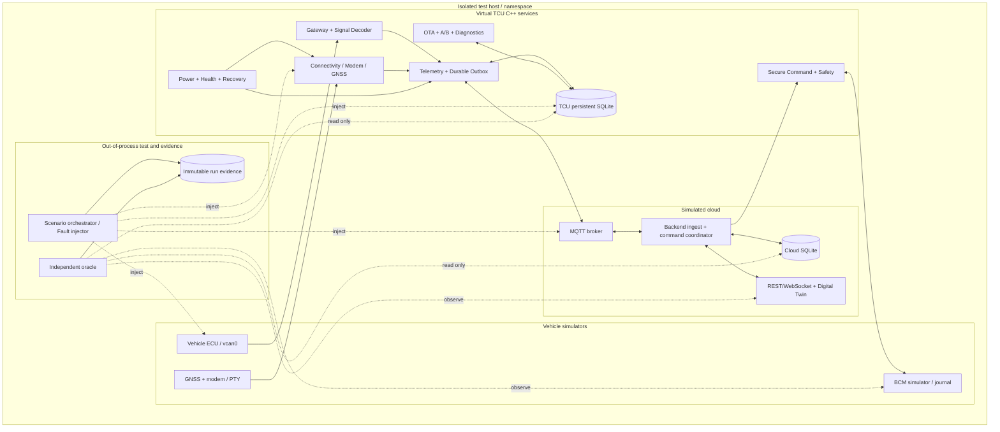
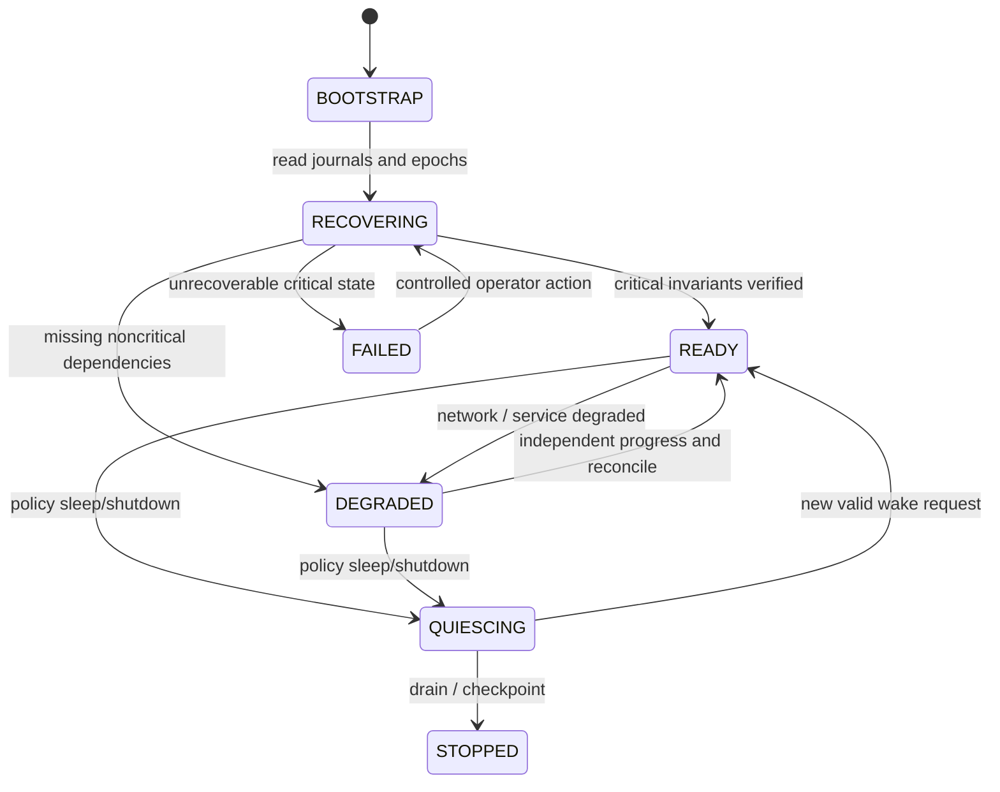
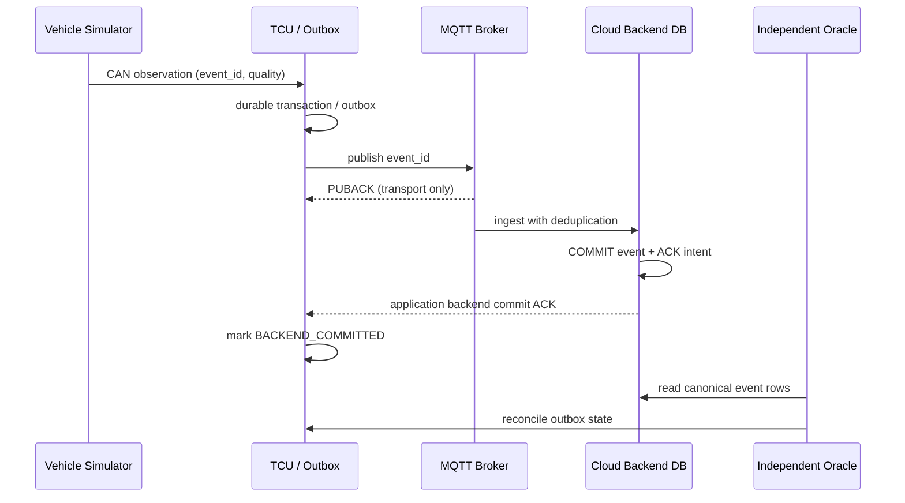
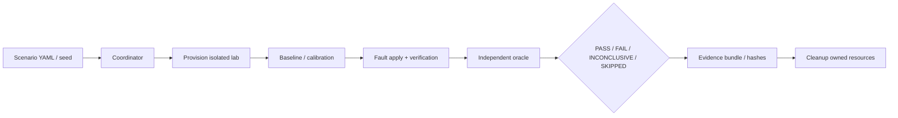

# PROJECT 30 — FULL VIRTUAL TCU INTEGRATION & CHAOS TEST

> **Document:** Production-style System Design & Verification Plan  
> **Project:** 30 / 30 — Virtual TCU Lab  
> **Target:** Middle C++ Developer · C++17/20 · Ubuntu Linux / Docker Compose (QEMU optional)  
> **Version:** 1.0 · 2026-10-30  
> **Status:** DESIGN / TEST PLAN — not an implemented or certified automotive system  
> **Scope:** End-to-end integration of projects P01–P29, deterministic simulation and controlled chaos experiments

## Hướng dẫn sử dụng nhanh (Tiếng Việt)

Đây là **bản System Design tổng hợp cho dự án cuối cùng P30**, ghép toàn bộ P01–P29 thành một TCU giả lập. Nội dung kỹ thuật chi tiết và tên các test case được viết bằng tiếng Anh để có thể chuyển trực tiếp thành Jira tickets, tên automated tests và thông báo trong CI; phần hướng dẫn dưới đây tóm tắt cách triển khai.

**Bốn mục tiêu bắt buộc:** (1) toàn hệ thống có luồng CAN/GNSS → TCU → MQTT → Cloud → Digital Twin hoạt động; (2) lệnh điều khiển giả lập qua validation/safety/BCM không thực thi trùng; (3) OTA A/B giữ được known-good image và recovery đúng; (4) hệ thống kiểm thử phải có **bằng chứng độc lập** để kết luận vượt qua một sự cố.

**Thứ tự nên triển khai:**

1. Đọc mục 2–9 để chốt các ranh giới module và 16 invariants; triển khai các tickets Sprint 1 trước khi tích hợp services.
2. Chạy `smoke`/`integration` không có fault và chứng minh các trạng thái nghiệp vụ (không chỉ process/container healthy).
3. Đưa các `E2E-WI-001…300` của mục 16 thành test cases; ưu tiên P0. Mỗi case phải có bước inject, expected behavior và oracle độc lập.
4. Sau khi các contract độc lập ổn định, chạy 50 multi-fault campaigns ở mục 17; chỉ dùng các lệnh tác động mạng/tiến trình trong **VM hoặc lab cô lập**.
5. Sử dụng schema SQLite mục 21 để lưu test evidence, xử lý `PASS`, `FAIL`, `INCONCLUSIVE`, `SKIPPED` và tạo báo cáo release gate theo mục 23.

**Ba nguyên tắc cần ghi nhớ:** `MQTT PUBACK` không chứng minh cloud đã commit dữ liệu; một command đã gửi đến BCM nhưng mất ACK không thể tự coi là thất bại để gửi lại mù; và một service chạy lại hoặc gửi heartbeat không có nghĩa nghiệp vụ đã phục hồi. Hệ thống phải dùng các journal, epochs và oracle để đối soát.

**Giới hạn:** 300 What-if và 50 chiến dịch đa lỗi là một bộ kiểm thử có cấu trúc, **không thể bao phủ mọi tổ hợp lỗi có thể xảy ra**. Các mục liên quan real CAN arbitration, RF GNSS/4G, wear-leveling và tiêu thụ điện phải chuyển sang hardware/HiL khi có thiết bị thật.

---

## 0. Document contract & important limits

- This is a *buildable design*, not a claim that an implementation exists, that all tests have run, or that any vehicle safety/cybersecurity standard has been certified.
- The 300 What-if cases and 50 multi-fault campaigns are an intentionally broad **risk-based catalog**, not a proof of exhaustive failure coverage. Extend with boundary-value testing, property-based tests, coverage-guided fuzzing, pairwise combinations and field evidence.
- All vehicle movement, door-lock, OTA, diagnostics and GNSS actions use **simulators only**. No control of a real car, CAN gateway, real modem, or safety-relevant ECU.
- **SUT (System Under Test):** all Virtual TCU application services plus simulated vehicle/BCM, modem, cloud, persistent stores, and digital twin. **Oracle:** external independent read-only verifier. **Harness:** fault injector, run orchestrator, evidence recorder.
- A successful injected fault does not imply the SUT passed. A successful SUT response does not imply the fault was injected. Any required evidence missing means **INCONCLUSIVE**, never PASS.
- Sample limits and SLOs are **lab acceptance targets**, not OEM specifications. Actual product requirements must be supplied by the organization, measured on target hardware, and traced through requirements and safety/security analyses.

## 1. Objective, outcomes and boundaries

**Goal:** Boot a virtual connected vehicle, collect CAN/GNSS/diagnostic data, transmit and persist telemetry, execute authorized simulated remote commands, perform virtual A/B OTA, manage power/recovery, and expose a digital twin—*while remaining logically consistent under partial failures and combinations of failures*.

**Deliverables:**
1. `virtual-tcu-lab/` mono-repo with CMake libraries/services, adapters, simulated vehicle/BCM/modem/GNSS, backend, database, dashboard, Compose profiles, test harness.
2. Repeatable `smoke`, `integration`, `chaos`, `endurance`, and optional `qemu` test profiles and pinned dependency manifests.
3. Independent oracle checking business and durability invariants, not relying solely on SUT self-reported health.
4. Versioned test catalog (300 cases + 50 campaigns), 36 Jira-style implementation tickets and machine-readable evidence / reports.
5. Operational runbooks: bring-up, failure injection, clean-up, recover, triage and release gates.

**Non-goals:** real LTE RF fidelity, bus-off/arbitration behavior on physical CAN, genuine GNSS multipath, ECU/HSM validation, functional safety certification, production cybersecurity assessment, hardware power consumption, OTA bootloader assurance, guaranteed exactly-once processing across unrelated processes.

### 1.1 Acceptance at system level

- End-to-end events preserve stable `vehicle_id`, `source_epoch`, `event_id`, `trace_id`, `schema_version`, quality, timestamps and correlation through hops.
- **No fabricated success** for cloud persistence, command execution, OTA installation, healthy status or GPS freshness.
- **No blind replay** of a remote command when its execution outcome is unknown.
- **No `VALID` from invalid/stale vehicle or GNSS data**, regardless of whether a newer MQTT packet was received.
- Safety/security denies are **fail-closed before dispatch**; recovery after dispatch must respect uncertain outcomes.
- Persistent queues and logs are bounded or have documented backpressure/retention/overflow policies; overload never silently masquerades as success.
- Shutdown/restart cannot produce double-completion, use-after-free, deadlock or resurrect old callbacks as current results.

## 2. Complete dependency and integration map (P01–P29)

| Layer | Source projects | Responsibility in Project 30 | Mandatory contract |
|---|---|---|---|
| Core runtime | P01 Event Bus, P02 IPC, P03 Scheduler, P04 Config & Logging | Queueing, request correlation, deadlines, configuration & trace | Bounded resources; immutable config generation; monotonic deadlines |
| Vehicle transport | P05 Virtual CAN, P06 DBC Decoder, P07 Gateway, P08 SOME/IP | Simulated ECU data, router, signal quality, service-oriented communication | No unsafe route loop; no stale value marked valid; source identity |
| Radio / positioning | P09 AT Modem, P10 Connectivity, P11 Network Fault Lab, P12 GNSS | Modem, bearer/cloud reachability, failure injection, position | `Registered ≠ Internet ≠ CloudReady`; fix validity independent of packet arrival |
| Telematics / cloud | P13 MQTT, P14 Durable Outbox, P15 Cloud Backend, P16 Remote Control, P17 Health | Publish/replay, idempotent storage, commands, health | Backend application ACK distinct from MQTT ACK; durable command and alert journal |
| Update / diagnostics | P18 OTA Download, P19 A/B Slot, P20 UDS, P21 DTC Collector | Signed artifact staging, virtual boot/rollback, diagnostic snapshots | Install only verified artifact; trial slot needs independent health; missing DTC ≠ cleared |
| Resilience / security | P22 Power, P23 Secure Commands, P24 Watchdog | Sleep, authorization, progress watchdog and recovery | No stale auth/safety; no false recovered; preserve known-good state |
| Platform / verification | P25 Soak, P26 systemd, P27 Yocto/QEMU, P28 Compose, P29 Digital Twin | Deployment, long runs, image tests, topology, dashboard | Container/proc healthy ≠ business healthy; dashboard resync on revision gaps |

**P27** is optional for the first lab MVP and runs separately in a QEMU VM: it is *not* assumed that Linux inside an arbitrary Docker container behaves like a Yocto boot image.

## 3. Architecture and trust boundaries



### 3.1 Deployment topology

- **`vehicle-net`:** vehicle/gateway simulator, isolated CAN (`vcan0`, optional `vcan1`) created only on a dedicated lab Linux host/VM. Cross-container SocketCAN access is *not* magically provided by Compose: host CAN setup or explicit namespaced adapters are required.
- **`tcu-net`:** TCU services; Unix socket directory shared only among the intended services, not as a global writable host mount.
- **`cloud-net`:** broker/backend/digital twin, separate persistent volumes for cloud and TCU DBs.
- **`fault-net`:** dedicated network namespace / host-level tools; no host `network_mode: host` or `privileged: true` as a default.
- **`observe-net`:** the oracle receives scoped read-only metrics/events and DB snapshots; it should not depend on the same callback and state machine used by the SUT.
- Configure *versioned schemas* and explicit migration per service; pin image digests for repeatability; redact secrets from all published evidence.

### 3.2 Trust and control boundaries

1. MQTT transport authenticates the connection; **P23 verifies command identity, authorization, expiry and anti-replay** prior to dispatch to P16.
2. P16 checks live/quality-qualified vehicle state; P07/BCM performs simulated execution with idempotency; uncertain results remain UNKNOWN.
3. TCU telemetry is considered *delivered to backend* only when a correlated **application-level backend commit ACK** is durable/reconciled.
4. P19 accepts P18 artifacts only after signed metadata policy + cryptographic integrity validation and durable staging; P19 independently revalidates required properties before boot activation.
5. External fault harness alone has perturbation capability. No test-generated credentials or permits are reused on production systems.

## 4. Key integration contracts

| Contract ID | Producer → Consumer | Identity / data | Validation & behavior |
|---|---|---|---|
| INT-01 | P05/06/07 → P01/P13 | `VehicleSignal{source_epoch,signal_id,value,quality,observed_steady,observed_utc}` | Stale/invalid never marked fresh; epoch changes on source reboot |
| INT-02 | P12 → P13/P29 | `PositionFix{fix_epoch,lat,lon,utc,quality}` | No-fix and old fix do not become live because transport reconnects |
| INT-03 | P10 → P13/P18 | `Connectivity{bearer,ip,endpoint,cloud,epoch}` | CloudReady requires protocol-specific authentication; late probes fenced |
| INT-04 | P14 → P15 | `TelemetryEnvelope{event_id,vehicle_id,source_epoch,payload_hash}` | Event ID stable across retransmits; cloud idempotency keyed by tenant/device/event |
| INT-05 | P15 → P14 | `BackendCommitAck{event_id,commit_token}` | Only after durable backend ingest; duplicates safe |
| INT-06 | P15/P23 → P16 | `ValidatedCommand{command_id,auth_context,expiry,policy_epoch}` | Reauthorization and safety recheck at dispatch boundary |
| INT-07 | P16 → BCM | `ExecutionRequest{command_id,actuation_id,action}` | Simulator journal resolves duplicate requests; ambiguous ACK creates UNKNOWN |
| INT-08 | P18 → P19 | `VerifiedArtifact{job_id,content_hash,manifest_hash,staged_path}` | Never trust path alone; immutable verified bytes/metadata |
| INT-09 | P19 → P24/P26 | `TrialBoot{slot,attempt,health_epoch}` | Only independent progress/health may confirm new slot GOOD |
| INT-10 | P20 → P21 | `DtcSnapshot{ecu_epoch,status_mask,scan_quality,items}` | Partial/failed scan cannot imply DTC cleared |
| INT-11 | P17/P24 → P29 | `HealthState{quality,component,status,reason,epoch}` | UNKNOWN/STALE are not OK; process alive not necessarily ready |
| INT-12 | P29 → browser | `TwinUpdate{revision,field_revision,source_epoch,quality}` | Revision gap triggers fresh snapshot before further deltas |

## 5. Data model, identities, clocks and ordering

- **Device:** `(tenant_id, vehicle_id)` forms the scoped principal; `device_id` and tenant are not trusted from bare MQTT payload fields unless explicitly bound to authenticated source identity.
- **Events:** stable 128-bit `event_id` for application deduplication, `trace_id` for cross-component audit, per-source monotonic `sequence` and `source_epoch`/`boot_id` to disambiguate counter resets.
- **Clocks:** `steady_clock` for local timeouts and freshness, trusted UTC for expiry where required, and persisted boot/session epochs for restart; do **not** persist steady clock counts for use after reboot.
- **Snapshots:** data quality (`VALID`, `STALE`, `INVALID`, `MISSING`, `UNTRUSTED`, `UNSUPPORTED`) is independent of transport quality and freshness; no blanket `zero` default for missing signals.
- **DB transactions:** outbox event and business mutation committed atomically *inside each database*, but two independent TCU/cloud SQLite DBs cannot share one atomic transaction; design reconciliation and application ACK rather than claiming global exactly-once.
- **Storage:** sample profile: WAL + `synchronous=FULL` where durability is required and supported by storage stack; verify power-loss behavior under an appropriate VM/block fault model. `NORMAL` may trade power-loss durability for throughput.

### 5.1 Business state machines



**Telemetry:** `CREATED → DURABLY_QUEUED → SENT/UNCERTAIN → BACKEND_COMMITTED` (or `EXPIRED/DROPPED_WITH_REASON` per policy); broker PUBACK alone is **not** `BACKEND_COMMITTED`.

**Command:** `RECEIVED → AUTHORIZED → JOURNALED → SAFETY_APPROVED → DISPATCH_INTENT → EXECUTED | DENIED | UNKNOWN`; terminal outcomes never overwritten by stale async callbacks.

**OTA:** `OFFERED → MANIFEST_VERIFIED → DOWNLOADING → ARTIFACT_VERIFIED → STAGED → TRIAL_BOOT → GOOD | ROLLED_BACK | RECOVERY_REQUIRED`; no GOOD from download/boot only.

## 6. C++17/20 API design (interfaces, no hardware dependency)

```cpp
struct Epoch { uint64_t boot = 0; uint64_t source = 0; };
struct TraceContext { std::string trace_id; std::string event_id; };
enum class Quality { Valid, Stale, Invalid, Missing, Untrusted, Unsupported };
enum class Outcome { Success, Denied, Unknown, Failed, TimedOut };

struct Observation {
    std::string vehicle_id;
    Epoch epoch;
    TraceContext trace;
    std::chrono::steady_clock::time_point received_at;
    Quality quality;
    std::vector<std::byte> payload;
};

class IClock {
public:
    virtual ~IClock() = default;
    virtual std::chrono::steady_clock::time_point now() const = 0;
};
class IStateSnapshot {
public:
    virtual ~IStateSnapshot() = default;
    virtual Observation read(std::string_view field) const = 0;
};
class IModuleLifecycle {
public:
    virtual ~IModuleLifecycle() = default;
    virtual void start() = 0;
    virtual void quiesce() = 0;
    virtual void stop() noexcept = 0;
    virtual bool madeProgressSince(uint64_t progress_token) const = 0;
};
class IFaultInjector {
public:
    virtual ~IFaultInjector() = default;
    virtual bool apply(std::string_view run_id,
                       std::string_view fault_id) = 0;
    virtual bool verifyApplied(std::string_view fault_id) const = 0;
    virtual void cleanup(std::string_view run_id) noexcept = 0;
};
class IInvariantOracle {
public:
    virtual ~IInvariantOracle() = default;
    virtual std::vector<std::string> violations(
        std::string_view run_id) const = 0;
};
```

**Design choices:** dependency injection (`IClock`, transports, repos); RAII and explicit ownership; bounded thread pools; cancellation tokens or generation fencing; input validation at each trust boundary; *exactly one state transition commit per event generation*. An in-memory event bus is not an inter-process durability guarantee.

## 7. Operational behaviors / end-to-end sequences

### 7.1 Cold start

1. Orchestrator checks host capabilities (`docker compose`, `iproute2`, `vcan`, disk space, unique lab name); creates only scoped networks/volumes.
2. Start DB and broker dependencies; container health is a precondition to service initialization, **not proof of business readiness**.
3. Each TCU service loads config, validates schema/version/permissions, opens durable journal, increments local generation and reconciles incomplete work.
4. Start CAN/PTY adapters and local services; connectivity may be `DEGRADED` while offline. Report `READY` only after essential local work is usable.
5. Oracle records baseline process identity, DB health, input counters and expected initial state before injection.

### 7.2 Normal telemetry end-to-end



### 7.3 Remote simulated door action

1. Backend emits signed/authorized command (only test principals).
2. P23 validates identity, signature, tenant, target, action, expiry, nonce/idempotency and policy epoch; records admission atomically.
3. P16 rechecks recent safety state and durable dispatch intent; simulator BCM deduplicates by command/actuation identity.
4. If BCM execution result cannot be proved, final state is `UNKNOWN` pending reconcile; never infer execution from MQTT ACK.
5. Digital Twin presents *requested/accepted/executed/unknown* separately. The scenario oracle queries BCM journal, command journal and backend view.

### 7.4 OTA with crash

P18 downloads with signed manifest and pinned content identity, checks Range/ETag/resume validity, verifies bytes and stages durably; P19 independently verifies, writes **inactive slot only**, trial boots, checks independent service progress and marks GOOD only after policy gates. Power interruption before journal/slot consistency is handled by recovery; if fallback cannot be trusted, enter `RECOVERY_REQUIRED` rather than guessing.

### 7.5 Diagnostic and health

UDS scans may be partial; P21 never treats a missing DTC in a partial scan as `CLEARED`. P17 health reports `UNKNOWN` when observations or monitors are absent. P29 displays quality and age, and resynchronizes from a committed snapshot after revision gaps.

### 7.6 Coordinated shutdown

Stop admission of new commands/OTA; quiesce producers; persist pending outbox/journals; cancel timers using epochs; flush within configured deadline; stop processes; save evidence; remove **only** resources owned by the test run. Unresolved commands remain UNKNOWN, not retroactively successful.

## 8. Behavioral contracts (Given / When / Then)

| ID | Given / When | Then / observable requirement |
|---|---|---|
| BC-01 | Offline vehicle produces valid signals | Durable outbox grows within configured cap; source freshness preserved |
| BC-02 | Broker sends PUBACK, backend DB rolls back | TCU never reports backend commit |
| BC-03 | Backend commits event but application ACK is lost | Event replay retains original ID; one canonical backend row |
| BC-04 | CAN speed times out | Speed quality becomes STALE/UNKNOWN; dashboard does not show live speed |
| BC-05 | GNSS lacks fix but packets continue | No live coordinate is published |
| BC-06 | Modem registered, cloud TLS fails | Connectivity != CloudReady |
| BC-07 | A remote command uses revoked identity | No dispatch into BCM |
| BC-08 | Command reaches BCM, then result is lost | Unknown outcome, no blind actuation retry |
| BC-09 | OTA file downloaded, signature/hash mismatch | No stage/activate/mark-GOOD |
| BC-10 | Trial boot service fails to make progress | Slot never confirmed GOOD; rollback/recovery policy invoked |
| BC-11 | DTC scan incomplete | No false DTC-clear event |
| BC-12 | Service emits heartbeat while worker hung | Independent progress oracle marks unhealthy |
| BC-13 | Restart reuses sequence 1 | New boot/source epoch prevents old event overriding new |
| BC-14 | Two callback outcomes race with timeout | One terminal result under a lock/journal CAS |
| BC-15 | Cloud/TCU SQLite full | No durable-success claim; bounded failure path |
| BC-16 | Browser misses WebSocket revision | Snapshot resync before applying later deltas |
| BC-17 | Fault tool targets incorrect namespace | Run fails to prove injection; status INCONCLUSIVE |
| BC-18 | Observer loses access to evidence | Status INCONCLUSIVE or FAIL according to policy, never PASS |
| BC-19 | Power sleep requested with live OTA lease | Enter safe postpone/abort state per policy; no untracked partial image |
| BC-20 | System recovers after a crash | Report RECOVERED only after reconciliation + progress probation |
| BC-21 | Duplicate or reordered cloud events | Idempotent canonical state, no duplicate business action |
| BC-22 | Config hot reload conflicts with in-flight work | Generation fencing prevents mixing old/new policy decisions |
| BC-23 | Invalid tenant attempts to query twin | No data leak and denied action recorded |
| BC-24 | Fault campaign cleanup fails | Mark test environment contaminated; refuse next run until cleaned |

## 9. Resilience invariant registry (release blockers)

| Invariant | Definition | Independent oracle |
|---|---|---|
| INV-01 | No stale/invalid CAN or GNSS data presented as live | Inject source silence + inspect twin field quality/age |
| INV-02 | No false `CloudReady` | Independent TLS/broker reachability + TCU state |
| INV-03 | At most one canonical telemetry event per scoped event ID | Cloud DB unique key + event counts |
| INV-04 | No `BackendCommitted` before corresponding DB commit | TCU journal + backend DB + fault timeline |
| INV-05 | No duplicate simulated actuation for same command ID | BCM independent action journal |
| INV-06 | No unsafe command dispatch on stale/unauthorized state | Command journal + BCM journal + policy epoch |
| INV-07 | OTA never marks unverified/newly unhealthy slot GOOD | Slot metadata + independently booted service progress |
| INV-08 | Known-good bootable slot not mutated by normal inactive-slot write | Pre/post image hash + metadata |
| INV-09 | Incomplete DTC scan cannot emit cleared transition | Source simulator ground truth + repository |
| INV-10 | Persistent commit obeys configured durability profile | DB/journal snapshots before/after crash injection |
| INV-11 | Bounded memory/queue/FD/thread under overload | cgroup `/proc` samples + queue counters |
| INV-12 | No handler completes twice, no stale epoch resurrection | Transaction IDs + callback/result journal |
| INV-13 | No tenant isolation violation, secrets excluded from logs | Controlled test principals + audit scan |
| INV-14 | Recovered != process restarted; progress validated | Independent progress counter + probation |
| INV-15 | Every PASS has verified fault and trustworthy evidence | Harness ledger + mandatory proof constraint |
| INV-16 | Test runner cleans only run-owned network/process/storage | Ownership tags + pre/post host resource inventories |

## 10. Reliability SLOs and test profiles (tunable examples)

| Profile | Example duration | Load / events | Gate |
|---|---|---|---|
| `smoke` | 5–10 min | 1 vehicle, 2–10 signals/s, 1 command | All basic flows and zero false positives |
| `integration` | 30–60 min | 2 vehicles, 10–100 signals/s, selected failures | All P0 contract tests |
| `chaos` | 2–12 h | Controlled faults with seeded timeline | No INV-01…INV-16 violations; proof complete |
| `endurance` | 24 h | Baseline traffic + bounded faults | No persistent growth trend exceeding baseline thresholds |
| `soak` | 7 days optional | Representative workflows and periodic restarts | Stable memory/FD/thread slopes; recoverable journals |
| `qemu` | Per boot image | QEMU smoke, reboot and persistent-state tests | No false READY, correct service and journal recovery |

Suggested initial targets (require measurement/tuning): `queue_capacity=1024` events per service, `max_inflight=128`, `command_deadline=5s`, `telemetry_backlog_limit=250MiB`, `health_probe_period=2s`, `probe_staleness=10s`, cold-start local readiness within `30s` on a reference VM. *They are examples, not verified guarantees.*

**SLO semantics:** measure p50/p95/p99 where applicable; throughput gates include offered load, accepted load, and explicit dropped/rejected counts; never choose an SLO that forces silent data loss or unsafe auto-retry.

## 11. Test harness architecture and lifecycle



**Scenario lifecycle:** `DECLARED → PROVISIONED → BASELINED → INJECTING → INJECTION_VERIFIED → OBSERVING → CLASSIFIED → CLEANED`. An injected fault without sufficient independent evidence cannot reach PASS. Failed cleanup marks the subsequent run environment tainted.

**Required trace artifacts:** `run.json`, baseline inventory, fault request/result/proof, timestamped process generations, network `tc`/link state, relevant database snapshots or transaction extracts, BCM journal, cloud canonical event counts, metrics time series, oracle violations, clean-up ledger, artifact hashes and redacted logs. Maintain `run_id` for cross-referencing.

**Avoid unreliable injection:** use deterministic clocks for unit/contract tests; in integration, perturb actual network namespace with `tc netem` and verify counters/traces. Simulated `SIGKILL` is not an equivalent of real battery power-cut; VM/block-layer faults are needed to explore storage durability.

## 12. Failure classification and triage

| Result | Meaning |
|---|---|
| `PASS` | All prerequisites true, injection independently verified, expected behavior/invariants observed within deadline, evidence sufficient |
| `FAIL` | Verified fault and an invariant violated or expected behavior observably failed |
| `INCONCLUSIVE` | Required injection proof, oracle observation or environmental precondition missing; do not count as pass |
| `SKIPPED` | Capability absent under explicit, preapproved skip policy; recorded coverage gap |

**Priority:** P0 = safety/security/data integrity/recovery release gate; P1 = major functional/performance; P2 = extended environmental/rare compatibility. Severity and test priority are separate fields.

**Triage procedure:** preserve original logs + hashes; link `run_id/trace_id/event_id`; compare oracle ground truth vs SUT reported state; find earliest boundary violation; reduce reproducer to smallest fault sequence; add regression test; only then change production behavior.

## 13. Ubuntu lab setup and limitations

Requirements: Ubuntu 22.04/24.04 or supported Linux VM, C++17 compiler, CMake, Docker Engine and Compose plugin, Python 3, `iproute2`, `can-utils`, SQLite client and a reproducibly pinned broker/client dependency. Host-side fault commands require *explicit privilege* and must run only in a dedicated lab VM or namespace.

```bash
# Prerequisites / capability checks (illustrative)
uname -a
docker compose version
command -v tc
command -v ip
command -v sqlite3

# In a dedicated Linux lab VM only; kernel support required
sudo modprobe vcan
sudo ip link add vcan0 type vcan
sudo ip link set vcan0 up
candump vcan0
# A separate shell:
cansend vcan0 123#1122334455667788
```

Illustrative orchestration commands **after** repository/Compose implementations exist:

```bash
cmake -S . -B build -G Ninja -DCMAKE_BUILD_TYPE=Debug
cmake --build build -j
ctest --test-dir build --output-on-failure

docker compose --profile core up -d --build
docker compose --profile full up -d --build
python3 tools/chaos/run.py --profile smoke --seed 20261030
python3 tools/chaos/run.py --profile chaos --campaign E2E-MF-01 --seed 101
python3 tools/chaos/report.py --run-id <run_id>
docker compose down  # volumes preserved by default
```

The `tools/chaos/*.py`, profile names and service images are **proposed interface paths**, not files delivered by this design. Do not run `down -v` on data you intend to keep. Use test-run-scoped names and cleanup tags.

### 13.1 Minimal illustrative Compose topology

```yaml
# compose.example.yaml — design sketch; images/services must be built first
services:
  broker:
    image: eclipse-mosquitto:2
    networks: [cloud_net]
    volumes:
      - ./configs/mosquitto.conf:/mosquitto/config/mosquitto.conf:ro
    healthcheck:
      # Supply a production-appropriate broker readiness command in the image.
      test: ["CMD-SHELL", "test -r /mosquitto/config/mosquitto.conf"]
      interval: 5s
      timeout: 2s
      retries: 5
  cloud:
    image: virtual-tcu/cloud:dev
    depends_on:
      broker:
        condition: service_healthy
    networks: [cloud_net]
    volumes: [cloud_data:/var/lib/cloud]
  tcu-core:
    image: virtual-tcu/core:dev
    depends_on:
      broker:
        condition: service_healthy
    networks: [cloud_net, tcu_net]
    volumes: [tcu_data:/var/lib/tcu]
  observer:
    image: virtual-tcu/observer:dev
    networks: [cloud_net, tcu_net]
    read_only: true
networks:
  cloud_net: {internal: true}
  tcu_net: {internal: true}
volumes:
  cloud_data: {}
  tcu_data: {}
```

The shown healthcheck only checks config visibility, **not actual broker readiness**: deliberately replace with a broker-level check before using it as a gate. Compose `depends_on: condition: service_healthy` governs initial startup ordering, **not perpetual readiness or automated business reconciliation**. `netem` works on interfaces in a controlled namespace; namespace routing and actual traffic direction must be proven.

## 14. Design decisions, alternatives and trade-offs

| ADR | Decision | Rejected / caveat |
|---|---|---|
| ADR-01 | C++17 for TCU services, Python for test/oracle orchestration | Single-language harness slows deterministic fault modeling |
| ADR-02 | Stable event/command IDs with application-level idempotency | MQTT QoS alone cannot guarantee exactly-once business effects |
| ADR-03 | Per-service SQLite journals + outbox/reconciliation | No distributed ACID transaction across processes and cloud |
| ADR-04 | Independent oracle with read-only access | Logs or healthchecks produced by the SUT can lie |
| ADR-05 | Namespace-scoped faults and explicit capability checks | Global `tc` changes can break the developer host |
| ADR-06 | Quality/epoch/revision metadata in every published twin field | Arrival time alone cannot resolve source reboot and stale data |
| ADR-07 | Separate systemd/QEMU optional profile | Containers are not a substitute for real boot/service manager behavior |
| ADR-08 | Fail-closed security/safety and UNKNOWN for post-dispatch ambiguity | Deny-after-dispatch cannot undo already executed action |
| ADR-09 | Evidence-based PASS/FAIL/INCONCLUSIVE | Counting a test pass without proving injection creates false confidence |
| ADR-10 | Pairwise + deterministic seeded chaos + soak | 300 named scenarios cannot exhaust the state space |

## 15. Test coverage method and risk scoring

The What-if catalog below is grouped into **30 subsystems/failure domains × 10 independently named scenarios = 300**. All cases include an injection method, expected behavior and an evidence/oracle. Pairwise coverage across domains is extended by **50 multi-fault campaigns**, but the complete cross-product is much larger than this document. Every P0 case must be automated or have a justified, reviewed deferral before release.

Risk ranking: consider severity (safety/security/data corruption), likelihood in integration, detectability, cross-layer propagation and rollback difficulty. For each failed case: preserve counterexample; create minimized regression; add risk to change-control and trace it to a requirement/invariant.

---

## 16. Catalog — 300 detailed What-if scenarios

**Reading a case:** `Inject` is the reproducible stimulus; `Expected` is the required SUT behavior; `Oracle` is *independent evidence*. Each uses the ID `E2E-WI-###` and a priority P0/P1. Real driver-level impairments are not assumed testable with Docker alone.

### 01. Boot, startup ordering and recovery barriers

| ID / priority | What-if | Fault injection / reproducer | Expected behavior (PASS oracle) | Independent evidence |
|---|---|---|---|---|
| `E2E-WI-001` · P0 | Broker starts after TCU | Delay broker container by 20 s at cold boot | TCU local functions start DEGRADED and reconnect without false CloudReady | Compare process readiness, broker auth probe and TCU connection epoch |
| `E2E-WI-002` · P0 | Cloud DB unavailable at boot | Reject backend DB open during first 60 s | Cloud never acknowledges telemetry as committed; backlog remains replayable | Read backend DB, TCU outbox and app ACK count |
| `E2E-WI-003` · P0 | TCU journal missing | Rename TCU DB before cold start | Service enters explicit initialization/recovery policy, never fabricates prior commands | Inspect initialization audit and BCM journal unchanged |
| `E2E-WI-004` · P0 | Corrupt essential command journal | Flip journal pages in disposable DB snapshot | Fail closed for command dispatch and surface RECOVERY_REQUIRED | Verify no BCM action, DB integrity and health status |
| `E2E-WI-005` · P0 | Service reports READY before replay reconciliation | Delay journal reconciliation with gate | Observer refuses system READY while unresolved intents exist | Compare readiness timestamp with reconciliation-complete marker |
| `E2E-WI-006` · P0 | One dependency healthy then fails | Start broker healthy and SIGKILL it during TCU startup | Startup is not mistaken for permanently ready; reconnect state degrades | Broker PID timeline and TCU readiness state |
| `E2E-WI-007` · P0 | Boot twice with same source sequence | Restart vehicle simulator and reset sequence counter | New source_epoch prevents older observations overriding newer state | Inspect twin source_epoch and sequence audit |
| `E2E-WI-008` · P1 | systemd-style service restarts while container stays up | Restart inner worker only through test adapter | Health reports missing progress until worker recovered | Independent progress counter vs container health |
| `E2E-WI-009` · P1 | Two services claim identical instance identity | Start duplicate service with same instance ID | Conflict detected, no cross-delivery of pending RPCs | Inspect service registry and RPC correlation IDs |
| `E2E-WI-010` · P1 | Shutdown interrupts cold-start recovery | SIGTERM during outbox replay and DB migration | Stop in bounded time; next start reconciles without success fabrication | Inspect DB state before/after second start and process exit |

### 02. Configuration, versions and hot reload

| ID / priority | What-if | Fault injection / reproducer | Expected behavior (PASS oracle) | Independent evidence |
|---|---|---|---|---|
| `E2E-WI-011` · P0 | Malformed config JSON | Replace a config snapshot with malformed JSON | Reject reload atomically and retain last-known-good config | Compare active config_generation before/after |
| `E2E-WI-012` · P0 | Wrong schema version | Set unsupported major schema version | Block affected service startup or enter safe DEGRADED | Config validation log and no dependent dispatch |
| `E2E-WI-013` · P0 | Two writers update config concurrently | Deliver two atomic rename events rapidly | Exactly one complete generation active at a time | Read active config hash and worker generation logs |
| `E2E-WI-014` · P0 | Reload network policy during retry | Trigger reload between timer scheduling and firing | Old timer cannot apply revoked retry policy | Compare timer generation and reconnect attempts |
| `E2E-WI-015` · P0 | Change CAN routing while frames queued | Commit conflicting route snapshot during backlog | No mixed-generation loop or forbidden route appears | Gateway route_id per transmitted frame and vcan capture |
| `E2E-WI-016` · P0 | Change authorization while command queued | Revoke test principal before handoff | Revalidate and deny before BCM dispatch | P23 policy_epoch and BCM action journal |
| `E2E-WI-017` · P0 | Change OTA policy after verification | Revoke signing key before slot activation | P19 revalidates trust at activation gate | Activation record and trust generation |
| `E2E-WI-018` · P1 | Config file permission denied | Remove read permission from one service config | No silent fallback to unsafe defaults | Config error and effective policy hash |
| `E2E-WI-019` · P1 | Clock jump during config TTL | Advance wall clock drastically with fake clock | TTL checks use trusted clock policy; no mass invalidation mistake | Clock trust state and accepted config version |
| `E2E-WI-020` · P1 | Rapid 500 configuration reloads | Apply seeded alternating valid/invalid configs | Memory bounded, valid snapshots coherent, invalid ones rejected | RSS slope, config hashes and reload result ledger |

### 03. Virtual CAN transport and ECU source

| ID / priority | What-if | Fault injection / reproducer | Expected behavior (PASS oracle) | Independent evidence |
|---|---|---|---|---|
| `E2E-WI-021` · P0 | CAN source stops transmitting | Pause CAN generator for longer than timeout | Dependent signals become STALE, not zero or VALID | CAN transmit counters and twin quality |
| `E2E-WI-022` · P0 | CAN interface goes down | Run ip link set vcan0 down in lab | CAN service marks transport unavailable; bounded retry | Link state and CAN adapter lifecycle logs |
| `E2E-WI-023` · P0 | CAN interface comes back with old buffer | Queue frames before down/up transition | Stale frame epochs rejected; valid new frames accepted | Injected frame IDs, decoder epoch and twin state |
| `E2E-WI-024` · P0 | CAN burst of 100k frames | Send bounded high-rate frame batch to vcan | Bounded queue, explicit drops, no memory growth without limit | candump counts, queue metrics and RSS |
| `E2E-WI-025` · P0 | Unexpected extended CAN ID | Send EFF frame when only SFF rules allowed | Reject or route only per explicit filter | Raw capture and routing decision |
| `E2E-WI-026` · P0 | Truncated CAN payload | Send DLC shorter than signal specification | Mark signal invalid; no out-of-bounds access | Frame capture, sanitizer and decode result |
| `E2E-WI-027` · P0 | Duplicate frames with same content | Repeat CAN frame with same synthetic source sequence | No duplicate business event beyond source policy | Event journal and source sequence analysis |
| `E2E-WI-028` · P1 | Simulated ECU resets mid-stream | Restart ECU generator with new source epoch | Signal cache invalidates old source state | Cache epochs and quality transitions |
| `E2E-WI-029` · P1 | Two ECU generators claim same address | Start duplicate CAN producer for one signal ID | Conflict logged and source arbitration policy applies | Tagged frames and source-selection decision |
| `E2E-WI-030` · P1 | CAN frame arrives while service stopping | Inject frame at quiesce barrier | No callback after owning object destruction | ASan/TSan logs and lifecycle trace |

### 04. DBC decoding, value quality and freshness

| ID / priority | What-if | Fault injection / reproducer | Expected behavior (PASS oracle) | Independent evidence |
|---|---|---|---|---|
| `E2E-WI-031` · P0 | Intel signal crosses byte boundary | Inject hand-checked little-endian bit vector | Exact raw/scaled result and no adjacent-bit corruption | Golden vector and decoder output |
| `E2E-WI-032` · P0 | Motorola signal crosses boundary | Inject hand-checked big-endian DBC vector | Exact decoded value, with correct sawtooth indexing | Golden vector and decoded byte trace |
| `E2E-WI-033` · P0 | Signed negative raw value | Inject signed signal with sign bit set | Correct sign extension and physical scaling | Independent reference decoder |
| `E2E-WI-034` · P0 | Scale produces overflow | Supply extreme raw and scaling factor | Reject/flag invalid instead of wrapping into normal value | Raw vector and validated output |
| `E2E-WI-035` · P0 | Reserved invalid signal encoding | Send DBC invalid sentinel | Quality INVALID rather than believable numeric value | DBC spec and emitted quality |
| `E2E-WI-036` · P0 | Multiplexor value changes rapidly | Alternate mux selection in back-to-back frames | Decode only active branches without stale branch carryover | Signal ID/mux trace and snapshot fields |
| `E2E-WI-037` · P0 | Signal freshness expires on queue backlog | Delay dispatcher beyond freshness deadline | Data age measured from source observation, not dequeue time | Original timestamp and consumer age |
| `E2E-WI-038` · P1 | DBC reload while decoding | Swap schema generation in the middle of burst | Each frame decoded wholly under one generation | Decoder generation per observation |
| `E2E-WI-039` · P1 | NaN/infinity from downstream transform | Inject non-finite converted sensor value via adapter | Reject before JSON/telemetry serialization | Validation log and output envelope |
| `E2E-WI-040` · P1 | Contradictory ignition signals | Simulate two ECUs reporting incompatible ignition states | Mark conflict/UNTRUSTED, prevent power/safety blind decision | Independent raw frames and quality reasons |

### 05. Gateway routing, loop prevention and command delivery

| ID / priority | What-if | Fault injection / reproducer | Expected behavior (PASS oracle) | Independent evidence |
|---|---|---|---|---|
| `E2E-WI-041` · P0 | Bidirectional forwarding loop configured | Attempt route A→B and B→A for matching IDs | Configuration rejected deny-by-default | Route validation output and frame-count stability |
| `E2E-WI-042` · P0 | Gateway has overlapping rules | Apply two rules with different priorities to same ID | Deterministic priority / reject ambiguity per spec | Route decision trace on matching frames |
| `E2E-WI-043` · P0 | Downstream CAN interface fails on send | Drop egress link before send | Command remains UNKNOWN or failed, never EXECUTED | Egress capture and command journal |
| `E2E-WI-044` · P0 | Gateway reconnect with stale TX queue | Disconnect link then reconnect after message expiry | Expired safety-sensitive frames not transmitted | Queue age and egress capture |
| `E2E-WI-045` · P0 | Gateway restart during request | SIGKILL gateway after command intent persisted | Reconcile with BCM; do not blindly redispatch | BCM journal and command state |
| `E2E-WI-046` · P0 | Malformed transform rule | Inject out-of-range signal transform config | Reject route snapshot before activation | Validator trace and active route hash |
| `E2E-WI-047` · P0 | Unknown CAN ID flood | Inject 10k unmatched frames | Drop with bounded observability; no route-by-default | Rule hit counters and egress capture |
| `E2E-WI-048` · P1 | Remote command and telemetry contention | Saturate RX frames while sending lock command | Critical path respects defined latency / overload policy | Egress timestamps and queue class metrics |
| `E2E-WI-049` · P1 | Gateway config reload on active TX | Revoke route at serialization barrier | Policy-defined in-flight boundary, no new revoked dispatch | Rule epoch on TX records |
| `E2E-WI-050` · P1 | Service discovery command collides with CAN route | Inject duplicate action through SOME/IP and CAN gateway paths | Shared command identity prevents double actuation | BCM command/action journal |

### 06. IPC and SOME/IP inter-service calls

| ID / priority | What-if | Fault injection / reproducer | Expected behavior (PASS oracle) | Independent evidence |
|---|---|---|---|---|
| `E2E-WI-051` · P0 | IPC server crash after receiving request | Kill server before response | Client returns UNKNOWN or timeout, no false success | IPC trace and service-side journal |
| `E2E-WI-052` · P0 | IPC response arrives after timeout | Delay response past deadline | Pending request completed once; late response ignored | Correlation ledger and terminal-state count |
| `E2E-WI-053` · P0 | Frame split across reads | Write IPC frame in one-byte chunks | Framing recovers exactly one valid message | Byte transcript and decoded message |
| `E2E-WI-054` · P0 | Two frames coalesced in read | Write concatenated frames in one write | Both messages parsed independently | Server frame counter and trace IDs |
| `E2E-WI-055` · P0 | Service Discovery TTL expires | Suppress SOME/IP offers beyond TTL | Service marked unavailable; old subscriptions not treated current | Offer/subscription epochs |
| `E2E-WI-056` · P0 | SUBSCRIBE ACK after UNSUBSCRIBE | Reorder simulated SD callbacks | Subscription not resurrected | Subscription generation and event reception |
| `E2E-WI-057` · P0 | Provider restarts reusing request ID | Restart provider and reset counter | Epoch-aware correlation prevents wrong completion | Session generations and response matching |
| `E2E-WI-058` · P1 | Slow handler exhausts worker pool | Stall handlers and send bounded RPC burst | Backpressure and timeout, no unbounded threads | Queue depth, active workers and RSS |
| `E2E-WI-059` · P1 | Malformed SOME/IP payload length | Inject advertised length inconsistent with frame | Parser rejects without memory misuse | Packet capture and sanitizer results |
| `E2E-WI-060` · P1 | IPC path replaced by unexpected socket | Swap Unix socket pathname while client reconnects | Peer identity validation/permission policy enforced | Socket peer credentials and connection result |

### 07. AT modem simulation and serial transport

| ID / priority | What-if | Fault injection / reproducer | Expected behavior (PASS oracle) | Independent evidence |
|---|---|---|---|---|
| `E2E-WI-061` · P0 | URC interleaves with solicited response | Insert +CEREG URC between two response lines | Parser dispatches URC separately from pending AT transaction | PTY wire transcript and command result |
| `E2E-WI-062` · P0 | Late OK from timed-out command | Delay OK until next AT command has started | Old response cannot complete new command | Command generation and final results |
| `E2E-WI-063` · P0 | Modem resets mid-attach | Recreate PTY and emit RESET during attach | Old transactions invalidated and attach restarted if policy allows | PTY generation and modem state transitions |
| `E2E-WI-064` · P0 | SIM disappears after registration | Emit SIM removal while connected | Registration/data state invalidated, cloud readiness false | Modem URCs and connectivity state |
| `E2E-WI-065` · P0 | PTY returns EIO on read | Close peer while reader blocked | Reconnect/backoff without busy loop | Read errors, CPU utilization and PTY count |
| `E2E-WI-066` · P0 | Long garbage line without newline | Stream oversized AT line | Parser bounds line buffer, rejects malformed input | Byte count, memory and parser warnings |
| `E2E-WI-067` · P0 | Two AT commands arrive simultaneously | Drive concurrent client requests into serialized modem | Single in-flight command or explicit multiplexing policy | AT send ordering and transaction table |
| `E2E-WI-068` · P1 | PDP context drops without registration loss | Emit PDP deactivation URC only | Data path downgraded without falsely claiming Internet | Attach/PDP states and cloud probe |
| `E2E-WI-069` · P1 | Modem sends duplicate URC storms | Emit 100k identical registration URCs | Coalesce/rate-limit, queues bounded | URC counts, queue metrics and CPU |
| `E2E-WI-070` · P1 | Shutdown closes PTY during callback | Close serial FD while callback is delivering | No use-after-free, no new command after shutdown | Sanitizers and transaction journal |

### 08. Connectivity and network reachability

| ID / priority | What-if | Fault injection / reproducer | Expected behavior (PASS oracle) | Independent evidence |
|---|---|---|---|---|
| `E2E-WI-071` · P0 | Registered modem but no IP address | Report CEREG registered with no PDP IP | Do not declare InternetReady | Modem state and IP interface probe |
| `E2E-WI-072` · P0 | IP address exists but default route absent | Remove lab default route | BearerReady may be true; InternetReady false | ip route and connectivity snapshot |
| `E2E-WI-073` · P0 | DNS resolves stale IP | Pin cached address that no longer serves cloud | Reachability retries/refresh, no CloudReady | DNS query log and endpoint probe |
| `E2E-WI-074` · P0 | TLS authentication rejected | Supply invalid test server certificate | Fail closed, cloud state not ready | TLS error and CloudReady history |
| `E2E-WI-075` · P0 | Network flaps every 200 ms | Toggle link repeatedly for 1 min | Backoff/hysteresis limits retry storm | Attempt timestamps and CPU |
| `E2E-WI-076` · P0 | Old connection probe succeeds after reset | Delay success callback beyond connection epoch change | Ignore stale success | Probe epoch and resulting state |
| `E2E-WI-077` · P0 | Wi-Fi and cellular both available | Simulate bearer switch during upload | Stable event IDs, no cross-bearer duplicate action | Outbox events and bearer history |
| `E2E-WI-078` · P1 | Connectivity lost during shutdown | Toggle link as stop starts | No new reconnect after quiescing | Lifecycle and socket-open counter |
| `E2E-WI-079` · P1 | Low battery suppresses retries | Trigger critical battery while timer pending | Power policy cancels/defer reconnect | Retry attempts and power policy state |
| `E2E-WI-080` · P1 | Cloud ACK path down but broker reachable | Filter only backend ack messages | `BackendCommitted` does not rise | Broker capture, backend DB and outbox |

### 09. GNSS, route tracking and location integrity

| ID / priority | What-if | Fault injection / reproducer | Expected behavior (PASS oracle) | Independent evidence |
|---|---|---|---|---|
| `E2E-WI-081` · P0 | RMC valid while GGA reports no fix | Emit contradictory NMEA pair | Fix quality INVALID/UNKNOWN; no live position | PTY transcript and fix quality |
| `E2E-WI-082` · P0 | NMEA checksum incorrect | Flip one byte after checksum computed | Sentence rejected, state not corrupted | NMEA bytes and checksum reject counter |
| `E2E-WI-083` · P0 | Location jumps 1000 km in 1 sec | Inject impossible route position | Reject/mark suspect according to configured plausibility policy | Simulator truth and GPS quality |
| `E2E-WI-084` · P0 | GNSS silence in tunnel | Stop NMEA after valid fix | VALID→STALE→LOST based on monotonic age | Source timing and dashboard age |
| `E2E-WI-085` · P0 | NMEA UTC moves backward | Reorder old RMC after new fix | Old location does not replace current | Fix timestamps and source epoch |
| `E2E-WI-086` · P0 | PTY reconnect splits RMC/GGA pair | Disconnect between sentence types | No mixing across transport generations | PTY epoch and assembled fix |
| `E2E-WI-087` · P0 | A fix has latitude outside ±90 | Encode out-of-range latitude field | Reject semantic-invalid sentence | Raw input and validation result |
| `E2E-WI-088` · P1 | GNSS emits high-rate repeated fixes | Send 100k repeated sentences | Bounded memory and no dashboard event storm | Ingress counts and emitted fix rate |
| `E2E-WI-089` · P1 | Vehicle moves while GNSS absent | Continue CAN speed only, stop GNSS | No dead reckoning falsely labeled GNSS VALID | Twin source/quality metadata |
| `E2E-WI-090` · P1 | GPS restored with old buffered NMEA | Resume with stale timestamp messages first | Ignore older fixes until a valid current one | Source timestamps and current position |

### 10. Telemetry mapping, serialization and schemas

| ID / priority | What-if | Fault injection / reproducer | Expected behavior (PASS oracle) | Independent evidence |
|---|---|---|---|---|
| `E2E-WI-091` · P0 | Unknown telemetry schema major version | Send unsupported schema from edge | Backend rejects safely without half-ingest | API error and canonical row count |
| `E2E-WI-092` · P0 | Missing required vehicle identifier | Remove vehicle ID from test envelope | Reject without leaking to other tenant | Validation trace and tenant DB partitions |
| `E2E-WI-093` · P0 | Telemetry payload hash changes on retry | Mutate payload while preserving event_id | Backend records conflict; never overwrite canonical data | Event hash and duplicate ledger |
| `E2E-WI-094` · P0 | Repeated CAN event creates repeated telemetry | Deliver same source sequence 100 times | Producer policy generates canonical event once or explicit distinct samples | Source sequence and event ID count |
| `E2E-WI-095` · P0 | Untrusted position included in report | Force GNSS quality UNTRUSTED | Position omitted or marked untrusted, never live | Payload and quality envelope |
| `E2E-WI-096` · P0 | JSON contains nonfinite numeric | Supply NaN in serialized measurement | Reject or encode per schema, never produce invalid JSON silently | Schema validator and wire payload |
| `E2E-WI-097` · P0 | Protobuf field version changes mid-run | Change sender and backend schema compatibility | Known fields survive; incompatible revision rejected | Schema fingerprint and decode result |
| `E2E-WI-098` · P1 | Telemetry clock disagrees with wall time | Jump UTC while steady clock advances | Freshness and ordering remain coherent under clock policy | Original receive_time and twin fields |
| `E2E-WI-099` · P1 | Compression stream truncated | Cut compressed payload before MQTT publish | Decode error, no DB commit | Wire bytes and backend validation |
| `E2E-WI-100` · P1 | Payload exceeds configured limit | Publish oversized telemetry item | Explicit reject or split per protocol, bounded memory | Admission result and RSS trace |

### 11. TCU offline outbox and replay correctness

| ID / priority | What-if | Fault injection / reproducer | Expected behavior (PASS oracle) | Independent evidence |
|---|---|---|---|---|
| `E2E-WI-101` · P0 | Crash after enqueue COMMIT | Kill TCU immediately after commit is durable | Event survives restart and replays | TCU DB pre/post and backend event ID |
| `E2E-WI-102` · P0 | Crash before enqueue COMMIT | Kill between insert and commit | No false accepted status or partial event | SQLite transaction state and producer result |
| `E2E-WI-103` · P0 | Backend commits then ACK lost | Drop app ACK after backend DB COMMIT | Replay same event_id; one canonical cloud record | Cloud unique index and TCU outbox |
| `E2E-WI-104` · P0 | PUBACK arrives but cloud DB failed | Reject backend transaction after broker receive | Do not retire outbox item | DB logs and outbox state |
| `E2E-WI-105` · P0 | Disk fills during WAL write | Quota-fill outbox volume on commit boundary | Explicit storage failure; no silent accepted event | Filesystem/quota and commit return |
| `E2E-WI-106` · P0 | Replay lease expires while publishing | Delay broker/ACK beyond lease deadline | Reclaim with fencing, no double terminal completion | Lease owner epoch and event ledger |
| `E2E-WI-107` · P0 | 100k offline samples exceed quota | Disconnect cloud and generate bounded flood | Defined eviction/rejection policy with explicit loss accounting | Queue count, dropped tally and disk usage |
| `E2E-WI-108` · P1 | Timestamp jumped one year | Advance wall clock during TTL cleanup | No mass deletion on untrusted wall clock | Retention ledger and trusted time state |
| `E2E-WI-109` · P1 | Two replay workers claim same batch | Start workers simultaneously at lease barrier | Atomic lease ensures one owner generation | SQLite lease rows and publication count |
| `E2E-WI-110` · P1 | Service shutdown during replay | Quiesce on in-flight publish | Persist uncertain states for later reconcile, no success fabrication | Outbox states and broker captures |

### 12. MQTT delivery/session and broker lifecycle

| ID / priority | What-if | Fault injection / reproducer | Expected behavior (PASS oracle) | Independent evidence |
|---|---|---|---|---|
| `E2E-WI-111` · P0 | QoS1 PUBACK lost | Block PUBACK while broker receives publish | Retry possible but same event ID and no duplicate canonical commit | Wire trace and backend unique key |
| `E2E-WI-112` · P0 | QoS2 handshake interrupted | Break connection between protocol stages | MQTT transport reconciles session; business outcome still separate | Packet trace and backend ACK |
| `E2E-WI-113` · P0 | Broker restarts with session lost | Restart broker with clean state | Resubscribe and reconcile pending commands | SessionPresent and subscription logs |
| `E2E-WI-114` · P0 | Broker client-id takeover | Connect second client with same client ID | Detect/disambiguate session ownership; old callbacks fenced | Broker disconnect reason and epochs |
| `E2E-WI-115` · P0 | Subscribe ACK arrives late | Delay SUBACK past unsubscribe | No resurrected subscription | Subscription manager state and live event delivery |
| `E2E-WI-116` · P0 | Retained command accidentally replayed | Mark test command as retained in broker | Command age/auth/idempotency prevents unsafe execution | Broker retained state and BCM journal |
| `E2E-WI-117` · P0 | Expired MQTT5 message delivered via replay | Delay beyond message expiry in simulator | Message not acted on if business expiry invalid | Ingress expiry verdict and BCM actions |
| `E2E-WI-118` · P1 | Duplicate cloud command on reconnect | Send same command packet 100 times | No duplicate actuation | Command ID ledger and BCM journal |
| `E2E-WI-119` · P1 | Broker disconnect with full outbound queue | Remove network while high throughput | Bounded queue, explicit backpressure and recovery | Queue depth, memory and replay results |
| `E2E-WI-120` · P1 | TCP connection is healthy but app worker dead | Stall message handler, keep keepalive alive | Independent progress monitor marks service unhealthy | MQTT keepalive and worker progress counters |

### 13. Cloud ingest, tenancy and application ACK

| ID / priority | What-if | Fault injection / reproducer | Expected behavior (PASS oracle) | Independent evidence |
|---|---|---|---|---|
| `E2E-WI-121` · P0 | Cloud DB commit succeeds and ACK publisher dies | Kill ACK service after commit | Durable ACK outbox replays; no event duplication | DB event row and ACK intent row |
| `E2E-WI-122` · P0 | Cloud DB transaction aborts | Force SQLITE_BUSY/ROLLBACK during ingest | No BACKEND_COMMITTED ACK emitted | DB transaction log and MQTT response |
| `E2E-WI-123` · P0 | Two tenants send same event ID | Use same event_id from different authenticated devices | Scoped uniqueness preserves independent records | Tenant/device composite keys |
| `E2E-WI-124` · P0 | Same device sends same ID different payload | Reuse ID with changed hash | Reject conflict and preserve canonical event | Conflict audit and payload hash |
| `E2E-WI-125` · P0 | Device revoked while ingest is pending | Revoke principal at final auth gate | Policy blocks unauthorized commit | Principal epoch and DB row count |
| `E2E-WI-126` · P0 | Malformed payload flood at MQTT ingress | Send 50k malformed bounded messages | Rate-limit/deny; no DB locks or memory leak | Rejection counters, DB health and RSS |
| `E2E-WI-127` · P0 | ACK intent duplicates after cloud restart | Restart outbox worker and re-read journal | May re-send ACK safely, one canonical event | ACK count and commit ledger |
| `E2E-WI-128` · P1 | Cloud backup restores older snapshot | Replace test DB with stale snapshot in disposable lab | Reconcile by epoch; never assert stale view is current | Snapshot generation and TCU state |
| `E2E-WI-129` · P1 | Command and telemetry share broker outage | Disconnect broker for both directions | Independent queues and no false command outcomes | Outbox and command states |
| `E2E-WI-130` · P1 | DB busy from long-running reader | Hold read transaction while writer ingests | Bounded retries/backpressure; no false accepted commit | SQLite busy traces and app ACK count |

### 14. Remote control safety and execution ambiguity

| ID / priority | What-if | Fault injection / reproducer | Expected behavior (PASS oracle) | Independent evidence |
|---|---|---|---|---|
| `E2E-WI-131` · P0 | UNLOCK requested while speed valid >0 | Submit authorized UNLOCK with simulated moving vehicle | Deny per lab safety policy before BCM dispatch | Vehicle quality/speed and BCM journal |
| `E2E-WI-132` · P0 | UNLOCK requested with speed STALE | Pause speed source then send UNLOCK | Fail closed; no actuation | Signal freshness and command state |
| `E2E-WI-133` · P0 | BCM executes command then ACK lost | Drop BCM response after journaled action | Command UNKNOWN until reconciled, no auto re-actuation | BCM action row and TCU command state |
| `E2E-WI-134` · P0 | TCU crashes after dispatch intent | Kill P16 between intent COMMIT and BCM send | On restart reconcile status before any replay | Command journal and BCM action history |
| `E2E-WI-135` · P0 | Two contradictory lock/unlock commands | Submit simultaneous commands for one vehicle | Serialized policy/order without overlapping unsafe actions | BCM action ordering and coordinator locks |
| `E2E-WI-136` · P0 | Command expires while queued | Stall dispatch beyond signed expiry | Deny before execution | Expiry verifier and BCM journal |
| `E2E-WI-137` · P0 | Vehicle ignition changes during safety gate | Toggle ignition after initial check before dispatch | Re-evaluate or fence state at actual dispatch boundary | Safety policy generation and actual state |
| `E2E-WI-138` · P1 | BCM restarts losing volatile state | Reset BCM process with durable journal intact | Recover dedup record and do not double actuation | BCM persisted action IDs |
| `E2E-WI-139` · P1 | BCM status reports success but door state unchanged | Inject inconsistent actuator sensor state | Do not present verified execution until reconciled | Actuation log and door feedback |
| `E2E-WI-140` · P1 | Cloud cancels after command already dispatched | Send cancel at post-dispatch barrier | Report cancellation uncertainty, do not pretend rollback | Dispatch timestamp and command status |

### 15. Command security, identity and authorization

| ID / priority | What-if | Fault injection / reproducer | Expected behavior (PASS oracle) | Independent evidence |
|---|---|---|---|---|
| `E2E-WI-141` · P0 | Valid TLS but invalid command signature | Change signed payload byte after signing | Reject before P16/BCM | Signature validation audit and zero BCM actions |
| `E2E-WI-142` · P0 | Tenant A targets tenant B car | Use authenticated tenant A principal with B vehicle_id | Deny and do not leak vehicle state | Authorization audit and API response |
| `E2E-WI-143` · P0 | Reused nonce with new command_id | Replay nonce under same principal scope | Reject replay per nonce ledger | Nonce unique key and verdict |
| `E2E-WI-144` · P0 | Same command ID with different action | Resend existing ID with changed signed payload | Reject conflict, preserve prior command record | Command hashes and BCM actions |
| `E2E-WI-145` · P0 | Certificate expired at reconnect | Set signed test cert beyond NotAfter in trusted test clock | Reject new session, no insecure downgrade | TLS handshake error and policy status |
| `E2E-WI-146` · P0 | Signing key revoked after queueing | Revoke key before dispatch | Revalidate trust boundary, deny stale authorization | Key generation and dispatch record |
| `E2E-WI-147` · P0 | System UTC untrusted during expiry check | Inject RTC jump with no trusted clock source | Fail closed for time-sensitive command | Time trust state and no BCM action |
| `E2E-WI-148` · P1 | Security journal full | Fill dedicated security DB volume before nonce commit | Deny command rather than bypass anti-replay | SQLITE_FULL and ledger/BCM audit |
| `E2E-WI-149` · P1 | Command parser receives maliciously deep JSON | Send bounded nested invalid payload | Parse safely under depth/size limits | Error code and sanitizer/RSS trace |
| `E2E-WI-150` · P1 | Audit sink fails alongside denied command | Disable log storage on authorization failure | Command still denied, with observability degradation flagged | BCM journal and security health status |

### 16. OTA download, HTTP transport and artifacts

| ID / priority | What-if | Fault injection / reproducer | Expected behavior (PASS oracle) | Independent evidence |
|---|---|---|---|---|
| `E2E-WI-151` · P0 | Range resume returns HTTP 200 | Return complete body for resumed Range request | Restart clean or validate full replacement; never append duplicate prefix | Artifact bytes and content hash |
| `E2E-WI-152` · P0 | Server returns 206 with wrong Content-Range | Shift reported range start by 1 byte | Reject/resync without merging two byte ranges | HTTP trace and staging offsets |
| `E2E-WI-153` · P0 | ETag changes halfway through image | Rotate immutable test artifact between requests | Discard incompatible partial content | ETag journal and final hash |
| `E2E-WI-154` · P0 | TLS cert invalid during resume | Use untrusted test HTTPS cert after reconnect | Fail closed, no fallback HTTP | TLS error and transfer state |
| `E2E-WI-155` · P0 | Disk becomes full during staging write | Fill staging volume at precise file offset | Partial artifact stays unverified, no READY | File length, DB journal and P19 state |
| `E2E-WI-156` · P0 | Network down during final fsync | Break HTTP after bytes received and before durable rename | Do not mark READY until verified durable boundary | Filesystem events and artifact state |
| `E2E-WI-157` · P0 | Manifest signature invalid | Replace signed metadata with tampered copy | Reject offer before staging activation | Signature audit and P19 handoff count |
| `E2E-WI-158` · P1 | Two OTA jobs target same path | Start conflicting downloads concurrently | Isolated staging or serialized conflict, no overwritten bytes | Job IDs, staging inode/hash |
| `E2E-WI-159` · P1 | Cancel collides with verify complete | Trigger cancel at verification completion barrier | Exactly one terminal job decision | Journal transition count and final state |
| `E2E-WI-160` · P1 | OTA image fully downloaded but wrong hardware class | Sign correct bytes with incompatible target metadata | Reject as incompatible before P19 | Device class and verified manifest policy |

### 17. A/B update, trial boot and rollback

| ID / priority | What-if | Fault injection / reproducer | Expected behavior (PASS oracle) | Independent evidence |
|---|---|---|---|---|
| `E2E-WI-161` · P0 | Power loss during inactive slot write | Terminate virtual boot VM mid-write | Known-good slot hash remains unchanged | Pre/post slot hashes and boot selector |
| `E2E-WI-162` · P0 | Boot selector journal torn | Interrupt virtual selector update between records | Choose proven consistent record or RECOVERY_REQUIRED | Dual boot records and journal integrity |
| `E2E-WI-163` · P0 | Trial slot boots but TCU worker deadlocked | Stall business worker while status API responds | Do not mark slot GOOD | Independent progress oracle and slot metadata |
| `E2E-WI-164` · P0 | Health PASS arrives after trial deadline | Delay healthy event past trial timeout | Ignore late PASS; apply rollback policy | Health generation and trial result |
| `E2E-WI-165` · P0 | Trial service restarts repeatedly | Cause crash loop during probation | Abort confirmation and rollback/recovery | Restart counter and slot state |
| `E2E-WI-166` · P0 | Anti-rollback floor blocks fallback | Set protected floor above known-good version | Do not bypass anti-rollback; RECOVERY_REQUIRED | Version floor, boot decision audit |
| `E2E-WI-167` · P0 | Slot B readback hash mismatch | Corrupt inactive image after write | Do not arm trial boot | Readback digest and boot selector |
| `E2E-WI-168` · P1 | Two update coordinators race | Start parallel OTA orchestration for same device | Single update lease owner/epoch | OTA lease journal and slot writes |
| `E2E-WI-169` · P1 | Cloud offline during trial health | Block cloud reachability while local health succeeds | Only required local gates decide GOOD; do not fabricate cloud evidence | Declared gate policy and health trace |
| `E2E-WI-170` · P1 | Mark-GOOD ACK lost | Drop response after durable selector confirmation | Reconcile actual slot metadata, no blind toggle | Selector record and journal decisions |

### 18. UDS/ISO-TP diagnostics

| ID / priority | What-if | Fault injection / reproducer | Expected behavior (PASS oracle) | Independent evidence |
|---|---|---|---|---|
| `E2E-WI-171` · P0 | ISO-TP consecutive frame lost | Drop a CF segment of multi-frame UDS response | No partial response accepted as valid DID/DTC snapshot | Transport trace and scan quality |
| `E2E-WI-172` · P0 | ISO-TP segmented payload too long | Send oversized advertised payload | Reject within memory cap | Parser errors and ASan trace |
| `E2E-WI-173` · P0 | UDS session expires during read | Advance S3 fake clock during DID handling | Apply session policy and reject stale completion | Session epoch and NRC/response |
| `E2E-WI-174` · P0 | SecurityAccess denied | Supply invalid mock seed/key for protected diagnostic | No unauthorized handler invoked | Security state and DID access audit |
| `E2E-WI-175` · P0 | UDS ResponsePending followed by server crash | Emit 0x78 then kill ECU simulator | Request remains pending/timeout, not successful | NRC trace and transaction result |
| `E2E-WI-176` · P0 | Unknown DID requested | Query unsupported DID over ISO-TP | Defined negative response, no memory corruption | Request/response bytes and service trace |
| `E2E-WI-177` · P0 | Two testers request incompatible sessions | Open multiple tester sources simultaneously | Session ownership policy deterministic | Tester session map and transitions |
| `E2E-WI-178` · P1 | UDS response arrives after request timeout | Delay ECU response beyond deadline | Ignore old completion; next request not corrupted | Request correlation and timeout log |
| `E2E-WI-179` · P1 | ECU reset mid-session | Inject SID 0x11 then reconnect transport | Old security/session state invalidated | Reset epoch and subsequent SID results |
| `E2E-WI-180` · P1 | UDS flood coincides with CAN high load | Send sustained bounded diagnostics while vehicle CAN bursts | Diagnostic rate limits and CAN high-priority policy | RX/TX counters and latency histograms |

### 19. DTC status/history and uploads

| ID / priority | What-if | Fault injection / reproducer | Expected behavior (PASS oracle) | Independent evidence |
|---|---|---|---|---|
| `E2E-WI-181` · P0 | DTC missing after partial scan | Truncate 0x19 response while one DTC omitted | No cleared transition for omitted DTC | Scan-quality flag and DTC history |
| `E2E-WI-182` · P0 | DTC status byte changes between scans | Toggle pending/confirmed flags on ECU simulator | Record accurate status transition with source epoch | ECU truth vs DTC event journal |
| `E2E-WI-183` · P0 | ECU resets between chunks | Reset ECU during multi-frame response | Reject mixed-generation snapshot | ECU boot epoch and scan result |
| `E2E-WI-184` · P0 | Status availability mask changes | Change supported status bits after ECU restart | Reinterpret according to new mask; not fabricate status | Availability mask and stored DTC status |
| `E2E-WI-185` · P0 | ClearDTC committed but reply lost | Drop response after ECU removes DTC | Reconcile before retry; no unintended clearing of new codes | ECU DTC journal and scan history |
| `E2E-WI-186` · P0 | DTC upload ack lost | Drop backend ACK after cloud DB commit | Replay same event_id, no duplicate canonical history | Cloud DTC unique key |
| `E2E-WI-187` · P0 | Disk full during DTC diff commit | Fill TCU DB during current/history/outbox transaction | All-or-nothing update | DB transaction and row counts |
| `E2E-WI-188` · P1 | Critical DTC while cloud offline | Trigger DTC and sever MQTT | Durable event or explicit bounded-storage failure | Outbox and cloud status |
| `E2E-WI-189` · P1 | RTC clock jumps between two scans | Shift wall clock backwards 1 day | Order by sequence/epoch not naive wall clock | Scan generations and display order |
| `E2E-WI-190` · P1 | DTC status toggles 1000 times | Rapidly toggle codes while throttling upload | Preserve defined transitions or explicitly coalesce by policy | ECU timeline vs emitted transition counts |

### 20. Health monitoring and progress detection

| ID / priority | What-if | Fault injection / reproducer | Expected behavior (PASS oracle) | Independent evidence |
|---|---|---|---|---|
| `E2E-WI-191` · P0 | Sensor stops reporting low battery | Pause voltage observations after warning | Health UNKNOWN/STALE, not OK | Sensor truth, quality and health aggregate |
| `E2E-WI-192` · P0 | CPU high for short burst | Inject 1 sec CPU spike under debounce setting | Avoid false CRITICAL if debounce not met | CPU time series and rule state |
| `E2E-WI-193` · P0 | CPU sustained high | Use CPU throttled workload beyond threshold | Raise alert with correct severity and recovery hysteresis | PSI/CPU metrics and alert history |
| `E2E-WI-194` · P0 | Heartbeat thread alive but worker stuck | Deadlock worker only, keep heartbeat active | Independent watchdog reports non-progress | Worker progress token and heartbeat count |
| `E2E-WI-195` · P0 | Monitor itself hangs | Freeze rule evaluator but leave probe alive | External supervisor identifies monitor failure | Independent evaluator progress probe |
| `E2E-WI-196` · P0 | SQLite unavailable for critical alert | Make alert journal read-only | Do not report durable alert success; degraded fallback | DB error and alert acknowledgment ledger |
| `E2E-WI-197` · P0 | Cloud offline while alert opens | Disconnect broker at alert COMMIT | Durable outbox or explicit storage failure | Alert journal and cloud ACK |
| `E2E-WI-198` · P1 | Alert ACK arrives out-of-order | Deliver remote ACK after alert has resolved | Do not reopen/overwrite newer state | Alert revision and transition history |
| `E2E-WI-199` · P1 | Recovery just at debounce boundary | Toggle metric near threshold repeatedly | Apply stable debounce/hysteresis with no alert storm | Metric timeline and alert count |
| `E2E-WI-200` · P1 | Missing monitoring source gets mapped to zero | Disable network probe while CPU data valid | Source health UNKNOWN, not zero-usage healthy | Source status and aggregate health state |

### 21. Power manager, sleep and wake

| ID / priority | What-if | Fault injection / reproducer | Expected behavior (PASS oracle) | Independent evidence |
|---|---|---|---|---|
| `E2E-WI-201` · P0 | Ignition ON during final sleep barrier | Toggle ignition immediately before simulated suspend | Sleep aborted or wake committed, ignition not lost | Wake ledger and power state |
| `E2E-WI-202` · P0 | OTA holds power lease | Start OTA slot writer then request sleep | Deny/defer sleep until safe checkpoint | OTA lease and slot write timeline |
| `E2E-WI-203` · P0 | Critical battery during cloud retry | Drop voltage below critical while backoff pending | Suspend nonessential retries per policy | Battery trace and connect attempts |
| `E2E-WI-204` · P0 | RTC jumps backward across wake schedule | Move UTC backward with fake clock | No missed or immediate repeated wake storm | Wake timer generations and emitted count |
| `E2E-WI-205` · P0 | Modem emits 100k wake URCs | Flood wake input queue | Coalesce/rate-limit, memory bounded | Wake counters, RSS and power cycles |
| `E2E-WI-206` · P0 | Sleep begins while SQLite transaction open | Pause DB COMMIT and request suspend | Quiesce deadline requires durable checkpoint or safe abort | Journal state and backend sleep request |
| `E2E-WI-207` · P0 | Wake arrives just after sleep backend ACK | Trigger wake at state flip to SLEEP | Resume reliably, no stuck SLEEP with pending wake | Backend state and wake journal |
| `E2E-WI-208` · P1 | Repeated sleep/wake 10k cycles | Run deterministic virtual clock cycle loop | No growing FD/threads, no stale wake generations | Resource slopes and state transitions |
| `E2E-WI-209` · P1 | Power backend fails to suspend | Return error from fake suspend backend | State not falsely SLEEP; recovery path entered | Backend error and power state |
| `E2E-WI-210` · P1 | Watchdog mistakes legitimate sleep for hang | Quiesce and silence heartbeat per sleep protocol | Watchdog uses sleep-aware supervision policy | Power lease and watchdog state |

### 22. Watchdog, crash loops and service recovery

| ID / priority | What-if | Fault injection / reproducer | Expected behavior (PASS oracle) | Independent evidence |
|---|---|---|---|---|
| `E2E-WI-211` · P0 | P13 MQTT worker segfaults | Inject SIGSEGV into simulated service process | Supervisor restarts within policy, outbox reconciles | Service generation and outbox state |
| `E2E-WI-212` · P0 | P16 crash after BCM dispatch | Kill command service post-action/pre-ACK | Restart doesn't double act; UNKNOWN/reconcile | BCM action count and command journal |
| `E2E-WI-213` · P0 | Persistent crash loop | Exit process 10 times quickly | Restart budget/quarantine, no thrash | systemd restart counters and quarantine status |
| `E2E-WI-214` · P0 | PID reused for new process | Force short-lived process sequence with same numeric PID in test | Use boot/process generation, never attach old state | Start time/proc identity and observer data |
| `E2E-WI-215` · P0 | Systemd reports active while worker blocked | Deadlock worker behind healthy process main | Independent progress oracle marks unhealthy | Process state and progress token |
| `E2E-WI-216` · P0 | Recovery coordinator journal corrupt | Corrupt disposable journal on restart | Conservative recovery required, no untracked destructive restart | Journal check and coordinator decision |
| `E2E-WI-217` · P0 | Two supervisors issue restart | Trigger container restart and app-internal restart simultaneously | Only one authority performs process restart | Restart action ledger and PID generations |
| `E2E-WI-218` · P1 | Late old health callback after restart | Delay old generation READY until new process running | Ignore callback, no false recovered | Health epoch and process identity |
| `E2E-WI-219` · P1 | Monitor disk fills during restart loop | Fill monitoring volume while service crashes | Continue safety containment, surface evidence degradation | Crash loop budget and missing-log alert |
| `E2E-WI-220` · P1 | Service recovers process but not backlog | Restart worker, intentionally freeze replay | Do not transition RECOVERED until business progress | Outbox age and independent replay counter |

### 23. Digital twin synchronization and dashboard

| ID / priority | What-if | Fault injection / reproducer | Expected behavior (PASS oracle) | Independent evidence |
|---|---|---|---|---|
| `E2E-WI-221` · P0 | WebSocket misses revision 17 | Drop exactly one delta to browser simulator | Detect gap, fetch full snapshot before applying revision 18 | Browser revision log and cloud snapshot |
| `E2E-WI-222` · P0 | TCU reboots and repeats sequence 1 | Restart producer without changing event_id namespace improperly | Source epoch used, no regression in current twin | Twin source epoch and event table |
| `E2E-WI-223` · P0 | GNSS stale but MQTT packet arrives now | Replay 30-minute-old coordinate with current receive time | Dashboard labels last-known, never live | Source timestamp and displayed quality |
| `E2E-WI-224` · P0 | Unknown command result shown to operator | Drop BCM ACK after actuation | UI displays UNKNOWN, not EXECUTED | BCM/command state and UI API payload |
| `E2E-WI-225` · P0 | Tenant A accesses tenant B WebSocket | Attempt subscription with cross-tenant token | No updates or history leaked | Authorization result and network trace |
| `E2E-WI-226` · P0 | DTC scan fails but old codes remain | Inject partial DTC read to cloud twin | Codes stay historical with quality UNKNOWN, not cleared | Source scan quality and displayed DTC list |
| `E2E-WI-227` · P0 | Twin DB commit succeeds then WebSocket publisher dies | Kill publisher between commit and broadcast | Outbox/revision recovery or client snapshot resync | DB revision and browser snapshot |
| `E2E-WI-228` · P1 | Client lags behind by 10k revisions | Throttle WebSocket reader | Bounded per-client buffer, resync required | Client queue and last revision |
| `E2E-WI-229` · P1 | Duplicate telemetry with old timestamp | Replay previously committed event many times | No duplicate canonical twin change | Cloud event key and twin revision count |
| `E2E-WI-230` · P1 | Field quality changes while value same | Make speed stale without changing numeric payload | Twin publishes quality transition even without value delta | Quality revision and UI rendered status |

### 24. SQLite / filesystem / durable data corruption

| ID / priority | What-if | Fault injection / reproducer | Expected behavior (PASS oracle) | Independent evidence |
|---|---|---|---|---|
| `E2E-WI-231` · P0 | Power cut during WAL COMMIT | Terminate disposable VM/block writer at commit barrier | Recovery matches configured durability; no half transaction | Pre/post page hashes, DB integrity and journal |
| `E2E-WI-232` · P0 | WAL present but main DB copied alone | Test incomplete snapshot restore missing -wal | Restore rejected or flagged inconsistent | Snapshot manifest and SQLite quick_check |
| `E2E-WI-233` · P0 | Disk full at critical transaction | Fill filesystem just before `COMMIT` | No false stored success; bounded retry | Commit return code and db row count |
| `E2E-WI-234` · P0 | Read-only volume mid-run | Remount/rebind simulated storage read-only | Writes fail visibly, no accepted-commit claim | Mount state and durability status |
| `E2E-WI-235` · P0 | SQLite BUSY from concurrent writer | Hold IMMEDIATE transaction while another writes | Deadline/busy policy respected without unbounded hang | Lock timing and queue depth |
| `E2E-WI-236` · P0 | WAL checkpoint stalls | Hold long-lived reader during checkpoint | Memory/disk growth bounded per policy; alert saturation | WAL size trend and checkpoint results |
| `E2E-WI-237` · P0 | Corrupted database header | Mutate disposable DB header before cold boot | Quarantine/recover per policy, no destructive auto-reset | DB validation and recovery decision |
| `E2E-WI-238` · P1 | Stale backup restored after newer commands | Restore older snapshot in isolated lab | Epoch/reconciliation prevents duplicate command execution | BCM journal and command identity |
| `E2E-WI-239` · P1 | Filesystem reports ENOSPC while logs grow | Fill logging partition separately | Safety/business queues remain prioritized | Per-volume stats and critical journal outcomes |
| `E2E-WI-240` · P1 | DB schema migration killed halfway | Kill service during version upgrade transaction | Transactional migrate/recover or safe fail | user_version, schema objects and migration ledger |

### 25. Network fault injection and cloud transport

| ID / priority | What-if | Fault injection / reproducer | Expected behavior (PASS oracle) | Independent evidence |
|---|---|---|---|---|
| `E2E-WI-241` · P0 | 50% packet loss on upload | Apply tc netem loss on TCU→Cloud egress only | Reconnect/replay; no false lossless-delivery claim | tc counters, pcap and outbox state |
| `E2E-WI-242` · P0 | Download-only packet loss | Apply loss on Cloud→TCU path only | Upload and ACK behaviors distinguished by direction | Two-direction pcap and ACK ledger |
| `E2E-WI-243` · P0 | DNS fails while TCP session alive | Block new DNS queries but retain existing TCP | Correctly handle existing session; retry eventually affected | DNS logs and connection age |
| `E2E-WI-244` · P0 | IP changes during TLS handshake | Replace route/address mid-handshake | No stale TLS success, reconnect cleanly | Socket peer info and auth status |
| `E2E-WI-245` · P0 | UDP reorder affects SOME/IP | Apply netem reorder on service traffic | Epoch/sequence validation, no incorrect session state | Packet order capture and subscription state |
| `E2E-WI-246` · P0 | Broker reachable, API unreachable | Block Cloud REST port only | MQTT session may be up; backend readiness separate | Independent port probes and service statuses |
| `E2E-WI-247` · P0 | High latency + low bandwidth | Netem 800ms latency with configured rate | In-flight bounded, timeouts/backpressure consistent | tc stats and queue metrics |
| `E2E-WI-248` · P1 | TCP RST after backend commit | Inject reset after commit before ACK | Unknown/replay same event ID, canonical once | Backend DB and outbox replay |
| `E2E-WI-249` · P1 | Connectivity probe receives stale success | Delay old probe across route change | Ignore success from old bearer epoch | Probe epoch and route history |
| `E2E-WI-250` · P1 | Fault mistakenly applied on host NIC | Attempt fault with target outside allowlist | Injector rejects; no host network mutation | Pre/post host qdisc inventory and refusal record |

### 26. Resource saturation and long-running stability

| ID / priority | What-if | Fault injection / reproducer | Expected behavior (PASS oracle) | Independent evidence |
|---|---|---|---|---|
| `E2E-WI-251` · P0 | 1 million CAN events in bounded burst | Generate traffic for 30s in lab | No unbounded queue; reject/drop counters accurately account inputs | Ingress/egress counters and RSS slope |
| `E2E-WI-252` · P0 | 100k MQTT publishes offline | Produce sustained data while broker down | Offline quota enforced, no hidden data loss | Outbox rows, rejects and quota |
| `E2E-WI-253` · P0 | Slow consumer with rapid producer | Sleep telemetry callback 1s while producer floods | Backpressure, no thread explosion | Thread count and queue depth |
| `E2E-WI-254` · P0 | File descriptor leak across reconnects | Introduce test mutant retaining sockets | Stability oracle detects monotonic FD growth | /proc fd series and generation count |
| `E2E-WI-255` · P0 | Memory leak resets after restart | Add per-connection intentional allocation leak mutant | Oracle detects per-generation growth, not masked by reboot | RSS slopes normalized by process generation |
| `E2E-WI-256` · P0 | CPU cgroup 10% capacity | Throttle TCU worker CPU quota | DEADLINE misses handled, no false success | cgroup CPU throttled metrics and task completion |
| `E2E-WI-257` · P0 | Disk volume approaches 100% | Gradually fill cloud and TCU volumes | Priority shedding, explicit alarms, no silent commit | Quota metrics and DB outcomes |
| `E2E-WI-258` · P1 | Log storm consumes IO budget | Produce debug log flood under disk latency | Rate-limit logs; preserve required audit events | Log severity counts and business latency |
| `E2E-WI-259` · P1 | Container OOM kill under load | Enforce lab memory limit and inject burst | Recovery policy and journal reconciliation correct | OOM counters and DB replay history |
| `E2E-WI-260` · P1 | Seven-day soak with periodic restart | Run representative workload with seeded restarts | Stable resource trend and zero invariant breach | Time-series, exception logs and final reconciliation |

### 27. Concurrency, timing and stale callback races

| ID / priority | What-if | Fault injection / reproducer | Expected behavior (PASS oracle) | Independent evidence |
|---|---|---|---|---|
| `E2E-WI-261` · P0 | Timeout and ACK arrive same instant | Gate both paths at same synchronization barrier | Exactly one terminal outcome | Transaction journal and callback count |
| `E2E-WI-262` · P0 | Cancel and successful OTA verify race | Release cancel and verification callbacks together | One legal terminal state, no unverified handoff | OTA job state history and P19 input |
| `E2E-WI-263` · P0 | Power wake and suspend race | Trigger wake at exact suspend commit barrier | No lost wake event | Wake ledger and backend state |
| `E2E-WI-264` · P0 | MQTT old callback after reconnect | Delay callback from previous connection generation | Fenced stale callback, no state resurrection | Connection epoch and state machine trace |
| `E2E-WI-265` · P0 | Worker shutdown during event dispatch | Stop Event Bus while handler sleeps | Bounded shutdown, no UAF/deadlock | ASan/TSan and process lifecycle |
| `E2E-WI-266` · P0 | DB lease expiry and worker ACK race | Expire lease while old owner finishes publish | CAS/fencing prevents double-completion | Lease owner epoch and journal transitions |
| `E2E-WI-267` · P0 | Command auth revocation at handoff | Revoke permissions between verify and dispatch | Last gate blocks dispatch | Auth policy epoch and BCM journal |
| `E2E-WI-268` · P1 | Config hot reload and CAN decode race | Swap DBC during active decode callback | One complete generation per frame | Decode generation trace and golden vector |
| `E2E-WI-269` · P1 | Clock step backward during timeout | Move wall clock while monotonic progresses | Monotonic deadlines continue safely | Fake clock traces and request deadline |
| `E2E-WI-270` · P1 | Parallel process restarts + IPC replies | Restart provider/client while replies in flight | New generation ignores stale replies | Connection generations and response IDs |

### 28. Deployment, containers, systemd and QEMU

| ID / priority | What-if | Fault injection / reproducer | Expected behavior (PASS oracle) | Independent evidence |
|---|---|---|---|---|
| `E2E-WI-271` · P0 | Compose starts DB but DB is not ready | Delay DB migrations after process start | Application readiness checks actual DB schema/health | DB schema and readiness timeline |
| `E2E-WI-272` · P0 | Container healthcheck passes with stuck worker | Make healthcheck shallow while handler hangs | Independent business-progress oracle flags unhealthy | Docker health and progress token |
| `E2E-WI-273` · P0 | Container recreated with new IP | Recreate backend without changing service DNS | Clients re-resolve/reconnect, no hard-coded IP | DNS results and connection history |
| `E2E-WI-274` · P0 | Volume accidentally shared between TCU and Cloud | Configure conflicting volume mapping in test validator | Deployment policy rejects unsafe topology | Compose validation output and mount inventory |
| `E2E-WI-275` · P0 | QEMU image boots but tcu-core missing | Remove service binary from guest image | Release gate fails despite successful kernel boot | systemctl status and process health |
| `E2E-WI-276` · P0 | Yocto host binary copied into target | Inject host-ABI executable into image recipe | Build/boot verification catches wrong architecture | ELF headers and target exec result |
| `E2E-WI-277` · P0 | systemd unit Restart=always causes loop | Inject permanently failing ExecStart | Rate limit/quarantine, no uncontrolled restart storm | systemd show status and journal |
| `E2E-WI-278` · P1 | Service runs with excessive capabilities | Launch container/service with privileged flag in policy check | Security gate rejects deployment | Compose config and capability audit |
| `E2E-WI-279` · P1 | Unpinned image updated between runs | Rebuild same tag to new digest | Manifest mismatch invalidates comparison baseline | Image digests in run manifest |
| `E2E-WI-280` · P1 | Docker daemon restarts during test | Restart Docker in dedicated lab VM | Runner classifies impact, reobserves and reconciles | Docker events, process generations and run classification |

### 29. Fault harness correctness and independent evidence

| ID / priority | What-if | Fault injection / reproducer | Expected behavior (PASS oracle) | Independent evidence |
|---|---|---|---|---|
| `E2E-WI-281` · P0 | Fault injected on wrong interface | Modify qdisc on unused lab veth | INCONCLUSIVE rather than PASS, since SUT not affected | Traffic path capture and qdisc counters |
| `E2E-WI-282` · P0 | Fault command reports success but did not apply | Stub injector returns true without state mutation | Oracle verifies absence and marks INCONCLUSIVE | Independent netlink state / VM monitor |
| `E2E-WI-283` · P0 | Observer misses a sampling interval | Pause metrics collector mid-campaign | Report observation gap, avoid unsupported PASS | Sampling heartbeat and gap metadata |
| `E2E-WI-284` · P0 | Test oracle and SUT share same clock bug | Skew SUT wall clock and oracle clock independently | Oracle uses monotonic/independent truth | Cross-clock provenance and test time ledger |
| `E2E-WI-285` · P0 | Evidence DB filled during chaos | Fill evidence volume before final verdict | Run cannot PASS without durable proof | Evidence COMMIT result and run status |
| `E2E-WI-286` · P0 | Runner killed during fault | SIGKILL harness while netem active | Recovery/cleanup ownership ledger, environment TAINTED until resolved | Pre/post qdisc inventory and cleanup log |
| `E2E-WI-287` · P0 | Fault cleanup removes another run's namespace | Start two runs and attempt broad cleanup | Reject delete not owned by current run | Namespace labels and action denial |
| `E2E-WI-288` · P1 | Old PASS result reused for new commit | Change source digest with same test name | Release gate rejects mismatched manifest/digest | Run manifest hashes and CI artifacts |
| `E2E-WI-289` · P1 | Fault seed omitted from report | Execute randomized campaign without seed recording | Result INCONCLUSIVE for reproducibility requirement | Report schema validator and seed field |
| `E2E-WI-290` · P1 | Oracle accidentally writes SUT DB | Try initializing observer with writable DB mount | Deploy policy forbids mutation; read-only enforcement | Mount flags and DB hash equality |

### 30. Security, privacy, provenance and cross-layer release gates

| ID / priority | What-if | Fault injection / reproducer | Expected behavior (PASS oracle) | Independent evidence |
|---|---|---|---|---|
| `E2E-WI-291` · P0 | Tenant location leaked through dashboard cache | Reuse cached tenant A vehicle response for tenant B request | Deny and purge wrong-cache scope | API response, cache key and audit |
| `E2E-WI-292` · P0 | Sensitive tokens appear in error logs | Trigger TLS/auth failure with test secret | Redaction prevents credential exposure | Secret scanner on redacted evidence bundle |
| `E2E-WI-293` · P0 | Unsigned OTA offered during network recovery | Deliver unsigned artifact while connectivity flaps | Reject update despite retries | Manifest verifier and inactive slot hash |
| `E2E-WI-294` · P0 | Old command injected from retained MQTT packet | Replay revoked command after TCU restart | Anti-replay and expiry reject before BCM | Nonce ledger and BCM journal |
| `E2E-WI-295` · P0 | Supply-chain digest mismatch | Replace image artifact with different digest after build | CI/release gate rejects release | Build provenance and artifact digest |
| `E2E-WI-296` · P0 | Firmware healthy but critical DTC present | Inject critical diagnostic fault during OTA trial | Declared health policy blocks GOOD when applicable | Health gate config, DTC and slot state |
| `E2E-WI-297` · P0 | GNSS wrong location plus unauthorized command | Combine spoofed GNSS with invalid cloud principal | Command denied independently of fake location | Auth audit, GNSS quality and BCM journal |
| `E2E-WI-298` · P1 | Critical health event lost due to alert queue saturation | Saturate normal alerts, inject critical synthetic fault | Critical admission/reserve policy or explicit failure, no false success | Alert journal and dropped counts |
| `E2E-WI-299` · P1 | Recovery changes security policy silently | Restart after DB corruption and config fallback attempt | Never auto-enable permissive defaults | Effective policy hash and authorization decisions |
| `E2E-WI-300` · P1 | Release report claims PASS with P0 missing evidence | Remove one required P0 oracle artifact before gate | Gate rejects release and lists exact coverage gap | Evidence manifest and release-gate verdict |


## 17. Multi-fault campaigns — 50 coordinated experiments

Each campaign uses T0 as baseline, T1/T2/T3 as controlled perturbation points. Orchestrator must first verify every injected fault independently. A campaign **fails** if any release-blocking invariant breaks; missing evidence is **INCONCLUSIVE**. Use fixed seeds, monotonic timeline offsets and independently recorded process generations.

### A. Vehicle, transport and signal integrity

| Campaign | Purpose | T0 | Fault sequence T1–T3 | Expected behavior | Independent evidence |
|---|---|---|---|---|---|---|
| `E2E-MF-01` | CAN silence + cloud replay + dashboard refresh | T0 valid speed and GPS sent | T1 CAN silence; T2 cloud offline; T3 replay old events | Speed STALE independent of new MQTT arrival; UI last-known, no live flag | CAN truth, P14 outbox, P15 DB, P29 revision+quality |
| `E2E-MF-02` | DBC schema switch + gateway backlog + producer reset | T0 steady frame stream | T1 saturate gateway RX; T2 hot reload DBC; T3 reboot source | Each frame decoded with one schema generation; no old epoch wins | Raw frames, decode hashes, source epochs and twin |
| `E2E-MF-03` | SOME/IP provider crash + RPC timeout + stale response | T0 provider available | T1 crash provider mid request; T2 request timeout; T3 replay old reply | At most one terminal state, no old response in new provider generation | RPC correlation, provider epoch, response count |
| `E2E-MF-04` | Modem reset + stale URC + DNS success | T0 modem attached/cloud ready | T1 reset PTY; T2 inject old +CEREG; T3 DNS probe returns | No CloudReady from outdated radio state | PTY transcript, epoch and TLS state |
| `E2E-MF-05` | GNSS reconnect + contradictory RMC/GGA + browser reconnect | T0 valid location and active WebSocket | T1 PTY reconnect; T2 conflicting fix; T3 WS reconnect | No live location until consistent new fix; browser snapshot quality correct | Raw NMEA, fix epoch and UI snapshot |
| `E2E-MF-06` | CAN flood + remote lock + slow Gateway | T0 authorized stationary lock | T1 overload CAN RX; T2 slow gateway TX; T3 send command | Explicit deadline and safety behavior; no duplicate actuation | BCM journal, queue metrics and command result |
| `E2E-MF-07` | Vehicle ECU reboot + DTC partial scan + ignition change | T0 active DTC and ignition ON | T1 ECU reboot; T2 partial 0x19; T3 ignition OFF | No DTC clear inferred; power state based on quality-qualified ignition | ECU truth, DTC history, power policy audit |
| `E2E-MF-08` | Network packet reorder + SOME/IP subscription restart + timer expiry | T0 subscription active | T1 reorder SD packets; T2 restart service; T3 old timer fires | Old callbacks fenced; no stale subscription resurrects | Network capture and subscription generation |
| `E2E-MF-09` | Gateway route reload + duplicated CAN command + BCM restart | T0 old route active | T1 revoke route; T2 duplicate actuation; T3 restart BCM | No forbidden route and no duplicate action | Route config epoch, egress capture, BCM journal |
| `E2E-MF-10` | GNSS spoof-like jump + low GPS quality + cloud congestion | T0 valid fix and normal telemetry | T1 1000-km jump; T2 reject GGA; T3 cloud queue overload | No false valid location; explicit backpressure; bounded resources | GNSS truth, payload quality, queues and twin |

### B. MQTT, storage and cloud commit ambiguity

| Campaign | Purpose | T0 | Fault sequence T1–T3 | Expected behavior | Independent evidence |
|---|---|---|---|---|---|---|
| `E2E-MF-11` | Backend COMMIT + ACK loss + broker restart | T0 event in TCU durable outbox | T1 backend COMMIT; T2 drop app ACK; T3 restart broker | Same event ID replay, one canonical backend row | TCU outbox, backend unique row, packet trace |
| `E2E-MF-12` | SQLite FULL + network recovery + telemetry burst | T0 network offline / outbox almost full | T1 disk full; T2 reconnect; T3 10k events | No false accepted data; bounded pressure; replay only committed items | Disk quota, producer results, backend IDs |
| `E2E-MF-13` | ACK intent COMMIT + cloud crash + duplicate retry | T0 cloud ingest healthy | T1 commit event+ACK intent; T2 kill backend; T3 replay duplicate | Cloud sends eventual ACK, one event row | Backend outbox row and event key |
| `E2E-MF-14` | MQTT QoS1 duplicate + clock skew + TTL cleanup | T0 queued telemetry with trusted UTC | T1 lose PUBACK; T2 shift wall clock; T3 expiry job runs | No inconsistent TTL deletion or duplicate canonical row | Time trust, outbox retention and cloud DB |
| `E2E-MF-15` | TCU crash + WAL checkpoint + publisher reconnect | T0 sustained replay | T1 force checkpoint; T2 kill TCU; T3 reconnect | Reconcile uncertain events without corruption | SQLite integrity and event count |
| `E2E-MF-16` | Broker takeover + session expiry + delayed SUBACK | T0 subscriptions active | T1 second client-id connects; T2 expire session; T3 old SUBACK arrives | Clean re-subscription; stale ACK ignored | Broker session logs and subscription epochs |
| `E2E-MF-17` | Cloud DB busy + normal DTC alert + app ACK timeout | T0 ingest healthy | T1 hold DB writer lock; T2 critical DTC; T3 ACK timeout | Alert/outbox retained; no false cloud commit | DTC journal, DB lock, alert status |
| `E2E-MF-18` | Network half-open + backlog quota + process restart | T0 cloud silent but TCP remains | T1 fill outbox to quota; T2 stop network; T3 restart worker | Bounded storage and correct reconciliation | Socket probes, queued event IDs and DB |
| `E2E-MF-19` | Two tenant IDs collide + schema migration + replay | T0 tenant-scoped DB old schema | T1 migrate schema; T2 replay same event ID by two tenants; T3 restart ingest | Separate canonical records, no tenant leak | Composite keys and query isolation test |
| `E2E-MF-20` | Cloud restore old backup + TCU retry + digital twin resync | T0 cloud has revision N | T1 restore revision N-5; T2 TCU replays; T3 browser reconnect | Reconciled epoch/revision, no false current snapshot | Cloud DB snapshots, TCU IDs and browser revision |

### C. Remote commands and security under partial failure

| Campaign | Purpose | T0 | Fault sequence T1–T3 | Expected behavior | Independent evidence |
|---|---|---|---|---|---|---|
| `E2E-MF-21` | Authorized unlock + BCM executed + result ACK loss | T0 stationary trusted vehicle state | T1 dispatch command; T2 BCM journals action; T3 block ACK and restart P16 | UNKNOWN until reconciliation; one BCM actuation | BCM action count, command journal, UI |
| `E2E-MF-22` | Auth revocation + stale speed + command in queue | T0 authorized identity/valid speed | T1 queue command; T2 revoke identity and stop CAN; T3 dispatch timer fires | Deny before dispatch; no BCM action | Auth generation, speed quality, BCM journal |
| `E2E-MF-23` | Clock rollback + replay nonce + MQTT retained message | T0 accepted historic command | T1 roll UTC back; T2 resend retained packet/nonce; T3 reconnect | Reject replay/expiry uncertainty | Nonce ledger, time trust and BCM actions |
| `E2E-MF-24` | BCM reboot + duplicate command + cloud cancel | T0 one command dispatched | T1 reboot BCM; T2 resend command; T3 send cancel | At most one action; report post-dispatch ambiguity | BCM durable journal and command final state |
| `E2E-MF-25` | Security DB full + TLS reauth + command flood | T0 full security ledger near quota | T1 fill journal; T2 rotate TLS cert; T3 send 1000 commands | Fail closed, no dedup bypass, bounded queue | TLS trust state, SQLITE_FULL and BCM journal |
| `E2E-MF-26` | Authorization policy reload + IPC ACK loss + P16 crash | T0 command admitted | T1 change auth policy; T2 dispatch then drop IPC ACK; T3 SIGKILL P16 | Reconcile UNKNOWN, no replay against revoked policy | Policy epoch, BCM journal and restart trace |
| `E2E-MF-27` | Conflicting lock/unlock + CAN congestion + safety change | T0 parked and unlocked | T1 send LOCK/UNLOCK; T2 CAN flood; T3 ignition/speed change | Serialized per vehicle, safety re-eval, no unsafe action | Vehicle state timeline and BCM sequence |
| `E2E-MF-28` | Tenant spoof + invalid signature + dashboard stale cache | T0 tenant A browser open | T1 send cross-tenant signed-invalid command; T2 cache stale twin; T3 browser refresh | No command execution or cross-tenant read | Security audit, BCM journal and API response |
| `E2E-MF-29` | Command expiry + connectivity flapping + late safety approval | T0 command in admission queue | T1 network flap; T2 command expires; T3 late safety result arrives | Expired command never dispatches | Expiry verdict and BCM action count |
| `E2E-MF-30` | Cloud marks command SENT + BCM executes + TCU storage corrupt | T0 accepted remote request | T1 BCM executes; T2 corrupt TCU disposable journal; T3 restart/reconcile | No claim EXECUTED without proof; no duplicate actuation | BCM truth, cloud journal and TCU recovery |

### D. OTA, power, recovery and diagnostics

| Campaign | Purpose | T0 | Fault sequence T1–T3 | Expected behavior | Independent evidence |
|---|---|---|---|---|---|---|
| `E2E-MF-31` | OTA partial write + battery critical + power cut | T0 slot A known-good | T1 start slot B write; T2 critical battery; T3 VM power-off | Slot A intact; B not GOOD; correct recovery state | Slot hashes, boot selector and journal |
| `E2E-MF-32` | Trial boot + worker deadlock + watchdog restart | T0 install verified slot B | T1 trial boot; T2 deadlock service; T3 supervisor restarts | No false slot GOOD; rollback or recovery | Trial attempts, progress oracle and slot metadata |
| `E2E-MF-33` | Anti-rollback conflict + boot record corruption + restart | T0 old GOOD slot & new floor | T1 raise floor; T2 corrupt one selector record; T3 reboot | No insecure fallback, recovery if needed | Version floor and dual selector records |
| `E2E-MF-34` | OTA signature revocation + cached verified artifact + reconnect | T0 artifact verified before revocation | T1 revoke signing key; T2 network returns; T3 attempt activation | Revalidation at activation, reject revoked artifact | Trust generation and activation count |
| `E2E-MF-35` | DTC scan incomplete + OTA health PASS + ECU reboot | T0 known critical DTC | T1 trigger ECU reboot; T2 partial scan; T3 OTA health gate evaluates | No false DTC clear / healthy slot confirmation | ECU truth, scan-quality and health gate |
| `E2E-MF-36` | Sleep requested + OTA lease + modem wake storm | T0 OTA checkpoint in progress | T1 ignition OFF; T2 modem wake flood; T3 attempt suspend | Safe lease and wake semantics; bounded processing | Lease registry, power state and memory |
| `E2E-MF-37` | Power manager journal failure + successful backend sleep + reboot | T0 active system | T1 force journal I/O error; T2 simulated sleep backend responds; T3 restart | Reconcile actual power state, no false committed sleep | Power backend state and transition journal |
| `E2E-MF-38` | Service crash during trial + monitor self-deadlock + cloud offline | T0 slot B trial and cloud disconnected | T1 kill app; T2 freeze monitor; T3 trial deadline | Independent watchdog flags missing progress; no GOOD | External observer, slot selector, watchdog state |
| `E2E-MF-39` | UDS ClearDTC + response loss + ECU restart | T0 ECU has DTC A | T1 clear A on ECU; T2 drop UDS response; T3 restart ECU/collector | Reconcile, no accidental clearing newly raised DTC B | ECU DTC history and P21 diff journal |
| `E2E-MF-40` | SQLite WAL rollback + A/B mark-good ACK loss + low battery | T0 B trial healthy | T1 request mark good; T2 lose ACK and crash writer; T3 battery critical | Check durable selector state, enforce battery and anti-rollback policy | Selector bytes, journal and battery timeline |

### E. Host, observability, scale and test-harness failures

| Campaign | Purpose | T0 | Fault sequence T1–T3 | Expected behavior | Independent evidence |
|---|---|---|---|---|---|---|
| `E2E-MF-41` | OOM + PID reuse + old health callback | T0 service healthy | T1 memory limit OOM; T2 restart to reallocated PID; T3 deliver old health result | Stale result fenced; no false recovered | cgroup OOM, process identity and health epoch |
| `E2E-MF-42` | Docker daemon restart + network fault still active + ACK replay | T0 network netem + backlog | T1 Docker daemon restart; T2 reconnect; T3 resume traffic | Reconcile delivery and clean up owned faults | Docker events, qdisc and event IDs |
| `E2E-MF-43` | Observer dies + runner continues + app error | T0 capture baseline | T1 kill independent oracle; T2 corrupt transaction; T3 finish test | FAIL if proven violation, otherwise INCONCLUSIVE; never PASS | Oracle heartbeat and DB mutation record |
| `E2E-MF-44` | Wrong network namespace + test runner reports success + CI release | T0 lab inventory pinned | T1 inject fault on unused namespace; T2 run passes locally; T3 release gate | Gate rejects PASS without injection proof | Qdisc path proof and evidence constraints |
| `E2E-MF-45` | Log volume full + critical security event + network offline | T0 normal operations | T1 fill log disk; T2 deny unauthorized command; T3 disconnect cloud | Deny still enforced; audit degradation visible | BCM journal, security verdict and volume stats |
| `E2E-MF-46` | Seven-day soak + periodic crashes + retained old metrics | T0 7-day run starts | T1 planned restart daily; T2 induce leak mutant; T3 analyze slopes | Detect per-generation leak; no false PASS from restarts | RSS/FD slopes and generations |
| `E2E-MF-47` | QEMU trial boot + systemd false READY + old image cache | T0 pinned image and known-good slot | T1 inject false READY; T2 swap old cached binary; T3 boot | Build provenance / progress gate rejects false healthy | Image digests, service progress and boot ID |
| `E2E-MF-48` | Config version mismatch + migration partial + backend flood | T0 older schema DB | T1 kill migration mid-flight; T2 flood messages; T3 restart | Safe failed migration/recovery, no mixed schema ingest | schema_version, DB integrity and event count |
| `E2E-MF-49` | Two test runs overlap + cleanup crash + stale PASS artifact | T0 two run IDs in lab | T1 kill runner A; T2 cleanup B attempt; T3 reuse old PASS report | Isolation respected; release gate rejects mismatched evidence | Resource ownership tags and run digests |
| `E2E-MF-50` | Mass multi-service outage + fault verification gap + auto recovery | T0 end-to-end normal | T1 restart broker/backend/TCU; T2 drop oracle samples; T3 network heals | SUT may recover but verdict INCONCLUSIVE until proof complete | Business reconciliation and observer gap report |


### 17.1 How to execute and shrink a failing campaign

1. Preflight: verify all requisite simulators, storage quotas, credentials, network interfaces and source versions; record a full baseline.
2. Pin a seed and use deterministic synchronization barriers for race windows; repeat with multiple seeds only after an initial reproducible baseline.
3. Apply T1, independently verify the fault; apply T2 and T3 at recorded timeline offsets or event barriers. If any required perturbation fails, classify INCONCLUSIVE.
4. Sample external invariants during injection **and after recovery**; a temporary `UNKNOWN` is permissible only within declared semantics, while fabricated `EXECUTED`/`GOOD`/`BACKEND_COMMITTED` is not.
5. Compute a verdict using *all* evidence, not a single heartbeat or log line. Preserve minimized counterexample, hashes, exact versions, command IDs and queue status.
6. Shrink a failing campaign by removing one perturbation at a time (delta debugging), then add the smallest deterministic regression test to the corresponding P01–P29 component.

---

## 18. Jira backlog — 36 implementation tickets

All tickets require: code review; CMake/CI integration; documented design delta; unit+integration tests; fault injection where relevant; reproducible run ID and evidence; zero open release-blocking invariant violations. Estimates are illustrative and should be re-estimated against the actual codebase.

### Sprint 1 — contracts, repo and baseline

| Jira ID | Task | Implementation scope | Dependencies | Acceptance criteria |
|---|---|---|---|---|
| `E2E-JIRA-01` | Establish monorepo toolchain | CMake presets, code formatting, C++17 CI, Docker profile placeholders, pinned lockfiles | P01–P29 repos/specs | Clean checkout config/build/test succeeds, binary provenance recorded |
| `E2E-JIRA-02` | Define common event envelope | Stable event_id, trace_id, source_epoch, quality, schema_version and config_generation | P01, P04, P06 | Golden round-trip schema tests and cross-process compatibility |
| `E2E-JIRA-03` | Create integrated process topology | Separate TCU, vehicle, broker, backend, twin, observer and storage volumes | P02, P28 | Compose config validates, process isolation/permissions inspected |
| `E2E-JIRA-04` | Build simulator clock and deterministic barriers | `IClock`, event timeline and seed-controlled scenario helper | P03, P11 | Reproduce identical timer/timeout interleaving in 100 runs |
| `E2E-JIRA-05` | Implement external oracle framework | Read-only adapters for TCU/BCM/cloud DB and progress counters | P14–P17, P25 | Oracle detects three injected deliberate invariant mutants |
| `E2E-JIRA-06` | Create evidence schema and ownership ledger | Run IDs, fault proof, immutable snapshots, cleanup tags and verdict gates | P25 | PASS without proof rejected by SQL/report logic |

### Sprint 2 — vehicle and connectivity integration

| Jira ID | Task | Implementation scope | Dependencies | Acceptance criteria |
|---|---|---|---|---|
| `E2E-JIRA-07` | Integrate Virtual CAN, DBC and Gateway | P05–P07 vcan adapters, epoch-aware quality and safe routing rules | P05–P07 | CAN → decoder → telemetry and loop rejection pass |
| `E2E-JIRA-08` | Integrate IPC / SOME-IP service calls | Correlation IDs, availability/subscriptions, disconnect/restart epoch | P02, P08 | Late reply and SD expiry tests pass |
| `E2E-JIRA-09` | Integrate AT modem and connectivity | PTY simulator, registration/PDP/IP/cloud readiness | P09–P11 | No CloudReady under registered-only or TLS-fail cases |
| `E2E-JIRA-10` | Integrate GNSS position quality | NMEA stream, source timestamps, last-known and stale semantics | P12 | Contradictory RMC/GGA and old fix rejected |
| `E2E-JIRA-11` | Add vehicle-to-edge trace propagation | CAN source sequence to queued event_id and trace context | P01/P06/P13 | One trace join across all hops without identity collision |
| `E2E-JIRA-12` | Build deterministic vehicle fault scenarios | CAN down, ECU reboot, signal stale, modem reset, GPS tunnel | P05/P09/P12 | Fault applied proof + oracle correct for 20 seed runs |

### Sprint 3 — telemetry, cloud and commands

| Jira ID | Task | Implementation scope | Dependencies | Acceptance criteria |
|---|---|---|---|---|
| `E2E-JIRA-13` | Integrate MQTT and durable replay | QoS transport + SQLite outbox with stable event IDs | P13/P14 | Lost PUBACK/app ACK cases yield one canonical backend record |
| `E2E-JIRA-14` | Integrate Cloud commit and ACK outbox | Transactionally commit event and ACK intent | P15 | Crash-after-commit recovers ACK and no duplicate row |
| `E2E-JIRA-15` | Implement simulated device/tenant registry | Principal identity binding, policy and test data partitioning | P15/P23 | Cross-tenant attempts consistently denied |
| `E2E-JIRA-16` | Connect secure remote-command pipeline | Verify → authorize → safety → durable intent → BCM | P16/P23 | Invalid signature and stale speed produce zero actuation |
| `E2E-JIRA-17` | Implement unknown-outcome reconciliation | BCM idempotency journal, TCU state machine and backend UI status | P16 | Lost BCM ACK never causes blind redispatch |
| `E2E-JIRA-18` | Expose first integrated dashboard | Speed/GNSS/health/command quality and snapshot resync | P29 | WebSocket gap triggers snapshot and preserves UNKNOWN labels |

### Sprint 4 — OTA, diagnostics and power/recovery

| Jira ID | Task | Implementation scope | Dependencies | Acceptance criteria |
|---|---|---|---|---|
| `E2E-JIRA-19` | Wire secure OTA download and stage | P18 HTTPS Range+ETag, metadata/signature and staged-file durability | P18 | Mismatched ETag/hash never reaches P19 |
| `E2E-JIRA-20` | Wire virtual A/B trial and rollback | Virtual selector, boot epochs, health gate and known-good protection | P19/P24 | Power cut leaves known-good slot intact |
| `E2E-JIRA-21` | Integrate UDS/DTC collection | ISO-TP simulator, scan quality and DTC status-history outbox | P20/P21 | Partial scan never emits false cleared event |
| `E2E-JIRA-22` | Integrate power leases and wake policies | Ignition/low-battery/sleep, OTA lease, network throttling | P22 | Ignition wake during quiesce not lost |
| `E2E-JIRA-23` | Integrate watchdog progress and quarantine | systemd-style simulated supervisor and business progress probation | P24/P26 | Heartbeat-alive/main-dead worker detected |
| `E2E-JIRA-24` | Build crash and restart recovery matrix | Crash before/after DB COMMIT, callback epoch and journal reconciliation | P14/P16/P19/P24 | No false committed/executed/good states after restart |

### Sprint 5 — chaos runner and resilience instrumentation

| Jira ID | Task | Implementation scope | Dependencies | Acceptance criteria |
|---|---|---|---|---|
| `E2E-JIRA-25` | Build network fault backend | Namespace allowlist, directional tc netem and injection proof | P11 | Wrong-interface fault results INCONCLUSIVE |
| `E2E-JIRA-26` | Build storage/process fault backend | Test-volume full, SIGKILL, DB busy, file permission and scoped cleanup | P25/P28 | Injection proof and host isolation tests pass |
| `E2E-JIRA-27` | Automate 300 single-fault scenarios | Catalog runner, capability checks and oracle adapters | WI-001..WI-300 | 100% cases enumerated; results PASS/FAIL/INCONCLUSIVE/SKIPPED recorded |
| `E2E-JIRA-28` | Automate 50 multi-fault campaigns | Barrier-based T1/T2/T3 schedules with fixed seeds | MF-01..MF-50 | Each campaign has executable steps, proof and verdict |
| `E2E-JIRA-29` | Build stress/soak metrics analysis | Resource slopes by PID generation, queue/accounting and p99 | P25 | Detect intentional FD leak and dropped-event mutant |
| `E2E-JIRA-30` | Implement security and evidence controls | Redaction, run provenance digests, read-only observer, release policy | P23/P25 | Secret scanner and missing-proof gate reject bad run |

### Sprint 6 — platform packaging and final release gate

| Jira ID | Task | Implementation scope | Dependencies | Acceptance criteria |
|---|---|---|---|---|
| `E2E-JIRA-31` | Build full Compose deployment profile | Networks, resource caps, health probes, volumes, service startup dependencies | P28 | Cold boot, broker crash, reconnect and no host exposure |
| `E2E-JIRA-32` | Add optional Yocto/QEMU profile | P27 pinned image, P26 systemd unit, persistent journal and trial boot | P26/P27 | Boot service and progress checks distinguish false READY |
| `E2E-JIRA-33` | Run integration suite with oracle | End-to-end telemetry, command, OTA, diagnostic and twin contracts | All components | All critical invariants checked under normal conditions |
| `E2E-JIRA-34` | Run chaos + endurance qualification | Execute P0 What-if and high-risk multi-fault plus measured soak | P25/P30 runner | No P0 fails; no unexamined INCONCLUSIVE; evidence complete |
| `E2E-JIRA-35` | Produce release/readiness report | Requirement traceability, coverage, SLOs, open risks, provenance, artifacts | All | Signed-off release gate lists exceptions and reproducibility data |
| `E2E-JIRA-36` | Write operational runbooks / onboarding demo | Setup, inject, observe, triage, cleanup and architecture tour | All | Another developer reproduces a reference failure and fixes it |


## 19. Proposed source tree

```text
virtual-tcu-lab/
├── CMakeLists.txt
├── cmake/                         # build presets, sanitizer options
├── include/tcu/contracts/         # C++17 envelopes/interfaces/schema
├── src/
│   ├── core/                      # P01-P04
│   ├── vehicle/                   # P05-P08
│   ├── radio/                     # P09-P12
│   ├── telemetry/                 # P13-P17
│   ├── update_diagnostics/        # P18-P21
│   └── power_security_recovery/   # P22-P24
├── apps/
│   ├── tcu-core/
│   ├── vehicle-simulator/
│   ├── bcm-simulator/
│   ├── modem-gnss-simulator/
│   ├── cloud-backend/
│   ├── twin-api/
│   └── independent-oracle/
├── deploy/
│   ├── compose.example.yaml
│   ├── systemd/
│   └── yocto/                     # optional P27
├── configs/
│   ├── mosquitto.conf
│   ├── schemas/
│   ├── routes/
│   └── test-policies/
├── tests/
│   ├── unit/
│   ├── contracts/
│   ├── integration/
│   ├── property/
│   └── mutants/
├── tools/
│   └── chaos/
│       ├── run.py
│       ├── report.py
│       ├── scenarios/             # E2E-WI-001..300
│       ├── campaigns/             # E2E-MF-01..50
│       └── injectors/
├── docs/
│   ├── 30_Full_Virtual_TCU_Integration_Chaos_Test_System_Design.md
│   ├── api-contracts.md
│   ├── runbook.md
│   └── adr/
└── artifacts/                      # test run generated; exclude secrets
```

## 20. Machine-readable scenario template (illustrative)

```yaml
schema_version: 1
id: E2E-WI-101
name: Crash after enqueue COMMIT
profile: integration
priority: P0
required_capabilities: [sqlite_fault_injector, process_supervisor]
seed: 111
preconditions:
  - cloud_backend_ready
  - tcu_outbox_writable
stimulus:
  - create_telemetry_event: {vehicle_id: car-lab-01, signal: speed, value: 45}
  - await_barrier: tcu_outbox_commit
  - inject: {type: process_kill, target: tcu-core, signal: SIGKILL}
verify_injection:
  - previous_process_generation_gone
  - new_process_generation_recorded
expected:
  - persisted_event_survives_restart
  - no_duplicate_canonical_backend_row
invariants: [INV-03, INV-04, INV-10, INV-12, INV-15]
evidence:
  - tcu_outbox_snapshot
  - cloud_event_rows
  - process_generation_timeline
  - fault_injection_proof
cleanup:
  - restart_owned_service
  - verify_run_owned_resources_clean
```

This YAML is a **contract example**, not yet connected to a working harness. For a real case, replace `await_barrier` with deterministic hooks, and ensure a crash at the selected barrier actually occurs; otherwise INCONCLUSIVE.

## 21. SQLite test-evidence schema (executable reference DDL)

Use a separate SQLite DB owned by the independent harness, distinct from SUT SQLite. Keep immutable snapshots or content hashes as external artifacts. The evidence DB should not hold secrets or unredacted location traces.

```sql
PRAGMA foreign_keys = ON;
PRAGMA journal_mode = WAL;
PRAGMA synchronous = FULL;

CREATE TABLE IF NOT EXISTS test_runs (
    run_id TEXT PRIMARY KEY,
    source_digest TEXT NOT NULL,
    config_digest TEXT NOT NULL,
    seed INTEGER NOT NULL,
    started_utc TEXT NOT NULL,
    status TEXT NOT NULL DEFAULT 'RUNNING'
       CHECK(status IN ('RUNNING','PASS','FAIL','INCONCLUSIVE','SKIPPED','TAINTED')),
    environment_clean INTEGER NOT NULL DEFAULT 1 CHECK(environment_clean IN (0,1))
);
CREATE TABLE IF NOT EXISTS test_cases (
    run_id TEXT NOT NULL,
    case_id TEXT NOT NULL,
    priority TEXT NOT NULL CHECK(priority IN ('P0','P1','P2')),
    prerequisite_verified INTEGER NOT NULL CHECK(prerequisite_verified IN (0,1)),
    injection_verified INTEGER NOT NULL CHECK(injection_verified IN (0,1)),
    oracle_verified INTEGER NOT NULL CHECK(oracle_verified IN (0,1)),
    invariant_violations INTEGER NOT NULL DEFAULT 0 CHECK(invariant_violations >= 0),
    evidence_count INTEGER NOT NULL DEFAULT 0 CHECK(evidence_count >= 0),
    result TEXT NOT NULL CHECK(result IN ('PASS','FAIL','INCONCLUSIVE','SKIPPED')),
    PRIMARY KEY (run_id,case_id),
    FOREIGN KEY (run_id) REFERENCES test_runs(run_id) ON DELETE CASCADE,
    CHECK(result <> 'PASS' OR
          (prerequisite_verified=1 AND injection_verified=1
           AND oracle_verified=1 AND invariant_violations=0 AND evidence_count>=1))
);
CREATE TABLE IF NOT EXISTS fault_actions (
    run_id TEXT NOT NULL,
    action_id TEXT NOT NULL,
    case_id TEXT NOT NULL,
    target TEXT NOT NULL,
    desired_state TEXT NOT NULL,
    observed_state TEXT,
    proof_hash TEXT,
    applied_utc TEXT,
    PRIMARY KEY (run_id, action_id),
    FOREIGN KEY (run_id) REFERENCES test_runs(run_id) ON DELETE CASCADE
);
CREATE TABLE IF NOT EXISTS evidence_artifacts (
    run_id TEXT NOT NULL,
    case_id TEXT NOT NULL,
    artifact_id TEXT NOT NULL,
    sha256 TEXT NOT NULL,
    media_type TEXT NOT NULL,
    redacted INTEGER NOT NULL CHECK(redacted IN (0,1)),
    uri TEXT NOT NULL,
    PRIMARY KEY (run_id,artifact_id),
    FOREIGN KEY (run_id,case_id) REFERENCES test_cases(run_id,case_id)
);
CREATE TABLE IF NOT EXISTS oracle_violations (
    run_id TEXT NOT NULL,
    case_id TEXT NOT NULL,
    invariant_id TEXT NOT NULL,
    observed_json TEXT NOT NULL,
    evidence_artifact_id TEXT,
    PRIMARY KEY (run_id,case_id,invariant_id),
    FOREIGN KEY (run_id,case_id) REFERENCES test_cases(run_id,case_id)
);
CREATE TABLE IF NOT EXISTS cleanup_actions (
    run_id TEXT NOT NULL,
    resource_id TEXT NOT NULL,
    owned_by_run INTEGER NOT NULL CHECK(owned_by_run IN (0,1)),
    status TEXT NOT NULL CHECK(status IN ('PENDING','CLEANED','FAILED','REFUSED')),
    PRIMARY KEY (run_id,resource_id),
    FOREIGN KEY (run_id) REFERENCES test_runs(run_id)
);
CREATE INDEX IF NOT EXISTS idx_cases_result ON test_cases(result,priority);
CREATE INDEX IF NOT EXISTS idx_fault_case ON fault_actions(run_id,case_id);
```

### 21.1 Evidence gating beyond SQL

The `test_cases` `CHECK` is a guardrail, not cryptographic proof that evidence is genuine. An independent report builder must cross-check: action `proof_hash`, actual scoped interface/process change, evidence artifact hashes, unbroken observer timeline, run/source/config digest, cleanup ledger, and the complete required invariant set before signing off. A `FAIL` does not require successful injection proof when an independently observed dangerous violation already occurred; classification policy must preserve it rather than hide it as INCONCLUSIVE.

## 22. Unit, integration, property and chaos testing approach

**Unit:** pure state machines with fake clocks and fake transports (Google Test), golden CAN/DBC/NMEA/UDS vectors, schema/serialization tests. **Concurrency:** ThreadSanitizer where compatible, AddressSanitizer/UBSan, stress with deterministic barriers. **Integration:** Linux `vcan`, PTY, `ip netns`, Docker Compose, broker, independent DB queries. **Chaos:** scoped `tc netem`, service kills, read-only/full simulated volumes, CPU limits and provenance-checked run IDs. **Security:** test identities, expired certs, invalid signatures, authorization and log redaction, no real secrets. **Long running:** 24h/7-day profiles with memory/FD/thread trends and intentional leaked-resource mutants. **QEMU:** boot/service recovery tests separately from container-level checks.

**Mutation checks:** deliberately introduce (i) false `BackendCommitted` on PUBACK, (ii) bad GPS stale handling, (iii) duplicate BCM execution, (iv) false OTA mark-GOOD, (v) heartbeat-only watchdog, and (vi) false PASS on missing proof. The oracle suite must detect all six before release; otherwise claimed coverage is not reliable.

## 23. Release readiness gate (review checklist)

- [ ] All *required* P0 catalog scenarios implemented and executed on pinned baseline; no unresolved FAIL/INCONCLUSIVE; any SKIPPED has explicit approved waiver and coverage impact.
- [ ] All mandatory critical multi-fault campaigns passed; no missing injection proof.
- [ ] No violations of INV-01…INV-16 in reference load and fault runs.
- [ ] TCU/cloud/BCM/OTA DB journals reconcile; unknown command outcomes have explicit path; no duplicate actuation.
- [ ] All security/tenant/command expiry tests pass; negative authorization paths prove zero dispatch.
- [ ] No unsupported claims of hardware fault tolerance or real-vehicle safety from VM tests.
- [ ] Resource limits documented and measured with per-generation trends, not just a single final sample.
- [ ] Every PASS ties to exact source digest, image digest, configuration hash, seed and evidence bundle.
- [ ] CI/report verifier tested against fabricated/old PASS artifacts and missing evidence.
- [ ] All run-owned resources cleaned or lab marked TAINTED; production/host network not mutated.
- [ ] All known architecture deviations, unresolved risks, and hardware validation gaps recorded.

## 24. System design review questions

1. Which telemetry messages are *lossless within retention* versus sampled/droppable? Is dropping explicitly observable?
2. What is the single source of truth when TCU, BCM and cloud disagree on a command result?
3. Does our authorization model bind publisher identity end-to-end or trust a broker ACL only?
4. At which exact commit/fence boundaries do we change states to `QUEUED`, `BACKEND_COMMITTED`, `EXECUTED` or `GOOD`?
5. Which services are allowed to run DEGRADED when cloud or CAN is absent, and which operations must be blocked?
6. How do we prove physical link errors, battery drains, real wake signals and flash wear later on target hardware?
7. Can the independent oracle observe *truth* when the SUT logging, status API or clock is wrong?
8. Who owns restart authority, and who owns ambiguity resolution after a process was restarted?
9. Which test domains are simulated in Docker, QEMU, and a future HIL target—and what remains untestable here?
10. Are all test artifacts sanitized so device identifiers, credentials and location traces are not accidentally published?

## 25. References, assumptions and compatibility notes

Primary technical references reviewed while designing this exercise:

1. Docker Compose — startup ordering & `service_healthy`: https://docs.docker.com/compose/how-tos/startup-order/
2. Docker Compose service model and dependencies: https://docs.docker.com/reference/compose-file/services/
3. Linux `tc-netem` manual: https://man7.org/linux/man-pages/man8/tc-netem.8.html
4. Linux SocketCAN documentation: https://docs.kernel.org/networking/can.html
5. SQLite WAL: https://www.sqlite.org/wal.html
6. SQLite PRAGMA `synchronous` and durability trade-offs: https://www.sqlite.org/pragma.html
7. MQTT Version 5.0, OASIS specification: https://docs.oasis-open.org/mqtt/mqtt/v5.0/os/mqtt-v5.0-os.html
8. Linux systemd service semantics: https://www.freedesktop.org/software/systemd/man/latest/systemd.service.html
9. Yocto Project documentation: https://docs.yoctoproject.org/
10. GoogleTest reference: https://google.github.io/googletest/

**Compatibility caution:** actual Docker Compose plugin, Linux kernel/cgroup, Yocto BSP and Mosquitto/Paho versions must be pinned/tested. This design intentionally does not assert that example YAML or scripts are a complete runnable product. Internal source paths and executable names are proposals.

## 26. Final acceptance statement

**Success is not “all containers are green”.** The final end-to-end project succeeds only when independent evidence shows that CAN/GNSS source quality, cloud durable delivery, authorized simulated commands, OTA known-good protection, diagnostics, power safety, watchdog recovery and dashboard state remain correct under normal conditions and the agreed fault model. A system that appears available while losing data, duplicating actions or showing false success has **failed** the relevant invariant.

**Verification status at document creation:** test catalog authored and structural/document schema checks performed as noted in the delivery summary; **zero** Project 30 C++ integration tests, Docker chaos runs or multi-day soak runs are claimed as executed. All stated timings/resources are design defaults awaiting benchmarking.
